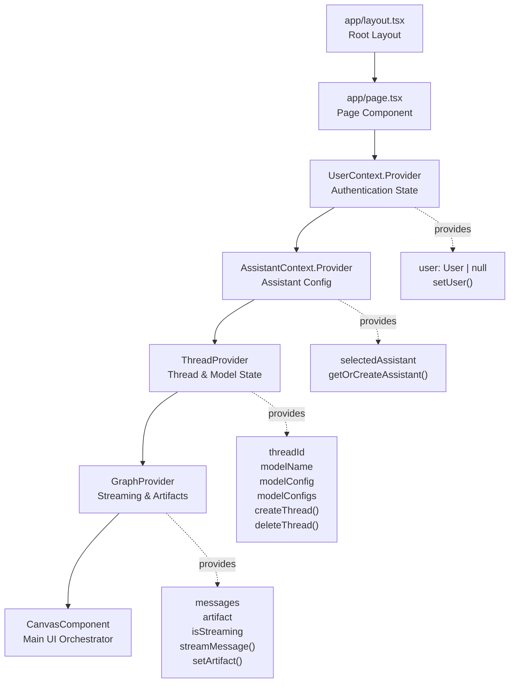
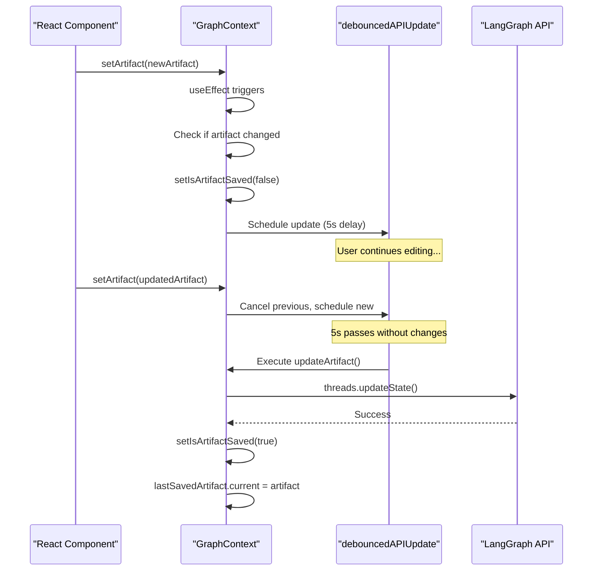
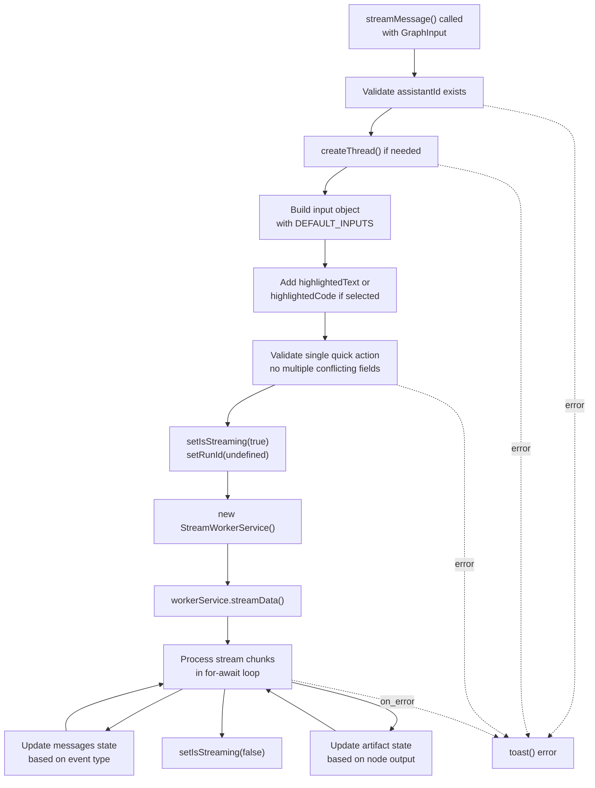
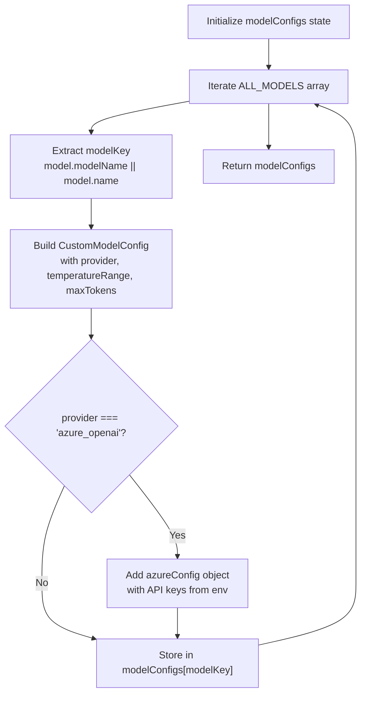
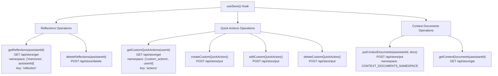
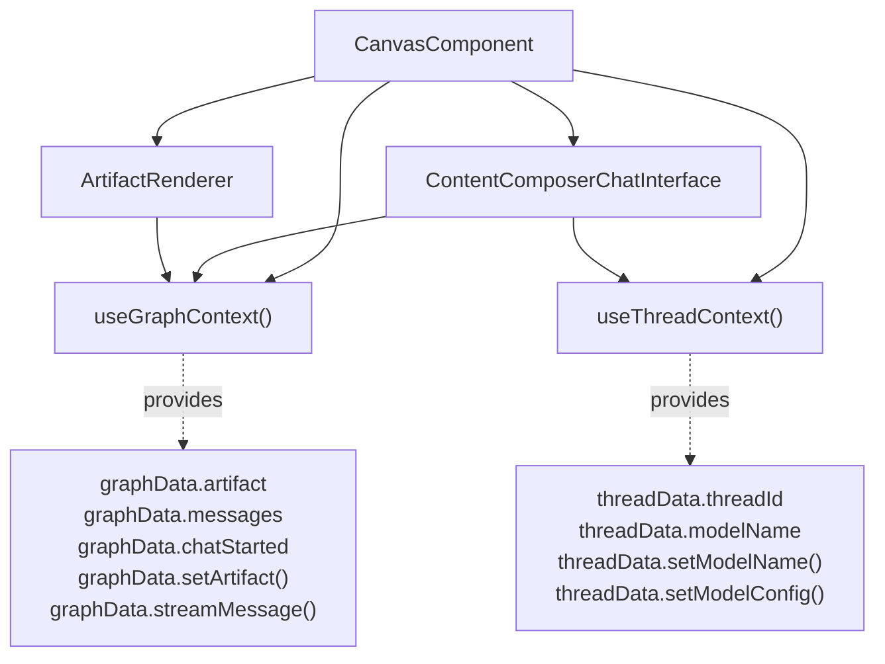

<!-- source: DeepWiki mcp.deepwiki.com · repo langchain-ai/open-canvas · page 3.1 State Management · fetched 2026-10-26 -->

# State Management

<details>
<summary>Relevant source files</summary>

The following files were used as context for generating this wiki page:

- [.codespellignore](.codespellignore)
- [apps/agents/package.json](apps/agents/package.json)
- [apps/web/package.json](apps/web/package.json)
- [apps/web/src/app/layout.tsx](apps/web/src/app/layout.tsx)
- [apps/web/src/components/canvas/canvas.tsx](apps/web/src/components/canvas/canvas.tsx)
- [apps/web/src/components/ui/resizable.tsx](apps/web/src/components/ui/resizable.tsx)
- [apps/web/src/contexts/GraphContext.tsx](apps/web/src/contexts/GraphContext.tsx)
- [apps/web/src/contexts/ThreadProvider.tsx](apps/web/src/contexts/ThreadProvider.tsx)
- [apps/web/src/hooks/useStore.tsx](apps/web/src/hooks/useStore.tsx)
- [packages/evals/package.json](packages/evals/package.json)
- [packages/shared/package.json](packages/shared/package.json)

</details>


## Purpose and Scope

This document describes the React Context-based state management architecture in the Open Canvas frontend application. It covers the hierarchy of context providers, their responsibilities, state types, and how data flows between components. For information about backend agent state management, see [Agent Graph Structure](#4.1). For details on data persistence and storage, see [Authentication and Storage](#2.4).

The state management system uses four primary React Contexts arranged in a hierarchical structure:
- **UserContext**: Manages authentication state
- **AssistantContext**: Manages assistant configuration
- **ThreadProvider**: Manages conversation threads and model configuration
- **GraphContext**: Manages streaming, messages, and artifact state

---

## Context Provider Hierarchy

The application uses a layered context provider architecture where each provider wraps its children and makes state available to downstream components. The hierarchy ensures proper dependency ordering and data flow.



**Sources:** [apps/web/src/contexts/GraphContext.tsx:1-149](), [apps/web/src/contexts/ThreadProvider.tsx:1-40](), [apps/web/src/components/canvas/canvas.tsx:1-50]()

### Provider Nesting Order

The nesting order is critical because child contexts depend on parent context values. Each context accesses parent contexts through their respective hooks:

| Provider | Hook | Dependencies | Purpose |
|----------|------|--------------|---------|
| `UserContext.Provider` | `useUserContext()` | None | Provides authenticated user object |
| `AssistantContext.Provider` | `useAssistantContext()` | `useUserContext` | Manages assistant selection and configuration |
| `ThreadProvider` | `useThreadContext()` | `useUserContext` | Manages conversation threads and model settings |
| `GraphProvider` | `useGraphContext()` | All above | Manages messages, artifacts, and streaming |

**Sources:** [apps/web/src/contexts/GraphContext.tsx:117-119](), [apps/web/src/contexts/ThreadProvider.tsx:38-39]()

---

## GraphContext

`GraphContext` is the most complex state manager, handling real-time message streaming, artifact updates, and coordination with the LangGraph backend. It is defined in [apps/web/src/contexts/GraphContext.tsx]().

### State Interface

The `GraphData` interface defines all state and methods exposed by `GraphContext`:

```typescript
interface GraphData {
  // Streaming state
  runId: string | undefined;
  isStreaming: boolean;
  firstTokenReceived: boolean;
  
  // Error handling
  error: boolean;
  artifactUpdateFailed: boolean;
  
  // Content state
  messages: BaseMessage[];
  artifact: ArtifactV3 | undefined;
  selectedBlocks: TextHighlight | undefined;
  
  // UI state
  updateRenderedArtifactRequired: boolean;
  isArtifactSaved: boolean;
  chatStarted: boolean;
  feedbackSubmitted: boolean;
  searchEnabled: boolean;
  
  // State setters
  setIsStreaming: Dispatch<SetStateAction<boolean>>;
  setFeedbackSubmitted: Dispatch<SetStateAction<boolean>>;
  setArtifact: Dispatch<SetStateAction<ArtifactV3 | undefined>>;
  setSelectedBlocks: Dispatch<SetStateAction<TextHighlight | undefined>>;
  setMessages: Dispatch<SetStateAction<BaseMessage[]>>;
  setUpdateRenderedArtifactRequired: Dispatch<SetStateAction<boolean>>;
  setChatStarted: Dispatch<SetStateAction<boolean>>;
  setSearchEnabled: Dispatch<SetStateAction<boolean>>;
  
  // Methods
  streamMessage: (params: GraphInput) => Promise<void>;
  setArtifactContent: (index: number, content: string) => void;
  setSelectedArtifact: (index: number) => void;
  clearState: () => void;
  switchSelectedThread: (thread: Thread) => void;
}
```

**Sources:** [apps/web/src/contexts/GraphContext.tsx:66-93]()

### Core State Variables

The `GraphProvider` component maintains state using React hooks:

```typescript
const [chatStarted, setChatStarted] = useState(false);
const [messages, setMessages] = useState<BaseMessage[]>([]);
const [artifact, setArtifact] = useState<ArtifactV3>();
const [selectedBlocks, setSelectedBlocks] = useState<TextHighlight>();
const [isStreaming, setIsStreaming] = useState(false);
const [updateRenderedArtifactRequired, setUpdateRenderedArtifactRequired] = useState(false);
const [isArtifactSaved, setIsArtifactSaved] = useState(true);
const [firstTokenReceived, setFirstTokenReceived] = useState(false);
const [runId, setRunId] = useState<string>();
const [feedbackSubmitted, setFeedbackSubmitted] = useState(false);
const [error, setError] = useState(false);
const [artifactUpdateFailed, setArtifactUpdateFailed] = useState(false);
const [searchEnabled, setSearchEnabled] = useState(false);
```

**Sources:** [apps/web/src/contexts/GraphContext.tsx:122-144]()

### Debounced Artifact Persistence

`GraphContext` implements automatic artifact persistence with debouncing to prevent excessive API calls. When an artifact changes, it triggers a debounced update after 5 seconds of inactivity:



The debouncing implementation uses lodash's `debounce` function:

**Sources:** [apps/web/src/contexts/GraphContext.tsx:129-208](), [apps/web/src/contexts/GraphContext.tsx:240-259]()

### Message Streaming Flow

The `streamMessageV2` method (aliased as `streamMessage` in the context value) orchestrates the complete streaming flow from user input to artifact rendering:



**Sources:** [apps/web/src/contexts/GraphContext.tsx:267-359]()

### Event-Driven State Updates

During streaming, `GraphContext` processes different event types and updates state accordingly. The main event handlers are:

| Event Type | LangGraph Nodes | State Updates |
|-----------|-----------------|---------------|
| `on_chain_start` | `updateHighlightedText`, `queryGenerator` | Initialize node-specific state, create web search message |
| `on_chat_model_stream` | `generateFollowup`, `replyToGeneralInput` | Append message chunks via `replaceOrInsertMessageChunk()` |
| `on_chat_model_stream` | `generateArtifact` | Accumulate tool call string, process with `handleGenerateArtifactToolCallChunk()` |
| `on_chat_model_stream` | `updateHighlightedText` | Update markdown artifact with `updateHighlightedMarkdown()` |
| `on_chat_model_stream` | `updateArtifact` | Update code artifact with `updateHighlightedCode()` |
| `on_chat_model_stream` | `rewriteArtifact`, `customAction` | Update artifact with `updateRewrittenArtifact()`, handle thinking tokens |
| `on_chat_model_end` | Various nodes | Handle non-streaming models, finalize artifact updates |
| `on_chain_end` | `generatePath`, `generateArtifact` | Extract tool calls, update shared run URL |

**Sources:** [apps/web/src/contexts/GraphContext.tsx:398-1195]()

### Thread Switching

The `switchSelectedThread` method updates all relevant state when a user switches to a different conversation thread:

**Sources:** [apps/web/src/contexts/GraphContext.tsx:1197-1263]()

---

## ThreadProvider

`ThreadProvider` manages conversation thread persistence, model selection, and model configuration. It is defined in [apps/web/src/contexts/ThreadProvider.tsx]().

### State Interface

```typescript
type ThreadContentType = {
  // Thread state
  threadId: string | null;
  userThreads: Thread[];
  isUserThreadsLoading: boolean;
  createThreadLoading: boolean;
  
  // Model configuration
  modelName: ALL_MODEL_NAMES;
  modelConfig: CustomModelConfig;
  modelConfigs: Record<ALL_MODEL_NAMES, CustomModelConfig>;
  
  // Methods
  getThread: (id: string) => Promise<Thread | undefined>;
  createThread: () => Promise<Thread | undefined>;
  getUserThreads: () => Promise<void>;
  deleteThread: (id: string, clearMessages: () => void) => Promise<void>;
  setThreadId: (id: string | null) => void;
  setModelName: (name: ALL_MODEL_NAMES) => void;
  setModelConfig: (modelName: ALL_MODEL_NAMES, config: CustomModelConfig) => void;
};
```

**Sources:** [apps/web/src/contexts/ThreadProvider.tsx:15-33]()

### Model Configuration Management

`ThreadProvider` initializes and manages model configurations for all available models. On initialization, it creates a `modelConfigs` object with default configurations:



The `modelConfig` computed property provides the active model's configuration, handling name variations like `azure/` prefixes:

**Sources:** [apps/web/src/contexts/ThreadProvider.tsx:47-89]()

### Thread CRUD Operations

`ThreadProvider` exposes methods for thread lifecycle management:

| Method | Purpose | API Call |
|--------|---------|----------|
| `createThread()` | Creates new thread with user metadata and model config | `client.threads.create()` |
| `getUserThreads()` | Fetches all threads for current user | `client.threads.search()` |
| `getThread(id)` | Retrieves specific thread by ID | `client.threads.get(id)` |
| `deleteThread(id)` | Deletes thread and creates new one if active | `client.threads.delete(id)` |

The `createThread` method stores model configuration in thread metadata:

**Sources:** [apps/web/src/contexts/ThreadProvider.tsx:139-184](), [apps/web/src/contexts/ThreadProvider.tsx:186-219](), [apps/web/src/contexts/ThreadProvider.tsx:221-241](), [apps/web/src/contexts/ThreadProvider.tsx:243-258]()

### Query Parameter Synchronization

`ThreadProvider` uses `nuqs` to synchronize `threadId` with URL query parameters, enabling shareable links and browser navigation:

```typescript
const [threadId, setThreadId] = useQueryState("threadId");
```

When `setThreadId` is called, the URL automatically updates to include `?threadId=<value>`, and browser back/forward buttons work correctly.

**Sources:** [apps/web/src/contexts/ThreadProvider.tsx:40]()

---

## UserContext and AssistantContext

While the source files for these contexts are not provided in the input, they are referenced throughout the codebase and follow similar patterns.

### UserContext

Based on usage in `GraphContext` and `ThreadProvider`, `UserContext` provides:

- `user: User | null` - The authenticated user object from Supabase
- `setUser()` - Method to update user state
- Authentication state management

**Sources:** [apps/web/src/contexts/GraphContext.tsx:117](), [apps/web/src/contexts/ThreadProvider.tsx:38]()

### AssistantContext

Based on usage in `GraphContext`, `AssistantContext` provides:

- `selectedAssistant` - The currently selected assistant configuration
- `isLoadingAllAssistants` - Loading state for assistant list
- `getOrCreateAssistant(userId)` - Method to retrieve or create an assistant

The assistant ID is critical for namespace isolation in the store (reflections, context documents).

**Sources:** [apps/web/src/contexts/GraphContext.tsx:118](), [apps/web/src/contexts/GraphContext.tsx:155-160]()

---

## State Persistence Mechanisms

The application uses multiple persistence mechanisms to maintain state across sessions and browser reloads.

### Artifact Persistence via LangGraph State

Artifacts are persisted to the LangGraph backend thread state. The `updateArtifact` method in `GraphContext` saves the current artifact:

```typescript
const updateArtifact = async (
  artifactToUpdate: ArtifactV3,
  threadId: string
) => {
  setArtifactUpdateFailed(false);
  if (isStreaming) return;

  try {
    const client = createClient();
    await client.threads.updateState(threadId, {
      values: {
        artifact: artifactToUpdate,
      },
    });
    setIsArtifactSaved(true);
    lastSavedArtifact.current = artifactToUpdate;
  } catch (_) {
    setArtifactUpdateFailed(true);
  }
};
```

This ensures artifacts are restored when switching threads or reloading the page.

**Sources:** [apps/web/src/contexts/GraphContext.tsx:240-259]()

### Model Configuration Persistence

Model configurations are stored in thread metadata when creating a new thread:

```typescript
const thread = await client.threads.create({
  metadata: {
    supabase_user_id: user.id,
    customModelName: modelName,
    modelConfig: {
      ...modelConfig,
      ...(modelConfig.provider === "azure_openai" && {
        azureConfig: modelConfig.azureConfig,
      }),
    },
  },
});
```

This allows the application to restore the correct model and its configuration when loading a thread.

**Sources:** [apps/web/src/contexts/ThreadProvider.tsx:153-164]()

### URL State Synchronization

Several pieces of state are synchronized with URL query parameters:

| State | Query Parameter | Context/Component |
|-------|----------------|-------------------|
| Thread ID | `threadId` | `ThreadProvider` |
| Chat Collapsed | `chatCollapsed` | `CanvasComponent` |
| Web Search Results | `webSearchResults` | `GraphContext` |

This enables shareable links and proper browser history integration.

**Sources:** [apps/web/src/contexts/ThreadProvider.tsx:40](), [apps/web/src/components/canvas/canvas.tsx:29-55](), [apps/web/src/contexts/GraphContext.tsx:146-148]()

---

## useStore Hook

The `useStore` hook provides access to persistent key-value storage for reflections, custom quick actions, and context documents. It is defined in [apps/web/src/hooks/useStore.tsx]() and uses API routes that interface with LangGraph's store.

### Store Operations



### Store Namespaces

The store uses namespaced keys to isolate data by user and assistant:

| Data Type | Namespace | Key | Scope |
|-----------|-----------|-----|-------|
| Reflections | `["memories", assistantId]` | `"reflection"` | Per-assistant memory |
| Quick Actions | `["custom_actions", userId]` | `"actions"` | Per-user shortcuts |
| Context Documents | `CONTEXT_DOCUMENTS_NAMESPACE` | `assistantId` | Per-assistant documents |

**Sources:** [apps/web/src/hooks/useStore.tsx:1-304]()

### Integration with GraphContext

While `useStore` is not directly used within `GraphContext`, components that consume `GraphContext` also use `useStore` to access persistent data. For example, the reflection system stores AI-extracted user preferences that influence future content generation.

**Sources:** [apps/web/src/hooks/useStore.tsx:19-65](), [apps/web/src/hooks/useStore.tsx:95-123](), [apps/web/src/hooks/useStore.tsx:228-289]()

---

## Component Integration

The context hierarchy integrates with the main application components through hooks. Here's how the `CanvasComponent` uses the contexts:



The `CanvasComponent` demonstrates the typical usage pattern:

1. Import context hooks at the component level
2. Destructure needed values and methods
3. Pass state and callbacks to child components
4. Update state in response to user interactions

**Sources:** [apps/web/src/components/canvas/canvas.tsx:32-35](), [apps/web/src/components/canvas/canvas.tsx:100-236]()

---

