<!-- source: DeepWiki mcp.deepwiki.com · repo langchain-ai/open-canvas · page 3.2 Chat Interface · fetched 2026-10-26 -->

# Chat Interface

Relevant source files

The following files were used as context for generating this wiki page:

- [apps/agents/src/open-canvas/nodes/reflect.ts](apps/agents/src/open-canvas/nodes/reflect.ts)
- [apps/web/src/app/layout.tsx](apps/web/src/app/layout.tsx)
- [apps/web/src/components/assistant-ui/attachment.tsx](apps/web/src/components/assistant-ui/attachment.tsx)
- [apps/web/src/components/canvas/canvas.tsx](apps/web/src/components/canvas/canvas.tsx)
- [apps/web/src/components/canvas/content-composer.tsx](apps/web/src/components/canvas/content-composer.tsx)
- [apps/web/src/components/chat-interface/composer-actions-popout.tsx](apps/web/src/components/chat-interface/composer-actions-popout.tsx)
- [apps/web/src/components/chat-interface/composer.tsx](apps/web/src/components/chat-interface/composer.tsx)
- [apps/web/src/components/chat-interface/thread.tsx](apps/web/src/components/chat-interface/thread.tsx)
- [apps/web/src/components/chat-interface/welcome.tsx](apps/web/src/components/chat-interface/welcome.tsx)
- [apps/web/src/components/ui/programming-lang-dropdown.tsx](apps/web/src/components/ui/programming-lang-dropdown.tsx)
- [apps/web/src/components/ui/resizable.tsx](apps/web/src/components/ui/resizable.tsx)
- [apps/web/src/constants.ts](apps/web/src/constants.ts)
- [apps/web/src/contexts/GraphContext.tsx](apps/web/src/contexts/GraphContext.tsx)
- [apps/web/src/contexts/ThreadProvider.tsx](apps/web/src/contexts/ThreadProvider.tsx)
- [apps/web/src/hooks/useLocalStorage.tsx](apps/web/src/hooks/useLocalStorage.tsx)

The Chat Interface is the primary user interaction layer in the Open Canvas web application, providing the text input, message display, and conversation management UI. It encompasses the message composer with attachment support, the welcome screen with quick-start prompts, the scrollable message thread, and integration with model selection and web search features.

For information about the underlying message streaming and state management, see [State Management](#3.1). For artifact rendering details, see [Artifact System](#3.3). For model configuration UI, see [Model Selection](#3.4).

## Component Architecture

The chat interface is built using `@assistant-ui/react` primitives and consists of several interconnected components that handle the conversation lifecycle.

### Component Hierarchy

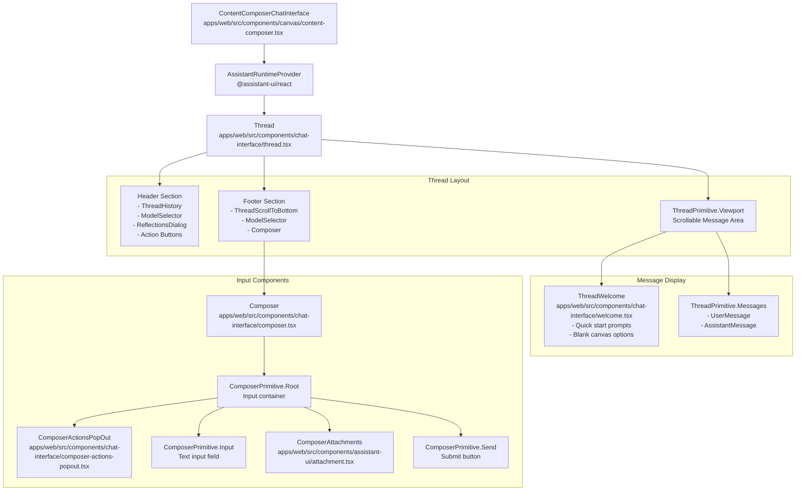

**Sources:** [apps/web/src/components/chat-interface/thread.tsx:1-190](), [apps/web/src/components/chat-interface/composer.tsx:1-120](), [apps/web/src/components/chat-interface/welcome.tsx:1-160](), [apps/web/src/components/canvas/content-composer.tsx:1-173]()

## Thread Component

The `Thread` component is the root container that orchestrates the entire chat interface layout and manages conversation-level actions.

### Thread Structure and Props

| Prop | Type | Purpose |
|------|------|---------|
| `userId` | `string \| undefined` | Current authenticated user ID |
| `hasChatStarted` | `boolean` | Whether conversation has any messages |
| `handleQuickStart` | `Function` | Callback for blank canvas quick starts |
| `setChatStarted` | `Function` | Updates conversation started state |
| `switchSelectedThreadCallback` | `Function` | Handles thread switching from history |
| `searchEnabled` | `boolean` | Web search feature flag |
| `setChatCollapsed` | `Function` | Collapses/expands chat panel |

**Sources:** [apps/web/src/components/chat-interface/thread.tsx:35-46]()

### Thread Layout Sections

The thread is divided into three main sections:

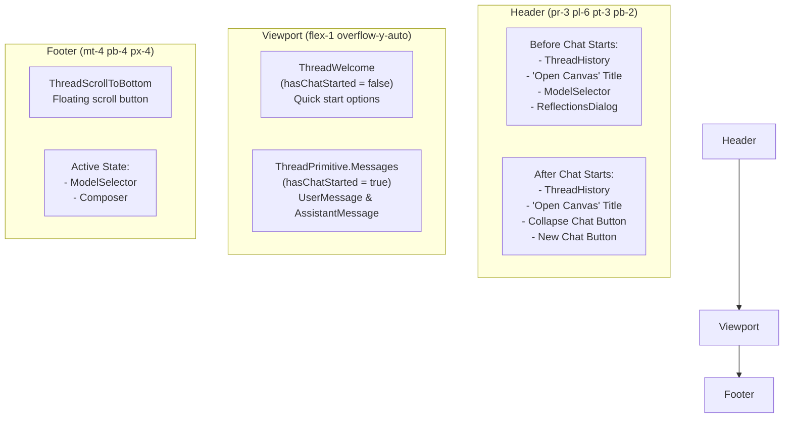

**Sources:** [apps/web/src/components/chat-interface/thread.tsx:93-189]()

### New Session Handling

The `handleNewSession` function resets the conversation state:

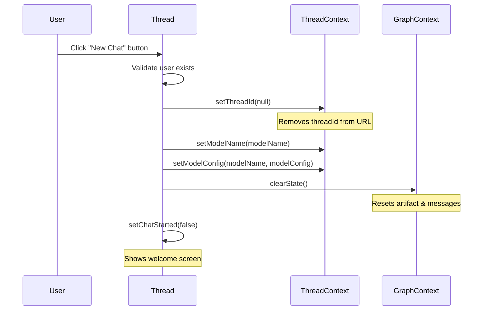

**Sources:** [apps/web/src/components/chat-interface/thread.tsx:73-91]()

## Composer Component

The `Composer` is the text input component that handles user message composition, attachments, and submission.

### Composer Features

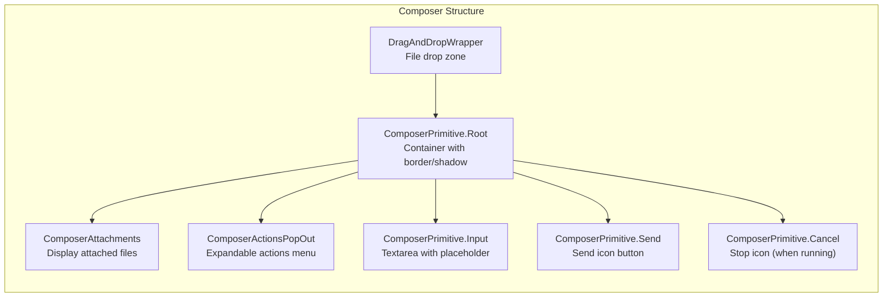

**Sources:** [apps/web/src/components/chat-interface/composer.tsx:68-119]()

### Dynamic Placeholders

The composer displays context-aware placeholders based on whether web search is enabled:

| Search Enabled | Example Placeholders |
|----------------|----------------------|
| `false` | "Share your big idea and let's write something amazing" "Your masterpiece begins with this prompt" "Turn your idea into content magic - start here" |
| `true` | "Share your topic - I'll add live data" "Write about anything - I'll find sources" "Your idea + fresh research = great content" |

Placeholders are randomly selected on component mount using `getRandomPlaceholder(searchEnabled)`.

**Sources:** [apps/web/src/components/chat-interface/composer.tsx:12-46, 69-73]()

### Send/Cancel State

The composer conditionally renders send or cancel buttons based on the thread's running state:

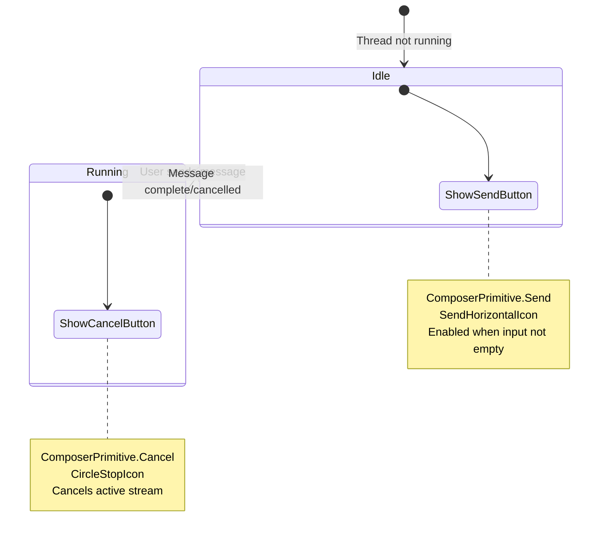

**Sources:** [apps/web/src/components/chat-interface/composer.tsx:93-114]()

## Composer Actions Pop-Out

The `ComposerActionsPopOut` provides an animated expandable menu for additional actions.

### Actions Menu Structure

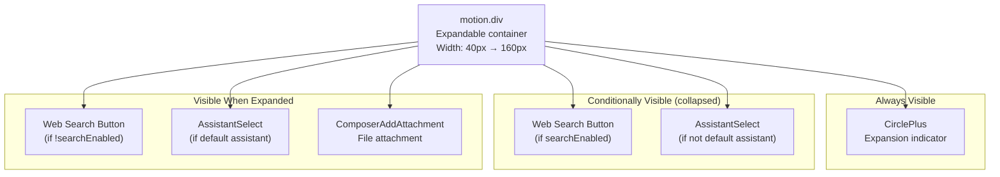

The component uses Framer Motion for smooth width transitions with spring physics:

| State | Width | Visible Actions |
|-------|-------|-----------------|
| Collapsed (default) | 40px, 80px, or 120px | Plus icon + conditionally search/assistant |
| Expanded (hover) | 160px | All actions available |

**Sources:** [apps/web/src/components/chat-interface/composer-actions-popout.tsx:1-162]()

### Expansion Logic

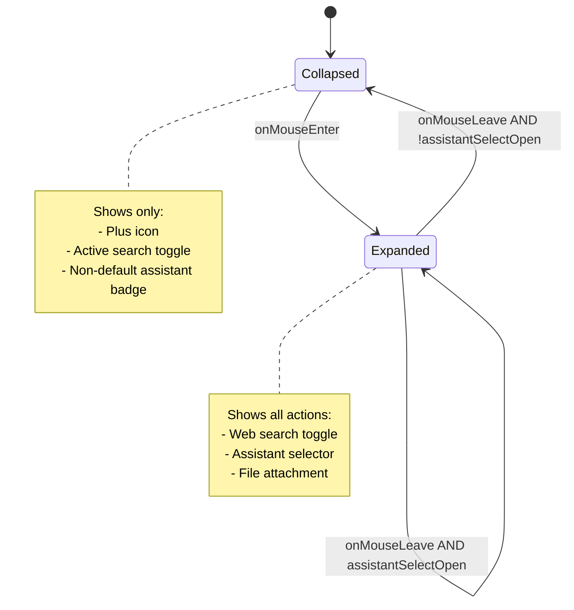

**Sources:** [apps/web/src/components/chat-interface/composer-actions-popout.tsx:73-119]()

## Thread Welcome Screen

The `ThreadWelcome` component displays when a conversation has not started, offering quick-start options.

### Welcome Screen Layout

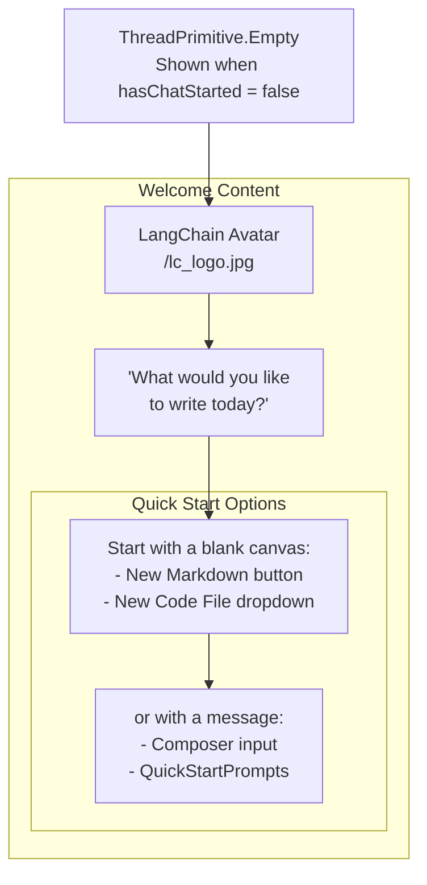

**Sources:** [apps/web/src/components/chat-interface/welcome.tsx:134-159]()

### Quick Start Prompts

The welcome screen displays 4 randomly selected prompts from different sets based on search enablement:

**Search Disabled Prompts** (18 options):
- Creative: "Write a bedtime story about a brave little robot"
- Code: "Create a function to calculate Fibonacci numbers in TypeScript"
- Writing: "Draft a resignation letter for a position I've had for 2 years"
- Projects: "Build a simple weather dashboard using React and Tailwind"

**Search Enabled Prompts** (10 options):
- Research-focused: "Write a market analysis of AI chip manufacturers in 2025"
- Current events: "Create a blog post about the latest climate change policies"
- Analysis: "Write a report on current cybersecurity threats in cloud computing"

**Sources:** [apps/web/src/components/chat-interface/welcome.tsx:10-41, 57-93]()

### Quick Start Flow

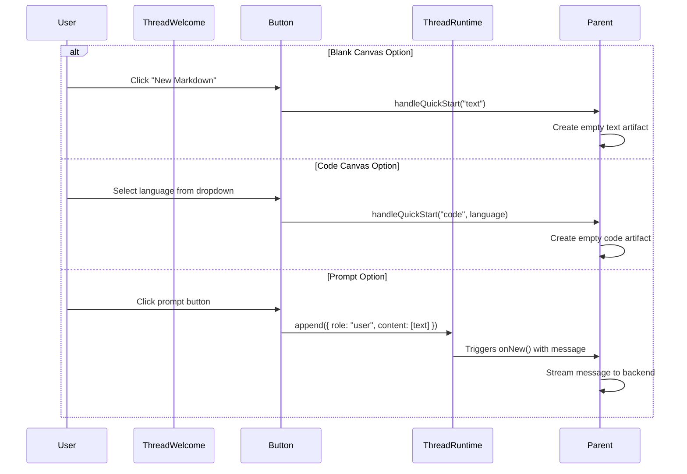

**Sources:** [apps/web/src/components/chat-interface/welcome.tsx:95-123](), [apps/web/src/components/canvas/content-composer.tsx:67-129]()

## Attachment System

The chat interface supports multiple attachment types through a composite adapter pattern.

### Attachment Adapters

The system uses `CompositeAttachmentAdapter` with specialized adapters:

| Adapter | Supported Types | Processing |
|---------|----------------|------------|
| `SimpleTextAttachmentAdapter` | `.txt` files | Direct text extraction |
| `AudioAttachmentAdapter` | `.mp3`, `.m4a`, `.wav`, `.webm` | FFmpeg transcoding + Whisper transcription |
| `VideoAttachmentAdapter` | `.mp4`, `.mpeg`, `.webm` | FFmpeg audio extraction + transcription |
| `PDFAttachmentAdapter` | `.pdf` files | Text extraction |

**Sources:** [apps/web/src/components/canvas/content-composer.tsx:142-149](), [apps/web/src/constants.ts:12-33]()

### Attachment Processing Flow

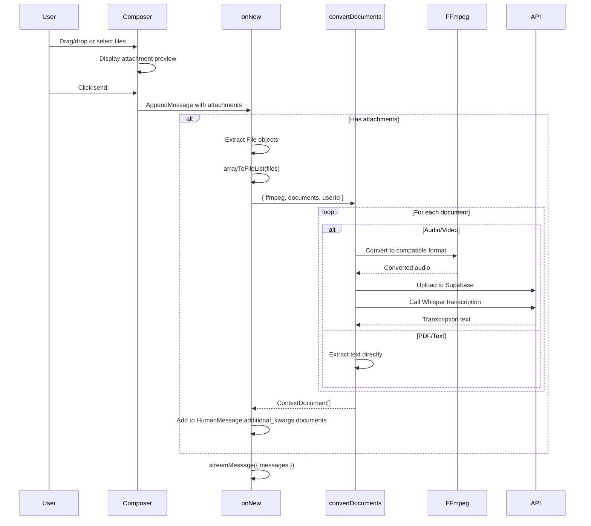

**Sources:** [apps/web/src/components/canvas/content-composer.tsx:92-123]()

### Attachment UI Components

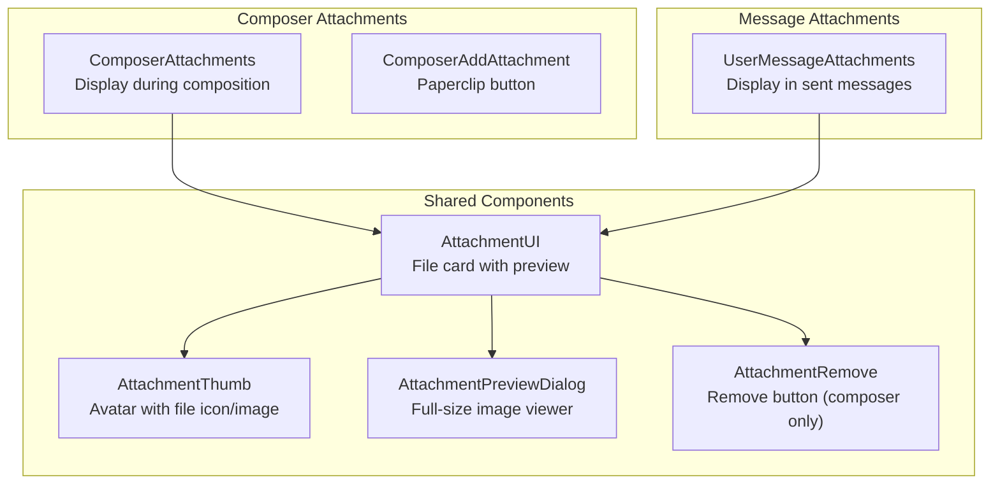

**Sources:** [apps/web/src/components/assistant-ui/attachment.tsx:1-213]()

#### Attachment Display

Each attachment is rendered as a card showing:

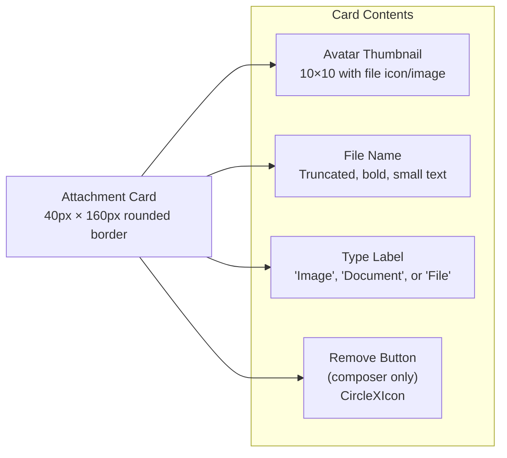

**Sources:** [apps/web/src/components/assistant-ui/attachment.tsx:110-178]()

## Message Display

Messages are rendered using custom `UserMessage` and `AssistantMessage` components provided to `ThreadPrimitive.Messages`.

### Message Component Mapping

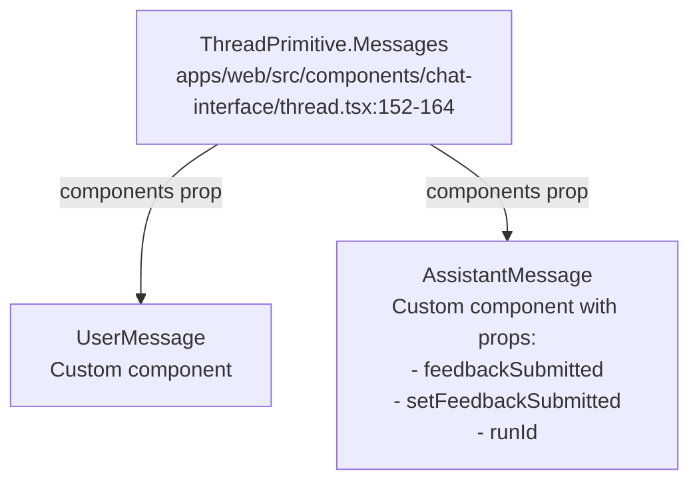

These components are imported from the messages module and integrate with feedback submission and LangSmith tracing.

**Sources:** [apps/web/src/components/chat-interface/thread.tsx:13, 152-164]()

## Integration Points

The chat interface integrates with multiple context providers and external systems.

### Context Dependencies

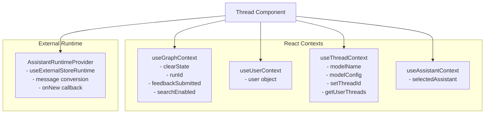

**Sources:** [apps/web/src/components/chat-interface/thread.tsx:48-68](), [apps/web/src/components/canvas/content-composer.tsx:52-68, 131-150]()

### Message Submission Flow

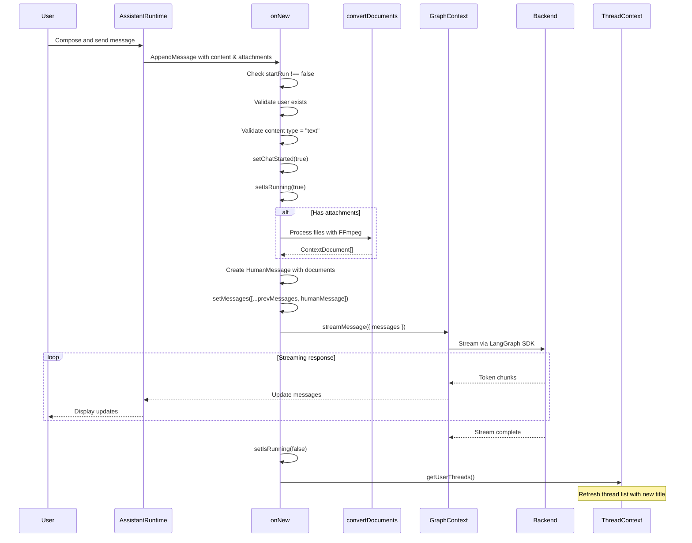

**Sources:** [apps/web/src/components/canvas/content-composer.tsx:67-129]()

### Storage and Persistence

The chat interface relies on multiple storage mechanisms:

| Storage Type | Location | Purpose | Example Keys |
|--------------|----------|---------|--------------|
| URL Parameters | Browser URL | Shareable state | `threadId`, `chatCollapsed` |
| Cookies | Browser | Session tracking | `oc_assistant_id_v2`, `oc_thread_id_v2` |
| Local Storage | Browser | User preferences | Model selection, UI state |
| Context State | React | Runtime state | Messages, artifacts, streaming status |

**Sources:** [apps/web/src/constants.ts:1-36](), [apps/web/src/hooks/useLocalStorage.tsx:1-58]()

## Advanced Features

### Thread History Integration

The `ThreadHistory` component (referenced in the thread header) allows users to switch between previous conversations:

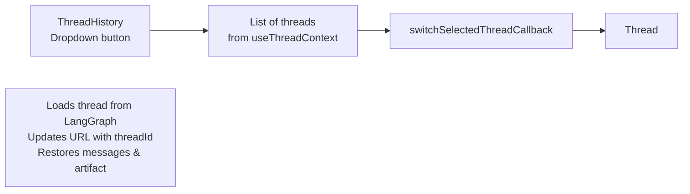

**Sources:** [apps/web/src/components/chat-interface/thread.tsx:97-99]()

### Reflections Dialog

When the chat has not started, users can access the `ReflectionsDialog` to view stored memories:

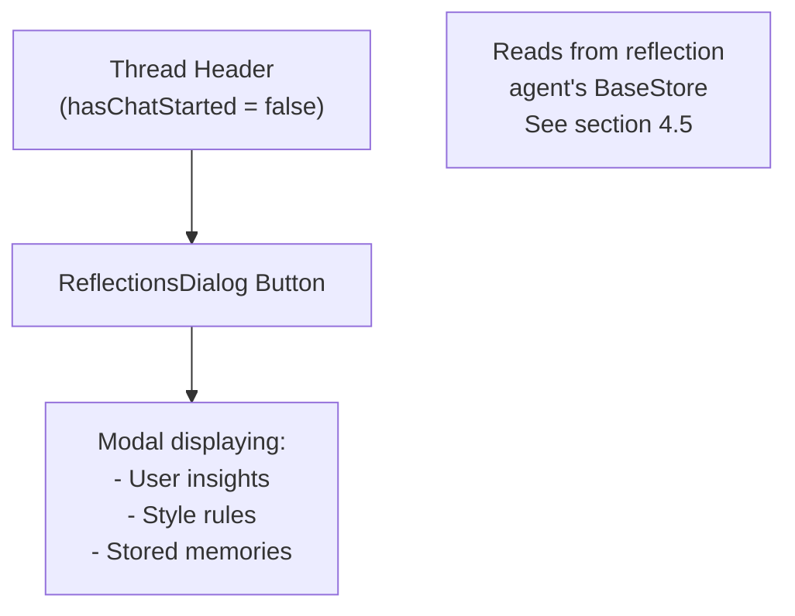

**Sources:** [apps/web/src/components/chat-interface/thread.tsx:8, 134]()

### Debounced Reflection

The reflection system (covered in detail in [Reflection and Memory System](#4.5)) runs in the background after conversations:

```mermaid
sequenceDiagram
    participant User
    participant Thread
    participant Backend
    participant ReflectNode
    participant ReflectionGraph
    
    User->>Thread: Send message
    Thread->>Backend: streamMessage()
    Backend->>Backend: Process with open-canvas graph
    Backend->>ReflectNode: Execute reflect node
    
    ReflectNode->>ReflectionGraph: Create background run
    Note over ReflectionGraph: multitaskStrategy: "enqueue"<br/>afterSeconds: 300 (5 minutes)
    
    alt User continues chatting
        User->>Thread: Send another message
        Note over ReflectionGraph: Previous run cancelled<br/>New run scheduled
    else User stops chatting
        Note over ReflectionGraph: Wait 5 minutes
        ReflectionGraph->>ReflectionGraph: Analyze conversation
        ReflectionGraph->>ReflectionGraph: Extract style rules
        ReflectionGraph->>ReflectionGraph: Store in BaseStore
    end
```

This prevents memory formation during active conversations, saving costs and reducing duplicate insights.

**Sources:** [apps/agents/src/open-canvas/nodes/reflect.ts:1-58]()

### Programming Language Selection

The welcome screen's code canvas option provides a dropdown for language selection:

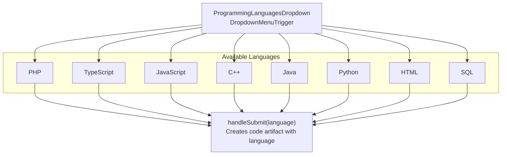

Each language selection triggers `handleQuickStart("code", language)` which creates a blank code artifact with the appropriate language setting.

**Sources:** [apps/web/src/components/ui/programming-lang-dropdown.tsx:1-140](), [apps/web/src/components/chat-interface/welcome.tsx:95-114]()

---

