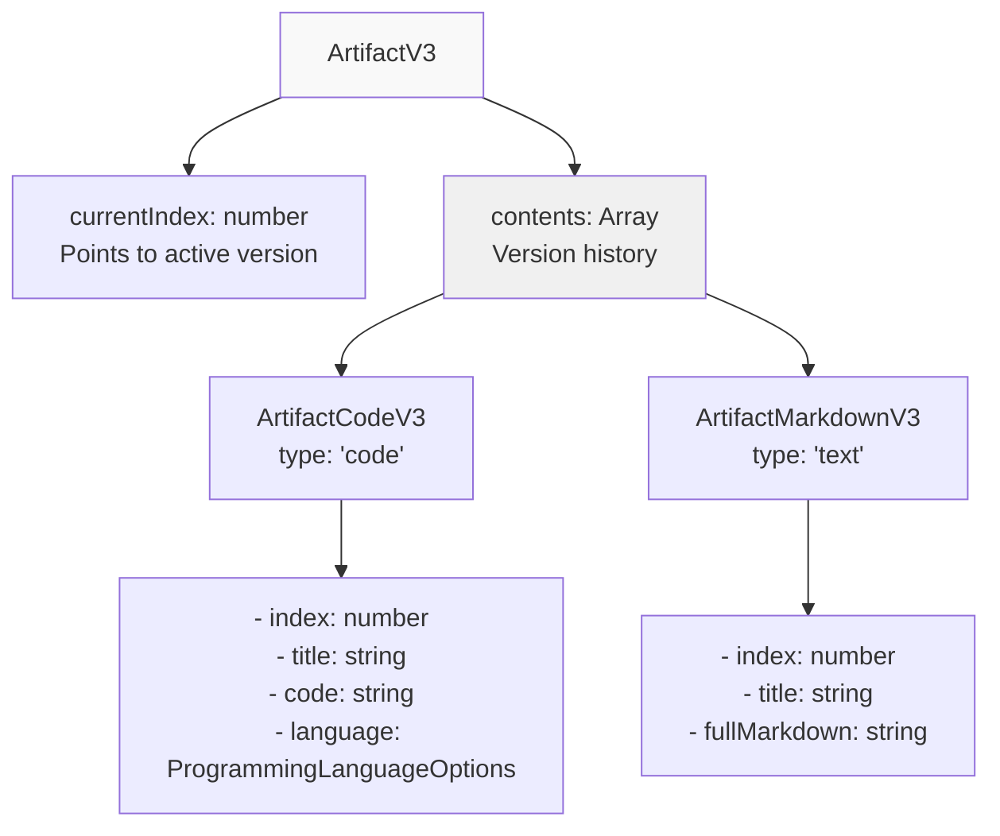
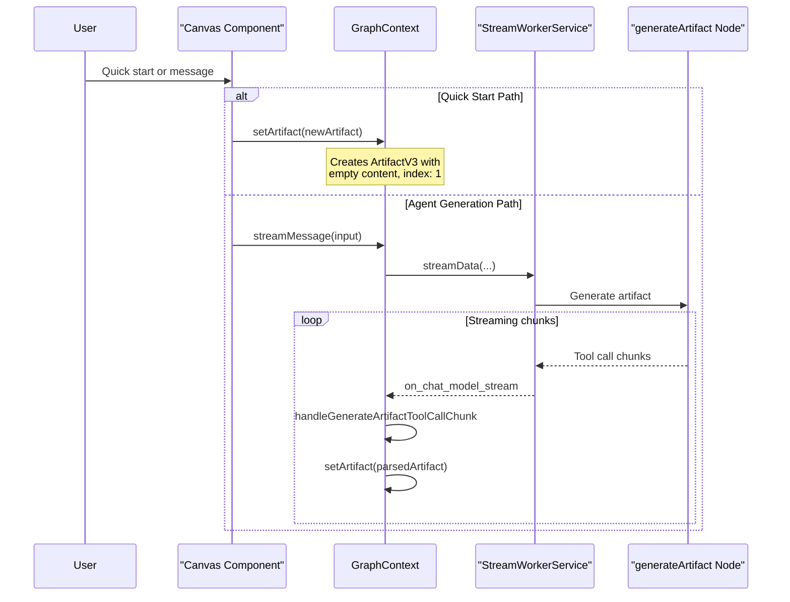
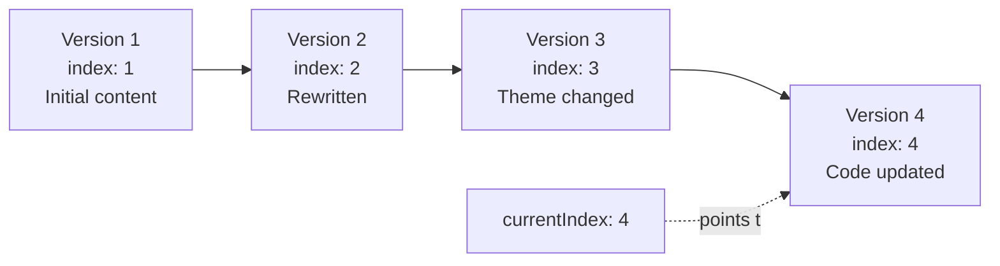
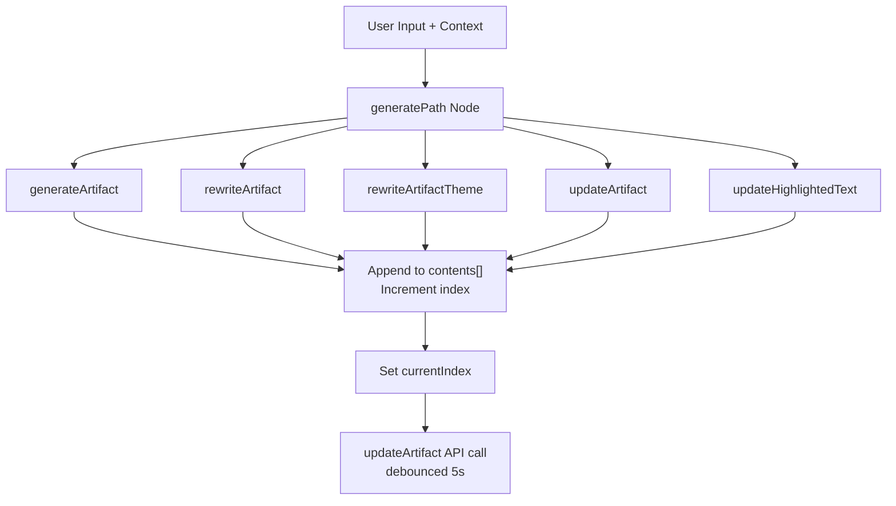
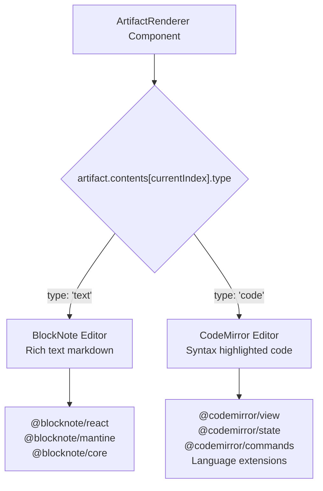
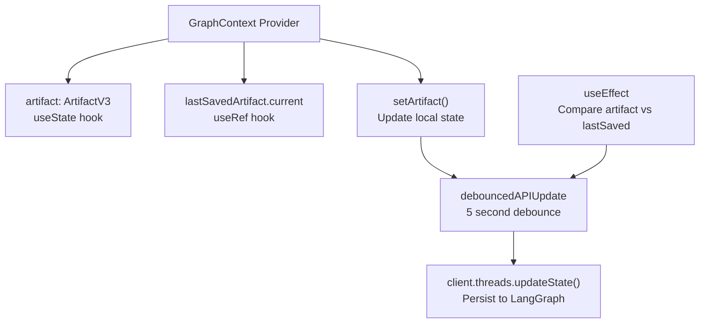
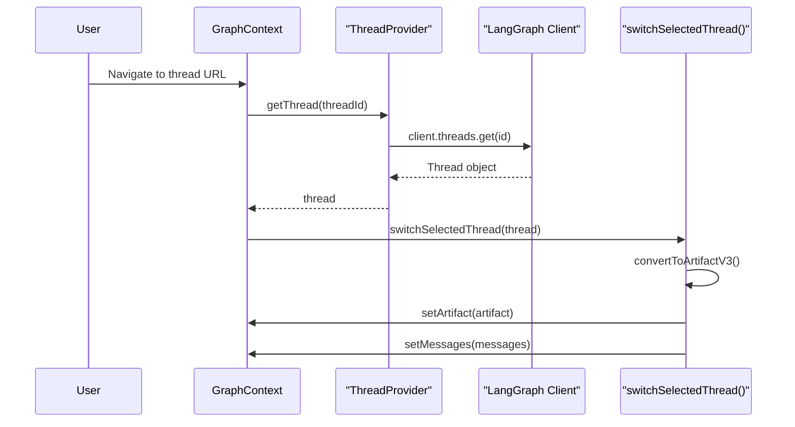

<!-- source: DeepWiki mcp.deepwiki.com · repo langchain-ai/open-canvas · page 3.3 Artifact System · fetched 2026-10-26 -->

# Artifact System

<details>
<summary>Relevant source files</summary>

The following files were used as context for generating this wiki page:

- [.codespellignore](.codespellignore)
- [apps/agents/package.json](apps/agents/package.json)
- [apps/web/package.json](apps/web/package.json)
- [apps/web/src/app/layout.tsx](apps/web/src/app/layout.tsx)
- [apps/web/src/components/canvas/canvas.tsx](apps/web/src/components/canvas/canvas.tsx)
- [apps/web/src/components/ui/resizable.tsx](apps/web/src/components/ui/resizable.tsx)
- [apps/web/src/contexts/GraphContext.tsx](apps/web/src/contexts/GraphContext.tsx)
- [apps/web/src/contexts/ThreadProvider.tsx](apps/web/src/contexts/ThreadProvider.tsx)
- [apps/web/src/hooks/useStore.tsx](apps/web/src/hooks/useStore.tsx)
- [package.json](package.json)
- [packages/evals/package.json](packages/evals/package.json)
- [packages/shared/package.json](packages/shared/package.json)
- [yarn.lock](yarn.lock)

</details>


The artifact system manages the lifecycle of documents created and edited within Open Canvas. An artifact represents a versioned piece of content—either rich text (markdown) or code—that users can collaboratively edit with AI assistance. This page covers the `ArtifactV3` data structure, artifact creation and versioning, real-time streaming updates, and rendering components.

For information about the LLM agents that generate and modify artifacts, see [Artifact Operations](#4.3). For state management patterns, see [State Management](#3.1).

---

## ArtifactV3 Data Structure

The `ArtifactV3` type represents the current artifact state with full version history. It consists of a collection of content versions and a pointer to the currently displayed version.



**Sources:** [apps/web/src/contexts/GraphContext.tsx:11-17](), [apps/web/src/components/canvas/canvas.tsx:14-19]()

### Content Type Structure

| Type | Fields | Description |
|------|--------|-------------|
| `ArtifactCodeV3` | `index`, `type: "code"`, `title`, `code`, `language` | Represents a code artifact with syntax highlighting support |
| `ArtifactMarkdownV3` | `index`, `type: "text"`, `title`, `fullMarkdown` | Represents rich text content rendered as markdown |

The `index` field uniquely identifies each version within an artifact's history. The `currentIndex` property on `ArtifactV3` determines which version is actively displayed in the UI.

**Sources:** [apps/web/src/components/canvas/canvas.tsx:71-87]()

---

## Artifact Lifecycle

### Creation

Artifacts are created through two primary pathways:

1. **Quick Start**: User initiates a blank artifact through the UI
2. **Agent Generation**: The `generateArtifact` agent node creates an artifact from user input



**Sources:** [apps/web/src/components/canvas/canvas.tsx:57-98](), [apps/web/src/contexts/GraphContext.tsx:472-504]()

#### Quick Start Creation

When a user clicks "Quick Start", the frontend creates an artifact shell:

```typescript
// From canvas.tsx:71-92
const newArtifact: ArtifactV3 = {
  currentIndex: 1,
  contents: [artifactContent], // Single initial version
};
```

**Sources:** [apps/web/src/components/canvas/canvas.tsx:89-92]()

#### Agent-Generated Creation

The `generateArtifact` node streams artifact content via tool calls. The `handleGenerateArtifactToolCallChunk` function accumulates JSON chunks and parses them incrementally:

**Sources:** [apps/web/src/contexts/GraphContext.tsx:472-504](), [apps/web/src/contexts/utils.tsx:49-137]()

---

## Versioning System

Each artifact maintains a complete version history in its `contents` array. When an artifact is modified, a new version is appended with an incremented index.



**Sources:** [apps/web/src/contexts/GraphContext.tsx:366-369]()

### Version Index Calculation

```typescript
// From GraphContext.tsx:366-369
let newArtifactIndex = 1;
if (artifact) {
  newArtifactIndex = artifact.contents.length + 1;
}
```

This ensures each new version has a unique, sequential index. Users can navigate between versions using the UI controls, which update the `currentIndex` property.

**Sources:** [apps/web/src/contexts/GraphContext.tsx:366-369]()

---

## Artifact Update Operations

The system supports six distinct update operations, each handled by a dedicated agent node:

| Operation | Node | Purpose | Creates New Version |
|-----------|------|---------|---------------------|
| Generate | `generateArtifact` | Create new artifact from scratch | Yes (index 1) |
| Full Rewrite | `rewriteArtifact` | Complete content replacement | Yes |
| Theme Change | `rewriteArtifactTheme` | Modify writing style/tone | Yes |
| Code Theme | `rewriteCodeArtifactTheme` | Change code style/structure | Yes |
| Update Selection | `updateArtifact` | Modify highlighted code | Yes |
| Update Text | `updateHighlightedText` | Modify highlighted markdown | Yes |

**Sources:** [apps/web/src/contexts/GraphContext.tsx:456-755]()

### Update Flow Diagram



**Sources:** [apps/web/src/contexts/GraphContext.tsx:267-359](), [apps/web/src/contexts/GraphContext.tsx:240-259]()

---

## Real-time Streaming Updates

The artifact system displays incremental updates as content streams from the LLM. Different operations use different streaming strategies:

### Streaming Strategies by Operation

```mermaid
graph TB
    subgraph "generateArtifact Streaming"
        GenStart["Accumulate tool_call_chunks"]
        GenParse["Parse partial JSON"]
        GenUpdate["Update artifact state"]
        GenStart --> GenParse --> GenUpdate
    end
    
    subgraph "updateArtifact Streaming"
        UpdateStart["Split original at indices"]
        UpdateAccum["Accumulate new content"]
        UpdateMerge["Merge: start + new + rest"]
        UpdateStart --> UpdateAccum --> UpdateMerge
    end
    
    subgraph "rewriteArtifact Streaming"
        RewriteStream["Stream full content"]
        RewriteThinking["Extract thinking tokens"]
        RewriteClean["Apply to artifact"]
        RewriteStream --> RewriteThinking --> RewriteClean
    end
```



**Sources:** [apps/web/src/contexts/GraphContext.tsx:472-754]()

### Generate Artifact Streaming

For `generateArtifact`, the system accumulates JSON chunks and attempts to parse them:

```typescript
// From GraphContext.tsx:475-486
if (message?.tool_call_chunks?.length > 0 
    && typeof message?.tool_call_chunks?.[0]?.args === "string") {
  generateArtifactToolCallStr += message.tool_call_chunks[0].args;
}

const result = handleGenerateArtifactToolCallChunk(
  generateArtifactToolCallStr
);
```

The `handleGenerateArtifactToolCallChunk` function in `utils.tsx` uses a rate-limited approach to prevent excessive re-renders during streaming.

**Sources:** [apps/web/src/contexts/GraphContext.tsx:475-504](), [apps/web/src/contexts/utils.tsx:49-137]()

### Update Selection Streaming (Code)

When updating highlighted code via `updateArtifact`, the system:

1. Splits the original code at `startCharIndex` and `endCharIndex`
2. Accumulates streaming chunks
3. Merges: `start + streamed_content + rest`

```typescript
// From GraphContext.tsx:637-650
if (updatedArtifactStartContent === undefined 
    && updatedArtifactRestContent === undefined) {
  updatedArtifactStartContent = prevCurrentContent.code.slice(0, startCharIndex);
  updatedArtifactRestContent = prevCurrentContent.code.slice(endCharIndex);
} else {
  updatedArtifactStartContent += partialUpdatedContent;
}
```

The `updateHighlightedCode` function then creates a new version with the merged content.

**Sources:** [apps/web/src/contexts/GraphContext.tsx:594-672]()

### Update Selection Streaming (Text)

The `updateHighlightedText` node follows a similar pattern for markdown:

```typescript
// From GraphContext.tsx:546-572
const startIndexOfHighlightedText = highlightedText.fullMarkdown.indexOf(
  highlightedText.markdownBlock
);

updatedArtifactStartContent = highlightedText.fullMarkdown.slice(
  0,
  startIndexOfHighlightedText
);
updatedArtifactRestContent = highlightedText.fullMarkdown.slice(
  startIndexOfHighlightedText + highlightedText.markdownBlock.length
);
```

**Sources:** [apps/web/src/contexts/GraphContext.tsx:506-592]()

### Rewrite Artifact Streaming

Full rewrites accumulate content and handle thinking models specially:

```typescript
// From GraphContext.tsx:689-703
fullNewArtifactContent += extractStreamDataChunk(nodeChunk)?.content || "";

if (isThinkingModel(threadData.modelName)) {
  if (!thinkingMessageId) {
    thinkingMessageId = `thinking-${uuidv4()}`;
  }
  newArtifactContent = handleRewriteArtifactThinkingModel({
    newArtifactContent: fullNewArtifactContent,
    setMessages,
    thinkingMessageId,
  });
} else {
  newArtifactContent = fullNewArtifactContent;
}
```

Thinking models (like o1) output reasoning tokens wrapped in `<think>` tags, which are extracted and displayed separately.

**Sources:** [apps/web/src/contexts/GraphContext.tsx:674-754]()

---

## Artifact Rendering

Artifacts are rendered by the `ArtifactRenderer` component, which delegates to specialized editors based on content type:



**Sources:** [apps/web/src/components/canvas/canvas.tsx:210-227](), [apps/web/src/components/artifacts/ArtifactRenderer.tsx:1-50]()

### BlockNote for Markdown

BlockNote provides a rich text editing experience with:
- Block-based editing (paragraphs, headings, lists, etc.)
- Real-time collaboration support via Yjs
- Extensible block types
- Markdown import/export

The editor is configured in the `@opencanvas/web` package with Mantine UI components for styling.

**Sources:** [yarn.lock:97-200]()

### CodeMirror for Code

CodeMirror v6 provides code editing with:
- Syntax highlighting for multiple languages (JavaScript, Python, Java, C++, PHP, SQL, etc.)
- Autocomplete
- Linting
- Search/replace
- Custom themes (One Dark theme)

Language support is loaded dynamically based on the artifact's `language` field.

**Sources:** [yarn.lock:206-398]()

---

## State Management

Artifact state is managed in `GraphContext` with React hooks and debounced persistence:



**Sources:** [apps/web/src/contexts/GraphContext.tsx:124-137](), [apps/web/src/contexts/GraphContext.tsx:180-208]()

### Debounced Persistence

To avoid excessive API calls during rapid updates, artifact persistence is debounced:

```typescript
// From GraphContext.tsx:130-136
const debouncedAPIUpdate = useRef(
  debounce(
    (artifact: ArtifactV3, threadId: string) =>
      updateArtifact(artifact, threadId),
    5000
  )
).current;
```

The `useEffect` hook at [apps/web/src/contexts/GraphContext.tsx:180-208]() monitors artifact changes and triggers the debounced update when:
- The artifact content has changed
- Not currently streaming
- Not switching threads
- Artifact is not empty

**Sources:** [apps/web/src/contexts/GraphContext.tsx:130-136](), [apps/web/src/contexts/GraphContext.tsx:180-208]()

### Persistence API

The `updateArtifact` function saves artifact state to the LangGraph thread:

```typescript
// From GraphContext.tsx:240-259
const updateArtifact = async (
  artifactToUpdate: ArtifactV3,
  threadId: string
) => {
  const client = createClient();
  await client.threads.updateState(threadId, {
    values: {
      artifact: artifactToUpdate,
    },
  });
  setIsArtifactSaved(true);
  lastSavedArtifact.current = artifactToUpdate;
};
```

This persists the entire artifact structure, including all versions, to the thread's state store.

**Sources:** [apps/web/src/contexts/GraphContext.tsx:240-259]()

---

## Thread Loading and Restoration

When users navigate to a thread, the artifact is restored from thread state:



**Sources:** [apps/web/src/contexts/GraphContext.tsx:213-238](), [apps/web/src/contexts/ThreadProvider.tsx:243-258]()

The `switchSelectedThread` function extracts the artifact from thread values and converts deprecated artifact formats to `ArtifactV3` if necessary:

**Sources:** [apps/web/src/contexts/utils.tsx:139-198]()

---

## Artifact Update State Flags

Several boolean flags track artifact update status in `GraphContext`:

| Flag | Purpose |
|------|---------|
| `isStreaming` | True while receiving streamed updates from LLM |
| `updateRenderedArtifactRequired` | True when UI needs to re-render artifact |
| `isArtifactSaved` | False when local artifact differs from persisted version |
| `firstTokenReceived` | True once first token arrives (for loading states) |
| `artifactUpdateFailed` | True if persistence API call failed |

These flags coordinate UI updates, loading states, and error handling.

**Sources:** [apps/web/src/contexts/GraphContext.tsx:66-93]()

---

## Error Handling

The artifact system includes error handling for common failure scenarios:

1. **Missing Artifact**: Toasts shown when artifact is undefined during updates
2. **Type Mismatches**: Errors if code operations receive markdown artifacts or vice versa
3. **Persistence Failures**: `artifactUpdateFailed` flag set, allowing retry logic
4. **Streaming Errors**: Caught in the main streaming loop and displayed to user

**Sources:** [apps/web/src/contexts/GraphContext.tsx:595-635](), [apps/web/src/contexts/GraphContext.tsx:244-258]()

---

