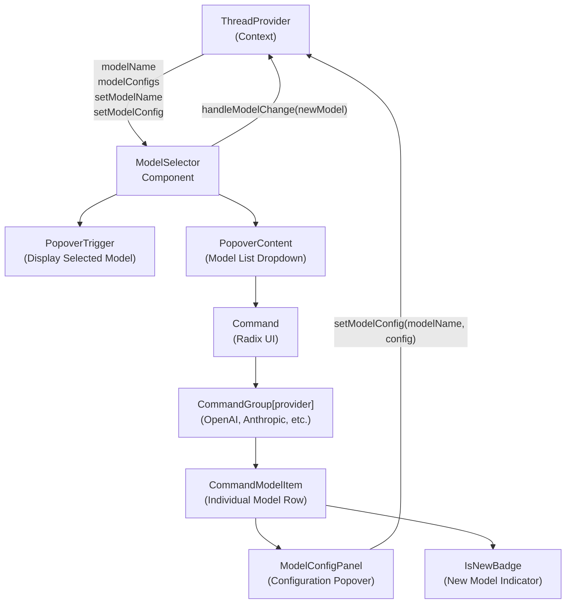
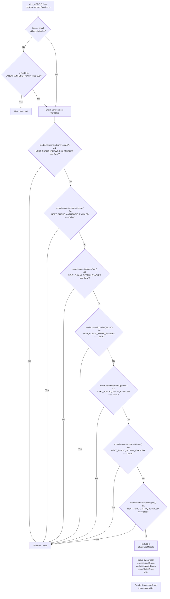
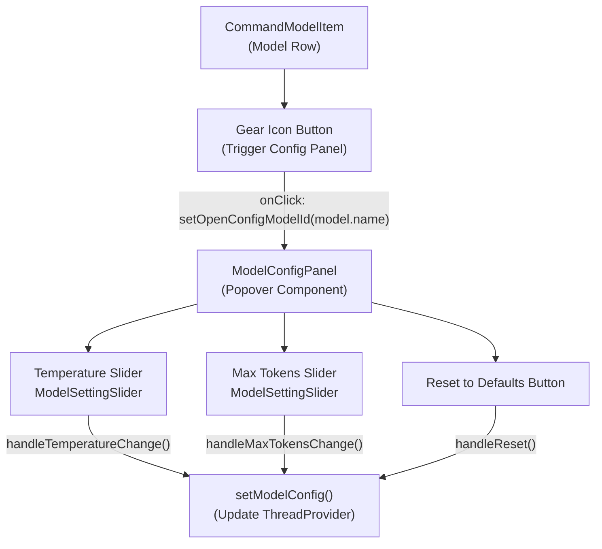
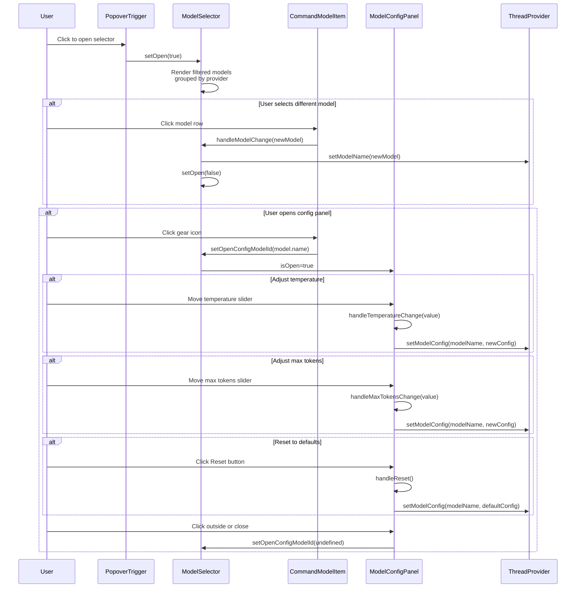
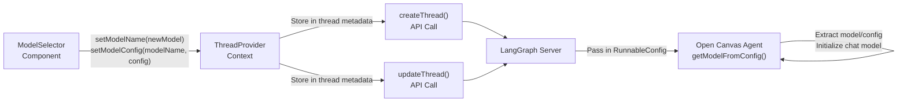

<!-- source: DeepWiki mcp.deepwiki.com · repo langchain-ai/open-canvas · page 3.4 Model Selection · fetched 2026-10-26 -->

# Model Selection

<details>
<summary>Relevant source files</summary>

The following files were used as context for generating this wiki page:

- [apps/web/src/app/layout.tsx](apps/web/src/app/layout.tsx)
- [apps/web/src/components/assistant-select/index.tsx](apps/web/src/components/assistant-select/index.tsx)
- [apps/web/src/components/canvas/canvas.tsx](apps/web/src/components/canvas/canvas.tsx)
- [apps/web/src/components/chat-interface/model-selector/index.tsx](apps/web/src/components/chat-interface/model-selector/index.tsx)
- [apps/web/src/components/chat-interface/model-selector/model-config-pannel.tsx](apps/web/src/components/chat-interface/model-selector/model-config-pannel.tsx)
- [apps/web/src/components/ui/resizable.tsx](apps/web/src/components/ui/resizable.tsx)
- [apps/web/src/contexts/GraphContext.tsx](apps/web/src/contexts/GraphContext.tsx)
- [apps/web/src/contexts/ThreadProvider.tsx](apps/web/src/contexts/ThreadProvider.tsx)
- [packages/shared/src/models.ts](packages/shared/src/models.ts)
- [packages/shared/src/utils/thinking.ts](packages/shared/src/utils/thinking.ts)

</details>


## Purpose and Scope

This document covers the frontend UI components that enable users to select and configure LLM models. The Model Selection system provides a dropdown selector for choosing from available models across multiple providers (OpenAI, Anthropic, Google, Groq, Fireworks, Ollama, Azure), along with a configuration panel for adjusting model parameters such as temperature and max tokens.

For information about the underlying model catalog and definitions, see [Model Configuration](#5.1). For details on how models are initialized and used in the backend agents, see [Provider Integration](#5.2).

---

## Component Architecture

The Model Selection system consists of two primary UI components located in [apps/web/src/components/chat-interface/model-selector/]():

### ModelSelector Component

The `ModelSelector` component serves as the main dropdown interface for model selection. It displays the currently selected model with its label and opens a popover containing all available models grouped by provider.

**Component Structure: ModelSelector and Related Components**



**Sources:** [apps/web/src/components/chat-interface/model-selector/index.tsx:1-391]()

The `ModelSelector` receives the following props from `ThreadProvider`:

| Prop | Type | Purpose |
|------|------|---------|
| `modelName` | `ALL_MODEL_NAMES` | Currently selected model identifier |
| `setModelName` | `(name: ALL_MODEL_NAMES) => void` | Function to update selected model |
| `modelConfig` | `CustomModelConfig` | Current model's configuration parameters |
| `setModelConfig` | `(modelName, config) => void` | Function to update model configuration |
| `modelConfigs` | `Record<string, CustomModelConfig>` | Configuration for all models |

**Sources:** [apps/web/src/components/chat-interface/model-selector/index.tsx:39-48]()

---

## Model Filtering Logic

The `ModelSelector` implements sophisticated filtering to determine which models are visible to users based on environment variables and user permissions.

### Filtering Flow



**Sources:** [apps/web/src/components/chat-interface/model-selector/index.tsx:121-193]()

### Permission-Based Filtering

Certain premium models are restricted to LangChain users (identified by `@langchain.dev` email domain). The system checks user authentication state and filters out restricted models:

```typescript
// From packages/shared/src/models.ts
export const LANGCHAIN_USER_ONLY_MODELS = [
  "o1",
  "gpt-4o",
  "gpt-4.5-preview",
  "claude-3-5-sonnet-latest",
  "claude-3-7-sonnet-latest",
  "gemini-2.0-flash-thinking-exp-01-21",
  "gemini-2.5-pro-preview-05-06",
  "claude-sonnet-4-0",
  "claude-opus-4-0",
  "gpt-4.1",
]
```

The filtering logic at [apps/web/src/components/chat-interface/model-selector/index.tsx:126-129]() checks:
1. User email via `useUserContext()`
2. If not a LangChain user and model is in `LANGCHAIN_USER_ONLY_MODELS`, exclude it

**Sources:** [apps/web/src/components/chat-interface/model-selector/index.tsx:121-129](), [packages/shared/src/models.ts:567-578]()

### Environment Variable Filtering

The system respects environment variables to enable/disable entire providers:

| Environment Variable | Purpose |
|---------------------|---------|
| `NEXT_PUBLIC_FIREWORKS_ENABLED` | Enable/disable Fireworks AI models |
| `NEXT_PUBLIC_ANTHROPIC_ENABLED` | Enable/disable Anthropic Claude models |
| `NEXT_PUBLIC_OPENAI_ENABLED` | Enable/disable OpenAI GPT models |
| `NEXT_PUBLIC_AZURE_ENABLED` | Enable/disable Azure OpenAI models |
| `NEXT_PUBLIC_GEMINI_ENABLED` | Enable/disable Google Gemini models |
| `NEXT_PUBLIC_OLLAMA_ENABLED` | Enable/disable Ollama local models |
| `NEXT_PUBLIC_GROQ_ENABLED` | Enable/disable Groq models |

Models are filtered by checking if their name contains the provider prefix and if the corresponding environment variable is set to `"false"`.

**Sources:** [apps/web/src/components/chat-interface/model-selector/index.tsx:147-189]()

### Provider Grouping

After filtering, models are grouped by provider for organized display:

```typescript
const azureModelGroup = allAllowedModels.filter(
  (m) => m.config.provider === "azure_openai"
);
const openaiModelGroup = allAllowedModels.filter(
  (m) => m.config.provider === "openai"
);
const anthropicModelGroup = allAllowedModels.filter(
  (m) => m.config.provider === "anthropic"
);
// ... etc for other providers
```

Each group is rendered as a separate `CommandGroup` with its provider name as the heading.

**Sources:** [apps/web/src/components/chat-interface/model-selector/index.tsx:201-221]()

---

## Model Configuration Panel

The `ModelConfigPanel` component provides a secondary popover interface for adjusting model-specific parameters. It appears when users click the gear icon next to a model in the selector.

### Configuration Panel Architecture



**Sources:** [apps/web/src/components/chat-interface/model-selector/model-config-pannel.tsx:1-173](), [apps/web/src/components/chat-interface/model-selector/index.tsx:63-113]()

### Configuration Parameters

The panel exposes two primary configuration parameters:

#### Temperature Control

Temperature controls the creativity and randomness of model outputs. The `ModelSettingSlider` component displays:
- **Label**: "Temperature"
- **Description**: "Controls creativity - lower for focused outputs, higher for more variety and imagination."
- **Range**: Defined per model in `temperatureRange` (typically 0.0 to 1.0)
- **Default**: Usually 0.5

**Special Handling:** Models in `TEMPERATURE_EXCLUDED_MODELS` have this slider disabled and display "(disabled)" in the UI. These models include:
- `o1-mini`
- `o3-mini`
- `o1`
- `o4-mini`

The check occurs at [apps/web/src/components/chat-interface/model-selector/model-config-pannel.tsx:107]():
```typescript
disabled={TEMPERATURE_EXCLUDED_MODELS.some((m) => m === model.name)}
```

**Sources:** [apps/web/src/components/chat-interface/model-selector/model-config-pannel.tsx:97-108](), [packages/shared/src/models.ts:581-586]()

#### Max Tokens Control

Max tokens sets the maximum length of model responses:
- **Label**: "Max tokens"
- **Description**: "Set how long the AI's response can be - more tokens mean longer, more detailed responses."
- **Range**: Varies significantly by model (e.g., 4,096 to 1,048,576 for Gemini 2.0 Flash)
- **Default**: Typically 4,096

**Sources:** [apps/web/src/components/chat-interface/model-selector/model-config-pannel.tsx:109-119]()

### Configuration State Management

Configuration changes are managed through callback handlers:

**Temperature Changes:**
```typescript
const handleTemperatureChange = useCallback(
  (value: number[]) => {
    setModelConfig(model.name, {
      ...modelConfig,
      temperatureRange: {
        ...modelConfig.temperatureRange,
        current: value[0],
      },
    });
  },
  [setModelConfig, modelConfig, model]
);
```

**Max Tokens Changes:**
```typescript
const handleMaxTokensChange = useCallback(
  (value: number[]) => {
    setModelConfig(model.name, {
      ...modelConfig,
      maxTokens: {
        ...modelConfig.maxTokens,
        current: value[0],
      },
    });
  },
  [setModelConfig, modelConfig, model]
);
```

**Reset to Defaults:**
```typescript
const handleReset = useCallback(() => {
  setModelConfig(model.name, {
    ...modelConfig,
    temperatureRange: {
      ...modelConfig.temperatureRange,
      current: modelConfig.temperatureRange.default,
    },
    maxTokens: {
      ...modelConfig.maxTokens,
      current: modelConfig.maxTokens.default,
    },
  });
}, [setModelConfig, modelConfig, model]);
```

All callbacks ultimately invoke `setModelConfig()`, which updates the configuration in `ThreadProvider` context.

**Sources:** [apps/web/src/components/chat-interface/model-selector/model-config-pannel.tsx:43-81]()

---

## UI Interaction Flow

The following diagram illustrates the complete user interaction flow from opening the selector to applying configuration changes:



**Sources:** [apps/web/src/components/chat-interface/model-selector/index.tsx:115-391](), [apps/web/src/components/chat-interface/model-selector/model-config-pannel.tsx:34-128]()

---

## Visual Indicators

### "New" Badge

Models flagged with `isNew: true` in the model catalog display a small badge to indicate recently added models. The `IsNewBadge` component renders a small "New" label next to the model name.

The badge appears in two locations:
1. In the popover trigger showing the selected model [apps/web/src/components/chat-interface/model-selector/index.tsx:237-240]()
2. Next to each model in the dropdown list [apps/web/src/components/chat-interface/model-selector/index.tsx:84-87]()

**Sources:** [apps/web/src/components/chat-interface/model-selector/index.tsx:195-199](), [apps/web/src/components/chat-interface/model-selector/new-badge.tsx]()

### Check Mark Indicator

The currently selected model displays a checkmark icon in the dropdown list, with opacity transitions to show/hide based on selection state:

```typescript
<Check
  className={cn(
    "mr-1 size-4",
    selectedModelName === model.name ? "opacity-100" : "opacity-0"
  )}
/>
```

**Sources:** [apps/web/src/components/chat-interface/model-selector/index.tsx:78-83]()

---

## Integration with Thread Context

The `ModelSelector` integrates tightly with `ThreadProvider` context to persist model selection and configuration across the user session.

### Data Flow to Backend



**Sources:** [apps/web/src/contexts/ThreadContext.tsx]()

When a user changes models or adjusts configuration:

1. **Model Name Update**: `setModelName()` updates the selected model in `ThreadProvider` state and persists it to the thread metadata
2. **Configuration Update**: `setModelConfig()` updates the configuration for a specific model in the `modelConfigs` record
3. **Thread Persistence**: Configuration is stored in thread metadata and passed to the LangGraph server as part of `RunnableConfig`
4. **Agent Usage**: Backend agents extract the model configuration using `getModelConfig()` and initialize the appropriate chat model

The configuration structure stored in thread metadata:

```typescript
{
  model: "gpt-4o-mini",
  temperature: 0.7,
  maxTokens: 8192,
  provider: "openai"
}
```

**Sources:** [apps/web/src/contexts/ThreadContext.tsx](), [apps/agents/src/open-canvas/nodes/]()

---

## Summary Table: Key Components and Their Roles

| Component | File Path | Primary Responsibility |
|-----------|-----------|------------------------|
| `ModelSelector` | [apps/web/src/components/chat-interface/model-selector/index.tsx]() | Main dropdown interface, model filtering, provider grouping |
| `CommandModelItem` | [apps/web/src/components/chat-interface/model-selector/index.tsx:63-113]() | Individual model row with check mark, label, new badge, and gear icon |
| `ModelConfigPanel` | [apps/web/src/components/chat-interface/model-selector/model-config-pannel.tsx]() | Configuration popover with temperature and max tokens sliders |
| `IsNewBadge` | [apps/web/src/components/chat-interface/model-selector/new-badge.tsx]() | Visual indicator for recently added models |
| `ModelSettingSlider` | [apps/web/src/components/chat-interface/model-selector/model-config-pannel.tsx:130-172]() | Reusable slider component for configuration parameters |
| `ALL_MODELS` | [packages/shared/src/models.ts:608-616]() | Complete catalog of available models from all providers |
| `LANGCHAIN_USER_ONLY_MODELS` | [packages/shared/src/models.ts:567-578]() | List of models restricted to LangChain users |
| `TEMPERATURE_EXCLUDED_MODELS` | [packages/shared/src/models.ts:581-586]() | Models that don't support temperature parameter |

**Sources:** [apps/web/src/components/chat-interface/model-selector/](), [packages/shared/src/models.ts]()

---

