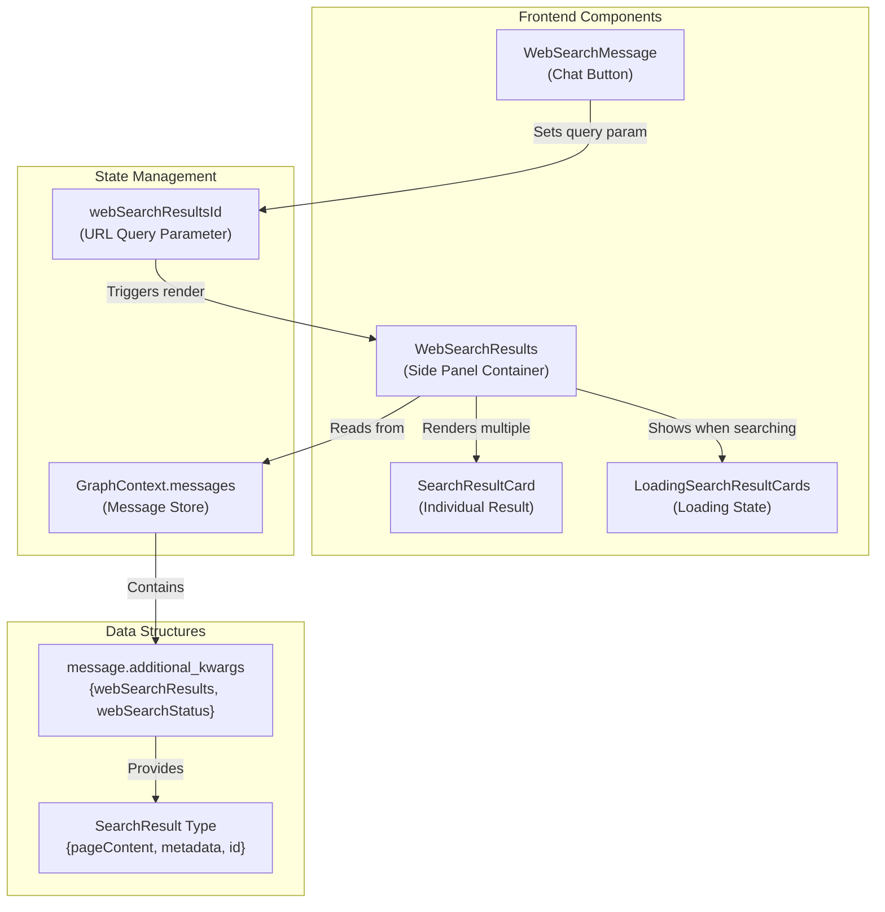
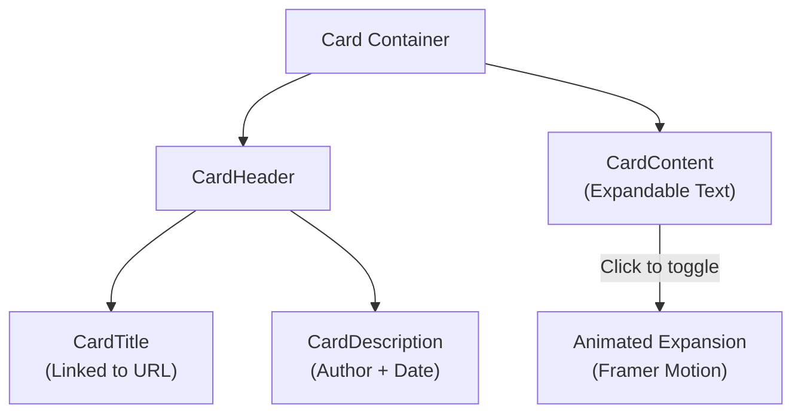
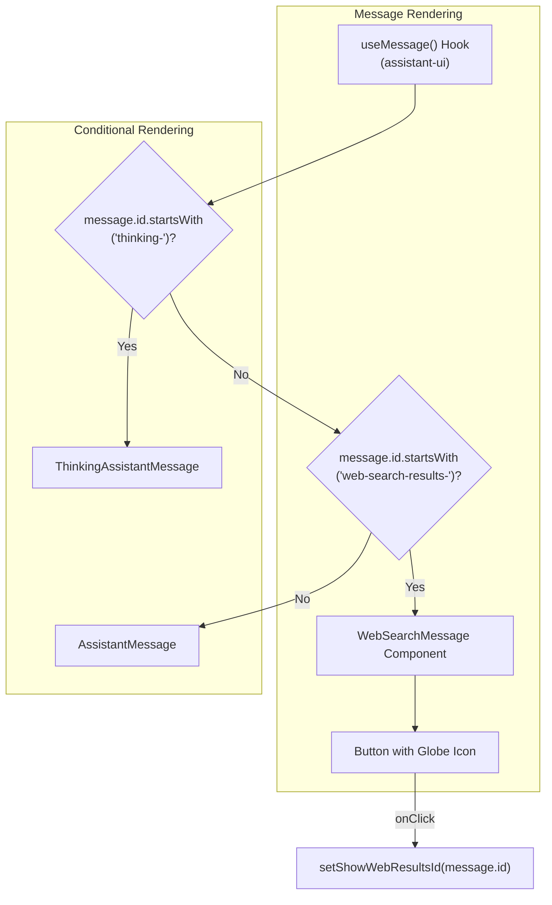
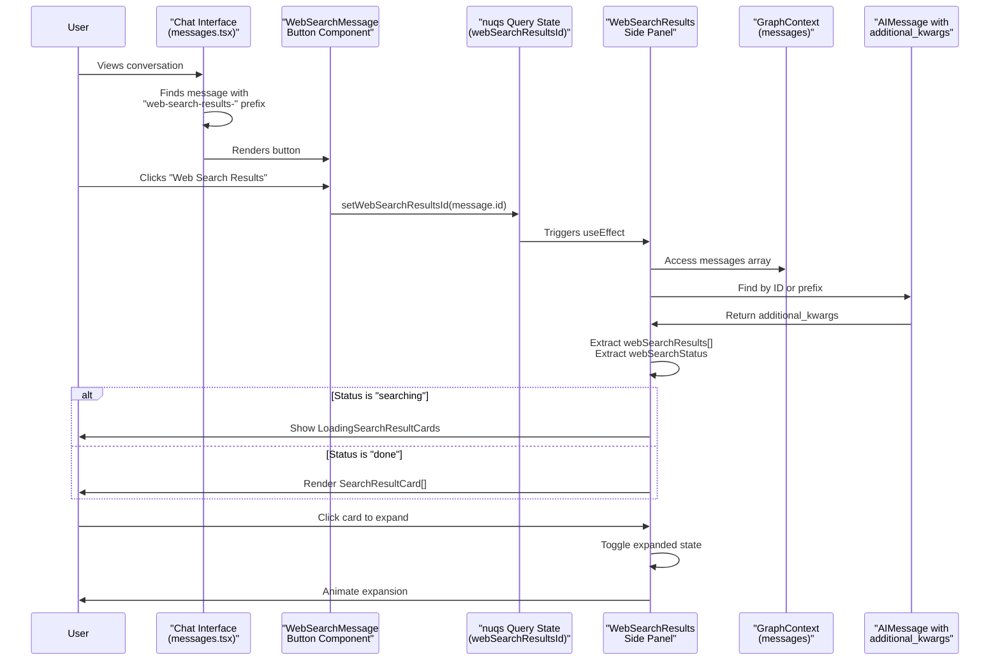
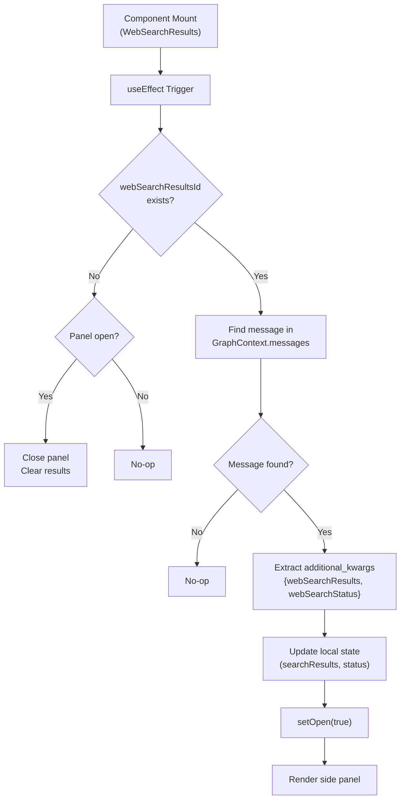

<!-- source: DeepWiki mcp.deepwiki.com · repo langchain-ai/open-canvas · page 3.5 Web Search Integration · fetched 2026-10-26 -->

# Web Search Integration

<details>
<summary>Relevant source files</summary>

The following files were used as context for generating this wiki page:

- [apps/agents/src/open-canvas/index.ts](apps/agents/src/open-canvas/index.ts)
- [apps/agents/src/summarizer/index.ts](apps/agents/src/summarizer/index.ts)
- [apps/agents/src/web-search/nodes/classify-message.ts](apps/agents/src/web-search/nodes/classify-message.ts)
- [apps/agents/src/web-search/nodes/query-generator.ts](apps/agents/src/web-search/nodes/query-generator.ts)
- [apps/web/src/components/chat-interface/messages.tsx](apps/web/src/components/chat-interface/messages.tsx)
- [apps/web/src/components/web-search-results/index.tsx](apps/web/src/components/web-search-results/index.tsx)
- [apps/web/src/components/web-search-results/loading-cards.tsx](apps/web/src/components/web-search-results/loading-cards.tsx)
- [apps/web/src/contexts/utils.ts](apps/web/src/contexts/utils.ts)
- [langgraph.json](langgraph.json)
- [packages/shared/src/types.ts](packages/shared/src/types.ts)

</details>


The Web Search Integration enables Open Canvas to perform web searches and display results alongside the conversation. When enabled, the system generates search queries from user input, executes searches using external APIs (Firecrawl/Exa), and displays results in a collapsible side panel.

For information about the backend `web_search` agent graph that executes searches, see [Web Search Agent](#4.4). For details on the LangGraph streaming architecture, see [Data Flow](#2.3).

## Overview

Web search functionality is implemented as a three-part system:

1. **Frontend UI Components**: Display search results in a side panel with expandable cards
2. **URL State Management**: Track which search results are displayed using query parameters
3. **Backend Agent Integration**: Connect to the `web_search` agent graph via message metadata

The search results are persisted in message `additional_kwargs` and accessed through URL-based state management, allowing users to reopen search panels by navigating to URLs with the `webSearchResultsId` parameter.

Sources: [apps/web/src/components/web-search-results/index.tsx](), [Diagram 1](#diagram-1), [Diagram 5](#diagram-5)

## Component Architecture



**Component Hierarchy**: The web search UI consists of four main components that work together to display search results from the backend agent.

Sources: [apps/web/src/components/web-search-results/index.tsx:1-170](), [apps/web/src/components/web-search-results/loading-cards.tsx:1-32](), [apps/web/src/components/chat-interface/messages.tsx:74-101]()

## WebSearchResults Component

The `WebSearchResults` component ([apps/web/src/components/web-search-results/index.tsx:75-170]()) manages the side panel that displays search results. It is a controlled component that accepts `open` and `setOpen` props.

### Component State

| State Variable | Type | Purpose |
|---------------|------|---------|
| `status` | `"searching" \| "done"` | Indicates whether search is in progress |
| `searchResults` | `SearchResult[]` | Array of search results to display |
| `webSearchResultsId` | `string \| null` | URL query parameter tracking which message contains results |

Sources: [apps/web/src/components/web-search-results/index.tsx:76-83]()

### Key Behaviors

The component implements several critical behaviors:

1. **Message Lookup**: Searches for messages with ID matching `webSearchResultsId` or starting with `"web-search-results-"` prefix ([apps/web/src/components/web-search-results/index.tsx:94-104]())

2. **Metadata Extraction**: Reads `webSearchResults` and `webSearchStatus` from `message.additional_kwargs` ([apps/web/src/components/web-search-results/index.tsx:105-112]())

3. **Auto-close**: Closes panel when `webSearchResultsId` is cleared ([apps/web/src/components/web-search-results/index.tsx:86-90]())

4. **Animation**: Uses Framer Motion for smooth slide-in/slide-out transitions ([apps/web/src/components/web-search-results/index.tsx:124-133]())

Sources: [apps/web/src/components/web-search-results/index.tsx:85-120]()

## SearchResultCard Component

The `SearchResultCard` component ([apps/web/src/components/web-search-results/index.tsx:21-68]()) renders individual search results with expandable content.

### Structure



**Card Layout**: Each search result displays title, author, publication date, and expandable content text.

### Metadata Display

The card extracts and displays metadata from `result.metadata`:

- **Title**: `result.metadata?.title` or "Untitled" ([apps/web/src/components/web-search-results/index.tsx:34-38]())
- **URL**: Links title to `result.metadata?.url` if available ([apps/web/src/components/web-search-results/index.tsx:28-36]())
- **Author**: `result.metadata?.author` or "Unknown author" ([apps/web/src/components/web-search-results/index.tsx:41]())
- **Date**: `result.metadata?.publishedDate` formatted with `date-fns` ([apps/web/src/components/web-search-results/index.tsx:42-43]())

### Expandable Content

The component uses local state to track expansion ([apps/web/src/components/web-search-results/index.tsx:22]()) and applies `line-clamp-3` CSS class when collapsed ([apps/web/src/components/web-search-results/index.tsx:59]()). Clicking anywhere in the card content toggles expansion ([apps/web/src/components/web-search-results/index.tsx:47-48]()).

Sources: [apps/web/src/components/web-search-results/index.tsx:21-68]()

## LoadingSearchResultCards Component

Displays skeleton loading states while search is in progress. Renders 5 placeholder cards with animated `Skeleton` components for title, description, and content ([apps/web/src/components/web-search-results/loading-cards.tsx:10-31]()).

Sources: [apps/web/src/components/web-search-results/loading-cards.tsx:1-32]()

## URL State Management

```mermaid
graph LR
    Button["'Web Search Results' Button<br/>(WebSearchMessage)"]
    URLParam["URL Query Parameter<br/>WEB_SEARCH_RESULTS_QUERY_PARAM"]
    Panel["Side Panel<br/>(WebSearchResults)"]
    Message["Message with ID<br/>starting with 'web-search-results-'"]
    
    Button -->|"setWebSearchResultsId(message.id)"| URLParam
    URLParam -->|"Triggers useEffect"| Panel
    Panel -->|"Finds message by ID"| Message
    Message -->|"Extracts additional_kwargs"| Results["webSearchResults[]<br/>webSearchStatus"]
```



**State Flow**: The web search UI is driven by URL query parameters, enabling shareable and bookmarkable search result views.

### WEB_SEARCH_RESULTS_QUERY_PARAM

The constant `WEB_SEARCH_RESULTS_QUERY_PARAM` (defined in [apps/web/src/constants]()) identifies the query parameter key. The `useQueryState` hook from `nuqs` manages this parameter ([apps/web/src/components/web-search-results/index.tsx:81-83]()).

### Opening Search Results

When a user clicks the "Web Search Results" button in the chat ([apps/web/src/components/chat-interface/messages.tsx:89-96]()), the `handleShowWebSearchResults` function sets the query parameter to the message ID ([apps/web/src/components/chat-interface/messages.tsx:79-85]()).

### Message ID Pattern

Web search messages are identified by IDs starting with `"web-search-results-"` ([apps/web/src/components/chat-interface/messages.tsx:111](), [apps/web/src/components/web-search-results/index.tsx:96]()). The lookup logic falls back to finding any message with this prefix if the exact ID isn't found ([apps/web/src/components/web-search-results/index.tsx:94-96]()).

Sources: [apps/web/src/components/web-search-results/index.tsx:81-113](), [apps/web/src/components/chat-interface/messages.tsx:74-99](), [apps/web/src/constants]()

## Chat Interface Integration



**Message Type Routing**: The chat interface conditionally renders different components based on message ID prefixes.

### WebSearchMessage Component

The `WebSearchMessage` component ([apps/web/src/components/chat-interface/messages.tsx:74-101]()) renders as a button in the message stream:

- **Styling**: Uses `bg-blue-50` and `hover:bg-blue-100` with full width ([apps/web/src/components/chat-interface/messages.tsx:92]())
- **Icon**: Displays a `Globe` icon from `lucide-react` ([apps/web/src/components/chat-interface/messages.tsx:94]())
- **Action**: Sets the `webSearchResultsId` query parameter on click ([apps/web/src/components/chat-interface/messages.tsx:84]())

### Message Detection

The `AssistantMessage` component uses message ID prefixes to determine rendering:

1. Check for `"thinking-"` prefix → render `ThinkingAssistantMessage` ([apps/web/src/components/chat-interface/messages.tsx:110,113-115]())
2. Check for `"web-search-results-"` prefix → render `WebSearchMessage` ([apps/web/src/components/chat-interface/messages.tsx:111,117-119]())
3. Otherwise → render standard `AssistantMessage` ([apps/web/src/components/chat-interface/messages.tsx:121-141]())

Sources: [apps/web/src/components/chat-interface/messages.tsx:103-141]()

## Data Flow Diagram



**Complete Flow**: User interactions with web search results are mediated through URL state, ensuring the panel state is shareable and persistent.

Sources: [apps/web/src/components/web-search-results/index.tsx:85-120](), [apps/web/src/components/chat-interface/messages.tsx:74-99]()

## SearchResult Data Structure

The `SearchResult` type (defined in `@opencanvas/shared/types`) structures the data displayed in each card:

```typescript
interface SearchResult {
  id: string;
  pageContent: string;
  metadata?: {
    title?: string;
    url?: string;
    author?: string;
    publishedDate?: string;
    // Additional metadata fields
  };
}
```

### Data Location in Messages

Search results are stored in the message's `additional_kwargs` object:

| Field | Type | Purpose |
|-------|------|---------|
| `webSearchResults` | `SearchResult[]` | Array of search results |
| `webSearchStatus` | `"searching" \| "done"` | Current search state |

The backend `web_search` agent populates these fields when search completes. The frontend reads them via the message lookup logic ([apps/web/src/components/web-search-results/index.tsx:105-108]()).

Sources: [apps/web/src/components/web-search-results/index.tsx:105-108](), [@opencanvas/shared/types]()

## Backend Agent Connection

The frontend web search UI connects to the backend `web_search` agent graph through message metadata:

1. **Agent Execution**: When the `web_search` agent completes, it creates a message with ID prefix `"web-search-results-"` ([apps/web/src/components/web-search-results/index.tsx:96]())

2. **Metadata Population**: The agent stores search results in `message.additional_kwargs.webSearchResults` and status in `message.additional_kwargs.webSearchStatus` ([apps/web/src/components/web-search-results/index.tsx:105-108]())

3. **Frontend Retrieval**: The `GraphContext` provides access to all messages ([apps/web/src/components/web-search-results/index.tsx:78-80]()), and the `WebSearchResults` component filters for the relevant message

For details on the `web_search` agent graph architecture, query generation, and search execution via Firecrawl/Exa, see [Web Search Agent](#4.4).

Sources: [apps/web/src/components/web-search-results/index.tsx:78-113](), [Diagram 5](#diagram-5)

## Component Lifecycle



**Lifecycle Management**: The component uses a single `useEffect` hook to synchronize with URL state and message data.

### Effect Dependencies

The effect depends on `[webSearchResultsId, messages]` ([apps/web/src/components/web-search-results/index.tsx:113]()), triggering when:

- The URL query parameter changes
- New messages arrive in `GraphContext`

### Auto-close Logic

If `webSearchResultsId` is null and the panel is open, the panel closes and results clear ([apps/web/src/components/web-search-results/index.tsx:86-90]()). This ensures the panel state remains synchronized with URL state.

Sources: [apps/web/src/components/web-search-results/index.tsx:85-113]()

## Animation and Styling

The component uses Framer Motion for animations:

### Panel Animation

- **Enter**: Slides in from right (`x: 0`) with opacity fade ([apps/web/src/components/web-search-results/index.tsx:127]())
- **Exit**: Slides out to right (`x: "100%"`) with opacity fade ([apps/web/src/components/web-search-results/index.tsx:128]())
- **Spring Physics**: Configured with `stiffness: 300, damping: 30` ([apps/web/src/components/web-search-results/index.tsx:129-133]())

### Card Content Animation

Individual card content uses `AnimatePresence` to animate expansion:

- **Height**: Animates from 0 to `"auto"` ([apps/web/src/components/web-search-results/index.tsx:54]())
- **Opacity**: Fades in/out during expansion ([apps/web/src/components/web-search-results/index.tsx:53]())
- **Duration**: 300ms with `easeInOut` timing ([apps/web/src/components/web-search-results/index.tsx:56]())

### Layout Classes

The side panel uses:
- `max-w-md`: Maximum width constraint
- `border-l-[1px] border-gray-200`: Left border separator
- `shadow-inner-left`: Custom shadow class
- `h-screen`: Full viewport height
- `overflow-hidden`: Prevents content overflow ([apps/web/src/components/web-search-results/index.tsx:125]())

Sources: [apps/web/src/components/web-search-results/index.tsx:50-56,124-133]()

## Usage Pattern

To integrate web search results in the UI:

1. **Enable Web Search**: User enables web search in the chat input
2. **Agent Execution**: Backend `web_search` agent executes (see [Web Search Agent](#4.4))
3. **Message Creation**: Agent creates message with `"web-search-results-"` prefix and populates `additional_kwargs`
4. **Button Display**: Chat interface renders `WebSearchMessage` button
5. **User Interaction**: User clicks button, setting `webSearchResultsId` query parameter
6. **Panel Display**: `WebSearchResults` component opens, displays results
7. **Close**: User clicks X button, clearing query parameter and closing panel ([apps/web/src/components/web-search-results/index.tsx:115-119]())

The URL-based state management ensures that refreshing the page or sharing the URL preserves the web search panel state.

Sources: [apps/web/src/components/web-search-results/index.tsx:115-119](), [apps/web/src/components/chat-interface/messages.tsx:79-99]()

---

