<!-- source: DeepWiki mcp.deepwiki.com · repo langchain-ai/open-canvas · page 3.6 UI Component Libraries · fetched 2026-10-26 -->

# UI Component Libraries

<details>
<summary>Relevant source files</summary>

The following files were used as context for generating this wiki page:

- [.codespellignore](.codespellignore)
- [apps/agents/package.json](apps/agents/package.json)
- [apps/web/package.json](apps/web/package.json)
- [apps/web/src/hooks/useStore.tsx](apps/web/src/hooks/useStore.tsx)
- [package.json](package.json)
- [packages/evals/package.json](packages/evals/package.json)
- [packages/shared/package.json](packages/shared/package.json)
- [yarn.lock](yarn.lock)

</details>


## Purpose and Scope

This document describes the external UI component libraries integrated into the Open Canvas frontend application (`apps/web`). It covers the four major library categories—Assistant-UI for conversational interfaces, BlockNote for rich text editing, Radix UI for accessible primitives, and CodeMirror for code editing—along with their specific usage patterns and integration points within the application.

For information about the overall frontend architecture and how these libraries fit into the component hierarchy, see [Frontend Architecture](#2.1). For details on state management with React contexts, see [State Management](#3.1).

---

## Library Dependency Overview

The frontend application integrates four distinct UI library ecosystems, each serving a specialized purpose:

| Library Category | Primary Packages | Purpose | Key Integration Points |
|-----------------|------------------|---------|------------------------|
| **Assistant-UI** | `@assistant-ui/react`<br/>`@assistant-ui/react-markdown`<br/>`@assistant-ui/react-ui` | Conversational UI components with streaming support | `ContentComposerChatInterface`, `Composer`, chat message rendering |
| **BlockNote** | `@blocknote/core`<br/>`@blocknote/react`<br/>`@blocknote/mantine`<br/>`@blocknote/shadcn` | Rich text editing with collaborative features | `ArtifactRenderer` for text artifacts |
| **Radix UI** | 20+ `@radix-ui/react-*` packages | Unstyled, accessible UI primitives | Dialogs, dropdowns, tooltips, popovers throughout the application |
| **CodeMirror** | `@uiw/react-codemirror`<br/>`@codemirror/lang-*` packages | Code editing with syntax highlighting for 10+ languages | `ArtifactRenderer` for code artifacts |

**Sources:** [apps/web/package.json:19-101]()

---

## Architecture: Library Integration Pattern

```mermaid
graph TB
    subgraph "Component Layer"
        Canvas["CanvasComponent<br/>(Main Orchestrator)"]
        ChatInterface["ContentComposerChatInterface"]
        ArtifactRenderer["ArtifactRenderer"]
        Composer["Composer"]
    end
    
    subgraph "Assistant-UI Library"
        AUI_Runtime["@assistant-ui/react<br/>AssistantRuntime"]
        AUI_Thread["ThreadPrimitive"]
        AUI_Composer["ComposerPrimitive"]
        AUI_Message["MessagePrimitive"]
        AUI_Markdown["@assistant-ui/react-markdown<br/>MarkdownText"]
        AUI_Syntax["@assistant-ui/react-syntax-highlighter"]
    end
    
    subgraph "BlockNote Library"
        BN_Core["@blocknote/core<br/>BlockNoteEditor"]
        BN_React["@blocknote/react<br/>useCreateBlockNote"]
        BN_Mantine["@blocknote/mantine<br/>MantineProvider"]
        BN_Shadcn["@blocknote/shadcn<br/>ShadcnProvider"]
    end
    
    subgraph "CodeMirror Library"
        CM_React["@uiw/react-codemirror<br/>CodeMirror component"]
        CM_State["@codemirror/state"]
        CM_View["@codemirror/view"]
        CM_Lang_JS["@codemirror/lang-javascript"]
        CM_Lang_Python["@codemirror/lang-python"]
        CM_Lang_Other["@codemirror/lang-*<br/>(10+ languages)"]
    end
    
    subgraph "Radix UI Primitives"
        RU_Dialog["@radix-ui/react-dialog"]
        RU_Dropdown["@radix-ui/react-dropdown-menu"]
        RU_Popover["@radix-ui/react-popover"]
        RU_Tooltip["@radix-ui/react-tooltip"]
        RU_Select["@radix-ui/react-select"]
        RU_Other["15+ other primitives"]
    end
    
    Canvas --> ChatInterface
    Canvas --> ArtifactRenderer
    ChatInterface --> Composer
    
    ChatInterface --> AUI_Runtime
    ChatInterface --> AUI_Thread
    Composer --> AUI_Composer
    ChatInterface --> AUI_Message
    ChatInterface --> AUI_Markdown
    ChatInterface --> AUI_Syntax
    
    ArtifactRenderer --> BN_Core
    ArtifactRenderer --> BN_React
    BN_React --> BN_Mantine
    BN_React --> BN_Shadcn
    
    ArtifactRenderer --> CM_React
    CM_React --> CM_State
    CM_React --> CM_View
    CM_React --> CM_Lang_JS
    CM_React --> CM_Lang_Python
    CM_React --> CM_Lang_Other
    
    Canvas --> RU_Dialog
    Composer --> RU_Dropdown
    ChatInterface --> RU_Popover
    Canvas --> RU_Tooltip
    ChatInterface --> RU_Select
    Canvas --> RU_Other
```

**Sources:** [apps/web/package.json:19-101](), [yarn.lock:30-88](), [yarn.lock:109-211](), [yarn.lock:218-409]()

---

## Assistant-UI: Conversational Interface Components

### Package Structure

The Assistant-UI ecosystem provides purpose-built components for AI chat interfaces with built-in streaming support and state management:

- **`@assistant-ui/react`** (v0.7.68): Core library with runtime, primitives, and streaming utilities
- **`@assistant-ui/react-markdown`** (v0.7.17): Markdown rendering for chat messages
- **`@assistant-ui/react-syntax-highlighter`** (v0.7.9): Code syntax highlighting in chat
- **`@assistant-ui/react-ui`** (v0.2.1): Pre-styled UI components built on primitives

### Key Features

Assistant-UI provides a complete runtime system for managing conversational state:

| Feature | Implementation | Purpose |
|---------|---------------|---------|
| **AssistantRuntime** | Manages thread state, messages, and streaming | Central runtime for all chat interactions |
| **Primitive Components** | Unstyled, composable UI building blocks | `ThreadPrimitive`, `MessagePrimitive`, `ComposerPrimitive` |
| **Streaming Support** | Built-in handling for `on_chat_model_stream` events | Real-time message updates during generation |
| **State Management** | Zustand-based internal state | Coordinates with GraphContext for application state |

### Integration Pattern

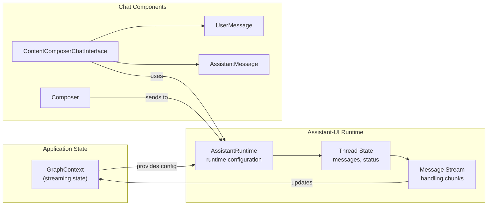

### Dependencies

Assistant-UI has deep integration with Radix UI primitives for accessibility:

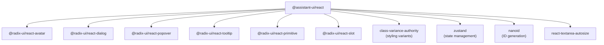

**Sources:** [apps/web/package.json:20-23](), [yarn.lock:30-41](), [yarn.lock:47-59](), [yarn.lock:61-88]()

---

## BlockNote: Rich Text Editing

### Package Structure

BlockNote provides a complete rich text editing solution built on TipTap and ProseMirror:

- **`@blocknote/core`** (v0.17.1): Core editor logic, schema, and extensions
- **`@blocknote/react`** (v0.17.1): React bindings and hooks
- **`@blocknote/mantine`** (v0.17.1): Mantine-styled UI components
- **`@blocknote/shadcn`** (v0.17.1): Shadcn-styled UI components (used in Open Canvas)

### Core Architecture

BlockNote is built on a layered architecture:

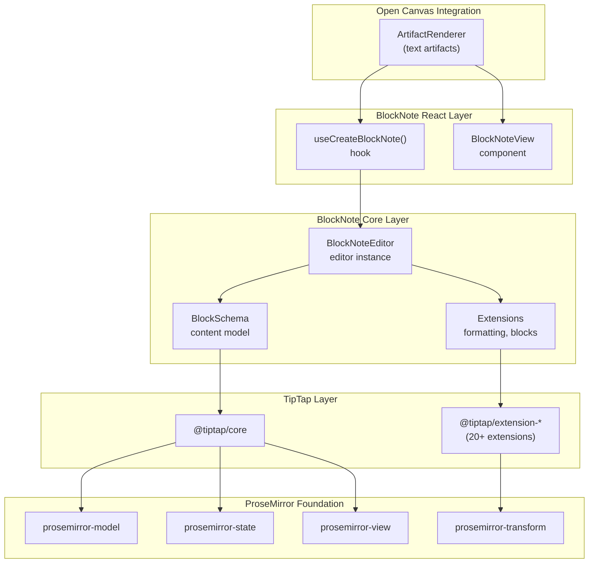

### Built-in Extensions

BlockNote core includes comprehensive TipTap extensions:

| Extension Category | Included Extensions | Purpose |
|-------------------|--------------------| --------|
| **Text Formatting** | `extension-bold`, `extension-italic`, `extension-underline`, `extension-strike`, `extension-code` | Basic text styling |
| **Structural** | `extension-paragraph`, `extension-hard-break`, `extension-horizontal-rule` | Document structure |
| **Interactive** | `extension-link`, `extension-gapcursor`, `extension-dropcursor` | User interaction |
| **Tables** | `extension-table-cell`, `extension-table-header`, `extension-table-row` | Table support |
| **Collaboration** | `extension-collaboration`, `extension-collaboration-cursor` | Real-time collaborative editing with Yjs |
| **History** | `extension-history` | Undo/redo functionality |

### UI Theming Approach

Open Canvas uses `@blocknote/shadcn` for consistent theming with the rest of the application:

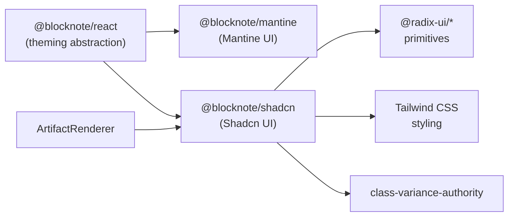

The Shadcn variant provides Radix UI-based components styled with Tailwind CSS, ensuring visual consistency with the broader application design system.

**Sources:** [apps/web/package.json:24-27](), [yarn.lock:109-155](), [yarn.lock:156-169](), [yarn.lock:170-182](), [yarn.lock:184-211]()

---

## CodeMirror: Code Editing and Syntax Highlighting

### Package Structure

Open Canvas uses `@uiw/react-codemirror` as a React wrapper around CodeMirror 6, with language support for 10+ programming languages:

- **`@uiw/react-codemirror`** (v4.23.5): React component wrapper
- **`@codemirror/lang-*`**: Language-specific packages for syntax highlighting

### Supported Languages

The application includes comprehensive language support:

| Language Package | Version | Use Case |
|-----------------|---------|----------|
| `@codemirror/lang-javascript` | ^6.2.2 | JavaScript, TypeScript, JSX |
| `@codemirror/lang-python` | ^6.1.6 | Python scripts |
| `@codemirror/lang-html` | ^6.4.9 | HTML with embedded CSS/JS |
| `@codemirror/lang-css` | ^6.0.0 | Stylesheets |
| `@codemirror/lang-json` | ^6.0.1 | JSON data |
| `@codemirror/lang-sql` | ^6.8.0 | SQL queries |
| `@codemirror/lang-java` | ^6.0.1 | Java code |
| `@codemirror/lang-cpp` | ^6.0.2 | C++ code |
| `@codemirror/lang-rust` | ^6.0.1 | Rust code |
| `@codemirror/lang-php` | ^6.0.1 | PHP code |
| `@codemirror/lang-xml` | ^6.1.0 | XML documents |

Additional language support includes:
- **`@replit/codemirror-lang-csharp`** (^6.2.0): C# syntax
- **`@nextjournal/lang-clojure`** (^1.0.0): Clojure syntax

### CodeMirror Architecture

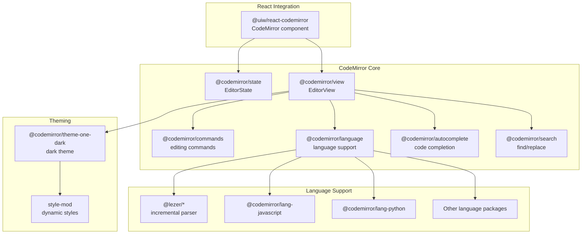

### Integration with ArtifactRenderer

CodeMirror is used exclusively in `ArtifactRenderer` for displaying and editing code artifacts:

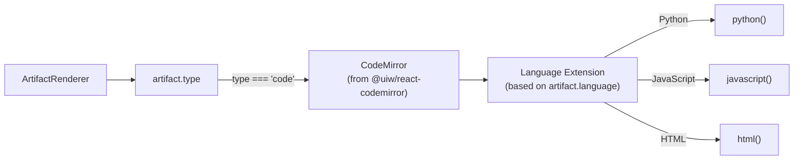

The component dynamically selects the appropriate language extension based on the artifact's `language` field, providing syntax highlighting and editing features tailored to each programming language.

**Sources:** [apps/web/package.json:28-44](), [apps/web/package.json:62](), [apps/web/package.json:66](), [yarn.lock:218-409]()

---

## Radix UI: Accessible Primitive Components

### Package Overview

Radix UI provides a comprehensive set of unstyled, accessible UI primitives. Open Canvas uses 20+ Radix packages to build its interface:

### Component Categories

| Category | Packages | Usage in Open Canvas |
|----------|----------|---------------------|
| **Overlays** | `react-dialog`, `react-popover`, `react-tooltip`, `react-hover-card` | Modals, contextual information, help text |
| **Navigation** | `react-dropdown-menu`, `react-navigation-menu`, `react-accordion`, `react-tabs` | Menus, navigation structures, collapsible sections |
| **Forms** | `react-select`, `react-checkbox`, `react-slider`, `react-label` | Model selection, settings, configuration |
| **Feedback** | `react-toast`, `react-progress` | Notifications, loading states |
| **Display** | `react-avatar` | User profile images |
| **Utilities** | `react-slot`, `react-primitive`, `react-compose-refs` | Composition utilities, ref management |

### Core Radix Dependencies

```mermaid
graph TB
    subgraph "Radix Core Utilities"
        Primitive["@radix-ui/primitive"]
        Context["@radix-ui/react-context"]
        ComposeRefs["@radix-ui/react-compose-refs"]
        Slot["@radix-ui/react-slot"]
        UseCallbackRef["@radix-ui/react-use-callback-ref"]
        UseEscapeKeydown["@radix-ui/react-use-escape-keydown"]
    end
    
    subgraph "Overlay Components"
        Dialog["@radix-ui/react-dialog"]
        Popover["@radix-ui/react-popover"]
        Tooltip["@radix-ui/react-tooltip"]
    end
    
    subgraph "Form Components"
        Select["@radix-ui/react-select"]
        Checkbox["@radix-ui/react-checkbox"]
        Slider["@radix-ui/react-slider"]
    end
    
    subgraph "Navigation Components"
        Dropdown["@radix-ui/react-dropdown-menu"]
        Accordion["@radix-ui/react-accordion"]
        Tabs["@radix-ui/react-tabs"]
    end
    
    Dialog --> Primitive
    Dialog --> Context
    Dialog --> ComposeRefs
    Dialog --> UseEscapeKeydown
    
    Popover --> Primitive
    Popover --> Context
    
    Tooltip --> Primitive
    Tooltip --> UseCallbackRef
    
    Select --> Primitive
    Select --> Slot
    
    Dropdown --> Primitive
    Dropdown --> Context
    
    Accordion --> Primitive
    Tabs --> Primitive
```

### Integration Pattern with Styling

Radix UI components are unstyled by default. Open Canvas uses Tailwind CSS and `class-variance-authority` for styling:

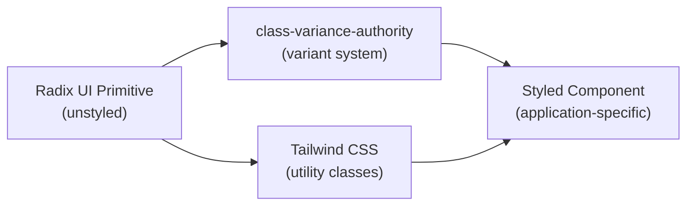

This approach provides:
- **Accessibility**: ARIA attributes, keyboard navigation, focus management built-in
- **Customization**: Complete control over visual presentation
- **Consistency**: Shared variant system via `class-variance-authority`

### Common Usage Patterns

**Dialog Example:**
```typescript
// Pattern: Modal dialogs for settings, confirmations
import * as Dialog from "@radix-ui/react-dialog"

<Dialog.Root>
  <Dialog.Trigger>...</Dialog.Trigger>
  <Dialog.Portal>
    <Dialog.Overlay className="..." />
    <Dialog.Content className="...">
      {/* Modal content */}
    </Dialog.Content>
  </Dialog.Portal>
</Dialog.Root>
```

**Dropdown Menu Example:**
```typescript
// Pattern: Context menus, action menus
import * as DropdownMenu from "@radix-ui/react-dropdown-menu"

<DropdownMenu.Root>
  <DropdownMenu.Trigger>...</DropdownMenu.Trigger>
  <DropdownMenu.Content>
    <DropdownMenu.Item>...</DropdownMenu.Item>
  </DropdownMenu.Content>
</DropdownMenu.Root>
```

**Sources:** [apps/web/package.json:46-61](), [yarn.lock:61-88]()

---

## Cross-Library Dependencies and Shared Utilities

### Shared Dependencies Across Libraries

Multiple UI libraries depend on common utilities, creating a shared foundation:

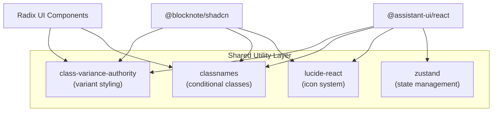

### Key Shared Packages

| Package | Version | Used By | Purpose |
|---------|---------|---------|---------|
| `class-variance-authority` | ^0.7.0 | Assistant-UI, BlockNote Shadcn, app components | Type-safe variant styling system |
| `classnames` | ^2.5.1 | Assistant-UI, BlockNote, app components | Conditional CSS class composition |
| `lucide-react` | ^0.473.0+ | Assistant-UI, BlockNote, app components | Consistent icon set |
| `zustand` | ^5.0.3 | Assistant-UI, app state | Lightweight state management |
| `react-icons` | ^5.2.1+ | BlockNote, app components | Additional icon libraries |

### Styling Integration: Tailwind CSS

All UI libraries integrate with Tailwind CSS for consistent theming:

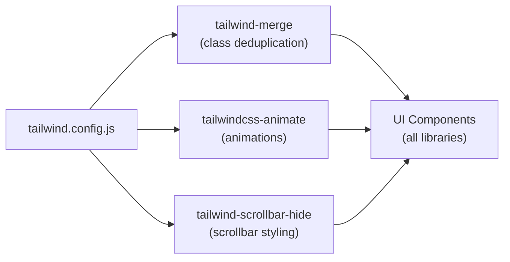

**Sources:** [apps/web/package.json:69](), [apps/web/package.json:70](), [apps/web/package.json:80](), [apps/web/package.json:95-97]()

---

## Version Management and Compatibility

### Library Version Constraints

The project maintains specific version constraints to ensure compatibility:

| Library | Current Version | Constraint Type | Notes |
|---------|----------------|-----------------|-------|
| `@assistant-ui/react` | 0.7.68 | ^0.7.68 | Minor version updates allowed |
| `@blocknote/*` | 0.17.1 | ^0.17.1 | All BlockNote packages synchronized |
| `@radix-ui/*` | Various (1.x-2.x) | Caret ranges | Independent versioning per package |
| `@codemirror/*` | 6.x | Caret ranges | CodeMirror 6 stable API |

### Dependency Resolution Overrides

The root `package.json` includes security-focused resolutions:

```json
"resolutions": {
  "fast-xml-parser": ">=5.3.6",
  "form-data": ">=4.0.4",
  "axios": ">=1.13.5",
  "tar": ">=7.5.8",
  "hono": ">=4.11.4",
  "linkifyjs": ">=4.3.2",
  "glob": ">=10.5.0 <11"
}
```

These overrides ensure transitive dependencies from UI libraries meet minimum security requirements.

**Sources:** [package.json:17-25](), [apps/web/package.json:20-27](), [apps/web/package.json:46-61]()

---

## Build and Bundle Considerations

### Tree Shaking and Code Splitting

Each UI library is designed for optimal tree shaking:

- **Radix UI**: Each component is a separate package, ensuring only imported components are bundled
- **CodeMirror**: Language packages are separate, loaded on-demand based on artifact type
- **BlockNote**: Theming packages (`mantine` vs `shadcn`) are separate; only one is bundled
- **Assistant-UI**: Modular exports allow selective imports

### Bundle Impact Analysis

Approximate production bundle contribution by library category:

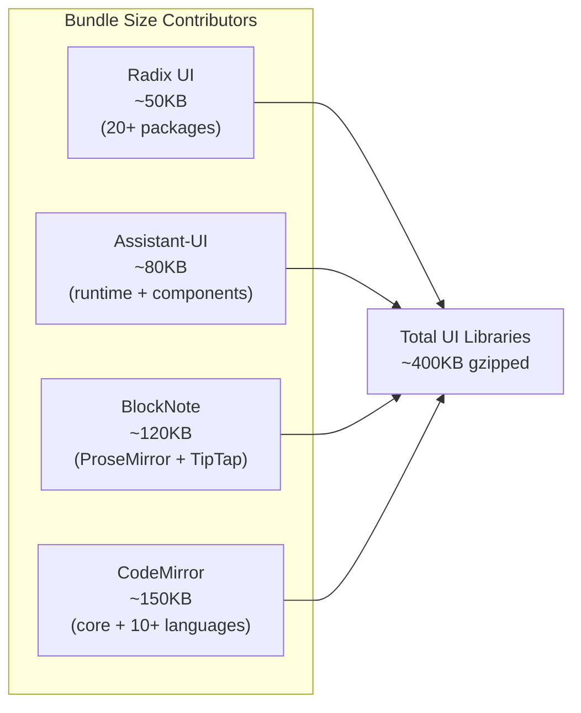

Note: Sizes are approximate and include dependencies. Actual bundle size varies based on which components are used.

**Sources:** [apps/web/package.json:19-101]()

---

