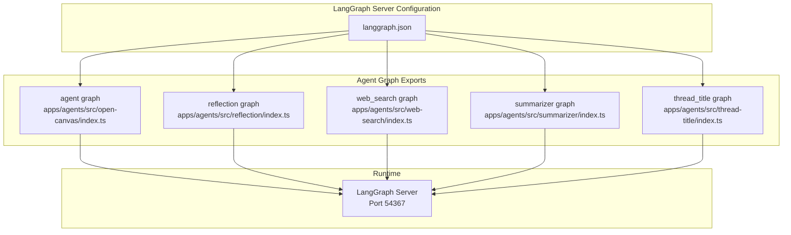
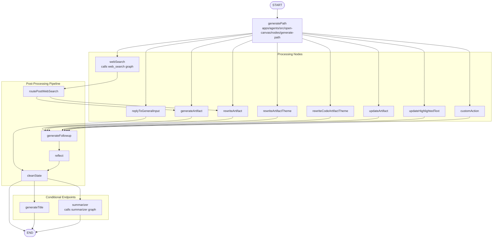

<!-- source: DeepWiki mcp.deepwiki.com · repo langchain-ai/open-canvas · page 4 Backend Agents · fetched 2026-10-26 -->

# Backend Agents

<details>
<summary>Relevant source files</summary>

The following files were used as context for generating this wiki page:

- [.codespellignore](.codespellignore)
- [apps/agents/package.json](apps/agents/package.json)
- [apps/agents/src/open-canvas/index.ts](apps/agents/src/open-canvas/index.ts)
- [apps/agents/src/summarizer/index.ts](apps/agents/src/summarizer/index.ts)
- [apps/agents/src/web-search/nodes/classify-message.ts](apps/agents/src/web-search/nodes/classify-message.ts)
- [apps/agents/src/web-search/nodes/query-generator.ts](apps/agents/src/web-search/nodes/query-generator.ts)
- [apps/web/package.json](apps/web/package.json)
- [apps/web/src/hooks/useStore.tsx](apps/web/src/hooks/useStore.tsx)
- [langgraph.json](langgraph.json)
- [packages/evals/package.json](packages/evals/package.json)
- [packages/shared/package.json](packages/shared/package.json)
- [packages/shared/src/types.ts](packages/shared/src/types.ts)

</details>


This document provides an overview of the LangGraph agent system that powers Open Canvas's AI-driven artifact generation and manipulation. The backend agent layer orchestrates complex AI workflows using LangGraph's state machine architecture, handling tasks from artifact creation to memory formation to web search integration.

For detailed information about specific components, see:
- Agent graph structure and state management: [Agent Graph Structure](#4.1)
- Routing logic and path determination: [Path Generation and Routing](#4.2)
- Individual artifact operation nodes: [Artifact Operations](#4.3)
- Model provider integration: [Model Integration](#5)
- Shared utilities and types: [Shared Code](#6)

## Architecture Overview

The backend agent system is built on **LangGraph**, a framework for orchestrating stateful, multi-step AI workflows as directed graphs. The system consists of five specialized agent graphs, each responsible for distinct functionality:

| Graph Name | Primary Purpose | Entry Point |
|------------|----------------|-------------|
| `agent` (open-canvas) | Main artifact generation and manipulation | [apps/agents/src/open-canvas/index.ts:162]() |
| `reflection` | Background memory formation and style rule extraction | [apps/agents/src/reflection/index.ts]() |
| `web_search` | Query generation and web search execution | [apps/agents/src/web-search/index.ts]() |
| `summarizer` | Conversation history condensation | [apps/agents/src/summarizer/index.ts:75]() |
| `thread_title` | Conversation title generation | [apps/agents/src/thread-title/index.ts]() |

These graphs are registered in the LangGraph server configuration and exposed as separate executable workflows:

**Sources:** [langgraph.json:6-11]()

## Graph Registration and Configuration



**Graph Registration**

The `langgraph.json` configuration file maps graph names to their TypeScript export locations. Each graph is exported as a compiled LangGraph `StateGraph` instance:

**Sources:** [langgraph.json:1-14]()

## Open Canvas Agent Graph

The `agent` graph (also called `open-canvas`) is the primary workflow orchestrator, handling all artifact generation, manipulation, and user interaction. It implements a sophisticated routing system with 15 nodes and conditional branching.

### Graph Structure



**Graph Builder Configuration**

The graph is constructed using LangGraph's `StateGraph` builder with explicit node and edge definitions. The `OpenCanvasGraphAnnotation` defines the shared state structure that flows through all nodes:

**Sources:** [apps/agents/src/open-canvas/index.ts:108-162]()

### State Management

The graph state is defined by `OpenCanvasGraphAnnotation.State` and contains:

| State Field | Type | Purpose |
|-------------|------|---------|
| `artifact` | `ArtifactV3` | Current artifact with version history |
| `_messages` | `BaseMessage[]` | Full conversation history (reducer: append) |
| `messages` | `BaseMessage[]` | User-visible messages (reducer: append) |
| `highlightedCode` | `HighlightedCode \| undefined` | Selected code snippet for partial updates |
| `highlightedText` | `HighlightedText \| undefined` | Selected text block for partial updates |
| `next` | `string \| undefined` | Next node to route to |
| `webSearchEnabled` | `boolean \| undefined` | Flag to trigger web search |
| `webSearchResults` | `SearchResult[] \| undefined` | Results from web search |
| Various flags | `string \| boolean \| undefined` | Operation-specific flags (e.g., `regenerateWithEmojis`, `fixBugs`) |

The state uses **reducer functions** for message fields, allowing nodes to append messages without replacing the entire array. Other fields use simple replacement semantics.

**Sources:** [apps/agents/src/open-canvas/state.js]() (inferred from usage)

### Node Types and Responsibilities

#### Router Node

- **`generatePath`**: Intelligent router that examines state flags and uses LLM-based routing to determine the next processing node. Handles URL extraction, context document loading, and web search triggering.

#### Artifact Generation Nodes

- **`generateArtifact`**: Creates new artifacts from scratch using tool calling with the `ARTIFACT_TOOL_SCHEMA`
- **`rewriteArtifact`**: Performs full artifact rewrites based on user requests
- **`rewriteArtifactTheme`**: Applies style/theme changes to text artifacts
- **`rewriteCodeArtifactTheme`**: Applies style/theme changes to code artifacts

#### Partial Update Nodes

- **`updateArtifact`**: Updates selected code snippets specified by `highlightedCode`
- **`updateHighlightedText`**: Updates selected text blocks specified by `highlightedText`

#### Utility Nodes

- **`replyToGeneralInput`**: Handles chat messages that don't require artifact operations
- **`customAction`**: Executes user-defined quick actions
- **`webSearch`**: Invokes the `web_search` graph for external information retrieval
- **`generateFollowup`**: Generates contextual follow-up questions
- **`reflect`**: Triggers background memory formation (debounced 5 minutes)
- **`cleanState`**: Resets temporary state flags using `DEFAULT_INPUTS`
- **`generateTitle`**: Invokes the `thread_title` graph for conversation titles
- **`summarizer`**: Invokes the `summarizer` graph for conversation condensation

**Sources:** [apps/agents/src/open-canvas/index.ts:108-161](), [apps/agents/src/open-canvas/nodes/]()

### Execution Flow

1. **Entry**: All requests enter through `START` → `generatePath`
2. **Routing**: `generatePath` analyzes state and routes to appropriate processing node via `routeNode` conditional edge
3. **Processing**: Selected node performs artifact operation or responds to user
4. **Post-Processing**: Artifact operations flow through `generateFollowup` → `reflect` → `cleanState`
5. **Conditional Termination**: `conditionallyGenerateTitle` determines whether to generate title, summarize, or end
6. **Exit**: Graph completes at `END`

**Routing Logic**

The `routeNode` function implements dynamic routing based on the `next` state field:

**Sources:** [apps/agents/src/open-canvas/index.ts:20-28]()

### State Cleanup

After each artifact operation, the graph resets temporary flags to prevent unintended behavior in subsequent operations:

**Sources:** [apps/agents/src/open-canvas/index.ts:30-34](), [packages/shared/src/constants.ts:10-25]()

## Supporting Agent Graphs

### Web Search Graph

**Purpose**: Generate search-optimized queries and execute web searches via Firecrawl/Exa APIs.

**Structure**:
- **`queryGenerator`**: Uses Claude 3.5 Sonnet to transform user messages into search-engine-friendly queries
- **`search`**: Executes search and returns formatted results

**Integration**: Called from `open-canvas` graph via the `webSearch` node. Results are stored in `webSearchResults` state field and formatted into an `AIMessage` for context.

**Sources:** [apps/agents/src/web-search/index.ts](), [apps/agents/src/web-search/nodes/query-generator.ts:24-45]()

### Summarizer Graph

**Purpose**: Condense long conversation histories using Claude 3.5 Sonnet to prevent token limit exhaustion.

**Trigger**: Automatically invoked when conversation character count exceeds `CHARACTER_MAX` (300,000 characters ≈ 75,000 tokens).

**Process**:
1. Formats all messages using `formatMessages` utility
2. Invokes Claude with `SUMMARIZER_PROMPT` system message
3. Creates a synthetic `HumanMessage` with the summary
4. Updates thread state via LangGraph SDK client, replacing messages with summary

**Special Handling**: Summary message is marked with `OC_SUMMARIZED_MESSAGE_KEY` in `additional_kwargs` to distinguish it from regular messages.

**Sources:** [apps/agents/src/summarizer/index.ts:25-69](), [apps/agents/src/open-canvas/index.ts:36-57]()

### Reflection Graph

**Purpose**: Background memory formation to extract user style preferences and insights.

**Trigger**: Debounced execution after artifact operations (5-minute delay to batch multiple operations).

**Storage**: Stores extracted reflections in `BaseStore` under namespace `["memories", assistantId]` with key `"reflection"`.

**Data Structure**:
```typescript
interface Reflections {
  styleRules: string[];  // Writing/coding style preferences
  content: string[];     // Facts about user and projects
}
```

**Retrieval**: Artifact generation nodes retrieve reflections via `getFormattedReflections` and inject them into system prompts for personalization.

**Sources:** [apps/agents/src/reflection/index.ts]() (inferred), [apps/agents/src/utils.ts:112-131](), [apps/agents/src/utils.ts:31-101]()

### Thread Title Graph

**Purpose**: Generate concise conversation titles for display in thread history.

**Trigger**: Conditionally invoked after the first user-AI exchange (when `messages.length === 2`).

**Routing Logic**:

**Sources:** [apps/agents/src/thread-title/index.ts]() (inferred), [apps/agents/src/open-canvas/index.ts:64-72]()

## Model Configuration and Integration

All agent nodes use a unified model configuration system that supports 7 LLM providers. The `getModelFromConfig` utility abstracts provider-specific initialization:

### Model Resolution Process

1. Extract `customModelName` from `config.configurable`
2. Determine provider based on model name patterns (e.g., `"gpt-"` → OpenAI, `"claude-"` → Anthropic)
3. Load provider-specific API keys from environment variables
4. Handle special cases:
   - Azure OpenAI: prefix `"azure/"`, custom deployment configuration
   - Ollama: prefix `"ollama-"`, local base URL
   - Tool calling: Fallback to `"gpt-4o"` for o1 models (no tool support)
   - Thinking models: Extract `<think>` tags for o1, o3, and Gemini thinking

### Configuration Parameters

- **`temperature`**: Extracted from `modelConfig.temperatureRange.current`, excluded for certain models (o1, o3)
- **`maxTokens`**: Extracted from `modelConfig.maxTokens.current`
- **`isToolCalling`**: Flag to trigger model fallback for tool support

**Sources:** [apps/agents/src/utils.ts:341-409](), [apps/agents/src/utils.ts:162-302]()

## Context Document Handling

The agent system supports uploading PDFs and text files as context. Each provider requires different preprocessing:

### Provider-Specific Implementations

| Provider | PDF Support | Implementation |
|----------|-------------|----------------|
| **Anthropic** | Native (3.5 Sonnet) | Base64 document blocks with `media_type` |
| **Anthropic** | Converted (other models) | `pdf-parse` library → text extraction |
| **OpenAI** | Converted | `pdf-parse` library → text extraction |
| **Google Gemini** | Native | Base64 document with type metadata |

Context documents are stored in `BaseStore` under `CONTEXT_DOCUMENTS_NAMESPACE = ["context_documents"]` and retrieved automatically during artifact generation:

**Sources:** [apps/agents/src/utils.ts:434-582](), [packages/shared/src/constants.ts:8]()

## Integration with Frontend

The agent system exposes its functionality via the LangGraph SDK, which the frontend uses to stream responses:

1. **Frontend**: Calls `streams.stream(threadId, input, config)` via LangGraph SDK
2. **Backend**: LangGraph server receives HTTP request, invokes `agent` graph
3. **Streaming**: Nodes emit events (`on_chat_model_stream`, `on_chain_start`, `on_chain_end`)
4. **Frontend**: `GraphContext` processes events and updates UI in real-time

**Configuration Object**:
```typescript
config: {
  configurable: {
    customModelName: string;
    modelConfig: CustomModelConfig;
    assistant_id: string;
    supabase_session?: Session;
    systemPrompt?: string;
  };
  store: BaseStore;  // For memory/context retrieval
}
```

**Sources:** [apps/agents/src/utils.ts:103-110](), [apps/web/src/contexts/GraphContext.tsx]() (inferred from integration)

## Key Utilities

The `apps/agents/src/utils.ts` file provides essential helper functions used across all agent nodes:

### Memory and Reflection Functions

- **`formatReflections(reflections, extra?)`**: Formats `Reflections` object into human-readable string with style guidelines and user facts
- **`getFormattedReflections(config)`**: Retrieves and formats reflections from `BaseStore`

### Artifact Utilities

- **`formatArtifactContent(content, shortenContent?)`**: Formats artifact content (code or markdown) into a standardized string representation
- **`formatArtifactContentWithTemplate(template, content, shortenContent?)`**: Injects artifact content into a template string

### Model Configuration

- **`getModelConfig(config, extra?)`**: Extracts model name, provider, API keys, and Azure configuration from `LangGraphRunnableConfig`
- **`getModelFromConfig(config, extra?)`**: Initializes a `ChatModel` instance with appropriate provider and parameters
- **`isUsingO1MiniModel(config)`**: Checks if current model is `o1-mini`

### Message Processing

- **`formatMessages(messages)`**: Converts `BaseMessage[]` array into XML-formatted string for LLM consumption
- **`createAIMessageFromWebResults(webResults)`**: Formats search results into an `AIMessage` with metadata
- **`getStringFromContent(content)`**: Extracts string from `MessageContent` (handles both string and complex content arrays)

### Context Document Handlers

- **`convertPDFToText(base64PDF)`**: Uses `pdf-parse` to extract text from base64-encoded PDFs
- **`createContextDocumentMessages(config, contextDocuments?)`**: Generates provider-specific message format for context documents
- **`createContextDocumentMessagesAnthropic(documents, options?)`**: Anthropic-specific handler with native PDF support
- **`createContextDocumentMessagesOpenAI(documents)`**: OpenAI-specific handler with PDF text extraction
- **`createContextDocumentMessagesGemini(documents)`**: Gemini-specific handler with native document support

### Configuration Helpers

- **`ensureStoreInConfig(config)`**: Validates and extracts `BaseStore` from config
- **`optionallyGetSystemPromptFromConfig(config)`**: Retrieves custom system prompt if present

**Sources:** [apps/agents/src/utils.ts:1-642]()

## Error Handling and Validation

Agent nodes perform state validation to ensure required fields are present:

### Common Validation Patterns

1. **Artifact Existence**: Verify `state.artifact` is not undefined before operations
2. **Message Type Checking**: Ensure recent message is `HumanMessage` using `getType() === "human"`
3. **Highlight Validation**: Confirm `highlightedCode` or `highlightedText` is present for partial updates
4. **Store Availability**: Use `ensureStoreInConfig` to validate `BaseStore` in config
5. **Tool Call Response**: Check for `response.tool_calls?.[0].args` in artifact generation

Validation failures throw descriptive errors that propagate to the frontend for user feedback.

**Sources:** [apps/agents/src/open-canvas/nodes/generate-artifact/index.ts:22-84](), [apps/agents/src/open-canvas/nodes/updateHighlightedText.ts:44-143](), [apps/agents/src/open-canvas/nodes/rewrite-artifact/index.ts:28-100]()

---

