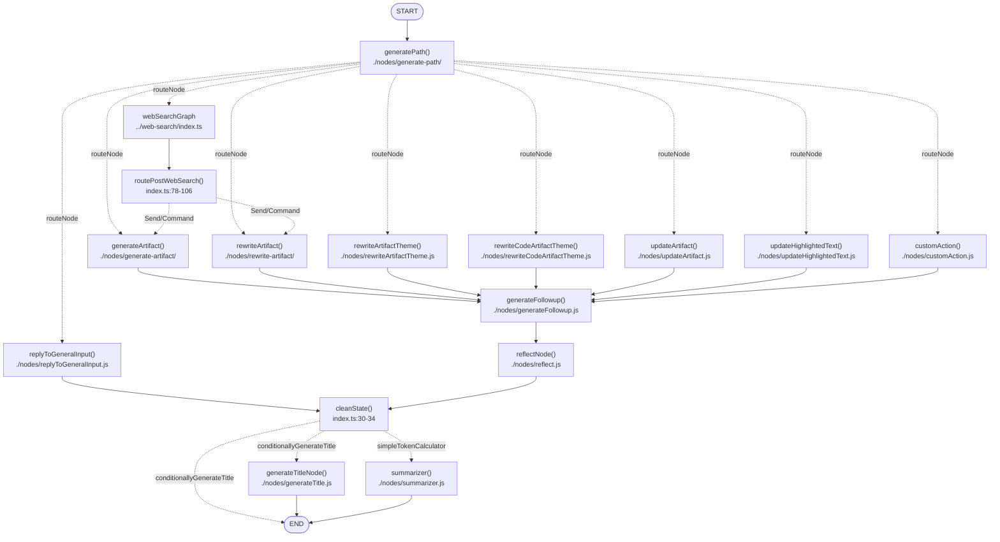
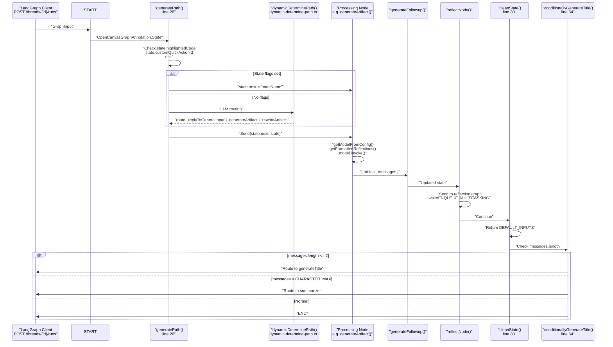
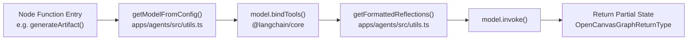

<!-- source: DeepWiki mcp.deepwiki.com · repo langchain-ai/open-canvas · page 4.1 Agent Graph Structure · fetched 2026-10-26 -->

# Agent Graph Structure

<details>
<summary>Relevant source files</summary>

The following files were used as context for generating this wiki page:

- [apps/agents/src/open-canvas/index.ts](apps/agents/src/open-canvas/index.ts)
- [apps/agents/src/open-canvas/nodes/generate-path/documents.ts](apps/agents/src/open-canvas/nodes/generate-path/documents.ts)
- [apps/agents/src/open-canvas/nodes/generate-path/dynamic-determine-path.ts](apps/agents/src/open-canvas/nodes/generate-path/dynamic-determine-path.ts)
- [apps/agents/src/open-canvas/nodes/generate-path/include-url-contents.ts](apps/agents/src/open-canvas/nodes/generate-path/include-url-contents.ts)
- [apps/agents/src/open-canvas/nodes/generate-path/index.ts](apps/agents/src/open-canvas/nodes/generate-path/index.ts)
- [apps/agents/src/summarizer/index.ts](apps/agents/src/summarizer/index.ts)
- [apps/agents/src/web-search/nodes/classify-message.ts](apps/agents/src/web-search/nodes/classify-message.ts)
- [apps/agents/src/web-search/nodes/query-generator.ts](apps/agents/src/web-search/nodes/query-generator.ts)
- [apps/agents/tsconfig.json](apps/agents/tsconfig.json)
- [langgraph.json](langgraph.json)
- [packages/shared/src/types.ts](packages/shared/src/types.ts)
- [packages/shared/src/utils/urls.ts](packages/shared/src/utils/urls.ts)

</details>


This document details the core agent graph structure of the Open Canvas backend, specifically focusing on the `open-canvas` agent graph built with LangGraph's `StateGraph`. It covers the state definition, node configuration, edge connections, routing logic, and graph compilation. For information about individual node implementations and their specific logic, see [Artifact Operations](#4.3) and other subsections under [Backend Agents](#4). For details on model integration used by these nodes, see [Model Integration](#5).

## Purpose and Scope

The Open Canvas backend uses LangGraph's `StateGraph` to orchestrate a complex multi-step AI workflow. The graph manages stateful conversations, artifact generation/manipulation, memory formation, and auxiliary tasks like summarization and title generation. This page documents the structural architecture of the graph: how nodes are defined, how they connect via edges, how state flows through the system, and how the graph routes execution based on state conditions.

---

## Graph Registry and Entry Point

All agent graphs in Open Canvas are registered in `langgraph.json`, which defines the entry points for the LangGraph server.

**Graph Registration Configuration**

| Graph Name | File Path | Purpose |
|------------|-----------|---------|
| `agent` | `apps/agents/src/open-canvas/index.ts:graph` | Main artifact generation and manipulation graph |
| `reflection` | `apps/agents/src/reflection/index.ts:graph` | Background memory formation |
| `thread_title` | `apps/agents/src/thread-title/index.ts:graph` | Conversation title generation |
| `summarizer` | `apps/agents/src/summarizer/index.ts:graph` | Conversation condensation |
| `web_search` | `apps/agents/src/web-search/index.ts:graph` | Web search integration |

The `agent` graph (also called the `open-canvas` graph) is the primary workflow that users interact with. It orchestrates all artifact operations and delegates to other graphs when needed.

**Sources:** [langgraph.json:1-14]()

---

## StateGraph Construction

The `open-canvas` graph is built using LangGraph's `StateGraph` class, which provides a state machine abstraction for LLM workflows. The graph is constructed using a builder pattern with method chaining.

### Imports and Initialization

The graph construction begins with importing LangGraph primitives and node functions:

```typescript
import { Command, END, Send, START, StateGraph } from "@langchain/langgraph";
import { OpenCanvasGraphAnnotation } from "./state.js";
// Node imports
import { generatePath } from "./nodes/generate-path/index.js";
import { generateArtifact } from "./nodes/generate-artifact/index.js";
import { rewriteArtifact } from "./nodes/rewrite-artifact/index.js";
// ... other node imports
```

**Sources:** [apps/agents/src/open-canvas/index.ts:1-18]()

### Graph Builder Pattern

The builder is instantiated with `OpenCanvasGraphAnnotation` and nodes are registered:

```typescript
const builder = new StateGraph(OpenCanvasGraphAnnotation)
  .addNode("generatePath", generatePath)
  .addEdge(START, "generatePath")
  .addNode("generateArtifact", generateArtifact)
  .addNode("rewriteArtifact", rewriteArtifact)
  // ... more nodes
  .addConditionalEdges("generatePath", routeNode, [...])
  .compile()
```

The builder methods define the graph's topology:

| Method | Purpose | Example |
|--------|---------|---------|
| `addNode(name, fn)` | Registers a node with its implementation function | `.addNode("generatePath", generatePath)` |
| `addEdge(from, to)` | Creates a deterministic edge | `.addEdge(START, "generatePath")` |
| `addConditionalEdges(from, router, destinations)` | Creates dynamic routing | `.addConditionalEdges("generatePath", routeNode, [...])` |

**Sources:** [apps/agents/src/open-canvas/index.ts:108-162]()
</thinking>

### State Annotation Structure

The `OpenCanvasGraphAnnotation` defines the state schema that flows through all nodes. It uses LangGraph's annotation system to specify field types and reducers:

```typescript
import { Annotation } from "@langchain/langgraph";
import { BaseMessage } from "@langchain/core/messages";

const OpenCanvasGraphAnnotation = Annotation.Root({
  artifact: Annotation<ArtifactV3 | undefined>,
  messages: Annotation<BaseMessage[]>({
    reducer: (left, right) => left.concat(right),
  }),
  _messages: Annotation<BaseMessage[]>({
    reducer: (left, right) => left.concat(right),
  }),
  // ... other fields
});
```

The annotation system automatically handles state merging and provides type safety across the entire graph.

**Sources:** [apps/agents/src/open-canvas/state.ts:1-50]()

---

## State Definition

The graph state is defined by `OpenCanvasGraphAnnotation.State`, which contains all data that flows through the graph. Key state fields include:

### State Fields

| Field | Type | Purpose |
|-------|------|---------|
| `artifact` | `ArtifactV3` | Current artifact with version history |
| `_messages` | `BaseMessage[]` | Internal message history for LLM context |
| `messages` | `BaseMessage[]` | Public message history |
| `highlightedCode` | `HighlightedCode?` | Selected code for partial updates |
| `highlightedText` | `HighlightedText?` | Selected text for partial updates |
| `next` | `string?` | Next node to route to |
| `language` | `ProgrammingLanguageOptions?` | Target programming language |
| `artifactLength` | `number?` | Desired artifact length |
| `regenerateWithEmojis` | `boolean?` | Whether to add emojis |
| `readingLevel` | `string?` | Target reading level |
| `addComments` | `boolean?` | Whether to add code comments |
| `addLogs` | `boolean?` | Whether to add logging |
| `fixBugs` | `boolean?` | Whether to fix bugs |
| `portLanguage` | `ProgrammingLanguageOptions?` | Language to port code to |
| `customQuickActionId` | `string?` | Custom action identifier |
| `webSearchEnabled` | `boolean?` | Whether web search is enabled |
| `webSearchResults` | `SearchResult[]?` | Web search results |

The state uses `DEFAULT_INPUTS` to reset temporary routing flags after processing, preventing unintended routing in subsequent turns.

**Sources:** [packages/shared/src/constants.ts:10-25](), [apps/agents/src/open-canvas/index.ts:30-34]()

---

## Graph Topology

The following diagram shows the complete node structure and edge connections in the `open-canvas` graph.

**Complete Open Canvas Graph Structure with Function Names**



**Sources:** [apps/agents/src/open-canvas/index.ts:1-18](), [apps/agents/src/open-canvas/index.ts:108-162]()

---

## Node Definitions

The graph contains 15 nodes, each implementing a specific function. Nodes receive the current state and config, process them, and return state updates.

### Node Implementation Pattern

All nodes follow the same signature pattern:

```typescript
import { LangGraphRunnableConfig } from "@langchain/langgraph";
import { 
  OpenCanvasGraphAnnotation, 
  OpenCanvasGraphReturnType 
} from "../state.js";

export async function nodeName(
  state: typeof OpenCanvasGraphAnnotation.State,
  config: LangGraphRunnableConfig
): Promise<OpenCanvasGraphReturnType> {
  // Node implementation
  return {
    // Partial state updates
  };
}
```

The `LangGraphRunnableConfig` provides access to the execution context, including:
- Thread ID for state persistence
- Configurable fields (e.g., `customModelName`)
- Store access for reflections and context documents

**Sources:** [apps/agents/src/open-canvas/nodes/generate-path/index.ts:1-30](), [apps/agents/src/open-canvas/state.ts:1-20]()

### Primary Processing Nodes

| Node Name | Purpose | Key Behavior |
|-----------|---------|--------------|
| `generatePath` | Route incoming requests to appropriate handler | Examines state flags and queries LLM for dynamic routing |
| `generateArtifact` | Create new artifact from user request | Uses tool calling to generate structured artifact |
| `rewriteArtifact` | Completely rewrite existing artifact | Fetches reflections, invokes model with full context |
| `rewriteArtifactTheme` | Apply style changes to text artifact | Modifies tone, style, or format without changing content |
| `rewriteCodeArtifactTheme` | Apply style changes to code artifact | Adjusts code style, formatting, or comments |
| `updateArtifact` | Update highlighted code section | Partial update of code based on selection |
| `updateHighlightedText` | Update highlighted text section | Partial update of markdown based on selection |
| `customAction` | Execute user-defined quick action | Processes custom quick action configurations |
| `replyToGeneralInput` | Handle non-artifact chat | Regular conversation without artifact manipulation |
| `webSearch` | Perform web search | Delegates to `web_search` graph |

### Post-Processing Nodes

| Node Name | Purpose | Key Behavior |
|-----------|---------|--------------|
| `generateFollowup` | Create follow-up questions | Generates 2-3 contextual questions after artifact operations |
| `reflect` | Form memories | Triggers background reflection graph (debounced 5 minutes) |
| `cleanState` | Reset routing flags | Clears temporary state fields using `DEFAULT_INPUTS` |
| `generateTitle` | Generate conversation title | Creates concise title for thread history display |
| `summarizer` | Condense conversation | Invokes summarizer graph when conversation exceeds token limit |

**Sources:** [apps/agents/src/open-canvas/index.ts:108-126]()

---

## Edge Configuration

Edges define how execution flows between nodes. The graph uses both deterministic edges and conditional edges.

### Deterministic Edges

Fixed transitions between nodes:

```typescript
.addEdge(START, "generatePath")
.addEdge("generateArtifact", "generateFollowup")
.addEdge("updateArtifact", "generateFollowup")
.addEdge("updateHighlightedText", "generateFollowup")
.addEdge("rewriteArtifact", "generateFollowup")
.addEdge("rewriteArtifactTheme", "generateFollowup")
.addEdge("rewriteCodeArtifactTheme", "generateFollowup")
.addEdge("customAction", "generateFollowup")
.addEdge("replyToGeneralInput", "cleanState")
.addEdge("generateFollowup", "reflect")
.addEdge("reflect", "cleanState")
.addEdge("generateTitle", END)
.addEdge("summarizer", END)
.addEdge("webSearch", "routePostWebSearch")
```

All artifact operations (generate, rewrite, update) converge on `generateFollowup`, ensuring consistent post-processing.

**Sources:** [apps/agents/src/open-canvas/index.ts:141-160]()

### Conditional Edges

Dynamic routing based on state:

#### Primary Router: `generatePath`

The conditional edge from `generatePath` uses the `routeNode` function:

```typescript
.addConditionalEdges("generatePath", routeNode, [
  "updateArtifact",
  "rewriteArtifactTheme",
  "rewriteCodeArtifactTheme",
  "replyToGeneralInput",
  "generateArtifact",
  "rewriteArtifact",
  "customAction",
  "updateHighlightedText",
  "webSearch",
])
```

The `routeNode` function implementation:

```typescript
const routeNode = (state: typeof OpenCanvasGraphAnnotation.State) => {
  if (!state.next) {
    throw new Error("'next' state field not set.");
  }
  return new Send(state.next, { ...state });
};
```

This router reads `state.next` (set by `generatePath`) and uses LangGraph's `Send` command to route to the specified destination. If `state.next` is not set, execution fails with an error.

**Sources:** [apps/agents/src/open-canvas/index.ts:20-28](), [apps/agents/src/open-canvas/index.ts:129-139]()

#### Post-Web Search Router: `routePostWebSearch`

```typescript
function routePostWebSearch(
  state: typeof OpenCanvasGraphAnnotation.State
): Send | Command
```

This router checks if the artifact exists and routes accordingly:
- If `state.artifact.contents.length > 1`: routes to `rewriteArtifact`
- Otherwise: routes to `generateArtifact`

It also injects web search results into the message history if results are found.

**Sources:** [apps/agents/src/open-canvas/index.ts:78-106]()

#### Terminal Router: `conditionallyGenerateTitle`

```typescript
const conditionallyGenerateTitle = (
  state: typeof OpenCanvasGraphAnnotation.State
): "generateTitle" | "summarizer" | typeof END => {
  if (state.messages.length > 2) {
    return simpleTokenCalculator(state);
  }
  return "generateTitle";
};
```

This router determines the final action:
1. If conversation has ≤2 messages: generate title
2. If conversation exceeds `CHARACTER_MAX` (300,000 chars): summarize
3. Otherwise: end

The `simpleTokenCalculator` estimates token usage based on character count (4 chars per token) and triggers summarization when approaching the 75,000 token context limit.

**Sources:** [apps/agents/src/open-canvas/index.ts:36-72](), [apps/agents/src/open-canvas/index.ts:154-158]()

---

## Routing Logic

The routing logic determines which node executes based on the current state. The system uses two routing strategies:

### Explicit State-Based Routing

The `generatePath` node (documented in detail in [Path Generation and Routing](#4.2)) examines specific state flags to determine routing:

**State Flag Routing Table**

| State Flag | Destination Node | Condition |
|------------|------------------|-----------|
| `highlightedCode` | `updateArtifact` | User has selected code |
| `highlightedText` | `updateHighlightedText` | User has selected text |
| `regenerateWithEmojis` | `rewriteArtifactTheme` | Add emojis requested |
| `readingLevel` | `rewriteArtifactTheme` | Reading level change |
| `addComments` | `rewriteCodeArtifactTheme` | Add code comments |
| `addLogs` | `rewriteCodeArtifactTheme` | Add logging |
| `fixBugs` | `rewriteCodeArtifactTheme` | Fix bugs |
| `portLanguage` | `rewriteCodeArtifactTheme` | Port to different language |
| `customQuickActionId` | `customAction` | Custom action triggered |
| `webSearchEnabled` | `webSearch` | Web search requested |

This explicit routing enables quick actions and UI-driven operations to bypass LLM routing decisions.

### Dynamic LLM-Based Routing

When no explicit state flags are set, `generatePath` queries an LLM to classify the user's intent and determine the appropriate node. The LLM chooses between:
- `replyToGeneralInput`: General conversation
- `generateArtifact`: Create new artifact
- `rewriteArtifact`: Modify existing artifact

**Sources:** [apps/agents/src/open-canvas/index.ts:20-28]()

---

## State Reset and Memory Management

### State Cleanup

After each conversation turn, the `cleanState` node resets temporary routing flags to prevent unintended routing in subsequent turns:

```typescript
const cleanState = (_: typeof OpenCanvasGraphAnnotation.State) => {
  return {
    ...DEFAULT_INPUTS,
  };
};
```

The `DEFAULT_INPUTS` constant defines all fields that should be reset:

```typescript
{
  highlightedCode: undefined,
  highlightedText: undefined,
  next: undefined,
  language: undefined,
  artifactLength: undefined,
  regenerateWithEmojis: undefined,
  readingLevel: undefined,
  addComments: undefined,
  addLogs: undefined,
  fixBugs: undefined,
  portLanguage: undefined,
  customQuickActionId: undefined,
  webSearchEnabled: undefined,
  webSearchResults: undefined,
}
```

**Sources:** [apps/agents/src/open-canvas/index.ts:30-34](), [packages/shared/src/constants.ts:10-25]()

### Memory Formation

The `reflect` node initiates background memory formation by creating a run of the `reflection` graph. This process is debounced (5-minute delay) and runs asynchronously without blocking the user interface. See [Reflection and Memory System](#4.5) for details.

**Sources:** [apps/agents/src/open-canvas/index.ts:123]()

---

## Graph Compilation and Execution

### Compilation

The graph is compiled using the `.compile()` method, which validates the graph structure and prepares it for execution:

```typescript
export const graph = builder.compile().withConfig({ runName: "open_canvas" });
```

The `withConfig({ runName: "open_canvas" })` call sets metadata for tracing and observability in LangSmith.

**Sources:** [apps/agents/src/open-canvas/index.ts:162]()

### Execution Flow

When a request enters the graph:

1. **Entry**: Execution begins at the `START` node
2. **Routing**: `generatePath` determines the destination node
3. **Processing**: The selected node processes the request
4. **Post-Processing**: Artifact operations flow through `generateFollowup` → `reflect` → `cleanState`
5. **Terminal**: Based on conversation length, the graph either ends, generates a title, or summarizes

**Typical Execution Sequence with Code Entities**



**Sources:** [apps/agents/src/open-canvas/index.ts:108-162](), [apps/agents/src/open-canvas/nodes/generate-path/index.ts:26-168](), [apps/agents/src/open-canvas/nodes/generate-path/dynamic-determine-path.ts:29-105]()

---

## Node Communication and Data Flow

Nodes communicate exclusively through state updates. Each node:

1. Receives the current state and config
2. Performs its processing (may involve LLM calls, database queries, etc.)
3. Returns a partial state update

The graph runtime merges these partial updates with the existing state. This pattern ensures:
- **Immutability**: Original state is never mutated
- **Composability**: Nodes can be added or removed without affecting others
- **Traceability**: Each state transition is logged for debugging

### Typical Node Implementation Flow

**Code Entity Mapping: Node Execution Pattern**



All content generation nodes follow this pattern:

1. **Get model configuration**: `getModelFromConfig(config, options)` retrieves the LLM instance
2. **Bind tools**: `model.bindTools([toolSchema], { tool_choice })` enforces structured output
3. **Fetch context**: `getFormattedReflections(config)` retrieves user memories from store
4. **Invoke model**: `model.invoke(messages)` generates content
5. **Return state update**: `{ artifact, messages }` partial state returned to graph

This pattern is consistent across `generateArtifact`, `rewriteArtifact`, `updateArtifact`, `rewriteArtifactTheme`, `rewriteCodeArtifactTheme`, and `customAction` nodes.

**Sources:** [apps/agents/src/open-canvas/nodes/generate-artifact/index.ts:1-100](), [apps/agents/src/utils.ts:1-50]()

---

## Integration with Other Graphs

The `open-canvas` graph integrates with four other specialized graphs:

### Web Search Integration

The `webSearch` node delegates to the `web_search` graph:

```typescript
.addNode("webSearch", webSearchGraph)
```

After the web search completes, `routePostWebSearch` processes the results and routes to either `generateArtifact` or `rewriteArtifact`.

**Sources:** [apps/agents/src/open-canvas/index.ts:126](), [apps/agents/src/open-canvas/index.ts:148]()

### Reflection Graph

The `reflect` node triggers the `reflection` graph as a background process. This graph analyzes the conversation and stores style rules and user insights in the `BaseStore`. See [Reflection and Memory System](#4.5) for details.

**Sources:** [apps/agents/src/open-canvas/index.ts:123]()

### Summarizer Graph

The `summarizer` node invokes the `summarizer` graph when the conversation exceeds the character limit. The summarizer uses Claude to condense the conversation into a summary message.

```typescript
export async function summarizer(
  state: SummarizeState
): Promise<Partial<SummarizeState>> {
  const model = new ChatAnthropic({
    model: "claude-3-5-sonnet-latest",
  });
  
  const messagesToSummarize = formatMessages(state.messages);
  const response = await model.invoke([
    ["system", SUMMARIZER_PROMPT],
    ["user", `Here are the messages to summarize:\n${messagesToSummarize}`],
  ]);
  
  // Create summary message and update thread state
  const newMessage = new HumanMessage({
    id: uuidv4(),
    content: newMessageContent,
    additional_kwargs: {
      [OC_SUMMARIZED_MESSAGE_KEY]: true,
    },
  });
  
  return {};
}
```

**Sources:** [apps/agents/src/open-canvas/index.ts:125](), [apps/agents/src/summarizer/index.ts:25-75]()

### Thread Title Graph

The `generateTitle` node invokes the `thread_title` graph to generate a concise title for new conversations.

**Sources:** [apps/agents/src/open-canvas/index.ts:124]()

---

## Summary

The Open Canvas agent graph structure implements a sophisticated state machine for managing AI-powered document editing workflows. Key architectural features include:

- **Modular Node Design**: 15 specialized nodes, each with a single responsibility
- **Flexible Routing**: Explicit state-based routing for UI actions, dynamic LLM-based routing for natural language
- **State Management**: Immutable state updates with automatic flag cleanup
- **Graph Composition**: Integration with four specialized graphs for auxiliary tasks
- **Observability**: Full tracing through LangSmith with named runs

This architecture enables complex multi-step workflows while maintaining code clarity and extensibility.

**Sources:** [apps/agents/src/open-canvas/index.ts:1-163](), [langgraph.json:1-14](), [packages/shared/src/constants.ts:1-88]()

---

