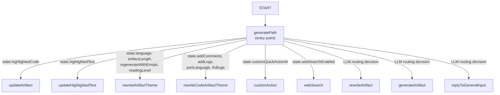
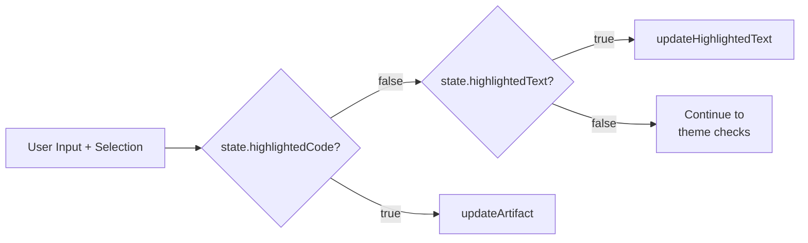
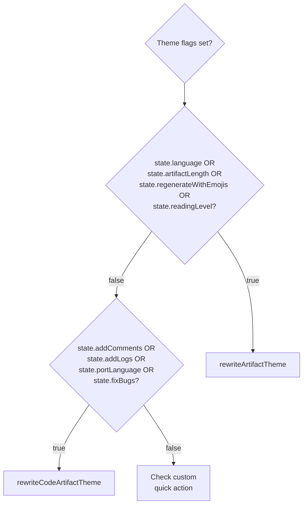
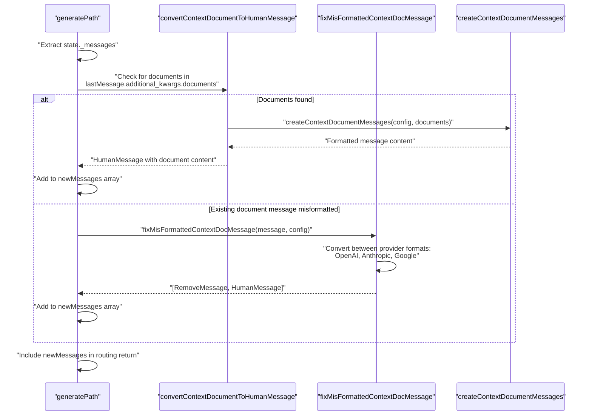
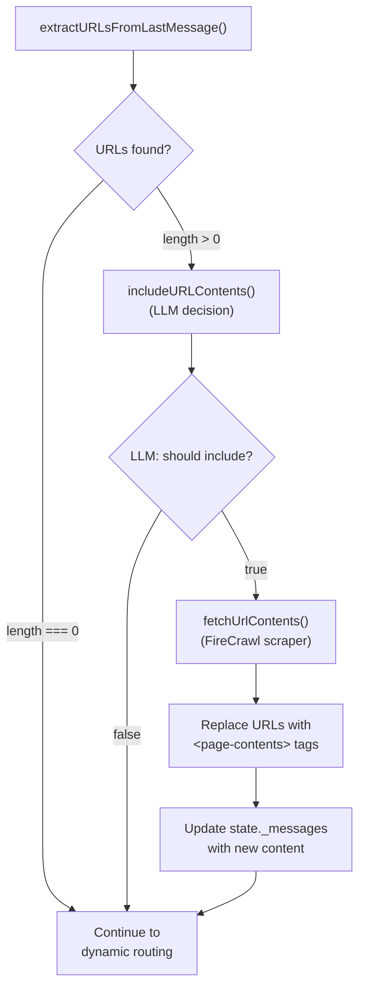
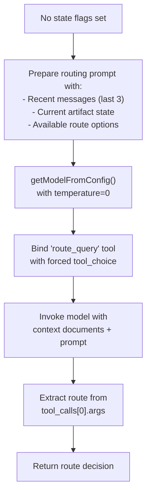
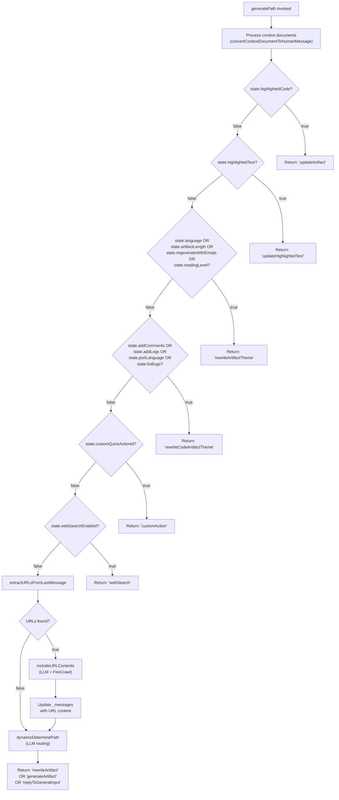

<!-- source: DeepWiki mcp.deepwiki.com · repo langchain-ai/open-canvas · page 4.2 Path Generation and Routing · fetched 2026-10-26 -->

# Path Generation and Routing

<details>
<summary>Relevant source files</summary>

The following files were used as context for generating this wiki page:

- [apps/agents/src/open-canvas/index.ts](apps/agents/src/open-canvas/index.ts)
- [apps/agents/src/open-canvas/nodes/generate-path/documents.ts](apps/agents/src/open-canvas/nodes/generate-path/documents.ts)
- [apps/agents/src/open-canvas/nodes/generate-path/dynamic-determine-path.ts](apps/agents/src/open-canvas/nodes/generate-path/dynamic-determine-path.ts)
- [apps/agents/src/open-canvas/nodes/generate-path/include-url-contents.ts](apps/agents/src/open-canvas/nodes/generate-path/include-url-contents.ts)
- [apps/agents/src/open-canvas/nodes/generate-path/index.ts](apps/agents/src/open-canvas/nodes/generate-path/index.ts)
- [apps/agents/src/summarizer/index.ts](apps/agents/src/summarizer/index.ts)
- [apps/agents/src/web-search/nodes/classify-message.ts](apps/agents/src/web-search/nodes/classify-message.ts)
- [apps/agents/src/web-search/nodes/query-generator.ts](apps/agents/src/web-search/nodes/query-generator.ts)
- [apps/agents/tsconfig.json](apps/agents/tsconfig.json)
- [langgraph.json](langgraph.json)
- [packages/shared/src/types.ts](packages/shared/src/types.ts)
- [packages/shared/src/utils/urls.ts](packages/shared/src/utils/urls.ts)

</details>


## Purpose and Scope

This document describes the `generatePath` node, which serves as the primary routing mechanism in the Open Canvas agent system. The `generatePath` node analyzes user input, processes contextual information, and determines which downstream node should handle the request. For information about the nodes that `generatePath` routes to (such as `generateArtifact`, `rewriteArtifact`, etc.), see [Artifact Operations](#4.3). For information about the web search integration, see [Web Search Agent](#4.4).

Sources: [apps/agents/src/open-canvas/nodes/generate-path/index.ts:23-168](), [apps/agents/src/open-canvas/index.ts:1-163]()

## The generatePath Node in Graph Structure

The `generatePath` node is the entry point for all requests in the main agent graph. It is directly connected to the `START` node and routes to eight possible downstream nodes based on request characteristics.



**Graph Entry Point Configuration**

The `generatePath` node is configured as the entry point in `langgraph.json`:

Sources: [langgraph.json:1-14](), [apps/agents/src/open-canvas/index.ts:108-139]()

## Routing Logic Overview

The `generatePath` function implements a priority-based routing system with three tiers:

1. **State Flag Routing**: Highest priority checks for specific state flags that indicate predetermined operations
2. **URL Content Processing**: Extracts and optionally scrapes URLs found in user messages
3. **Dynamic LLM Routing**: Uses an LLM to analyze intent when no state flags are set

The function signature and initial setup:

```typescript
async function generatePath(
  state: typeof OpenCanvasGraphAnnotation.State,
  config: LangGraphRunnableConfig
): Promise<OpenCanvasGraphReturnType>
```

Sources: [apps/agents/src/open-canvas/nodes/generate-path/index.ts:26-29]()

## State-Based Conditional Routing

The `generatePath` node evaluates state flags in a specific order to determine routing. Each check returns early if a condition is met.

### Routing Priority Table

| Priority | State Flags | Target Node | Purpose |
|----------|-------------|-------------|---------|
| 1 | `state.highlightedCode` | `updateArtifact` | Modify highlighted code section |
| 2 | `state.highlightedText` | `updateHighlightedText` | Modify highlighted text section |
| 3 | `state.language`, `state.artifactLength`, `state.regenerateWithEmojis`, `state.readingLevel` | `rewriteArtifactTheme` | Theme-based text rewriting |
| 4 | `state.addComments`, `state.addLogs`, `state.portLanguage`, `state.fixBugs` | `rewriteCodeArtifactTheme` | Theme-based code rewriting |
| 5 | `state.customQuickActionId` | `customAction` | Execute custom quick action |
| 6 | `state.webSearchEnabled` | `webSearch` | Perform web search |
| 7 | None of above | Dynamic routing | LLM determines path |

### Highlighted Content Routing

When users select code or text, the state flags indicate partial updates should occur:



Sources: [apps/agents/src/open-canvas/nodes/generate-path/index.ts:56-71](), [packages/shared/src/types.ts:101-130]()

### Theme-Based Rewriting Routing

Theme flags trigger specialized rewriting operations:



Sources: [apps/agents/src/open-canvas/nodes/generate-path/index.ts:73-99](), [packages/shared/src/types.ts:34-99]()

### Quick Action and Web Search Routing

Custom quick actions and web search have dedicated routing paths:

Sources: [apps/agents/src/open-canvas/nodes/generate-path/index.ts:101-117]()

## Context Document Processing

Before routing decisions are made, `generatePath` processes context documents attached to messages. Context documents are files (PDFs, text documents) that users upload to provide additional context.

### Document Conversion Flow



### Document Format Conversion

The `fixMisFormattedContextDocMessage` function handles format incompatibilities between LLM providers:

| Provider | Document Format | Conversion Required |
|----------|----------------|---------------------|
| OpenAI | `type: "text"` with extracted text | From Anthropic/Gemini formats |
| Anthropic | `type: "document"`, `source.type: "base64"` | From Gemini format |
| Google Gemini | `type: "application/pdf"`, `data: base64` | From Anthropic format |

Sources: [apps/agents/src/open-canvas/nodes/generate-path/index.ts:32-54](), [apps/agents/src/open-canvas/nodes/generate-path/documents.ts:1-135]()

## URL Content Extraction

When URLs are detected in user messages, `generatePath` determines whether to scrape and inline the content. This enables users to reference web pages naturally in conversation.

### URL Extraction and Processing Pipeline



### URL Extraction Implementation

The `extractUrls` utility extracts both markdown-formatted and plain URLs:

- **Markdown links**: `[text](https://example.com)` 
- **Plain URLs**: `https://example.com`

Sources: [packages/shared/src/utils/urls.ts:1-23](), [apps/agents/src/open-canvas/nodes/generate-path/index.ts:16-21]()

### LLM-Based URL Content Inclusion

The `includeURLContents` function uses an LLM to determine user intent:

**Prompt Template**:
```
You're an advanced AI assistant.
You have been tasked with analyzing the user's message and determining 
if the user wants the contents of the URL included in their message 
included in their prompt.
You should ONLY answer 'true' if it is explicitly clear the user 
included the URL in their message so that its contents would be 
included in the prompt, otherwise, answer 'false'
```

**Model Configuration**:
- Model: `gemini-2.0-flash` (fast, cheap model for classification)
- Temperature: 0 (deterministic)
- Tool call: `determine_include_url_contents` (forced tool)

**Schema**:
```typescript
{
  shouldIncludeUrlContents: boolean
}
```

Sources: [apps/agents/src/open-canvas/nodes/generate-path/include-url-contents.ts:7-28](), [apps/agents/src/open-canvas/nodes/generate-path/include-url-contents.ts:58-116]()

### FireCrawl Web Scraping

When URL content should be included, FireCrawl scrapes the page:

**Configuration**:
- Mode: `"scrape"`
- Format: `["markdown"]`
- Returns: `{ url: string, pageContent: string }`

**Content Inlining**:
The scraped content is wrapped in XML tags and replaces the original URL:
```xml
<page-contents url="https://example.com">
  [scraped markdown content]
</page-contents>
```

Sources: [apps/agents/src/open-canvas/nodes/generate-path/include-url-contents.ts:30-49](), [apps/agents/src/open-canvas/nodes/generate-path/include-url-contents.ts:95-106]()

### Message Update Flow

After URL content processing, the internal message list is updated:

Sources: [apps/agents/src/open-canvas/nodes/generate-path/index.ts:119-139]()

## Dynamic LLM-Based Routing

When no state flags are set, `generatePath` delegates routing decisions to an LLM via the `dynamicDeterminePath` function. This enables flexible, intent-based routing.

### Dynamic Routing Architecture



### Routing Prompt Construction

The routing prompt is constructed from several template components:

**Main Template** (`ROUTE_QUERY_PROMPT`):
- Placeholder: `{artifactOptions}` - Lists available actions based on artifact state
- Placeholder: `{recentMessages}` - Last 3 messages for context
- Placeholder: `{currentArtifactPrompt}` - Current artifact content or indicator of no artifact

**Artifact-Dependent Options**:

When artifact exists (`ROUTE_QUERY_OPTIONS_HAS_ARTIFACTS`):
- Option: `rewriteArtifact` - Modify existing artifact

When no artifact exists (`ROUTE_QUERY_OPTIONS_NO_ARTIFACTS`):
- Option: `generateArtifact` - Create new artifact

**Both cases include**:
- Option: `replyToGeneralInput` - General conversation response

Sources: [apps/agents/src/open-canvas/nodes/generate-path/dynamic-determine-path.ts:39-60]()

### Tool Schema Definition

The routing decision uses structured output with a constrained enum:

```typescript
const schema = z.object({
  route: z
    .enum(["replyToGeneralInput", artifactRoute])
    .describe("The route to take based on the user's query."),
});
```

Where `artifactRoute` is:
- `"rewriteArtifact"` if `state.artifact` exists
- `"generateArtifact"` if no artifact exists

**Tool Binding**:
```typescript
const modelWithTool = model.bindTools(
  [
    {
      name: "route_query",
      description: "The route to take based on the user's query.",
      schema,
    },
  ],
  {
    tool_choice: "route_query",
  }
);
```

Sources: [apps/agents/src/open-canvas/nodes/generate-path/dynamic-determine-path.ts:71-88]()

### Model Invocation

The model is invoked with:
1. Context document messages (if any)
2. New messages from document processing (if any)
3. The routing prompt

**Model Configuration**:
- Temperature: 0 (deterministic routing)
- `isToolCalling: true` (enables tool calling)

Sources: [apps/agents/src/open-canvas/nodes/generate-path/dynamic-determine-path.ts:66-98](), [apps/agents/src/open-canvas/nodes/generate-path/index.ts:141-148]()

## Complete Routing Flow

The following diagram shows the complete `generatePath` routing decision process:



Sources: [apps/agents/src/open-canvas/nodes/generate-path/index.ts:26-168]()

## Return Value Structure

The `generatePath` function returns an `OpenCanvasGraphReturnType` with two required fields:

```typescript
return {
  next: route,           // Target node name
  ...messages,          // Message updates (if any)
};
```

**Message Updates**:
- `messages`: New messages to append to user-visible conversation
- `_messages`: New messages to append to internal conversation history (includes hidden messages)

When documents are processed or URLs are scraped, both arrays are updated:

Sources: [apps/agents/src/open-canvas/nodes/generate-path/index.ts:154-167]()

## Error Handling

The `dynamicDeterminePath` function throws an error if routing fails:

```typescript
const route = routingResult?.route;
if (!route) {
  throw new Error("Route not found");
}
```

This ensures that routing always succeeds or fails explicitly, preventing silent failures.

**URL Content Extraction Error Handling**:
The `includeURLContents` function catches and logs errors, returning `undefined` to continue routing without URL content:

```typescript
try {
  // ... URL processing logic
} catch (e) {
  console.error("Failed to handle included URLs", e);
  return undefined;
}
```

Sources: [apps/agents/src/open-canvas/nodes/generate-path/index.ts:150-152](), [apps/agents/src/open-canvas/nodes/generate-path/include-url-contents.ts:112-115]()

## Integration with Graph Structure

The `generatePath` node connects to the broader graph structure through conditional edges:

**Graph Definition**:
```typescript
.addConditionalEdges("generatePath", routeNode, [
  "updateArtifact",
  "rewriteArtifactTheme",
  "rewriteCodeArtifactTheme",
  "replyToGeneralInput",
  "generateArtifact",
  "rewriteArtifact",
  "customAction",
  "updateHighlightedText",
  "webSearch",
])
```

The `routeNode` helper function reads `state.next` and dispatches to the appropriate node:

```typescript
const routeNode = (state: typeof OpenCanvasGraphAnnotation.State) => {
  if (!state.next) {
    throw new Error("'next' state field not set.");
  }
  return new Send(state.next, { ...state });
};
```

Sources: [apps/agents/src/open-canvas/index.ts:20-28](), [apps/agents/src/open-canvas/index.ts:129-139]()

---

