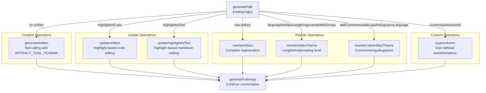
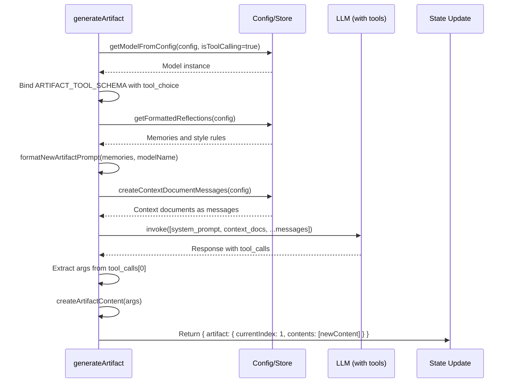
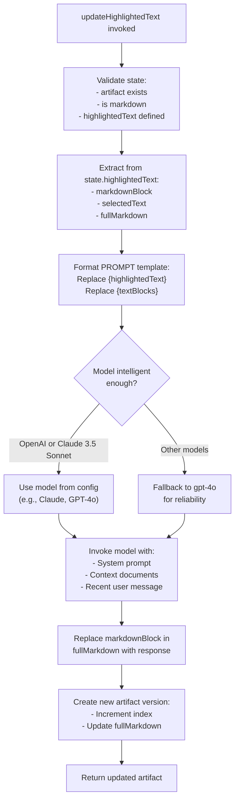
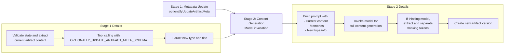
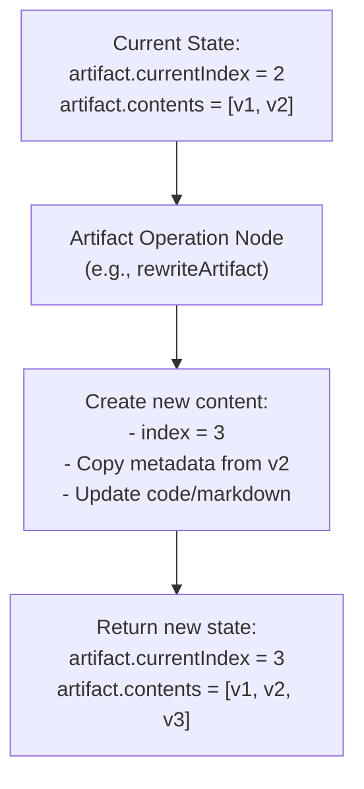
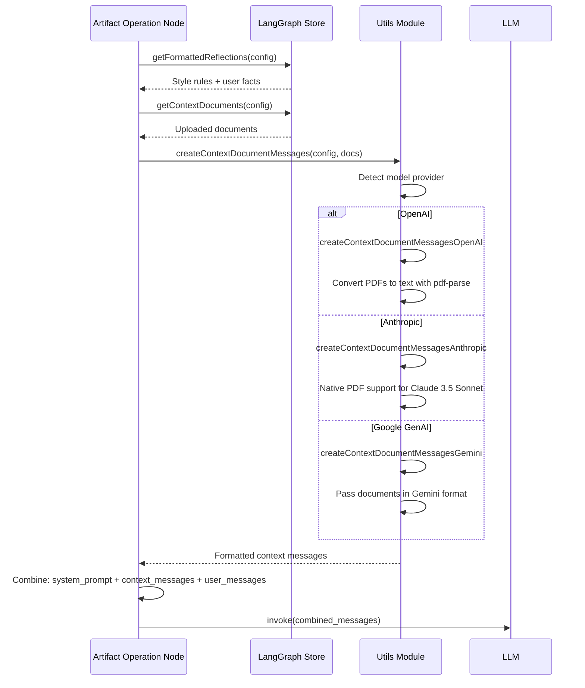
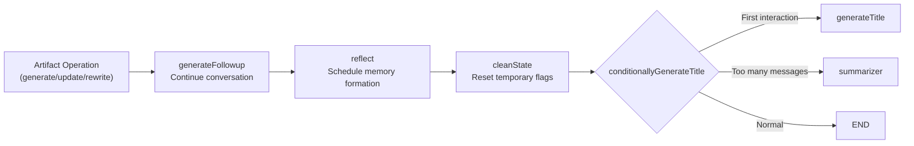

<!-- source: DeepWiki mcp.deepwiki.com · repo langchain-ai/open-canvas · page 4.3 Artifact Operations · fetched 2026-10-26 -->

# Artifact Operations

<details>
<summary>Relevant source files</summary>

The following files were used as context for generating this wiki page:

- [apps/agents/src/open-canvas/index.ts](apps/agents/src/open-canvas/index.ts)
- [apps/agents/src/open-canvas/nodes/generate-path/documents.ts](apps/agents/src/open-canvas/nodes/generate-path/documents.ts)
- [apps/agents/src/open-canvas/nodes/generate-path/dynamic-determine-path.ts](apps/agents/src/open-canvas/nodes/generate-path/dynamic-determine-path.ts)
- [apps/agents/src/open-canvas/nodes/generate-path/include-url-contents.ts](apps/agents/src/open-canvas/nodes/generate-path/include-url-contents.ts)
- [apps/agents/src/open-canvas/nodes/generate-path/index.ts](apps/agents/src/open-canvas/nodes/generate-path/index.ts)
- [apps/agents/src/summarizer/index.ts](apps/agents/src/summarizer/index.ts)
- [apps/agents/src/web-search/nodes/classify-message.ts](apps/agents/src/web-search/nodes/classify-message.ts)
- [apps/agents/src/web-search/nodes/query-generator.ts](apps/agents/src/web-search/nodes/query-generator.ts)
- [apps/agents/tsconfig.json](apps/agents/tsconfig.json)
- [langgraph.json](langgraph.json)
- [packages/shared/src/types.ts](packages/shared/src/types.ts)
- [packages/shared/src/utils/urls.ts](packages/shared/src/utils/urls.ts)

</details>


## Purpose and Scope

This document details the specialized nodes in the Open Canvas agent graph that create, modify, and regenerate artifacts. These nodes are the core of the artifact manipulation system, implementing various strategies for generating code and markdown documents based on user requests.

For information about how these nodes are selected and routed to, see [Path Generation and Routing](#4.2). For information about the artifact data structures and versioning, see [Artifact System](#3.3). For information about state management across nodes, see [Agent Graph Structure](#4.1).

**Sources:** [apps/agents/src/open-canvas/index.ts:1-162](), [langgraph.json:1-14]()

---

## Artifact Operation Node Overview

The Open Canvas agent graph includes seven specialized nodes for artifact manipulation, each handling different types of modifications:

| Node Name | Function | Trigger Condition | Input Requirements |
|-----------|----------|-------------------|-------------------|
| `generateArtifact` | Creates new artifacts from scratch | No existing artifact or web search results available | User message requesting artifact creation |
| `updateArtifact` | Modifies specific highlighted code sections | `state.highlightedCode` is defined | Highlighted code selection, existing code artifact |
| `updateHighlightedText` | Modifies specific highlighted markdown text | `state.highlightedText` is defined | Highlighted text selection, existing markdown artifact |
| `rewriteArtifact` | Completely regenerates existing artifact | Artifact exists, no special flags set | Existing artifact of any type |
| `rewriteArtifactTheme` | Applies thematic changes to markdown | `state.language`, `state.artifactLength`, or `state.regenerateWithEmojis` set | Existing markdown artifact |
| `rewriteCodeArtifactTheme` | Applies code-specific transformations | `state.addComments`, `state.addLogs`, `state.fixBugs`, or `state.portLanguage` set | Existing code artifact |
| `customAction` | Executes user-defined quick actions | `state.customQuickActionId` is defined | Existing artifact, custom action definition |

All nodes follow the same signature pattern: they accept `state: typeof OpenCanvasGraphAnnotation.State` and `config: LangGraphRunnableConfig`, and return `Promise<OpenCanvasGraphReturnType>`.

**Sources:** [apps/agents/src/open-canvas/index.ts:108-127](), [packages/shared/src/constants.ts:10-25]()

---

## Artifact Operation Flow



**Sources:** [apps/agents/src/open-canvas/index.ts:129-147]()

---

## Generate Artifact Node

The `generateArtifact` node creates new artifacts from scratch using tool calling. It is the primary entry point for artifact creation when no existing artifact is present.

### Implementation Strategy

1. **Tool Binding**: The node binds the `ARTIFACT_TOOL_SCHEMA` to the LLM with forced tool choice
2. **Context Preparation**: Includes reflections (memories/style rules), system prompt, and context documents
3. **Model Invocation**: Calls the model with tool calling enabled
4. **Artifact Creation**: Extracts tool call arguments and creates the artifact structure

### Key Code Flow



### Artifact Tool Schema

The node uses structured output via the `ARTIFACT_TOOL_SCHEMA`, which defines fields for:
- `type`: Artifact type (code or text)
- `title`: Artifact title
- `code` or `fullMarkdown`: The actual content
- `language`: Programming language (for code artifacts)

The schema enforces that the model returns properly structured artifact data that can be directly inserted into the state.

**Sources:** [apps/agents/src/open-canvas/nodes/generate-artifact/index.ts:1-84](), [apps/agents/src/utils.ts:341-409]()

---

## Update Operations

### Update Artifact (Code)

The `updateArtifact` node handles targeted modifications to highlighted code sections. This is referenced in the graph but the implementation file was not provided in the context.

**Typical Flow:**
1. User selects specific lines of code in the UI
2. `state.highlightedCode` is populated with selection metadata
3. Node receives the highlighted section and surrounding context
4. LLM generates updated code for only the selected portion
5. Updated code replaces the highlighted section in the full artifact

**Sources:** [apps/agents/src/open-canvas/index.ts:117]()

---

### Update Highlighted Text (Markdown)

The `updateHighlightedText` node modifies specific sections of markdown artifacts while preserving the overall structure.

#### Prompt Strategy

The node uses a specialized prompt that emphasizes:
- Responding with ONLY the updated text block
- Maintaining full markdown syntax and formatting
- Avoiding additional markdown wrappers
- Preserving surrounding content unchanged



#### Model Selection Logic

The node includes intelligent fallback logic:
- If the user's selected model is OpenAI or Claude 3.5 Sonnet, it's used directly
- For other models, the system falls back to `gpt-4o` to ensure reliable text updates
- This prevents issues with less capable models producing incorrect formatting

**Sources:** [apps/agents/src/open-canvas/nodes/updateHighlightedText.ts:1-144]()

---

## Rewrite Operations

### Rewrite Artifact (Complete Regeneration)

The `rewriteArtifact` node performs complete artifact regeneration based on user feedback. This is the most flexible rewrite operation.

#### Two-Stage Process



#### Metadata Update Strategy

Before generating new content, the node calls `optionallyUpdateArtifactMeta` to determine if the artifact's type or title should change:

1. **Tool Calling**: Uses `OPTIONALLY_UPDATE_ARTIFACT_META_SCHEMA` for structured output
2. **Reflection Integration**: Includes user's style guidelines and memories
3. **Context Awareness**: Considers the current artifact content and user's request
4. **Type Detection**: Determines if the artifact type should change (e.g., code → markdown)

#### Thinking Model Support

For models that support chain-of-thought reasoning (e.g., o1, o3-mini), the node:
1. Detects thinking models via `isThinkingModel(modelName)`
2. Extracts thinking and response tokens using `extractThinkingAndResponseTokens()`
3. Creates a separate `AIMessage` for the thinking content
4. Returns both the thinking message and the updated artifact

**Sources:** [apps/agents/src/open-canvas/nodes/rewrite-artifact/index.ts:1-100](), [apps/agents/src/open-canvas/nodes/rewrite-artifact/update-meta.ts:1-67]()

---

### Rewrite Artifact Theme (Style Modifications)

The `rewriteArtifactTheme` node applies stylistic changes to markdown artifacts without changing the core content. This is triggered by state flags like:
- `state.language`: Change reading level/language complexity
- `state.artifactLength`: Make content longer or shorter
- `state.regenerateWithEmojis`: Add or remove emojis

**Typical Use Cases:**
- "Make this more concise"
- "Add emojis to make it friendlier"
- "Rewrite at a 5th grade reading level"
- "Expand this with more detail"

**Sources:** [apps/agents/src/open-canvas/index.ts:115](), [packages/shared/src/constants.ts:14-16]()

---

### Rewrite Code Artifact Theme (Code Transformations)

The `rewriteCodeArtifactTheme` node applies code-specific transformations triggered by state flags:
- `state.addComments`: Add explanatory comments
- `state.addLogs`: Insert logging statements
- `state.fixBugs`: Debug and fix errors
- `state.portLanguage`: Convert to different programming language

**Typical Use Cases:**
- "Add comments to this code"
- "Port this Python code to TypeScript"
- "Fix any bugs in this code"
- "Add console.log statements for debugging"

**Sources:** [apps/agents/src/open-canvas/index.ts:116](), [packages/shared/src/constants.ts:18-21]()

---

## Custom Action Node

The `customAction` node executes user-defined quick actions on artifacts. This provides an extensible mechanism for adding custom transformations without modifying the core graph.

**Trigger Condition:** `state.customQuickActionId` is set to a non-undefined value

**Implementation Pattern:**
1. System looks up the custom action definition by ID
2. Applies the action's prompt template to the current artifact
3. Invokes the model with the custom instructions
4. Returns the transformed artifact

This allows users to define frequently-used transformations (e.g., "Convert to bullet points", "Add citations", "Generate unit tests") that can be triggered with a single click.

**Sources:** [apps/agents/src/open-canvas/index.ts:120](), [packages/shared/src/constants.ts:22]()

---

## State Management and Artifact Versioning

### Artifact Structure

All artifact operations work with the `ArtifactV3` structure:

```typescript
{
  currentIndex: number,      // Points to the active version
  contents: Array<           // Array of all versions
    ArtifactCodeV3 | ArtifactMarkdownV3
  >
}
```

Each content item has an `index` field that identifies its version. When nodes create new versions, they:
1. Increment the index: `state.artifact.contents.length + 1`
2. Create a new content object with the updated data
3. Append it to the `contents` array
4. Update `currentIndex` to point to the new version

### Version Creation Pattern



This versioning strategy enables:
- **Undo/Redo**: Users can navigate between versions
- **Comparison**: UI can show diffs between versions
- **Rollback**: Users can return to any previous state
- **History**: Full audit trail of changes

**Sources:** [apps/agents/src/open-canvas/nodes/rewrite-artifact/index.ts:82-99](), [apps/agents/src/open-canvas/nodes/updateHighlightedText.ts:117-142]()

---

## Context Integration

All artifact operation nodes integrate multiple context sources to produce high-quality outputs:

| Context Source | Purpose | Integration Method |
|---------------|---------|-------------------|
| Reflections | Apply user's style preferences and remembered facts | `getFormattedReflections(config)` |
| Context Documents | Include uploaded files (PDFs, text) in prompts | `createContextDocumentMessages(config)` |
| System Prompt | Custom instructions from user settings | `optionallyGetSystemPromptFromConfig(config)` |
| Web Search Results | External information from web search agent | `state.webSearchResults` |
| Message History | Full conversation context | `state._messages` |

### Context Message Construction Flow



### Model-Specific Context Handling

Different LLM providers have varying capabilities for context documents:

- **OpenAI**: PDFs must be converted to text using `pdf-parse` library
- **Anthropic**: Claude 3.5 Sonnet supports native PDF document understanding
- **Google GenAI**: Gemini models accept documents in specific format with base64 encoding

The `createContextDocumentMessages` function handles these differences transparently.

**Sources:** [apps/agents/src/utils.ts:515-582](), [apps/agents/src/utils.ts:434-513]()

---

## Model Configuration and Fallbacks

Artifact operations must handle diverse LLM models with varying capabilities:

### Temperature and Token Exclusions

Certain models (e.g., OpenAI o1 series) don't support standard parameters:

```typescript
const includeStandardParams = !TEMPERATURE_EXCLUDED_MODELS.some(
  (m) => m === modelName
);

if (includeStandardParams) {
  // Use temperature and maxTokens
} else {
  // Use max_completion_tokens instead
}
```

### Tool Calling Fallbacks

For artifact generation, which requires tool calling:

1. **o1 models**: Automatically fall back to `gpt-4o` since o1 doesn't support tools
2. **Gemini Thinking**: Falls back to `gemini-2.0-flash-exp` for tool support
3. **Fireworks**: Uses `llama-v3p3-70b-instruct` for tool calling operations

These fallbacks are handled in `getModelConfig()` with the `isToolCalling` flag:

```typescript
if (extra?.isToolCalling && actualModelName.includes("o1")) {
  actualModelName = "gpt-4o"; // Fallback for tool calling
}
```

**Sources:** [apps/agents/src/utils.ts:162-302](), [apps/agents/src/utils.ts:382-395]()

---

## Post-Operation Flow

After any artifact operation completes, the graph follows a consistent flow:



### State Cleanup

The `cleanState` node resets all temporary operation flags to their defaults:

```typescript
{
  highlightedCode: undefined,
  highlightedText: undefined,
  next: undefined,
  language: undefined,
  artifactLength: undefined,
  regenerateWithEmojis: undefined,
  readingLevel: undefined,
  addComments: undefined,
  addLogs: undefined,
  fixBugs: undefined,
  portLanguage: undefined,
  customQuickActionId: undefined,
  webSearchEnabled: undefined,
  webSearchResults: undefined,
}
```

This ensures that operation flags don't persist across turns and interfere with subsequent routing decisions.

**Sources:** [apps/agents/src/open-canvas/index.ts:30-34](), [apps/agents/src/open-canvas/index.ts:141-153](), [packages/shared/src/constants.ts:10-25]()

---

## Integration with Web Search

Artifact operations can be enhanced with web search results. When `state.webSearchEnabled` is true:

1. **Path Generation** routes to `webSearch` node first
2. **Web Search Agent** generates query and retrieves results
3. **Route Post Web Search** determines next action:
   - If artifact exists → `rewriteArtifact`
   - If no artifact → `generateArtifact`
4. **Web results** are added to messages as `AIMessage` with `webSearchResults` metadata
5. **Artifact operation** proceeds with enriched context

This enables use cases like:
- "Generate a React component that uses the latest Tailwind CSS features"
- "Update this code with current best practices from the web"
- "Rewrite this article with facts from recent news"

**Sources:** [apps/agents/src/open-canvas/index.ts:78-106](), [apps/agents/src/utils.ts:604-632]()

---

