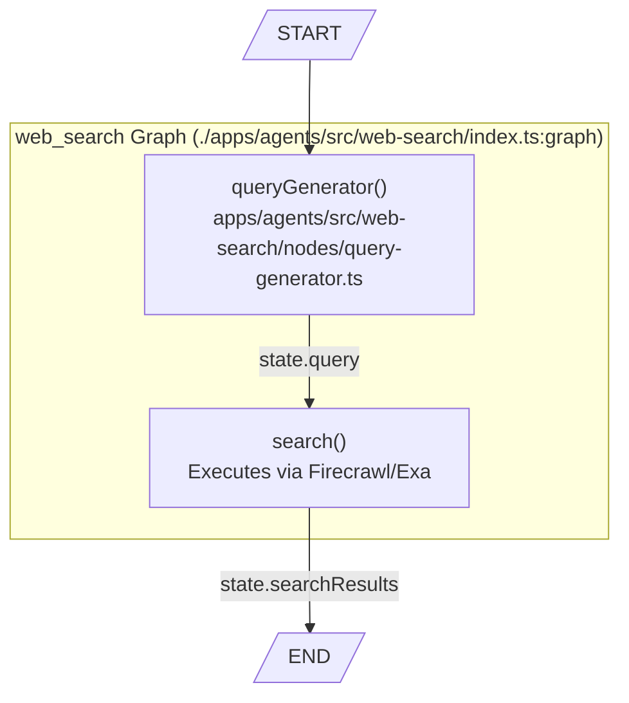
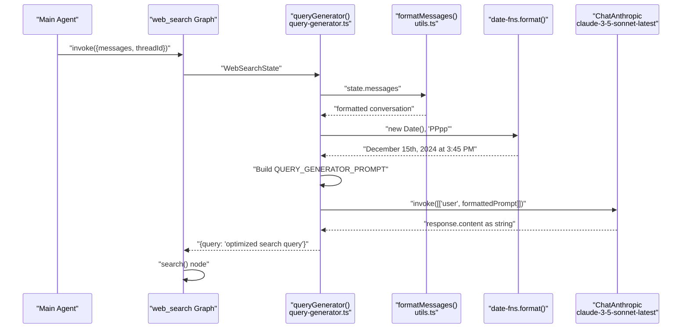
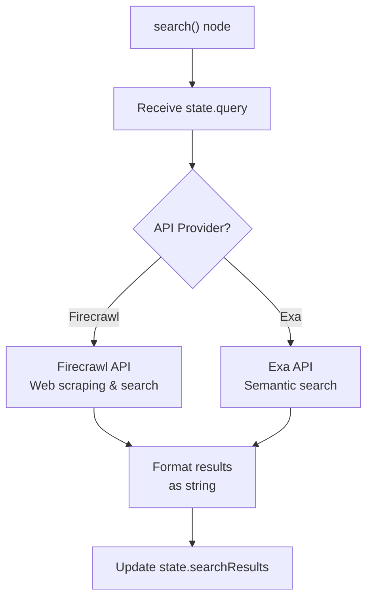
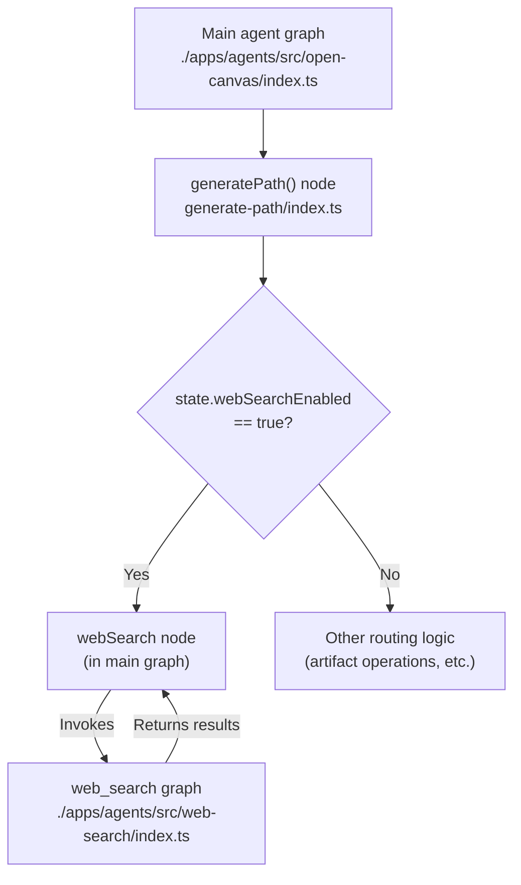
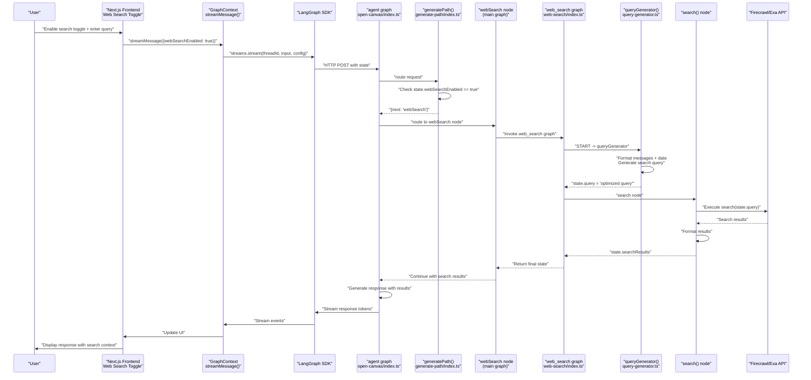

<!-- source: DeepWiki mcp.deepwiki.com · repo langchain-ai/open-canvas · page 4.4 Web Search Agent · fetched 2026-10-26 -->

# Web Search Agent

<details>
<summary>Relevant source files</summary>

The following files were used as context for generating this wiki page:

- [apps/agents/src/open-canvas/index.ts](apps/agents/src/open-canvas/index.ts)
- [apps/agents/src/open-canvas/nodes/generate-path/documents.ts](apps/agents/src/open-canvas/nodes/generate-path/documents.ts)
- [apps/agents/src/open-canvas/nodes/generate-path/dynamic-determine-path.ts](apps/agents/src/open-canvas/nodes/generate-path/dynamic-determine-path.ts)
- [apps/agents/src/open-canvas/nodes/generate-path/include-url-contents.ts](apps/agents/src/open-canvas/nodes/generate-path/include-url-contents.ts)
- [apps/agents/src/open-canvas/nodes/generate-path/index.ts](apps/agents/src/open-canvas/nodes/generate-path/index.ts)
- [apps/agents/src/summarizer/index.ts](apps/agents/src/summarizer/index.ts)
- [apps/agents/src/web-search/nodes/classify-message.ts](apps/agents/src/web-search/nodes/classify-message.ts)
- [apps/agents/src/web-search/nodes/query-generator.ts](apps/agents/src/web-search/nodes/query-generator.ts)
- [apps/agents/tsconfig.json](apps/agents/tsconfig.json)
- [langgraph.json](langgraph.json)
- [packages/shared/src/types.ts](packages/shared/src/types.ts)
- [packages/shared/src/utils/urls.ts](packages/shared/src/utils/urls.ts)

</details>


This document provides a technical overview of the Web Search Agent in Open Canvas. The web search agent is a specialized LangGraph that generates optimized search queries and retrieves information from the internet when requested by the main agent.

For information about the frontend components that enable web search, see page 3.5. For information about how the main agent integrates with the web search agent, see page 4.1.

## 1. Overview

The Web Search Agent is implemented as a standalone LangGraph named `web_search`, registered in the LangGraph configuration alongside other specialized agents:

| Graph Name | Purpose | Entry Point |
|------------|---------|-------------|
| `agent` | Main Open Canvas agent | `./apps/agents/src/open-canvas/index.ts:graph` |
| `web_search` | Web search agent | `./apps/agents/src/web-search/index.ts:graph` |
| `reflection` | Memory formation | `./apps/agents/src/reflection/index.ts:graph` |
| `summarizer` | Conversation compression | `./apps/agents/src/summarizer/index.ts:graph` |
| `thread_title` | Title generation | `./apps/agents/src/thread-title/index.ts:graph` |

The web search agent is invoked by the main agent when `state.webSearchEnabled` is true. It takes conversation messages as input, generates an optimized search query using Claude 3.5 Sonnet, executes the search via Firecrawl or Exa APIs, and returns formatted results that the main agent can incorporate into its response.

Sources: [langgraph.json:1-14]()

## 2. Agent Graph Structure

### Agent Graph Architecture



The web search graph is defined in [apps/agents/src/web-search/index.ts]() and consists of two sequential nodes:

1. **`queryGenerator`**: Transforms conversation messages into a search-optimized query using Claude 3.5 Sonnet
2. **`search`**: Executes the search using Firecrawl or Exa API and returns formatted results

### State Definition

The web search agent uses `WebSearchState` (defined via `WebSearchAnnotation`) to manage data flow:

```typescript
interface WebSearchState {
  messages: BaseMessage[];      // Input: conversation history from main agent
  threadId: string;             // Thread identifier for tracking
  query?: string;               // Generated: optimized search query
  searchResults?: string;       // Generated: formatted search results
}
```

The state flows through the graph:
- `messages` and `threadId` are provided by the main agent upon invocation
- `queryGenerator` adds `query` to the state
- `search` node adds `searchResults` to the state
- Final state with `searchResults` is returned to the main agent

Sources: [langgraph.json:11](), [apps/agents/src/web-search/nodes/query-generator.ts:24-45]()

## 3. Query Generation

### Query Generator Node

The `queryGenerator` node is responsible for transforming user messages into search-engine optimized queries. It uses Claude 3.5 Sonnet with zero temperature to ensure deterministic query generation.

### Query Generation Flow


</thinking>

The `queryGenerator` function in [apps/agents/src/web-search/nodes/query-generator.ts:24-45]() executes the following steps:

1. Initializes `ChatAnthropic` model with `claude-3-5-sonnet-latest` and `temperature: 0`
2. Calls `formatMessages(state.messages)` to convert message objects to readable text
3. Generates current date string using `format(new Date(), "PPpp")` from `date-fns`
4. Builds the prompt by replacing placeholders in `QUERY_GENERATOR_PROMPT`
5. Invokes the model with the formatted prompt
6. Returns `{query: response.content}` to update the state

### Query Generator Prompt

The query generator uses a focused prompt that instructs the model to:

1. Transform the most recent user message into a search-engine friendly query
2. Keep the query similar to the original message
3. Include conversation context for relevance
4. Use the current date for time-sensitive queries

The prompt structure:

```
You're a helpful AI assistant tasked with writing a query to search the web.
You're provided with a list of messages between a user and an AI assistant.
The most recent message from the user is the one you should update to be 
a more search engine friendly query.

Try to keep the new query as similar to the message as possible, while 
still being search engine friendly.

<conversation>
{conversation}
</conversation>

<additional_context>
The current date is {formatted_date}
</additional_context>

Respond ONLY with the search query, and nothing else.
```

### Model Configuration

```typescript
const model = new ChatAnthropic({
  model: "claude-3-5-sonnet-latest",
  temperature: 0,
});
```

The zero temperature ensures consistent, predictable query generation without creative variation.

### Date Context

The query generator includes the current date in the prompt to help generate time-aware queries:

```typescript
const additionalContext = `The current date is ${format(new Date(), "PPpp")}`;
```

This uses `date-fns` formatting to provide a complete date-time string (e.g., "December 15th, 2024 at 3:45 PM").

Sources: [apps/agents/src/web-search/nodes/query-generator.ts:1-46](), [apps/agents/src/summarizer/index.ts:8]()

## 4. Search Execution

### Search Node

The `search` node (defined in [apps/agents/src/web-search/index.ts]()) takes the optimized query from `queryGenerator` and performs the actual web search. The implementation uses either Firecrawl or Exa API to retrieve search results.

### Search Execution Process



The search node:
1. Receives `state.query` from `queryGenerator`
2. Executes the search using the configured search provider (Firecrawl or Exa)
3. Formats the search results into a readable string
4. Updates `state.searchResults` with the formatted output
5. Returns control to the graph, which ends and returns to the main agent

### Search Result Format

The search results are formatted as a string containing:

| Field | Description |
|-------|-------------|
| Title | Result title or heading |
| URL | Source URL |
| Content | Snippet or summary of the result |
| Relevance | Optional relevance score or ranking |

These formatted results are stored in `state.searchResults` and returned to the main agent for incorporation into response generation.

Sources: [langgraph.json:11]()

## 5. Integration with Main Agent

### Invocation from Main Agent

The web search agent is invoked by the Open Canvas main agent (the `agent` graph) when `state.webSearchEnabled` is true. This occurs during the routing phase in the `generatePath` node.

### Routing Decision in Main Agent



The routing logic in `generatePath` checks the state flag:

```typescript
if (state.webSearchEnabled) {
  return {
    next: "webSearch",
    ...(newMessages.length
      ? { messages: newMessages, _messages: newMessages }
      : {}),
  };
}
```

When `state.webSearchEnabled` is true:
1. `generatePath` returns `{next: "webSearch"}`
2. The main agent routes to its `webSearch` node
3. The `webSearch` node invokes the `web_search` graph with current state
4. The `web_search` graph executes and returns results
5. Control returns to the main agent for further processing

### Post-Search Processing

After the web search graph completes:

1. The search results are returned to the main agent
2. The main agent's `routeAfterWebSearch` or similar node processes the results
3. The results are incorporated into the context for artifact generation or response generation
4. The main agent continues with its normal workflow (e.g., `generateArtifact`, `rewriteArtifact`, or `respondToGeneralInput`)

Sources: [langgraph.json:11]()

## 6. Complete Web Search Flow

The complete flow from user request to search results involves the frontend, main agent, and web search graph:



The end-to-end flow:

1. User enables web search toggle in UI and submits query
2. Frontend sets `webSearchEnabled: true` and calls `GraphContext.streamMessage()`
3. LangGraph SDK sends HTTP request to main agent
4. Main agent's `generatePath` checks `state.webSearchEnabled` and routes to `webSearch` node
5. `webSearch` node invokes the `web_search` graph
6. Web search graph executes `queryGenerator` → `search` pipeline
7. `queryGenerator` optimizes the query using Claude 3.5 Sonnet
8. `search` node executes via Firecrawl/Exa API
9. Formatted results return to main agent in `state.searchResults`
10. Main agent incorporates results into response generation
11. Response streams back to frontend and displays to user

Sources: [langgraph.json:6-11](), [apps/agents/src/web-search/nodes/query-generator.ts:1-46]()

## 7. Technical Implementation Details

### Query Generator Implementation

The `queryGenerator` function in [apps/agents/src/web-search/nodes/query-generator.ts:24-45]() is implemented as follows:

```typescript
export async function queryGenerator(
  state: WebSearchState
): Promise<Partial<WebSearchState>> {
  const model = new ChatAnthropic({
    model: "claude-3-5-sonnet-latest",
    temperature: 0,
  });

  const additionalContext = `The current date is ${format(new Date(), "PPpp")}`;

  const formattedMessages = formatMessages(state.messages);
  const formattedPrompt = QUERY_GENERATOR_PROMPT.replace(
    "{conversation}",
    formattedMessages
  ).replace("{additional_context}", additionalContext);

  const response = await model.invoke([["user", formattedPrompt]]);

  return {
    query: response.content as string,
  };
}
```

Key implementation details:

| Component | Value | Purpose |
|-----------|-------|---------|
| Model | `claude-3-5-sonnet-latest` | High-quality query generation |
| Temperature | `0` | Deterministic output, no randomness |
| Date Format | `format(new Date(), "PPpp")` | Full date-time string (e.g., "Dec 15th, 2024 at 3:45 PM") |
| Message Format | `formatMessages()` utility | Converts `BaseMessage[]` to readable text |
| Prompt Template | `QUERY_GENERATOR_PROMPT` | Contains conversation and context placeholders |

### Message Formatting

The `formatMessages()` utility function (imported from `../../utils.js`) converts the LangChain message objects into a human-readable conversation format:

```typescript
const formattedMessages = formatMessages(state.messages);
// Converts:
// [HumanMessage("What's the weather?"), AIMessage("I need to search...")]
// Into:
// "User: What's the weather?\nAssistant: I need to search..."
```

This formatted conversation is then embedded in the query generator prompt to provide context for query optimization.

Sources: [apps/agents/src/web-search/nodes/query-generator.ts:1-46](), [apps/agents/src/summarizer/index.ts:8]()

## 8. Summary

The web search functionality in Open Canvas consists of two primary capabilities:

| Capability | Trigger | Implementation | Purpose |
|------------|---------|----------------|---------|
| Direct Web Search | User enables search toggle | `web_search` graph with `queryGenerator` and `searchExecutor` | Perform internet searches for up-to-date information |
| URL Content Extraction | URLs detected in message | `includeURLContents` with FireCrawl | Extract and include content from specific URLs |

These capabilities allow the AI assistant to access current information from the internet, making responses more accurate and useful for time-sensitive or research-oriented queries.

Sources: [apps/agents/src/open-canvas/nodes/generate-path/index.ts:26-168](), [apps/agents/src/web-search/nodes/query-generator.ts:1-46](), [apps/agents/src/open-canvas/nodes/generate-path/include-url-contents.ts:1-120]()

---

