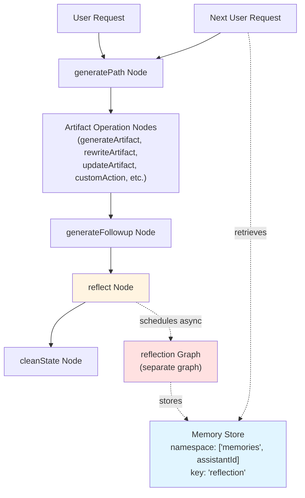
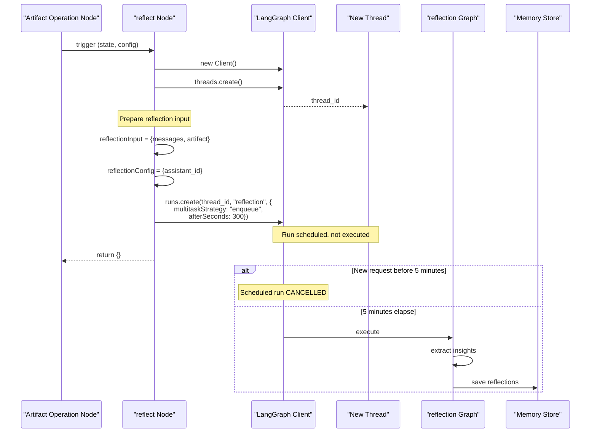
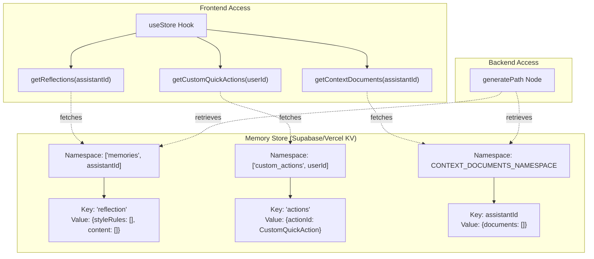
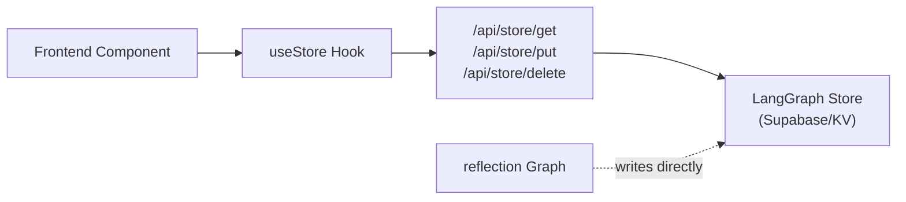
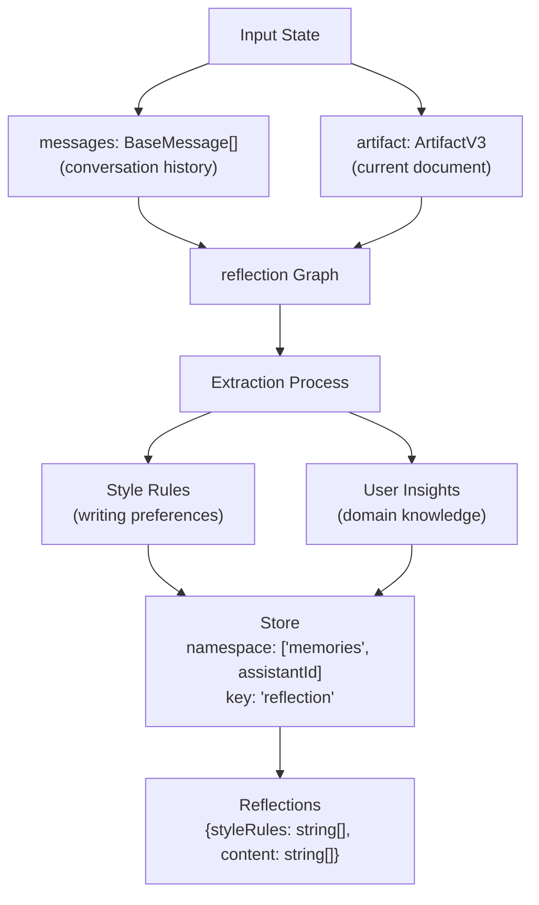
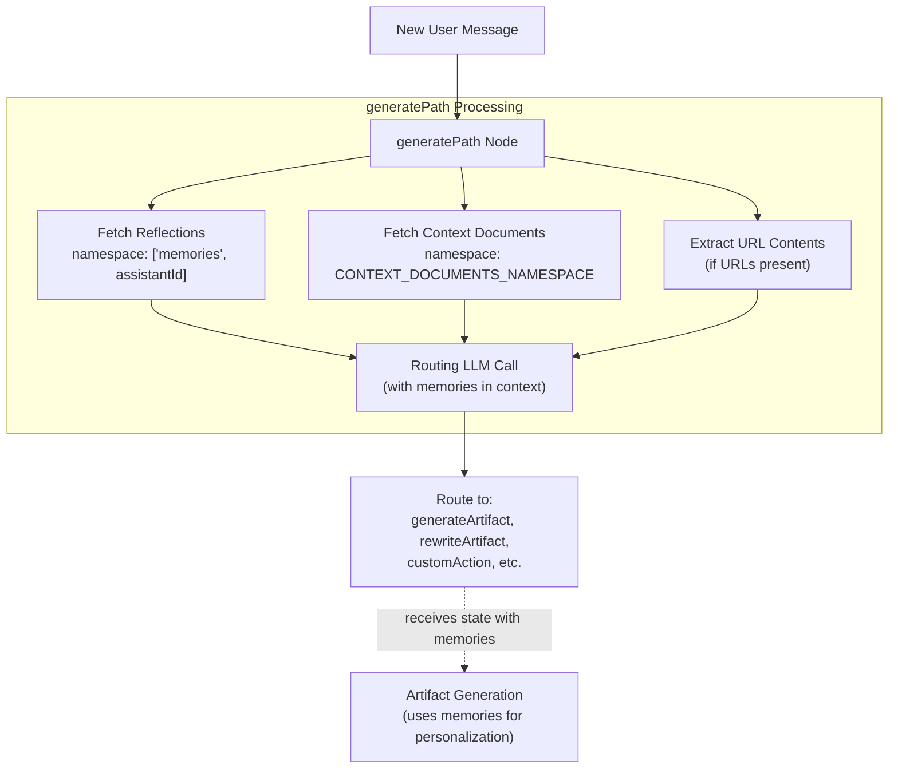
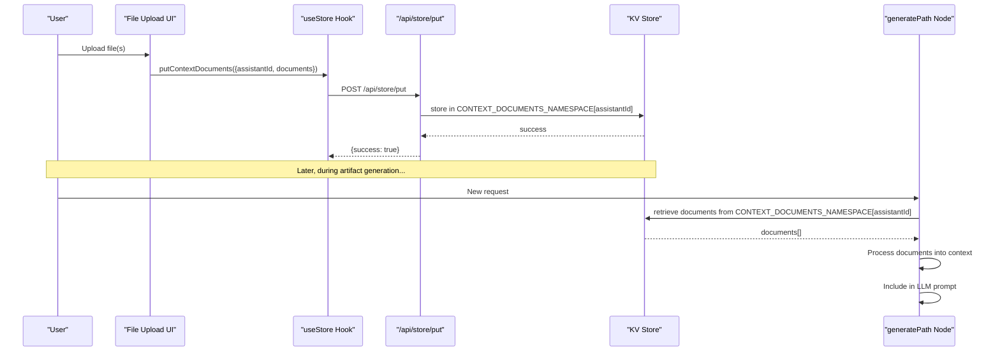
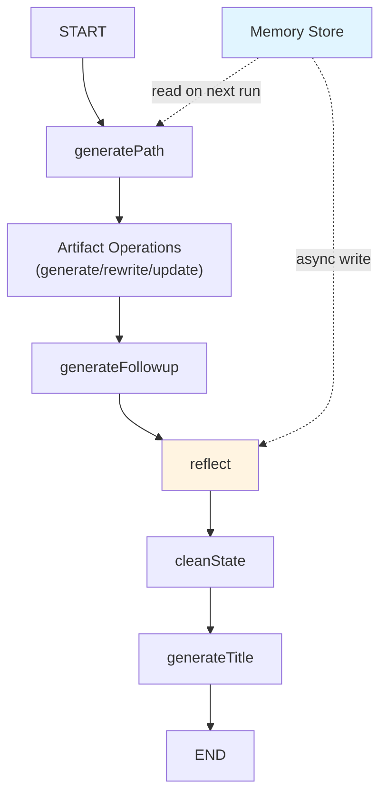

<!-- source: DeepWiki mcp.deepwiki.com · repo langchain-ai/open-canvas · page 4.5 Reflection and Memory System · fetched 2026-10-26 -->

# Reflection and Memory System

<details>
<summary>Relevant source files</summary>

The following files were used as context for generating this wiki page:

- [.codespellignore](.codespellignore)
- [apps/agents/package.json](apps/agents/package.json)
- [apps/agents/src/open-canvas/index.ts](apps/agents/src/open-canvas/index.ts)
- [apps/agents/src/open-canvas/nodes/reflect.ts](apps/agents/src/open-canvas/nodes/reflect.ts)
- [apps/agents/src/summarizer/index.ts](apps/agents/src/summarizer/index.ts)
- [apps/agents/src/web-search/nodes/classify-message.ts](apps/agents/src/web-search/nodes/classify-message.ts)
- [apps/agents/src/web-search/nodes/query-generator.ts](apps/agents/src/web-search/nodes/query-generator.ts)
- [apps/web/package.json](apps/web/package.json)
- [apps/web/src/components/assistant-ui/attachment.tsx](apps/web/src/components/assistant-ui/attachment.tsx)
- [apps/web/src/components/chat-interface/composer-actions-popout.tsx](apps/web/src/components/chat-interface/composer-actions-popout.tsx)
- [apps/web/src/components/chat-interface/composer.tsx](apps/web/src/components/chat-interface/composer.tsx)
- [apps/web/src/components/chat-interface/welcome.tsx](apps/web/src/components/chat-interface/welcome.tsx)
- [apps/web/src/components/ui/programming-lang-dropdown.tsx](apps/web/src/components/ui/programming-lang-dropdown.tsx)
- [apps/web/src/hooks/useStore.tsx](apps/web/src/hooks/useStore.tsx)
- [langgraph.json](langgraph.json)
- [packages/evals/package.json](packages/evals/package.json)
- [packages/shared/package.json](packages/shared/package.json)
- [packages/shared/src/types.ts](packages/shared/src/types.ts)

</details>


## Purpose and Scope

The Reflection and Memory System enables Open Canvas to learn from user interactions and progressively personalize content generation. This system extracts insights about user preferences, writing styles, and domain knowledge through asynchronous memory formation, storing these insights for retrieval in future interactions. This page documents the reflect node's scheduling mechanism, the reflection graph's extraction process, memory storage architecture, and how these memories influence content generation.

For information about context compression and message summarization, see [Supporting Agents](#4.6). For details on how memories are used during path routing, see [Path Generation and Routing](#4.2).

---

## System Architecture

The reflection system operates through three primary components: a triggering mechanism in the main agent workflow, an asynchronous reflection graph that extracts insights, and a persistent storage layer for memory retrieval.

### Reflection Trigger Flow



**Sources:** [apps/agents/src/open-canvas/index.ts:141-153](), [apps/agents/src/open-canvas/nodes/reflect.ts:5-57](), [langgraph.json:8]()

The `reflect` node is invoked after every artifact manipulation operation in the main agent graph. Rather than blocking the response, it schedules an asynchronous run of the `reflection` graph, allowing the user to continue their interaction while memory formation happens in the background.

---

## The Reflect Node

### Implementation and Scheduling Strategy

The `reflect` node implements a sophisticated debounced async scheduling mechanism that balances memory formation with cost efficiency.



**Sources:** [apps/agents/src/open-canvas/nodes/reflect.ts:5-57]()

### Key Scheduling Parameters

| Parameter | Value | Purpose |
|-----------|-------|---------|
| `multitaskStrategy` | `"enqueue"` | Queues the reflection run instead of executing immediately |
| `afterSeconds` | `300` (5 minutes) | Debounces repeated reflection requests during active conversations |
| Thread Strategy | New thread per schedule | Each reflection run uses a fresh thread to avoid state conflicts |

The scheduling occurs in [apps/agents/src/open-canvas/nodes/reflect.ts:29-51]():

```typescript
await langGraphClient.runs.create(
  newThread.thread_id,
  "reflection",
  {
    input: reflectionInput,
    config: reflectionConfig,
    multitaskStrategy: "enqueue",
    afterSeconds: 5 * 60, // 5 minutes
  }
);
```

### Debouncing Behavior

The `afterSeconds` parameter creates a debouncing effect: if a user sends multiple messages within 5 minutes, each new artifact operation schedules a new reflection run, automatically canceling the previous pending run. This prevents redundant memory formation during active conversations while ensuring insights are eventually extracted after the user pauses.

**Sources:** [apps/agents/src/open-canvas/nodes/reflect.ts:29-51]()

---

## Memory Storage Architecture

### Storage Namespaces

The memory system uses three distinct namespaces in the LangGraph store to organize different types of persistent data:



**Sources:** [apps/web/src/hooks/useStore.tsx:1-304](), [packages/shared/src/constants.ts]()

### Reflections Data Structure

The `Reflections` type defines the memory format extracted by the reflection graph:

```typescript
export interface Reflections {
  styleRules: string[];
  content: string[];
}
```

**Sources:** [packages/shared/src/types.ts:160-169]()

- **`styleRules`**: Array of extracted style preferences (e.g., "Use emojis sparingly", "Prefer active voice", "Keep paragraphs short")
- **`content`**: Array of domain-specific insights about the user (e.g., "Works in healthcare", "Interested in machine learning", "Building a chatbot application")

### Frontend Storage Interface

The `useStore` hook provides the primary interface for memory operations from the frontend:

| Method | Namespace | Purpose |
|--------|-----------|---------|
| `getReflections(assistantId)` | `["memories", assistantId]` | Retrieves stored reflections for display |
| `deleteReflections(assistantId)` | `["memories", assistantId]` | Clears user's memory |
| `getCustomQuickActions(userId)` | `["custom_actions", userId]` | Fetches user-defined quick actions |
| `deleteCustomQuickAction(id, rest, userId)` | `["custom_actions", userId]` | Removes a quick action |
| `createCustomQuickAction(newAction, rest, userId)` | `["custom_actions", userId]` | Adds a quick action |
| `getContextDocuments(assistantId)` | `CONTEXT_DOCUMENTS_NAMESPACE` | Retrieves reference documents |
| `putContextDocuments({assistantId, documents})` | `CONTEXT_DOCUMENTS_NAMESPACE` | Stores reference documents |

**Sources:** [apps/web/src/hooks/useStore.tsx:11-304]()

### Storage Implementation

The frontend communicates with the store through API routes that wrap the LangGraph SDK store operations:



**Sources:** [apps/web/src/hooks/useStore.tsx:19-93]()

The `getReflections` method demonstrates the retrieval pattern in [apps/web/src/hooks/useStore.tsx:19-65]():

```typescript
const res = await fetch("/api/store/get", {
  method: "POST",
  body: JSON.stringify({
    namespace: ["memories", assistantId],
    key: "reflection",
  }),
});

const { item } = await res.json();
let styleRules = item.value.styleRules ?? [];
let content = item.value.content ?? [];
```

---

## The Reflection Graph

While the reflection graph implementation is defined in a separate module ([langgraph.json:8]()), its behavior can be understood through its inputs, outputs, and integration points.

### Reflection Graph Interface



**Sources:** [apps/agents/src/open-canvas/nodes/reflect.ts:14-24](), [langgraph.json:8]()

The reflection graph receives the full conversation history and current artifact state as input in [apps/agents/src/open-canvas/nodes/reflect.ts:14-24]():

```typescript
const reflectionInput = {
  messages: state._messages,
  artifact: state.artifact,
};
const reflectionConfig = {
  configurable: {
    open_canvas_assistant_id: config.configurable?.assistant_id,
  },
};
```

### Memory Extraction Categories

The reflection graph analyzes conversation patterns and artifact content to extract two types of insights:

| Category | Examples | Use Case |
|----------|----------|----------|
| **Style Rules** | "Prefers concise explanations", "Uses technical jargon", "Avoids passive voice", "Includes code comments" | Inform tone, structure, and formatting decisions in future generations |
| **User Insights** | "Building a React application", "Works in fintech", "Interested in accessibility", "Learning TypeScript" | Provide domain context and personalize content relevance |

**Sources:** [packages/shared/src/types.ts:160-169](), [Diagram 6 from high-level overview]()

---

## Memory Usage in Content Generation

### Retrieval During Path Generation

The `generatePath` node retrieves and incorporates stored memories at the beginning of each request, ensuring all downstream nodes benefit from learned context.



**Sources:** [High-level Diagram 6](), [apps/agents/src/open-canvas/nodes/generate-path/index.ts (referenced but not provided)]()

### Memory Impact on Artifact Generation

Memories influence content generation in multiple ways:

| Impact Area | Description | Example |
|-------------|-------------|---------|
| **Tone and Style** | Style rules guide voice, sentence structure, and formatting | If reflections include "Prefers bullet points", generated documents use more lists |
| **Technical Level** | Content insights adjust explanation depth | If user is "Learning Python", code examples include more explanatory comments |
| **Domain Context** | User insights pre-populate relevant context | If user "Works in healthcare", medical terminology is used appropriately without over-explanation |
| **Preference Adherence** | Past preferences are automatically applied | If user previously requested "No emojis", future generations exclude them by default |

### Custom Quick Actions and Memory

Custom quick actions (stored in `["custom_actions", userId]`) can optionally include reflections in their context through the `includeReflections` flag:

```typescript
export interface CustomQuickAction {
  id: string;
  title: string;
  prompt: string;
  includeReflections: boolean;    // Whether to inject memories
  includePrefix: boolean;         // Whether to include system prefix
  includeRecentHistory: boolean;  // Whether to include last 5 messages
}
```

**Sources:** [packages/shared/src/types.ts:132-158](), [apps/web/src/hooks/useStore.tsx:95-226]()

When `includeReflections` is true, the custom action execution includes the user's style rules and content insights in the prompt, ensuring personalized behavior even for user-defined operations.

---

## Context Documents

Context documents represent a distinct memory category optimized for reference materials rather than learned preferences.

### Context Document Structure

```typescript
export type ContextDocument = {
  name: string;           // Document filename
  type: string;           // MIME type or "text"
  data: string;           // Base64 encoded content or plain text
  metadata?: Record<string, any>;  // Optional additional data
};
```

**Sources:** [packages/shared/src/types.ts:171-189]()

### Context Document Lifecycle



**Sources:** [apps/web/src/hooks/useStore.tsx:228-289]()

Context documents are retrieved in [apps/web/src/hooks/useStore.tsx:260-289]():

```typescript
const res = await fetch("/api/store/get", {
  method: "POST",
  body: JSON.stringify({
    namespace: CONTEXT_DOCUMENTS_NAMESPACE,
    key: assistantId,
  }),
});

const { item } = await res.json();
return item?.value?.documents;
```

Unlike reflections which are extracted from interactions, context documents are explicitly uploaded by users and processed directly into the generation context by the `generatePath` node.

---

## Memory Management and Lifecycle

### Memory Persistence

| Memory Type | Scope | Lifetime | Deletion Method |
|-------------|-------|----------|-----------------|
| **Reflections** | Per assistant | Until manually deleted | `deleteReflections(assistantId)` |
| **Custom Quick Actions** | Per user | Until manually deleted | `deleteCustomQuickAction(id, rest, userId)` |
| **Context Documents** | Per assistant | Until manually replaced | Overwrite via `putContextDocuments()` |

**Sources:** [apps/web/src/hooks/useStore.tsx:67-93](), [apps/web/src/hooks/useStore.tsx:125-158](), [apps/web/src/hooks/useStore.tsx:228-258]()

### Memory Update Strategy

Memories follow an append-and-deduplicate strategy:

1. New reflection runs analyze recent interactions
2. Extracted insights are merged with existing reflections
3. The reflection graph handles deduplication logic internally
4. Updated reflections overwrite the previous version in the store

This approach ensures memories accumulate progressively without requiring manual merging logic in the application layer.

**Sources:** [High-level architecture understanding from Diagram 6]()

### Viewing and Managing Reflections

Users can view their stored reflections through the frontend interface, which retrieves and displays the memory state in [apps/web/src/hooks/useStore.tsx:19-65]():

```typescript
setReflections({
  ...item.value,
  styleRules,
  content,
  updatedAt: new Date(item.updatedAt),
  assistantId,
});
```

The `updatedAt` timestamp indicates when the most recent reflection run completed, providing transparency about memory freshness.

---

## Integration with Main Agent Graph

### Graph-Level Memory Flow

The reflection system integrates into the main agent graph as a post-processing step that doesn't block user responses:



**Sources:** [apps/agents/src/open-canvas/index.ts:108-162]()

The edge configuration in [apps/agents/src/open-canvas/index.ts:141-158]() shows the reflection trigger:

```typescript
.addEdge("generateArtifact", "generateFollowup")
.addEdge("updateArtifact", "generateFollowup")
.addEdge("updateHighlightedText", "generateFollowup")
.addEdge("rewriteArtifact", "generateFollowup")
.addEdge("rewriteArtifactTheme", "generateFollowup")
.addEdge("rewriteCodeArtifactTheme", "generateFollowup")
.addEdge("customAction", "generateFollowup")
// Only reflect if an artifact was generated/updated.
.addEdge("generateFollowup", "reflect")
.addEdge("reflect", "cleanState")
```

Every artifact-modifying operation routes through `generateFollowup` to `reflect`, ensuring consistent memory formation across all content generation paths.

---

## Performance Considerations

### Cost Optimization

The 5-minute debounce window serves multiple purposes:

| Benefit | Impact |
|---------|--------|
| **Reduced API Calls** | Avoids redundant reflection runs during rapid back-and-forth exchanges |
| **Batch Processing** | Allows multiple interactions to accumulate before analysis |
| **Cost Savings** | Minimizes LLM calls to the reflection graph |
| **Memory Quality** | Provides richer context for extraction by waiting for conversation pauses |

**Sources:** [apps/agents/src/open-canvas/nodes/reflect.ts:49]()

### Memory Retrieval Performance

Reflection retrieval adds minimal overhead to request processing:

1. Reflections are fetched once per request in `generatePath`
2. The data structure is compact (two string arrays)
3. Store lookups are fast (key-value retrieval)
4. No additional LLM calls required during retrieval

**Sources:** [Inferred from architecture]()

### Error Handling

The reflect node includes error handling to prevent reflection failures from impacting user experience in [apps/agents/src/open-canvas/nodes/reflect.ts:52-54]():

```typescript
} catch (e) {
  console.error("Failed to start reflection");
}

return {};
```

If reflection scheduling fails, the node returns an empty update, allowing the main workflow to complete successfully without stored memories.

---

## Summary

The Reflection and Memory System provides Open Canvas with progressive learning capabilities through:

1. **Async Scheduling**: The `reflect` node schedules background memory formation without blocking responses
2. **Debounced Execution**: 5-minute delay prevents redundant processing during active conversations  
3. **Structured Storage**: Separate namespaces organize reflections, quick actions, and context documents
4. **Automatic Retrieval**: The `generatePath` node fetches memories at the start of each request
5. **Personalized Generation**: Extracted style rules and user insights inform all downstream content operations

This architecture enables the system to learn user preferences and domain context organically, improving content quality over time while maintaining responsive user interactions.

**Sources:** [apps/agents/src/open-canvas/nodes/reflect.ts:5-57](), [apps/web/src/hooks/useStore.tsx:1-304](), [packages/shared/src/types.ts:160-189](), [apps/agents/src/open-canvas/index.ts:108-162](), [langgraph.json:8]()

---

