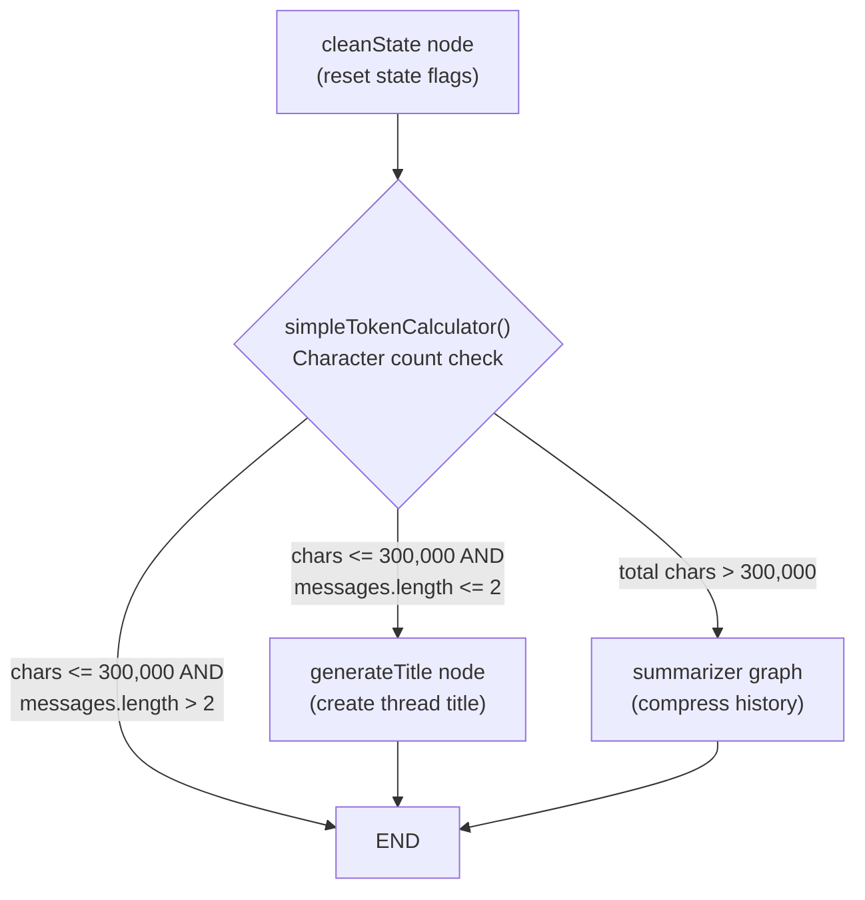
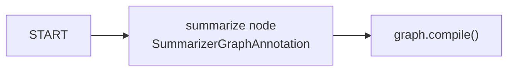
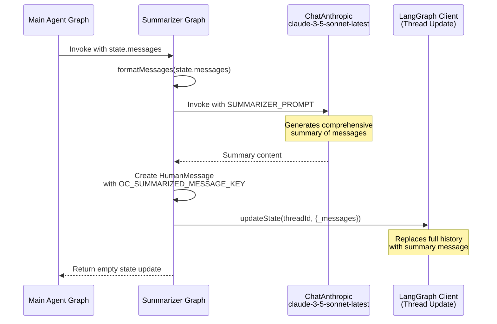
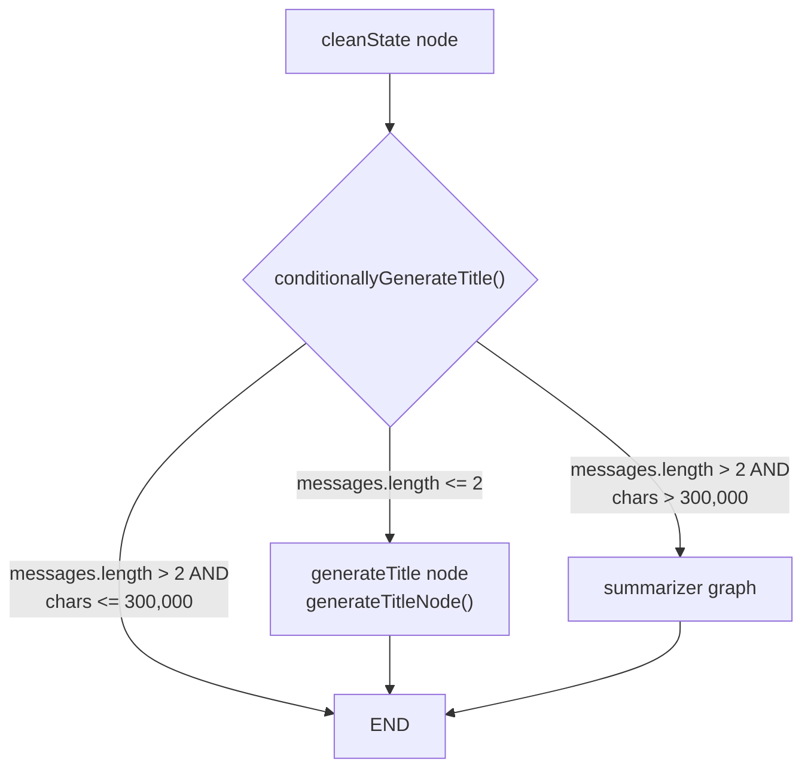
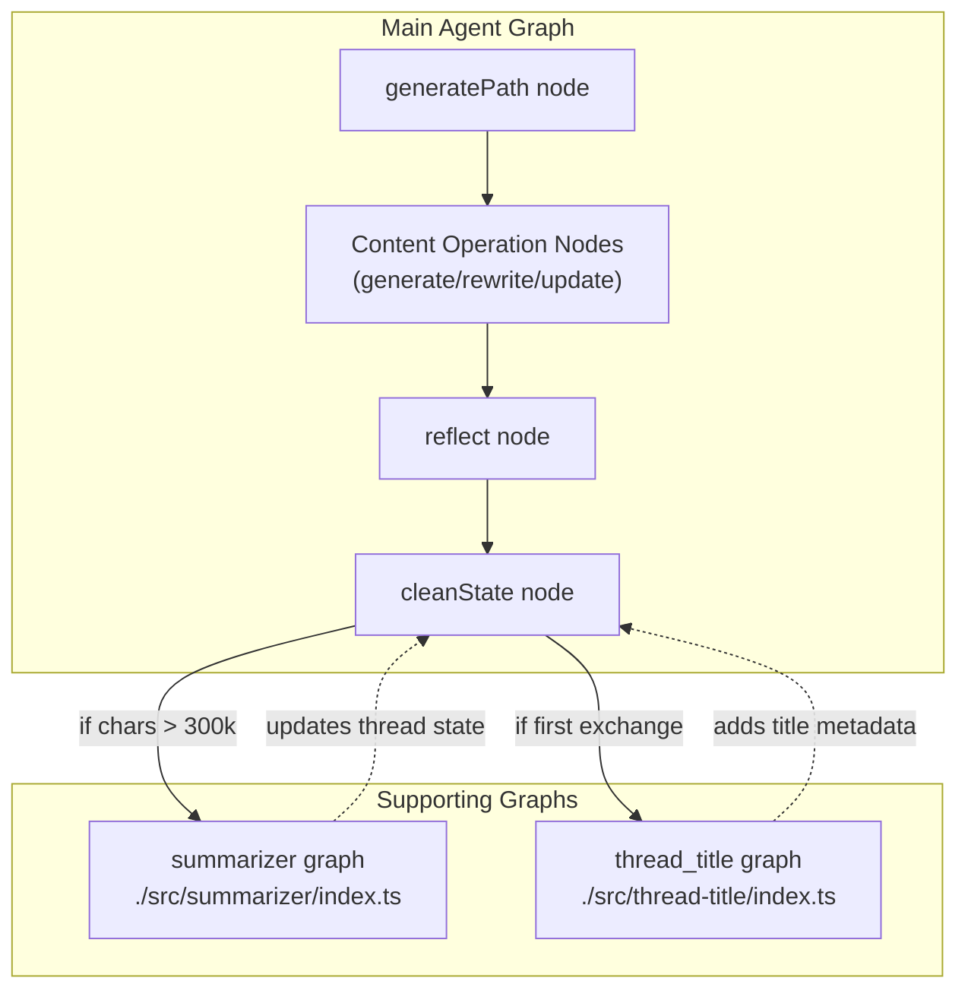

<!-- source: DeepWiki mcp.deepwiki.com · repo langchain-ai/open-canvas · page 4.6 Supporting Agents · fetched 2026-10-26 -->

# Supporting Agents

<details>
<summary>Relevant source files</summary>

The following files were used as context for generating this wiki page:

- [apps/agents/src/open-canvas/index.ts](apps/agents/src/open-canvas/index.ts)
- [apps/agents/src/open-canvas/nodes/generate-path/documents.ts](apps/agents/src/open-canvas/nodes/generate-path/documents.ts)
- [apps/agents/src/open-canvas/nodes/generate-path/dynamic-determine-path.ts](apps/agents/src/open-canvas/nodes/generate-path/dynamic-determine-path.ts)
- [apps/agents/src/open-canvas/nodes/generate-path/include-url-contents.ts](apps/agents/src/open-canvas/nodes/generate-path/include-url-contents.ts)
- [apps/agents/src/open-canvas/nodes/generate-path/index.ts](apps/agents/src/open-canvas/nodes/generate-path/index.ts)
- [apps/agents/src/summarizer/index.ts](apps/agents/src/summarizer/index.ts)
- [apps/agents/src/web-search/nodes/classify-message.ts](apps/agents/src/web-search/nodes/classify-message.ts)
- [apps/agents/src/web-search/nodes/query-generator.ts](apps/agents/src/web-search/nodes/query-generator.ts)
- [apps/agents/tsconfig.json](apps/agents/tsconfig.json)
- [langgraph.json](langgraph.json)
- [packages/shared/src/types.ts](packages/shared/src/types.ts)
- [packages/shared/src/utils/urls.ts](packages/shared/src/utils/urls.ts)

</details>


This page documents the supporting LangGraph graphs that provide auxiliary functionality to the main agent workflow. These specialized graphs handle context compression when message history grows too large, generate conversation titles for thread organization, and have already been covered in other sections. For the web search agent, see [Web Search Agent](#4.4). For the reflection and memory system, see [Reflection and Memory System](#4.5). For the main agent graph structure and workflow, see [Agent Graph Structure](#4.1).

---

## Overview of Supporting Graphs

The Open Canvas agent system defines five distinct graphs in [langgraph.json:6-11](). Three of these serve as supporting utilities:

| Graph Name | Entry Point | Primary Purpose |
|------------|-------------|-----------------|
| `summarizer` | `./apps/agents/src/summarizer/index.ts:graph` | Compress conversation history when context window limits are approached |
| `thread_title` | `./apps/agents/src/thread-title/index.ts:graph` | Generate concise titles for conversations based on initial exchanges |
| `web_search` | `./apps/agents/src/web-search/index.ts:graph` | Perform web searches and enrich context (documented in [4.4](#4.4)) |

These graphs are invoked conditionally by the main agent graph based on specific state conditions and thresholds.

**Sources:** [langgraph.json:1-14]()

---

## Summarizer Graph

### Purpose and Triggering Conditions

The summarizer graph compresses conversation history when the total character count exceeds a predefined threshold. The main agent graph monitors message length using the `simpleTokenCalculator` function at [apps/agents/src/open-canvas/index.ts:39-57]():



**Figure 1:** Decision flow for invoking the summarizer graph

The `CHARACTER_MAX` constant is set to 300,000 characters at [apps/agents/src/open-canvas/index.ts:37](), which approximates 75,000 tokens assuming 4 characters per token.

**Sources:** [apps/agents/src/open-canvas/index.ts:36-57](), [apps/agents/src/open-canvas/index.ts:154-160]()

### Graph Structure and Implementation

The summarizer graph is defined in [apps/agents/src/summarizer/index.ts:71-78]() with a simple linear structure:



**Figure 2:** Summarizer graph structure

The graph uses the `SummarizerGraphAnnotation` state schema and contains a single node that performs the summarization operation.

**Sources:** [apps/agents/src/summarizer/index.ts:71-78]()

### Summarization Process

The `summarizer` function at [apps/agents/src/summarizer/index.ts:25-69]() implements the following workflow:



**Figure 3:** Summarizer graph execution sequence

Key implementation details:

1. **Model Selection**: Uses `ChatAnthropic` with `claude-3-5-sonnet-latest` at [apps/agents/src/summarizer/index.ts:28-30]()

2. **Prompt Template**: The `SUMMARIZER_PROMPT` at [apps/agents/src/summarizer/index.ts:10-23]() instructs the model to:
   - Create detailed, thorough summaries incorporating main ideas
   - Eliminate extraneous language
   - Format as paragraphs
   - Conclude with message counter `[End of Notes, Message #X]`

3. **Message Formatting**: The `formatMessages` utility function converts the message array into a readable string format for summarization

4. **Summary Message Creation**: A new `HumanMessage` is created at [apps/agents/src/summarizer/index.ts:48-54]() with:
   - UUID identifier
   - Instructional prefix telling the AI to use the summary implicitly without acknowledging its existence
   - `OC_SUMMARIZED_MESSAGE_KEY` flag in `additional_kwargs` to mark it as a summary

5. **Thread State Update**: The function directly updates the thread state using the LangGraph SDK `Client` at [apps/agents/src/summarizer/index.ts:56-66](), replacing the `_messages` array with the single summary message

**Sources:** [apps/agents/src/summarizer/index.ts:10-69]()

### Message Preservation Strategy

The summarizer employs an important transparency mechanism. The summary message includes instructions at [apps/agents/src/summarizer/index.ts:39-46]() that tell the AI to:

- Never acknowledge the summary's existence to the user
- Use the summary content to inform responses as if the full conversation still exists
- Maintain conversational continuity despite the compression

This approach allows the system to manage context window limits while preserving the illusion of a complete conversation history.

**Sources:** [apps/agents/src/summarizer/index.ts:39-54]()

---

## Thread Title Generator

### Conditional Invocation

The thread title generator is invoked only for the first user-AI exchange in a conversation. The `conditionallyGenerateTitle` function at [apps/agents/src/open-canvas/index.ts:64-72]() checks the message count:

```typescript
// Simplified logic from index.ts:64-72
function conditionallyGenerateTitle(state) {
  if (state.messages.length > 2) {
    // More than 2 messages means not first exchange
    return simpleTokenCalculator(state);
  }
  return "generateTitle";
}
```

This ensures that titles are generated exactly once per conversation thread, specifically after the first complete human-AI interaction.

**Sources:** [apps/agents/src/open-canvas/index.ts:64-72]()

### Integration in Main Graph

The title generator is integrated into the main agent graph's conditional routing at [apps/agents/src/open-canvas/index.ts:154-159]():



**Figure 4:** Thread title generation routing logic

The `generateTitleNode` function is imported from [apps/agents/src/open-canvas/nodes/generateTitle.js]() and added as a node at [apps/agents/src/open-canvas/index.ts:124]().

**Sources:** [apps/agents/src/open-canvas/index.ts:13](), [apps/agents/src/open-canvas/index.ts:124](), [apps/agents/src/open-canvas/index.ts:154-160]()

### Thread Title in UI

The generated title is displayed in the thread history component, allowing users to easily identify and navigate between different conversations. The title provides context about the conversation's subject matter without requiring users to remember or manually name their threads.

**Sources:** [apps/agents/src/open-canvas/index.ts:59-72]()

---

## Integration Patterns

### Execution Context

Supporting graphs execute within the broader LangGraph runtime managed by the LangGraph server. The main agent graph references these supporting graphs directly:



**Figure 5:** Supporting graph integration with main agent workflow

**Sources:** [apps/agents/src/open-canvas/index.ts:108-160]()

### State Isolation and Updates

The supporting graphs operate with constrained state schemas:

1. **Summarizer**: Uses `SummarizerGraphAnnotation` which includes `messages` array and `threadId`. It directly modifies thread state via the LangGraph SDK client at [apps/agents/src/summarizer/index.ts:56-66]()

2. **Thread Title**: Uses its own state annotation and updates thread metadata upon completion

Both graphs return to the main agent graph after completion, which then routes to `END` at [apps/agents/src/open-canvas/index.ts:159-160]().

**Sources:** [apps/agents/src/summarizer/index.ts:3](), [apps/agents/src/summarizer/index.ts:56-68](), [apps/agents/src/open-canvas/index.ts:154-160]()

### Asynchronous Execution

Unlike the reflection agent which uses debounced asynchronous scheduling, the summarizer and thread title generators execute synchronously as part of the main agent graph's execution path. They block the completion of the graph until their operations finish, ensuring thread state consistency before the graph terminates.

**Sources:** [apps/agents/src/open-canvas/index.ts:154-160]()

---

## Configuration and Dependencies

### Environment Requirements

The supporting graphs require the following configuration:

| Configuration | Required By | Purpose |
|---------------|-------------|---------|
| `ANTHROPIC_API_KEY` | Summarizer | Claude model access for summarization |
| `PORT` | Summarizer | LangGraph Client connection for thread updates |
| Model-specific API keys | Thread Title | LLM access for title generation |

**Sources:** [apps/agents/src/summarizer/index.ts:28-30](), [apps/agents/src/summarizer/index.ts:56-58]()

### Shared Utilities

Supporting graphs leverage shared utility functions from [apps/agents/src/utils.js]():

- `formatMessages()`: Converts message arrays into readable string format at [apps/agents/src/summarizer/index.ts:8](), [apps/agents/src/summarizer/index.ts:32]()
- `getModelFromConfig()`: Retrieves configured LLM instance (used by thread title generator)
- `createContextDocumentMessages()`: Processes context documents (not used by summarizer/title generators)

**Sources:** [apps/agents/src/summarizer/index.ts:8](), [apps/agents/src/summarizer/index.ts:32]()

---

## Performance Considerations

### Context Window Management

The summarizer's `CHARACTER_MAX` threshold of 300,000 characters provides a safety margin well below most modern LLM context limits. This proactive compression prevents context overflow errors and maintains consistent performance as conversations grow.

The character-based estimation at [apps/agents/src/open-canvas/index.ts:39-51]() accounts for both string and array-type message content, ensuring accurate measurement across different message formats.

**Sources:** [apps/agents/src/open-canvas/index.ts:36-57]()

### State Update Efficiency

The summarizer uses direct thread state updates via the LangGraph SDK client at [apps/agents/src/summarizer/index.ts:62-66]() rather than returning state updates through the normal graph return mechanism. This approach:

- Reduces memory overhead by replacing the entire message history atomically
- Ensures the main graph sees the updated state immediately
- Avoids potential race conditions with concurrent state updates

**Sources:** [apps/agents/src/summarizer/index.ts:56-68]()

---

