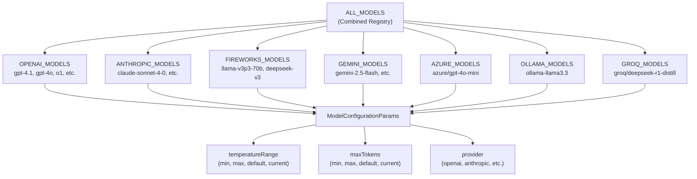
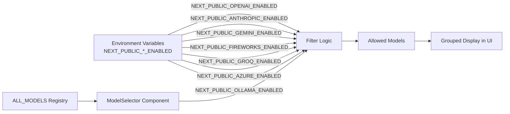
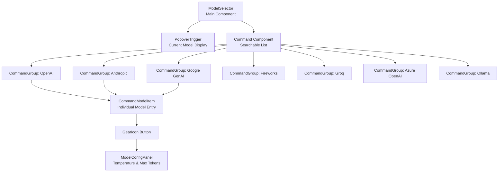
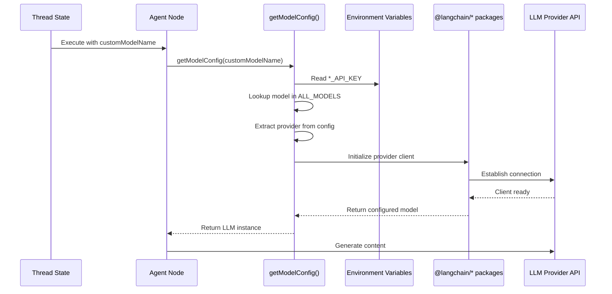

<!-- source: DeepWiki mcp.deepwiki.com · repo langchain-ai/open-canvas · page 5 Model Integration · fetched 2026-10-26 -->

# Model Integration

<details>
<summary>Relevant source files</summary>

The following files were used as context for generating this wiki page:

- [apps/web/src/components/assistant-select/index.tsx](apps/web/src/components/assistant-select/index.tsx)
- [apps/web/src/components/chat-interface/model-selector/index.tsx](apps/web/src/components/chat-interface/model-selector/index.tsx)
- [apps/web/src/components/chat-interface/model-selector/model-config-pannel.tsx](apps/web/src/components/chat-interface/model-selector/model-config-pannel.tsx)
- [package.json](package.json)
- [packages/shared/src/models.ts](packages/shared/src/models.ts)
- [packages/shared/src/utils/thinking.ts](packages/shared/src/utils/thinking.ts)
- [yarn.lock](yarn.lock)

</details>


## Purpose and Scope

This document describes how Open Canvas integrates multiple LLM providers (OpenAI, Anthropic, Google, Fireworks, Groq, Azure, Ollama) through a unified model configuration system. The integration enables users to select and configure models from different providers while maintaining consistent behavior across the application.

For information about how models are used within the agent system, see [Backend Architecture](#4.2). For details on model selection UI components, see [Model Selection](#3.4).

---

## Centralized Model Registry

The model integration system is built around a single source of truth: the `ALL_MODELS` registry defined in `packages/shared/src/models.ts`. This registry consolidates all supported models and their configurations.

### Model Registry Structure



**Sources:** [packages/shared/src/models.ts:1-640]()

### ModelConfigurationParams Interface

Each model in the registry conforms to the `ModelConfigurationParams` interface, which defines:

| Field | Type | Description |
|-------|------|-------------|
| `name` | `string` | Unique model identifier (e.g., `"gpt-4o"`, `"claude-3-5-sonnet-latest"`) |
| `label` | `string` | Human-readable display name |
| `config` | `CustomModelConfig` | Configuration object containing provider, temperature range, and max tokens |
| `isNew` | `boolean` | Whether to display "New" badge in UI |

The `CustomModelConfig` structure includes:

- **provider**: One of `"openai"`, `"anthropic"`, `"google-genai"`, `"fireworks"`, `"groq"`, `"azure_openai"`, or `"ollama"`
- **temperatureRange**: Object with `min`, `max`, `default`, and `current` values (typically 0-1)
- **maxTokens**: Object with `min`, `max`, `default`, and `current` values

**Sources:** [packages/shared/src/models.ts:1-640]()

---

## Provider-Specific Model Groups

### OpenAI Models

The OpenAI provider includes GPT-4, GPT-4o, and o-series models with varying capabilities:

```typescript
OPENAI_MODELS = [
  "gpt-4.1", "gpt-4.1-mini", "o4-mini",      // Newest models
  "gpt-4o", "gpt-4o-mini",                    // Standard GPT-4o variants
  "gpt-4.5-preview",                          // Preview model
  "o3-mini", "o1-mini", "o1"                  // Chain-of-thought models
]
```

**Configuration characteristics:**
- Temperature range: 0-1 (default 0.5)
- Max tokens: 16,384-100,000 depending on model
- Provider identifier: `"openai"`

**Sources:** [packages/shared/src/models.ts:26-207]()

### Anthropic Models

Anthropic provides Claude models with extended context windows:

```typescript
ANTHROPIC_MODELS = [
  "claude-sonnet-4-0",                        // Latest Sonnet
  "claude-opus-4-0",                          // Latest Opus
  "claude-3-7-sonnet-latest",                 // Previous generation
  "claude-3-5-sonnet-latest",
  "claude-3-5-haiku-20241022",               // Fast model
  "claude-3-haiku-20240307"                  // Legacy
]
```

**Configuration characteristics:**
- Temperature range: 0-1 (default 0.5)
- Max tokens: 4,096-64,000 depending on model
- Provider identifier: `"anthropic"`

**Sources:** [packages/shared/src/models.ts:235-356]()

### Google Gemini Models

Google's Gemini models offer large context windows and thinking capabilities:

```typescript
GEMINI_MODELS = [
  "gemini-2.5-flash-preview-05-20",          // Preview models
  "gemini-2.5-pro-preview-05-06",
  "gemini-1.5-flash",                        // Stable release
  "gemini-2.0-flash",
  "gemini-2.0-flash-thinking-exp-01-21"      // Thinking model
]
```

**Configuration characteristics:**
- Temperature range: 0-1 (default 0.5)
- Max tokens: 8,192-1,048,576 (Gemini 2.0 Flash supports very large outputs)
- Provider identifier: `"google-genai"`

**Sources:** [packages/shared/src/models.ts:464-565]()

### Fireworks Models

Fireworks provides optimized inference for open-source models:

```typescript
FIREWORKS_MODELS = [
  "accounts/fireworks/models/llama-v3p3-70b-instruct",  // Latest Llama
  "accounts/fireworks/models/llama-v3p1-70b-instruct",  // Legacy
  "accounts/fireworks/models/deepseek-v3",              // DeepSeek models
  "accounts/fireworks/models/deepseek-r1"               // Reasoning model
]
```

**Configuration characteristics:**
- Temperature range: 0-1 (default 0.5)
- Max tokens: 8,000-16,384 depending on model
- Provider identifier: `"fireworks"`

**Sources:** [packages/shared/src/models.ts:358-439]()

### Other Providers

**Groq** (fast inference):
- `groq/deepseek-r1-distill-llama-70b` - Distilled reasoning model

**Azure OpenAI**:
- `azure/gpt-4o-mini` - Azure-hosted OpenAI models

**Ollama** (local models):
- `ollama-llama3.3` - Local Llama 3.3 70B
- Note: Ollama model names must be prefixed with `"ollama-"`

**Sources:** [packages/shared/src/models.ts:212-233](), [packages/shared/src/models.ts:3-24](), [packages/shared/src/models.ts:441-462]()

---

## Frontend Model Selection System

### Feature Flag Filtering

The frontend uses environment variables to control which providers are available to users. This allows deployments to enable/disable providers based on available API keys or licensing.



**Filter implementation:**

The filtering logic checks model names against feature flags:

```typescript
// OpenAI models filtered if NEXT_PUBLIC_OPENAI_ENABLED === "false"
model.name.includes("gpt-") && process.env.NEXT_PUBLIC_OPENAI_ENABLED === "false"

// Anthropic models filtered if NEXT_PUBLIC_ANTHROPIC_ENABLED === "false"
model.name.includes("claude-") && process.env.NEXT_PUBLIC_ANTHROPIC_ENABLED === "false"

// Similar checks for gemini-, azure/, ollama-, fireworks/, groq/
```

**Sources:** [apps/web/src/components/chat-interface/model-selector/index.tsx:139-193]()

### ModelSelector Component Architecture



**Key functions:**

- **`handleModelChange`**: Updates selected model and closes popover
- **Model grouping**: Models are organized by provider in separate `CommandGroup` components
- **Configuration access**: Each model entry has a gear icon that opens `ModelConfigPanel`

**Sources:** [apps/web/src/components/chat-interface/model-selector/index.tsx:1-392]()

### Model Configuration Panel

The `ModelConfigPanel` component allows users to adjust model parameters:

| Parameter | Control | Constraints |
|-----------|---------|-------------|
| **Temperature** | Slider | Min/max from model config; disabled for `TEMPERATURE_EXCLUDED_MODELS` |
| **Max Tokens** | Slider | Min/max from model config; always adjustable |
| **Reset** | Button | Restores default values for both parameters |

**Temperature exclusions:**
- Models like `o1`, `o1-mini`, `o3-mini`, `o4-mini` do not support temperature configuration
- The slider is disabled and shows the minimum value when a temperature-excluded model is selected

**Implementation details:**

```typescript
// Temperature change handler
handleTemperatureChange(value: number[]) {
  setModelConfig(model.name, {
    ...modelConfig,
    temperatureRange: { ...modelConfig.temperatureRange, current: value[0] }
  });
}

// Max tokens change handler
handleMaxTokensChange(value: number[]) {
  setModelConfig(model.name, {
    ...modelConfig,
    maxTokens: { ...modelConfig.maxTokens, current: value[0] }
  });
}
```

**Sources:** [apps/web/src/components/chat-interface/model-selector/model-config-pannel.tsx:1-173]()

---

## Special Model Categories

Open Canvas maintains several lists of models with special behaviors that require specific handling.

### Thinking Models

**Definition:** Models that perform chain-of-thought reasoning before generating final responses.

```typescript
THINKING_MODELS = [
  "accounts/fireworks/models/deepseek-r1",
  "groq/deepseek-r1-distill-llama-70b"
]
```

**Behavior:** These models output their reasoning process wrapped in `world'"]
    Extract["extractThinkingAndResponseTokens"]
    ThinkingContent["thinking: 'reasoning...'"]
    ResponseContent["response: 'Hello world'"]
    
    RawOutput --> Extract
    Extract --> ThinkingContent
    Extract --> ResponseContent
    
    ThinkingContent --> ThinkingMsg["Display as Thinking Message"]
    ResponseContent --> ResponseMsg["Display as Response"]
```

**Utility function:** `extractThinkingAndResponseTokens(text)` parses the XML tags and returns separate thinking and response strings. It handles streaming scenarios where tags may be incomplete.

**Sources:** [packages/shared/src/models.ts:603-606](), [packages/shared/src/utils/thinking.ts:1-134]()

### Temperature-Excluded Models

**Definition:** Models that do not support the temperature parameter.

```typescript
TEMPERATURE_EXCLUDED_MODELS = [
  "o1-mini",
  "o3-mini", 
  "o1",
  "o4-mini"
]
```

**Behavior:** When these models are selected, the temperature slider in `ModelConfigPanel` is disabled and displays the minimum value. The model uses its built-in temperature setting.

**Sources:** [packages/shared/src/models.ts:581-586]()

### Non-Streaming Models

The system distinguishes between two types of non-streaming behavior:

**Non-streaming tool calls:**

```typescript
NON_STREAMING_TOOL_CALLING_MODELS = [
  "gemini-2.0-flash-exp",
  "gemini-1.5-flash",
  "gemini-2.5-pro-preview-05-06",
  "gemini-2.5-flash-preview-05-20"
]
```

These models do not stream back tool call events incrementally.

**Non-streaming text:**

```typescript
NON_STREAMING_TEXT_MODELS = [
  "o1",
  "gemini-2.0-flash-thinking-exp-01-21"
]
```

These models return complete text responses rather than streaming tokens.

**Sources:** [packages/shared/src/models.ts:589-600]()

### LangChain User-Only Models

**Definition:** Models restricted to LangChain employees (users with `@langchain.dev` email addresses).

```typescript
LANGCHAIN_USER_ONLY_MODELS = [
  "o1",
  "gpt-4o",
  "gpt-4.5-preview",
  "claude-3-5-sonnet-latest",
  "claude-3-7-sonnet-latest",
  "gemini-2.0-flash-thinking-exp-01-21",
  "gemini-2.5-pro-preview-05-06",
  "claude-sonnet-4-0",
  "claude-opus-4-0",
  "gpt-4.1"
]
```

**Behavior:** The frontend checks `user?.email?.endsWith("@langchain.dev")` and filters out these models for non-LangChain users.

**Sources:** [packages/shared/src/models.ts:567-578](), [apps/web/src/components/chat-interface/model-selector/index.tsx:126-129](), [apps/web/src/components/chat-interface/model-selector/index.tsx:139-145]()

---

## Backend Model Initialization

While the model registry and frontend selection are defined in shared code, the actual initialization of LLM clients happens in the backend agent system.

### Runtime Model Configuration Flow



**Key steps:**

1. **Thread configuration:** Each thread stores `customModelName` (the selected model) and `customModelConfig` (temperature and max tokens settings)

2. **Model lookup:** `getModelConfig()` receives the model name and searches `ALL_MODELS` to find the configuration

3. **Provider identification:** The function extracts the `provider` field from the model's config

4. **API key retrieval:** Based on the provider, the function reads the appropriate environment variable:
   - OpenAI: `OPENAI_API_KEY`
   - Anthropic: `ANTHROPIC_API_KEY`
   - Google: `GOOGLE_API_KEY`
   - Fireworks: `FIREWORKS_API_KEY`
   - Groq: `GROQ_API_KEY`
   - Azure: `AZURE_OPENAI_API_KEY`, `AZURE_OPENAI_ENDPOINT`
   - Ollama: `OLLAMA_BASE_URL` (local deployment)

5. **Client initialization:** The function uses the appropriate `@langchain/*` package to create a client instance:
   - `@langchain/openai` for OpenAI and Azure
   - `@langchain/anthropic` for Anthropic
   - `@langchain/google-genai` for Gemini
   - `@langchain/community` for Fireworks, Groq, Ollama

6. **Model invocation:** The agent nodes use the initialized client to generate content with the configured temperature and max tokens

**Sources:** Based on system architecture diagrams and standard LangChain integration patterns

---

## Default Model Configuration

The system defines a default model used for new threads:

```typescript
DEFAULT_MODEL_NAME = "gpt-4.1-mini"  // OPENAI_MODELS[1].name
DEFAULT_MODEL_CONFIG = {
  provider: "openai",
  temperatureRange: { min: 0, max: 1, default: 0.5, current: 0.5 },
  maxTokens: { min: 1, max: 32768, default: 4096, current: 4096 }
}
```

This configuration is used when:
- A new thread is created without explicit model selection
- A user resets their model configuration
- The system needs a fallback model

**Sources:** [packages/shared/src/models.ts:634-639]()

---

## Model Configuration Persistence

Model configurations are persisted per-thread, allowing different conversations to use different models and settings:

| Storage Location | Data Stored | Scope |
|------------------|-------------|-------|
| Thread state (Supabase/KV) | `customModelName`, `customModelConfig` | Per-thread |
| Frontend state | Model configs for all models | Session-based |
| Shared registry | Default configurations | Global |

**Configuration flow:**

1. User selects model and adjusts parameters in `ModelSelector`
2. Frontend calls `setModelConfig(modelName, config)` to update thread state
3. Thread state is persisted to storage
4. On next agent invocation, backend reads thread state and calls `getModelConfig()`
5. Model-specific configuration is applied to LLM client

This design allows users to have multiple threads with different models running simultaneously, each maintaining its own configuration.

**Sources:** [apps/web/src/components/chat-interface/model-selector/index.tsx:115-137](), [apps/web/src/components/chat-interface/model-selector/model-config-pannel.tsx:43-81]()

---

