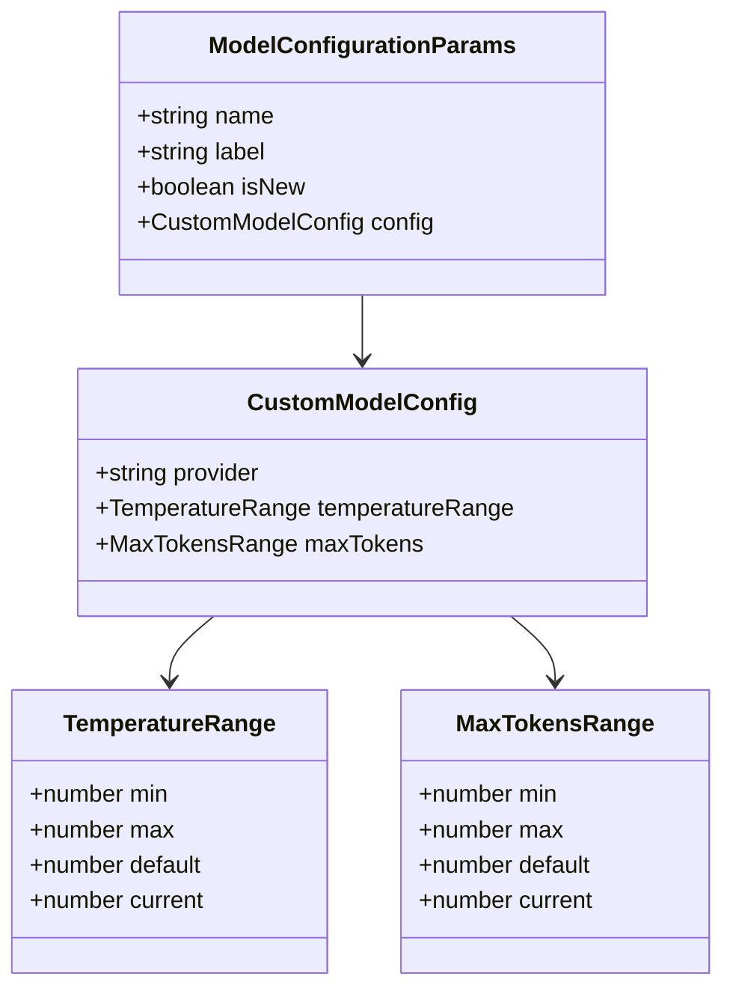
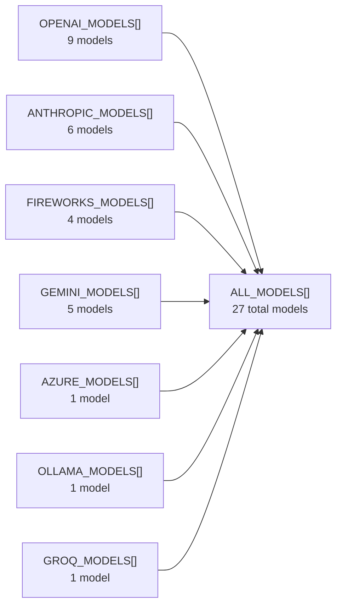
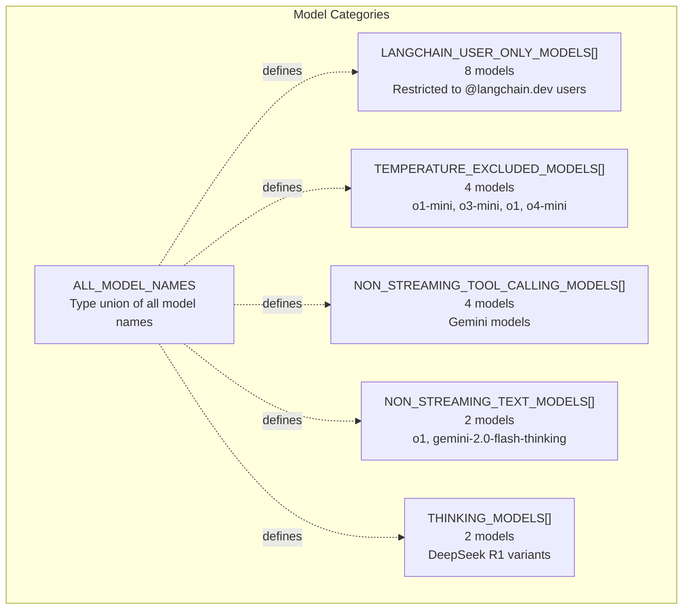
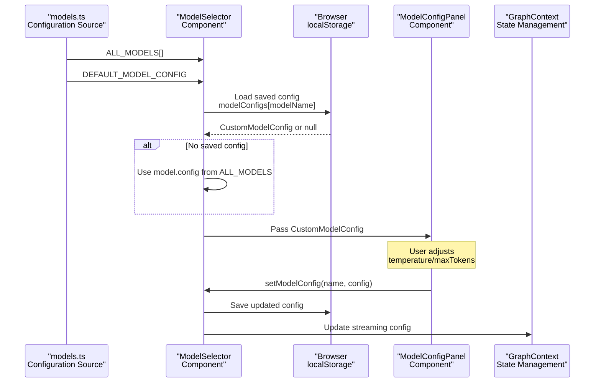

<!-- source: DeepWiki mcp.deepwiki.com · repo langchain-ai/open-canvas · page 5.1 Model Configuration · fetched 2026-10-26 -->

# Model Configuration

<details>
<summary>Relevant source files</summary>

The following files were used as context for generating this wiki page:

- [.codespellignore](.codespellignore)
- [apps/agents/package.json](apps/agents/package.json)
- [apps/web/package.json](apps/web/package.json)
- [apps/web/src/components/assistant-select/index.tsx](apps/web/src/components/assistant-select/index.tsx)
- [apps/web/src/components/chat-interface/model-selector/index.tsx](apps/web/src/components/chat-interface/model-selector/index.tsx)
- [apps/web/src/components/chat-interface/model-selector/model-config-pannel.tsx](apps/web/src/components/chat-interface/model-selector/model-config-pannel.tsx)
- [apps/web/src/hooks/useStore.tsx](apps/web/src/hooks/useStore.tsx)
- [packages/evals/package.json](packages/evals/package.json)
- [packages/shared/package.json](packages/shared/package.json)
- [packages/shared/src/models.ts](packages/shared/src/models.ts)
- [packages/shared/src/utils/thinking.ts](packages/shared/src/utils/thinking.ts)

</details>


This document details the model configuration system in Open Canvas, including the `ALL_MODELS` configuration array, the `ModelConfigurationParams` and `CustomModelConfig` type definitions, temperature and token limit settings, and model categorization lists used for special handling. For information about provider-specific initialization and the `getModelFromConfig` utility, see [Provider Integration](#5.2). For special model behaviors including thinking models, see [Special Model Handling](#5.3).

## Purpose and Scope

The model configuration system provides a centralized registry of all supported language models across seven providers (OpenAI, Anthropic, Azure OpenAI, Google Gemini, Fireworks, Groq, and Ollama). Each model is defined with its provider, display label, parameter ranges, and default values. This configuration is shared between the frontend and backend through the `@opencanvas/shared` package, ensuring consistent model behavior across the application.

## Model Configuration Structure

### Type Definitions

The model configuration system uses two primary TypeScript interfaces to define model properties:



**`ModelConfigurationParams`** represents a complete model definition as stored in the `ALL_MODELS` array. It contains:
- `name`: The model identifier used in API calls (e.g., `"gpt-4o"`, `"claude-3-5-sonnet-latest"`)
- `label`: Human-readable display name shown in the UI (e.g., `"GPT 4o"`, `"Claude 3.5 Sonnet"`)
- `isNew`: Boolean flag indicating whether to display a "NEW" badge in the UI
- `config`: The `CustomModelConfig` object containing provider and parameter settings

**`CustomModelConfig`** defines the runtime configuration for a model:
- `provider`: One of `"openai"`, `"anthropic"`, `"azure_openai"`, `"google-genai"`, `"fireworks"`, `"groq"`, or `"ollama"`
- `temperatureRange`: Object with `min`, `max`, `default`, and `current` values controlling randomness
- `maxTokens`: Object with `min`, `max`, `default`, and `current` values controlling response length

Sources: [packages/shared/src/types.ts](), [packages/shared/src/models.ts:1-45]()

### Parameter Ranges

Each model configuration includes two adjustable parameters:

| Parameter | Description | Typical Range | Purpose |
|-----------|-------------|---------------|---------|
| **Temperature** | Controls output randomness | 0.0 - 1.0 | Lower values (0.0-0.3) produce focused, deterministic outputs. Higher values (0.7-1.0) increase creativity and variation. |
| **Max Tokens** | Limits response length | 1 - 100,000+ | Constrains the maximum number of tokens in the model's response. Varies significantly by model. |

Both parameters store four values:
- `min`: Minimum allowed value
- `max`: Maximum allowed value  
- `default`: Initial value when model is first selected
- `current`: User's current setting, persisted in local storage

The `current` value is modified by the user through the `ModelConfigPanel` component and stored per-model in the frontend's local storage.

Sources: [packages/shared/src/models.ts:10-22](), [apps/web/src/components/chat-interface/model-selector/model-config-pannel.tsx:43-81]()

## Model Registry

### ALL_MODELS Array

The `ALL_MODELS` constant aggregates model definitions from all providers into a single array:



The `ALL_MODELS` array is constructed by concatenating provider-specific arrays. This structure allows for easy addition of new models and maintains clear separation between providers.

Sources: [packages/shared/src/models.ts:608-616]()

### Provider Model Groups

Each provider maintains its own model array with provider-specific configurations:

#### OpenAI Models

OpenAI provides the largest model selection, including standard chat models and reasoning models:

| Model Name | Label | Max Tokens | Notes |
|------------|-------|------------|-------|
| `gpt-4.1` | GPT 4.1 | 32,768 | Latest standard model, marked as new |
| `gpt-4.1-mini` | GPT 4.1 mini | 32,768 | Smaller, faster variant |
| `o4-mini` | o4 mini | 100,000 | High token limit |
| `gpt-4o` | GPT 4o | 16,384 | Previous generation |
| `gpt-4o-mini` | GPT 4o mini | 16,384 | Previous generation mini |
| `gpt-4.5-preview` | GPT 4.5 | 16,384 | Preview model |
| `o3-mini` | o3 mini | 100,000 | Reasoning model |
| `o1-mini` | o1 mini | 65,536 | Reasoning model |
| `o1` | o1 | 100,000 | Full reasoning model |

All OpenAI models default to temperature `0.5` and `4,096` tokens.

Sources: [packages/shared/src/models.ts:26-207]()

#### Anthropic Models

Anthropic provides Claude models across three tiers (Opus, Sonnet, Haiku):

| Model Name | Label | Max Tokens | Notes |
|------------|-------|------------|-------|
| `claude-sonnet-4-0` | Claude Sonnet 4 | 64,000 | Latest Sonnet, marked as new |
| `claude-opus-4-0` | Claude Opus 4 | 32,000 | Latest Opus, marked as new |
| `claude-3-7-sonnet-latest` | Claude 3.7 Sonnet | 8,192 | Current Sonnet |
| `claude-3-5-sonnet-latest` | Claude 3.5 Sonnet | 8,192 | Previous Sonnet |
| `claude-3-5-haiku-20241022` | Claude 3.5 Haiku | 8,192 | Fast model |
| `claude-3-haiku-20240307` | Claude 3 Haiku (old) | 4,096 | Legacy model |

Sources: [packages/shared/src/models.ts:235-356]()

#### Gemini Models

Google Gemini models include standard and thinking variants:

| Model Name | Label | Max Tokens | Notes |
|------------|-------|------------|-------|
| `gemini-2.5-flash-preview-05-20` | Gemini 2.5 Flash (Preview) | 100,000 | Preview, marked as new |
| `gemini-2.5-pro-preview-05-06` | Gemini 2.5 Pro (Preview) | 100,000 | Preview, marked as new |
| `gemini-1.5-flash` | Gemini 1.5 Flash | 8,192 | Standard model |
| `gemini-2.0-flash` | Gemini 2.0 Flash | 1,048,576 | Extremely high token limit |
| `gemini-2.0-flash-thinking-exp-01-21` | Gemini 2.0 Flash Thinking | 1,048,576 | Thinking model variant |

Sources: [packages/shared/src/models.ts:464-565]()

#### Other Providers

**Fireworks** hosts open-source models:
- Llama 3.3 70B (`accounts/fireworks/models/llama-v3p3-70b-instruct`)
- Llama 70B old (`accounts/fireworks/models/llama-v3p1-70b-instruct`)
- DeepSeek V3 (`accounts/fireworks/models/deepseek-v3`)
- DeepSeek R1 (`accounts/fireworks/models/deepseek-r1`)

**Groq** provides fast inference:
- DeepSeek R1 Llama 70b Distill (`groq/deepseek-r1-distill-llama-70b`)

**Ollama** enables local model execution:
- Llama 3.3 70B (`ollama-llama3.3`) - Note: Ollama model names must be prefixed with `"ollama-"`

**Azure OpenAI** mirrors OpenAI models:
- GPT-4o mini (`azure/gpt-4o-mini`)

Sources: [packages/shared/src/models.ts:358-462]()

## Model Categorization Lists

The configuration system maintains several categorization lists for special model handling:



### LANGCHAIN_USER_ONLY_MODELS

Contains models restricted to users with `@langchain.dev` email addresses. The frontend checks this list in the `ModelSelector` component to filter available models:

```typescript
const LANGCHAIN_USER_ONLY_MODELS = [
  "o1",
  "gpt-4o",
  "gpt-4.5-preview",
  "claude-3-5-sonnet-latest",
  "claude-3-7-sonnet-latest",
  "gemini-2.0-flash-thinking-exp-01-21",
  "gemini-2.5-pro-preview-05-06",
  "claude-sonnet-4-0",
  "claude-opus-4-0",
  "gpt-4.1",
];
```

Sources: [packages/shared/src/models.ts:567-578](), [apps/web/src/components/chat-interface/model-selector/index.tsx:139-145]()

### TEMPERATURE_EXCLUDED_MODELS

Lists models that do not support the temperature parameter. The `ModelConfigPanel` checks this list to disable the temperature slider:

```typescript
const TEMPERATURE_EXCLUDED_MODELS = [
  "o1-mini",
  "o3-mini",
  "o1",
  "o4-mini",
];
```

These models (primarily reasoning models) use internal temperature settings that cannot be overridden.

Sources: [packages/shared/src/models.ts:580-586](), [apps/web/src/components/chat-interface/model-selector/model-config-pannel.tsx:107]()

### NON_STREAMING_TOOL_CALLING_MODELS

Identifies models that do not stream tool calls incrementally. These models return complete tool call objects rather than streaming them:

```typescript
const NON_STREAMING_TOOL_CALLING_MODELS = [
  "gemini-2.0-flash-exp",
  "gemini-1.5-flash",
  "gemini-2.5-pro-preview-05-06",
  "gemini-2.5-flash-preview-05-20",
];
```

Sources: [packages/shared/src/models.ts:588-594]()

### NON_STREAMING_TEXT_MODELS

Lists models that do not stream text responses. These models generate complete responses before returning:

```typescript
const NON_STREAMING_TEXT_MODELS = [
  "o1",
  "gemini-2.0-flash-thinking-exp-01-21",
];
```

Sources: [packages/shared/src/models.ts:596-600]()

### THINKING_MODELS

Identifies models that perform chain-of-thought reasoning with `<think>` tags. These models require special parsing to extract thinking tokens:

```typescript
const THINKING_MODELS = [
  "accounts/fireworks/models/deepseek-r1",
  "groq/deepseek-r1-distill-llama-70b",
];
```

The `extractThinkingAndResponseTokens` utility in `packages/shared/src/utils/thinking.ts` parses these models' outputs to separate reasoning from final responses.

Sources: [packages/shared/src/models.ts:602-606](), [packages/shared/src/utils/thinking.ts:32-70]()

## Default Model Configuration

The system defines default model settings used when initializing new conversations:

```typescript
// packages/shared/src/models.ts
export const DEFAULT_MODEL_NAME: ALL_MODEL_NAMES = OPENAI_MODELS[1].name;  // "gpt-4.1-mini"
export const DEFAULT_MODEL_CONFIG: CustomModelConfig = {
  ...OPENAI_MODELS[1].config,
  temperatureRange: { ...OPENAI_MODELS[1].config.temperatureRange },
  maxTokens: { ...OPENAI_MODELS[1].config.maxTokens },
};
```

The default model is `gpt-4.1-mini` (the second model in `OPENAI_MODELS`), configured with:
- Provider: `openai`
- Temperature: `0.5` (default and current)
- Max tokens: `4,096` (default and current)
- Temperature range: `0.0` - `1.0`
- Max tokens range: `1` - `32,768`

Sources: [packages/shared/src/models.ts:634-639]()

## Configuration Flow

The following diagram illustrates how model configurations flow from definition to usage:



When the `ModelSelector` component initializes, it:
1. Loads the `ALL_MODELS` array and filters based on feature flags and user permissions
2. Retrieves saved configurations from `localStorage` keyed by model name
3. Falls back to the default configuration from `model.config` for unsaved models
4. Passes configurations to `ModelConfigPanel` for user adjustment
5. Persists updated configurations back to `localStorage` on change
6. Propagates changes to `GraphContext` for use in agent streaming

Sources: [apps/web/src/components/chat-interface/model-selector/index.tsx:115-193](), [apps/web/src/components/chat-interface/model-selector/model-config-pannel.tsx:34-128]()

## Environment-Based Filtering

The frontend filters available models based on environment variables, allowing deployment administrators to disable specific providers:

| Environment Variable | Purpose | Models Affected |
|---------------------|---------|-----------------|
| `NEXT_PUBLIC_OPENAI_ENABLED` | Enable/disable OpenAI | All `gpt-*` and `o*` models |
| `NEXT_PUBLIC_ANTHROPIC_ENABLED` | Enable/disable Anthropic | All `claude-*` models |
| `NEXT_PUBLIC_AZURE_ENABLED` | Enable/disable Azure | All `azure/*` models |
| `NEXT_PUBLIC_GEMINI_ENABLED` | Enable/disable Google | All `gemini-*` models |
| `NEXT_PUBLIC_FIREWORKS_ENABLED` | Enable/disable Fireworks | All `accounts/fireworks/*` models |
| `NEXT_PUBLIC_OLLAMA_ENABLED` | Enable/disable Ollama | All `ollama-*` models |
| `NEXT_PUBLIC_GROQ_ENABLED` | Enable/disable Groq | All `groq/*` models |

Setting any of these to `"false"` removes the corresponding models from the UI selector. This filtering occurs in the `ModelSelector` component's `allAllowedModels` computation.

Sources: [apps/web/src/components/chat-interface/model-selector/index.tsx:147-192]()

---

