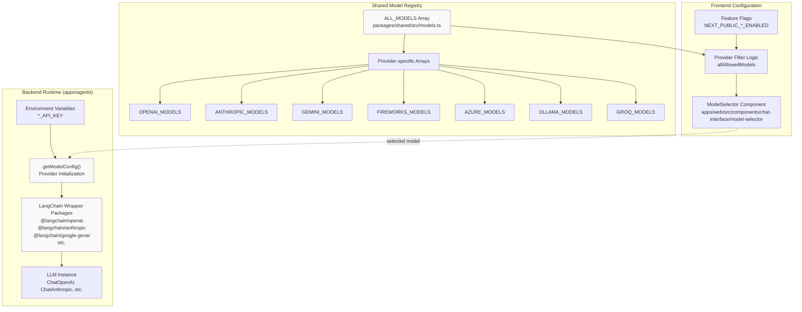
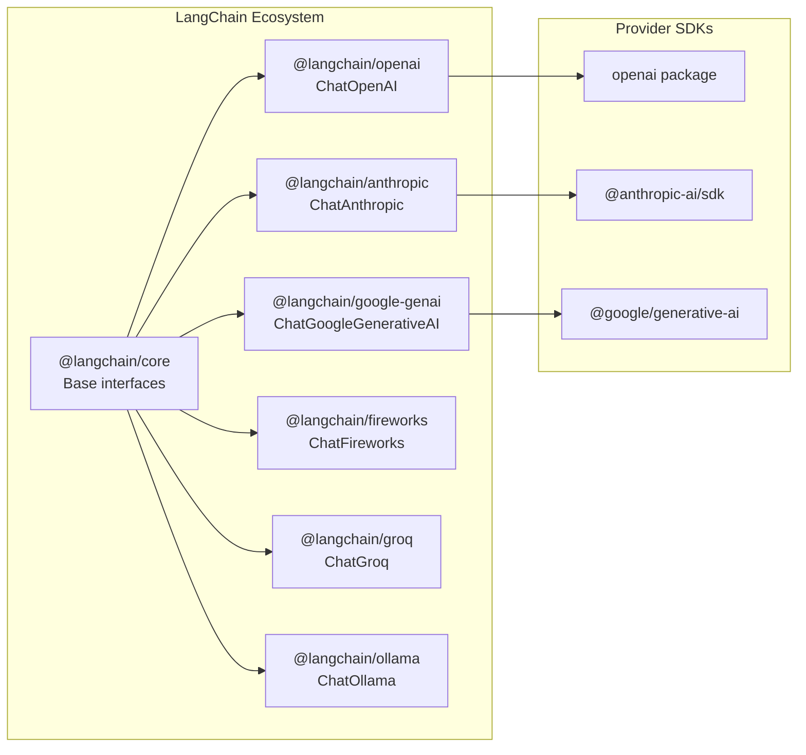
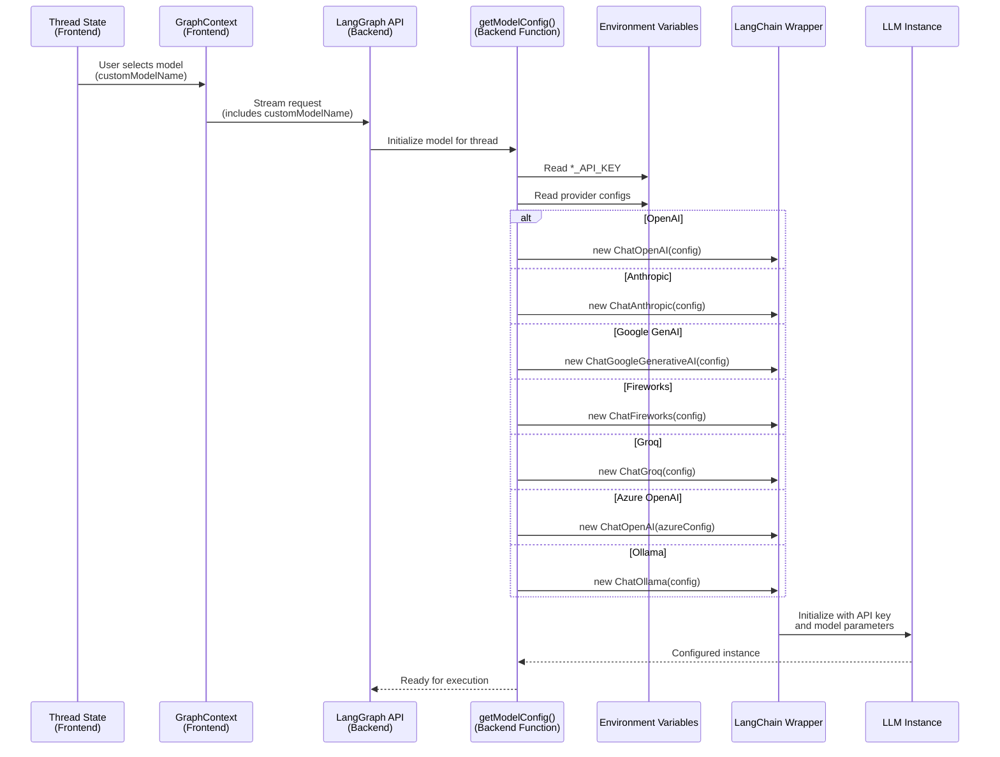
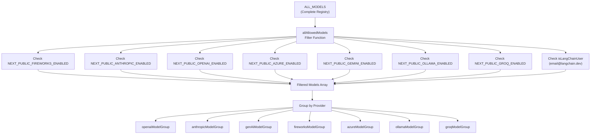

<!-- source: DeepWiki mcp.deepwiki.com · repo langchain-ai/open-canvas · page 5.2 Provider Integration · fetched 2026-10-26 -->

# Provider Integration

<details>
<summary>Relevant source files</summary>

The following files were used as context for generating this wiki page:

- [apps/web/src/components/assistant-select/index.tsx](apps/web/src/components/assistant-select/index.tsx)
- [apps/web/src/components/chat-interface/model-selector/index.tsx](apps/web/src/components/chat-interface/model-selector/index.tsx)
- [apps/web/src/components/chat-interface/model-selector/model-config-pannel.tsx](apps/web/src/components/chat-interface/model-selector/model-config-pannel.tsx)
- [package.json](package.json)
- [packages/shared/src/models.ts](packages/shared/src/models.ts)
- [packages/shared/src/utils/thinking.ts](packages/shared/src/utils/thinking.ts)
- [yarn.lock](yarn.lock)

</details>


This page documents the technical integration of LLM providers into Open Canvas. It covers the wrapper packages used, environment-based configuration, runtime initialization, and provider-specific implementation details. For model configuration parameters and the model registry, see [Model Configuration](#5.1). For special handling of thinking models and streaming behavior, see [Special Model Handling](#5.3).

## Overview

Open Canvas integrates seven LLM providers through a unified architecture that uses LangChain wrapper packages for consistent API access. Each provider is configured via environment variables and can be enabled or disabled through feature flags. The system supports OpenAI, Anthropic, Google Gemini, Fireworks AI, Groq, Azure OpenAI, and Ollama for local models.

**Sources:** [packages/shared/src/models.ts:1-640]()

## Provider Architecture



**Diagram: Provider Integration Architecture**

The architecture separates provider configuration (shared package), provider selection (frontend), and provider initialization (backend). The `ALL_MODELS` array serves as the single source of truth for available models, while runtime initialization happens via `getModelConfig()` in the agents backend.

**Sources:** [packages/shared/src/models.ts:608-616](), [apps/web/src/components/chat-interface/model-selector/index.tsx:139-193]()

## Environment Configuration

### API Keys

Each provider requires an API key stored as an environment variable in the backend:

| Provider | Environment Variable | Used By |
|----------|---------------------|---------|
| OpenAI | `OPENAI_API_KEY` | Backend (apps/agents) |
| Anthropic | `ANTHROPIC_API_KEY` | Backend (apps/agents) |
| Google Gemini | `GOOGLE_API_KEY` | Backend (apps/agents) |
| Fireworks | `FIREWORKS_API_KEY` | Backend (apps/agents) |
| Groq | `GROQ_API_KEY` | Backend (apps/agents) |
| Azure OpenAI | `AZURE_OPENAI_API_KEY`<br/>`AZURE_OPENAI_ENDPOINT`<br/>`AZURE_OPENAI_API_VERSION` | Backend (apps/agents) |
| Ollama | `OLLAMA_BASE_URL` | Backend (apps/agents) |

These environment variables are read at runtime by the backend's `getModelConfig()` function to initialize the appropriate LangChain wrapper.

### Feature Flags

Frontend feature flags control which providers are visible in the UI:

| Provider | Feature Flag | Default |
|----------|-------------|---------|
| OpenAI | `NEXT_PUBLIC_OPENAI_ENABLED` | true |
| Anthropic | `NEXT_PUBLIC_ANTHROPIC_ENABLED` | true |
| Google Gemini | `NEXT_PUBLIC_GEMINI_ENABLED` | true |
| Fireworks | `NEXT_PUBLIC_FIREWORKS_ENABLED` | true |
| Groq | `NEXT_PUBLIC_GROQ_ENABLED` | true |
| Azure OpenAI | `NEXT_PUBLIC_AZURE_ENABLED` | true |
| Ollama | `NEXT_PUBLIC_OLLAMA_ENABLED` | true |

The `ModelSelector` component filters available models based on these flags, checking each model's name prefix against the corresponding feature flag.

**Sources:** [apps/web/src/components/chat-interface/model-selector/index.tsx:139-193]()

## LangChain Wrapper Packages

Open Canvas uses LangChain's provider-specific packages to create a unified interface for all LLM providers. These packages are included in the backend dependencies:



**Diagram: LangChain Wrapper Package Dependencies**

All LangChain wrapper packages extend from `@langchain/core` base classes, providing a consistent interface for:
- Message formatting
- Streaming responses
- Tool calling
- Token counting
- Error handling

**Sources:** [yarn.lock:17-29]()

## Provider-Specific Configuration

### OpenAI Integration

OpenAI models are configured with the `provider: "openai"` identifier. The system supports multiple OpenAI models including GPT-4o, GPT-4o-mini, o1-mini, o1, and newer variants.

**Model Definitions:**
- [packages/shared/src/models.ts:26-207]()

**Key Characteristics:**
- Uses `@langchain/openai` package with `ChatOpenAI` class
- Supports temperature range 0-1
- Max tokens vary by model (4,096 to 100,000)
- Temperature is excluded for reasoning models (o1-mini, o3-mini, o1, o4-mini)

**Model Name Pattern:** Direct model names (e.g., `gpt-4o`, `gpt-4o-mini`)

**Sources:** [packages/shared/src/models.ts:26-207](), [packages/shared/src/models.ts:581-586]()

### Anthropic Integration

Anthropic models use the `provider: "anthropic"` identifier and include the Claude family of models.

**Model Definitions:**
- [packages/shared/src/models.ts:235-356]()

**Key Characteristics:**
- Uses `@langchain/anthropic` package with `ChatAnthropic` class
- Native SDK: `@anthropic-ai/sdk@^0.39.0`
- Supports temperature range 0-1
- Max tokens range from 4,096 to 64,000 depending on model
- Includes Claude 3.5, 3.7, and Claude 4 Sonnet/Opus variants

**Model Name Pattern:** `claude-*` prefix (e.g., `claude-3-5-sonnet-latest`, `claude-sonnet-4-0`)

**Sources:** [packages/shared/src/models.ts:235-356](), [yarn.lock:17-29]()

### Google Gemini Integration

Google models use the `provider: "google-genai"` identifier for Gemini models.

**Model Definitions:**
- [packages/shared/src/models.ts:464-565]()

**Key Characteristics:**
- Uses `@langchain/google-genai` package with `ChatGoogleGenerativeAI` class
- Supports temperature range 0-1
- Max tokens range from 8,192 to 1,048,576 (Gemini 2.0)
- Non-streaming tool calls for some models
- Non-streaming text for thinking models

**Model Name Pattern:** `gemini-*` prefix (e.g., `gemini-2.0-flash`, `gemini-2.5-pro-preview-05-06`)

**Special Handling:** Gemini thinking models are included in `NON_STREAMING_TEXT_MODELS` array.

**Sources:** [packages/shared/src/models.ts:464-565](), [packages/shared/src/models.ts:589-600]()

### Fireworks Integration

Fireworks models use the `provider: "fireworks"` identifier for fast inference hosting.

**Model Definitions:**
- [packages/shared/src/models.ts:358-439]()

**Key Characteristics:**
- Uses `@langchain/fireworks` package
- Supports Llama and DeepSeek models
- Temperature range 0-1
- Max tokens typically 8,000-16,384
- Feature flag: `NEXT_PUBLIC_FIREWORKS_ENABLED`

**Model Name Pattern:** `accounts/fireworks/models/*` prefix (e.g., `accounts/fireworks/models/llama-v3p3-70b-instruct`)

**Thinking Models:** DeepSeek R1 is included in `THINKING_MODELS` array for chain-of-thought processing.

**Sources:** [packages/shared/src/models.ts:358-439](), [packages/shared/src/models.ts:603-606]()

### Groq Integration

Groq provides ultra-fast inference for select models using the `provider: "groq"` identifier.

**Model Definitions:**
- [packages/shared/src/models.ts:441-462]()

**Key Characteristics:**
- Uses `@langchain/groq` package
- Currently supports DeepSeek R1 distilled variants
- Temperature range 0-1
- Max tokens up to 8,000
- Feature flag: `NEXT_PUBLIC_GROQ_ENABLED`

**Model Name Pattern:** `groq/*` prefix (e.g., `groq/deepseek-r1-distill-llama-70b`)

**Thinking Models:** Groq DeepSeek models are included in `THINKING_MODELS` for reasoning capabilities.

**Sources:** [packages/shared/src/models.ts:441-462](), [packages/shared/src/models.ts:603-606]()

### Azure OpenAI Integration

Azure OpenAI models use the `provider: "azure_openai"` identifier for enterprise deployments.

**Model Definitions:**
- [packages/shared/src/models.ts:3-24]()

**Key Characteristics:**
- Uses `@langchain/openai` package with Azure configuration
- Requires three environment variables: `AZURE_OPENAI_API_KEY`, `AZURE_OPENAI_ENDPOINT`, `AZURE_OPENAI_API_VERSION`
- Supports same temperature and token ranges as OpenAI models
- Feature flag: `NEXT_PUBLIC_AZURE_ENABLED`

**Model Name Pattern:** `azure/*` prefix (e.g., `azure/gpt-4o-mini`)

**Configuration Note:** Azure models require additional environment configuration for endpoint and API version compared to standard OpenAI integration.

**Sources:** [packages/shared/src/models.ts:3-24]()

### Ollama Integration

Ollama enables local model execution using the `provider: "ollama"` identifier.

**Model Definitions:**
- [packages/shared/src/models.ts:212-233]()

**Key Characteristics:**
- Uses `@langchain/ollama` package with `ChatOllama` class
- Requires `OLLAMA_BASE_URL` environment variable (default: `http://localhost:11434`)
- Lower max tokens (typically 2,048) due to local resource constraints
- Temperature range 0-1
- Feature flag: `NEXT_PUBLIC_OLLAMA_ENABLED`

**Model Name Pattern:** `ollama-*` prefix (e.g., `ollama-llama3.3`)

**Important:** Model names MUST be prefixed with `"ollama-"` as documented in the code comments.

**Sources:** [packages/shared/src/models.ts:209-233]()

## Runtime Initialization Flow



**Diagram: Model Initialization Sequence**

The `getModelConfig()` function serves as the central initialization point in the backend. It:

1. Receives the `customModelName` from the thread configuration
2. Reads the appropriate API key from environment variables
3. Determines the provider based on the model's `provider` field in `ALL_MODELS`
4. Instantiates the correct LangChain wrapper class
5. Applies model-specific configurations (temperature, maxTokens)
6. Returns a ready-to-use LLM instance

**Sources:** [packages/shared/src/models.ts:608-640]()

## Provider Selection and Filtering

The `ModelSelector` component implements client-side filtering to show only enabled providers:



**Diagram: Model Filtering Logic in ModelSelector**

The filtering logic performs multiple checks:

1. **Feature Flag Check:** Tests if `process.env.NEXT_PUBLIC_*_ENABLED === "false"`
2. **LangChain User Check:** Certain premium models (defined in `LANGCHAIN_USER_ONLY_MODELS`) are restricted to users with `@langchain.dev` email addresses
3. **Model Name Pattern Matching:** Uses provider-specific prefixes to match models to feature flags

After filtering, models are grouped by their `config.provider` field for organized display in the UI.

**Sources:** [apps/web/src/components/chat-interface/model-selector/index.tsx:139-222](), [packages/shared/src/models.ts:567-578]()

## Provider-Specific Behavior Handling

### Thinking Models

Models that perform chain-of-thought reasoning before responding are tracked in the `THINKING_MODELS` array:

- `accounts/fireworks/models/deepseek-r1` (Fireworks)
- `groq/deepseek-r1-distill-llama-70b` (Groq)

These models wrap their reasoning in `<think>` XML tags. The system extracts and processes this content separately using utility functions:

- `extractThinkingAndResponseTokens()` - Parses thinking and response content
- `handleRewriteArtifactThinkingModel()` - Updates message state with thinking tokens
- `isThinkingModel()` - Checks if a model is a thinking model

**Sources:** [packages/shared/src/models.ts:603-606](), [packages/shared/src/utils/thinking.ts:1-134]()

### Non-Streaming Models

Some models don't support streaming for tool calls or text:

**Non-Streaming Tool Calls:**
- `gemini-2.0-flash-exp`
- `gemini-1.5-flash`
- `gemini-2.5-pro-preview-05-06`
- `gemini-2.5-flash-preview-05-20`

**Non-Streaming Text:**
- `o1` (OpenAI)
- `gemini-2.0-flash-thinking-exp-01-21` (Google)

The backend must handle these models with batch processing instead of streaming responses.

**Sources:** [packages/shared/src/models.ts:589-600]()

### Temperature Exclusions

Reasoning models that don't support temperature parameters:
- `o1-mini`
- `o3-mini`
- `o1`
- `o4-mini`

The `ModelConfigPanel` component disables the temperature slider for these models and uses the minimum value automatically.

**Sources:** [packages/shared/src/models.ts:581-586](), [apps/web/src/components/chat-interface/model-selector/model-config-pannel.tsx:107]()

## Model Configuration Management

Each provider's models maintain configuration state through the `CustomModelConfig` interface, which includes:

```typescript
{
  provider: "openai" | "anthropic" | "google-genai" | "fireworks" | "groq" | "azure_openai" | "ollama",
  temperatureRange: {
    min: number,
    max: number,
    default: number,
    current: number
  },
  maxTokens: {
    min: number,
    max: number,
    default: number,
    current: number
  }
}
```

The `ModelSelector` component maintains a `modelConfigs` record that persists per-model configurations across the user session. When a user adjusts temperature or max tokens via the `ModelConfigPanel`, the changes are saved to this record and used in subsequent API calls.

**Sources:** [apps/web/src/components/chat-interface/model-selector/index.tsx:39-48](), [apps/web/src/components/chat-interface/model-selector/model-config-pannel.tsx:34-82]()

---

