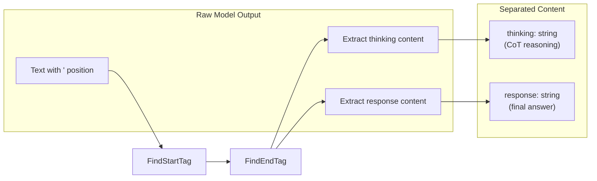
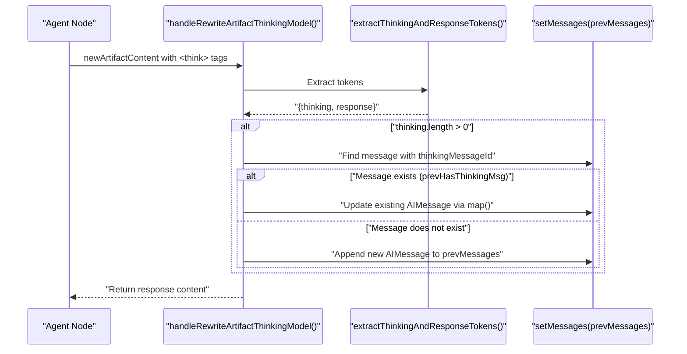
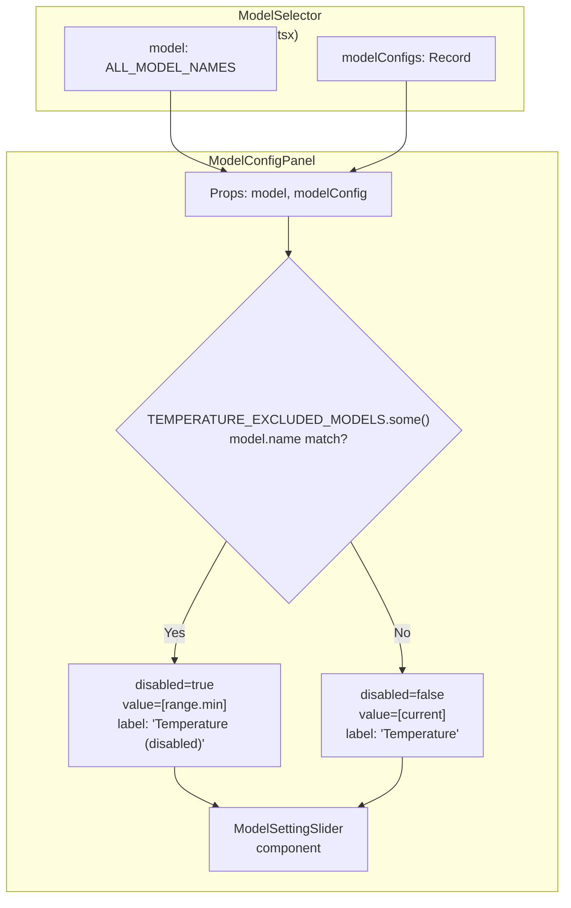
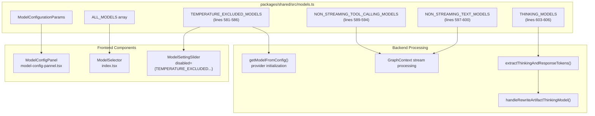

<!-- source: DeepWiki mcp.deepwiki.com · repo langchain-ai/open-canvas · page 5.3 Special Model Handling · fetched 2026-10-26 -->

# Special Model Handling

<details>
<summary>Relevant source files</summary>

The following files were used as context for generating this wiki page:

- [apps/web/src/components/assistant-select/index.tsx](apps/web/src/components/assistant-select/index.tsx)
- [apps/web/src/components/chat-interface/model-selector/index.tsx](apps/web/src/components/chat-interface/model-selector/index.tsx)
- [apps/web/src/components/chat-interface/model-selector/model-config-pannel.tsx](apps/web/src/components/chat-interface/model-selector/model-config-pannel.tsx)
- [packages/shared/src/models.ts](packages/shared/src/models.ts)
- [packages/shared/src/utils/thinking.ts](packages/shared/src/utils/thinking.ts)

</details>


## Purpose and Scope

This document describes how Open Canvas handles models with special characteristics that require different processing or configuration compared to standard language models. These special cases include models that perform Chain-of-Thought reasoning with explicit thinking tags, models that do not support temperature parameters, and models with non-streaming output behaviors.

For general model configuration and provider integration, see [Model Configuration](#5.1) and [Provider Integration](#5.2).

---

## Model Categories

Open Canvas categorizes certain models into special groups that require custom handling. These categories are defined in [packages/shared/src/models.ts:580-607]() and affect how the system initializes, configures, and processes responses from these models.

### Model Category Overview

| Category | Count | Purpose | Configuration Impact |
|----------|-------|---------|---------------------|
| `TEMPERATURE_EXCLUDED_MODELS` | 4 | Models that do not support temperature parameter | Temperature slider disabled in UI |
| `NON_STREAMING_TOOL_CALLING_MODELS` | 4 | Models that return complete tool calls only | No progressive tool call streaming |
| `NON_STREAMING_TEXT_MODELS` | 2 | Models that return complete text responses | No progressive text streaming |
| `THINKING_MODELS` | 2 | Models that perform CoT with ` tags"]
    end
    
    subgraph Process["extractThinkingAndResponseTokens()"]
        FindStartTag["Find  position"]
        
        NoTags["No "]
    end
    
    subgraph Output["Separated Content"]
        ThinkingContent["thinking: string<br/>(CoT reasoning)"]
        ResponseContent["response: string<br/>(final answer)"]
    end
    
    RawText --> FindStartTag
    FindStartTag --> NoTags
    FindStartTag --> FindEndTag
    
    NoTags -->|Return entire text| ResponseContent
    NoTags -->|Return empty string| ThinkingContent
    
    FindEndTag --> IncompleteTags
    FindEndTag --> CompleteTags
    
    IncompleteTags --> ExtractThinkingIncomplete
    IncompleteTags --> ExtractResponseBefore
    ExtractThinkingIncomplete --> ThinkingContent
    ExtractResponseBefore --> ResponseContent
    
    CompleteTags --> ExtractThinkingComplete
    CompleteTags --> ExtractResponseBefore
    CompleteTags --> ExtractResponseAfter
    ExtractThinkingComplete --> ThinkingContent
    ExtractResponseBefore --> ResponseContent
    ExtractResponseAfter --> ResponseContent
```



**Sources:** [packages/shared/src/utils/thinking.ts:32-70]()

### Implementation Details

The `extractThinkingAndResponseTokens` function in [packages/shared/src/utils/thinking.ts:32-70]() handles three scenarios:

1. **Complete Tags**: Both `` are present
   - Extracts content between tags as thinking
   - Returns all text outside tags as response

2. **Incomplete/Streaming Tags**: Only `<think>` is present
   - Treats all content after `<think>` as thinking (streaming in progress)
   - Returns content before `<think>` as response

3. **No Tags**: Neither tag is present
   - Returns entire text as response
   - Returns empty string for thinking

### Artifact Rewriting with Thinking Models

When rewriting artifacts with thinking models, the `handleRewriteArtifactThinkingModel` function at [packages/shared/src/utils/thinking.ts:89-129]() processes the thinking tokens and updates the message state:



**Sources:** [packages/shared/src/utils/thinking.ts:89-129]()

### Model Detection

The utility function `isThinkingModel` at [packages/shared/src/utils/thinking.ts:131-133]() checks if a given model name matches any entry in the `THINKING_MODELS` array:

```typescript
export function isThinkingModel(model: string): boolean {
  return THINKING_MODELS.some((m) => m === model);
}
```

This allows the system to conditionally apply thinking token extraction when processing responses from these models.

**Sources:** [packages/shared/src/utils/thinking.ts:131-133]()

---

## Temperature-Excluded Models

### Overview

Certain models do not support the temperature parameter, which controls output randomness and creativity. These models use fixed sampling strategies and will error or ignore the temperature parameter if provided.

**Temperature-Excluded Models:**
- `o1-mini`
- `o3-mini`
- `o1`
- `o4-mini`

Defined at [packages/shared/src/models.ts:581-586]().

### UI Configuration

The `ModelConfigPanel` component at [apps/web/src/components/chat-interface/model-selector/model-config-pannel.tsx]() automatically detects and disables temperature control for these models:



**Sources:** [apps/web/src/components/chat-interface/model-selector/model-config-pannel.tsx:97-108](), [apps/web/src/components/chat-interface/model-selector/model-config-pannel.tsx:144-172]()

### Implementation

In [apps/web/src/components/chat-interface/model-selector/model-config-pannel.tsx:107](), the `ModelSettingSlider` receives a `disabled` prop determined by checking if the model exists in `TEMPERATURE_EXCLUDED_MODELS`:

```typescript
disabled={TEMPERATURE_EXCLUDED_MODELS.some((m) => m === model.name)}
```

The `ModelSettingSlider` component at [apps/web/src/components/chat-interface/model-selector/model-config-pannel.tsx:130-172]() handles disabled state by:
- Setting the `Slider` value to `[range.min]` instead of `[value]` (line 164)
- Displaying "(disabled)" suffix in the title (line 152-153)
- Applying `opacity-50` CSS class to all elements (lines 149, 156, 168)
- Preventing user interaction via the `disabled` prop on `Slider` (line 166)

**Sources:** [apps/web/src/components/chat-interface/model-selector/model-config-pannel.tsx:97-172]()

---

## Non-Streaming Models

### Overview

Some models do not support progressive streaming of their outputs. Open Canvas handles two categories of non-streaming behavior:

1. **Non-streaming tool calls**: Models that return complete tool call responses instead of streaming them token-by-token
2. **Non-streaming text**: Models that return complete text responses instead of streaming them token-by-token

### Non-Streaming Tool Calling Models

**Affected Models:**
- `gemini-2.0-flash-exp`
- `gemini-1.5-flash`
- `gemini-2.5-pro-preview-05-06`
- `gemini-2.5-flash-preview-05-20`

Defined at [packages/shared/src/models.ts:589-594]().

These Google GenAI models do not stream tool call invocations progressively. Instead, they return the complete tool call structure once the decision is made. The system must wait for the entire tool call response before processing it.

### Non-Streaming Text Models

**Affected Models:**
- `o1` (OpenAI)
- `gemini-2.0-flash-thinking-exp-01-21` (Google)

Defined at [packages/shared/src/models.ts:597-600]().

These models do not stream their text responses progressively. The entire response is generated internally before being returned as a complete message. This affects the user experience as no intermediate tokens appear during generation.

### Streaming Behavior Comparison

| Model Type | Tool Calls | Text Response | User Experience |
|------------|-----------|---------------|-----------------|
| Standard Models | Progressive streaming | Progressive streaming | Tokens appear gradually |
| Non-streaming Tool Calling | Complete response | Progressive streaming | Tool calls appear complete |
| Non-streaming Text | Depends on model | Complete response | Full response appears at once |

### Processing Implications

The streaming behavior affects how the LangGraph SDK processes responses and how the UI updates:

```mermaid
graph TB
    subgraph Standard["Standard Streaming Models"]
        StandardStart["LLM generates token"]
        StandardEmit["on_chat_model_stream event"]
        StandardContext["GraphContext processes chunk"]
        StandardUI["UI updates incrementally"]
    end
    
    subgraph NonStreamToolCall["NON_STREAMING_TOOL_CALLING_MODELS"]
        ToolGenerate["LLM generates complete tool call"]
        ToolComplete["Complete tool call returned"]
        ToolContext["GraphContext receives full structure"]
        ToolUI["UI updates once with full tool call"]
    end
    
    subgraph NonStreamText["NON_STREAMING_TEXT_MODELS"]
        TextGenerate["LLM generates complete response"]
        TextComplete["Complete text returned"]
        TextContext["GraphContext receives full message"]
        TextUI["UI updates once with full text"]
    end
    
    StandardStart --> StandardEmit
    StandardEmit --> StandardContext
    StandardContext --> StandardUI
    StandardUI -.next chunk.-> StandardStart
    
    ToolGenerate --> ToolComplete
    ToolComplete --> ToolContext
    ToolContext --> ToolUI
    
    TextGenerate --> TextComplete
    TextComplete --> TextContext
    TextContext --> TextUI
```



**Sources:** [packages/shared/src/models.ts:589-600]()

---

## Provider-Specific Quirks

### Ollama Model Naming

Ollama models must be prefixed with `"ollama-"` as noted in [packages/shared/src/models.ts:210-211](). This prefix distinguishes local Ollama models from cloud-based models and allows the system to route requests to the local Ollama server rather than external APIs.

Example: `ollama-llama3.3` at [packages/shared/src/models.ts:214]()

### Azure OpenAI Configuration

Azure OpenAI models use the `azure/` prefix (e.g., `azure/gpt-4o-mini` at [packages/shared/src/models.ts:5]()) and require additional configuration parameters compared to standard OpenAI models. The provider type is set to `"azure_openai"` rather than `"openai"` at [packages/shared/src/models.ts:9]().

### Gemini Model Variations

Google's Gemini models have several special considerations:
- Preview models have different streaming behaviors
- Thinking models (`gemini-2.0-flash-thinking-exp-01-21`) do not stream text
- Most Gemini models do not stream tool calls
- Token limits vary significantly (from 8,192 to 1,048,576)

### Model Name Prefixes

| Provider | Prefix | Example |
|----------|--------|---------|
| Azure OpenAI | `azure/` | `azure/gpt-4o-mini` |
| Ollama | `ollama-` | `ollama-llama3.3` |
| Fireworks | `accounts/fireworks/models/` | `accounts/fireworks/models/deepseek-r1` |
| Groq | `groq/` | `groq/deepseek-r1-distill-llama-70b` |
| Standard OpenAI | (none) | `gpt-4o` |
| Anthropic | (none) | `claude-3-5-sonnet-latest` |
| Google GenAI | (none) | `gemini-2.0-flash` |

**Sources:** [packages/shared/src/models.ts:3-565]()

---

## Configuration Impact Summary



**Sources:** [packages/shared/src/models.ts:1-640](), [apps/web/src/components/chat-interface/model-selector/model-config-pannel.tsx:1-173](), [packages/shared/src/utils/thinking.ts:1-134]()

---

