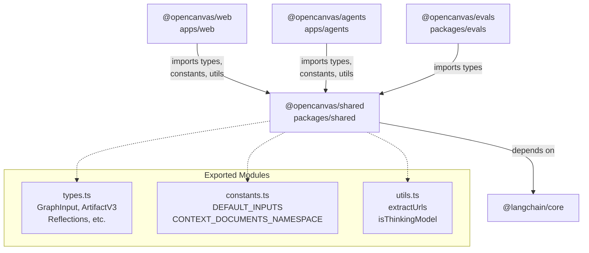
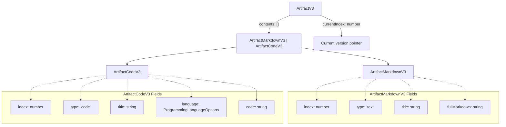
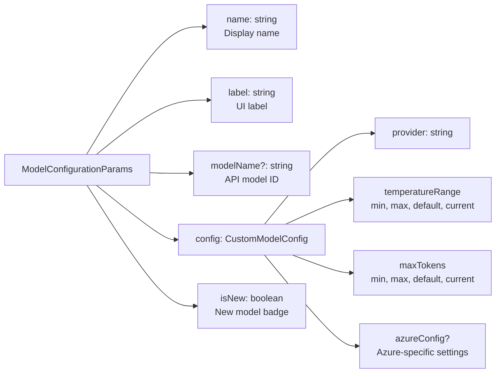
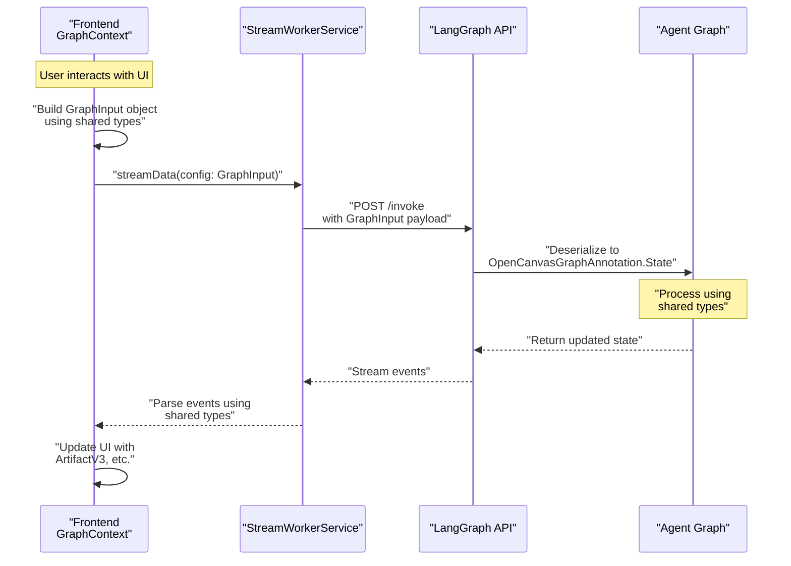

<!-- source: DeepWiki mcp.deepwiki.com · repo langchain-ai/open-canvas · page 6 Shared Code · fetched 2026-10-26 -->

# Shared Code

<details>
<summary>Relevant source files</summary>

The following files were used as context for generating this wiki page:

- [.codespellignore](.codespellignore)
- [apps/agents/package.json](apps/agents/package.json)
- [apps/agents/src/open-canvas/index.ts](apps/agents/src/open-canvas/index.ts)
- [apps/agents/src/summarizer/index.ts](apps/agents/src/summarizer/index.ts)
- [apps/agents/src/web-search/nodes/classify-message.ts](apps/agents/src/web-search/nodes/classify-message.ts)
- [apps/agents/src/web-search/nodes/query-generator.ts](apps/agents/src/web-search/nodes/query-generator.ts)
- [apps/web/package.json](apps/web/package.json)
- [apps/web/src/hooks/useStore.tsx](apps/web/src/hooks/useStore.tsx)
- [langgraph.json](langgraph.json)
- [packages/evals/package.json](packages/evals/package.json)
- [packages/shared/package.json](packages/shared/package.json)
- [packages/shared/src/types.ts](packages/shared/src/types.ts)

</details>


The `packages/shared` module serves as the single source of truth for type definitions, constants, and utility functions used across both the frontend (`apps/web`) and backend (`apps/agents`) applications. This shared package ensures type safety and consistency throughout the Open Canvas codebase by defining common interfaces for artifacts, model configurations, reflections, and graph inputs.

For information about model-specific configurations and provider integrations, see [Model Configuration](#5.1). For details about how these types are used in the agent workflow, see [Backend Architecture](#2.2).

## Package Structure

The shared package is configured as a TypeScript library that compiles to CommonJS and ESM formats. The package exports its compiled output through multiple entry points defined in `package.json`:

```
packages/shared/
├── src/
│   ├── types.ts          # Core type definitions
│   ├── constants.ts      # Shared constants
│   └── utils.ts          # Utility functions
├── dist/                 # Compiled output
│   ├── index.js
│   ├── index.d.ts
│   └── ...
└── package.json
```

**Build Configuration**: The package uses TypeScript compilation (`tsc`) to generate type definitions and JavaScript output. Both applications import from `@opencanvas/shared` as a workspace dependency, with the monorepo's Turbo build system ensuring the shared package compiles before dependent applications.

Sources: [packages/shared/package.json:1-54](), [apps/agents/package.json:38](), [apps/web/package.json:45]()

### Dependency Graph



Sources: [packages/shared/package.json:1-54](), [apps/agents/package.json:38](), [apps/web/package.json:45]()

## Core Type Definitions

The `types.ts` file defines the foundational data structures used throughout Open Canvas. These types can be grouped into several categories:

### GraphInput Interface

The `GraphInput` interface defines the complete state shape for agent graph invocations. This is the primary input contract between the frontend and backend:

| Field | Type | Purpose |
|-------|------|---------|
| `messages` | `Record<string, any>[]` | Conversation history in LangChain message format |
| `highlightedCode` | `CodeHighlight?` | Selected code range for partial updates |
| `highlightedText` | `TextHighlight?` | Selected text block for text artifact updates |
| `artifact` | `ArtifactV3?` | Current artifact with version history |
| `next` | `string?` | Routing hint for next node to execute |
| `language` | `LanguageOptions?` | Target language for translations |
| `artifactLength` | `ArtifactLengthOptions?` | Desired content length |
| `regenerateWithEmojis` | `boolean?` | Emoji generation flag |
| `readingLevel` | `ReadingLevelOptions?` | Target reading comprehension level |
| `addComments` | `boolean?` | Code commenting flag |
| `addLogs` | `boolean?` | Code logging flag |
| `portLanguage` | `ProgrammingLanguageOptions?` | Language for code porting |
| `fixBugs` | `boolean?` | Bug fixing flag |
| `customQuickActionId` | `string?` | Custom action identifier |
| `webSearchEnabled` | `boolean?` | Web search toggle |
| `webSearchResults` | `SearchResult[]?` | Fetched search results |

Sources: [packages/shared/src/types.ts:206-229]()

### Artifact Type System

The artifact system uses a versioned type hierarchy to represent generated content:



**ArtifactV3**: The root interface containing a `contents` array with version history and a `currentIndex` pointer to the active version. Each version is either a text artifact (markdown) or code artifact.

**ArtifactMarkdownV3**: Represents text-based content with fields `index` (version number), `type` (literal `"text"`), `title`, and `fullMarkdown` (the complete markdown content).

**ArtifactCodeV3**: Represents code-based content with fields `index`, `type` (literal `"code"`), `title`, `language` (programming language identifier), and `code` (the source code).

Sources: [packages/shared/src/types.ts:106-124]()

### Highlight Types

The system supports two types of content highlighting for partial updates:

**CodeHighlight**: Defines a character range in code artifacts:
```typescript
{
  startCharIndex: number;
  endCharIndex: number;
}
```

**TextHighlight**: Defines a selection in markdown artifacts with context:
```typescript
{
  fullMarkdown: string;      // Complete document
  markdownBlock: string;     // Parent block containing selection
  selectedText: string;      // Exact highlighted text
}
```

Sources: [packages/shared/src/types.ts:101-130]()

## Model Configuration Types

The shared package defines the type system for multi-model support, enabling dynamic LLM provider configuration:

### ModelConfigurationParams Interface



**CustomModelConfig**: Encapsulates model-specific configuration including:
- **provider**: String identifier (e.g., `"openai"`, `"anthropic"`)
- **temperatureRange**: Defines valid temperature bounds and current value
- **maxTokens**: Defines token limit bounds and current value
- **azureConfig**: Optional Azure OpenAI-specific configuration including API keys, instance names, deployment names, and API versions

This type system allows the frontend to present model configuration controls and persist them per-thread, while the backend uses the configuration to initialize the appropriate LLM client.

Sources: [packages/shared/src/types.ts:3-32]()

### Type Enumerations

The shared package defines several constrained type unions for configuration options:

| Type | Purpose | Values |
|------|---------|--------|
| `ProgrammingLanguageOptions` | Supported code languages | `typescript`, `javascript`, `cpp`, `java`, `php`, `python`, `html`, `sql`, `json`, `rust`, `xml`, `clojure`, `csharp`, `other` |
| `LanguageOptions` | Natural language options | `english`, `mandarin`, `spanish`, `french`, `hindi` |
| `ReadingLevelOptions` | Text complexity targets | `pirate`, `child`, `teenager`, `college`, `phd` |
| `ArtifactLengthOptions` | Content length preferences | `shortest`, `short`, `long`, `longest` |
| `ArtifactType` | Artifact classification | `code`, `text` |

Sources: [packages/shared/src/types.ts:34-99]()

## Memory System Types

### Reflections Interface

The `Reflections` interface structures the memory system that enables personalized content generation:

```typescript
interface Reflections {
  styleRules: string[];   // Style preferences extracted from past interactions
  content: string[];      // Key facts and context about the user
}
```

**Usage**: The reflection agent analyzes conversation history to extract:
- **styleRules**: Patterns like "User prefers concise explanations" or "Use technical terminology"
- **content**: Domain knowledge like "User is building a React application" or "User works in healthcare"

These reflections are stored namespaced by assistant ID (`["memories", assistantId]`) and retrieved during path generation to inform content creation.

Sources: [packages/shared/src/types.ts:160-169](), [apps/web/src/hooks/useStore.tsx:19-65]()

### CustomQuickAction Interface

Defines user-created quick action shortcuts:

| Field | Type | Purpose |
|-------|------|---------|
| `id` | `string` | UUID identifier |
| `title` | `string` | Display name in UI |
| `prompt` | `string` | Template for action execution |
| `includeReflections` | `boolean` | Whether to inject reflections |
| `includePrefix` | `boolean` | Whether to add default prefix |
| `includeRecentHistory` | `boolean` | Whether to include last 5 messages |

Custom quick actions are stored per-user in namespace `["custom_actions", userId]` and enable users to create reusable content transformation templates.

Sources: [packages/shared/src/types.ts:132-158](), [apps/web/src/hooks/useStore.tsx:95-226]()

### ContextDocument Interface

Represents uploaded reference documents:

```typescript
interface ContextDocument {
  name: string;           // File name
  type: string;           // MIME type or document type
  data: string;           // Base64 encoded content or plain text
  metadata?: Record<string, any>;  // Optional additional metadata
}
```

Context documents are stored using the `CONTEXT_DOCUMENTS_NAMESPACE` constant and keyed by assistant ID, allowing users to maintain reference materials per conversation.

Sources: [packages/shared/src/types.ts:171-189](), [apps/web/src/hooks/useStore.tsx:228-289]()

## Search System Types

### SearchResult Type

Web search integration uses the `SearchResult` type, which extends LangChain's `DocumentInterface` with Exa-specific metadata:

```typescript
type SearchResult = DocumentInterface<ExaMetadata>;

type ExaMetadata = {
  id: string;
  url: string;
  title: string;
  author: string;
  publishedDate: string;
  image?: string;
  favicon?: string;
};
```

This type wraps search results from the Exa search API, preserving metadata for display in the frontend's `WebSearchResults` component while providing the document content for context enrichment.

Sources: [packages/shared/src/types.ts:191-204]()

## Constants Module

The constants module exports shared values used across applications:

**DEFAULT_INPUTS**: Defines the initial state for the `GraphInput` interface, ensuring consistent default values when starting new conversations or resetting state.

**CONTEXT_DOCUMENTS_NAMESPACE**: String constant defining the namespace for storing context documents in the LangGraph store (`["context_documents"]`). This namespace is used by both frontend and backend to coordinate document storage.

**OC_SUMMARIZED_MESSAGE_KEY**: Key used in message `additional_kwargs` to mark messages that contain conversation summaries. This prevents infinite summarization loops and allows the system to identify compressed history.

Sources: [apps/agents/src/open-canvas/index.ts:2](), [apps/web/src/hooks/useStore.tsx:9](), [apps/agents/src/summarizer/index.ts:5]()

## Type Usage Patterns

### Frontend to Backend Flow



Sources: [packages/shared/src/types.ts:206-229](), [apps/agents/src/open-canvas/index.ts:15]()

### Memory Storage Pattern

The `useStore` hook demonstrates how shared types coordinate frontend and backend storage:

1. **Reflections**: Stored in namespace `["memories", assistantId]` with key `"reflection"`, typed as `Reflections`
2. **Quick Actions**: Stored in namespace `["custom_actions", userId]` with key `"actions"`, typed as `Record<string, CustomQuickAction>`
3. **Context Documents**: Stored in `CONTEXT_DOCUMENTS_NAMESPACE` with assistant ID as key, typed as `{ documents: ContextDocument[] }`

This consistent use of shared types ensures type safety across API boundaries and enables reliable serialization/deserialization.

Sources: [apps/web/src/hooks/useStore.tsx:1-304](), [packages/shared/src/types.ts:1-230]()

## Integration with LangChain Core

The shared package depends on `@langchain/core` to align with LangChain's type system:

- **DocumentInterface**: Used as the base type for `SearchResult`, ensuring compatibility with LangChain document loaders and vector stores
- **Message types**: The `messages` field in `GraphInput` uses LangChain message format (`HumanMessage`, `AIMessage`, etc.)

This integration allows seamless interoperability with LangChain's ecosystem while maintaining Open Canvas's domain-specific types.

Sources: [packages/shared/package.json:51-53](), [packages/shared/src/types.ts:1-2]()

---

