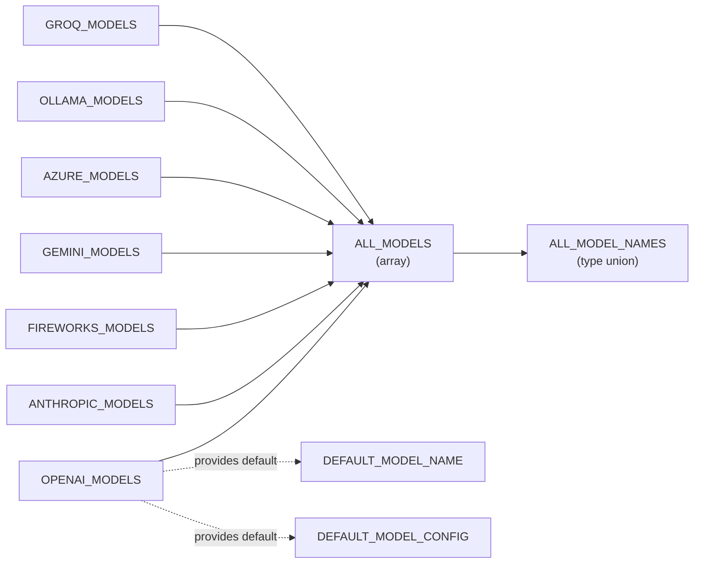
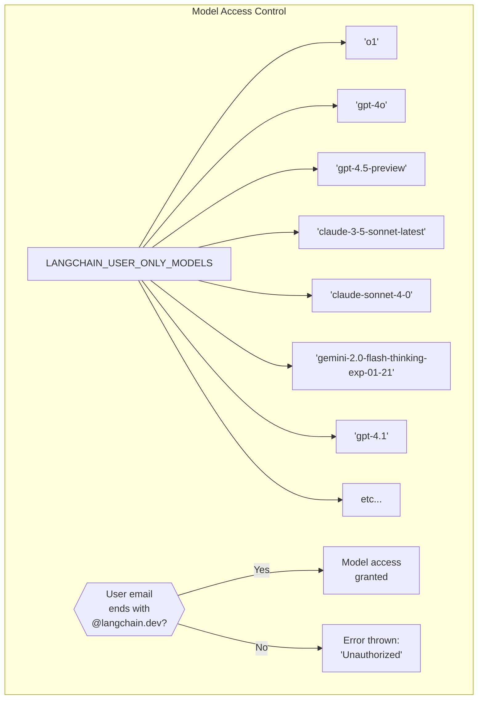
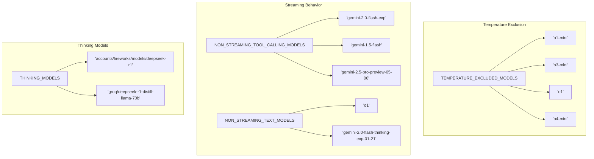
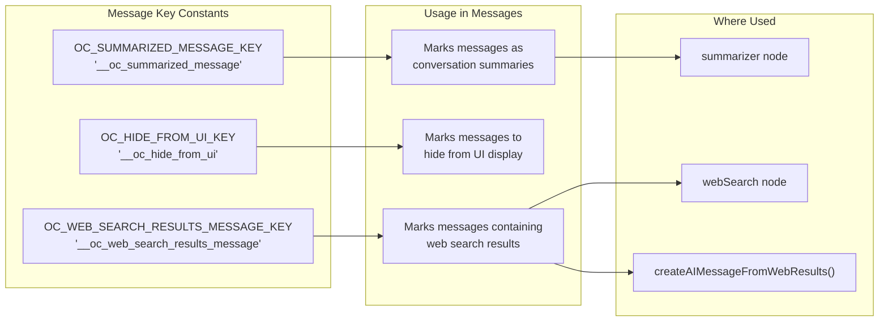
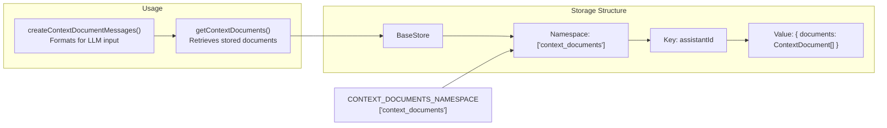
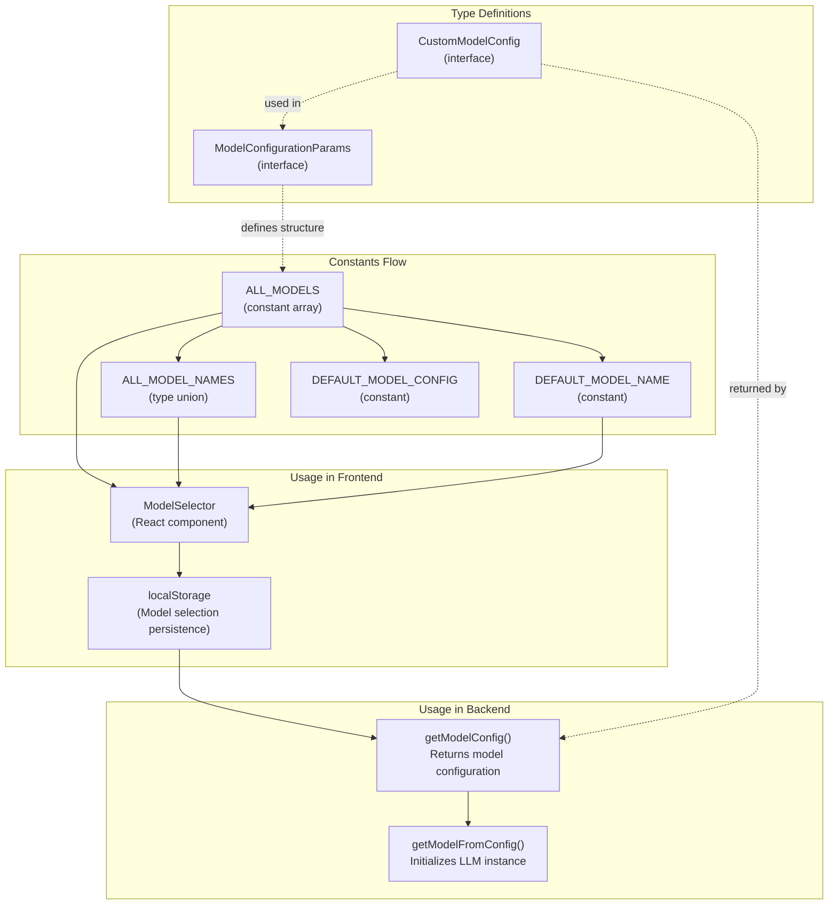

<!-- source: DeepWiki mcp.deepwiki.com · repo langchain-ai/open-canvas · page 6.1 Types and Constants · fetched 2026-10-26 -->

# Types and Constants

<details>
<summary>Relevant source files</summary>

The following files were used as context for generating this wiki page:

- [.codespellignore](.codespellignore)
- [apps/agents/package.json](apps/agents/package.json)
- [apps/agents/src/open-canvas/index.ts](apps/agents/src/open-canvas/index.ts)
- [apps/agents/src/summarizer/index.ts](apps/agents/src/summarizer/index.ts)
- [apps/agents/src/web-search/nodes/classify-message.ts](apps/agents/src/web-search/nodes/classify-message.ts)
- [apps/agents/src/web-search/nodes/query-generator.ts](apps/agents/src/web-search/nodes/query-generator.ts)
- [apps/web/package.json](apps/web/package.json)
- [apps/web/src/hooks/useStore.tsx](apps/web/src/hooks/useStore.tsx)
- [langgraph.json](langgraph.json)
- [packages/evals/package.json](packages/evals/package.json)
- [packages/shared/package.json](packages/shared/package.json)
- [packages/shared/src/types.ts](packages/shared/src/types.ts)

</details>


This page documents the shared type definitions, constants, and configuration structures defined in the `@opencanvas/shared` package. These shared definitions ensure type consistency and configuration standardization across both the frontend (`@opencanvas/web`) and backend (`@opencanvas/agents`) applications.

For information about how these types and constants are used in utility functions, see [Utility Functions](#6.2). For information about how model configurations are used to initialize LLM instances, see [Provider Integration](#5.2).

## Purpose and Scope

The `@opencanvas/shared` package centralizes:
- **Type definitions**: TypeScript interfaces and types used across the monorepo
- **Model configurations**: Definitions for all supported LLM providers and their parameters
- **Constants**: Shared string literals, default values, and categorization lists
- **Namespaces**: Standardized keys for storage and state management

This centralization prevents code duplication and ensures that frontend and backend components use identical type definitions and configuration values.

## Model Configuration Structure

### ModelConfigurationParams and Related Types

The system defines a comprehensive structure for configuring language models across multiple providers.

```mermaid
graph TB
    subgraph "Model Configuration Hierarchy"
        ModelConfigurationParams["ModelConfigurationParams"]
        ModelConfigurationParams --> name["name: string"]
        ModelConfigurationParams --> label["label: string"]
        ModelConfigurationParams --> isNew["isNew: boolean"]
        ModelConfigurationParams --> config["config: CustomModelConfig"]
        
        config --> provider["provider: string"]
        config --> temperatureRange["temperatureRange"]
        config --> maxTokens["maxTokens"]
        
        temperatureRange --> tempMin["min: number"]
        temperatureRange --> tempMax["max: number"]
        temperatureRange --> tempDefault["default: number"]
        temperatureRange --> tempCurrent["current: number"]
        
        maxTokens --> tokensMin["min: number"]
        maxTokens --> tokensMax["max: number"]
        maxTokens --> tokensDefault["default: number"]
        maxTokens --> tokensCurrent["current: number"]
    end
    
    subgraph "Provider-Specific Arrays"
        OPENAI_MODELS["OPENAI_MODELS[]"]
        ANTHROPIC_MODELS["ANTHROPIC_MODELS[]"]
        GEMINI_MODELS["GEMINI_MODELS[]"]
        FIREWORKS_MODELS["FIREWORKS_MODELS[]"]
        AZURE_MODELS["AZURE_MODELS[]"]
        OLLAMA_MODELS["OLLAMA_MODELS[]"]
        GROQ_MODELS["GROQ_MODELS[]"]
    end
    
    subgraph "Aggregate Arrays"
        ALL_MODELS["ALL_MODELS[]<br/>Union of all provider models"]
        ALL_MODEL_NAMES["ALL_MODEL_NAMES<br/>Type union of all model names"]
    end
    
    OPENAI_MODELS --> ALL_MODELS
    ANTHROPIC_MODELS --> ALL_MODELS
    GEMINI_MODELS --> ALL_MODELS
    FIREWORKS_MODELS --> ALL_MODELS
    AZURE_MODELS --> ALL_MODELS
    OLLAMA_MODELS --> ALL_MODELS
    GROQ_MODELS --> ALL_MODELS
    
    ALL_MODELS --> ALL_MODEL_NAMES
    
    ModelConfigurationParams -.defines structure for.-> OPENAI_MODELS
    ModelConfigurationParams -.defines structure for.-> ANTHROPIC_MODELS
```



**Sources:** [packages/shared/src/models.ts:1-640]()

Each model configuration specifies:
- **name**: The model identifier used in API calls (e.g., `"gpt-4o-mini"`, `"claude-3-5-sonnet-latest"`)
- **label**: Human-readable display name shown in the UI (e.g., `"GPT 4o mini"`, `"Claude 3.5 Sonnet"`)
- **isNew**: Boolean flag indicating if the model should display a "New" badge in the UI
- **config**: Nested configuration object containing:
  - **provider**: Provider identifier (`"openai"`, `"anthropic"`, `"google-genai"`, `"fireworks"`, `"azure_openai"`, `"ollama"`, `"groq"`)
  - **temperatureRange**: Configuration for the temperature parameter with min, max, default, and current values
  - **maxTokens**: Configuration for the maximum output tokens with min, max, default, and current values

### Provider-Specific Model Arrays

Models are organized into provider-specific arrays, each conforming to the `ModelConfigurationParams` structure:

| Provider Array | Provider ID | Example Models | Source Lines |
|---------------|-------------|----------------|--------------|
| `OPENAI_MODELS` | `"openai"` | `"gpt-4.1"`, `"gpt-4o-mini"`, `"o3-mini"`, `"o1"` | [packages/shared/src/models.ts:26-207]() |
| `ANTHROPIC_MODELS` | `"anthropic"` | `"claude-sonnet-4-0"`, `"claude-3-5-sonnet-latest"`, `"claude-3-5-haiku-20241022"` | [packages/shared/src/models.ts:235-356]() |
| `GEMINI_MODELS` | `"google-genai"` | `"gemini-2.5-flash-preview-05-20"`, `"gemini-2.0-flash"`, `"gemini-2.0-flash-thinking-exp-01-21"` | [packages/shared/src/models.ts:464-565]() |
| `FIREWORKS_MODELS` | `"fireworks"` | `"accounts/fireworks/models/llama-v3p3-70b-instruct"`, `"accounts/fireworks/models/deepseek-r1"` | [packages/shared/src/models.ts:358-439]() |
| `AZURE_MODELS` | `"azure_openai"` | `"azure/gpt-4o-mini"` | [packages/shared/src/models.ts:3-24]() |
| `OLLAMA_MODELS` | `"ollama"` | `"ollama-llama3.3"` | [packages/shared/src/models.ts:212-233]() |
| `GROQ_MODELS` | `"groq"` | `"groq/deepseek-r1-distill-llama-70b"` | [packages/shared/src/models.ts:441-462]() |

**Sources:** [packages/shared/src/models.ts:3-565]()

### Aggregate Model Arrays and Types



**Sources:** [packages/shared/src/models.ts:608-640]()

The `ALL_MODELS` array [packages/shared/src/models.ts:608-616]() concatenates all provider-specific arrays:

```typescript
export const ALL_MODELS: ModelConfigurationParams[] = [
  ...OPENAI_MODELS,
  ...ANTHROPIC_MODELS,
  ...FIREWORKS_MODELS,
  ...GEMINI_MODELS,
  ...AZURE_MODELS,
  ...OLLAMA_MODELS,
  ...GROQ_MODELS,
];
```

The `ALL_MODEL_NAMES` type [packages/shared/src/models.ts:625-632]() is a TypeScript union of all model name strings:

```typescript
export type ALL_MODEL_NAMES =
  | OPENAI_MODEL_NAMES
  | ANTHROPIC_MODEL_NAMES
  | FIREWORKS_MODEL_NAMES
  | GEMINI_MODEL_NAMES
  | AZURE_MODEL_NAMES
  | OLLAMA_MODEL_NAMES
  | GROQ_MODEL_NAMES;
```

Default configurations [packages/shared/src/models.ts:634-639]() point to `OPENAI_MODELS[1]` (`"gpt-4.1-mini"`):

```typescript
export const DEFAULT_MODEL_NAME: ALL_MODEL_NAMES = OPENAI_MODELS[1].name;
export const DEFAULT_MODEL_CONFIG: CustomModelConfig = {
  ...OPENAI_MODELS[1].config,
  temperatureRange: { ...OPENAI_MODELS[1].config.temperatureRange },
  maxTokens: { ...OPENAI_MODELS[1].config.maxTokens },
};
```

**Sources:** [packages/shared/src/models.ts:608-640]()

## Model Categorization Lists

The system maintains several categorization lists that specify special handling requirements for certain models:

### Model Access Restrictions



**Sources:** [packages/shared/src/models.ts:567-578](), [apps/agents/src/utils.ts:365-379]()

`LANGCHAIN_USER_ONLY_MODELS` [packages/shared/src/models.ts:567-578]() lists models restricted to users with `@langchain.dev` email addresses:

```typescript
export const LANGCHAIN_USER_ONLY_MODELS = [
  "o1",
  "gpt-4o",
  "gpt-4.5-preview",
  "claude-3-5-sonnet-latest",
  "claude-3-7-sonnet-latest",
  "gemini-2.0-flash-thinking-exp-01-21",
  "gemini-2.5-pro-preview-05-06",
  "claude-sonnet-4-0",
  "claude-opus-4-0",
  "gpt-4.1",
];
```

This list is checked in `getModelFromConfig` [apps/agents/src/utils.ts:365-379]() before model initialization.

**Sources:** [packages/shared/src/models.ts:567-578](), [apps/agents/src/utils.ts:365-379]()

### Parameter Exclusion Lists



**Sources:** [packages/shared/src/models.ts:580-606]()

| Constant | Purpose | Models | Source Lines |
|----------|---------|--------|--------------|
| `TEMPERATURE_EXCLUDED_MODELS` | Models that do not support the `temperature` parameter | `"o1-mini"`, `"o3-mini"`, `"o1"`, `"o4-mini"` | [packages/shared/src/models.ts:581-586]() |
| `NON_STREAMING_TOOL_CALLING_MODELS` | Models that do not stream tool calls | `"gemini-2.0-flash-exp"`, `"gemini-1.5-flash"`, `"gemini-2.5-pro-preview-05-06"`, `"gemini-2.5-flash-preview-05-20"` | [packages/shared/src/models.ts:589-594]() |
| `NON_STREAMING_TEXT_MODELS` | Models that do not stream text responses | `"o1"`, `"gemini-2.0-flash-thinking-exp-01-21"` | [packages/shared/src/models.ts:597-600]() |
| `THINKING_MODELS` | Models that perform chain-of-thought reasoning with `<think>` tags | `"accounts/fireworks/models/deepseek-r1"`, `"groq/deepseek-r1-distill-llama-70b"` | [packages/shared/src/models.ts:603-606]() |

These lists are used throughout the backend to conditionally apply special handling:
- `TEMPERATURE_EXCLUDED_MODELS` is checked in `getModelFromConfig` [apps/agents/src/utils.ts:382-394]() to exclude temperature parameters
- `THINKING_MODELS` is checked in `isThinkingModel` [packages/shared/src/utils/thinking.ts:131-133]() to enable `<think>` tag extraction

**Sources:** [packages/shared/src/models.ts:580-606](), [apps/agents/src/utils.ts:382-394](), [packages/shared/src/utils/thinking.ts:131-133]()

## Message Key Constants

Special message keys are used to mark messages with metadata for conditional rendering or processing:



**Sources:** [packages/shared/src/constants.ts:3-6](), [apps/agents/src/utils.ts:623-631]()

Defined in [packages/shared/src/constants.ts:3-6]():

```typescript
export const OC_SUMMARIZED_MESSAGE_KEY = "__oc_summarized_message";
export const OC_HIDE_FROM_UI_KEY = "__oc_hide_from_ui";
export const OC_WEB_SEARCH_RESULTS_MESSAGE_KEY = 
  "__oc_web_search_results_message";
```

These keys are used in message `additional_kwargs` to mark messages for special handling:
- `OC_SUMMARIZED_MESSAGE_KEY`: Applied by the summarizer agent to mark condensed conversation summaries
- `OC_HIDE_FROM_UI_KEY`: Used to hide internal messages from the UI while keeping them in the conversation history
- `OC_WEB_SEARCH_RESULTS_MESSAGE_KEY`: Applied by `createAIMessageFromWebResults` [apps/agents/src/utils.ts:623-631]() to mark web search result messages

**Sources:** [packages/shared/src/constants.ts:3-6](), [apps/agents/src/utils.ts:604-632]()

## Input State Constants

### DEFAULT_INPUTS

```mermaid
graph TB
    DEFAULT_INPUTS["DEFAULT_INPUTS"]
    
    DEFAULT_INPUTS --> highlightedCode["highlightedCode: undefined"]
    DEFAULT_INPUTS --> highlightedText["highlightedText: undefined"]
    DEFAULT_INPUTS --> next["next: undefined"]
    DEFAULT_INPUTS --> language["language: undefined"]
    DEFAULT_INPUTS --> artifactLength["artifactLength: undefined"]
    DEFAULT_INPUTS --> regenerateWithEmojis["regenerateWithEmojis: undefined"]
    DEFAULT_INPUTS --> readingLevel["readingLevel: undefined"]
    DEFAULT_INPUTS --> addComments["addComments: undefined"]
    DEFAULT_INPUTS --> addLogs["addLogs: undefined"]
    DEFAULT_INPUTS --> fixBugs["fixBugs: undefined"]
    DEFAULT_INPUTS --> portLanguage["portLanguage: undefined"]
    DEFAULT_INPUTS --> customQuickActionId["customQuickActionId: undefined"]
    DEFAULT_INPUTS --> webSearchEnabled["webSearchEnabled: undefined"]
    DEFAULT_INPUTS --> webSearchResults["webSearchResults: undefined"]
    
    subgraph "Used in Graph"
        cleanState["cleanState node<br/>Resets state flags after processing"]
    end
    
    DEFAULT_INPUTS -.spread into.-> cleanState
```



**Sources:** [packages/shared/src/constants.ts:10-25](), [apps/agents/src/open-canvas/index.ts:30-34]()

The `DEFAULT_INPUTS` object [packages/shared/src/constants.ts:10-25]() defines the default state for all input flags:

```typescript
export const DEFAULT_INPUTS = {
  highlightedCode: undefined,
  highlightedText: undefined,
  next: undefined,
  language: undefined,
  artifactLength: undefined,
  regenerateWithEmojis: undefined,
  readingLevel: undefined,
  addComments: undefined,
  addLogs: undefined,
  fixBugs: undefined,
  portLanguage: undefined,
  customQuickActionId: undefined,
  webSearchEnabled: undefined,
  webSearchResults: undefined,
};
```

This object is used in the `cleanState` node [apps/agents/src/open-canvas/index.ts:30-34]() to reset temporary state flags after each processing cycle:

```typescript
const cleanState = (_: typeof OpenCanvasGraphAnnotation.State) => {
  return {
    ...DEFAULT_INPUTS,
  };
};
```

**Sources:** [packages/shared/src/constants.ts:10-25](), [apps/agents/src/open-canvas/index.ts:30-34]()

## Programming Language Options

### PROGRAMMING_LANGUAGES Array

```mermaid
graph TB
    PROG_LANGS["PROGRAMMING_LANGUAGES[]"]
    
    subgraph "Array Elements"
        PROG_LANGS --> ts["{ language: 'typescript', label: 'TypeScript' }"]
        PROG_LANGS --> js["{ language: 'javascript', label: 'JavaScript' }"]
        PROG_LANGS --> cpp["{ language: 'cpp', label: 'C++' }"]
        PROG_LANGS --> java["{ language: 'java', label: 'Java' }"]
        PROG_LANGS --> php["{ language: 'php', label: 'PHP' }"]
        PROG_LANGS --> python["{ language: 'python', label: 'Python' }"]
        PROG_LANGS --> html["{ language: 'html', label: 'HTML' }"]
        PROG_LANGS --> sql["{ language: 'sql', label: 'SQL' }"]
        PROG_LANGS --> json["{ language: 'json', label: 'JSON' }"]
        PROG_LANGS --> rust["{ language: 'rust', label: 'Rust' }"]
        PROG_LANGS --> xml["{ language: 'xml', label: 'XML' }"]
        PROG_LANGS --> clojure["{ language: 'clojure', label: 'Clojure' }"]
        PROG_LANGS --> csharp["{ language: 'csharp', label: 'C#' }"]
        PROG_LANGS --> other["{ language: 'other', label: 'Other' }"]
    end
    
    subgraph "Usage"
        dropdown["UI Dropdowns<br/>Language selection"]
        codeMirror["CodeMirror<br/>Syntax highlighting"]
        artifactType["Artifact type<br/>determination"]
    end
    
    PROG_LANGS --> dropdown
    PROG_LANGS --> codeMirror
    PROG_LANGS --> artifactType
```



**Sources:** [packages/shared/src/constants.ts:27-87]()

The `PROGRAMMING_LANGUAGES` array [packages/shared/src/constants.ts:27-87]() defines supported programming languages for code artifacts:

```typescript
export const PROGRAMMING_LANGUAGES: Array<{
  language: ProgrammingLanguageOptions;
  label: string;
}> = [
  { language: "typescript", label: "TypeScript" },
  { language: "javascript", label: "JavaScript" },
  { language: "cpp", label: "C++" },
  { language: "java", label: "Java" },
  { language: "php", label: "PHP" },
  { language: "python", label: "Python" },
  { language: "html", label: "HTML" },
  { language: "sql", label: "SQL" },
  { language: "json", label: "JSON" },
  { language: "rust", label: "Rust" },
  { language: "xml", label: "XML" },
  { language: "clojure", label: "Clojure" },
  { language: "csharp", label: "C#" },
  { language: "other", label: "Other" },
];
```

Each entry contains:
- **language**: The language identifier used in artifact metadata and CodeMirror configuration
- **label**: The human-readable display name shown in UI dropdowns

**Sources:** [packages/shared/src/constants.ts:27-87]()

## Namespace Constants

### CONTEXT_DOCUMENTS_NAMESPACE



**Sources:** [packages/shared/src/constants.ts:8](), [apps/agents/src/utils.ts:515-526]()

The `CONTEXT_DOCUMENTS_NAMESPACE` constant [packages/shared/src/constants.ts:8]() defines the storage namespace for context documents:

```typescript
export const CONTEXT_DOCUMENTS_NAMESPACE = ["context_documents"];
```

This namespace is used in `getContextDocuments` [apps/agents/src/utils.ts:515-526]() to retrieve stored documents from the BaseStore:

```typescript
async function getContextDocuments(
  config: LangGraphRunnableConfig
): Promise<ContextDocument[]> {
  const store = config.store;
  const assistantId = config.configurable?.assistant_id;
  if (!store || !assistantId) {
    return [];
  }

  const result = await store.get(CONTEXT_DOCUMENTS_NAMESPACE, assistantId);
  return result?.value?.documents || [];
}
```

Context documents (PDFs, text files) uploaded by users are stored under this namespace and retrieved during artifact generation to provide additional context to the LLM.

**Sources:** [packages/shared/src/constants.ts:8](), [apps/agents/src/utils.ts:515-582]()

## Core Type Definitions

While type definitions are not directly visible in the provided files, their usage throughout the codebase reveals their structure:

### Type Structure Overview

```mermaid
graph TB
    subgraph "Artifact Types"
        ArtifactV3["ArtifactV3"]
        ArtifactCodeV3["ArtifactCodeV3"]
        ArtifactMarkdownV3["ArtifactMarkdownV3"]
        
        ArtifactV3 --> ArtifactCodeV3
        ArtifactV3 --> ArtifactMarkdownV3
        
        ArtifactCodeV3 --> code_props["title: string<br/>code: string<br/>type: 'code'<br/>language: string"]
        ArtifactMarkdownV3 --> md_props["title: string<br/>fullMarkdown: string<br/>type: 'text'"]
    end
    
    subgraph "Reflection Types"
        Reflections["Reflections"]
        Reflections --> styleRules["styleRules: string[]"]
        Reflections --> content["content: string[]"]
    end
    
    subgraph "Context Types"
        ContextDocument["ContextDocument"]
        ContextDocument --> doc_type["type: string<br/>(e.g. 'application/pdf', 'text/plain')"]
        ContextDocument --> doc_data["data: string<br/>(base64 encoded)"]
    end
    
    subgraph "Model Types"
        CustomModelConfig["CustomModelConfig"]
        ModelConfigurationParams["ModelConfigurationParams"]
        
        CustomModelConfig --> config_props["provider: string<br/>temperatureRange: object<br/>maxTokens: object"]
        ModelConfigurationParams --> param_props["name: string<br/>label: string<br/>isNew: boolean<br/>config: CustomModelConfig"]
    end
    
    subgraph "Search Types"
        SearchResult["SearchResult"]
        SearchResult --> search_props["pageContent: string<br/>metadata: object"]
    end
```



**Sources:** [apps/agents/src/utils.ts:1-642](), [packages/shared/src/types.ts]() (referenced but not provided)

### Key Type Usages

| Type | Used In | Purpose | Example Source |
|------|---------|---------|----------------|
| `ArtifactV3` | Artifact generation/rewriting nodes | Union type for code or markdown artifacts | [apps/agents/src/utils.ts:3-10]() |
| `ArtifactCodeV3` | Code artifact operations | Represents code artifacts with language metadata | [apps/agents/src/utils.ts:134-149]() |
| `ArtifactMarkdownV3` | Text artifact operations | Represents text/markdown artifacts | [apps/agents/src/utils.ts:134-149]() |
| `Reflections` | Memory system | Stores user style rules and content insights | [apps/agents/src/utils.ts:31-101]() |
| `ContextDocument` | Document processing | Uploaded PDFs and text files for context | [apps/agents/src/utils.ts:434-582]() |
| `CustomModelConfig` | Model initialization | Runtime model configuration | [apps/agents/src/utils.ts:162-180]() |
| `ModelConfigurationParams` | Model selection UI | Complete model definition with config | [packages/shared/src/models.ts:1-640]() |
| `SearchResult` | Web search integration | Search result structure from Exa/Firecrawl | [apps/agents/src/utils.ts:604-632]() |

**Sources:** [apps/agents/src/utils.ts:1-642](), [packages/shared/src/models.ts:1-640]()

## Type and Constant Relationships



**Sources:** [packages/shared/src/models.ts:1-640](), [apps/agents/src/utils.ts:162-409](), [apps/web/src/components/chat-interface/model-selector/index.tsx:1-392]()

The relationship between types and constants follows this flow:

1. **Type Definitions** (`ModelConfigurationParams`, `CustomModelConfig`) define the structure
2. **Constant Arrays** (`ALL_MODELS`) implement instances conforming to these types
3. **Derived Types** (`ALL_MODEL_NAMES`) extract type unions from constant arrays
4. **Default Values** (`DEFAULT_MODEL_NAME`, `DEFAULT_MODEL_CONFIG`) provide fallbacks
5. **Frontend Usage** (`ModelSelector`) reads constants for UI display and selection
6. **Backend Usage** (`getModelConfig`, `getModelFromConfig`) processes constants for LLM initialization

This architecture ensures type safety across the entire flow from UI selection to LLM invocation, with shared constants eliminating the possibility of frontend-backend configuration mismatches.

**Sources:** [packages/shared/src/models.ts:1-640](), [apps/agents/src/utils.ts:162-409](), [apps/web/src/components/chat-interface/model-selector/index.tsx:1-392]()

---

