<!-- source: DeepWiki mcp.deepwiki.com · repo langchain-ai/open-canvas · page 6.2 Utility Functions · fetched 2026-10-26 -->

# Utility Functions

<details>
<summary>Relevant source files</summary>

The following files were used as context for generating this wiki page:

- [apps/agents/src/open-canvas/nodes/generate-path/documents.ts](apps/agents/src/open-canvas/nodes/generate-path/documents.ts)
- [apps/agents/src/open-canvas/nodes/generate-path/dynamic-determine-path.ts](apps/agents/src/open-canvas/nodes/generate-path/dynamic-determine-path.ts)
- [apps/agents/src/open-canvas/nodes/generate-path/include-url-contents.ts](apps/agents/src/open-canvas/nodes/generate-path/include-url-contents.ts)
- [apps/agents/src/open-canvas/nodes/generate-path/index.ts](apps/agents/src/open-canvas/nodes/generate-path/index.ts)
- [apps/agents/tsconfig.json](apps/agents/tsconfig.json)
- [apps/web/src/components/assistant-select/index.tsx](apps/web/src/components/assistant-select/index.tsx)
- [apps/web/src/components/chat-interface/model-selector/index.tsx](apps/web/src/components/chat-interface/model-selector/index.tsx)
- [apps/web/src/components/chat-interface/model-selector/model-config-pannel.tsx](apps/web/src/components/chat-interface/model-selector/model-config-pannel.tsx)
- [packages/shared/src/models.ts](packages/shared/src/models.ts)
- [packages/shared/src/utils/thinking.ts](packages/shared/src/utils/thinking.ts)
- [packages/shared/src/utils/urls.ts](packages/shared/src/utils/urls.ts)

</details>


This document details the shared utility functions available in `packages/shared/src/utils/`. These functions provide common functionality used across both frontend and backend applications, including URL extraction from text and processing of "thinking" model outputs. For information about shared types and constants, see page 6.1.

## 1. Overview

The shared utility functions fall into two main categories:

| Category | Functions | Purpose |
|----------|-----------|---------|
| **URL Processing** | `extractUrls` | Extract URLs from text including markdown-formatted links |
| **Thinking Model Processing** | `extractThinkingAndResponseTokens`<br/>`handleRewriteArtifactThinkingModel`<br/>`isThinkingModel` | Parse and handle Chain-of-Thought (CoT) reasoning from thinking models |

These utilities enable consistent handling of URLs and thinking model outputs across the frontend and backend components of Open Canvas.

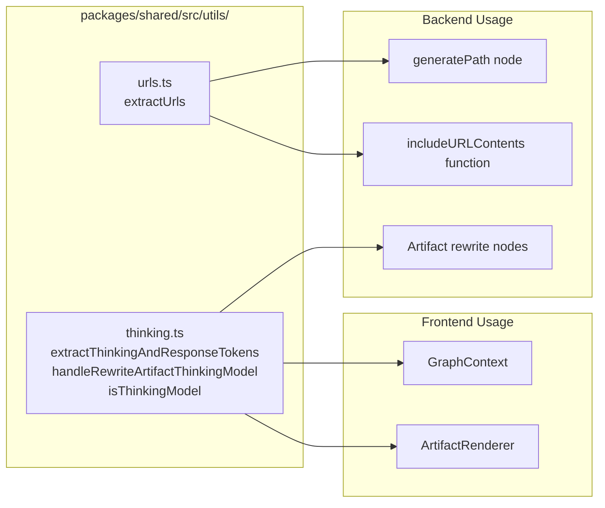

Sources: [packages/shared/src/utils/urls.ts](), [packages/shared/src/utils/thinking.ts]()

## 2. Model Configuration and Initialization

### 2.1 Model Configuration Retrieval

The `getModelConfig` function is a central utility that retrieves the appropriate configuration for a language model based on the provided configuration object and optional parameters.

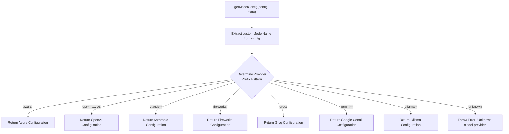

Sources: [apps/agents/src/utils.ts:162-302]()

The function returns an object containing:
- `modelName`: The actual model name to use
- `modelProvider`: The provider identifier (e.g., 'openai', 'anthropic')
- `modelConfig`: Any custom configuration for the model
- Provider-specific configs like `apiKey`, `baseUrl`, or `azureConfig`

### 2.2 Model Initialization

The `getModelFromConfig` function initializes a model instance using the configuration retrieved by `getModelConfig`.

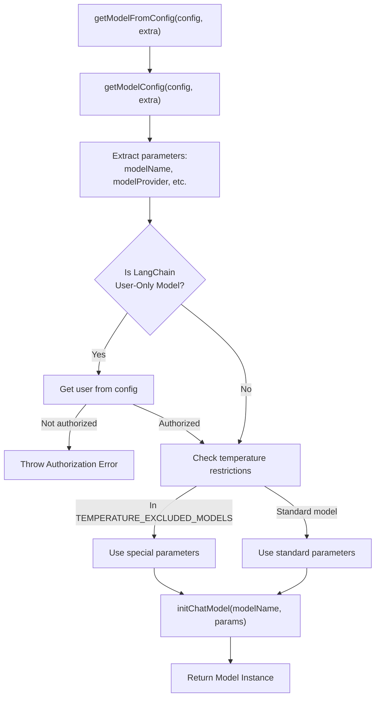

Sources: [apps/agents/src/utils.ts:341-409]()

This function handles:
- Authorization checks for restricted models
- Special parameter handling for models with specific requirements
- Proper initialization of the model with appropriate configuration

## 3. Content Formatting Utilities

### 3.1 Reflection Formatting

The `formatReflections` function converts structured reflection data into a formatted string for inclusion in prompts.

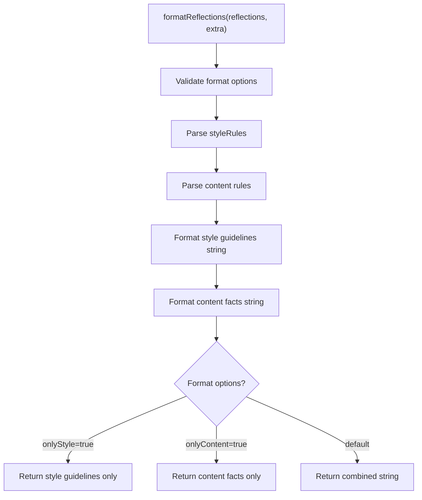

Sources: [apps/agents/src/utils.ts:31-101]()

### 3.2 Artifact Content Formatting

Two key functions handle artifact content formatting:

- `formatArtifactContent` - Formats an artifact (code or markdown) into a text string
- `formatArtifactContentWithTemplate` - Applies a template to formatted artifact content

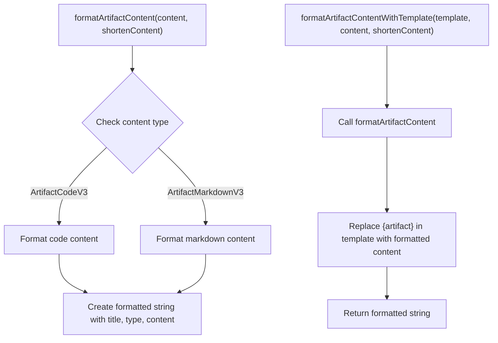

Sources: [apps/agents/src/utils.ts:133-160]()

### 3.3 Thinking Model Processing

For models that provide their reasoning process, the system includes utilities to extract thinking content from responses.

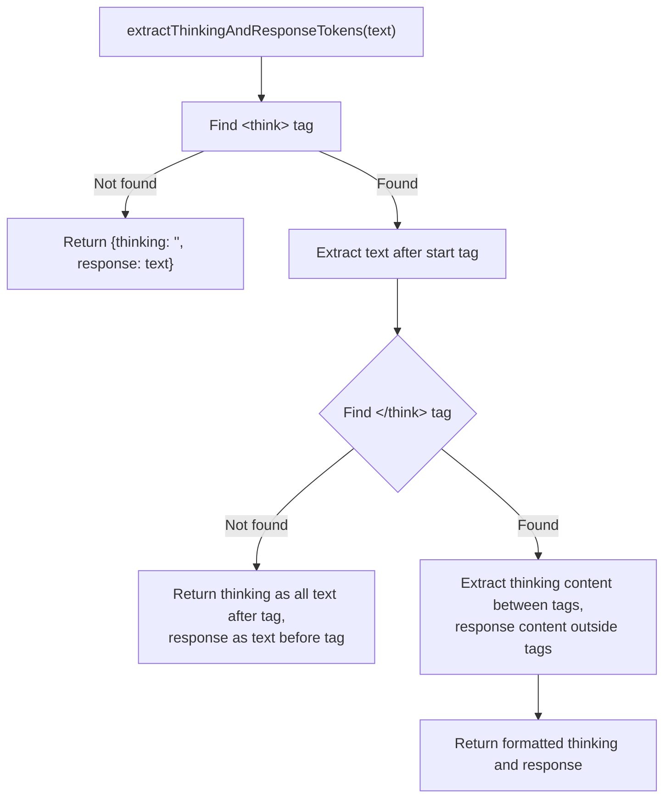

Sources: [packages/shared/src/utils/thinking.ts:32-70]()

## 4. Message Handling Utilities

### 4.1 Message Formatting

The `formatMessages` function converts an array of messages into a formatted string representation.

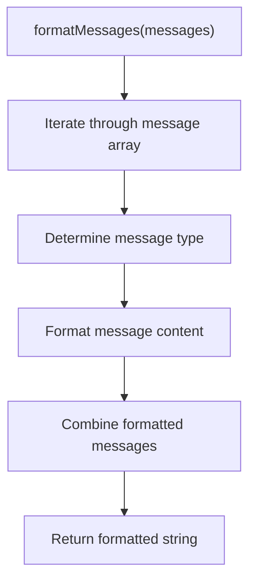

Sources: [apps/agents/src/utils.ts:584-602]()

### 4.2 Web Search Result Formatting

The `createAIMessageFromWebResults` function formats web search results into an AI message.

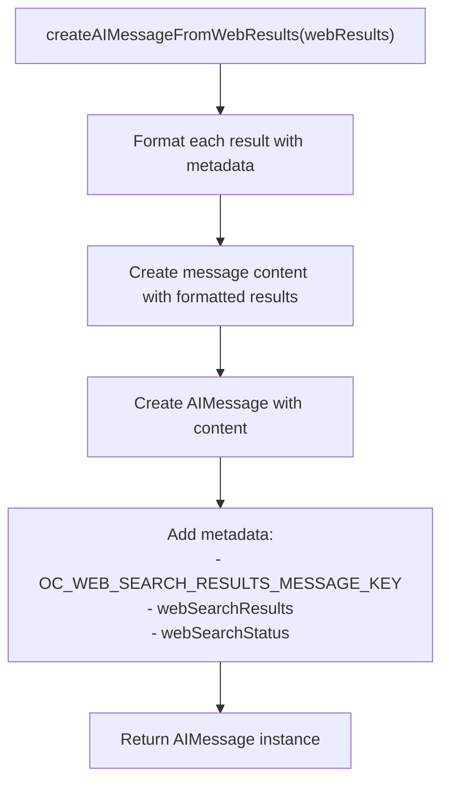

Sources: [apps/agents/src/utils.ts:604-632]()

## 5. Document Processing Utilities

### 5.1 PDF Processing

The system includes utilities for converting PDF documents to text for use with language models.

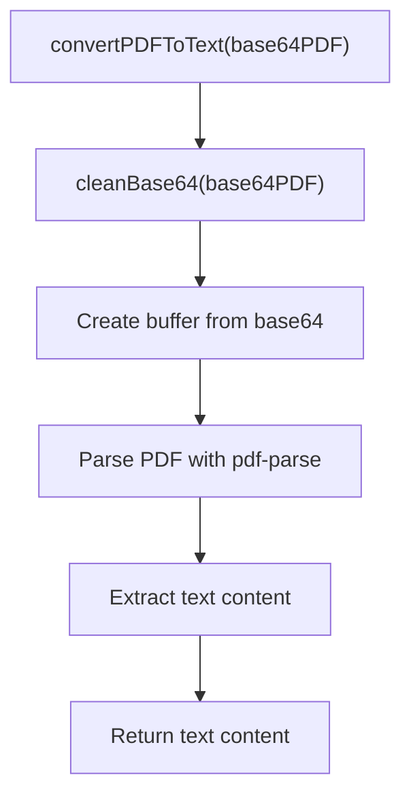

Sources: [apps/agents/src/utils.ts:415-432]()

### 5.2 Context Document Processing

The system provides specialized functions for creating message content from context documents for different providers.

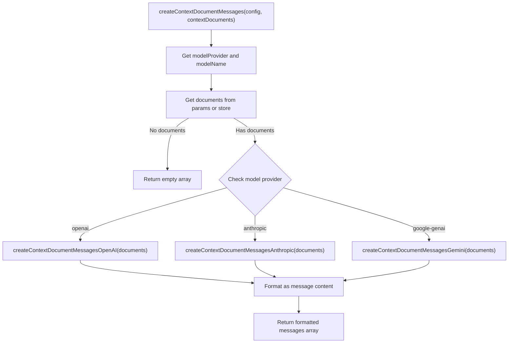

Sources: [apps/agents/src/utils.ts:528-582](), [apps/agents/src/utils.ts:434-513]()

## 6. Model Configuration Constants

The system defines comprehensive model configurations in the shared models module.

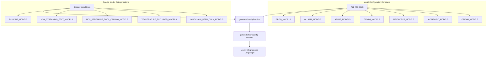

Sources: [packages/shared/src/models.ts:457-465](), [packages/shared/src/models.ts:427-455]()

### 6.1 Model Type Structure

Each model configuration follows a consistent structure:

```
{
  name: string,          // Model identifier (e.g., "gpt-4o")
  label: string,         // Display name (e.g., "GPT 4o")
  isNew: boolean,        // Flag for newly added models
  config: {
    provider: string,    // Provider identifier
    temperatureRange: {  // Temperature configuration
      min: number,
      max: number,
      default: number,
      current: number
    },
    maxTokens: {         // Token limits
      min: number,
      max: number,
      default: number,
      current: number
    }
  }
}
```

Sources: [packages/shared/src/models.ts:26-46]()

## 7. Integration with Frontend Components

The utility functions are used throughout the system to support frontend components like the model selector.

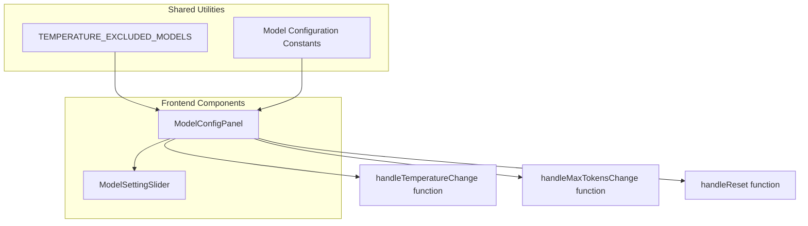

Sources: [apps/web/src/components/chat-interface/model-selector/model-config-pannel.tsx:34-82](), [apps/web/src/components/chat-interface/model-selector/model-config-pannel.tsx:107-108]()

## 8. Thinking Model Utilities

The system includes specialized utilities for handling "thinking" models that provide their reasoning process.

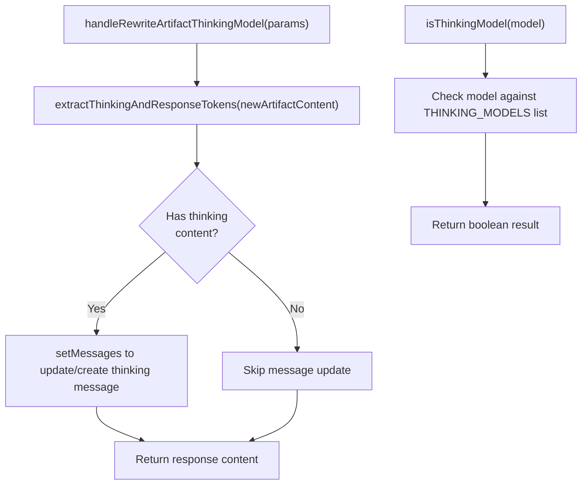

Sources: [packages/shared/src/utils/thinking.ts:89-133]()

## Summary

The utility functions in Open Canvas provide essential infrastructure for model integration, content handling, and message processing. These utilities enable the system to work with multiple LLM providers, format content consistently, process documents, and handle web search results. The model configuration utilities in particular are central to the system's ability to work with diverse language models with different capabilities and requirements.

---

