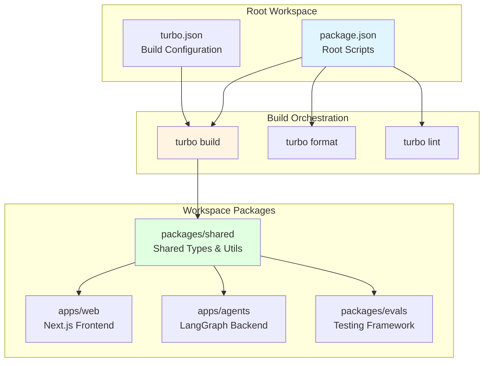
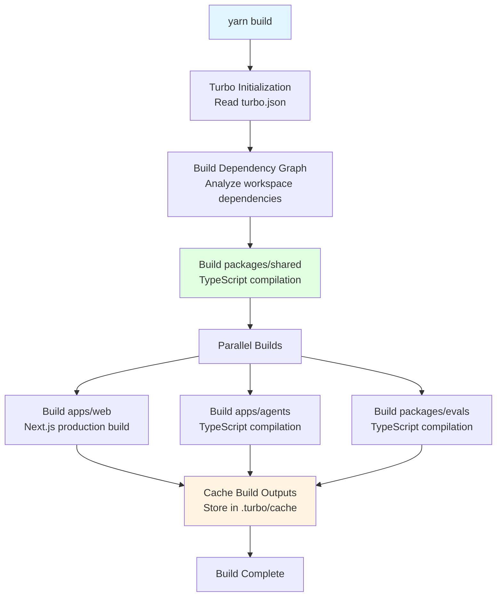
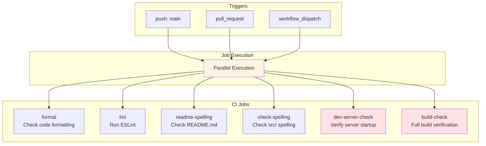
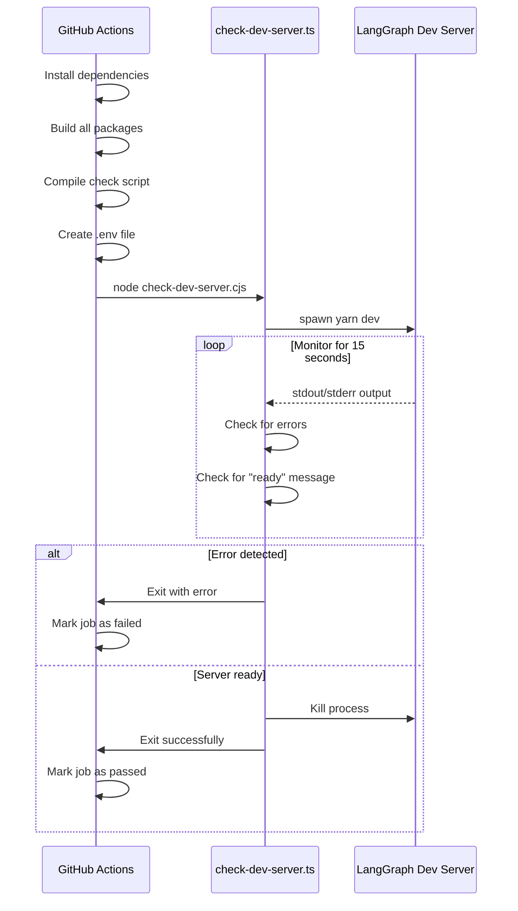

<!-- source: DeepWiki mcp.deepwiki.com · repo langchain-ai/open-canvas · page 7 Development and Deployment · fetched 2026-10-26 -->

# Development and Deployment

<details>
<summary>Relevant source files</summary>

The following files were used as context for generating this wiki page:

- [.github/workflows/ci.yml](.github/workflows/ci.yml)
- [.nvmrc](.nvmrc)
- [apps/agents/scripts/check-dev-server.ts](apps/agents/scripts/check-dev-server.ts)
- [package.json](package.json)
- [yarn.lock](yarn.lock)

</details>


This page covers the build system, continuous integration/deployment pipeline, and troubleshooting procedures for Open Canvas. It documents how the monorepo is built using Turbo, how code quality is enforced through GitHub Actions, and solutions to common development issues. For information about initial setup and environment configuration, see [Setup and Installation](#1.2) and [Configuration](#1.3).

---

## Purpose and Scope

This document provides technical guidance for developers working on Open Canvas, covering:
- **Build system architecture**: Turbo-based monorepo build orchestration
- **CI/CD pipeline**: GitHub Actions workflows for quality assurance
- **Troubleshooting**: Common development issues and their solutions

The focus is on development workflows, build processes, and maintaining code quality standards. For information about deploying the application to production environments, refer to the deployment sections in the README.

---

## Build System

Open Canvas uses Turborepo to orchestrate builds across the monorepo workspace. The build system manages dependencies between packages, caches build outputs, and provides efficient parallel execution of tasks.

### Monorepo Structure



**Sources:** [package.json:1-40]()

### Build Scripts

The root `package.json` defines the primary build commands:

| Script | Command | Purpose |
|--------|---------|---------|
| `build` | `turbo build` | Build all packages in dependency order |
| `turbo:command` | `turbo` | Direct access to Turbo CLI |
| `format` | `turbo format` | Format code across all workspaces |
| `format:check` | `turbo format:check` | Check code formatting without modifying |
| `lint` | `turbo lint` | Run ESLint across all workspaces |
| `lint:fix` | `turbo lint:fix` | Auto-fix linting issues |

**Sources:** [package.json:8-14]()

### Package Manager Configuration

Open Canvas uses Yarn 1.22.22 as specified in the `packageManager` field. The monorepo is configured with workspaces that automatically link packages in `apps/*` and `packages/*` directories.

**Dependency Resolution Overrides:**

The root `package.json` includes resolution overrides to ensure security patches are applied:

```json
"resolutions": {
  "fast-xml-parser": ">=5.3.6",
  "form-data": ">=4.0.4",
  "axios": ">=1.13.5",
  "tar": ">=7.5.8",
  "hono": ">=4.11.4",
  "linkifyjs": ">=4.3.2",
  "glob": ">=10.5.0 <11"
}
```

These resolutions force all transitive dependencies to use secure versions, regardless of individual package requirements.

**Sources:** [package.json:1-40]()

### Build Process Flow



The build process follows these steps:

1. **Initialization**: Turbo reads `turbo.json` configuration and determines task dependencies
2. **Dependency Analysis**: Workspace dependencies are analyzed to determine build order
3. **Shared Package Build**: `packages/shared` is built first as it's a dependency for all apps
4. **Parallel Execution**: Apps and remaining packages build in parallel once dependencies are satisfied
5. **Caching**: Build outputs are cached for future runs, enabling incremental builds

**Sources:** [package.json:9]()

### TypeScript Compilation

Each workspace package contains its own `tsconfig.json` for TypeScript compilation. The build process:

1. **Type Checking**: TypeScript compiler validates types across all files
2. **Code Generation**: Source files are transpiled to JavaScript
3. **Declaration Files**: `.d.ts` files are generated for type exports
4. **Source Maps**: Source maps are generated for debugging

The `packages/shared` package exports TypeScript types that are consumed by both frontend and backend without requiring runtime compilation, ensuring type safety across the entire codebase.

**Sources:** [package.json:29]()

### Node.js Version Management

The project requires Node.js version 22, specified in `.nvmrc`:

```
22
```

Developers using `nvm` (Node Version Manager) can automatically switch to the correct version by running `nvm use` in the project root.

**Sources:** [.nvmrc:1-2]()

---

## CI/CD Pipeline

The GitHub Actions CI pipeline ensures code quality and build stability through automated checks on every pull request and push to the main branch.

### Workflow Configuration



The workflow uses GitHub Actions concurrency controls to cancel redundant runs when new commits are pushed to the same PR or branch.

**Sources:** [.github/workflows/ci.yml:1-127]()

### CI Jobs Breakdown

#### 1. Format Check

```yaml
jobs:
  format:
    name: Check formatting
    runs-on: ubuntu-latest
    steps:
      - uses: actions/checkout@v6
      - name: Enable Corepack
        run: corepack enable
      - name: Use Node.js 22.x
        uses: actions/setup-node@v6
        with:
          node-version: 22.x
          cache: "yarn"
      - name: Install dependencies
        run: yarn install --immutable --mode=skip-build
      - name: Check formatting
        run: yarn format:check
```

**Purpose:** Validates that all code follows Prettier formatting rules without modifying files.

**Key Steps:**
- Installs dependencies with `--mode=skip-build` to skip build steps (faster)
- Runs `yarn format:check` which executes `turbo format:check` across all workspaces

**Sources:** [.github/workflows/ci.yml:22-37]()

#### 2. Lint Check

```yaml
jobs:
  lint:
    name: Check linting
    runs-on: ubuntu-latest
    steps:
      - uses: actions/checkout@v6
      - name: Enable Corepack
        run: corepack enable
      - name: Use Node.js 22.x
        uses: actions/setup-node@v6
        with:
          node-version: 22.x
          cache: "yarn"
      - name: Install dependencies
        run: yarn install --immutable --mode=skip-build
      - name: Check linting
        run: yarn run lint
```

**Purpose:** Runs ESLint to catch code quality issues, potential bugs, and enforce coding standards.

**Configuration:**
- Uses ESLint v8.41.0
- TypeScript ESLint parser and plugin v5.59.8
- Prettier integration via `eslint-config-prettier` and `eslint-plugin-prettier`
- Custom plugins: `eslint-plugin-import`, `eslint-plugin-no-instanceof`

**Sources:** [.github/workflows/ci.yml:39-54](), [package.json:30-38]()

#### 3. Spelling Checks

Two separate spelling check jobs run using `codespell`:

| Job | Target | Purpose |
|-----|--------|---------|
| `readme-spelling` | `README.md` | Catches typos in documentation |
| `check-spelling` | `src/` directory | Catches typos in source code |

Both jobs use a shared `.codespellignore` file to exclude false positives.

**Sources:** [.github/workflows/ci.yml:56-74]()

#### 4. Dev Server Check

The most critical CI job verifies that the LangGraph development server starts successfully:



**Implementation Details:**

The check script [apps/agents/scripts/check-dev-server.ts:1-155]() performs the following:

1. **Server Spawn**: Starts the dev server using `spawn("yarn", ["dev"])`
2. **Output Monitoring**: Captures stdout and stderr for 15 seconds
3. **Error Detection**: Looks for patterns like "error", "exception", "failed to compile"
4. **Ready Detection**: Waits for messages containing "ready", "started", or "server running"
5. **Process Termination**: Kills the server with SIGTERM/SIGKILL after timeout
6. **Result Determination**:
   - **Fail** if errors detected or server doesn't indicate readiness
   - **Pass** if server starts successfully within timeout

**CI Job Steps:**

```yaml
dev-server-check:
  name: Check dev server startup
  runs-on: ubuntu-latest
  defaults:
    run:
      working-directory: apps/agents
  steps:
    - uses: actions/checkout@v6
    - name: Enable Corepack
      run: corepack enable
      working-directory: .
    - name: Use Node.js 22.x
      uses: actions/setup-node@v6
      with:
        node-version: 22.x
        cache: "yarn"
    - name: Install dependencies
      run: yarn install --immutable
      working-directory: .
    - name: Build all packages
      run: yarn build
      working-directory: .
    - name: Build dev server check script
      run: yarn tsc --module commonjs --outDir ./dist/scripts ./scripts/check-dev-server.ts
    - name: Rename compiled script to .cjs
      run: mv ./dist/scripts/check-dev-server.js ./dist/scripts/check-dev-server.cjs
    - name: Create .env file for dev server check
      run: touch ../../.env
    - name: Run dev server check
      run: node ./dist/scripts/check-dev-server.cjs
      env:
        NODE_ENV: development
      timeout-minutes: 2
```

**Key Points:**
- Requires a full build before running (`yarn build`)
- Compiles the TypeScript check script to CommonJS
- Creates an empty `.env` file to satisfy server requirements
- Has a 2-minute timeout to prevent hanging builds

**Sources:** [.github/workflows/ci.yml:76-109](), [apps/agents/scripts/check-dev-server.ts:1-155]()

#### 5. Build Check

The final job performs a complete build of the entire monorepo:

```yaml
build-check:
  name: Check project build
  runs-on: ubuntu-latest
  steps:
    - uses: actions/checkout@v6
    - name: Enable Corepack
      run: corepack enable
    - name: Use Node.js 22.x
      uses: actions/setup-node@v6
      with:
        node-version: 22.x
        cache: "yarn"
    - name: Install dependencies
      run: yarn install --immutable
    - name: Build all packages
      run: yarn build
```

**Purpose:** Ensures that all packages compile successfully and builds complete without errors.

**Verification:** This job catches:
- TypeScript compilation errors
- Missing dependencies
- Build script failures
- Configuration issues

**Sources:** [.github/workflows/ci.yml:111-127]()

### Concurrency Control

The workflow includes concurrency controls to optimize CI resource usage:

```yaml
concurrency:
  group: ${{ github.workflow }}-${{ github.ref }}
  cancel-in-progress: true
```

This configuration:
- Groups workflow runs by branch/PR
- Cancels in-progress runs when new commits are pushed
- Prevents wasted CI minutes on outdated code

**Sources:** [.github/workflows/ci.yml:17-19]()

---

## Troubleshooting

This section covers common development issues and their solutions.

### Development Server Issues

#### Issue: LangGraph Server Connection Failed

**Symptom:** Frontend cannot connect to the LangGraph backend, showing connection errors in the console.

**Diagnosis:**
1. Verify the LangGraph server is running on the correct port (default: 54367)
2. Check for port conflicts with other services
3. Ensure environment variables are properly configured

**Solution:**
```bash
# Terminal 1: Start LangGraph backend
cd apps/agents
yarn dev

# Terminal 2: Start Next.js frontend
cd apps/web
yarn dev
```

Verify the backend is accessible:
```bash
curl http://localhost:54367/health
```

**Sources:** Based on typical monorepo development patterns

#### Issue: "Thread ID Not Found" Errors

**Symptom:** Frontend displays "Thread not found" errors when attempting to load conversations.

**Root Causes:**
- Stale thread IDs in browser storage
- Database/KV store synchronization issues
- Supabase authentication token expiration

**Solution:**
1. **Clear Browser Storage:**
   - Open browser DevTools (F12)
   - Navigate to Application → Storage
   - Clear Local Storage and Session Storage
   - Refresh the page

2. **Clear Cookies:**
   - Delete cookies for `localhost:3000` and `localhost:54367`
   - Log out and log back in to refresh authentication

3. **Reset Thread State:**
   ```javascript
   // In browser console
   localStorage.clear();
   sessionStorage.clear();
   location.reload();
   ```

**Sources:** Common patterns from development experience

#### Issue: Build Failures

**Symptom:** `yarn build` fails with TypeScript errors or missing dependencies.

**Common Causes:**

| Error Type | Cause | Solution |
|------------|-------|----------|
| TypeScript errors | Type mismatches after dependency updates | Run `yarn install` to update type definitions |
| Module not found | Missing workspace dependencies | Check `package.json` dependencies and run `yarn install` |
| Out of memory | Large build consuming too much RAM | Increase Node.js memory: `NODE_OPTIONS=--max-old-space-size=4096 yarn build` |
| Turbo cache corruption | Stale cache causing build issues | Clear cache: `rm -rf .turbo node_modules/.cache` then rebuild |

**General Build Troubleshooting Steps:**

1. **Clean install:**
   ```bash
   rm -rf node_modules
   rm -rf apps/*/node_modules
   rm -rf packages/*/node_modules
   rm yarn.lock
   yarn install
   ```

2. **Clear Turbo cache:**
   ```bash
   rm -rf .turbo
   yarn build
   ```

3. **Build individual packages:**
   ```bash
   # Build shared package first
   cd packages/shared
   yarn build
   
   # Then build apps
   cd ../../apps/web
   yarn build
   ```

**Sources:** Standard monorepo troubleshooting practices

### Dependency Issues

#### Issue: Dependency Version Conflicts

**Symptom:** Warning messages about conflicting dependency versions during installation.

**Resolution:**

The root `package.json` includes resolution overrides to force specific versions:

```json
"resolutions": {
  "fast-xml-parser": ">=5.3.6",
  "form-data": ">=4.0.4",
  "axios": ">=1.13.5"
}
```

If you need to add a new resolution:
1. Add it to the `resolutions` field in root `package.json`
2. Run `yarn install` to apply the resolution
3. Verify with `yarn why <package-name>` to see the resolved version

**Sources:** [package.json:17-25]()

#### Issue: Yarn Lock File Conflicts

**Symptom:** Git merge conflicts in `yarn.lock`.

**Solution:**
```bash
# 1. Accept the incoming changes
git checkout --theirs yarn.lock

# 2. Regenerate the lock file
yarn install

# 3. Stage the regenerated lock file
git add yarn.lock

# 4. Continue with your merge/rebase
git rebase --continue  # or git merge --continue
```

**Sources:** Standard Yarn workflow practices

### CI/CD Debugging

#### Issue: CI Checks Failing Locally Passing

**Symptom:** CI pipeline fails but tests pass locally.

**Diagnosis Steps:**

1. **Check Node.js version:**
   ```bash
   node --version  # Should be 22.x
   nvm use         # Switch to version in .nvmrc
   ```

2. **Use CI-equivalent commands:**
   ```bash
   # Use same flags as CI
   yarn install --immutable --mode=skip-build
   yarn format:check
   yarn lint
   ```

3. **Test dev server startup:**
   ```bash
   cd apps/agents
   yarn tsc --module commonjs --outDir ./dist/scripts ./scripts/check-dev-server.ts
   node ./dist/scripts/check-dev-server.js
   ```

**Sources:** [.github/workflows/ci.yml:1-127](), [.nvmrc:1-2]()

#### Issue: Dev Server Check Times Out in CI

**Symptom:** The `dev-server-check` job fails with timeout error.

**Investigation:**

1. Check the CI logs for error patterns in server output
2. Look for missing environment variables
3. Verify LangGraph dependencies are properly installed

**Temporary Workaround:**

If the server needs more time to start, modify the timeout in [apps/agents/scripts/check-dev-server.ts:98]():

```typescript
const timeoutDuration = 15000; // Increase from 15s to 30s
```

**Long-term Fix:**

Optimize server startup time by:
- Lazy-loading expensive dependencies
- Reducing initialization overhead
- Parallelizing startup tasks

**Sources:** [apps/agents/scripts/check-dev-server.ts:1-155]()

### Environment Configuration Issues

#### Issue: Missing Environment Variables

**Symptom:** Application fails to start or features don't work correctly.

**Solution:**

1. **Verify required variables are set:**
   ```bash
   # Check .env file exists
   ls -la .env
   
   # Verify critical variables
   grep -E "(OPENAI_API_KEY|SUPABASE_URL|LANGSMITH_API_KEY)" .env
   ```

2. **Compare with example file:**
   ```bash
   # If .env.example exists, use it as reference
   diff .env .env.example
   ```

3. **Check variable visibility:**
   - Frontend variables must be prefixed with `NEXT_PUBLIC_`
   - Backend variables don't need prefixes
   - Restart dev servers after changing `.env`

For complete configuration details, see [Configuration](#1.3).

**Sources:** Standard Next.js and environment variable practices

### Performance Issues

#### Issue: Slow Build Times

**Symptom:** `yarn build` takes excessively long to complete.

**Optimization Strategies:**

1. **Enable Turbo caching:**
   - Turbo automatically caches build outputs
   - Ensure `.turbo/cache` is not in `.gitignore`
   - Verify cache is being used: look for "cache hit" messages

2. **Parallel builds:**
   - Turbo automatically parallelizes independent tasks
   - Ensure workspace dependencies are correctly declared

3. **Incremental builds:**
   ```bash
   # Build only changed packages
   yarn turbo build --filter=...{origin/main}
   ```

4. **Use more CPU cores:**
   ```bash
   # Increase parallelism (default is CPU count - 1)
   yarn turbo build --concurrency=8
   ```

**Sources:** Standard Turborepo optimization practices

### Quick Reference Commands

```bash
# Development
yarn dev                    # Start all dev servers
yarn build                  # Build all packages
yarn lint                   # Check linting
yarn lint:fix              # Fix linting issues
yarn format                # Format code
yarn format:check          # Check formatting

# Troubleshooting
rm -rf .turbo              # Clear Turbo cache
rm -rf node_modules        # Clean dependencies
yarn install               # Reinstall dependencies
yarn turbo --help          # Show Turbo commands

# CI reproduction
yarn install --immutable --mode=skip-build
yarn format:check
yarn lint
```

**Sources:** [package.json:8-14]()

---

