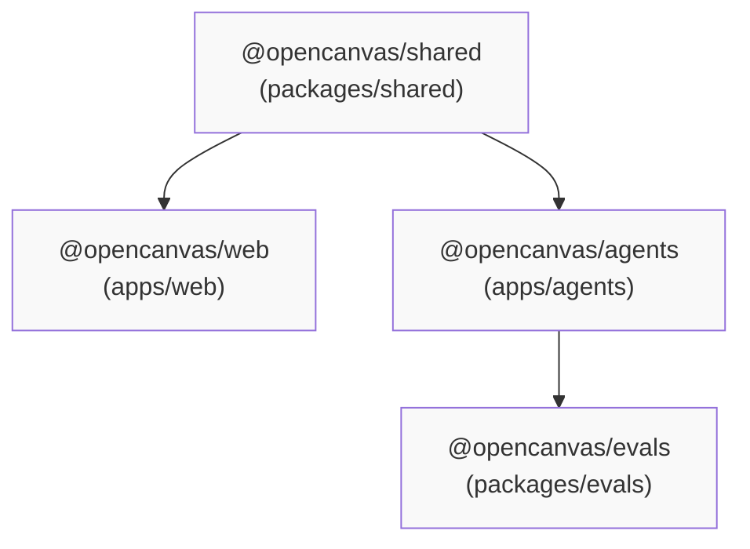
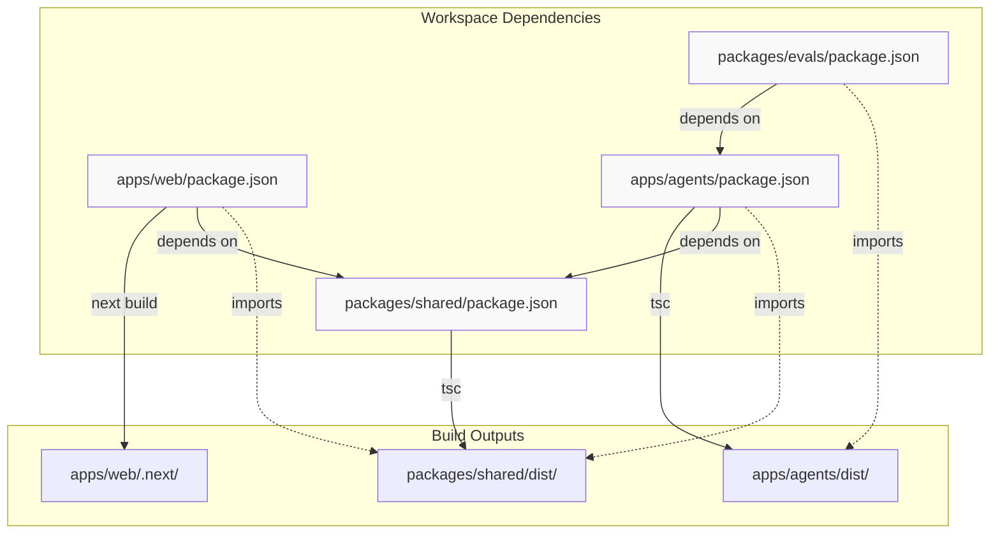
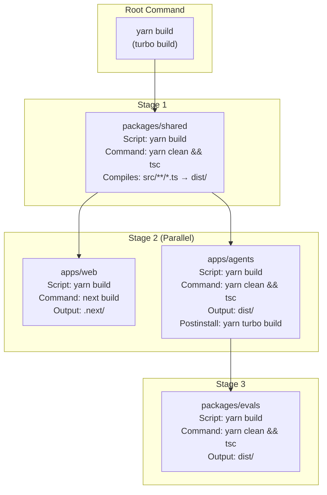
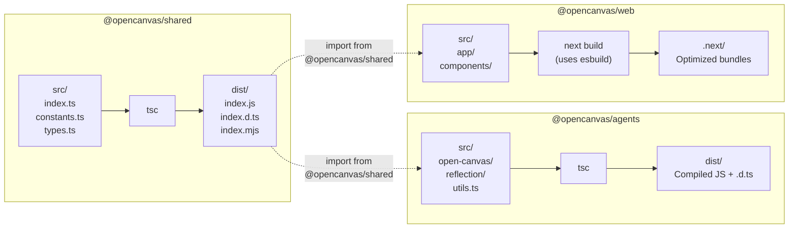
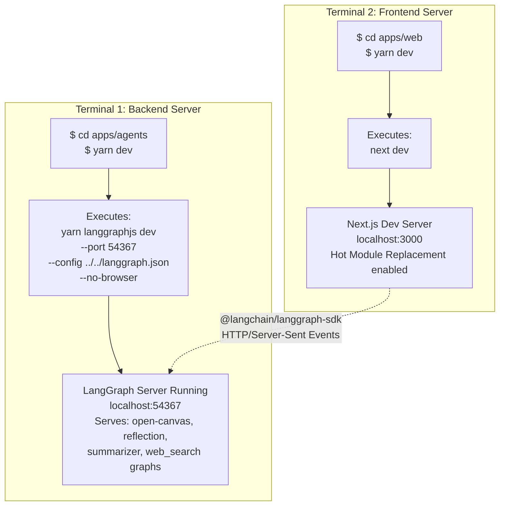
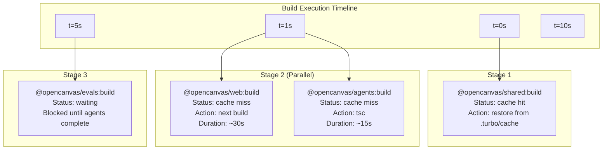
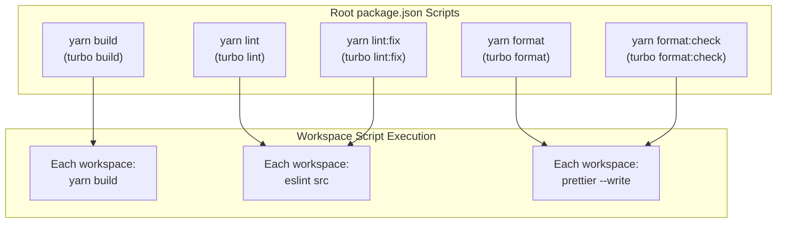

<!-- source: DeepWiki mcp.deepwiki.com · repo langchain-ai/open-canvas · page 7.1 Build System · fetched 2026-10-26 -->

# Build System

<details>
<summary>Relevant source files</summary>

The following files were used as context for generating this wiki page:

- [.github/workflows/ci.yml](.github/workflows/ci.yml)
- [.nvmrc](.nvmrc)
- [apps/agents/scripts/check-dev-server.ts](apps/agents/scripts/check-dev-server.ts)
- [package.json](package.json)
- [yarn.lock](yarn.lock)

</details>


This document describes the build system configuration for Open Canvas, including monorepo organization, workspace dependencies, build orchestration with Turborepo, and development workflows. For information about deployment and production setup, see [Troubleshooting](#7.2).

## Overview

Open Canvas uses a **Yarn workspaces** monorepo structure with **Turborepo** for build orchestration. The repository contains four workspaces: two applications (`apps/web`, `apps/agents`) and two shared packages (`packages/shared`, `packages/evals`). Turborepo manages parallel builds, caching, and task dependencies to optimize development and CI/CD workflows.

**Sources:** [package.json:1-31](), [turbo.json:1-22]()

---

## Monorepo Structure

### Workspace Configuration

The root [package.json:7]() defines the workspace structure using Yarn's workspace feature:

```json
"workspaces": ["apps/*", "packages/*"]
```

This configuration creates four distinct workspaces:

| Workspace | Path | Type | Purpose |
|-----------|------|------|---------|
| `@opencanvas/web` | `apps/web/` | Next.js Application | Frontend UI and user interaction |
| `@opencanvas/agents` | `apps/agents/` | LangGraph Server | Backend AI agent orchestration |
| `@opencanvas/shared` | `packages/shared/` | TypeScript Library | Common models, constants, utilities |
| `@opencanvas/evals` | `packages/evals/` | Testing Framework | Evaluation and test harness |

**Dependency Chain:**



**Sources:** [package.json:7](), [apps/web/package.json:1-125](), [apps/agents/package.json:1-71](), [packages/shared/package.json:1-54](), [packages/evals/package.json:1-39]()

### Package Manager

The repository uses **Yarn 1.22.22** as specified in [package.json:16]():

```json
"packageManager": "yarn@1.22.22"
```

Yarn workspaces enable:
- **Dependency hoisting**: Common dependencies installed once at root level
- **Symlinked workspaces**: Local packages linked via symlinks rather than published versions
- **Single lockfile**: [yarn.lock]() manages all workspace dependencies centrally

**Sources:** [package.json:16](), [yarn.lock:1-3]()

---

## Workspace Dependencies

### Dependency Graph



### Shared Package Dependencies

**packages/shared** declares workspace dependencies in [packages/shared/package.json:38-53]():

- `@opencanvas/web` imports from `@opencanvas/shared` in [apps/web/package.json:44]()
- `@opencanvas/agents` imports from `@opencanvas/shared` in [apps/agents/package.json:38]()
- `@opencanvas/evals` imports from `@opencanvas/agents` in [packages/evals/package.json:19]()

The wildcard `"*"` version ensures workspaces always use the local version rather than a published package.

**Sources:** [apps/web/package.json:44](), [apps/agents/package.json:38](), [packages/evals/package.json:19]()

### TypeScript Configuration

Each workspace includes TypeScript compilation as part of its build process:

| Workspace | Build Command | Output Directory | Entry Point |
|-----------|--------------|------------------|-------------|
| `packages/shared` | `tsc` | `dist/` | [packages/shared/package.json:7-8]() |
| `apps/agents` | `tsc` | `dist/` | [apps/agents/package.json:6-8]() |
| `apps/web` | `next build` | `.next/` | N/A (Next.js handles internally) |

**Sources:** [packages/shared/package.json:28](), [apps/agents/package.json:16](), [apps/web/package.json:10]()

---

## Build Orchestration

### Turborepo Configuration

Turborepo is configured in [turbo.json:1-22]() to manage task execution across workspaces:

```json
{
  "$schema": "https://turbo.build/schema.json",
  "globalDependencies": ["**/.env"],
  "tasks": {
    "build": {
      "dependsOn": ["^build"],
      "outputs": ["dist/**", ".next/**", "!.next/cache/**"]
    },
    "lint": {
      "dependsOn": ["^lint"]
    },
    "lint:fix": {
      "dependsOn": ["^lint:fix"]
    },
    "format": {
      "dependsOn": ["^format"]
    },
    "format:check": {
      "dependsOn": ["^format:check"]
    }
  }
}
```

**Key Configuration:**

- **globalDependencies** [turbo.json:3](): `**/.env` files trigger cache invalidation
- **dependsOn** [turbo.json:6](): `^` prefix indicates dependency on upstream workspace tasks
- **outputs** [turbo.json:7](): Cached build artifacts for incremental builds

**Sources:** [turbo.json:1-22]()

### Task Execution Flow

**Diagram: Turborepo Build Task Orchestration**



**Execution Stages:**

1. **Stage 1**: `packages/shared` builds first (no workspace dependencies)
   - Runs: `rm -rf ./dist .turbo && tsc`
   - Generates: `dist/index.js`, `dist/index.mjs`, `dist/index.d.ts`

2. **Stage 2**: `apps/web` and `apps/agents` build in parallel (both depend on `packages/shared`)
   - `apps/web`: Runs `next build` (uses esbuild internally for bundling)
   - `apps/agents`: Runs `rm -rf ./dist .turbo && tsc`

3. **Stage 3**: `packages/evals` builds after `apps/agents` completes
   - Requires `apps/agents/dist/` to be available for type resolution

Turborepo's caching stores outputs defined in [turbo.json:7]() and skips rebuilding unchanged workspaces based on content hashing.

**Sources:** [turbo.json:5-8](), [package.json:9](), [packages/shared/package.json:28-29](), [apps/web/package.json:10](), [apps/agents/package.json:16](), [packages/evals/package.json:9]()
</thinking>

### TypeScript Compilation Pipeline

**Diagram: TypeScript Build Process**



**Compilation Details:**

- **packages/shared** and **apps/agents**: Use raw `tsc` (TypeScript Compiler) without bundling
- **apps/web**: Next.js uses esbuild for fast bundling and code splitting
- **Type Declarations**: `.d.ts` files generated for all packages enable type checking in consumers

**Sources:** [packages/shared/package.json:28](), [apps/agents/package.json:16](), [apps/web/package.json:10]()

---

## Build Pipelines by Package

### packages/shared

**Purpose:** Common TypeScript library with type definitions, constants, and utilities shared across frontend and backend.

**Build Configuration:**

[packages/shared/package.json:27-33]() defines the build pipeline:

```json
"scripts": {
  "build": "yarn clean && tsc",
  "clean": "rm -rf ./dist .turbo || true"
}
```

**Build Process:**

1. **Clean**: Remove `dist/` and `.turbo/` directories
2. **TypeScript Compilation**: `tsc` compiles TypeScript source files
3. **Output**: Generates `dist/index.js`, `dist/index.mjs`, `dist/index.d.ts`

**Exports Configuration** [packages/shared/package.json:9-20]():

```json
"exports": {
  ".": {
    "types": "./dist/index.d.ts",
    "import": "./dist/index.js",
    "require": "./dist/index.js"
  }
}
```

This allows consuming workspaces to import via:
```typescript
import { ArtifactV3, ALL_MODELS } from "@opencanvas/shared";
```

**Sources:** [packages/shared/package.json:6-33]()

### apps/agents

**Purpose:** LangGraph server implementation containing AI agent graphs for artifact generation, reflection, search, and summarization.

**Build Configuration:**

[apps/agents/package.json:14-22]() defines build and development scripts:

```json
"scripts": {
  "dev": "yarn langgraphjs dev --port 54367 --config ../../langgraph.json --no-browser",
  "build": "yarn clean && tsc",
  "clean": "rm -rf ./dist .turbo || true",
  "postinstall": "yarn turbo build"
}
```

**Build Process:**

1. **Clean**: Remove build artifacts
2. **TypeScript Compilation**: `tsc` compiles agent graph implementations
3. **Output**: `dist/` directory with compiled JavaScript
4. **Post-install Hook**: Ensures build runs after dependency installation

**Development Server:**

The `dev` script [apps/agents/package.json:15]() starts the LangGraph development server:
- **Port:** 54367
- **Configuration:** Uses root `langgraph.json` for graph registry
- **No Browser:** Prevents automatic browser opening

**Sources:** [apps/agents/package.json:14-22]()

### apps/web

**Purpose:** Next.js 14 frontend application providing the user interface, chat interaction, and artifact display.

**Build Configuration:**

[apps/web/package.json:8-17]() defines Next.js build scripts:

```json
"scripts": {
  "dev": "next dev",
  "build": "next build",
  "start": "next start",
  "lint": "next lint",
  "lint:fix": "next lint --fix"
}
```

**Build Process:**

Next.js handles the build pipeline internally:

1. **Page Compilation**: Compiles React components in `src/app/` and `src/components/`
2. **API Routes**: Bundles API routes from `src/app/api/`
3. **Static Optimization**: Pre-renders static pages where possible
4. **Bundle Optimization**: Code splitting, tree shaking, minification
5. **Output**: `.next/` directory containing production-ready bundles

**Development Server:**

- **Command:** `next dev` [apps/web/package.json:9]()
- **Port:** 3000 (default)
- **Hot Reload:** Enabled for rapid development

**Sources:** [apps/web/package.json:8-17]()

### packages/evals

**Purpose:** Evaluation framework and test harness for assessing agent performance.

**Build Configuration:**

[packages/evals/package.json:8-14]() mirrors the shared package structure:

```json
"scripts": {
  "build": "yarn clean && tsc",
  "clean": "rm -rf ./dist .turbo || true"
}
```

**Dependencies:**

[packages/evals/package.json:16-22]() shows evaluation-specific dependencies:
- `@opencanvas/agents`: Access to agent implementations for testing
- `langsmith`: LangSmith SDK for evaluation tracking
- `@langchain/openai`: LLM evaluators

**Sources:** [packages/evals/package.json:8-22]()

---

## Development Workflows

### Common Development Tasks

The root [package.json:8-14]() provides unified commands across all workspaces:

| Command | Purpose | Turbo Task |
|---------|---------|------------|
| `yarn build` | Build all workspaces in dependency order | [turbo.json:5-8]() |
| `yarn lint` | Run ESLint across all workspaces | [turbo.json:9-11]() |
| `yarn lint:fix` | Auto-fix ESLint issues | [turbo.json:12-14]() |
| `yarn format` | Format code with Prettier | [turbo.json:15-17]() |
| `yarn format:check` | Check code formatting | [turbo.json:18-20]() |

**Sources:** [package.json:8-14](), [turbo.json:4-21]()

### Development Server Startup

**Diagram: Development Server Commands and Ports**



**Server Startup Commands:**

1. **Backend** (Terminal 1):
   ```bash
   cd apps/agents
   yarn dev
   ```
   Runs: `langgraphjs dev --port 54367 --config ../../langgraph.json --no-browser`
   - Starts LangGraph server on port 54367
   - Loads agent graphs from `langgraph.json`
   - No browser auto-launch (`--no-browser` flag)

2. **Frontend** (Terminal 2):
   ```bash
   cd apps/web
   yarn dev
   ```
   Runs: `next dev`
   - Starts Next.js development server on port 3000 (default)
   - Connects to backend via `@langchain/langgraph-sdk` client
   - Enables hot module replacement for rapid iteration

**Sources:** [apps/agents/package.json:15](), [apps/web/package.json:9]()

### Code Quality Tools

All workspaces share common development tooling configured at the root:

**ESLint** [package.json:21-28]():
- `@typescript-eslint/eslint-plugin`: TypeScript-specific linting rules
- `eslint-config-prettier`: Disables formatting rules that conflict with Prettier
- `eslint-plugin-import`: Import/export validation

**Prettier** [package.json:29]():
- Consistent code formatting across JavaScript, TypeScript, JSON, Markdown
- Configured via `.prettierrc` in each workspace

**TypeScript** [package.json:20]():
- Version 5.x used across all workspaces
- Strict type checking enabled

**Sources:** [package.json:17-30]()

---

## Build Caching and Optimization

### Turbo Cache Behavior

Turborepo implements content-addressable caching based on:

1. **Input Hashing:**
   - Source files in workspace directory
   - `package.json` dependencies
   - Environment variables (via `globalDependencies`)

2. **Cache Key Generation:**
   - Hash of all inputs determines cache key
   - Stored in `.turbo/` directory per workspace

3. **Cache Restoration:**
   - If cache key matches, output is restored from cache
   - Build step is skipped entirely

**Cache Outputs** [turbo.json:7]():
```json
"outputs": ["dist/**", ".next/**", "!.next/cache/**"]
```

The `!.next/cache/**` exclusion prevents Next.js's own cache from being double-cached.

**Sources:** [turbo.json:7]()

### Parallel Execution and Caching

**Diagram: Turborepo Task Parallelization**



**Example Build Output:**

```bash
$ yarn build

• Packages in scope: @opencanvas/agents, @opencanvas/evals, @opencanvas/shared, @opencanvas/web
• Running build in 4 packages
• Remote caching disabled

@opencanvas/shared:build: cache hit, replaying logs [0.1s]
@opencanvas/web:build: cache miss, executing [30.2s]
@opencanvas/agents:build: cache miss, executing [15.4s]
@opencanvas/evals:build: waiting for dependencies, then cache miss [5.1s]

Tasks:    4 successful (1 cached, 3 from cache)
Cached:   1 (saved 5s)
Time:     35.8s
```

**Execution Characteristics:**

1. **Stage 1**: `packages/shared` completes instantly via cache restoration
2. **Stage 2**: `apps/web` and `apps/agents` execute in parallel (no interdependency)
3. **Stage 3**: `packages/evals` waits for `apps/agents` to finish (imports from `@opencanvas/agents`)

**Cache Keys** are computed from:
- Source file contents (`src/**/*`)
- `package.json` dependencies
- Environment variables (`.env` files per [turbo.json:3]())

**Sources:** [turbo.json:5-8](), [turbo.json:3]()

---

## Scripts Reference

### Root-Level Scripts

**Diagram: Root Scripts and Workspace Execution**



[package.json:8-14]() provides workspace-wide commands:

| Command | Turbo Task | Effect |
|---------|------------|--------|
| `yarn build` | `turbo build` | Builds all workspaces in dependency order |
| `yarn lint` | `turbo lint` | Runs `eslint src` in all workspaces |
| `yarn lint:fix` | `turbo lint:fix` | Runs `eslint src --fix` in all workspaces |
| `yarn format` | `turbo format` | Runs `prettier --write` in all workspaces |
| `yarn format:check` | `turbo format:check` | Runs `prettier --check` in all workspaces |
| `yarn turbo:command` | Direct turbo access | Allows running arbitrary turbo commands |

These execute the corresponding task in all workspaces via Turborepo's task orchestration.

**Sources:** [package.json:8-14]()

### Workspace-Specific Scripts

Each workspace defines additional scripts for local development:

**Table: Workspace Scripts by Package**

| Workspace | Script | Command | Purpose |
|-----------|--------|---------|---------|
| **apps/web** | `dev` | `next dev` | Start development server on port 3000 |
| | `build` | `next build` | Production build with Next.js |
| | `start` | `next start` | Serve production build |
| | `eval` | `vitest run --config ls.vitest.config.ts` | Run evaluation tests |
| | `eval:highlights` | `yarn tsx evals/highlights.ts` | Test highlight functionality |
| **apps/agents** | `dev` | `yarn langgraphjs dev --port 54367 --config ../../langgraph.json --no-browser` | Start LangGraph server |
| | `build` | `yarn clean && tsc` | TypeScript compilation |
| | `clean` | `rm -rf ./dist .turbo` | Remove build artifacts |
| | `postinstall` | `yarn turbo build` | Auto-build after dependency install |
| **packages/shared** | `build` | `yarn clean && tsc` | TypeScript compilation |
| | `clean` | `rm -rf ./dist .turbo` | Remove build artifacts |
| | `lint` | `eslint src` | Run ESLint on source files |
| | `lint:fix` | `eslint src --fix` | Auto-fix ESLint issues |
| **packages/evals** | `build` | `yarn clean && tsc` | TypeScript compilation |
| | `clean` | `rm -rf ./dist .turbo` | Remove build artifacts |

**Notable Scripts:**

- **`postinstall`** in `apps/agents` [apps/agents/package.json:22](): Automatically triggers `turbo build` after `yarn install`, ensuring all dependencies are built before the agents package is used
- **`dev`** scripts start local development servers with hot reload enabled
- **`clean`** scripts remove both build output (`dist/`, `.next/`) and Turborepo cache (`.turbo/`)

**Sources:** [apps/web/package.json:8-17](), [apps/agents/package.json:14-22](), [packages/shared/package.json:27-33](), [packages/evals/package.json:8-14]()

---

## Environment Configuration

### Global Environment Dependencies

[turbo.json:3]() declares environment files as global dependencies:

```json
"globalDependencies": ["**/.env"]
```

Changes to any `.env` file invalidate Turborepo's cache, forcing rebuilds.

**Environment File Locations:**
- `apps/web/.env`: Frontend configuration (API endpoints, feature flags)
- `apps/agents/.env`: Backend configuration (LLM API keys, database URLs)

**Sources:** [turbo.json:3]()

---

## Summary

The Open Canvas build system leverages Yarn workspaces and Turborepo to manage a multi-package monorepo efficiently. Key characteristics:

1. **Dependency Management:** Yarn workspaces with centralized lockfile
2. **Build Orchestration:** Turborepo handles task dependencies and parallel execution
3. **Caching:** Content-addressable caching minimizes redundant builds
4. **TypeScript:** All packages compile with `tsc` except Next.js frontend
5. **Code Quality:** Unified ESLint, Prettier, and TypeScript configurations

The dependency chain (`shared → web/agents → evals`) ensures correct build order, while Turborepo's parallelization optimizes build time when workspaces are independent.

**Sources:** [package.json:1-31](), [turbo.json:1-22](), [apps/web/package.json:1-125](), [apps/agents/package.json:1-71](), [packages/shared/package.json:1-54](), [packages/evals/package.json:1-39]()

---

