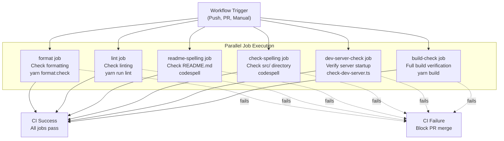
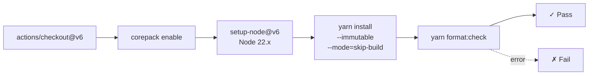
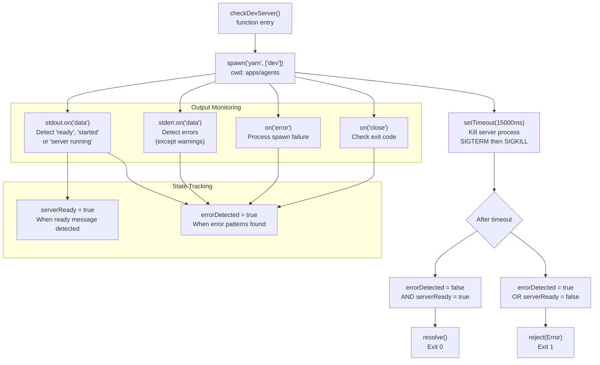
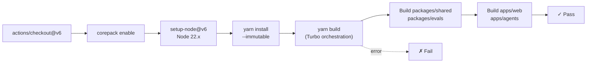
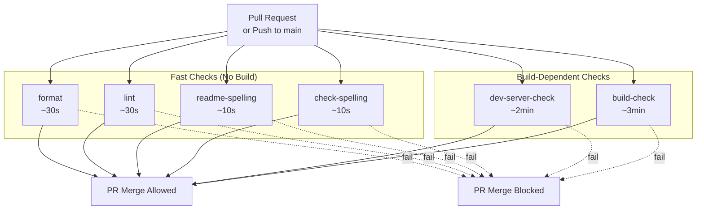

<!-- source: DeepWiki mcp.deepwiki.com · repo langchain-ai/open-canvas · page 7.2 CI/CD Pipeline · fetched 2026-10-26 -->

# CI/CD Pipeline

<details>
<summary>Relevant source files</summary>

The following files were used as context for generating this wiki page:

- [.github/workflows/ci.yml](.github/workflows/ci.yml)
- [.nvmrc](.nvmrc)
- [apps/agents/scripts/check-dev-server.ts](apps/agents/scripts/check-dev-server.ts)

</details>


## Purpose and Scope

This document describes the Continuous Integration and Continuous Deployment (CI/CD) pipeline for Open Canvas, implemented using GitHub Actions. The pipeline automatically validates code quality, formatting, spelling, and build integrity on every pull request and push to the main branch.

For information about the build system that the CI pipeline uses, see [Build System](#7.1). For deployment and production configuration, see [Configuration](#1.3).

---

## Workflow Overview

The CI pipeline is defined in [.github/workflows/ci.yml]() and consists of six parallel jobs that execute independently. The workflow is triggered on:

- **Push events** to the `main` branch
- **Pull request events** targeting any branch
- **Manual workflow dispatch** via GitHub UI

### Concurrency Control

The workflow implements automatic cancellation of redundant runs using the `concurrency` configuration [.github/workflows/ci.yml:17-19]():

```yaml
concurrency:
  group: ${{ github.workflow }}-${{ github.ref }}
  cancel-in-progress: true
```

When a new push occurs to the same PR or branch while a previous CI run is still executing, the earlier run is automatically cancelled. This optimization ensures efficient use of GitHub's runner resources and faster feedback cycles.

**Sources:** [.github/workflows/ci.yml:13-19]()

---

## CI Jobs Architecture



All jobs execute in parallel on `ubuntu-latest` runners. Each job must pass for the workflow to succeed and allow PR merging.

**Sources:** [.github/workflows/ci.yml:21-127]()

---

## Node.js Environment Setup

All jobs that require Node.js follow a consistent setup pattern:

| Step | Action | Configuration |
|------|--------|---------------|
| 1. Checkout | `actions/checkout@v6` | Clones repository |
| 2. Enable Corepack | `corepack enable` | Enables Yarn Berry support |
| 3. Node.js Setup | `actions/setup-node@v6` | Node.js 22.x with Yarn cache |
| 4. Install Dependencies | `yarn install` | Installs workspace dependencies |

The Node.js version is specified in [.nvmrc]() as `22` and is consistently used across all CI jobs [.github/workflows/ci.yml:29-33](), [.github/workflows/ci.yml:46-50](), [.github/workflows/ci.yml:87-91](), [.github/workflows/ci.yml:118-122]().

**Sources:** [.github/workflows/ci.yml:26-35](), [.nvmrc]()

---

## Job: Check Formatting

**Job Name:** `format`  
**Purpose:** Validates code formatting using Prettier



This job installs dependencies with `--mode=skip-build` flag [.github/workflows/ci.yml:35]() to skip compilation steps, as formatting checks only require source files. The `yarn format:check` command uses Prettier to verify all files match the project's formatting rules.

**Sources:** [.github/workflows/ci.yml:22-37]()

---

## Job: Check Linting

**Job Name:** `lint`  
**Purpose:** Validates code quality using ESLint

The linting job follows an identical setup pattern to the formatting job but executes `yarn run lint` [.github/workflows/ci.yml:54](). Dependencies are installed with `--mode=skip-build` [.github/workflows/ci.yml:52]() since linting operates on source files.

ESLint configuration is inherited from workspace packages and enforces TypeScript type checking, React best practices, and custom code quality rules.

**Sources:** [.github/workflows/ci.yml:39-54]()

---

## Job: Spelling Checks

### README Spelling Check

**Job Name:** `readme-spelling`  
**Purpose:** Validates spelling in README.md using codespell

```yaml
- uses: codespell-project/actions-codespell@v2
  with:
    ignore_words_file: .codespellignore
    path: README.md
```

This job uses the `codespell-project/actions-codespell@v2` action [.github/workflows/ci.yml:61]() to scan the README file. Custom words and technical terms are exempted via `.codespellignore` [.github/workflows/ci.yml:63]().

**Sources:** [.github/workflows/ci.yml:56-64]()

### Code Spelling Check

**Job Name:** `check-spelling`  
**Purpose:** Validates spelling in source code

Identical to the README check but targets the `src` directory [.github/workflows/ci.yml:74](). This catches typos in comments, variable names, and string literals throughout the codebase.

**Sources:** [.github/workflows/ci.yml:66-74]()

---

## Job: Dev Server Startup Check

**Job Name:** `dev-server-check`  
**Purpose:** Verifies that the LangGraph development server starts successfully without errors

This job is unique in that it implements a custom startup verification script and operates specifically in the `apps/agents` directory [.github/workflows/ci.yml:80-81]().

### Execution Steps

| Step | Command | Purpose |
|------|---------|---------|
| 1. Install dependencies | `yarn install --immutable` | Full dependency installation (no skip-build) |
| 2. Build packages | `yarn build` | Compile all workspace packages including `packages/shared` |
| 3. Compile check script | `yarn tsc --module commonjs --outDir ./dist/scripts ./scripts/check-dev-server.ts` | Compile TypeScript check script to CommonJS |
| 4. Rename output | `mv ./dist/scripts/check-dev-server.js ./dist/scripts/check-dev-server.cjs` | Ensure .cjs extension |
| 5. Create .env file | `touch ../../.env` | Create empty environment file in repository root |
| 6. Execute check | `node ./dist/scripts/check-dev-server.cjs` | Run server startup verification |

The job builds all packages [.github/workflows/ci.yml:95-97]() before the server check because the LangGraph server requires compiled TypeScript modules from `packages/shared` to start successfully.

**Sources:** [.github/workflows/ci.yml:76-109]()

### Dev Server Check Script Architecture



**Sources:** [apps/agents/scripts/check-dev-server.ts]()

### Script Implementation Details

The `checkDevServer()` function [apps/agents/scripts/check-dev-server.ts:9-144]() implements a sophisticated startup verification strategy:

#### Process Spawning

```typescript
const serverProcess = spawn("yarn", ["dev"], {
  cwd: targetCwd,
  shell: true,
  stdio: "pipe",
});
```

The script spawns the dev server process [apps/agents/scripts/check-dev-server.ts:16-20]() from the `apps/agents` directory, piping all stdio streams for monitoring.

#### Output Pattern Detection

**Success Indicators** [apps/agents/scripts/check-dev-server.ts:32-39]():
- Output contains "ready"
- Output contains "started"
- Output contains "server running"

When detected, `serverReady` flag is set to true [apps/agents/scripts/check-dev-server.ts:37]().

**Error Indicators** [apps/agents/scripts/check-dev-server.ts:42-58]():
- Output contains "error"
- Output contains "exception:"
- Output contains "failed to compile"
- Output contains "failed"

Warnings are explicitly excluded from error detection [apps/agents/scripts/check-dev-server.ts:49]().

#### Timeout Mechanism

After 15 seconds [apps/agents/scripts/check-dev-server.ts:98](), the script evaluates server state:

| Condition | Result |
|-----------|--------|
| `errorDetected = true` | **Fail** - Reject with error message [apps/agents/scripts/check-dev-server.ts:115-123]() |
| `serverReady = false` | **Fail** - Reject with timeout message [apps/agents/scripts/check-dev-server.ts:124-132]() |
| `errorDetected = false` AND `serverReady = true` | **Pass** - Resolve successfully [apps/agents/scripts/check-dev-server.ts:133-138]() |

The process is terminated using `SIGTERM`, falling back to `SIGKILL` if necessary [apps/agents/scripts/check-dev-server.ts:104-110]().

#### Environment Configuration

The script runs with `NODE_ENV=development` [.github/workflows/ci.yml:108]() and a 2-minute timeout [.github/workflows/ci.yml:109]() to prevent hanging if the server fails to start or stop.

**Sources:** [apps/agents/scripts/check-dev-server.ts:1-154](), [.github/workflows/ci.yml:98-109]()

---

## Job: Build Check

**Job Name:** `build-check`  
**Purpose:** Verifies complete project build including TypeScript compilation and bundle generation



This job performs a full installation without `--mode=skip-build` [.github/workflows/ci.yml:124]() and executes the complete build process [.github/workflows/ci.yml:125-126]().

The `yarn build` command invokes Turbo's build orchestration system, which:
1. Builds `packages/shared` (TypeScript compilation)
2. Builds `packages/evals` (TypeScript compilation)
3. Builds `apps/web` (Next.js production build)
4. Builds `apps/agents` (Python environment setup and LangGraph compilation)

This comprehensive check ensures that all workspace dependencies are correctly configured and that the entire monorepo compiles without errors. For details on the build system architecture, see [Build System](#7.1).

**Sources:** [.github/workflows/ci.yml:111-127]()

---

## Dependency Management Strategy

The CI pipeline uses different installation strategies based on job requirements:

| Job | Installation Flags | Rationale |
|-----|-------------------|-----------|
| `format`, `lint` | `--immutable --mode=skip-build` | Source-only analysis, no compilation needed |
| `dev-server-check`, `build-check` | `--immutable` | Full build required |

The `--immutable` flag [.github/workflows/ci.yml:35]() ensures that `yarn.lock` is strictly respected and prevents dependency modifications during CI runs. The `--mode=skip-build` flag [.github/workflows/ci.yml:35]() skips post-install build scripts, significantly reducing installation time for jobs that only need source files.

**Sources:** [.github/workflows/ci.yml:35](), [.github/workflows/ci.yml:93](), [.github/workflows/ci.yml:124]()

---

## CI Workflow Summary



The pipeline prioritizes fast feedback by running lightweight checks (formatting, linting, spelling) in parallel with heavier build verification. The complete CI run typically completes in 2-3 minutes when all jobs pass.

**Sources:** [.github/workflows/ci.yml:1-127]()

---

