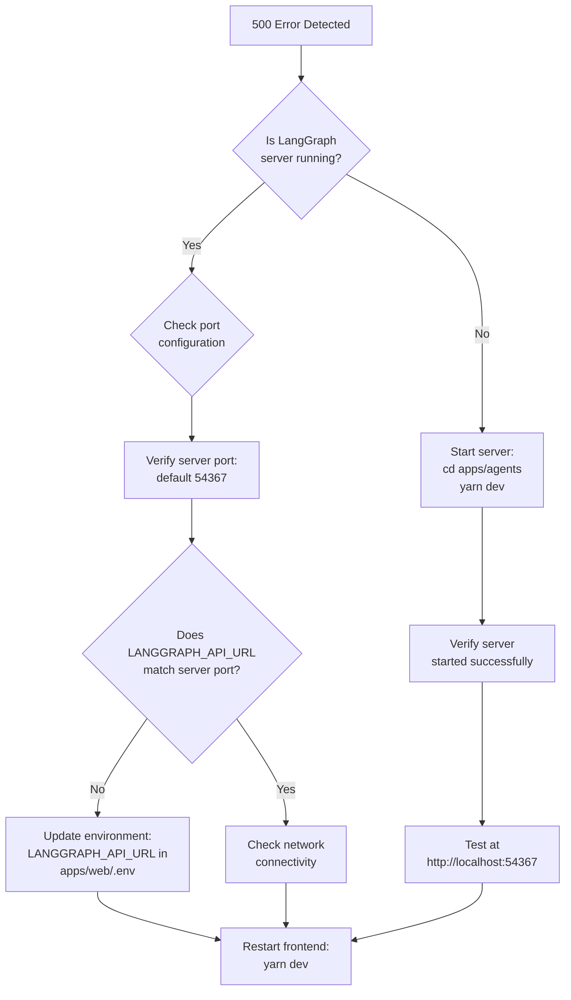
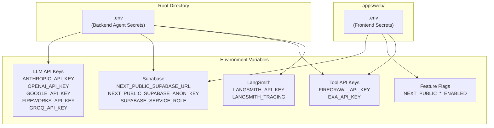
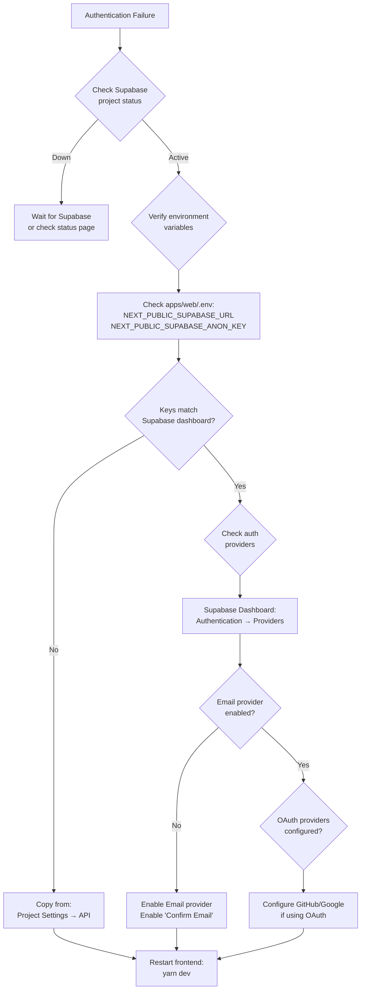
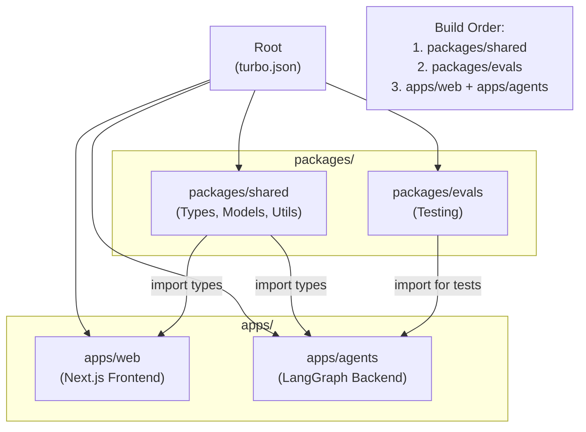
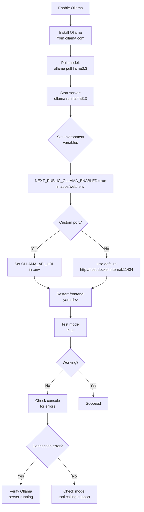

<!-- source: DeepWiki mcp.deepwiki.com · repo langchain-ai/open-canvas · page 7.3 Troubleshooting · fetched 2026-10-26 -->

# Troubleshooting

<details>
<summary>Relevant source files</summary>

The following files were used as context for generating this wiki page:

- [.env.example](.env.example)
- [README.md](README.md)
- [apps/web/.env.example](apps/web/.env.example)
- [static/screenshot.png](static/screenshot.png)

</details>


This document provides solutions to common issues encountered when setting up, running, and debugging Open Canvas. It covers environment configuration problems, connection errors, authentication failures, and runtime issues with both the frontend and backend components.

For information about setting up the development environment initially, see [Setup and Installation](#1.2). For details on environment configuration, see [Configuration](#1.3).

---

## Overview of Common Issue Categories

Open Canvas troubleshooting typically falls into the following categories:

| Category | Symptoms | Components Affected |
|----------|----------|---------------------|
| **LangGraph Server Connection** | 500 errors, "thread ID not found" toasts | Frontend → Backend communication |
| **Authentication Issues** | Login failures, redirect loops | Supabase integration |
| **Environment Configuration** | Missing API keys, model initialization errors | Frontend and Backend |
| **Thread/Session State** | Stale thread IDs, cookie conflicts | GraphContext, LangGraph database |
| **Build Issues** | Import errors, missing dependencies | Monorepo workspace dependencies |
| **Model Provider Errors** | API errors, rate limits, missing providers | LLM integration layer |

---

## LangGraph Server Connection Issues

### Problem: 500 Network Errors

**Symptoms:**
- HTTP 500 errors in browser console when making requests
- No response from agent when sending messages
- Toast notifications indicating connection failure

**Diagnostic Steps:**



**Solution:**

1. **Verify LangGraph server is running**: Navigate to `apps/agents` and run:
   ```bash
   yarn dev
   ```
   This executes `npx @langchain/langgraph-cli dev --port 54367` as defined in [apps/agents/package.json]().

2. **Check port configuration**: The default port is 54367. If you're using a different port, specify it with the `--port` flag:
   ```bash
   npx @langchain/langgraph-cli dev --port <YOUR_PORT>
   ```

3. **Configure frontend API URL**: Ensure `LANGGRAPH_API_URL` in `apps/web/.env` matches your server port. The frontend resolves this value in [apps/web/src/constants.ts](), which falls back to `http://localhost:54367` if not set.

4. **Restart the frontend**: After changing environment variables:
   ```bash
   cd apps/web
   yarn dev
   ```

**Sources:** [README.md:168-169](), [apps/agents/package.json]()

---

### Problem: "Thread ID Not Found" Errors

**Symptoms:**
- Error toast: "thread ID not found"
- Cannot continue existing conversations
- New messages fail to send

**Root Cause:**

Each LangGraph server instance maintains its own SQLite database of threads. When you switch between different LangGraph server instances (e.g., restarting the server, changing ports, or switching machines), the thread IDs stored in browser cookies no longer exist in the new server's database.

```mermaid
sequenceDiagram
    participant Browser
    participant Cookie["Browser Cookie<br/>(oc_thread_id_v2)"]
    participant Frontend["Frontend<br/>(apps/web)"]
    participant Server1["LangGraph Server<br/>(instance 1)"]
    participant Server2["LangGraph Server<br/>(instance 2)"]
    
    Note over Browser,Server1: Original Session
    Browser->>Frontend: User interaction
    Frontend->>Server1: Create thread
    Server1->>Cookie: Store thread ID: abc123
    
    Note over Server1,Server2: Server Restart
    Server1-xServer2: New instance, new DB
    
    Note over Browser,Server2: New Session
    Browser->>Frontend: Continue conversation
    Frontend->>Cookie: Read thread ID: abc123
    Frontend->>Server2: Request with thread: abc123
    Server2-->>Frontend: Error: thread ID not found
    Frontend->>Browser: Display error toast
```

**Solution:**

1. **Clear the thread ID cookie**: The thread ID is stored in the `oc_thread_id_v2` cookie. Clear it using browser DevTools:
   - Open browser DevTools (F12)
   - Navigate to Application → Cookies → `http://localhost:3000`
   - Delete the `oc_thread_id_v2` cookie
   - Refresh the page

2. **Verify LangGraph server connection**: Ensure you're connecting to the correct server instance. Check the server URL in [apps/web/src/constants.ts]():
   ```typescript
   export const LANGGRAPH_API_URL =
     process.env.LANGGRAPH_API_URL ?? "http://localhost:54367";
   ```

3. **Force new thread creation**: After clearing the cookie, the GraphContext will automatically create a new thread on the next interaction via [apps/web/src/contexts/GraphContext.tsx]().

**Prevention:**

To avoid this issue when switching between environments:
- Use consistent ports for your LangGraph server
- Document your local server configuration
- Consider using different browser profiles for different development setups

**Sources:** [README.md:166-167](), [README.md:170-171](), [apps/web/src/constants.ts](), [apps/web/src/contexts/GraphContext.tsx]()

---

## Environment Configuration Issues

### Problem: Missing or Incorrect API Keys

**Symptoms:**
- Model initialization errors
- "API key not found" errors in console
- Models not appearing in ModelSelector dropdown
- Authentication failures with external services

**Configuration File Structure:**



**Solution:**

1. **Copy example files**: Ensure both `.env` files exist:
   ```bash
   # Root directory (for agents)
   cp .env.example .env
   
   # Frontend directory
   cd apps/web
   cp .env.example .env
   ```

2. **Required API keys** (from [.env.example]()):
   - `ANTHROPIC_API_KEY`: Required for Claude models
   - `OPENAI_API_KEY`: Required for GPT models
   - `NEXT_PUBLIC_SUPABASE_URL`: Required for authentication
   - `NEXT_PUBLIC_SUPABASE_ANON_KEY`: Required for authentication

3. **Optional API keys** (from [.env.example]() and [apps/web/.env.example]()):
   - `GOOGLE_API_KEY`: For Gemini models
   - `FIREWORKS_API_KEY`: For Llama models
   - `GROQ_API_KEY`: For audio/video transcription
   - `FIRECRAWL_API_KEY`: For web scraping
   - `EXA_API_KEY`: For web search

4. **Feature flags** (from [apps/web/.env.example:1-9]()):
   Set these to control which models appear in the UI:
   ```bash
   NEXT_PUBLIC_ANTHROPIC_ENABLED=true
   NEXT_PUBLIC_OPENAI_ENABLED=true
   NEXT_PUBLIC_GEMINI_ENABLED=true
   NEXT_PUBLIC_FIREWORKS_ENABLED=true
   NEXT_PUBLIC_OLLAMA_ENABLED=false
   NEXT_PUBLIC_GROQ_ENABLED=false
   ```

5. **Verify model initialization**: The backend reads API keys in [apps/agents/src/agent/utils.ts]() via the `getModelConfig()` function. Check server logs for initialization errors.

**Sources:** [.env.example](), [apps/web/.env.example](), [README.md:72-83]()

---

### Problem: "Model name is missing in config" Error

**Symptoms:**
- Error thrown when making requests to agent
- Console shows: "Model name is missing in config."
- No response from LLM

**Root Cause:**

The agent graph expects `customModelName` to be specified in `config.configurable` when invoking the graph. This is validated in [apps/agents/src/agent/utils.ts]() by the `getModelConfig()` function.

**Solution:**

1. **Ensure model is selected in UI**: The ModelSelector component in [apps/web/src/components/ModelSelector.tsx]() should set the model name. Verify a model is selected before sending messages.

2. **Check ThreadProvider state**: The selected model is persisted in thread state via [apps/web/src/contexts/ThreadProvider.tsx](). Inspect the thread configuration in GraphContext to ensure `customModelName` is set.

3. **Verify model is available**: Check that the selected model is:
   - Defined in [packages/shared/src/models.ts]()
   - Has corresponding API key configured
   - Not filtered out by feature flags

4. **Manual testing**: If adding a custom model, follow the validation steps from [README.md:142-147]():
   - Generate a new artifact
   - Generate a followup message
   - Update artifact via chat
   - Update artifact via quick action
   - Test both text and code artifacts

**Sources:** [README.md:172-173](), [apps/agents/src/agent/utils.ts](), [apps/web/src/contexts/ThreadProvider.tsx](), [packages/shared/src/models.ts]()

---

## Authentication Issues

### Problem: Supabase Authentication Failures

**Symptoms:**
- Cannot log in or sign up
- Redirected to login page after authentication
- Session expires immediately

**Diagnostic Flow:**



**Solution:**

1. **Verify Supabase credentials** (from [README.md:88-92]()):
   - Navigate to Supabase Dashboard → Project Settings → API
   - Copy `Project URL` → `NEXT_PUBLIC_SUPABASE_URL`
   - Copy `anon public` key → `NEXT_PUBLIC_SUPABASE_ANON_KEY`
   - Paste into [apps/web/.env]()

2. **Enable authentication providers** (from [README.md:93-94]()):
   - Navigate to Authentication → Providers in Supabase Dashboard
   - Enable `Email` provider
   - Enable `Confirm Email` option
   - Optionally enable GitHub and/or Google OAuth

3. **Test authentication flow** (from [README.md:96-98]()):
   ```bash
   cd apps/web
   yarn dev
   ```
   - Visit http://localhost:3000
   - Should redirect to http://localhost:3000/auth/login
   - Test signup/login flow
   - Verify email confirmation if using email provider

4. **Check UserContext initialization**: The authentication state is managed in [apps/web/src/contexts/UserContext.tsx](). Check browser console for errors during authentication.

**Sources:** [README.md:85-98](), [apps/web/.env.example:15-21]()

---

## Build and Dependency Issues

### Problem: Build Failures or Import Errors

**Symptoms:**
- TypeScript errors about missing types
- Import statements fail to resolve
- "Cannot find module" errors

**Root Cause:**

Open Canvas uses a monorepo structure with workspace dependencies. The `packages/shared` module must be built before the frontend or backend can import from it.

**Workspace Dependency Graph:**



**Solution:**

1. **Run full build from root** (from [README.md:104-107]()):
   ```bash
   cd open-canvas  # Root directory
   yarn build
   ```
   This runs the Turbo build orchestrator defined in [turbo.json](), which builds packages in the correct dependency order.

2. **Clean build artifacts**:
   ```bash
   # Remove all node_modules
   yarn clean
   
   # Reinstall dependencies
   yarn install
   
   # Rebuild
   yarn build
   ```

3. **Verify shared package build**: Check that [packages/shared/dist/]() directory exists and contains compiled TypeScript output.

4. **Check workspace configuration**: Ensure [package.json]() at the root defines the correct workspace packages:
   ```json
   "workspaces": [
     "apps/*",
     "packages/*"
   ]
   ```

**Sources:** [README.md:101-107](), [turbo.json]()

---

## Model Provider Issues

### Problem: Model Initialization or API Errors

**Symptoms:**
- Models not appearing in dropdown
- "Rate limit exceeded" errors
- "Invalid API key" errors
- Model-specific errors in console

**Model Provider Configuration Map:**

| Provider | API Key Variable | Feature Flag | Integration File |
|----------|-----------------|--------------|------------------|
| OpenAI | `OPENAI_API_KEY` | `NEXT_PUBLIC_OPENAI_ENABLED` | [apps/agents/src/agent/utils.ts]() |
| Anthropic | `ANTHROPIC_API_KEY` | `NEXT_PUBLIC_ANTHROPIC_ENABLED` | [apps/agents/src/agent/utils.ts]() |
| Google | `GOOGLE_API_KEY` | `NEXT_PUBLIC_GEMINI_ENABLED` | [apps/agents/src/agent/utils.ts]() |
| Fireworks | `FIREWORKS_API_KEY` | `NEXT_PUBLIC_FIREWORKS_ENABLED` | [apps/agents/src/agent/utils.ts]() |
| Azure OpenAI | `_AZURE_OPENAI_API_KEY` | `NEXT_PUBLIC_AZURE_ENABLED` | [apps/agents/src/agent/utils.ts]() |
| Groq | `GROQ_API_KEY` | `NEXT_PUBLIC_GROQ_ENABLED` | [apps/agents/src/agent/utils.ts]() |
| Ollama | N/A (local) | `NEXT_PUBLIC_OLLAMA_ENABLED` | [apps/agents/src/agent/utils.ts]() |

**Solution:**

1. **Verify API key format**: Most providers require specific key formats:
   - OpenAI: starts with `sk-`
   - Anthropic: starts with `sk-ant-`
   - Check provider documentation for exact format

2. **Check rate limits**: If getting rate limit errors:
   - Wait for rate limit reset
   - Upgrade API tier with provider
   - Use a different model with higher limits

3. **Enable feature flag**: Ensure the provider's feature flag is set to `true` in [apps/web/.env]():
   ```bash
   NEXT_PUBLIC_ANTHROPIC_ENABLED=true
   ```

4. **Verify model definitions**: Check that the model is defined in [packages/shared/src/models.ts]() and included in the `ALL_MODELS` array.

5. **Check provider-specific configuration**:
   - **Azure OpenAI**: Requires additional variables with `_` prefix (see [apps/web/.env.example:29-36]())
   - **Ollama**: Requires local Ollama server running (see [README.md:149-161]())

6. **Test with minimal example**: Try the simplest possible request first to isolate the issue.

**Sources:** [packages/shared/src/models.ts](), [apps/agents/src/agent/utils.ts](), [apps/web/.env.example:1-9]()

---

## Ollama-Specific Issues

### Problem: Ollama Models Not Working

**Symptoms:**
- Ollama models don't appear in dropdown
- Connection errors to Ollama server
- Unexpected model behavior

**Ollama Setup Checklist:**



**Solution:**

1. **Install and configure Ollama** (from [README.md:152-157]()):
   ```bash
   # Install Ollama from https://ollama.com
   
   # Pull a tool-calling capable model
   ollama pull llama3.3
   
   # Start the server
   ollama run llama3.3
   ```

2. **Enable Ollama in frontend** (from [apps/web/.env.example:8]()):
   ```bash
   NEXT_PUBLIC_OLLAMA_ENABLED=true
   ```

3. **Configure API URL** (from [apps/web/.env.example:11-13]()):
   - Default: `http://host.docker.internal:11434`
   - Custom: Set `OLLAMA_API_URL` if using non-default port

4. **Important limitations** (from [README.md:159-161]()):
   - Open source LLMs are not as good at instruction following
   - May experience errors or unexpected behavior
   - Ensure model supports tool calling

**Sources:** [README.md:149-161](), [apps/web/.env.example:8-13]()

---

## Runtime and Streaming Issues

### Problem: No Text Being Generated

**Symptoms:**
- Message sent but no response appears
- Loading indicator persists indefinitely
- No errors in console but no content generated

**Solution:**

1. **Check multiple LangGraph servers**: This is the most common cause (from [README.md:166-167]()):
   - Clear the `oc_thread_id_v2` cookie
   - Refresh the page
   - Start a new conversation

2. **Verify streaming state**: Check GraphContext state in React DevTools:
   - Should show `isStreaming: true` during generation
   - Should reset to `false` after completion

3. **Check browser console**: Look for:
   - Network errors to LangGraph API
   - Event stream connection errors
   - Model initialization errors

4. **Verify model selection**: Ensure:
   - A model is selected in ModelSelector
   - The selected model's API key is configured
   - The model is not in `NON_STREAMING` models list (from [packages/shared/src/models.ts]())

5. **Check LangGraph server logs**: Navigate to the terminal running `apps/agents` and look for:
   - Node execution errors
   - LLM API errors
   - Timeout issues

**Sources:** [README.md:166-167](), [apps/web/src/contexts/GraphContext.tsx](), [packages/shared/src/models.ts]()

---

## Debugging Utilities

### Enable LangSmith Tracing

For observability and debugging agent behavior, enable LangSmith tracing (from [.env.example:3-7]()):

```bash
# In root .env
LANGSMITH_TRACING="true"
LANGSMITH_API_KEY="<your-key>"
LANGCHAIN_PROJECT="open-canvas-dev"  # Optional
```

Once enabled, view traces at https://smith.langchain.com to see:
- Agent graph execution flow
- LLM calls and responses
- Node-level performance metrics
- Error traces

### Browser DevTools

**Console tab**: Check for:
- Network errors
- JavaScript exceptions
- Warning messages

**Network tab**: Monitor:
- Requests to LangGraph API (`http://localhost:54367`)
- Supabase authentication calls
- Model API requests

**Application tab**: Inspect:
- Cookies (especially `oc_thread_id_v2`)
- Local storage
- Session storage

**Sources:** [.env.example:3-7]()

---

## Quick Reference: Port Configuration

| Service | Default Port | Environment Variable | Configuration File |
|---------|-------------|---------------------|-------------------|
| Frontend | 3000 | N/A | [apps/web/package.json]() |
| LangGraph Server | 54367 | `--port` flag | [apps/agents/package.json]() |
| LangGraph API URL | 54367 | `LANGGRAPH_API_URL` | [apps/web/src/constants.ts]() |
| Ollama | 11434 | `OLLAMA_API_URL` | [apps/web/.env.example:11-13]() |

**Sources:** [README.md:111-123](), [apps/web/src/constants.ts](), [apps/web/.env.example]()

---

## Getting Help

If you encounter issues not covered in this guide:

1. **Check GitHub Issues**: Search existing issues at https://github.com/langchain-ai/open-canvas/issues
2. **Open a new issue**: Use the GitHub issue tracker with:
   - Detailed error messages
   - Steps to reproduce
   - Environment information (OS, Node version, etc.)
3. **Contact maintainers**: For contribution questions, email: `brace(at)langchain(dot)dev`

**Sources:** [README.md:186-198]()