# Page: Overview

# Overview

<details>
<summary>Relevant source files</summary>

The following files were used as context for generating this wiki page:

- [.codespellignore](.codespellignore)
- [.env.example](.env.example)
- [README.md](README.md)
- [apps/agents/package.json](apps/agents/package.json)
- [apps/web/.env.example](apps/web/.env.example)
- [apps/web/package.json](apps/web/package.json)
- [apps/web/src/hooks/useStore.tsx](apps/web/src/hooks/useStore.tsx)
- [package.json](package.json)
- [packages/evals/package.json](packages/evals/package.json)
- [packages/shared/package.json](packages/shared/package.json)
- [static/screenshot.png](static/screenshot.png)
- [yarn.lock](yarn.lock)

</details>


This document provides a high-level introduction to Open Canvas, covering its purpose, architecture, monorepo structure, key components, and technology stack. For detailed information about specific subsystems, see:
- Frontend implementation: [Frontend Application](#3)
- Backend agent system: [Backend Agents](#4)
- LLM provider integration: [Model Integration](#5)
- Build and deployment: [Development and Deployment](#7)

## Purpose and Scope

Open Canvas is an open source web application for collaborating with AI agents to write and edit documents. It functions as an AI-powered collaborative editor supporting both rich text (markdown) and code editing across multiple programming languages. The system enables conversational interaction with AI agents that can generate, rewrite, and incrementally update documents while maintaining memory of user preferences and style rules across sessions.

The application is built as a monorepo containing a Next.js frontend (`@opencanvas/web`), a LangGraph agent backend (`@opencanvas/agents`), and shared packages for common code. It integrates with seven different LLM providers (OpenAI, Anthropic, Google Gemini, Fireworks AI, Groq, Azure OpenAI, and Ollama) and uses Supabase for authentication and data persistence.

**Sources:** [README.md:1-198](), [package.json:1-31](), [apps/web/package.json:1-125](), [apps/agents/package.json:1-71]()

## Core Functionality

Open Canvas enables three primary workflows:

1. **Artifact Generation**: Users interact with AI agents via chat to generate new documents (text or code). The agent creates an artifact displayed in a side-by-side editor view alongside the chat interface.

2. **Artifact Modification**: Users can request changes to existing artifacts through chat messages or by highlighting specific sections and using quick actions. The system supports both full rewrites and targeted updates to selected text or code.

3. **Memory-Driven Personalization**: A background reflection agent analyzes conversations to extract user preferences, writing style rules, and contextual information. These reflections are stored in a shared memory store and retrieved during subsequent interactions to personalize responses.

The system maintains artifact versioning, allowing users to navigate through historical versions of their documents. All interactions stream responses in real-time, providing immediate visual feedback as the AI generates content.

**Sources:** [README.md:7-21](), [apps/agents/src/open-canvas/nodes/rewrite-artifact/update-meta.ts:1-67]()

## High-Level Architecture

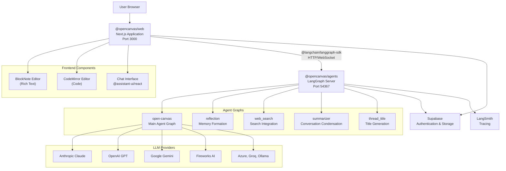

**Architecture Overview**

The system follows a three-tier client-server architecture:

1. **Frontend Tier** (`@opencanvas/web`): A Next.js 14 application providing the user interface with specialized editors (BlockNote for markdown, CodeMirror for code) and a chat interface powered by `@assistant-ui/react`. The frontend communicates with the backend via the `@langchain/langgraph-sdk` client library using HTTP and WebSocket protocols.

2. **Backend Tier** (`@opencanvas/agents`): A LangGraph agent server running on port 54367, orchestrating five specialized agent graphs that handle different aspects of document generation, modification, and memory management. The server is built with the Hono web framework and processes requests through a state machine architecture.

3. **External Services Tier**: Supabase provides authentication (email/password, GitHub, Google OAuth) and data persistence. LangSmith provides tracing and observability for LLM operations. Multiple LLM providers offer model diversity and flexibility.

**Sources:** [README.md:1-198](), [apps/web/package.json:19-99](), [apps/agents/package.json:24-50](), [.env.example:1-34](), [apps/web/.env.example:1-37]()

## Monorepo Structure

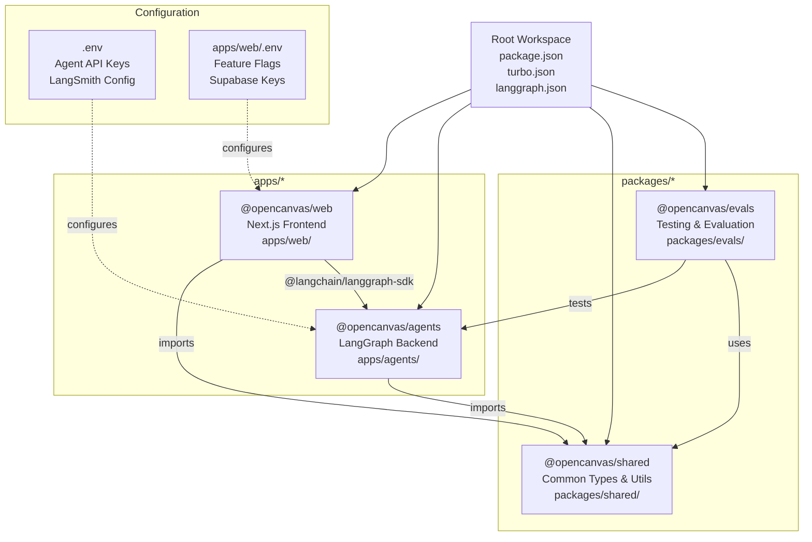

**Workspace Organization**

The monorepo uses Yarn Workspaces with the following structure defined in [package.json:7]():

| Package | Path | Purpose | Key Dependencies |
|---------|------|---------|------------------|
| `@opencanvas/web` | `apps/web/` | Next.js frontend application | `next`, `@assistant-ui/react`, `@blocknote/core`, `@uiw/react-codemirror` |
| `@opencanvas/agents` | `apps/agents/` | LangGraph agent backend | `@langchain/langgraph`, `@langchain/anthropic`, `@langchain/openai` |
| `@opencanvas/shared` | `packages/shared/` | Common types and utilities | `@langchain/core` |
| `@opencanvas/evals` | `packages/evals/` | Testing and evaluation | `langsmith`, `vitest` |

**Build Orchestration**: Turborepo coordinates builds across packages as defined in [turbo.json:1-22](). The build order ensures `@opencanvas/shared` compiles first, as both frontend and backend depend on its type definitions and utility functions. The configuration in [turbo.json:5-7]() specifies build outputs and dependency relationships.

**Configuration Files**: The root `.env` file ([.env.example:1-34]()) contains secrets for the agent backend (LLM API keys, LangSmith credentials, Supabase service role). The `apps/web/.env` file ([apps/web/.env.example:1-37]()) contains frontend configuration (feature flags for model providers, public Supabase keys).

**Sources:** [package.json:1-31](), [turbo.json:1-22](), [apps/web/package.json:1-125](), [apps/agents/package.json:1-71](), [packages/shared/package.json:1-54](), [packages/evals/package.json:1-39](), [.env.example:1-34](), [apps/web/.env.example:1-37]()

## Key Features

### Artifact System

Artifacts represent the documents users create and edit. Each artifact has:
- **Type**: `text` (markdown) or `code` (with programming language specification)
- **Content**: The actual document text/code
- **Versions**: Historical snapshots enabling time-travel through edits
- **Metadata**: Title, language (for code), and creation/update timestamps

Artifacts are stored in the LangGraph state (`OpenCanvasGraphAnnotation.State`) and persisted to Supabase. The frontend renders artifacts using BlockNote for text and CodeMirror for code, with real-time updates during streaming responses.

### Memory and Personalization

The `reflection` agent graph analyzes conversations in the background (debounced by 5 minutes) to extract:
- **Style Rules**: User preferences for writing style, code patterns, formatting
- **User Insights**: Facts about the user, their projects, and domain expertise
- **Context Documents**: Uploaded PDFs and text files for reference

These memories are stored in a `BaseStore` under user-specific namespaces and retrieved during artifact generation to personalize outputs. The system uses [apps/agents/src/open-canvas/nodes/rewrite-artifact/update-meta.ts:32]() to format and inject reflections into prompts.

### Quick Actions

Users can trigger pre-built or custom quick actions on artifacts:
- **Pre-built**: Common operations like "Add comments", "Fix bugs", "Port to language"
- **Custom**: User-defined prompts tied to their account, persisting across sessions

Quick actions bypass the routing logic and directly invoke specific agent nodes with the artifact and prompt.

### Web Search Integration

The `web_search` agent graph enables agents to search the web via Firecrawl or Exa APIs when enabled. Results are displayed in a side panel and injected into the conversation context for the main agent.

**Sources:** [README.md:13-21](), [apps/agents/src/open-canvas/nodes/rewrite-artifact/update-meta.ts:1-67]()

## Technology Stack

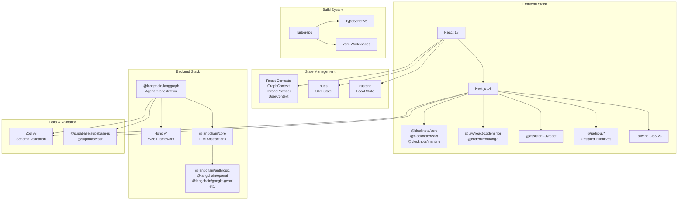

**Frontend Technologies**

| Component | Package | Purpose |
|-----------|---------|---------|
| Framework | `next@14.2.25` | Server-side rendering, routing, API routes |
| UI Library | `react@^18` | Component architecture and state management |
| Rich Text Editor | `@blocknote/core@^0.17.1` | Block-based markdown editor with real-time rendering |
| Code Editor | `@uiw/react-codemirror@^4.23.5` | Syntax-highlighted code editing with language support |
| Chat Interface | `@assistant-ui/react@^0.7.68` | AI chat components with streaming support |
| Primitives | `@radix-ui/*` | Unstyled, accessible UI primitives (Dialog, Popover, etc.) |
| Styling | `tailwindcss@^3.4.1` | Utility-first CSS framework |

**Backend Technologies**

| Component | Package | Purpose |
|-----------|---------|---------|
| Agent Framework | `@langchain/langgraph@^0.4.4` | State machine orchestration for AI workflows |
| Web Server | Built on Hono framework | HTTP server for agent endpoints |
| LLM Abstraction | `@langchain/core@^0.3.71` | Base interfaces for language models and tools |
| LLM Providers | `@langchain/anthropic`, `@langchain/openai`, etc. | Provider-specific model integrations |
| Schema Validation | `zod@^3.23.8` | Runtime type validation across frontend and backend |

**Build and Development**

The monorepo uses:
- **Turborepo** ([turbo.json:1-22]()): Coordinates parallel builds with caching
- **TypeScript v5**: Type safety across all packages
- **Yarn Workspaces** ([package.json:7]()): Dependency management
- **esbuild**: Fast bundling for production builds

**Sources:** [apps/web/package.json:19-99](), [apps/agents/package.json:24-50](), [packages/shared/package.json:51-53](), [turbo.json:1-22](), [yarn.lock:1-100]()

## Data Flow Overview

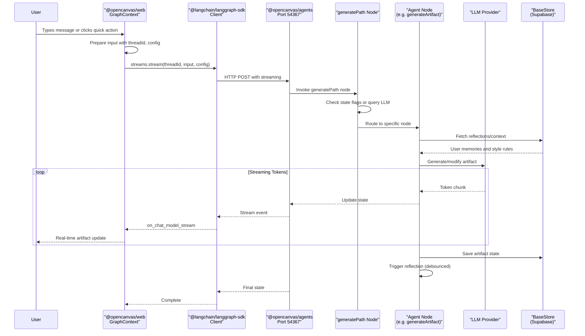

**Message Processing Pipeline**

1. **Input Collection**: User interactions (chat messages, quick actions, text highlighting) are captured in the frontend and packaged with the current thread ID and model configuration.

2. **Request Initiation**: The `GraphContext` React Context ([apps/web/src/contexts/GraphContext.tsx]()) calls `streams.stream()` from `@langchain/langgraph-sdk` to initiate a streaming request to the LangGraph server.

3. **Routing**: The `generatePath` node examines the state for explicit routing flags (`highlightedCode`, `webSearchEnabled`, etc.) or queries an LLM to determine the appropriate processing node.

4. **Processing**: The selected agent node (e.g., `generateArtifact`, `updateArtifact`) retrieves user memories from `BaseStore`, constructs a prompt with reflections, and invokes the configured LLM.

5. **Streaming Response**: As the LLM generates tokens, they stream through all layers back to the frontend. The `GraphContext` processes stream events (`on_chat_model_stream`, `on_chain_start`, `on_chain_end`) to update the artifact display in real-time.

6. **Persistence**: Final artifact states are saved to both LangGraph's thread state and Supabase. A debounced `reflection` node (5-minute delay) analyzes the conversation in the background to update user memories.

**Sources:** [README.md:1-198](), [apps/agents/src/open-canvas/nodes/rewrite-artifact/update-meta.ts:1-67]()

## Model Integration

Open Canvas supports seven LLM providers through a unified configuration system defined in `packages/shared/src/models.ts`:

| Provider | Environment Variables | Models Supported |
|----------|----------------------|------------------|
| OpenAI | `OPENAI_API_KEY` | `gpt-4o`, `gpt-4o-mini`, `o1-preview`, `o1-mini`, `o3-mini` |
| Anthropic | `ANTHROPIC_API_KEY` | `claude-3-5-sonnet`, `claude-3-5-haiku`, `claude-3-opus` |
| Google Gemini | `GOOGLE_API_KEY` | `gemini-1.5-pro`, `gemini-1.5-flash`, `gemini-2.0-flash-exp` |
| Azure OpenAI | `_AZURE_OPENAI_API_KEY`, `_AZURE_OPENAI_API_DEPLOYMENT_NAME` | Custom deployments |
| Fireworks AI | `FIREWORKS_API_KEY` | `llama-v3p3-70b-instruct`, `llama-v3p1-405b-instruct` |
| Groq | `GROQ_API_KEY` | `llama-3.3-70b-versatile` |
| Ollama | `OLLAMA_API_URL` | Local models (e.g., `llama3.3`) |

The `getModelFromConfig()` function in `apps/agents/src/agent/utils.ts` initializes the appropriate model based on configuration parameters including `customModelName`, `temperature`, and `maxTokens`.

**Feature Flags**: Frontend model availability is controlled by environment variables in [apps/web/.env.example:1-9]() (e.g., `NEXT_PUBLIC_ANTHROPIC_ENABLED`, `NEXT_PUBLIC_OLLAMA_ENABLED`).

**Sources:** [.env.example:9-26](), [apps/web/.env.example:1-37](), [README.md:129-161]()

---

# Page: Project Structure

# Project Structure

<details>
<summary>Relevant source files</summary>

The following files were used as context for generating this wiki page:

- [.codespellignore](.codespellignore)
- [apps/agents/package.json](apps/agents/package.json)
- [apps/web/package.json](apps/web/package.json)
- [apps/web/src/hooks/useStore.tsx](apps/web/src/hooks/useStore.tsx)
- [package.json](package.json)
- [packages/evals/package.json](packages/evals/package.json)
- [packages/shared/package.json](packages/shared/package.json)
- [yarn.lock](yarn.lock)

</details>


This document describes the monorepo organization, workspace structure, and build system configuration of the Open Canvas codebase. It covers the directory layout, package dependencies, and build orchestration but does not detail the implementation within each package. For information about the frontend application internals, see [Frontend Architecture](#2.1). For backend agent implementation details, see [Backend Architecture](#2.2).

---

## Monorepo Organization

Open Canvas uses a **Yarn workspaces** monorepo structure with **Turborepo** for build orchestration. The codebase is organized into two top-level directories: `apps/` for deployable applications and `packages/` for shared libraries.

### Workspace Configuration

The root [package.json:7]() defines the workspace pattern:

```json
"workspaces": ["apps/*", "packages/*"]
```

This configuration enables:
- Dependency hoisting to the root `node_modules`
- Cross-workspace dependency linking
- Unified script execution via Turborepo
- Shared development tooling (ESLint, Prettier, TypeScript)

**Sources:** [package.json:1-31]()

---

## Directory Structure

**Monorepo Structure Diagram**

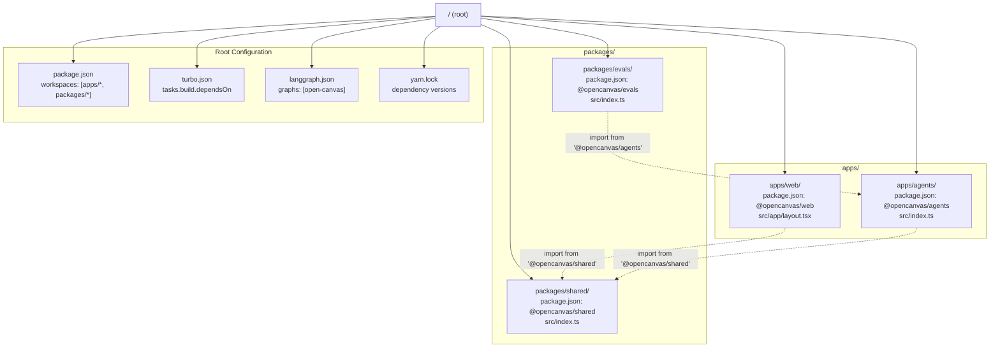

**Sources:** [package.json:7](), [apps/web/package.json:1-125](), [apps/agents/package.json:1-71](), [packages/shared/package.json:1-54](), [packages/evals/package.json:1-39]()

---

## Applications

### apps/web - Frontend Application

The `apps/web` directory contains the **Next.js 14** frontend application serving the user interface.

| Attribute | Value |
|-----------|-------|
| Package Name | `@opencanvas/web` |
| Framework | Next.js 14.2.25 |
| Port | 3000 (default) |
| Build Output | `.next/` |
| Entry Point | `src/app/layout.tsx` |

**Directory Structure:**
```
apps/web/
├── src/
│   ├── app/              # Next.js App Router pages
│   ├── components/       # React components
│   ├── contexts/         # React Context providers
│   ├── hooks/            # Custom React hooks
│   └── lib/              # Utility functions
├── public/               # Static assets
├── package.json          # Package configuration
├── next.config.js        # Next.js configuration
└── tsconfig.json         # TypeScript configuration
```

**Key Dependencies:**
- `@assistant-ui/react@^0.7.68` - Chat interface primitives
- `@blocknote/core@^0.17.1`, `@blocknote/react@^0.17.1`, `@blocknote/shadcn@^0.17.1` - Rich text editing
- `@uiw/react-codemirror@^4.23.5` - Code editor with language support
- `@langchain/langgraph-sdk@^0.0.107` - Backend communication via HTTP/WebSocket
- `@opencanvas/shared@*` - Shared utilities and types (workspace dependency)
- `@supabase/supabase-js@^2.45.5`, `@supabase/ssr@^0.5.1` - Authentication and storage
- `@radix-ui/react-*` - UI component primitives (Dialog, Dropdown, Popover, etc.)
- `next@14.2.25` - React framework
- `react@^18`, `react-dom@^18` - React runtime

**Development Scripts:**
```bash
yarn dev        # Next.js dev server on port 3000
yarn build      # Production build to .next/
yarn start      # Start production server
yarn lint       # ESLint validation
yarn format     # Prettier code formatting
```

**Import Pattern Example:**
```typescript
// Importing from shared package
import { ALL_MODELS } from '@opencanvas/shared';
import { getArtifactContent } from '@opencanvas/shared/utils/artifacts';
```

**Sources:** [apps/web/package.json:1-125]()

---

### apps/agents - Backend Agent System

The `apps/agents` directory contains the **LangGraph** agent implementation that powers the AI capabilities.

| Attribute | Value |
|-----------|-------|
| Package Name | `@opencanvas/agents` |
| Framework | LangGraph 0.4.4 |
| Port | 54367 |
| Build Output | `dist/` (TypeScript compilation) |
| Registry Config | `../../langgraph.json` |
| Entry Point | `src/index.ts` |

**Directory Structure:**
```
apps/agents/
├── src/
│   ├── open-canvas/          # Main agent graph
│   │   ├── nodes/            # Graph node implementations
│   │   ├── prompts.ts        # LLM prompt templates
│   │   └── state.ts          # OpenCanvasGraphAnnotation
│   ├── reflection/           # Reflection agent graph
│   ├── summarizer/           # Summarizer agent graph
│   ├── web-search/           # Web search agent graph
│   ├── thread-title/         # Thread title agent graph
│   ├── utils.ts              # Shared utility functions
│   └── index.ts              # Agent exports
├── package.json              # Package configuration
└── tsconfig.json             # TypeScript configuration
```

**Key Dependencies:**
- `@langchain/langgraph@^0.4.4` - StateGraph and Annotation framework
- `@langchain/core@^0.3.71` - Base abstractions (BaseMessage, Runnable, etc.)
- `@langchain/openai@^0.4.2`, `@langchain/anthropic@^0.3.21`, `@langchain/google-genai@^0.2.10`, `@langchain/groq@^0.2.2`, `@langchain/ollama@^0.2.0` - LLM provider clients
- `@langchain/exa@^0.1.0` - Exa search API integration
- `@opencanvas/shared@*` - Shared model configs and types (workspace dependency)
- `@supabase/supabase-js@^2.45.5` - Database and authentication client
- `@mendable/firecrawl-js@1.10.1` - Web page scraping
- `@ffmpeg/ffmpeg@^0.12.15` - Audio/video transcoding
- `zod@^3.23.8` - Schema validation

**Development Scripts:**
```bash
yarn dev        # LangGraph dev server on port 54367
yarn build      # Compile TypeScript to dist/
yarn clean      # Remove dist/ and .turbo/
yarn lint       # ESLint validation
```

The development server command at [apps/agents/package.json:15]() explicitly specifies:
```json
"dev": "yarn langgraphjs dev --port 54367 --config ../../langgraph.json --no-browser"
```

**Import Pattern Example:**
```typescript
// Importing from shared package
import { getModelFromConfig } from '@opencanvas/shared';
import { ALL_MODELS } from '@opencanvas/shared/models';
```

**Sources:** [apps/agents/package.json:1-71]()

---

## Shared Packages

### packages/shared - Common Code Library

The `packages/shared` directory provides shared types, constants, and utilities used by both frontend and backend.

| Attribute | Value |
|-----------|-------|
| Package Name | `@opencanvas/shared` |
| Export Strategy | Dual ESM/CJS with flexible path exports |
| Build Output | `dist/` (TypeScript compilation) |
| Main Entry | `dist/index.js` |
| Types Entry | `dist/index.d.ts` |

**Directory Structure:**
```
packages/shared/
├── src/
│   ├── models.ts             # ALL_MODELS configuration
│   ├── types.ts              # TypeScript type definitions
│   ├── constants.ts          # Shared constants
│   ├── utils/
│   │   ├── artifacts.ts      # Artifact helper functions
│   │   └── formatting.ts     # Format utility functions
│   └── index.ts              # Package entry point
├── package.json              # Package configuration
└── tsconfig.json             # TypeScript configuration
```

**Module Exports Structure:**

The [packages/shared/package.json:9-20]() defines flexible export mappings:
```json
"exports": {
  ".": {
    "types": "./dist/index.d.ts",
    "import": "./dist/index.js",
    "require": "./dist/index.js"
  },
  "./*": {
    "types": "./dist/*.d.ts",
    "import": "./dist/*.js",
    "require": "./dist/*.js"
  },
  "./package.json": "./package.json"
}
```

This enables consumers to import from:
- Root: `import { ALL_MODELS } from '@opencanvas/shared'`
- Specific files: `import { getArtifactContent } from '@opencanvas/shared/utils/artifacts'`
- Package metadata: `import pkg from '@opencanvas/shared/package.json'`

**Key Exports:**
- `ALL_MODELS` - Complete model configuration catalog with provider details
- `ArtifactV3` - Current artifact data structure interface
- `ModelConfigurationParams` - Model parameter configuration interface
- `ContextDocument` - Uploaded document type definition
- `Reflections` - User memory and style rules interface
- `DEFAULT_INPUTS` - Default prompt templates
- `PROGRAMMING_LANGUAGES` - Supported language list
- `formatReflections()` - Format user memories for prompts
- `formatArtifactContent()` - Format artifacts for display
- `getArtifactContent()` - Extract content from artifact versions

**Dependencies:**
- `@langchain/core@^0.3.71` - For LangChain type compatibility

**Sources:** [packages/shared/package.json:1-54]()

---

### packages/evals - Evaluation Framework

The `packages/evals` directory contains testing and evaluation utilities for agent behavior validation using LangSmith.

| Attribute | Value |
|-----------|-------|
| Package Name | `@opencanvas/evals` |
| Build Output | `dist/` (TypeScript compilation) |
| Primary Dependency | `@opencanvas/agents` |

**Directory Structure:**
```
packages/evals/
├── src/
│   ├── evaluators/           # LangSmith evaluator functions
│   ├── datasets/             # Test dataset definitions
│   └── index.ts              # Evaluation runner
├── package.json              # Package configuration
└── tsconfig.json             # TypeScript configuration
```

**Key Dependencies:**
- `@opencanvas/agents@*` - Agent implementation to test (workspace dependency)
- `@langchain/core@^0.3.71`, `@langchain/openai@^0.4.2` - LangChain primitives
- `langsmith@^0.3.60` - Tracing, evaluation, and dataset management
- `zod@^3.24.1` - Schema validation for test cases
- `dotenv@^16.4.7` - Environment variable loading

**Development Scripts:**
```bash
yarn build      # Compile TypeScript to dist/
yarn lint       # ESLint validation
```

**Usage Pattern:**
The evals package imports agent graphs from `@opencanvas/agents` and runs them against test datasets stored in LangSmith, measuring performance metrics and validating outputs.

**Sources:** [packages/evals/package.json:1-39]()

---

## Build System and Orchestration

### Turborepo Configuration

The [turbo.json:1-22]() file defines the build pipeline orchestration using Turborepo's task dependency system.

**Configuration Structure:**

```json
{
  "$schema": "https://turbo.build/schema.json",
  "globalDependencies": ["**/.env"],
  "tasks": {
    "build": {
      "dependsOn": ["^build"],
      "outputs": ["dist/**", ".next/**", "!.next/cache/**"]
    },
    "lint": {
      "dependsOn": ["^lint"]
    },
    "lint:fix": {
      "dependsOn": ["^lint:fix"]
    },
    "format": {
      "dependsOn": ["^format"]
    },
    "format:check": {
      "dependsOn": ["^format:check"]
    }
  }
}
```

**Key Configuration Fields:**

| Field | Value | Purpose |
|-------|-------|---------|
| `globalDependencies` | `["**/.env"]` | Invalidate cache when any `.env` file changes |
| `tasks.build.dependsOn` | `["^build"]` | Build workspace dependencies first (^ = upstream deps) |
| `tasks.build.outputs` | `["dist/**", ".next/**", "!.next/cache/**"]` | Cache these directories for faster rebuilds |

**Task Execution Order:**

When running `yarn build` from the root, Turborepo executes:

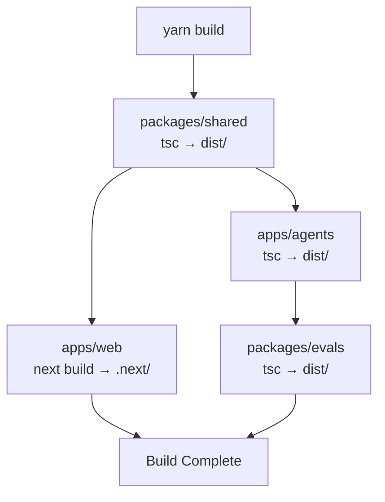

1. **packages/shared** builds first (no dependencies)
2. **apps/web** and **apps/agents** build in parallel (both depend only on `shared`)
3. **packages/evals** builds last (depends on `agents`)

**Caching Behavior:**
- Turborepo hashes inputs (source files, dependencies, env vars) for each task
- If inputs haven't changed, outputs are restored from `.turbo/cache/`
- The `^build` dependency ensures upstream packages are built before downstream consumers

**Sources:** [turbo.json:1-22]()

---

**Package Dependency Graph**

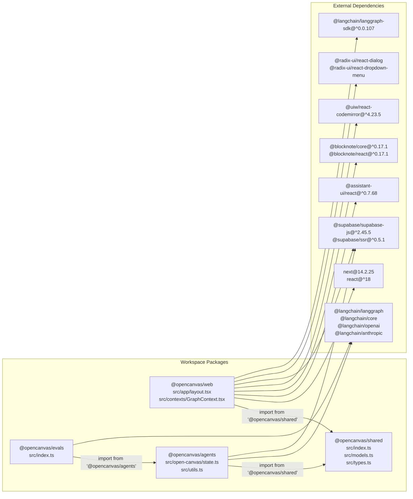

**Build Order:**

| Order | Package | Reason |
|-------|---------|--------|
| 1 | `packages/shared` | No internal dependencies |
| 2 | `apps/web`, `apps/agents` | Depend only on `shared` (parallel) |
| 3 | `packages/evals` | Depends on `agents` |

**Sources:** [apps/web/package.json:19-99](), [apps/agents/package.json:24-50](), [packages/evals/package.json:16-22]()

---

## Development Tooling

### Shared Configuration Files

The root workspace provides unified development tooling for all packages:

| Tool | Configuration | Purpose |
|------|---------------|---------|
| TypeScript | `tsconfig.json` | Type checking and compilation |
| ESLint | `.eslintrc` (root) | Code linting rules |
| Prettier | `.prettierrc` | Code formatting standards |
| Yarn | `yarn.lock` | Dependency version locking |

**Root Development Dependencies:**

[package.json:17-30]() defines shared devDependencies:
- `turbo` - Build orchestration
- `typescript` - TypeScript compiler
- `eslint` - Linting framework
- `@typescript-eslint/eslint-plugin`, `@typescript-eslint/parser` - TypeScript linting
- `prettier` - Code formatter
- `eslint-config-prettier` - ESLint/Prettier integration

---

### Unified Scripts

The root [package.json:8-14]() provides workspace-wide commands that execute across all packages:

```json
{
  "scripts": {
    "build": "turbo build",
    "turbo:command": "turbo",
    "format": "turbo format",
    "format:check": "turbo format:check",
    "lint": "turbo lint",
    "lint:fix": "turbo lint:fix"
  }
}
```

**Script Behavior:**

| Script | Command | Behavior |
|--------|---------|----------|
| `build` | `turbo build` | Builds all packages in dependency order (shared → web/agents → evals) |
| `format` | `turbo format` | Runs Prettier formatting on all packages |
| `format:check` | `turbo format:check` | Validates Prettier formatting without modification |
| `lint` | `turbo lint` | Runs ESLint on all packages |
| `lint:fix` | `turbo lint:fix` | Runs ESLint with auto-fix on all packages |
| `turbo:command` | `turbo` | Direct access to Turborepo CLI |

**Execution Model:**

When running `yarn build`:
1. Turborepo reads [turbo.json:4-7]() for task configuration
2. Analyzes `package.json` dependencies to determine build order
3. Executes `build` script in each package respecting `dependsOn: ["^build"]`
4. Caches successful builds for faster subsequent runs

**Example Workflows:**

```bash
# Format all source code
yarn format

# Build entire monorepo (respects dependency graph)
yarn build

# Lint and auto-fix all packages
yarn lint:fix

# Build only a specific package and its dependencies
yarn turbo:command run build --filter=@opencanvas/web
```

**Per-package Scripts:**

Each package defines its own `build`, `format`, and `lint` scripts:
- [apps/web/package.json:8-17]() - Next.js build, ESLint, Prettier
- [apps/agents/package.json:14-22]() - TypeScript compilation, LangGraph dev server
- [packages/shared/package.json:27-33]() - TypeScript compilation
- [packages/evals/package.json:8-14]() - TypeScript compilation

**Sources:** [package.json:1-31](), [turbo.json:1-22]()

---

## Package Manager Configuration

### Yarn Version

The [package.json:16]() specifies:
```json
"packageManager": "yarn@1.22.22"
```

This pins the Yarn classic (v1) version for consistent behavior across development environments.

### Workspace Privacy

All workspace packages are marked as `"private": true`:
- [package.json:6]() - Root
- [apps/web/package.json:7]() - Web app
- [apps/agents/package.json:13]() - Agents
- [packages/shared/package.json:26]() - Shared
- [packages/evals/package.json:7]() - Evals

This prevents accidental publication to npm registries.

**Sources:** [package.json:1-31](), [apps/web/package.json:1-125](), [apps/agents/package.json:1-71](), [packages/shared/package.json:1-54](), [packages/evals/package.json:1-39]()

---

# Page: Setup and Installation

# Setup and Installation

<details>
<summary>Relevant source files</summary>

The following files were used as context for generating this wiki page:

- [.env.example](.env.example)
- [.github/workflows/ci.yml](.github/workflows/ci.yml)
- [.nvmrc](.nvmrc)
- [README.md](README.md)
- [apps/agents/scripts/check-dev-server.ts](apps/agents/scripts/check-dev-server.ts)
- [apps/web/.env.example](apps/web/.env.example)
- [static/screenshot.png](static/screenshot.png)

</details>


This document provides step-by-step instructions for installing Open Canvas locally and running both the Next.js frontend and LangGraph agent server in development mode. For detailed configuration of environment variables and API keys, see [Configuration](#1.3). For understanding the monorepo structure before installation, see [Project Structure](#1.1).

## Prerequisites

Open Canvas requires specific tools and services to function correctly. All required and optional prerequisites must be configured before running the application.

### Package Manager

The monorepo uses **Yarn** for dependency management and workspace orchestration. Yarn is required (not npm or pnpm) due to workspace-specific configurations.

- [Yarn](https://yarnpkg.com/) - Install via `npm install -g yarn`

### LLM Provider API Keys

At minimum, **both OpenAI and Anthropic** API keys are required for core functionality:

| Provider | Required | Purpose | Registration Link |
|----------|----------|---------|-------------------|
| OpenAI | ✅ Yes | Primary model provider | [platform.openai.com/signup](https://platform.openai.com/signup/) |
| Anthropic | ✅ Yes | Claude models for summarization | [console.anthropic.com](https://console.anthropic.com/) |
| Google GenAI | ⚪ Optional | Gemini models | [aistudio.google.com/apikey](https://aistudio.google.com/apikey) |
| Fireworks AI | ⚪ Optional | Llama models | [fireworks.ai/login](https://fireworks.ai/login) |
| Groq | ⚪ Optional | Audio/video transcription | [groq.com](https://groq.com) |
| Azure OpenAI | ⚪ Optional | Azure-hosted OpenAI models | Requires Azure account |

### External Services

| Service | Required | Purpose |
|---------|----------|---------|
| **Supabase** | ✅ Yes | User authentication and data persistence |
| **LangSmith** | ✅ Yes | LLM tracing and observability |
| **Firecrawl** | ⚪ Optional | Web scraping for web search agent |
| **Exa** | ⚪ Optional | Semantic search API for web search agent |

### Development Tools

- **LangGraph CLI** - Required for running the agent server locally
  - Install: `pip install langgraph-cli` or use the included package

**Sources:** [README.md:26-56]()

## Installation Flow

The installation process follows a specific sequence to ensure workspace dependencies are correctly resolved.

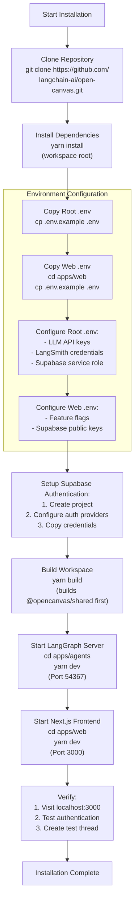

**Sources:** [README.md:58-127]()

## Step 1: Clone Repository

Clone the Open Canvas repository from GitHub:

```bash
git clone https://github.com/langchain-ai/open-canvas.git
cd open-canvas
```

**Sources:** [README.md:59-64]()

## Step 2: Install Dependencies

Install all workspace dependencies using Yarn from the repository root:

```bash
yarn install
```

This command installs dependencies for all workspaces defined in the root [package.json](), including:
- `@opencanvas/web` - Next.js frontend
- `@opencanvas/agents` - LangGraph backend
- `@opencanvas/shared` - Shared types and utilities
- `@opencanvas/evals` - Testing and evaluation suite

The `postinstall` script in [apps/agents/package.json:22]() automatically triggers a Turborepo build after installation.

**Sources:** [README.md:66-70](), [apps/agents/package.json:22]()

## Step 3: Configure Environment Variables

Open Canvas requires two separate `.env` files:

### Root `.env` File

The root `.env` file configures the LangGraph agent server:

```bash
cp .env.example .env
```

Edit `.env` to set the following required variables:

| Variable | Purpose | Example |
|----------|---------|---------|
| `LANGSMITH_TRACING` | Enable LangSmith tracing | `"true"` |
| `LANGSMITH_API_KEY` | LangSmith API key | `"ls__..."` |
| `ANTHROPIC_API_KEY` | Anthropic Claude access | `"sk-ant-..."` |
| `OPENAI_API_KEY` | OpenAI GPT access | `"sk-..."` |
| `NEXT_PUBLIC_SUPABASE_URL` | Supabase project URL | `"https://xxx.supabase.co"` |
| `NEXT_PUBLIC_SUPABASE_ANON_KEY` | Supabase anonymous key | `"eyJ..."` |
| `SUPABASE_SERVICE_ROLE` | Supabase service role key | `"eyJ..."` |

Optional variables for additional providers:

| Variable | Purpose |
|----------|---------|
| `_AZURE_OPENAI_API_KEY` | Azure OpenAI key (note underscore prefix) |
| `_AZURE_OPENAI_API_DEPLOYMENT_NAME` | Azure deployment name |
| `_AZURE_OPENAI_API_VERSION` | Azure API version |
| `_AZURE_OPENAI_API_BASE_PATH` | Azure base path |
| `FIREWORKS_API_KEY` | Fireworks AI key |
| `GOOGLE_API_KEY` | Google Gemini key |
| `GROQ_API_KEY` | Groq API key for transcription |
| `FIRECRAWL_API_KEY` | Firecrawl web scraping key |

**Note:** Azure OpenAI variables must be prefixed with an underscore (`_`) to distinguish them from standard OpenAI configuration.

### Web `.env` File

The `apps/web/.env` file configures the Next.js frontend:

```bash
cd apps/web/
cp .env.example .env
```

Edit `apps/web/.env` to set the following required variables:

| Variable | Purpose |
|----------|---------|
| `NEXT_PUBLIC_SUPABASE_URL` | Supabase project URL (public) |
| `NEXT_PUBLIC_SUPABASE_ANON_KEY` | Supabase anonymous key (public) |

Feature flags to enable/disable model providers:

| Variable | Default | Purpose |
|----------|---------|---------|
| `NEXT_PUBLIC_FIREWORKS_ENABLED` | `true` | Show Fireworks models in UI |
| `NEXT_PUBLIC_GEMINI_ENABLED` | `true` | Show Gemini models in UI |
| `NEXT_PUBLIC_ANTHROPIC_ENABLED` | `true` | Show Anthropic models in UI |
| `NEXT_PUBLIC_OPENAI_ENABLED` | `true` | Show OpenAI models in UI |
| `NEXT_PUBLIC_AZURE_ENABLED` | `false` | Show Azure OpenAI models in UI |
| `NEXT_PUBLIC_OLLAMA_ENABLED` | `false` | Show Ollama local models in UI |
| `NEXT_PUBLIC_GROQ_ENABLED` | `false` | Show Groq models in UI |

Optional variables:

| Variable | Purpose | Default |
|----------|---------|---------|
| `OLLAMA_API_URL` | Ollama server URL | `"http://host.docker.internal:11434"` |
| `GROQ_API_KEY` | Groq transcription key | - |
| `FIRECRAWL_API_KEY` | Firecrawl web scraping key | - |

**Sources:** [README.md:72-83](), [.env.example:1-34](), [apps/web/.env.example:1-37]()

## Step 4: Setup Supabase Authentication

### Create Supabase Project

1. Visit the [Supabase dashboard](https://supabase.com/dashboard/projects)
2. Create a new project
3. Wait for the project to initialize

### Copy API Credentials

Navigate to **Project Settings** → **API** and copy:

- **Project URL** → Set as `NEXT_PUBLIC_SUPABASE_URL` in both `.env` files
- **anon public key** → Set as `NEXT_PUBLIC_SUPABASE_ANON_KEY` in both `.env` files

Navigate to **Project Settings** → **API** → **Service role** and copy:

- **service_role key** → Set as `SUPABASE_SERVICE_ROLE` in root `.env` file

### Configure Authentication Providers

Navigate to **Authentication** → **Providers**:

1. **Enable Email Provider:**
   - Toggle **Email** to enabled
   - Ensure **Confirm Email** is checked
   - Save changes

2. **Optional - Enable OAuth Providers:**
   - **GitHub**: Follow [Supabase GitHub Auth docs](https://supabase.com/docs/guides/auth/social-login/auth-github)
   - **Google**: Follow [Supabase Google Auth docs](https://supabase.com/docs/guides/auth/social-login/auth-google)

**Sources:** [README.md:85-98]()

## Step 5: Build the Workspace

Before running development servers, build all workspace packages to ensure dependencies are available:

```bash
# From repository root
yarn build
```

This command triggers Turborepo to build packages in dependency order:

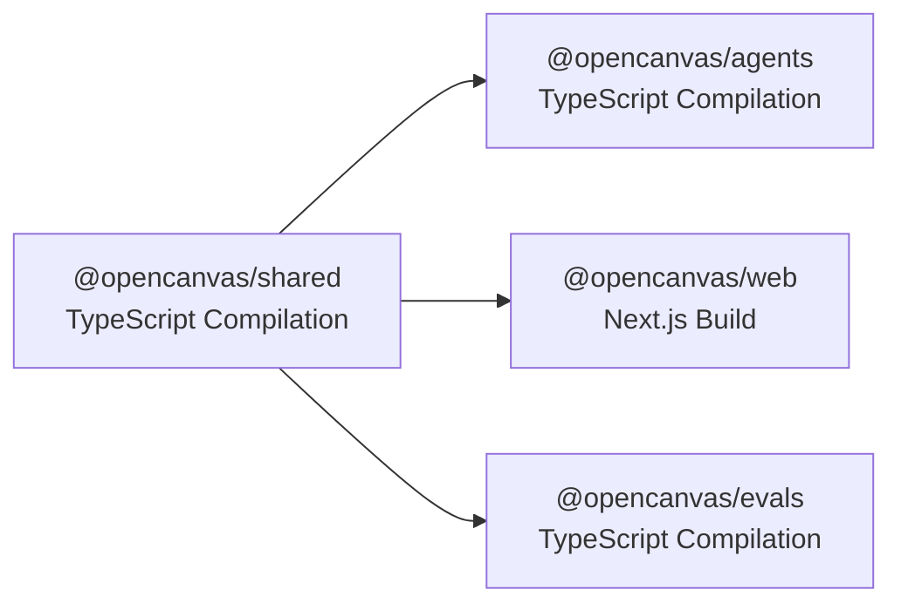

The build process:

1. **`@opencanvas/shared`** compiles first (dependency for all other packages)
   - Command: `tsc` ([packages/shared/package.json:28]())
   - Output: `packages/shared/dist/`

2. **`@opencanvas/agents`** compiles TypeScript agent code
   - Command: `yarn clean && tsc` ([apps/agents/package.json:16]())
   - Output: `apps/agents/dist/`

3. **`@opencanvas/web`** builds Next.js production bundle
   - Command: `next build` ([apps/web/package.json:10]())
   - Output: `apps/web/.next/`

4. **`@opencanvas/evals`** compiles evaluation suite
   - Command: `yarn clean && tsc` ([packages/evals/package.json:9]())
   - Output: `packages/evals/dist/`

Build caching is configured in [turbo.json:5-8]() to skip rebuilding unchanged packages.

**Sources:** [README.md:101-107](), [turbo.json:5-8](), [apps/agents/package.json:16](), [apps/web/package.json:10](), [packages/shared/package.json:28]()

## Step 6: Run the LangGraph Server

The LangGraph agent server must be running before starting the frontend.

### Start the Server

From the repository root, navigate to the agents directory and start the development server:

```bash
cd apps/agents
yarn dev
```

This executes the command: `yarn langgraphjs dev --port 54367 --config ../../langgraph.json --no-browser` ([apps/agents/package.json:15]())

### Verify Server is Running

You should see output similar to:

```
Ready!
- 🚀 API: http://localhost:54367
- 🎨 Studio UI: https://smith.langchain.com/studio?baseUrl=http://localhost:54367
```

The LangGraph server exposes:
- **HTTP API** on port `54367` - Used by the frontend via `@langchain/langgraph-sdk`
- **Studio UI** - Visual graph debugging interface (requires LangSmith account)

### LangGraph Configuration

The server reads its configuration from [langgraph.json]() in the repository root, which defines:
- Agent graph entry points
- Environment variable requirements
- Dockerfile configuration

**Sources:** [README.md:109-117](), [apps/agents/package.json:15]()

## Step 7: Run the Next.js Frontend

With the LangGraph server running, start the Next.js frontend in a separate terminal.

### Start the Frontend

From the repository root, navigate to the web directory and start the development server:

```bash
cd apps/web
yarn dev
```

This executes `next dev` ([apps/web/package.json:9]()), which starts the Next.js development server on port `3000`.

### Initial Compilation

On first run, Next.js compiles all pages and components, which may take 30-60 seconds. Subsequent starts are faster due to caching.

### Access the Application

Open your browser and navigate to [http://localhost:3000](http://localhost:3000).

**Sources:** [README.md:119-127](), [apps/web/package.json:9]()

## Server Communication Architecture

The following diagram shows how the two development servers communicate:

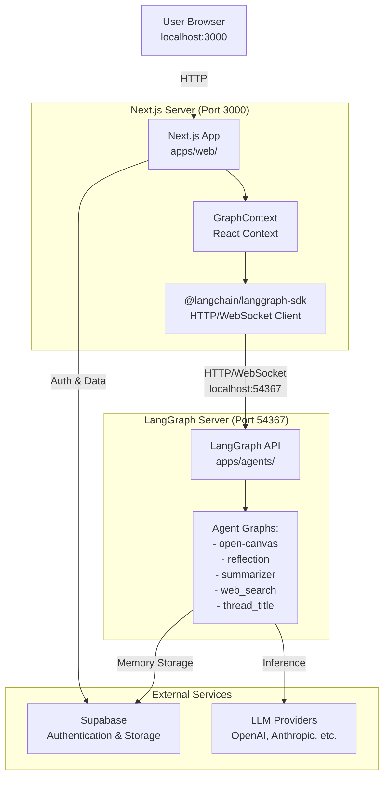

**Key communication paths:**

1. **Frontend → Backend**: The `@langchain/langgraph-sdk` client ([apps/web/package.json:41]()) makes HTTP POST requests to `http://localhost:54367` to invoke agent graphs
2. **Backend → LLMs**: Agent nodes use `getModelFromConfig` to initialize LLM clients (OpenAI, Anthropic, etc.)
3. **Both → Supabase**: Frontend uses `@supabase/ssr` ([apps/web/package.json:62]()) for authentication; backend uses `@supabase/supabase-js` ([apps/agents/package.json:39]()) with service role key

**Sources:** [apps/web/package.json:41,62](), [apps/agents/package.json:39]()

## Verification Steps

### Test Authentication

1. Navigate to [http://localhost:3000](http://localhost:3000)
2. You should be redirected to [http://localhost:3000/auth/login](http://localhost:3000/auth/login)
3. If you configured OAuth providers (GitHub/Google):
   - Click the provider button
   - Complete OAuth flow
   - You should be redirected to the home page
4. If using email authentication:
   - Navigate to [http://localhost:3000/auth/signup](http://localhost:3000/auth/signup)
   - Create an account with email and password
   - Check your email for confirmation link
   - After confirming, you should be redirected to the home page

### Create Test Thread

1. From the home page, you should see a blank canvas with a chat interface
2. Type a message in the chat input (e.g., "Write a hello world function in Python")
3. Submit the message
4. Verify that:
   - The LangGraph server logs show activity
   - A response streams back to the chat interface
   - An artifact (code or markdown) appears in the canvas area

### Check Thread Persistence

1. Refresh the page
2. Verify the conversation and artifact persist
3. Check that the thread ID appears in the URL (e.g., `?threadId=...`)
4. Verify you can continue the conversation

**Sources:** [README.md:96-98]()

## Common Installation Issues

### Port Already in Use

**Problem:** `Error: Port 3000 (or 54367) already in use`

**Solutions:**
- Identify and kill the process using the port:
  ```bash
  # macOS/Linux
  lsof -ti:3000 | xargs kill -9
  lsof -ti:54367 | xargs kill -9
  ```
- Or specify a different port:
  ```bash
  # Next.js
  PORT=3001 yarn dev
  
  # LangGraph (modify package.json dev script)
  yarn langgraphjs dev --port 54368 --config ../../langgraph.json --no-browser
  ```

### Workspace Build Errors

**Problem:** `Error: Cannot find module '@opencanvas/shared'`

**Solution:** Ensure `@opencanvas/shared` builds before other packages:
```bash
cd packages/shared
yarn build
cd ../..
yarn build
```

### Missing Environment Variables

**Problem:** Agent server crashes with `Error: ANTHROPIC_API_KEY is not set`

**Solution:** Verify all required variables are set in root `.env` file:
```bash
# Check if variable is loaded
cd apps/agents
node -e "require('dotenv').config({path:'../../.env'}); console.log(process.env.ANTHROPIC_API_KEY)"
```

### Supabase Connection Errors

**Problem:** `Error: Invalid API key` when accessing the application

**Solution:** Verify Supabase configuration:
1. Ensure `NEXT_PUBLIC_SUPABASE_URL` and `NEXT_PUBLIC_SUPABASE_ANON_KEY` are set in `apps/web/.env`
2. Verify the keys match your Supabase project settings
3. Clear browser cookies and localStorage
4. Restart the Next.js server

**Sources:** [README.md:162-172]()

## Local Ollama Setup (Optional)

Open Canvas supports calling local LLMs via Ollama for fully offline operation.

### Prerequisites

1. Install [Ollama](https://ollama.com)
2. Pull a tool-calling capable model:
   ```bash
   ollama pull llama3.3
   ```

### Configuration

1. Start the Ollama server:
   ```bash
   ollama run llama3.3
   ```

2. Enable Ollama in `apps/web/.env`:
   ```bash
   NEXT_PUBLIC_OLLAMA_ENABLED=true
   ```

3. (Optional) Set custom Ollama URL if not using default port:
   ```bash
   OLLAMA_API_URL="http://host.docker.internal:11434"
   ```

### Limitations

Open source LLMs typically have weaker instruction following capabilities compared to proprietary models (GPT-4, Claude). You may experience:
- Errors in complex multi-step operations
- Inconsistent artifact generation
- Failure to follow custom quick actions

**Sources:** [README.md:149-161]()

## Next Steps

After successful installation:

1. **Configure models and settings**: See [Configuration](#1.3) for detailed environment variable documentation
2. **Understand the architecture**: See [System Architecture](#2) for how components interact
3. **Explore the frontend**: See [Frontend Application](#3) for UI component documentation
4. **Explore the agents**: See [Backend Agents](#4) for agent graph documentation

**Sources:** [README.md:1-198]()

---

# Page: Configuration

# Configuration

<details>
<summary>Relevant source files</summary>

The following files were used as context for generating this wiki page:

- [.codespellignore](.codespellignore)
- [.env.example](.env.example)
- [README.md](README.md)
- [apps/agents/package.json](apps/agents/package.json)
- [apps/web/.env.example](apps/web/.env.example)
- [apps/web/package.json](apps/web/package.json)
- [apps/web/src/hooks/useStore.tsx](apps/web/src/hooks/useStore.tsx)
- [packages/evals/package.json](packages/evals/package.json)
- [packages/shared/package.json](packages/shared/package.json)
- [static/screenshot.png](static/screenshot.png)

</details>


This page documents the environment variables and configuration options for Open Canvas, including settings for both the frontend (web application) and backend (LangGraph server) components.

For information about project structure and organization, see [Project Structure](#1.1). For setup and installation instructions, see [Setup and Installation](#1.2).

## Overview

Open Canvas uses environment variables to configure its components, with separate configuration files for the frontend and backend. The configuration determines which LLM providers are available, authentication settings, feature flags, and other system parameters.

**Configuration Files:**
- **Backend**: Root `.env` file (read by LangGraph server in `apps/agents`)
- **Frontend**: `apps/web/.env` file (read by Next.js application)

**Key Configuration Functions:**
- `getModelConfig` [apps/agents/src/utils.ts:162-302]() - Extracts model configuration from LangGraph config
- `getModelFromConfig` [apps/agents/src/utils.ts:341-409]() - Initializes chat model from configuration
- `initChatModel` from `langchain/chat_models/universal` - Universal LangChain model loader

Sources: [README.md:72-83](), [.env.example:1-34](), [apps/web/.env.example:1-37](), [apps/agents/src/utils.ts:162-409]()

## Configuration Flow

### Configuration Architecture

The following diagram shows how environment variables flow through the codebase to configure system components:

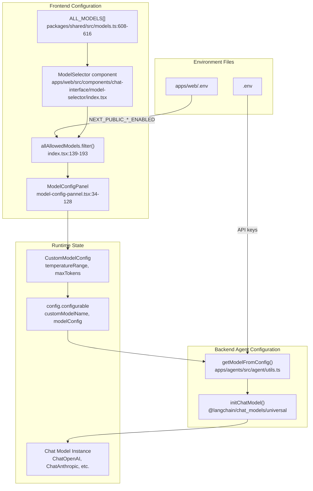

This diagram shows the complete configuration pipeline from environment variables to runtime model instances, including the frontend model selection flow and backend model initialization.

Sources: [README.md:72-83](), [.env.example:1-34](), [apps/web/.env.example:1-37](), [packages/shared/src/models.ts:608-616](), [apps/web/src/components/chat-interface/model-selector/index.tsx:139-193]()

## Backend Environment Variables

The backend configuration (root `.env` file) focuses on API keys for LLM providers, authentication, and tracing. These variables are read by the LangGraph server running in `apps/agents`.

### LangSmith Tracing

LangSmith provides observability and tracing for LangGraph execution.

| Variable | Required | Default | Description |
|----------|----------|---------|-------------|
| `LANGSMITH_TRACING` | No | `"false"` | Enable LangSmith tracing |
| `LANGSMITH_API_KEY` | Yes (if tracing) | - | LangSmith API key |
| `LANGCHAIN_PROJECT` | No | `"default"` | LangSmith project name |

**Usage in code**: The LangGraph server automatically reads these variables when initializing.

Sources: [.env.example:3-7]()

### LLM Provider API Keys

These API keys are accessed via `process.env` in `getModelConfig()` [apps/agents/src/utils.ts:162-302]() and `getModelFromConfig()` [apps/agents/src/utils.ts:341-409]().

#### OpenAI

```bash
OPENAI_API_KEY=""
```

**Used for models**: Models matching `gpt-`, `o1`, or `o3` prefixes [apps/agents/src/utils.ts:213-229]()

**Code reference**: `process.env.OPENAI_API_KEY` [apps/agents/src/utils.ts:227]()

#### Anthropic

```bash
ANTHROPIC_API_KEY=""
```

**Used for models**: Models matching `claude-` prefix [apps/agents/src/utils.ts:231-237]()

**Code reference**: `process.env.ANTHROPIC_API_KEY` [apps/agents/src/utils.ts:235]()

#### Azure OpenAI

```bash
_AZURE_OPENAI_API_KEY=""
_AZURE_OPENAI_API_DEPLOYMENT_NAME=""
_AZURE_OPENAI_API_VERSION=""
_AZURE_OPENAI_API_BASE_PATH=""
```

**Note**: Azure variables MUST be prefixed with underscore (`_`) to distinguish them from standard OpenAI configuration.

**Used for models**: Models starting with `azure/` prefix [apps/agents/src/utils.ts:186-206]()

**Code reference**: `process.env._AZURE_OPENAI_API_KEY` and related [apps/agents/src/utils.ts:196-203]()

#### Google (Gemini)

```bash
GOOGLE_API_KEY=""
```

**Used for models**: Models matching `gemini-` prefix [apps/agents/src/utils.ts:264-290]()

**Code reference**: `process.env.GOOGLE_API_KEY` [apps/agents/src/utils.ts:274]()

#### Fireworks AI

```bash
FIREWORKS_API_KEY=""
```

**Used for models**: Models matching `fireworks/` prefix [apps/agents/src/utils.ts:239-253]()

**Code reference**: `process.env.FIREWORKS_API_KEY` [apps/agents/src/utils.ts:252]()

#### Groq

```bash
GROQ_API_KEY=""
```

**Used for models**: Models starting with `groq/` prefix [apps/agents/src/utils.ts:255-262]()

**Code reference**: `process.env.GROQ_API_KEY` [apps/agents/src/utils.ts:260]()

**Additional use**: Audio/video transcription services [README.md:40]()

Sources: [.env.example:9-26](), [apps/agents/src/utils.ts:162-302]()

### Supabase Configuration

Supabase provides authentication and data storage. These variables are used by both frontend and backend.

```bash
NEXT_PUBLIC_SUPABASE_URL=""
NEXT_PUBLIC_SUPABASE_ANON_KEY=""
SUPABASE_SERVICE_ROLE=""
```

| Variable | Scope | Description |
|----------|-------|-------------|
| `NEXT_PUBLIC_SUPABASE_URL` | Both | Supabase project URL |
| `NEXT_PUBLIC_SUPABASE_ANON_KEY` | Both | Anonymous/public API key |
| `SUPABASE_SERVICE_ROLE` | Backend only | Service role key for admin operations |

**Backend usage**: Creating Supabase client in `getUserFromConfig()` [apps/agents/src/utils.ts:327-334]()

```typescript
const supabase = createClient(
  process.env.NEXT_PUBLIC_SUPABASE_URL,
  process.env.SUPABASE_SERVICE_ROLE
);
```

Sources: [.env.example:28-31](), [apps/agents/src/utils.ts:310-334]()

### External Tools

```bash
FIRECRAWL_API_KEY=""
```

**Purpose**: Web scraping via FireCrawl API for web search functionality

**Usage**: Used by web search agent for retrieving webpage content [README.md:41]()

Sources: [.env.example:33](), [README.md:41]()

### Ollama (Local Models)

Ollama enables running LLMs locally on your machine. The default model is llama3.3.

**Backend Configuration** (`.env`):
```bash
# Defaults to http://host.docker.internal:11434 if not set
# Only needs to be set if using a non-default Ollama server port
OLLAMA_API_URL="http://host.docker.internal:11434"
```

**Frontend Configuration** (`apps/web/.env`):
```bash
# Enable Ollama models in the UI
NEXT_PUBLIC_OLLAMA_ENABLED=false

# Defaults to http://host.docker.internal:11434 if not set
OLLAMA_API_URL="http://host.docker.internal:11434"
```

**Model Definition**:

Ollama models are defined in the `OLLAMA_MODELS` array [packages/shared/src/models.ts:212-233]():
```typescript
/**
 * Ollama model names _MUST_ be prefixed with `"ollama-"`
 */
const OLLAMA_MODELS = [
  {
    name: "ollama-llama3.3",
    label: "Llama 3.3 70B (local)",
    config: {
      provider: "ollama",
      temperatureRange: { min: 0, max: 1, default: 0.5, current: 0.5 },
      maxTokens: { min: 1, max: 2_048, default: 2_048, current: 2_048 },
    },
    isNew: false,
  },
];
```

**Setup Requirements**:
1. Install [Ollama](https://ollama.com)
2. Pull a tool-calling capable model: `ollama pull llama3.3`
3. Start the Ollama server: `ollama run llama3.3`
4. Set `NEXT_PUBLIC_OLLAMA_ENABLED=true` in `apps/web/.env`

**Performance Note**: Open source LLMs typically have lower instruction-following quality than proprietary models like GPT-4o or Claude Sonnet, which may result in errors or unexpected behavior [README.md:160]().

Sources: [apps/web/.env.example:8-13](), [packages/shared/src/models.ts:212-233](), [README.md:149-161]()

## Frontend Environment Variables

The frontend configuration (`apps/web/.env` file) includes feature flags, authentication, and processing settings. These variables are accessed in the Next.js application.

### Model Provider Feature Flags

These `NEXT_PUBLIC_` prefixed flags control which LLM providers are shown in the model selector UI. They are checked at runtime in the `ModelSelector` component to filter the `ALL_MODELS` array.

| Variable | Default | Description |
|----------|---------|-------------|
| `NEXT_PUBLIC_FIREWORKS_ENABLED` | `true` | Enable Fireworks AI models |
| `NEXT_PUBLIC_GEMINI_ENABLED` | `true` | Enable Google Gemini models |
| `NEXT_PUBLIC_ANTHROPIC_ENABLED` | `true` | Enable Anthropic Claude models |
| `NEXT_PUBLIC_OPENAI_ENABLED` | `true` | Enable OpenAI GPT models |
| `NEXT_PUBLIC_AZURE_ENABLED` | `false` | Enable Azure OpenAI models |
| `NEXT_PUBLIC_OLLAMA_ENABLED` | `false` | Enable local Ollama models |
| `NEXT_PUBLIC_GROQ_ENABLED` | `false` | Enable Groq models |

**Implementation**: The `ModelSelector` component filters models using `allAllowedModels` [apps/web/src/components/chat-interface/model-selector/index.tsx:139-193]():

```typescript
const allAllowedModels = ALL_MODELS.filter((model) => {
  if (
    !isLangChainUser &&
    LANGCHAIN_USER_ONLY_MODELS.some((m) => m === model.name)
  ) {
    return false;
  }

  if (
    model.name.includes("fireworks/") &&
    process.env.NEXT_PUBLIC_FIREWORKS_ENABLED === "false"
  ) {
    return false;
  }
  // ... similar checks for other providers
  return true;
});
```

The filtered models are then grouped by provider (OpenAI, Azure OpenAI, Anthropic, Google GenAI, Groq, Fireworks, Ollama) for display in the UI [apps/web/src/components/chat-interface/model-selector/index.tsx:201-221]().

Sources: [apps/web/.env.example:1-9](), [apps/web/src/components/chat-interface/model-selector/index.tsx:139-193]()

### Supabase Configuration

```bash
# Public keys for authentication
NEXT_PUBLIC_SUPABASE_URL=""
NEXT_PUBLIC_SUPABASE_ANON_KEY=""

# Optional: Separate keys for document storage
NEXT_PUBLIC_SUPABASE_URL_DOCUMENTS=""
NEXT_PUBLIC_SUPABASE_ANON_KEY_DOCUMENTS=""
```

**Frontend usage**: Creating Supabase client for authentication and document uploads.

Sources: [apps/web/.env.example:15-21]()

### Document Processing Keys

```bash
# For audio/video transcription
GROQ_API_KEY=""

# For web page scraping
FIRECRAWL_API_KEY=""
```

These keys enable optional features in the frontend:
- **Groq**: Audio/video transcription for file uploads
- **FireCrawl**: Web page content extraction for context documents

Sources: [apps/web/.env.example:23-27]()

### Azure OpenAI Configuration

Azure OpenAI requires additional configuration parameters beyond a simple API key. Variables MUST be prefixed with underscore (`_`) to distinguish them from standard OpenAI configuration.

**Backend Configuration** (`.env`):
```bash
# ENSURE THEY ARE PREFIXED WITH AN UNDERSCORE
_AZURE_OPENAI_API_KEY=""
_AZURE_OPENAI_API_DEPLOYMENT_NAME=""
_AZURE_OPENAI_API_VERSION=""
_AZURE_OPENAI_API_BASE_PATH=""  # Optional custom domain
```

**Frontend Configuration** (`apps/web/.env`):
```bash
# ENSURE THEY ARE PREFIXED WITH AN UNDERSCORE
_AZURE_OPENAI_API_KEY=""
_AZURE_OPENAI_API_INSTANCE_NAME=""
_AZURE_OPENAI_API_DEPLOYMENT_NAME=""
_AZURE_OPENAI_API_VERSION="2024-08-01-preview"
_AZURE_OPENAI_API_BASE_PATH=""  # Optional custom domain
```

**Model Definition**:

Azure models are defined in the `AZURE_MODELS` array [packages/shared/src/models.ts:3-24]():
```typescript
const AZURE_MODELS: ModelConfigurationParams[] = [
  {
    name: "azure/gpt-4o-mini",
    label: "GPT-4o mini (Azure)",
    isNew: false,
    config: {
      provider: "azure_openai",
      temperatureRange: { min: 0, max: 1, default: 0.5, current: 0.5 },
      maxTokens: { min: 1, max: 4_096, default: 4_096, current: 4_096 },
    },
  },
];
```

**Important**: The `azure/` prefix in the model name is used to identify Azure models. The default configuration has `NEXT_PUBLIC_AZURE_ENABLED=false` since Azure OpenAI is less common than standard OpenAI API [apps/web/.env.example:6-7]().

Sources: [.env.example:15-19](), [apps/web/.env.example:29-36](), [packages/shared/src/models.ts:3-24]()

### LangGraph Server URL

```bash
# Not in .env.example, but used at runtime
LANGGRAPH_API_URL="http://localhost:54367"
```

**Usage**: Frontend connects to the LangGraph server at this URL. Default is `http://localhost:54367` if not specified.

**Troubleshooting reference**: See [README.md:168-170]() for port configuration issues.

Sources: [README.md:168-170]()

## Model Configuration System

Open Canvas implements a sophisticated model configuration system that manages LLM settings across the application. The system handles model selection, parameter configuration (temperature, max tokens), and provider-specific settings.

### Model Configuration Data Flow

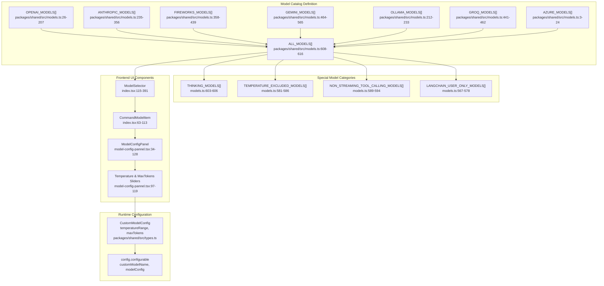

This diagram shows how model configuration flows from the static catalog definitions through the UI components to runtime configuration objects.

Sources: [packages/shared/src/models.ts:3-640](), [apps/web/src/components/chat-interface/model-selector/index.tsx:115-391](), [apps/web/src/components/chat-interface/model-selector/model-config-pannel.tsx:34-128]()

### Model Configuration System

#### Model Catalog Structure

Open Canvas defines all available models in `packages/shared/src/models.ts` organized by provider:

| Provider Array | Models Included | Location |
|---------------|-----------------|----------|
| `AZURE_MODELS` | Azure-hosted GPT models | [packages/shared/src/models.ts:3-24]() |
| `OPENAI_MODELS` | GPT-4.1, GPT-4.5, o1, o3, o4-mini, gpt-4o variants | [packages/shared/src/models.ts:26-207]() |
| `OLLAMA_MODELS` | llama3.3 (local) | [packages/shared/src/models.ts:212-233]() |
| `ANTHROPIC_MODELS` | Claude Sonnet 4, Opus 4, Claude 3.5/3.7 Sonnet, Haiku | [packages/shared/src/models.ts:235-356]() |
| `FIREWORKS_MODELS` | Llama 3.3, DeepSeek V3, DeepSeek R1 | [packages/shared/src/models.ts:358-439]() |
| `GROQ_MODELS` | DeepSeek R1 Llama 70b Distill | [packages/shared/src/models.ts:441-462]() |
| `GEMINI_MODELS` | Gemini 2.5 Flash/Pro, Gemini 2.0 Flash Thinking | [packages/shared/src/models.ts:464-565]() |

All provider arrays are combined into `ALL_MODELS` [packages/shared/src/models.ts:608-616]():

```typescript
export const ALL_MODELS: ModelConfigurationParams[] = [
  ...OPENAI_MODELS,
  ...ANTHROPIC_MODELS,
  ...FIREWORKS_MODELS,
  ...GEMINI_MODELS,
  ...AZURE_MODELS,
  ...OLLAMA_MODELS,
  ...GROQ_MODELS,
];
```

#### Special Model Categories

Open Canvas defines several categorization arrays for special model handling:

| Category | Purpose | Models |
|----------|---------|--------|
| `LANGCHAIN_USER_ONLY_MODELS` | Restricted to `@langchain.dev` email domains | o1, gpt-4o, gpt-4.5-preview, Claude Sonnet 4, Opus 4, Gemini 2.5 Pro, gpt-4.1 [packages/shared/src/models.ts:567-578]() |
| `TEMPERATURE_EXCLUDED_MODELS` | Do not support temperature parameter | o1-mini, o3-mini, o1, o4-mini [packages/shared/src/models.ts:581-586]() |
| `NON_STREAMING_TOOL_CALLING_MODELS` | Do not stream tool calls | gemini-2.0-flash-exp, gemini-1.5-flash, gemini-2.5-pro-preview [packages/shared/src/models.ts:589-594]() |
| `NON_STREAMING_TEXT_MODELS` | Do not stream text responses | o1, gemini-2.0-flash-thinking [packages/shared/src/models.ts:597-600]() |
| `THINKING_MODELS` | Support chain-of-thought with ` tags
  // Returns: { thinking: string, response: string }
}
```

**Use Cases**:
1. **Complete tags**: `'Hello world'` → `{ thinking: 'processing...', response: 'Hello world' }`
2. **Streaming/incomplete**: `'Hello <think>processing...'` → `{ thinking: 'processing...', response: 'Hello ' }`
3. **No tags**: `'Hello world'` → `{ thinking: '', response: 'Hello world' }`

**Artifact Rewriting**:

For artifact updates, `handleRewriteArtifactThinkingModel()` [packages/shared/src/utils/thinking.ts:89-129]() processes thinking tokens separately from response content, creating a dedicated thinking message in the UI state.

**Model Check**:

The `isThinkingModel()` helper function [packages/shared/src/utils/thinking.ts:131-133]() checks if a model name is in the `THINKING_MODELS` list.

Sources: [packages/shared/src/models.ts:603-606](), [packages/shared/src/utils/thinking.ts:1-134]()

#### `getModelFromConfig()`

**Location**: [apps/agents/src/utils.ts:341-409]()

**Purpose**: Creates a chat model instance using configuration from `getModelConfig()`

**Parameters**:
- `config: LangGraphRunnableConfig` - Runtime configuration
- `extra?: { temperature?, maxTokens?, isToolCalling? }` - Override parameters

**Returns**: `Promise<ChatModel>` - Initialized LangChain chat model instance

**Process**:
1. Calls `getModelConfig()` to extract configuration [apps/agents/src/utils.ts:349-358]()
2. Checks authorization for restricted models [apps/agents/src/utils.ts:365-380]()
3. Determines if standard parameters are supported [apps/agents/src/utils.ts:382-384]()
4. Calls `initChatModel()` with appropriate parameters [apps/agents/src/utils.ts:386-408]()

**Authorization Check**:
```typescript
const isLangChainUserModel = LANGCHAIN_USER_ONLY_MODELS.some(
  (m) => m === modelName
);
if (isLangChainUserModel) {
  const user = await getUserFromConfig(config);
  if (!user?.email?.endsWith("@langchain.dev")) {
    throw new Error("Unauthorized. Can not use LangChain only models...");
  }
}
```

**Parameter Handling**:
- Models in `TEMPERATURE_EXCLUDED_MODELS`: Use `max_completion_tokens` instead of `maxTokens` and `temperature`
- Example: OpenAI o1 models [apps/agents/src/utils.ts:382-395]()

Sources: [apps/agents/src/utils.ts:341-409](), [packages/shared/src/models.ts:380-400]()

### Configuration Type Definitions

Open Canvas defines shared TypeScript interfaces for model configuration in `packages/shared/src/types.ts`.

#### `ModelConfigurationParams`

Represents a complete model configuration with UI metadata:

| Field | Type | Description |
|-------|------|-------------|
| `name` | `string` | Internal identifier (e.g., `"openai-gpt-4o"`) |
| `label` | `string` | Display name in UI (e.g., `"GPT-4o"`) |
| `modelName?` | `string` | Optional provider-specific model name |
| `config` | `CustomModelConfig` | Model parameters and settings |
| `isNew` | `boolean` | Flag for newly added models (shows badge in UI) |

#### `CustomModelConfig`

Contains model parameters and provider-specific settings:

```typescript
interface CustomModelConfig {
  provider: string;  // "openai" | "anthropic" | "google-genai" | etc.
  
  temperatureRange: {
    min: number;      // Minimum allowed temperature
    max: number;      // Maximum allowed temperature
    default: number;  // Default temperature
    current: number;  // Currently selected temperature
  };
  
  maxTokens: {
    min: number;      // Minimum tokens
    max: number;      // Maximum tokens
    default: number;  // Default max tokens
    current: number;  // Currently selected max tokens
  };
  
  azureConfig?: {   // Only for Azure OpenAI models
    azureOpenAIApiKey: string;
    azureOpenAIApiInstanceName: string;
    azureOpenAIApiDeploymentName: string;
    azureOpenAIApiVersion: string;
    azureOpenAIBasePath?: string;
  };
}
```

**Usage in config object**:
```typescript
config.configurable = {
  customModelName: "gpt-4o",
  modelConfig: {
    temperatureRange: { min: 0, max: 2, default: 0.5, current: 0.7 },
    maxTokens: { min: 1, max: 16000, default: 8000, current: 8000 },
    // ...
  }
}
```

Sources: [packages/shared/src/types.ts:1-100]()

### Model Catalog Structure

The `ALL_MODELS` array in `packages/shared/src/models.ts` serves as the single source of truth for all available models. Each model entry contains complete configuration.

**Example model entry**:
```typescript
{
  name: "openai-gpt-4o",
  label: "GPT-4o",
  config: {
    provider: "openai",
    temperatureRange: { min: 0, max: 2, default: 0.5, current: 0.5 },
    maxTokens: { min: 1, max: 16000, default: 8000, current: 8000 }
  },
  isNew: false
}
```

**Special Model Categories**:

| Constant | Purpose | Models Included |
|----------|---------|-----------------|
| `THINKING_MODELS` | Models that support chain-of-thought with `<think>` tags | o1 models, Gemini thinking |
| `NON_STREAMING_MODELS` | Models that don't support streaming | Certain older models |
| `TEMPERATURE_EXCLUDED_MODELS` | Models that don't accept temperature parameter | o1 series |
| `LANGCHAIN_USER_ONLY_MODELS` | Restricted to `@langchain.dev` users | Special test models |

**Usage in authorization** [apps/agents/src/utils.ts:365-380]():
```typescript
const isLangChainUserModel = LANGCHAIN_USER_ONLY_MODELS.some(
  (m) => m === modelName
);
```

Sources: [packages/shared/src/models.ts:1-400](), [apps/agents/src/utils.ts:26-28]()

## Configuration Constants

Open Canvas defines shared configuration constants in `packages/shared/src/constants.ts` that are used across both frontend and backend.

### Message Keys and Flags

These constants identify special message types and metadata:

| Constant | Value | Purpose |
|----------|-------|---------|
| `OC_SUMMARIZED_MESSAGE_KEY` | `"__oc_summarized_message"` | Marks summarized conversation messages |
| `OC_HIDE_FROM_UI_KEY` | `"__oc_hide_from_ui"` | Marks messages hidden from user interface |
| `OC_WEB_SEARCH_RESULTS_MESSAGE_KEY` | `"__oc_web_search_results_message"` | Marks AI messages containing web search results |

**Usage in web search** [apps/agents/src/utils.ts:626-627]():
```typescript
additional_kwargs: {
  [OC_WEB_SEARCH_RESULTS_MESSAGE_KEY]: true,
  webSearchResults: webResults,
}
```

Sources: [packages/shared/src/constants.ts:3-6]()

### Default Input Values

The `DEFAULT_INPUTS` object defines the default state for action flags:

```typescript
export const DEFAULT_INPUTS = {
  highlightedCode: undefined,
  highlightedText: undefined,
  next: undefined,
  language: undefined,
  artifactLength: undefined,
  regenerateWithEmojis: undefined,
  readingLevel: undefined,
  addComments: undefined,
  addLogs: undefined,
  fixBugs: undefined,
  portLanguage: undefined,
  customQuickActionId: undefined,
  webSearchEnabled: undefined,
  webSearchResults: undefined,
};
```

**Usage**: Reset state flags in `cleanState` node [apps/agents/src/open-canvas/index.ts:30-34]()

Sources: [packages/shared/src/constants.ts:10-25](), [apps/agents/src/open-canvas/index.ts:30-34]()

### Programming Languages

The `PROGRAMMING_LANGUAGES` array defines supported code languages:

```typescript
export const PROGRAMMING_LANGUAGES: Array<{
  language: ProgrammingLanguageOptions;
  label: string;
}> = [
  { language: "typescript", label: "TypeScript" },
  { language: "javascript", label: "JavaScript" },
  { language: "cpp", label: "C++" },
  { language: "java", label: "Java" },
  { language: "php", label: "PHP" },
  { language: "python", label: "Python" },
  { language: "html", label: "HTML" },
  { language: "sql", label: "SQL" },
  { language: "json", label: "JSON" },
  { language: "rust", label: "Rust" },
  { language: "xml", label: "XML" },
  { language: "clojure", label: "Clojure" },
  { language: "csharp", label: "C#" },
  { language: "other", label: "Other" },
];
```

**Usage**: Displayed in language selector UI, used for code artifact generation and syntax highlighting.

Sources: [packages/shared/src/constants.ts:27-88]()

### Storage Namespaces

```typescript
export const CONTEXT_DOCUMENTS_NAMESPACE = ["context_documents"];
```

**Usage**: Namespace for storing context documents in LangGraph's key-value store [apps/agents/src/utils.ts:524]().

Sources: [packages/shared/src/constants.ts:8](), [apps/agents/src/utils.ts:515-526]()

## Setting Up Configuration

To configure Open Canvas locally:

1. Copy the example environment files:
   ```bash
   # The root `.env` file for the LangGraph server
   cp .env.example .env
   
   # The `apps/web/.env` file for the frontend
   cd apps/web/
   cp .env.example .env
   ```

2. Fill in the required environment variables with your API keys and other settings.

3. Set up Supabase authentication as described in the [Setup and Installation](#1.2) section.

Sources: [README.md:72-83](), [README.md:85-97]()

## Provider-Specific Configuration

### OpenAI Models

**Supported Models**: GPT-4o, GPT-4o Mini, o1-preview, o1-mini, o3-mini

**Configuration**:
```bash
OPENAI_API_KEY="sk-..."
```

**Detection Logic** [apps/agents/src/utils.ts:213-229]():
- Model names matching `gpt-`, `o1`, or `o3` patterns
- Special handling: o1 models fallback to `gpt-4o` for tool calling

**Provider Key**: `"openai"`

Sources: [apps/agents/src/utils.ts:213-229](), [README.md:135]()

### Anthropic Models

**Supported Models**: Claude 3.5 Sonnet, Claude 3 Haiku, Claude 3 Opus

**Configuration**:
```bash
ANTHROPIC_API_KEY="sk-ant-..."
```

**Detection Logic** [apps/agents/src/utils.ts:231-237]():
- Model names matching `claude-` pattern

**Provider Key**: `"anthropic"`

**Special Feature**: Claude 3.5 Sonnet supports native PDF document processing [apps/agents/src/utils.ts:549]()

Sources: [apps/agents/src/utils.ts:231-237](), [README.md:133]()

### Google Gemini Models

**Supported Models**: Gemini 2.0 Flash, Gemini Pro, Gemini Thinking

**Configuration**:
```bash
GOOGLE_API_KEY="AIza..."
```

**Detection Logic** [apps/agents/src/utils.ts:264-290]():
- Model names matching `gemini-` pattern
- Gemini thinking models fallback to `gemini-2.0-flash-exp` for tool calling

**Provider Key**: `"google-genai"`

Sources: [apps/agents/src/utils.ts:264-290]()

### Fireworks AI Models

**Supported Models**: Llama 3.3 70B, Mistral models

**Configuration**:
```bash
FIREWORKS_API_KEY="fw_..."
```

**Detection Logic** [apps/agents/src/utils.ts:239-253]():
- Model names matching `fireworks/` prefix
- Non-tool-calling models fallback to `llama-v3p3-70b-instruct`

**Provider Key**: `"fireworks"`

Sources: [apps/agents/src/utils.ts:239-253](), [README.md:134]()

### Groq Models

**Supported Models**: Fast inference models

**Configuration**:
```bash
GROQ_API_KEY="gsk_..."
```

**Detection Logic** [apps/agents/src/utils.ts:255-262]():
- Model names starting with `groq/` prefix
- Prefix is stripped when instantiating model

**Provider Key**: `"groq"`

Sources: [apps/agents/src/utils.ts:255-262]()

### Azure OpenAI Models

**Supported Models**: Any OpenAI model deployed to Azure

**Configuration**:
```bash
_AZURE_OPENAI_API_KEY="..."
_AZURE_OPENAI_API_INSTANCE_NAME="your-instance"
_AZURE_OPENAI_API_DEPLOYMENT_NAME="your-deployment"
_AZURE_OPENAI_API_VERSION="2024-08-01-preview"
_AZURE_OPENAI_API_BASE_PATH="https://..."  # Optional
```

**Detection Logic** [apps/agents/src/utils.ts:186-206]():
- Model names starting with `azure/` prefix
- Prefix is stripped to get actual model name
- o1 models fallback to `gpt-4o` for tool calling

**Provider Key**: `"azure_openai"`

**Important**: All Azure variables MUST be prefixed with underscore (`_`)

Sources: [apps/agents/src/utils.ts:186-206](), [apps/web/.env.example:29-36]()

### Ollama (Local Models)

**Supported Models**: Any Ollama-compatible model (llama3.3 recommended)

**Configuration**:
```bash
# Backend
OLLAMA_API_URL="http://host.docker.internal:11434"

# Frontend
NEXT_PUBLIC_OLLAMA_ENABLED=true
```

**Detection Logic** [apps/agents/src/utils.ts:292-299]():
- Model names starting with `ollama-` prefix
- Prefix is stripped when instantiating model
- Base URL defaults to `http://host.docker.internal:11434`

**Provider Key**: `"ollama"`

**Setup Requirements**:
1. Install Ollama locally
2. Pull a tool-calling capable model: `ollama pull llama3.3`
3. Start server: `ollama run llama3.3`
4. Enable in frontend config

**Performance Note**: Open source models may have lower instruction-following quality than proprietary models [README.md:160]()

Sources: [apps/agents/src/utils.ts:292-299](), [README.md:149-161]()

## Adding New Model Providers

To integrate a new LLM provider into Open Canvas:

### Step 1: Define Models in Catalog

Create a new provider array in `packages/shared/src/models.ts`:

```typescript
const NEWPROVIDER_MODELS: ModelConfigurationParams[] = [
  {
    name: "newprovider-model-name",
    label: "New Provider Model",
    config: {
      provider: "newprovider",
      temperatureRange: { min: 0, max: 1, default: 0.5, current: 0.5 },
      maxTokens: { min: 1, max: 4096, default: 4096, current: 4096 }
    },
    isNew: true
  }
];
```

Then add to `ALL_MODELS` array [packages/shared/src/models.ts:608-616]():
```typescript
export const ALL_MODELS: ModelConfigurationParams[] = [
  ...OPENAI_MODELS,
  ...ANTHROPIC_MODELS,
  ...FIREWORKS_MODELS,
  ...GEMINI_MODELS,
  ...AZURE_MODELS,
  ...OLLAMA_MODELS,
  ...GROQ_MODELS,
  ...NEWPROVIDER_MODELS,  // Add here
];
```

### Step 2: Install LangChain Provider Package

```bash
cd apps/agents
yarn add @langchain/newprovider
```

### Step 3: Update Backend Configuration

Add provider API key to `.env.example` and `.env`:

```bash
# New Provider
NEWPROVIDER_API_KEY=""
```

Update `getModelFromConfig()` in `apps/agents/src/agent/utils.ts` to handle the new provider.

### Step 4: Add Frontend Feature Flag

Add to `apps/web/.env.example`:

```bash
# Enable/disable New Provider models in UI
NEXT_PUBLIC_NEWPROVIDER_ENABLED=true
```

Add filtering logic to `ModelSelector` [apps/web/src/components/chat-interface/model-selector/index.tsx:139-193]():

```typescript
const allAllowedModels = ALL_MODELS.filter((model) => {
  // ... existing filters
  
  if (
    model.name.includes("newprovider-") &&
    process.env.NEXT_PUBLIC_NEWPROVIDER_ENABLED === "false"
  ) {
    return false;
  }
  
  return true;
});
```

### Step 5: Add Model Group to UI

Add a new `CommandGroup` in the `ModelSelector` component [apps/web/src/components/chat-interface/model-selector/index.tsx:247-385]():

```typescript
const newproviderModelGroup = allAllowedModels.filter(
  (m) => m.config.provider === "newprovider"
);

// In the render:
{newproviderModelGroup.length > 0 && (
  <CommandGroup heading="New Provider" className="w-full">
    {newproviderModelGroup.map((model) => {
      const config = modelConfigs[model.name];
      return (
        <CommandModelItem
          key={model.name}
          model={model}
          handleModelChange={handleModelChange}
          config={config}
          selectedModelName={modelName}
          openConfigModelId={openConfigModelId}
          setOpenConfigModelId={setOpenConfigModelId}
          setModelConfig={setModelConfig}
        />
      );
    })}
  </CommandGroup>
)}
```

### Step 6: Testing Checklist

Test the following operations with your new model [README.md:142-147]():

| Test | Description |
|------|-------------|
| ✓ Generate new text artifact | Prompt the model to create a markdown document |
| ✓ Generate new code artifact | Prompt the model to create a code file |
| ✓ Generate followup message | Verify followup questions appear after artifact creation |
| ✓ Update artifact via chat | Send a message requesting changes to the artifact |
| ✓ Update artifact via quick action | Use a built-in quick action (e.g., "Make it longer") |
| ✓ Custom quick actions | Create and test a custom quick action |

Sources: [README.md:137-147](), [packages/shared/src/models.ts:608-616](), [apps/web/src/components/chat-interface/model-selector/index.tsx:139-385]()

## Troubleshooting Configuration Issues

Common configuration issues and solutions:

| Issue | Solution |
|-------|----------|
| LangGraph server connection issues | Clear `oc_thread_id_v2` cookie and refresh the page |
| 500 network errors | Ensure LangGraph server is running on the correct port specified by `LANGGRAPH_API_URL` |
| "thread ID not found" errors | Verify LangGraph server port configuration |
| "Model name is missing in config" error | Ensure `customModelName` is specified in the config when invoking the graph |

Sources: [README.md:164-173]()

---

# Page: System Architecture

# System Architecture

<details>
<summary>Relevant source files</summary>

The following files were used as context for generating this wiki page:

- [.codespellignore](.codespellignore)
- [.env.example](.env.example)
- [README.md](README.md)
- [apps/agents/package.json](apps/agents/package.json)
- [apps/web/.env.example](apps/web/.env.example)
- [apps/web/package.json](apps/web/package.json)
- [apps/web/src/hooks/useStore.tsx](apps/web/src/hooks/useStore.tsx)
- [package.json](package.json)
- [packages/evals/package.json](packages/evals/package.json)
- [packages/shared/package.json](packages/shared/package.json)
- [static/screenshot.png](static/screenshot.png)
- [yarn.lock](yarn.lock)

</details>


This document provides a high-level technical overview of Open Canvas's system architecture, explaining how the monorepo structure, frontend application, backend agent system, and external services interact to enable collaborative document editing with AI agents. The architecture is designed to support real-time streaming, multi-model LLM integration, persistent memory, and artifact versioning.

For detailed information about specific subsystems, see:
- Frontend implementation details: [Frontend Architecture](#2.1)
- Backend agent implementation: [Backend Architecture](#2.2)
- Message streaming mechanics: [Data Flow](#2.3)
- Authentication and persistence: [Authentication and Storage](#2.4)

---

## Monorepo Structure

Open Canvas is organized as a Yarn workspaces monorepo with Turbo for build orchestration. The repository contains two primary applications and two shared packages.

**Monorepo Organization**

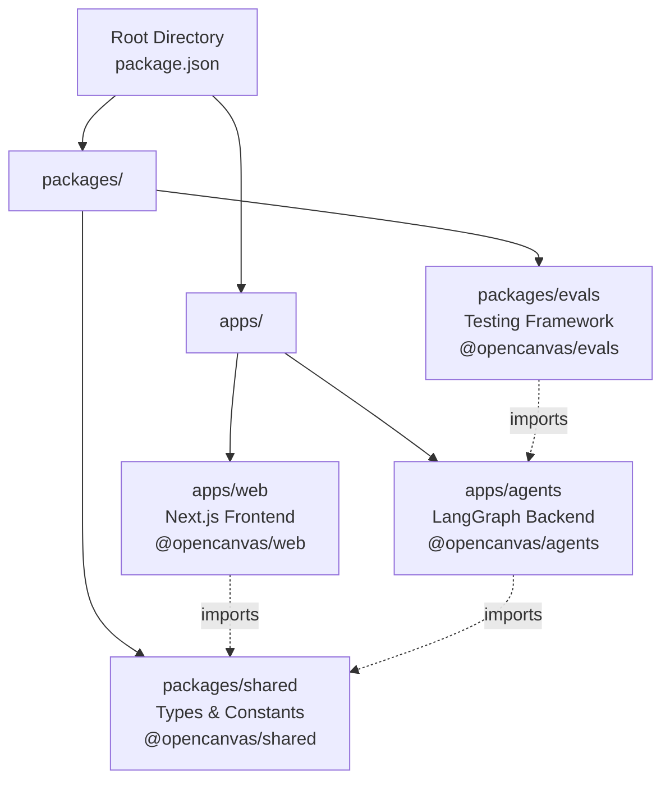

**Sources:** [package.json:1-40](), [apps/web/package.json:1-126](), [apps/agents/package.json:1-71](), [packages/shared/package.json:1-54](), [packages/evals/package.json:1-39]()

| Directory | Purpose | Key Dependencies |
|-----------|---------|------------------|
| `apps/web` | Next.js frontend application serving the user interface | `next`, `@assistant-ui/react`, `@blocknote/*`, `@radix-ui/*`, `@uiw/react-codemirror` |
| `apps/agents` | LangGraph agent backend implementing AI workflows | `@langchain/langgraph`, `@langchain/anthropic`, `@langchain/openai`, `@langchain/google-genai` |
| `packages/shared` | Shared TypeScript types, constants, and model definitions | `@langchain/core` |
| `packages/evals` | Evaluation framework for testing agent behavior | `langsmith`, `@langchain/openai` |

**Sources:** [apps/web/package.json:19-100](), [apps/agents/package.json:24-50](), [packages/shared/package.json:51-53]()

The build system uses Turbo to orchestrate compilation across workspace dependencies. The `@opencanvas/shared` package must be built first as it provides types consumed by both frontend and backend.

**Sources:** [package.json:8-14](), [apps/agents/package.json:14-22](), [packages/shared/package.json:27-33]()

---

## High-Level System Interaction

The system follows a client-server architecture where the Next.js frontend communicates with a LangGraph backend via the `@langchain/langgraph-sdk`. Both applications maintain independent connections to Supabase for authentication and data persistence.

**System Component Communication**

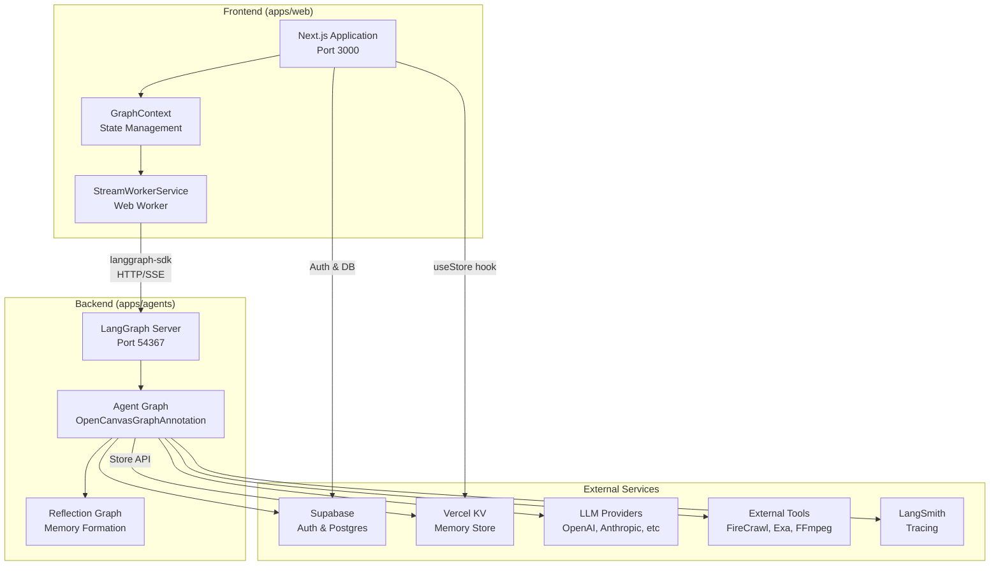

**Sources:** [README.md:1-198](), [apps/web/package.json:42](), [apps/agents/package.json:33-34]()

The frontend initiates conversations by sending messages to the LangGraph server, which executes agent workflows and streams responses back via Server-Sent Events (SSE). Both applications share a common type system defined in `@opencanvas/shared` to ensure consistency across the stack.

**Sources:** [packages/shared/package.json:1-54]()

---

## Frontend-Backend Integration Points

The frontend and backend communicate through several distinct interfaces, each serving a specific purpose in the application flow.

**API Integration Architecture**

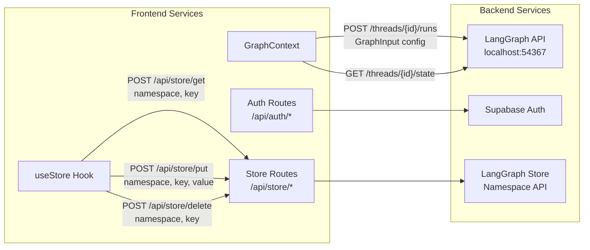

**Sources:** [apps/web/src/hooks/useStore.tsx:1-304]()

| Integration Point | Frontend Component | Backend Endpoint | Purpose |
|-------------------|-------------------|------------------|---------|
| Graph Execution | `GraphContext` | `POST /threads/{threadId}/runs` | Invoke agent graph with streaming |
| State Retrieval | `GraphContext` | `GET /threads/{threadId}/state` | Fetch current conversation state |
| Memory Storage | `useStore.getReflections()` | Store API `namespace: ["memories", assistantId]` | Retrieve user reflections |
| Quick Actions | `useStore.getCustomQuickActions()` | Store API `namespace: ["custom_actions", userId]` | Manage custom prompts |
| Context Documents | `useStore.getContextDocuments()` | Store API `namespace: CONTEXT_DOCUMENTS_NAMESPACE` | Upload reference materials |

**Sources:** [apps/web/src/hooks/useStore.tsx:19-93](), [apps/web/src/hooks/useStore.tsx:95-192](), [apps/web/src/hooks/useStore.tsx:228-289]()

---

## LangGraph Server Configuration

The LangGraph backend is configured via `langgraph.json`, which defines multiple graph entry points. The server runs on port 54367 and exposes a REST API for graph execution.

**Graph Entry Points**

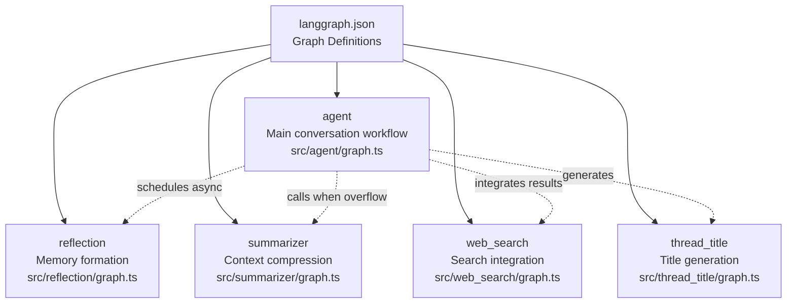

**Sources:** [apps/agents/package.json:15]()

The main `agent` graph is invoked for user messages, while supporting graphs run independently or are called by the main workflow. The `reflection` graph executes asynchronously with a debounced strategy to extract memories from conversations.

**Sources:** [README.md:99-117]()

---

## Environment Configuration

Open Canvas requires extensive environment configuration across both frontend and backend applications. Configuration is split between API keys (backend), feature flags (frontend), and shared authentication credentials.

**Environment Variable Distribution**

| Variable | Location | Purpose |
|----------|----------|---------|
| `ANTHROPIC_API_KEY` | Root `.env` | Anthropic Claude API access |
| `OPENAI_API_KEY` | Root `.env` | OpenAI GPT models access |
| `GOOGLE_API_KEY` | Root `.env` | Google Gemini API access |
| `FIREWORKS_API_KEY` | Root `.env` | Fireworks AI Llama models |
| `GROQ_API_KEY` | Root `.env` & `apps/web/.env` | Audio transcription |
| `FIRECRAWL_API_KEY` | Root `.env` & `apps/web/.env` | Web scraping |
| `NEXT_PUBLIC_SUPABASE_URL` | `apps/web/.env` | Supabase project URL |
| `NEXT_PUBLIC_SUPABASE_ANON_KEY` | `apps/web/.env` | Supabase public API key |
| `SUPABASE_SERVICE_ROLE` | Root `.env` | Supabase admin access |
| `NEXT_PUBLIC_FIREWORKS_ENABLED` | `apps/web/.env` | Show/hide Fireworks models |
| `NEXT_PUBLIC_GEMINI_ENABLED` | `apps/web/.env` | Show/hide Gemini models |
| `NEXT_PUBLIC_ANTHROPIC_ENABLED` | `apps/web/.env` | Show/hide Anthropic models |
| `NEXT_PUBLIC_OPENAI_ENABLED` | `apps/web/.env` | Show/hide OpenAI models |
| `NEXT_PUBLIC_OLLAMA_ENABLED` | `apps/web/.env` | Enable local Ollama models |
| `OLLAMA_API_URL` | `apps/web/.env` | Ollama server URL |
| `LANGSMITH_API_KEY` | Root `.env` | LangSmith tracing |

**Sources:** [.env.example:1-34](), [apps/web/.env.example:1-37]()

Feature flags prefixed with `NEXT_PUBLIC_` control model visibility in the frontend `ModelSelector` component, while actual API keys remain server-side only.

**Sources:** [apps/web/.env.example:1-9]()

---

## Model Provider Architecture

The system abstracts multiple LLM providers through a unified interface defined in `packages/shared`. The `ALL_MODELS` registry serves as the single source of truth for available models, and `getModelConfig()` initializes the appropriate provider at runtime.

**Model Configuration Flow**

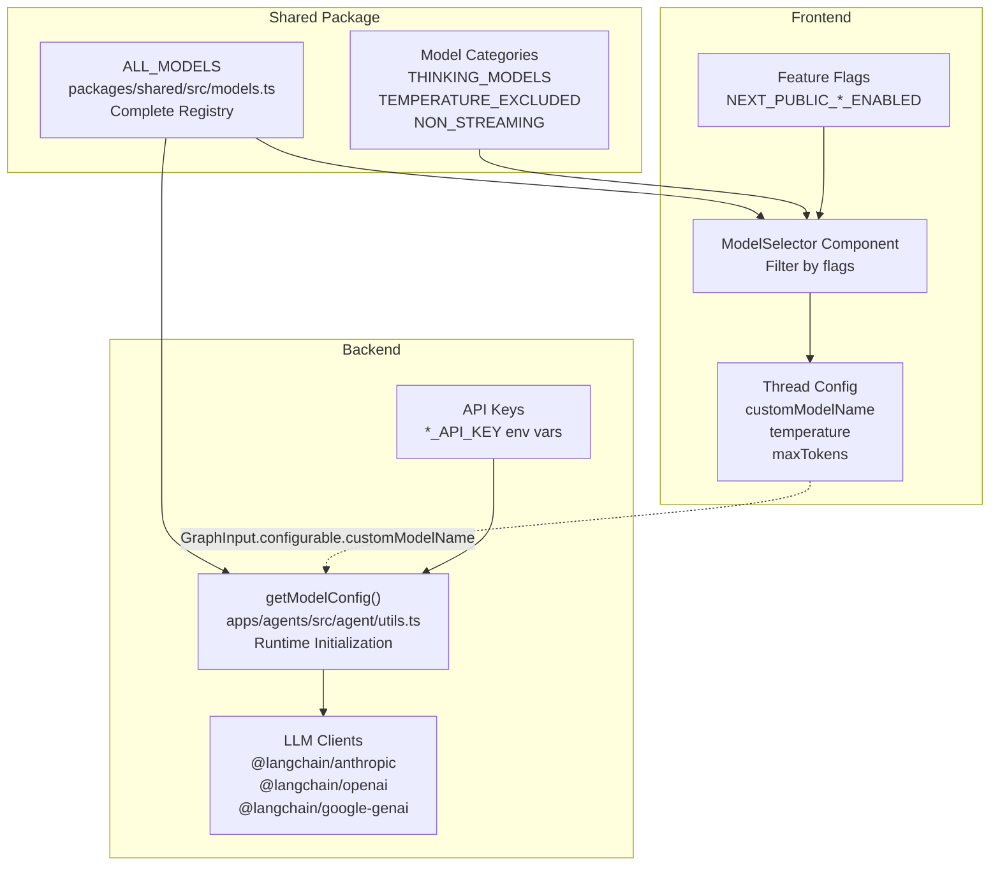

**Sources:** [README.md:129-148](), [apps/web/.env.example:1-9]()

The frontend filters visible models based on feature flags, while the backend `getModelConfig()` function validates the selected model and initializes the corresponding `@langchain/*` client with the appropriate API key.

**Sources:** [README.md:138-143]()

---

## Data Persistence Strategy

Open Canvas uses a hybrid persistence strategy combining Supabase (relational database for auth and threads) with Vercel KV (fast key-value store for memories and quick actions). The LangGraph server automatically persists thread state, while the `useStore` hook manages application-level data.

**Storage Namespace Organization**

| Namespace | Key | Value Type | Purpose |
|-----------|-----|------------|---------|
| `["memories", assistantId]` | `"reflection"` | `Reflections` | User style rules and insights |
| `["custom_actions", userId]` | `"actions"` | `Record<string, CustomQuickAction>` | User-defined prompts |
| `CONTEXT_DOCUMENTS_NAMESPACE` | `assistantId` | `{ documents: ContextDocument[] }` | Reference materials |
| Thread state | `threadId` | LangGraph state | Conversation history and artifacts |

**Sources:** [apps/web/src/hooks/useStore.tsx:9](), [apps/web/src/hooks/useStore.tsx:19-93](), [apps/web/src/hooks/useStore.tsx:95-192](), [apps/web/src/hooks/useStore.tsx:228-289]()

The `useStore` hook provides a unified interface for storage operations:

```typescript
// Reflections: namespace ["memories", assistantId], key "reflection"
await getReflections(assistantId)
await deleteReflections(assistantId)

// Custom Quick Actions: namespace ["custom_actions", userId], key "actions"
await getCustomQuickActions(userId)
await createCustomQuickAction(newAction, rest, userId)
await editCustomQuickAction(editedAction, rest, userId)
await deleteCustomQuickAction(id, rest, userId)

// Context Documents: namespace CONTEXT_DOCUMENTS_NAMESPACE, key assistantId
await putContextDocuments({ assistantId, documents })
await getContextDocuments(assistantId)
```

**Sources:** [apps/web/src/hooks/useStore.tsx:11-304]()

---

## External Service Dependencies

Open Canvas integrates with multiple external services to provide authentication, model access, web scraping, search, and observability.

**External Service Integration**

```mermaid
graph TB
    subgraph "Authentication & Storage"
        Supabase["Supabase<br/>Auth: Email/OAuth<br/>DB: Postgres"]
        VercelKV["Vercel KV<br/>Redis-based Store"]
    end
    
    subgraph "LLM Providers"
        OpenAI["OpenAI<br/>GPT-4o, GPT-4o-mini"]
        Anthropic["Anthropic<br/>Claude 3.5 Sonnet"]
        Google["Google<br/>Gemini Pro/Flash"]
        Fireworks["Fireworks<br/>Llama 3 variants"]
        Groq["Groq<br/>Fast inference"]
        Ollama["Ollama<br/>Local models"]
    end
    
    subgraph "External Tools"
        FireCrawl["FireCrawl<br/>Web scraping"]
        Exa["Exa Search<br/>Semantic search"]
        FFmpeg["FFmpeg<br/>Media processing"]
    end
    
    subgraph "Observability"
        LangSmith["LangSmith<br/>Tracing & Monitoring"]
    end
    
    WebApp["apps/web"] --> Supabase
    WebApp --> VercelKV
    WebApp --> FireCrawl
    WebApp --> FFmpeg
    
    AgentsApp["apps/agents"] --> Supabase
    AgentsApp --> VercelKV
    AgentsApp --> OpenAI
    AgentsApp --> Anthropic
    AgentsApp --> Google
    AgentsApp --> Fireworks
    AgentsApp --> Groq
    AgentsApp --> Ollama
    AgentsApp --> FireCrawl
    AgentsApp --> Exa
    AgentsApp --> LangSmith
```

**Sources:** [README.md:28-56](), [.env.example:1-34](), [apps/web/.env.example:1-37]()

| Service | Frontend Use | Backend Use | Configuration |
|---------|-------------|-------------|---------------|
| Supabase | Authentication, session management | Thread persistence | `NEXT_PUBLIC_SUPABASE_URL`, `NEXT_PUBLIC_SUPABASE_ANON_KEY`, `SUPABASE_SERVICE_ROLE` |
| Vercel KV | Store API proxy | Memory storage | Configured via LangGraph SDK |
| OpenAI | N/A | GPT model access | `OPENAI_API_KEY` |
| Anthropic | N/A | Claude model access | `ANTHROPIC_API_KEY` |
| Google | N/A | Gemini model access | `GOOGLE_API_KEY` |
| Fireworks | N/A | Llama model access | `FIREWORKS_API_KEY` |
| Groq | Audio transcription | N/A | `GROQ_API_KEY` |
| Ollama | N/A | Local model access | `OLLAMA_API_URL` |
| FireCrawl | Document uploading | Web scraping | `FIRECRAWL_API_KEY` |
| Exa | N/A | Semantic search | Via `@langchain/exa` |
| FFmpeg | Media processing | N/A | `@ffmpeg/ffmpeg`, `@ffmpeg/util` |
| LangSmith | N/A | Tracing, observability | `LANGSMITH_API_KEY`, `LANGSMITH_TRACING` |

**Sources:** [apps/web/package.json:38-43](), [apps/agents/package.json:25-42](), [.env.example:3-33]()

---

## Development Workflow

The development workflow requires running both the LangGraph server and the Next.js frontend simultaneously. The monorepo build system ensures workspace dependencies are compiled before starting development servers.

**Development Server Startup Sequence**

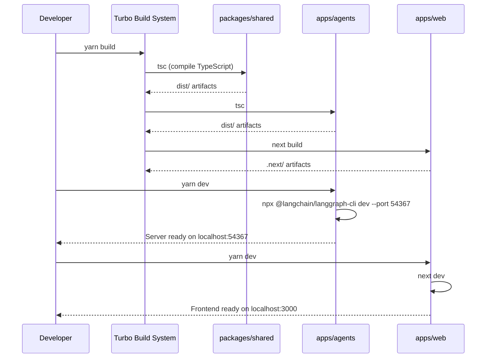

**Sources:** [README.md:99-127](), [package.json:9](), [apps/agents/package.json:15](), [apps/web/package.json:9]()

The LangGraph CLI (`@langchain/langgraph-cli`) automatically watches for changes and reloads the agent code. The Next.js development server provides hot module replacement for frontend changes.

**Sources:** [apps/agents/package.json:15](), [apps/agents/package.json:54]()

---

# Page: Frontend Architecture

# Frontend Architecture

<details>
<summary>Relevant source files</summary>

The following files were used as context for generating this wiki page:

- [.codespellignore](.codespellignore)
- [apps/agents/package.json](apps/agents/package.json)
- [apps/web/package.json](apps/web/package.json)
- [apps/web/src/app/layout.tsx](apps/web/src/app/layout.tsx)
- [apps/web/src/components/canvas/canvas.tsx](apps/web/src/components/canvas/canvas.tsx)
- [apps/web/src/components/ui/resizable.tsx](apps/web/src/components/ui/resizable.tsx)
- [apps/web/src/contexts/GraphContext.tsx](apps/web/src/contexts/GraphContext.tsx)
- [apps/web/src/contexts/ThreadProvider.tsx](apps/web/src/contexts/ThreadProvider.tsx)
- [apps/web/src/hooks/useStore.tsx](apps/web/src/hooks/useStore.tsx)
- [package.json](package.json)
- [packages/evals/package.json](packages/evals/package.json)
- [packages/shared/package.json](packages/shared/package.json)
- [yarn.lock](yarn.lock)

</details>


## Purpose and Scope

This document describes the architecture of the Next.js frontend application located at `apps/web/`. It covers the component hierarchy, state management patterns using React Context, UI library integrations (BlockNote, CodeMirror, Radix UI, Mantine), and the communication layer with the LangGraph backend. 

For information about the backend agent system, see [Backend Architecture](#2.2). For details on the data flow between frontend and backend, see [Data Flow](#2.3).

---

## Application Structure

The frontend follows a layered architecture built on Next.js 14 with React 18, organized around specialized contexts for state management and modular UI components for different editing experiences.

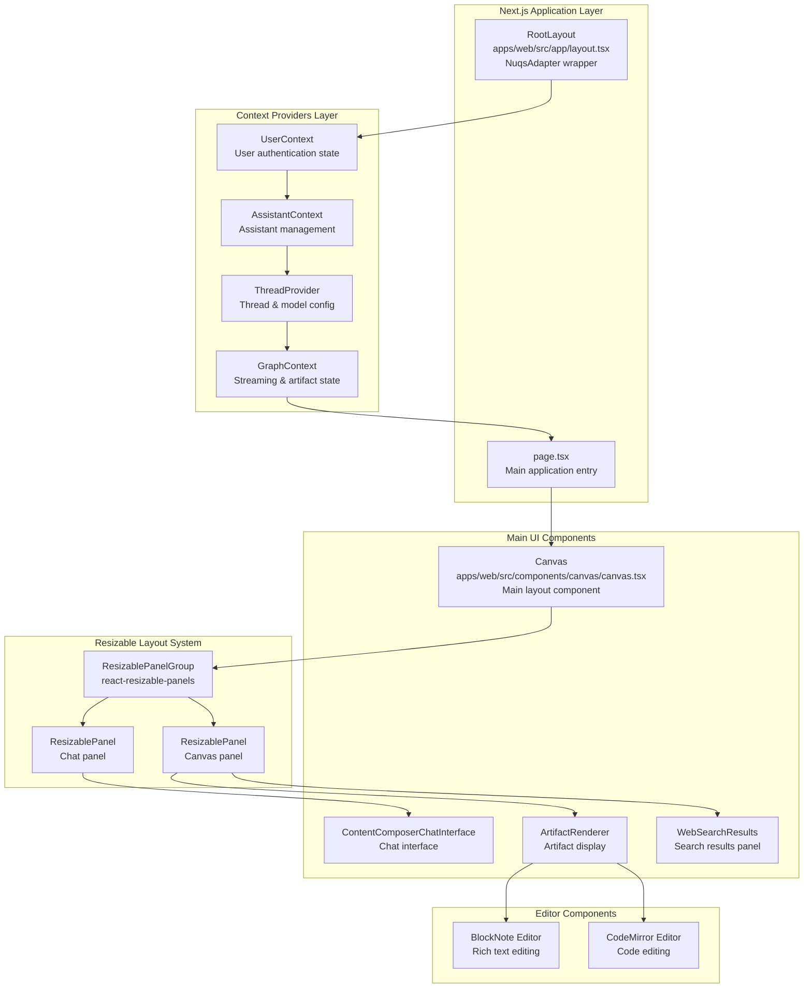

**Sources:** [apps/web/src/app/layout.tsx:1-28](), [apps/web/src/components/canvas/canvas.tsx:1-241](), [apps/web/src/contexts/GraphContext.tsx:1-1100](), [apps/web/src/contexts/ThreadProvider.tsx:1-291]()

---

## Context Provider Architecture

The frontend uses a layered Context architecture where each provider manages a specific domain of state. Providers are nested to enforce dependency ordering and data flow.

### Provider Hierarchy and Dependencies

```mermaid
graph TB
    NuqsAdapter["NuqsAdapter<br/>URL state synchronization"]
    
    UserContext["UserContext<br/>Manages: user, session<br/>Source: Supabase Auth"]
    
    AssistantContext["AssistantContext<br/>Manages: selectedAssistant<br/>isLoadingAllAssistants<br/>Depends: user.id"]
    
    ThreadProvider["ThreadProvider<br/>Manages: threadId, userThreads<br/>modelName, modelConfigs<br/>Depends: user"]
    
    GraphContext["GraphContext<br/>Manages: messages[], artifact<br/>isStreaming, selectedBlocks<br/>Depends: user, selectedAssistant, threadId"]
    
    NuqsAdapter --> UserContext
    UserContext --> AssistantContext
    AssistantContext --> ThreadProvider
    ThreadProvider --> GraphContext
    
    GraphContext -.uses.-> StreamWorkerService["StreamWorkerService<br/>Web Worker for streaming"]
    ThreadProvider -.reads/writes.-> URLParams["URL Query Parameters<br/>threadId via nuqs"]
    GraphContext -.reads/writes.-> URLParams2["URL Query Parameters<br/>webSearchResultsId via nuqs"]
```

**Sources:** [apps/web/src/app/layout.tsx:1-28](), [apps/web/src/contexts/GraphContext.tsx:99-178](), [apps/web/src/contexts/ThreadProvider.tsx:35-82]()

### GraphContext - Core State Management

The `GraphContext` is the most complex provider, managing real-time streaming, artifact state, and message handling. It implements debounced API updates to optimize performance.

**Key State Variables:**

| State Variable | Type | Purpose |
|----------------|------|---------|
| `messages` | `BaseMessage[]` | Full message history including AI responses |
| `artifact` | `ArtifactV3 \| undefined` | Current artifact with versioning |
| `selectedBlocks` | `TextHighlight \| undefined` | User-selected text/code blocks |
| `isStreaming` | `boolean` | Whether LLM is currently streaming |
| `updateRenderedArtifactRequired` | `boolean` | Signals UI to re-render artifact |
| `isArtifactSaved` | `boolean` | Tracks save state for UI indicators |
| `runId` | `string \| undefined` | LangSmith run ID for current operation |
| `searchEnabled` | `boolean` | Whether web search is enabled |

**Key Functions:**

| Function | Signature | Purpose |
|----------|-----------|---------|
| `streamMessage` | `(params: GraphInput) => Promise<void>` | Initiates LLM streaming and processes responses |
| `setArtifactContent` | `(index: number, content: string) => void` | Updates artifact content at specific version |
| `switchSelectedThread` | `(thread: Thread) => void` | Loads thread state and switches context |
| `clearState` | `() => void` | Resets all context state |

**Debounced Updates:**

The context implements debounced artifact updates to avoid overwhelming the API:

```
debouncedAPIUpdate = debounce(
  (artifact: ArtifactV3, threadId: string) => updateArtifact(artifact, threadId),
  5000
)
```

This ensures artifact state is saved 5 seconds after the last change, reducing API calls during rapid edits.

**Sources:** [apps/web/src/contexts/GraphContext.tsx:66-93](), [apps/web/src/contexts/GraphContext.tsx:116-178](), [apps/web/src/contexts/GraphContext.tsx:240-259]()

### ThreadProvider - Thread and Model Management

The `ThreadProvider` manages conversation threads and model configuration state. It maintains a per-model configuration registry.

**Key State Variables:**

| State Variable | Type | Purpose |
|----------------|------|---------|
| `threadId` | `string \| null` | Current active thread ID (synced to URL) |
| `userThreads` | `Thread[]` | List of user's threads |
| `modelName` | `ALL_MODEL_NAMES` | Currently selected model |
| `modelConfig` | `CustomModelConfig` | Configuration for current model |
| `modelConfigs` | `Record<ALL_MODEL_NAMES, CustomModelConfig>` | Configuration registry for all models |

**Key Functions:**

| Function | Signature | Purpose |
|----------|-----------|---------|
| `createThread` | `() => Promise<Thread \| undefined>` | Creates new thread with metadata |
| `getUserThreads` | `() => Promise<void>` | Fetches user's threads from API |
| `deleteThread` | `(id: string, clearMessages: () => void) => Promise<void>` | Deletes thread and handles cleanup |
| `getThread` | `(id: string) => Promise<Thread \| undefined>` | Fetches specific thread by ID |
| `setModelConfig` | `(modelName: ALL_MODEL_NAMES, config: CustomModelConfig) => void` | Updates model configuration |

**Model Configuration Initialization:**

The provider initializes configurations for all available models on mount, pulling default configs from `ALL_MODELS` and handling provider-specific settings like Azure OpenAI credentials.

**Sources:** [apps/web/src/contexts/ThreadProvider.tsx:15-33](), [apps/web/src/contexts/ThreadProvider.tsx:37-82](), [apps/web/src/contexts/ThreadProvider.tsx:139-184]()

---

## UI Component Libraries

The frontend integrates multiple specialized UI libraries, each serving a distinct purpose in the editing experience.

### Component Library Integration Map

```mermaid
graph TB
    subgraph "Styling Layer"
        TailwindCSS["Tailwind CSS v3<br/>Utility-first styling"]
        GlobalCSS["globals.css<br/>Custom styles"]
    end
    
    subgraph "Primitive UI Components"
        RadixUI["Radix UI<br/>Unstyled primitives<br/>Dialog, Popover, Tooltip, etc."]
    end
    
    subgraph "Styled Component Library"
        Mantine["Mantine v7<br/>Styled components<br/>Forms, Buttons, etc."]
    end
    
    subgraph "AI Chat Components"
        AssistantUI["@assistant-ui/react v0.7.68<br/>AI chat interface<br/>Message bubbles, Composer"]
    end
    
    subgraph "Editor Components"
        BlockNote["@blocknote/mantine v0.17.1<br/>Block-based editor<br/>Rich text & markdown"]
        CodeMirror["@codemirror/* v6<br/>Code editor<br/>Syntax highlighting"]
    end
    
    subgraph "Layout Components"
        ResizablePanels["react-resizable-panels<br/>Resizable layout panels"]
    end
    
    TailwindCSS --> RadixUI
    TailwindCSS --> Mantine
    TailwindCSS --> AssistantUI
    GlobalCSS --> TailwindCSS
    
    RadixUI -.provides primitives.-> Mantine
    Mantine -.styles.-> BlockNote
    
    BlockNote -.text editing.-> ArtifactRenderer["ArtifactRenderer"]
    CodeMirror -.code editing.-> ArtifactRenderer
    AssistantUI -.chat UI.-> ContentComposer["ContentComposerChatInterface"]
    ResizablePanels -.layout.-> Canvas["Canvas Component"]
```

**Sources:** [yarn.lock:97-200](), [apps/web/src/app/layout.tsx:1-28](), [apps/web/src/components/canvas/canvas.tsx:1-50]()

### Editor Integration Details

**BlockNote Configuration:**

The frontend uses `@blocknote/mantine` which provides Mantine-styled UI components for the BlockNote editor. BlockNote is used for markdown/rich text artifacts and provides:
- Block-based editing (paragraphs, headings, lists, code blocks)
- Toolbar and formatting menus styled with Mantine
- Emoji picker integration via `@emoji-mart/data`
- Collaboration support via Y.js integration

**CodeMirror Configuration:**

CodeMirror v6 is used for code artifacts with multiple language support:

| Language Package | Version | Purpose |
|------------------|---------|---------|
| `@codemirror/lang-javascript` | v6.2.2 | JavaScript/TypeScript support |
| `@codemirror/lang-python` | v6.1.7 | Python syntax |
| `@codemirror/lang-cpp` | v6.0.2 | C++ syntax |
| `@codemirror/lang-java` | v6.0.1 | Java syntax |
| `@codemirror/lang-rust` | v6.0.1 | Rust syntax |
| `@codemirror/lang-sql` | v6.8.0 | SQL syntax |
| `@codemirror/lang-html` | v6.4.9 | HTML syntax |
| `@codemirror/lang-css` | v6.3.1 | CSS syntax |
| `@codemirror/lang-json` | v6.0.1 | JSON syntax |
| `@codemirror/lang-php` | v6.0.1 | PHP syntax |
| `@codemirror/lang-xml` | v6.1.0 | XML syntax |

Additional CodeMirror features:
- `@codemirror/commands` - Keyboard shortcuts and commands
- `@codemirror/autocomplete` - Autocomplete functionality
- `@codemirror/search` - Find/replace functionality
- `@codemirror/lint` - Linting and error detection
- `@codemirror/theme-one-dark` - Dark theme support

**Sources:** [yarn.lock:97-343](), [yarn.lock:206-398]()

---

## Communication Layer

The frontend communicates with the LangGraph backend using the `@langchain/langgraph-sdk` client library, which provides both HTTP and WebSocket support for streaming.

### LangGraph SDK Integration

```mermaid
graph TB
    subgraph "Frontend - GraphContext"
        StreamMessage["streamMessage()<br/>Initiates streaming"]
        StreamWorkerService["StreamWorkerService<br/>Web Worker wrapper"]
        StateHandlers["Stream Event Handlers<br/>on_chat_model_stream<br/>on_chain_start<br/>on_chain_end"]
    end
    
    subgraph "LangGraph SDK Client"
        SDKClient["@langchain/langgraph-sdk<br/>Client instance"]
        StreamsAPI["streams.stream()<br/>Streaming interface"]
        ThreadsAPI["threads API<br/>create, get, search, updateState, delete"]
    end
    
    subgraph "Backend - LangGraph Server"
        Server["Hono Server<br/>Port 54367"]
        AgentGraph["open-canvas Agent Graph"]
    end
    
    StreamMessage --> StreamWorkerService
    StreamWorkerService --> SDKClient
    SDKClient --> StreamsAPI
    SDKClient --> ThreadsAPI
    
    StreamsAPI -->|"WebSocket/HTTP<br/>POST /threads/{threadId}/runs/stream"| Server
    ThreadsAPI -->|"HTTP<br/>CRUD operations"| Server
    
    Server --> AgentGraph
    AgentGraph -->|"Stream events"| StreamsAPI
    StreamsAPI --> StateHandlers
    StateHandlers --> UIUpdate["UI State Updates<br/>setMessages, setArtifact"]
```

**Sources:** [apps/web/src/contexts/GraphContext.tsx:267-410](), [apps/web/src/contexts/GraphContext.tsx:351-358]()

### Stream Event Processing

The `GraphContext.streamMessage()` function processes various stream events to update the UI in real-time:

**Stream Event Types:**

| Event Type | Nodes | Processing Logic |
|------------|-------|------------------|
| `on_chain_start` | `updateHighlightedText`, `queryGenerator` | Initialize state for node execution |
| `on_chat_model_stream` | `generateFollowup`, `replyToGeneralInput` | Update chat messages in real-time |
| `on_chat_model_stream` | `generateArtifact` | Accumulate tool call JSON and parse incrementally |
| `on_chat_model_stream` | `updateHighlightedText` | Update highlighted text blocks in artifact |
| `on_chat_model_stream` | `updateArtifact` | Update highlighted code blocks in artifact |
| `on_chat_model_stream` | `rewriteArtifact` | Stream rewritten artifact content with thinking token handling |
| `on_chain_end` | `rewriteArtifact`, `generateArtifact` | Finalize artifact state and clean up |
| `error` | Any | Display error toast and halt streaming |

**Chunk Processing Example:**

For the `generateArtifact` node, the stream handler accumulates partial JSON from tool calls:

```
if (message?.tool_call_chunks?.length > 0 && 
    typeof message?.tool_call_chunks?.[0]?.args === "string") {
  generateArtifactToolCallStr += message.tool_call_chunks[0].args;
}

const result = handleGenerateArtifactToolCallChunk(generateArtifactToolCallStr);
if (result && typeof result === "object") {
  setArtifact(result);
}
```

This enables real-time artifact preview as the LLM generates content.

**Sources:** [apps/web/src/contexts/GraphContext.tsx:398-754](), [apps/web/src/contexts/GraphContext.tsx:456-503]()

### Thread State Management

The SDK's `threads` API provides CRUD operations for conversation threads:

**Thread Operations:**

| Operation | Method | Purpose |
|-----------|--------|---------|
| Create | `client.threads.create({ metadata })` | Creates new thread with user ID and model config |
| Get | `client.threads.get(id)` | Retrieves thread by ID |
| Search | `client.threads.search({ metadata, limit })` | Searches threads by metadata (e.g., user ID) |
| Update State | `client.threads.updateState(id, { values })` | Updates thread state (e.g., artifact) |
| Delete | `client.threads.delete(id)` | Permanently deletes thread |

**Thread Metadata Structure:**

When creating a thread, the following metadata is stored:

```
metadata: {
  supabase_user_id: user.id,
  customModelName: modelName,
  modelConfig: {
    ...modelConfig,
    ...(modelConfig.provider === "azure_openai" && {
      azureConfig: modelConfig.azureConfig
    })
  }
}
```

This ensures thread state includes model configuration for resuming conversations.

**Sources:** [apps/web/src/contexts/ThreadProvider.tsx:139-184](), [apps/web/src/contexts/ThreadProvider.tsx:186-219](), [apps/web/src/contexts/GraphContext.tsx:240-259]()

---

## Layout System

The application uses a resizable panel layout built on `react-resizable-panels` to provide flexible workspace organization.

### Canvas Layout Structure

```mermaid
graph TB
    Canvas["Canvas Component<br/>apps/web/src/components/canvas/canvas.tsx"]
    
    RPG["ResizablePanelGroup<br/>direction='horizontal'<br/>Full screen container"]
    
    ChatPanel["ResizablePanel<br/>id='chat-panel-main'<br/>defaultSize=25%<br/>minSize=15%, maxSize=50%<br/>order=1"]
    
    Handle["ResizableHandle<br/>Drag separator"]
    
    CanvasPanel["ResizablePanel<br/>id='canvas-panel'<br/>defaultSize=75%<br/>minSize=50%, maxSize=85%<br/>order=2"]
    
    ContentComposer["ContentComposerChatInterface<br/>Chat messages & input"]
    
    ArtifactRenderer["ArtifactRenderer<br/>BlockNote or CodeMirror"]
    
    WebSearchResults["WebSearchResults<br/>Side panel"]
    
    Canvas --> RPG
    RPG --> ChatPanel
    RPG --> Handle
    RPG --> CanvasPanel
    
    ChatPanel --> ContentComposer
    CanvasPanel --> ArtifactRenderer
    CanvasPanel --> WebSearchResults
```

**Sources:** [apps/web/src/components/canvas/canvas.tsx:100-236](), [apps/web/src/components/ui/resizable.tsx:1-45]()

### Chat Collapse Functionality

The layout supports collapsing the chat panel to maximize canvas space. This state is synchronized to URL parameters for persistence:

**State Management:**

```
const [chatCollapsed, setChatCollapsed] = useState(false);
const chatCollapsedSearchParam = searchParams.get(CHAT_COLLAPSED_QUERY_PARAM);

// Sync from URL on mount
useEffect(() => {
  if (chatCollapsedSearchParam) {
    setChatCollapsed(JSON.parse(chatCollapsedSearchParam));
  }
}, [chatCollapsedSearchParam]);

// Update URL when state changes
setChatCollapsed((c) => {
  const queryParams = new URLSearchParams(searchParams.toString());
  queryParams.set(CHAT_COLLAPSED_QUERY_PARAM, JSON.stringify(c));
  router.replace(`?${queryParams.toString()}`, { scroll: false });
});
```

When collapsed, the canvas panel expands to 100% width while the chat panel is hidden from the DOM entirely.

**Sources:** [apps/web/src/components/canvas/canvas.tsx:32-55](), [apps/web/src/components/canvas/canvas.tsx:144-196]()

---

## URL State Management

The frontend uses `nuqs` for type-safe URL state management, enabling shareable application states and browser history integration.

### URL Parameters

```mermaid
graph LR
    subgraph "URL Query Parameters"
        ThreadID["threadId<br/>Current thread ID"]
        ChatCollapsed["chatCollapsed<br/>Chat panel state"]
        WebSearchID["webSearchResultsId<br/>Web search panel state"]
    end
    
    subgraph "State Synchronization"
        ThreadProvider["ThreadProvider<br/>useQueryState('threadId')"]
        Canvas["Canvas Component<br/>useSearchParams()"]
        GraphContext["GraphContext<br/>useQueryState('webSearchResultsId')"]
    end
    
    ThreadID <--> ThreadProvider
    ChatCollapsed <--> Canvas
    WebSearchID <--> GraphContext
    
    ThreadProvider -.updates on.-> ThreadCreate["createThread()"]
    ThreadProvider -.updates on.-> ThreadSwitch["switchSelectedThread()"]
    Canvas -.updates on.-> ChatToggle["setChatCollapsed()"]
    GraphContext -.updates on.-> WebSearchStart["Web search starts"]
```

**Query Parameter Usage:**

| Parameter | Type | Managed By | Purpose |
|-----------|------|------------|---------|
| `threadId` | `string \| null` | `ThreadProvider` | Persists current conversation thread |
| `chatCollapsed` | `boolean` | `Canvas` | Persists chat panel collapse state |
| `webSearchResultsId` | `string \| null` | `GraphContext` | Controls web search results panel visibility |

**Integration with NuqsAdapter:**

The root layout wraps the application with `NuqsAdapter` to enable URL state synchronization:

```
<html lang="en" className="h-screen">
  <body className={cn("min-h-full", inter.className)}>
    <NuqsAdapter>{children}</NuqsAdapter>
  </body>
</html>
```

This enables:
- Type-safe query parameter access via `useQueryState()`
- Automatic URL updates when state changes
- Browser back/forward button support
- Shareable URLs with embedded application state

**Sources:** [apps/web/src/app/layout.tsx:21-27](), [apps/web/src/contexts/ThreadProvider.tsx:40-40](), [apps/web/src/contexts/GraphContext.tsx:146-148](), [apps/web/src/components/canvas/canvas.tsx:41-55]()

---

## Key File Reference

### Core Context Files

| File Path | Primary Exports | Lines of Code | Purpose |
|-----------|----------------|---------------|---------|
| `apps/web/src/contexts/GraphContext.tsx` | `GraphProvider`, `useGraphContext` | ~1100 | Manages streaming, artifact state, messages |
| `apps/web/src/contexts/ThreadProvider.tsx` | `ThreadProvider`, `useThreadContext` | ~291 | Manages threads and model configuration |
| `apps/web/src/contexts/UserContext.tsx` | `UserProvider`, `useUserContext` | Not shown | Manages user authentication state |
| `apps/web/src/contexts/AssistantContext.tsx` | `AssistantProvider`, `useAssistantContext` | Not shown | Manages assistant selection |

### Core Component Files

| File Path | Primary Components | Purpose |
|-----------|-------------------|---------|
| `apps/web/src/components/canvas/canvas.tsx` | `Canvas`, `CanvasComponent` | Main layout with resizable panels |
| `apps/web/src/components/canvas/content-composer.tsx` | `ContentComposerChatInterface` | Chat interface and message input |
| `apps/web/src/components/artifacts/ArtifactRenderer.tsx` | `ArtifactRenderer` | Renders BlockNote or CodeMirror based on artifact type |
| `apps/web/src/components/web-search-results.tsx` | `WebSearchResults` | Web search results side panel |
| `apps/web/src/components/ui/resizable.tsx` | `ResizablePanel`, `ResizableHandle`, `ResizablePanelGroup` | Resizable layout primitives |

### Application Entry Points

| File Path | Purpose |
|-----------|---------|
| `apps/web/src/app/layout.tsx` | Root layout, context provider nesting, global styles |
| `apps/web/src/app/page.tsx` | Main page component (not shown but referenced) |
| `apps/web/src/app/globals.css` | Global CSS and Tailwind imports |

**Sources:** [apps/web/src/contexts/GraphContext.tsx:1-1100](), [apps/web/src/contexts/ThreadProvider.tsx:1-291](), [apps/web/src/components/canvas/canvas.tsx:1-241](), [apps/web/src/app/layout.tsx:1-28]()

---

# Page: Backend Architecture

# Backend Architecture

<details>
<summary>Relevant source files</summary>

The following files were used as context for generating this wiki page:

- [.codespellignore](.codespellignore)
- [apps/agents/package.json](apps/agents/package.json)
- [apps/agents/src/open-canvas/index.ts](apps/agents/src/open-canvas/index.ts)
- [apps/agents/src/open-canvas/nodes/generate-path/documents.ts](apps/agents/src/open-canvas/nodes/generate-path/documents.ts)
- [apps/agents/src/open-canvas/nodes/generate-path/dynamic-determine-path.ts](apps/agents/src/open-canvas/nodes/generate-path/dynamic-determine-path.ts)
- [apps/agents/src/open-canvas/nodes/generate-path/include-url-contents.ts](apps/agents/src/open-canvas/nodes/generate-path/include-url-contents.ts)
- [apps/agents/src/open-canvas/nodes/generate-path/index.ts](apps/agents/src/open-canvas/nodes/generate-path/index.ts)
- [apps/agents/src/summarizer/index.ts](apps/agents/src/summarizer/index.ts)
- [apps/agents/src/web-search/nodes/classify-message.ts](apps/agents/src/web-search/nodes/classify-message.ts)
- [apps/agents/src/web-search/nodes/query-generator.ts](apps/agents/src/web-search/nodes/query-generator.ts)
- [apps/agents/tsconfig.json](apps/agents/tsconfig.json)
- [apps/web/package.json](apps/web/package.json)
- [apps/web/src/hooks/useStore.tsx](apps/web/src/hooks/useStore.tsx)
- [langgraph.json](langgraph.json)
- [packages/evals/package.json](packages/evals/package.json)
- [packages/shared/package.json](packages/shared/package.json)
- [packages/shared/src/types.ts](packages/shared/src/types.ts)
- [packages/shared/src/utils/urls.ts](packages/shared/src/utils/urls.ts)

</details>


## Purpose and Scope

This document describes the backend architecture of Open Canvas, which is built on LangGraph and implements a multi-graph agent system. The backend is located in the `apps/agents` directory and handles all AI-powered content generation, routing, and memory formation. For information about how the frontend communicates with the backend, see [Data Flow](#2.3). For details on model configuration and provider integration, see [Model Integration](#5).

The backend operates as a standalone LangGraph service that exposes multiple graphs via HTTP API endpoints on port 54367 (configurable via `PORT` environment variable).

---

## Graph Configuration and Entry Points

The backend defines five distinct LangGraph graphs in [langgraph.json:6-11](), which serves as the configuration manifest for the LangGraph server:

```mermaid
graph TB
    subgraph LangGraphServer["LangGraph Server (Port 54367)"]
        Config["langgraph.json<br/>Graph Registry"]
        
        Config -->|"graph: agent"| AgentGraph["./apps/agents/src/open-canvas/index.ts:graph<br/>Main Agent Workflow"]
        Config -->|"graph: reflection"| ReflectionGraph["./apps/agents/src/reflection/index.ts:graph<br/>Memory Formation"]
        Config -->|"graph: thread_title"| TitleGraph["./apps/agents/src/thread-title/index.ts:graph<br/>Title Generation"]
        Config -->|"graph: summarizer"| SummarizerGraph["./apps/agents/src/summarizer/index.ts:graph<br/>Context Compression"]
        Config -->|"graph: web_search"| WebSearchGraph["./apps/agents/src/web-search/index.ts:graph<br/>Search Integration"]
    end
    
    Frontend["Frontend (LangGraph SDK)"] -->|"POST /invoke"| LangGraphServer
    
    AgentGraph -.->|"async schedule"| ReflectionGraph
    AgentGraph -->|"conditional call"| TitleGraph
    AgentGraph -->|"conditional call"| SummarizerGraph
    AgentGraph -->|"embedded subgraph"| WebSearchGraph
```

**Sources:** [langgraph.json:1-14](), [apps/agents/package.json:15]()

### Graph Definitions

| Graph Name | File Path | Purpose |
|------------|-----------|---------|
| `agent` | `./apps/agents/src/open-canvas/index.ts:graph` | Primary workflow for generating, rewriting, and updating artifacts |
| `reflection` | `./apps/agents/src/reflection/index.ts:graph` | Asynchronous extraction of style rules and user insights |
| `thread_title` | `./apps/agents/src/thread-title/index.ts:graph` | Generates concise thread titles for conversation history |
| `summarizer` | `./apps/agents/src/summarizer/index.ts:graph` | Compresses message history when character limits are exceeded |
| `web_search` | `./apps/agents/src/web-search/index.ts:graph` | Performs web searches and enriches context |

The server is started via [apps/agents/package.json:15]() with the command `langgraphjs dev --port 54367 --config ../../langgraph.json`.

**Sources:** [langgraph.json:6-11](), [apps/agents/package.json:15]()

---

## Main Agent Graph Structure

The primary `agent` graph implements the `OpenCanvasGraphAnnotation` state machine in [apps/agents/src/open-canvas/index.ts:108-162](). The graph uses a hub-and-spoke architecture with `generatePath` as the central routing node.

```mermaid
graph TB
    START["START"] --> GeneratePath["generatePath<br/>(apps/agents/src/open-canvas/nodes/generate-path/index.ts)"]
    
    GeneratePath -->|"routeNode()"| ReplyGeneral["replyToGeneralInput"]
    GeneratePath -->|"routeNode()"| GenerateArtifact["generateArtifact"]
    GeneratePath -->|"routeNode()"| RewriteArtifact["rewriteArtifact"]
    GeneratePath -->|"routeNode()"| UpdateArtifact["updateArtifact"]
    GeneratePath -->|"routeNode()"| UpdateHighlighted["updateHighlightedText"]
    GeneratePath -->|"routeNode()"| RewriteTheme["rewriteArtifactTheme"]
    GeneratePath -->|"routeNode()"| RewriteCode["rewriteCodeArtifactTheme"]
    GeneratePath -->|"routeNode()"| CustomAction["customAction"]
    GeneratePath -->|"routeNode()"| WebSearch["webSearch<br/>(embedded subgraph)"]
    
    GenerateArtifact --> GenerateFollowup["generateFollowup"]
    RewriteArtifact --> GenerateFollowup
    UpdateArtifact --> GenerateFollowup
    UpdateHighlighted --> GenerateFollowup
    RewriteTheme --> GenerateFollowup
    RewriteCode --> GenerateFollowup
    CustomAction --> GenerateFollowup
    
    WebSearch --> RoutePostWebSearch["routePostWebSearch<br/>(index.ts:78-106)"]
    RoutePostWebSearch -->|"Send()"| GenerateArtifact
    RoutePostWebSearch -->|"Send()"| RewriteArtifact
    
    ReplyGeneral --> CleanState["cleanState<br/>(resets DEFAULT_INPUTS)"]
    GenerateFollowup --> Reflect["reflect<br/>(schedules async memory)"]
    Reflect --> CleanState
    
    CleanState -->|"conditionallyGenerateTitle()"| GenerateTitle["generateTitle"]
    CleanState -->|"simpleTokenCalculator()"| Summarizer["summarizer"]
    CleanState -->|"default"| END["END"]
    
    GenerateTitle --> END
    Summarizer --> END
```

**Sources:** [apps/agents/src/open-canvas/index.ts:108-162]()

### Routing Logic

The `routeNode` function at [apps/agents/src/open-canvas/index.ts:20-28]() uses the `Send` primitive to dynamically route based on `state.next`:

```typescript
const routeNode = (state: typeof OpenCanvasGraphAnnotation.State) => {
  if (!state.next) {
    throw new Error("'next' state field not set.");
  }
  return new Send(state.next, { ...state });
};
```

**Sources:** [apps/agents/src/open-canvas/index.ts:20-28](), [apps/agents/src/open-canvas/index.ts:129-139]()

---

## Path Generation and Routing

The `generatePath` node at [apps/agents/src/open-canvas/nodes/generate-path/index.ts:26-168]() serves as the intelligent router for the entire system. It performs several preprocessing steps before determining the route:

### Routing Decision Flow

```mermaid
graph TB
    Start["generatePath Entry"] --> ContextDocs["convertContextDocumentToHumanMessage()<br/>(documents.ts:20-47)"]
    
    ContextDocs --> StateChecks{"Check state flags"}
    
    StateChecks -->|"highlightedCode?"| UpdateArtifact["return { next: 'updateArtifact' }"]
    StateChecks -->|"highlightedText?"| UpdateHighlighted["return { next: 'updateHighlightedText' }"]
    StateChecks -->|"language/artifactLength/<br/>regenerateWithEmojis/<br/>readingLevel?"| RewriteTheme["return { next: 'rewriteArtifactTheme' }"]
    StateChecks -->|"addComments/addLogs/<br/>portLanguage/fixBugs?"| RewriteCode["return { next: 'rewriteCodeArtifactTheme' }"]
    StateChecks -->|"customQuickActionId?"| CustomAction["return { next: 'customAction' }"]
    StateChecks -->|"webSearchEnabled?"| WebSearch["return { next: 'webSearch' }"]
    StateChecks -->|"none match"| URLCheck{"extractUrls()<br/>finds URLs?"}
    
    URLCheck -->|"yes"| IncludeURL["includeURLContents()<br/>(include-url-contents.ts:58-116)"]
    URLCheck -->|"no"| DynamicRoute["dynamicDeterminePath()<br/>(dynamic-determine-path.ts:29-101)"]
    
    IncludeURL --> DynamicRoute
    
    DynamicRoute --> LLMDecision{"LLM decides route"}
    LLMDecision -->|"artifact exists"| RewriteOrReply["'rewriteArtifact' or<br/>'replyToGeneralInput'"]
    LLMDecision -->|"no artifact"| GenerateOrReply["'generateArtifact' or<br/>'replyToGeneralInput'"]
```

**Sources:** [apps/agents/src/open-canvas/nodes/generate-path/index.ts:26-168](), [apps/agents/src/open-canvas/nodes/generate-path/include-url-contents.ts:58-116](), [apps/agents/src/open-canvas/nodes/generate-path/dynamic-determine-path.ts:29-101]()

### State-Based Routing

The routing follows a priority order defined in [apps/agents/src/open-canvas/nodes/generate-path/index.ts:56-117]():

1. **Highlighted Code** (`state.highlightedCode`) → `updateArtifact`
2. **Highlighted Text** (`state.highlightedText`) → `updateHighlightedText`
3. **Theme Options** (`state.language`, `state.artifactLength`, `state.regenerateWithEmojis`, `state.readingLevel`) → `rewriteArtifactTheme`
4. **Code Options** (`state.addComments`, `state.addLogs`, `state.portLanguage`, `state.fixBugs`) → `rewriteCodeArtifactTheme`
5. **Custom Actions** (`state.customQuickActionId`) → `customAction`
6. **Web Search** (`state.webSearchEnabled`) → `webSearch`
7. **Dynamic Routing** → LLM-based decision via `dynamicDeterminePath`

**Sources:** [apps/agents/src/open-canvas/nodes/generate-path/index.ts:56-117]()

### URL Content Enrichment

When URLs are detected via `extractUrls()` from [packages/shared/src/utils/urls.ts:6-22](), the system:

1. Calls `includeURLContents()` at [apps/agents/src/open-canvas/nodes/generate-path/include-url-contents.ts:58-116]()
2. Uses an LLM to determine if the user wants URL contents included
3. Scrapes content using FireCrawlLoader if affirmative
4. Replaces URLs in the message with `<page-contents>` blocks

**Sources:** [apps/agents/src/open-canvas/nodes/generate-path/index.ts:121-128](), [apps/agents/src/open-canvas/nodes/generate-path/include-url-contents.ts:58-116](), [packages/shared/src/utils/urls.ts:6-22]()

### Dynamic Path Determination

The `dynamicDeterminePath` function at [apps/agents/src/open-canvas/nodes/generate-path/dynamic-determine-path.ts:29-101]() uses structured output from an LLM to choose between:

- `replyToGeneralInput` - For chat-only responses
- `generateArtifact` - When no artifact exists
- `rewriteArtifact` - When an artifact exists

The function constructs a prompt with:
- Recent messages (last 3)
- Current artifact content (if present)
- Context document messages
- Route-specific options from prompts

**Sources:** [apps/agents/src/open-canvas/nodes/generate-path/dynamic-determine-path.ts:29-101]()

---

## Supporting Graphs

### Summarizer Graph

The summarizer graph at [apps/agents/src/summarizer/index.ts:25-75]() compresses message history when the character count exceeds `CHARACTER_MAX` (300,000 characters, defined at [apps/agents/src/open-canvas/index.ts:37]()).

```mermaid
graph LR
    Trigger["simpleTokenCalculator()<br/>(index.ts:39-57)"] -->|"totalChars > 300,000"| Summarizer["summarizer node<br/>(summarizer/index.ts:25-69)"]
    
    Summarizer --> ClaudeModel["ChatAnthropic<br/>claude-3-5-sonnet-latest"]
    ClaudeModel --> CreateSummary["formatMessages() + SUMMARIZER_PROMPT"]
    CreateSummary --> UpdateThread["Client.threads.updateState()<br/>replaces _messages"]
    UpdateThread --> NewMessage["HumanMessage with<br/>OC_SUMMARIZED_MESSAGE_KEY"]
```

The summarizer:
1. Formats all messages using `formatMessages()` from [apps/agents/src/utils.js]()
2. Invokes Claude with `SUMMARIZER_PROMPT` at [apps/agents/src/summarizer/index.ts:10-23]()
3. Creates a new `HumanMessage` with `OC_SUMMARIZED_MESSAGE_KEY` in `additional_kwargs`
4. Uses the LangGraph SDK `Client` to directly update thread state

**Sources:** [apps/agents/src/summarizer/index.ts:25-75](), [apps/agents/src/open-canvas/index.ts:37-57]()

### Web Search Graph

The web search graph performs multi-step search operations when `state.webSearchEnabled` is true:

```mermaid
graph TB
    Start["START"] --> Classify["classifyMessage<br/>(web-search/nodes/classify-message.ts:24-46)"]
    
    Classify --> Decision{"shouldSearch?"}
    Decision -->|"false"| End["END<br/>(no search results)"]
    Decision -->|"true"| QueryGen["queryGenerator<br/>(web-search/nodes/query-generator.ts:24-45)"]
    
    QueryGen --> ClaudeQuery["ChatAnthropic<br/>claude-3-5-sonnet-latest"]
    ClaudeQuery --> SearchExec["Execute search<br/>(Exa API)"]
    SearchExec --> End2["END<br/>(returns webSearchResults)"]
```

**Key Steps:**

1. **Classification** ([apps/agents/src/web-search/nodes/classify-message.ts:24-46]()): Determines if the message warrants a search
2. **Query Generation** ([apps/agents/src/web-search/nodes/query-generator.ts:24-45]()): Converts the user message into a search-engine-friendly query
3. **Search Execution**: Uses Exa or other search tools (via `@langchain/exa` dependency)

The results flow back through `routePostWebSearch()` at [apps/agents/src/open-canvas/index.ts:78-106](), which creates an AI message containing search results and routes to either `generateArtifact` or `rewriteArtifact`.

**Sources:** [apps/agents/src/web-search/nodes/classify-message.ts:24-46](), [apps/agents/src/web-search/nodes/query-generator.ts:24-45](), [apps/agents/src/open-canvas/index.ts:78-106](), [langgraph.json:11]()

### Reflection Graph

The reflection graph is invoked asynchronously by the `reflect` node. Details about the reflection system, including debounced scheduling and memory formation, are covered in [Reflection and Memory System](#4.5).

**Sources:** [langgraph.json:8](), [apps/agents/src/open-canvas/index.ts:123]()

### Thread Title Graph

The `generateTitle` node is conditionally invoked by `conditionallyGenerateTitle()` at [apps/agents/src/open-canvas/index.ts:64-72]() when:
- `state.messages.length <= 2` (first human-AI exchange)
- Character count is below `CHARACTER_MAX`

This generates concise titles for display in the thread history UI.

**Sources:** [apps/agents/src/open-canvas/index.ts:64-72](), [langgraph.json:9]()

---

## Node Implementation Patterns

### Artifact Operations

All artifact operation nodes follow a common pattern:

```mermaid
graph LR
    NodeEntry["Node Entry<br/>(generateArtifact, rewriteArtifact,<br/>updateArtifact, etc.)"] --> GetModel["getModelFromConfig()<br/>(utils.js)"]
    GetModel --> BuildPrompt["Construct prompt<br/>with templates"]
    BuildPrompt --> Invoke["model.invoke()<br/>or streamEvents()"]
    Invoke --> UpdateState["Return state update<br/>(artifact, messages)"]
```

Common utilities used across nodes:

- **`getModelFromConfig(config, options)`**: Initializes LLM from thread configuration
- **`getModelConfig(config)`**: Extracts model provider and settings
- **`formatArtifactContentWithTemplate(template, content)`**: Injects artifact into prompts
- **`createContextDocumentMessages(config, documents?)`**: Converts context docs to messages

**Sources:** [apps/agents/src/utils.js]()

### State Updates

Nodes return partial state updates that are merged by LangGraph. Common return patterns:

```typescript
// Routing nodes
return { next: "nodeName", messages: [...], _messages: [...] };

// Content generation nodes
return { artifact: updatedArtifact, messages: [newMessage] };

// Terminal nodes
return {}; // No state updates
```

**Sources:** [apps/agents/src/open-canvas/nodes/generate-path/index.ts:57-168]()

---

## Dependencies and Runtime

### Core Dependencies

The backend relies on several LangChain ecosystem packages from [apps/agents/package.json:24-50]():

| Package | Purpose |
|---------|---------|
| `@langchain/langgraph` | Graph execution engine and state management |
| `@langchain/langgraph-sdk` | Client for thread state updates (used in summarizer) |
| `@langchain/core` | Base message types and abstractions |
| `@langchain/anthropic` | Claude model integration |
| `@langchain/google-genai` | Gemini model integration |
| `@langchain/openai` | OpenAI/Azure OpenAI integration |
| `@langchain/groq` | Groq inference integration |
| `@langchain/ollama` | Local model integration |
| `@langchain/exa` | Exa search tool integration |
| `@langchain/community` | FireCrawl and other loaders |

**Sources:** [apps/agents/package.json:24-50]()

### External Tools

Additional tools integrated via [apps/agents/package.json:25-48]():

- **FFmpeg** (`@ffmpeg/ffmpeg`): Media processing
- **FireCrawl** (`@mendable/firecrawl-js`): Web scraping for URL content
- **PDF Parser** (`pdf-parse`): Document text extraction
- **Exa** (`exa-js`): Web search capabilities

**Sources:** [apps/agents/package.json:25-48]()

### Build and Development

Build configuration from [apps/agents/tsconfig.json:1-34]():

- **Target**: ES2021
- **Module**: NodeNext (ESM with `.js` extensions)
- **Output**: `./dist` directory
- **Entry**: `./src` directory

Development server: `yarn langgraphjs dev --port 54367 --config ../../langgraph.json --no-browser`

**Sources:** [apps/agents/tsconfig.json:1-34](), [apps/agents/package.json:15]()

### Shared Package Integration

The agents package depends on `@opencanvas/shared` ([apps/agents/package.json:38]()), which provides:

- Type definitions (`GraphInput`, `ArtifactV3`, `Reflections`, `ContextDocument`)
- Constants (`DEFAULT_INPUTS`, `OC_SUMMARIZED_MESSAGE_KEY`, `CONTEXT_DOCUMENTS_NAMESPACE`)
- Utility functions (`extractUrls`, `getArtifactContent`)

See [Shared Code](#6) for complete details on shared types and utilities.

**Sources:** [apps/agents/package.json:38](), [packages/shared/src/types.ts:1-230]()

---

## Context Management

### Document Processing

Context documents are processed through [apps/agents/src/open-canvas/nodes/generate-path/documents.ts:20-46]():

```mermaid
graph TB
    LastMessage["messages[messages.length - 1]"] --> CheckDocs{"Has documents in<br/>additional_kwargs?"}
    
    CheckDocs -->|"yes"| CreateMessages["createContextDocumentMessages()<br/>(utils.js)"]
    CreateMessages --> ConvertPDF["convertPDFToText()<br/>for PDF documents"]
    ConvertPDF --> HumanMsg["new HumanMessage<br/>with OC_HIDE_FROM_UI_KEY"]
    
    CheckDocs -->|"no"| CheckMisformat{"Existing doc message<br/>wrong format?"}
    CheckMisformat -->|"yes"| FixFormat["fixMisFormattedContextDocMessage()<br/>(documents.ts:49-134)"]
    FixFormat --> RemoveOld["RemoveMessage(old)"]
    RemoveOld --> AddNew["HumanMessage(new format)"]
```

The system handles three document formats:
- **Anthropic**: `{ type: "document", source: { type: "base64", data: ... } }`
- **Google Gemini**: `{ type: "application/pdf", data: ... }`
- **OpenAI**: Converts PDFs to text using `pdf-parse`

**Sources:** [apps/agents/src/open-canvas/nodes/generate-path/documents.ts:20-134]()

### Storage Integration

The backend retrieves context documents and reflections from storage via the `getModelConfig()` utility, which extracts configuration from LangGraph's `RunnableConfig`. The actual storage operations are handled by the frontend's `useStore` hook, documented in [Authentication and Storage](#2.4).

**Sources:** [apps/web/src/hooks/useStore.tsx:228-289](), [apps/web/src/hooks/useStore.tsx:19-65]()

---

# Page: Data Flow

# Data Flow

<details>
<summary>Relevant source files</summary>

The following files were used as context for generating this wiki page:

- [.codespellignore](.codespellignore)
- [apps/agents/package.json](apps/agents/package.json)
- [apps/web/package.json](apps/web/package.json)
- [apps/web/src/app/layout.tsx](apps/web/src/app/layout.tsx)
- [apps/web/src/components/canvas/canvas.tsx](apps/web/src/components/canvas/canvas.tsx)
- [apps/web/src/components/canvas/content-composer.tsx](apps/web/src/components/canvas/content-composer.tsx)
- [apps/web/src/components/chat-interface/thread.tsx](apps/web/src/components/chat-interface/thread.tsx)
- [apps/web/src/components/ui/resizable.tsx](apps/web/src/components/ui/resizable.tsx)
- [apps/web/src/constants.ts](apps/web/src/constants.ts)
- [apps/web/src/contexts/GraphContext.tsx](apps/web/src/contexts/GraphContext.tsx)
- [apps/web/src/contexts/ThreadProvider.tsx](apps/web/src/contexts/ThreadProvider.tsx)
- [apps/web/src/hooks/useLocalStorage.tsx](apps/web/src/hooks/useLocalStorage.tsx)
- [apps/web/src/hooks/useStore.tsx](apps/web/src/hooks/useStore.tsx)
- [packages/evals/package.json](packages/evals/package.json)
- [packages/shared/package.json](packages/shared/package.json)

</details>


This page describes the complete data flow through the Open Canvas system, from user input through streaming agent execution, LLM interaction, and back to UI updates. It covers the message processing pipeline, artifact generation and updates, and state management patterns.

For information about the agent graph structure and routing logic, see [Agent Graph Structure](#4.1). For details on state management contexts, see [State Management](#3.1). For authentication and data persistence, see [Authentication and Storage](#2.4).

---

## Overview

Open Canvas implements a bidirectional streaming architecture where data flows through multiple layers, from the React frontend through LangGraph agents to LLM providers and back. The system handles real-time streaming of tokens, partial artifact updates, and asynchronous state persistence.

**Sources:** [README.md:1-198](), [apps/web/src/contexts/GraphContext.tsx:1-1866]()

---

## Data Flow Architecture

The following diagram illustrates the complete data flow from user interaction to UI update:

```mermaid
graph TB
    User["User"]
    UI["Next.js UI Components<br/>ContentComposerChatInterface<br/>ArtifactRenderer"]
    GraphContext["GraphContext<br/>streamMessageV2()"]
    ThreadContext["ThreadContext<br/>Thread Management"]
    
    subgraph "Frontend State"
        Messages["messages: BaseMessage[]"]
        Artifact["artifact: ArtifactV3"]
        StreamState["isStreaming<br/>firstTokenReceived<br/>selectedBlocks"]
    end
    
    subgraph "SDK Layer"
        StreamWorker["StreamWorkerService<br/>@/workers/graph-stream"]
        LangGraphSDK["@langchain/langgraph-sdk<br/>Client"]
    end
    
    subgraph "LangGraph Server"
        HTTPEndpoint["HTTP POST /threads/{id}/runs/stream"]
        GraphExecutor["Graph Executor"]
        GeneratePath["generatePath Node<br/>Router"]
        AgentNodes["Agent Processing Nodes<br/>generateArtifact<br/>rewriteArtifact<br/>updateArtifact<br/>etc."]
        SharedMemory["BaseStore<br/>Reflections & Context"]
    end
    
    subgraph "LLM Providers"
        ModelConfig["getModelFromConfig()"]
        LLM["OpenAI/Anthropic/etc.<br/>Streaming Response"]
    end
    
    User -->|"Types message or<br/>selects action"| UI
    UI -->|"streamMessage(input)"| GraphContext
    GraphContext -->|"Check/create threadId"| ThreadContext
    GraphContext -->|"Update local state"| StreamState
    GraphContext -->|"streamData(config)"| StreamWorker
    StreamWorker -->|"streams.stream()"| LangGraphSDK
    LangGraphSDK -->|"HTTP POST with input"| HTTPEndpoint
    HTTPEndpoint --> GraphExecutor
    GraphExecutor --> GeneratePath
    GeneratePath -->|"Routes to specific node"| AgentNodes
    AgentNodes -->|"Fetch user memory"| SharedMemory
    AgentNodes -->|"Generate/update content"| ModelConfig
    ModelConfig --> LLM
    
    LLM -.->|"Token stream chunks"| AgentNodes
    AgentNodes -.->|"Stream events"| GraphExecutor
    GraphExecutor -.->|"on_chat_model_stream<br/>on_chain_start<br/>on_chain_end"| LangGraphSDK
    LangGraphSDK -.->|"Stream events"| StreamWorker
    StreamWorker -.->|"Process chunks"| GraphContext
    GraphContext -.->|"Update state"| Messages
    GraphContext -.->|"Update state"| Artifact
    Artifact -.->|"Re-render"| UI
    Messages -.->|"Re-render"| UI
    UI -.->|"Display updates"| User
```

**Key Flow Stages:**

1. **User Input**: User types a message, selects highlighted text/code, or triggers a quick action
2. **State Preparation**: `GraphContext` checks for existing thread or creates new one
3. **Stream Initiation**: `streamMessageV2()` constructs input with current artifact, messages, and action flags
4. **HTTP Request**: `StreamWorkerService` sends streaming request to LangGraph server
5. **Agent Processing**: Server routes request through `generatePath`, executes appropriate agent nodes
6. **LLM Streaming**: Agent nodes stream tokens from LLM providers
7. **Event Processing**: Frontend processes stream events (`on_chat_model_stream`, `on_chain_start`, `on_chain_end`)
8. **UI Updates**: React state updates trigger re-renders with new content
9. **Persistence**: Debounced updates save artifacts and state to Supabase

**Sources:** [apps/web/src/contexts/GraphContext.tsx:267-410](), [apps/web/src/workers/graph-stream/streamWorker.ts]()

---

## Stream Initiation and Input Construction

The data flow begins when the user interacts with the UI. The `GraphContext` component manages the initiation of streaming requests.

### Input Construction

```mermaid
graph TB
    UserAction["User Action<br/>Message/Quick Action/Highlight"]
    streamMessage["streamMessage(params)"]
    CheckThread{"threadId exists?"}
    CreateThread["createThread()<br/>ThreadContext"]
    ConstructInput["Construct GraphInput"]
    
    subgraph "Input Fields"
        BaseInput["DEFAULT_INPUTS"]
        Messages["messages: BaseMessage[]<br/>_messages: BaseMessage[]"]
        CurrentArtifact["artifact: ArtifactV3"]
        HighlightData["highlightedText<br/>highlightedCode"]
        ActionFlags["language<br/>artifactLength<br/>customQuickActionId<br/>etc."]
        SearchFlag["webSearchEnabled"]
    end
    
    ValidateFields["Validate: Only 1 action field set"]
    StartStream["StreamWorkerService.streamData()"]
    
    UserAction --> streamMessage
    streamMessage --> CheckThread
    CheckThread -->|"No"| CreateThread
    CheckThread -->|"Yes"| ConstructInput
    CreateThread --> ConstructInput
    
    ConstructInput --> BaseInput
    ConstructInput --> Messages
    ConstructInput --> CurrentArtifact
    ConstructInput --> HighlightData
    ConstructInput --> ActionFlags
    ConstructInput --> SearchFlag
    
    BaseInput --> ValidateFields
    Messages --> ValidateFields
    CurrentArtifact --> ValidateFields
    HighlightData --> ValidateFields
    ActionFlags --> ValidateFields
    SearchFlag --> ValidateFields
    
    ValidateFields --> StartStream
```

**Input Construction Logic** [apps/web/src/contexts/GraphContext.tsx:295-339]():

1. **Thread Management**: Check if `threadId` exists; if not, call `threadData.createThread()` and wait for response
2. **Message Preparation**: Construct `messagesInput` with two arrays:
   - `messages`: Full unfiltered message list
   - `_messages`: LLM context messages (includes summarization messages)
3. **Artifact State**: Include current `artifact` object if one exists
4. **Highlight Selection**: Add `highlightedText` or `highlightedCode` if user has selected content
5. **Action Flags**: Include any quick action parameters (`language`, `artifactLength`, `customQuickActionId`, etc.)
6. **Web Search**: Set `webSearchEnabled` flag from `searchEnabled` state
7. **Validation**: Ensure only one action field is defined (prevents conflicting operations)

**Sources:** [apps/web/src/contexts/GraphContext.tsx:267-339](), [packages/shared/src/constants.ts]()

---

## Stream Event Processing

Once the stream starts, the frontend processes various event types from the LangGraph server. The main processing loop handles chunks asynchronously.

### Event Processing Loop

```mermaid
graph TB
    StreamStart["StreamWorkerService.streamData()"]
    EventLoop["for await (const chunk of stream)"]
    
    CheckError{"chunk.event === 'error'?"}
    ShowError["Display error toast<br/>setError(true)<br/>setIsStreaming(false)"]
    
    ExtractFields["extractChunkFields(chunk)<br/>Get: runId, event, langgraphNode, etc."]
    
    CheckEventType{"Event Type?"}
    
    OnChainStart["'on_chain_start'<br/>Node initialization"]
    OnChatModelStream["'on_chat_model_stream'<br/>Token streaming"]
    OnChatModelEnd["'on_chat_model_end'<br/>Completion"]
    OnChainEnd["'on_chain_end'<br/>Node completion"]
    
    ProcessStartLogic["Process node-specific<br/>initialization logic"]
    ProcessStreamLogic["Process streaming<br/>token updates"]
    ProcessEndLogic["Process completion<br/>and final state"]
    
    ContinueLoop["Continue to next chunk"]
    
    StreamStart --> EventLoop
    EventLoop --> CheckError
    CheckError -->|"Yes"| ShowError
    ShowError --> ContinueLoop
    CheckError -->|"No"| ExtractFields
    
    ExtractFields --> CheckEventType
    
    CheckEventType -->|"'on_chain_start'"| OnChainStart
    CheckEventType -->|"'on_chat_model_stream'"| OnChatModelStream
    CheckEventType -->|"'on_chat_model_end'"| OnChatModelEnd
    CheckEventType -->|"'on_chain_end'"| OnChainEnd
    
    OnChainStart --> ProcessStartLogic
    OnChatModelStream --> ProcessStreamLogic
    OnChatModelEnd --> ProcessEndLogic
    OnChainEnd --> ContinueLoop
    
    ProcessStartLogic --> ContinueLoop
    ProcessStreamLogic --> ContinueLoop
    ProcessEndLogic --> ContinueLoop
    
    ContinueLoop --> EventLoop
```

**Event Types and Processing** [apps/web/src/contexts/GraphContext.tsx:398-1044]():

### `on_chain_start` Events

Triggered when a LangGraph node begins execution. Used for initialization:

- **`updateHighlightedText`** [apps/web/src/contexts/GraphContext.tsx:430-432](): Captures `highlightedText` input
- **`queryGenerator`** [apps/web/src/contexts/GraphContext.tsx:434-453](): Creates web search message placeholder, generates unique `webSearchMessageId`, sets `webSearchResultsId` query parameter

### `on_chat_model_stream` Events

Processes streaming tokens from the LLM. Different handling per node:

| Node | Processing Logic | State Updates |
|------|-----------------|---------------|
| `generateFollowup` | Insert/update AI message chunks | `setMessages()` with `replaceOrInsertMessageChunk()` |
| `replyToGeneralInput` | Insert/update AI message chunks | `setMessages()` with `replaceOrInsertMessageChunk()` |
| `generateArtifact` | Accumulate tool call args, parse partial JSON | `setArtifact()` with `handleGenerateArtifactToolCallChunk()` result |
| `updateHighlightedText` | Stream updated markdown blocks | `setArtifact()` with `updateHighlightedMarkdown()` |
| `updateArtifact` | Stream updated code | `setArtifact()` with `updateHighlightedCode()` |
| `rewriteArtifact` | Stream full artifact rewrite | `setArtifact()` with `updateRewrittenArtifact()` |
| `rewriteArtifactTheme` | Stream themed rewrite | `setArtifact()` with `updateRewrittenArtifact()` |
| `rewriteCodeArtifactTheme` | Stream code themed rewrite | `setArtifact()` with `updateRewrittenArtifact()` |
| `customAction` | Stream custom action result | `setArtifact()` with `updateRewrittenArtifact()` |

### `on_chat_model_end` Events

Handles non-streaming models [apps/web/src/contexts/GraphContext.tsx:847-1044]():

- **Non-streaming text models**: Models in `NON_STREAMING_TEXT_MODELS` list receive full response in `nodeOutput`
- Same update logic as streaming, but processes complete content at once
- Supports models like `o1-mini` and `o1-preview` that don't support streaming

**Sources:** [apps/web/src/contexts/GraphContext.tsx:398-1044](), [apps/web/src/contexts/utils.ts]()

---

## Artifact Generation and Updates

Artifact operations follow different patterns depending on the operation type. All operations update the `artifact` state incrementally during streaming.

### Artifact Generation Flow

```mermaid
sequenceDiagram
    participant UI as "UI Component"
    participant Context as "GraphContext"
    participant Worker as "StreamWorkerService"
    participant Agent as "generateArtifact Node"
    participant LLM as "LLM Provider"
    
    UI->>Context: streamMessage({ messages })
    Context->>Context: Initialize newArtifactIndex = 1<br/>or artifact.contents.length + 1
    Context->>Worker: streamData(input)
    Worker->>Agent: Execute node
    Agent->>LLM: Generate artifact with tool call
    
    loop Token Streaming
        LLM-->>Agent: Token chunk
        Agent-->>Worker: on_chat_model_stream event
        Worker-->>Context: Process chunk
        Context->>Context: Accumulate to<br/>generateArtifactToolCallStr
        Context->>Context: handleGenerateArtifactToolCallChunk()
        Context->>Context: Parse partial JSON
        alt Valid partial artifact
            Context->>Context: setArtifact({ currentIndex, contents })
            Context->>UI: Re-render with partial artifact
        end
    end
    
    Agent-->>Worker: on_chain_end event
    Worker-->>Context: Stream complete
    Context->>Context: Final artifact in state
```

**Generation Process** [apps/web/src/contexts/GraphContext.tsx:472-504]():

1. **Initialize Index**: Calculate `newArtifactIndex = artifact?.contents.length + 1 || 1`
2. **Accumulate Tokens**: Add each chunk to `generateArtifactToolCallStr`
3. **Parse Incrementally**: Call `handleGenerateArtifactToolCallChunk()` with accumulated string
4. **Update State**: If valid partial artifact parsed, call `setArtifact()` with new content
5. **First Token**: Set `firstTokenReceived = true` on first valid parse

**Sources:** [apps/web/src/contexts/GraphContext.tsx:472-504](), [apps/web/src/contexts/utils.ts:1-100]()

### Artifact Update Flow (Highlighted Code)

```mermaid
sequenceDiagram
    participant User as "User"
    participant Editor as "CodeMirror Editor"
    participant Context as "GraphContext"
    participant Agent as "updateArtifact Node"
    participant LLM as "LLM"
    
    User->>Editor: Select code range
    Editor->>Context: Set selectedBlocks state
    User->>Context: Send message
    Context->>Context: Build input with<br/>highlightedCode: {<br/>  code, startCharIndex, endCharIndex<br/>}
    
    Context->>Context: Initialize:<br/>updatedArtifactStartContent = code[0:start]<br/>updatedArtifactRestContent = code[end:]<br/>isFirstUpdate = true
    
    Context->>Agent: Execute with highlightedCode
    Agent->>LLM: Generate updated code
    
    loop Token Streaming
        LLM-->>Agent: Partial update token
        Agent-->>Context: on_chat_model_stream
        Context->>Context: updatedArtifactStartContent += token
        Context->>Context: fullContent = start + rest
        Context->>Context: removeCodeBlockFormatting(fullContent)
        Context->>Context: updateHighlightedCode(<br/>  artifact, content,<br/>  newArtifactIndex,<br/>  isFirstUpdate<br/>)
        
        alt isFirstUpdate === true
            Context->>Context: Create new artifact content entry
            Context->>Context: isFirstUpdate = false
        else
            Context->>Context: Update existing content entry
        end
        
        Context->>Context: setArtifact(updated)
        Context->>Editor: Re-render with new code
    end
```

**Update Process** [apps/web/src/contexts/GraphContext.tsx:594-672]():

1. **Input Construction**: User selects code range, system captures `startCharIndex` and `endCharIndex`
2. **Initialize Buffers** (first chunk):
   - `updatedArtifactStartContent = prevContent.code.slice(0, startCharIndex)`
   - `updatedArtifactRestContent = prevContent.code.slice(endCharIndex)`
3. **Stream Tokens**: Append each token to `updatedArtifactStartContent`
4. **Combine Content**: `fullContent = updatedArtifactStartContent + updatedArtifactRestContent`
5. **Format**: Call `removeCodeBlockFormatting()` to strip markdown code fences
6. **Update Artifact**: Call `updateHighlightedCode()` which:
   - On `isFirstUpdate = true`: Create new content entry at `newArtifactIndex`
   - On subsequent updates: Update content at `newArtifactIndex`
7. **Version Management**: Original content remains at `prevCurrentContent.index`, new version at `newArtifactIndex`

**Sources:** [apps/web/src/contexts/GraphContext.tsx:594-672](), [apps/web/src/contexts/utils.ts:200-250]()

### Artifact Rewrite Flow

```mermaid
graph TB
    RewriteStart["rewriteArtifact Node"]
    MetaToolCall["rewrite_artifact_metadata<br/>Tool Call"]
    RewriteMeta["rewriteArtifactMeta:<br/>{ type, title, language }"]
    
    CheckThinking{"isThinkingModel()?"}
    ThinkingProcess["handleRewriteArtifactThinkingModel()<br/>Extract thinking tokens"]
    DirectContent["Use fullNewArtifactContent<br/>directly"]
    
    ModelStreamStart["rewrite_artifact_model_call<br/>Task"]
    
    loop Token Streaming
        TokenChunk["Token chunk from LLM"]
        Accumulate["fullNewArtifactContent += chunk"]
        ProcessContent["Extract actual content<br/>(thinking vs non-thinking)"]
        FormatCode{"type === 'code'?"}
        RemoveFormatting["removeCodeBlockFormatting()"]
        UpdateArtifact["updateRewrittenArtifact({<br/>  prevArtifact,<br/>  newArtifactContent,<br/>  rewriteArtifactMeta,<br/>  newArtifactIndex,<br/>  isFirstUpdate<br/>})"]
        SetState["setArtifact(updated)"]
    end
    
    RewriteStart --> MetaToolCall
    MetaToolCall --> RewriteMeta
    RewriteMeta --> ModelStreamStart
    ModelStreamStart --> TokenChunk
    TokenChunk --> Accumulate
    Accumulate --> CheckThinking
    CheckThinking -->|"Yes"| ThinkingProcess
    CheckThinking -->|"No"| DirectContent
    ThinkingProcess --> ProcessContent
    DirectContent --> ProcessContent
    ProcessContent --> FormatCode
    FormatCode -->|"Yes"| RemoveFormatting
    FormatCode -->|"No"| UpdateArtifact
    RemoveFormatting --> UpdateArtifact
    UpdateArtifact --> SetState
    SetState --> TokenChunk
```

**Rewrite Process** [apps/web/src/contexts/GraphContext.tsx:674-754]():

1. **Metadata Extraction**: First tool call returns `rewriteArtifactMeta` with `type`, `title`, `language`
2. **Content Streaming**: Second task `rewrite_artifact_model_call` streams new content
3. **Accumulation**: All tokens accumulated into `fullNewArtifactContent`
4. **Thinking Models**: For models in thinking model list:
   - Create separate message with ID `thinking-${uuid}`
   - Extract `<think>` tags with `handleRewriteArtifactThinkingModel()`
   - Display thinking in separate UI element
   - Use only content outside `<think>` tags for artifact
5. **Code Formatting**: Call `removeCodeBlockFormatting()` for code artifacts
6. **Artifact Update**: Call `updateRewrittenArtifact()`:
   - On first update: Create new version at `newArtifactIndex`
   - Subsequent updates: Update content at `newArtifactIndex`
   - Preserve metadata from `rewriteArtifactMeta`

**Sources:** [apps/web/src/contexts/GraphContext.tsx:674-754](), [packages/shared/src/utils/thinking.ts]()

---

## State Management and Persistence

The system uses multiple layers of state management with debounced persistence to minimize API calls.

### State Update Flow

```mermaid
graph TB
    UserEdit["User edits artifact<br/>or receives stream update"]
    SetArtifact["setArtifact(newArtifact)"]
    
    UseEffect["useEffect dependency:<br/>artifact, threadId"]
    
    CheckConditions{"Checks:<br/>threadId exists?<br/>messages.length > 0?<br/>artifact exists?<br/>!updateRenderedArtifactRequired?<br/>!threadSwitched?<br/>!isStreaming?"}
    
    CheckEmpty{"Is artifact empty?"}
    
    CheckChanged{"lastSavedArtifact.current<br/>!== artifact?"}
    
    SetUnsaved["setIsArtifactSaved(false)"]
    DebouncedUpdate["debouncedAPIUpdate(<br/>  artifact,<br/>  threadId<br/>)<br/>Debounce: 5 seconds"]
    
    UpdateAPI["updateArtifact(<br/>  artifact, threadId<br/>)"]
    ThreadUpdate["client.threads.updateState(<br/>  threadId,<br/>  { values: { artifact } }<br/>)"]
    
    SetSaved["setIsArtifactSaved(true)<br/>lastSavedArtifact.current = artifact"]
    
    UserEdit --> SetArtifact
    SetArtifact --> UseEffect
    UseEffect --> CheckConditions
    
    CheckConditions -->|"Any false"| Skip["Skip update"]
    CheckConditions -->|"All true"| CheckEmpty
    
    CheckEmpty -->|"Yes"| Skip
    CheckEmpty -->|"No"| CheckChanged
    
    CheckChanged -->|"No"| Skip
    CheckChanged -->|"Yes"| SetUnsaved
    
    SetUnsaved --> DebouncedUpdate
    DebouncedUpdate -.->|"After 5s delay"| UpdateAPI
    UpdateAPI --> ThreadUpdate
    ThreadUpdate --> SetSaved
```

**Persistence Logic** [apps/web/src/contexts/GraphContext.tsx:174-208]():

1. **Trigger**: `useEffect` monitors changes to `artifact` and `threadId`
2. **Validation Checks**:
   - `threadId` must exist
   - `messages.length > 0` and `artifact` must be defined
   - Must not be in special states: `updateRenderedArtifactRequired`, `threadSwitched`, `isStreaming`
   - Artifact must not be empty (single empty text or code content)
3. **Change Detection**: Compare current `artifact` with `lastSavedArtifact.current`
4. **Debouncing**: Call `debouncedAPIUpdate(artifact, threadId)` with 5-second delay
5. **API Update**: Call `client.threads.updateState()` to persist to LangGraph thread state
6. **Success**: Update `lastSavedArtifact.current` and set `isArtifactSaved = true`
7. **Failure**: Set `artifactUpdateFailed = true` for UI notification

**Debounce Configuration** [apps/web/src/contexts/GraphContext.tsx:130-136]():

```typescript
const debouncedAPIUpdate = useRef(
  debounce(
    (artifact: ArtifactV3, threadId: string) =>
      updateArtifact(artifact, threadId),
    5000  // 5 second delay
  )
).current;
```

**Sources:** [apps/web/src/contexts/GraphContext.tsx:130-260]()

---

## Thread and Message Management

Thread management is handled by `ThreadContext`, which integrates with the data flow for thread creation and state synchronization.

### Thread Creation Flow

```mermaid
sequenceDiagram
    participant User as "User"
    participant Context as "GraphContext"
    participant ThreadCtx as "ThreadContext"
    participant SDK as "LangGraph SDK Client"
    participant Server as "LangGraph Server"
    
    User->>Context: First message (no threadId)
    Context->>ThreadCtx: createThread()
    ThreadCtx->>ThreadCtx: Check user exists
    ThreadCtx->>ThreadCtx: setCreateThreadLoading(true)
    
    ThreadCtx->>SDK: client.threads.create({<br/>  metadata: {<br/>    supabase_user_id,<br/>    customModelName,<br/>    modelConfig<br/>  }<br/>})
    
    SDK->>Server: POST /threads
    Server-->>SDK: Thread created { thread_id }
    SDK-->>ThreadCtx: Return Thread object
    
    ThreadCtx->>ThreadCtx: setThreadId(thread_id)
    ThreadCtx->>ThreadCtx: getUserThreads() (async)
    ThreadCtx->>ThreadCtx: setCreateThreadLoading(false)
    ThreadCtx-->>Context: Return Thread object
    
    Context->>Context: Use thread_id for stream
    Context->>SDK: streams.stream(thread_id, input, config)
```

**Thread Creation** [apps/web/src/contexts/ThreadProvider.tsx:139-184]():

1. **Pre-conditions**: User must be authenticated
2. **Metadata**: Include `supabase_user_id`, `customModelName`, `modelConfig` (with Azure config if needed)
3. **SDK Call**: `client.threads.create()`
4. **Update State**: Set `threadId` in URL query parameters
5. **Async Fetch**: Call `getUserThreads()` to refresh thread list (non-blocking)
6. **Error Handling**: Show toast notification on failure

**Sources:** [apps/web/src/contexts/ThreadProvider.tsx:139-184]()

### Message Flow

```mermaid
graph TB
    StreamChunk["Stream chunk received"]
    CheckNode{"LangGraph Node?"}
    
    GenerateFollowup["generateFollowup or<br/>replyToGeneralInput"]
    ExtractMessage["extractStreamDataChunk(nodeChunk)"]
    CheckMessageId{"followupMessageId<br/>exists?"}
    CreateId["followupMessageId = message.id"]
    ReplaceOrInsert["replaceOrInsertMessageChunk(<br/>  prevMessages,<br/>  message<br/>)"]
    SetMessages["setMessages(updated)"]
    
    WebSearchNode["queryGenerator"]
    CreateWebSearchId["webSearchMessageId = uuid()"]
    CreateAIMessage["new AIMessage({<br/>  id: webSearchMessageId,<br/>  content: '',<br/>  additional_kwargs: {<br/>    webSearchResults: [],<br/>    webSearchStatus: 'searching'<br/>  }<br/>})"]
    AppendMessage["setMessages([...prev, message])"]
    SetQueryParam["setWebSearchResultsId(id)"]
    
    StreamChunk --> CheckNode
    CheckNode -->|"generateFollowup or reply"| GenerateFollowup
    CheckNode -->|"queryGenerator"| WebSearchNode
    
    GenerateFollowup --> ExtractMessage
    ExtractMessage --> CheckMessageId
    CheckMessageId -->|"No"| CreateId
    CheckMessageId -->|"Yes"| ReplaceOrInsert
    CreateId --> ReplaceOrInsert
    ReplaceOrInsert --> SetMessages
    
    WebSearchNode --> CreateWebSearchId
    CreateWebSearchId --> CreateAIMessage
    CreateAIMessage --> AppendMessage
    AppendMessage --> SetQueryParam
```

**Message Operations**:

| Operation | Function | Purpose |
|-----------|----------|---------|
| Insert new message | `replaceOrInsertMessageChunk()` [apps/web/src/contexts/utils.ts:100-150]() | Add AI response during streaming; merge partial chunks by ID |
| Web search placeholder | `new AIMessage()` [apps/web/src/contexts/GraphContext.tsx:440-449]() | Create message with `webSearchResults` in `additional_kwargs` |
| Thinking message | `new AIMessage()` [apps/web/src/contexts/GraphContext.tsx:693-700]() | Separate message for thinking model output with special ID |

**Sources:** [apps/web/src/contexts/GraphContext.tsx:456-470](), [apps/web/src/contexts/utils.ts]()

---

## Error Handling and Recovery

The data flow includes multiple layers of error handling to ensure graceful degradation.

### Error Handling Flow

```mermaid
graph TB
    StreamError["chunk.event === 'error'"]
    ExtractMessage["errorMessage = chunk.data.message<br/>|| 'Unknown error'"]
    ShowToast["toast({<br/>  title: 'Error generating content',<br/>  description: errorMessage,<br/>  variant: 'destructive'<br/>})"]
    SetErrorState["setError(true)<br/>setIsStreaming(false)"]
    BreakLoop["break stream loop"]
    
    APIError["Thread update fails"]
    SetUpdateFailed["setArtifactUpdateFailed(true)"]
    DisplayIndicator["Display unsaved indicator in UI"]
    
    ValidationError["Multiple action fields set"]
    ShowValidationToast["toast({<br/>  title: 'Error',<br/>  description: 'Can not use multiple fields...'<br/>})"]
    ReturnEarly["return (skip stream)"]
    
    MissingState["Required state missing<br/>(artifact, highlightedText, etc.)"]
    ShowStateError["toast({<br/>  title: 'Error',<br/>  description: specific error message<br/>})"]
    ReturnFromHandler["return from event handler"]
    
    StreamError --> ExtractMessage
    ExtractMessage --> ShowToast
    ShowToast --> SetErrorState
    SetErrorState --> BreakLoop
    
    APIError --> SetUpdateFailed
    SetUpdateFailed --> DisplayIndicator
    
    ValidationError --> ShowValidationToast
    ShowValidationToast --> ReturnEarly
    
    MissingState --> ShowStateError
    ShowStateError --> ReturnFromHandler
```

**Error Categories**:

1. **Stream Errors** [apps/web/src/contexts/GraphContext.tsx:399-411]():
   - Detected via `chunk.event === "error"`
   - Display toast with error message
   - Set `error = true` and `isStreaming = false`
   - Break stream loop

2. **Validation Errors** [apps/web/src/contexts/GraphContext.tsx:330-339]():
   - Check multiple action fields set simultaneously
   - Show toast and return early before starting stream

3. **State Errors** [apps/web/src/contexts/GraphContext.tsx:595-635]():
   - Missing required state (artifact, highlightedText, etc.)
   - Display specific error toast
   - Return from event handler (graceful skip)

4. **Persistence Errors** [apps/web/src/contexts/GraphContext.tsx:256-258]():
   - Thread update fails
   - Set `artifactUpdateFailed = true`
   - Display unsaved indicator in UI
   - User can retry by editing artifact

**Sources:** [apps/web/src/contexts/GraphContext.tsx:240-260](), [apps/web/src/contexts/GraphContext.tsx:399-635]()

---

## Thread State Synchronization

When switching threads, the system loads thread state and synchronizes with the UI.

### Thread Switch Flow

```mermaid
sequenceDiagram
    participant User as "User"
    participant UI as "Thread Selector UI"
    participant GraphCtx as "GraphContext"
    participant ThreadCtx as "ThreadContext"
    participant SDK as "LangGraph SDK Client"
    
    User->>UI: Select different thread
    UI->>GraphCtx: switchSelectedThread(thread)
    GraphCtx->>GraphCtx: setThreadSwitched(true)
    
    GraphCtx->>GraphCtx: Extract thread.values:<br/>artifact, messages, _messages
    
    alt artifact exists
        GraphCtx->>GraphCtx: Check artifact type
        alt deprecated artifact type
            GraphCtx->>GraphCtx: convertToArtifactV3(artifact)
        end
        GraphCtx->>GraphCtx: setArtifact(artifact)
        GraphCtx->>GraphCtx: setUpdateRenderedArtifactRequired(true)
    end
    
    GraphCtx->>GraphCtx: setMessages(messages || [])
    GraphCtx->>ThreadCtx: setThreadId(thread.thread_id)
    
    Note over GraphCtx: Wait 1 second
    GraphCtx->>GraphCtx: setThreadSwitched(false)
    
    GraphCtx->>UI: State updated, re-render
```

**Switch Process** [apps/web/src/contexts/GraphContext.tsx:1779-1813]():

1. **Flag Set**: `setThreadSwitched(true)` prevents premature state updates
2. **Extract Values**: Read `artifact`, `messages`, `_messages` from `thread.values`
3. **Artifact Migration**: Check `isDeprecatedArtifactType()` and convert if needed using `convertToArtifactV3()`
4. **State Updates**:
   - `setArtifact()` with thread's artifact
   - `setUpdateRenderedArtifactRequired(true)` to trigger editor re-render
   - `setMessages()` with thread's messages
5. **Thread ID**: Call `threadData.setThreadId()` to update URL query parameter
6. **Debounce Reset**: Wait 1 second, then `setThreadSwitched(false)` to allow state updates
7. **Model Config**: Extract and apply `customModelName` and `modelConfig` from thread metadata

**Sources:** [apps/web/src/contexts/GraphContext.tsx:1779-1813](), [packages/shared/src/utils/artifacts.ts]()

---

## Streaming Optimization

The system implements several optimizations to handle high-frequency streaming updates efficiently.

### Optimization Techniques

| Technique | Implementation | Purpose |
|-----------|----------------|---------|
| **Debounced Artifact Updates** | `debounce(updateArtifact, 5000)` [apps/web/src/contexts/GraphContext.tsx:131-135]() | Reduce API calls for state persistence |
| **Rate-Limited Rendering** | `handleGenerateArtifactToolCallChunk()` returns `"continue"` [apps/web/src/contexts/utils.ts]() | Skip invalid partial JSON parses |
| **Stream Worker** | `StreamWorkerService` [apps/web/src/workers/graph-stream/streamWorker.ts]() | Offload stream processing to web worker |
| **Memoized Components** | `React.memo(Canvas)` [apps/web/src/components/canvas/canvas.tsx:240]() | Prevent unnecessary re-renders |
| **Conditional State Updates** | Check `isFirstUpdate` flag | Create version once, update incrementally |
| **Debounced Reflection** | 5-minute delay on `reflect` node | Background memory formation without blocking |

**Stream Processing Pattern** [apps/web/src/contexts/GraphContext.tsx:488-503]():

```typescript
// Accumulate all chunks
generateArtifactToolCallStr += message.content;

// Try to parse incrementally
const result = handleGenerateArtifactToolCallChunk(
  generateArtifactToolCallStr
);

if (result === "continue") {
  continue; // Skip this chunk, wait for more data
} else if (typeof result === "object") {
  if (!firstTokenReceived) {
    setFirstTokenReceived(true);
  }
  setArtifact(result); // Valid partial artifact
}
```

**Sources:** [apps/web/src/contexts/GraphContext.tsx:131-503](), [apps/web/src/contexts/utils.ts]()

---

## Data Flow Summary

The Open Canvas data flow implements a sophisticated streaming architecture with the following key characteristics:

1. **Bidirectional Streaming**: Real-time token streaming from LLM providers to UI with immediate visual feedback
2. **Event-Driven Processing**: Multiple event types (`on_chain_start`, `on_chat_model_stream`, `on_chain_end`) handled differently per node
3. **Incremental Updates**: Artifacts updated token-by-token during streaming with version management
4. **Debounced Persistence**: State changes saved with 5-second debounce to minimize API calls
5. **Graceful Error Handling**: Multiple error categories with specific recovery strategies
6. **Optimized Rendering**: Rate limiting, memoization, and conditional updates reduce unnecessary renders
7. **Thread Synchronization**: Clean state management when switching threads with migration support

The system balances real-time responsiveness with efficient resource usage through strategic debouncing, validation, and incremental updates.

**Sources:** [apps/web/src/contexts/GraphContext.tsx:1-1866](), [README.md:1-198]()

---

# Page: Authentication and Storage

# Authentication and Storage

<details>
<summary>Relevant source files</summary>

The following files were used as context for generating this wiki page:

- [.codespellignore](.codespellignore)
- [.env.example](.env.example)
- [README.md](README.md)
- [apps/agents/package.json](apps/agents/package.json)
- [apps/web/.env.example](apps/web/.env.example)
- [apps/web/package.json](apps/web/package.json)
- [apps/web/src/hooks/useStore.tsx](apps/web/src/hooks/useStore.tsx)
- [packages/evals/package.json](packages/evals/package.json)
- [packages/shared/package.json](packages/shared/package.json)
- [static/screenshot.png](static/screenshot.png)

</details>


## Purpose and Scope

This document covers the authentication and data persistence mechanisms in Open Canvas. It explains how users authenticate via Supabase, how sessions are managed across frontend and backend, and how various types of data (threads, memories, context documents) are stored and retrieved.

For information about the overall system architecture and how authentication fits into the request flow, see [System Architecture](#2). For details on state management in the frontend, see [State Management](#3.1).

---

## Overview

Open Canvas uses **Supabase** as its authentication provider and primary data store. The system maintains a clear separation between frontend authentication (using public keys) and backend authorization (using service role keys). User sessions are propagated from the frontend to the backend via access tokens embedded in LangGraph configuration.

**Key Components:**
- **Frontend**: Manages user authentication UI and session state via `UserContext`
- **Backend**: Validates access tokens and performs authorized operations via Supabase service role
- **LangGraph Store**: Persists graph state, memories, and context documents
- **Supabase Database**: Stores thread metadata and user information

---

## Authentication System

### Supabase Authentication Setup

Open Canvas supports multiple authentication providers configured through Supabase:

| Provider | Configuration Required | Frontend Variable | Backend Variable |
|----------|----------------------|-------------------|------------------|
| Email/Password | Supabase Email Auth enabled | `NEXT_PUBLIC_SUPABASE_URL`<br>`NEXT_PUBLIC_SUPABASE_ANON_KEY` | `SUPABASE_SERVICE_ROLE` |
| GitHub OAuth | GitHub OAuth App credentials in Supabase | Same as above | Same as above |
| Google OAuth | Google OAuth Client credentials in Supabase | Same as above | Same as above |

**Configuration Sources:**
- Frontend: [apps/web/.env.example:16-18]()
- Backend: [.env.example:28-31]()
- Setup instructions: [README.md:85-94]()

Sources: [README.md:85-94](), [apps/web/.env.example:15-21](), [.env.example:28-31]()

### Authentication Flow Diagram

```mermaid
sequenceDiagram
    participant User
    participant Browser
    participant NextJS as "Next.js App<br/>(Port 3000)"
    participant UserContext
    participant SupabaseAuth as "Supabase Auth API"
    participant GraphContext
    participant LangGraphSDK
    participant LangGraphServer as "LangGraph Server<br/>(Port 54367)"
    participant SupabaseDB as "Supabase Database"
    
    User->>Browser: Navigate to app
    Browser->>NextJS: Request page
    NextJS->>UserContext: Initialize
    UserContext->>SupabaseAuth: Check session (anon key)
    
    alt No valid session
        SupabaseAuth-->>UserContext: No session
        UserContext-->>Browser: Redirect to /auth/login
        User->>Browser: Login with provider
        Browser->>SupabaseAuth: Authenticate (email/GitHub/Google)
        SupabaseAuth->>SupabaseDB: Verify credentials
        SupabaseDB-->>SupabaseAuth: User data
        SupabaseAuth-->>UserContext: Session + access_token
    else Valid session exists
        SupabaseAuth-->>UserContext: Existing session
    end
    
    UserContext->>GraphContext: Provide session
    User->>GraphContext: Send message
    GraphContext->>LangGraphSDK: streamData(threadId, input, config)
    Note over GraphContext,LangGraphSDK: config.configurable.supabase_session<br/>contains access_token
    
    LangGraphSDK->>LangGraphServer: HTTP request with config
    LangGraphServer->>LangGraphServer: getUserFromConfig()
    LangGraphServer->>SupabaseAuth: getUser(access_token)<br/>using service role
    SupabaseAuth->>SupabaseDB: Validate token
    SupabaseDB-->>SupabaseAuth: User object
    SupabaseAuth-->>LangGraphServer: Authorized user
    
    alt Restricted model (LangChain only)
        LangGraphServer->>LangGraphServer: Check user.email domain
        alt Not @langchain.dev
            LangGraphServer-->>GraphContext: 403 Unauthorized
        end
    end
    
    LangGraphServer->>SupabaseDB: Persist thread/state
    LangGraphServer-->>LangGraphSDK: Stream response
```

**Key Authentication Steps:**

1. **Initial Session Check**: `UserContext` uses `NEXT_PUBLIC_SUPABASE_ANON_KEY` to check for existing sessions
2. **Provider Authentication**: User authenticates via Email/GitHub/Google through Supabase
3. **Session Propagation**: Access token from session is included in `config.configurable.supabase_session`
4. **Backend Validation**: Backend uses `SUPABASE_SERVICE_ROLE` to validate the access token and retrieve user data

Sources: [README.md:85-98](), [apps/agents/src/utils.ts:310-334]()

### Frontend Authentication

The frontend authentication is managed through a React Context that wraps the entire application:

**UserContext Integration:**
```
apps/web/src/app/layout.tsx
├── NuqsAdapter
└── UserContext  ← Provides authentication state
    └── AssistantContext
        └── ThreadProvider
            └── GraphContext
```

The `UserContext` provider:
- Initializes Supabase client with `NEXT_PUBLIC_SUPABASE_URL` and `NEXT_PUBLIC_SUPABASE_ANON_KEY`
- Manages authentication state (logged in/out, user info)
- Provides sign-in/sign-out methods to child components
- Redirects unauthenticated users to `/auth/login`

**Authentication Pages:**
- Login: `http://localhost:3000/auth/login`
- Signup: `http://localhost:3000/auth/signup`
- Email confirmation handled by Supabase

Sources: [README.md:95-97]()

### Backend Authorization

The backend validates user access tokens and enforces authorization policies:

#### Token Validation

```mermaid
graph TB
    Config["LangGraphRunnableConfig"]
    GetUser["getUserFromConfig()"]
    ExtractToken["Extract access_token from<br/>config.configurable.supabase_session"]
    CreateClient["createClient()<br/>with SUPABASE_SERVICE_ROLE"]
    ValidateToken["supabase.auth.getUser(access_token)"]
    ReturnUser["Return User object"]
    
    Config --> GetUser
    GetUser --> ExtractToken
    ExtractToken --> CreateClient
    CreateClient --> ValidateToken
    ValidateToken --> ReturnUser
    
    style GetUser fill:#f9f9f9
    style ValidateToken fill:#f9f9f9
```

**Implementation:** [apps/agents/src/utils.ts:310-334]()

Key details:
- Access token extracted from `config.configurable.supabase_session.access_token`
- Supabase client created with `NEXT_PUBLIC_SUPABASE_URL` and `SUPABASE_SERVICE_ROLE`
- `supabase.auth.getUser(accessToken)` validates token and returns user data
- Returns `undefined` if environment variables not set or token invalid

Sources: [apps/agents/src/utils.ts:310-334]()

#### Model Authorization

Certain models are restricted to LangChain employees:

**Authorization Check:** [apps/agents/src/utils.ts:365-380]()

```
getModelFromConfig()
├── Check if model in LANGCHAIN_USER_ONLY_MODELS
├── Call getUserFromConfig() to get user
├── Validate user.email ends with "@langchain.dev"
└── Throw error if unauthorized
```

**Restricted Models:**
- Defined in `LANGCHAIN_USER_ONLY_MODELS` array: [packages/shared/src/models.ts]()
- Checked during model initialization: [apps/agents/src/utils.ts:365-380]()
- Error thrown: `"Unauthorized. Can not use LangChain only models without a user with a @langchain.dev email."`

Sources: [apps/agents/src/utils.ts:365-380](), [packages/shared/src/models.ts]()

---

## Storage Architecture

### Storage Layers Overview

```mermaid
graph TB
    subgraph "Frontend Storage"
        GraphContext["GraphContext<br/>(messages, artifact state)"]
        ThreadProvider["ThreadProvider<br/>(thread_id, modelConfig)"]
        Cookies["Browser Cookies<br/>(oc_thread_id_v2)"]
        useStore["useStore Hook"]
    end
    
    subgraph "API Routes (Next.js)"
        GetAPI["/api/store/get<br/>GET operation"]
        PutAPI["/api/store/put<br/>PUT operation"]
        DeleteAPI["/api/store/delete<br/>DELETE operation"]
    end
    
    subgraph "LangGraph Store Backend"
        StoreAPI["config.store<br/>(BaseStore)"]
        MemoryNS["Namespace: ['memories', assistant_id]<br/>Key: 'reflection'"]
        ActionsNS["Namespace: ['custom_actions', user_id]<br/>Key: 'actions'"]
        DocsNS["Namespace: CONTEXT_DOCUMENTS_NAMESPACE<br/>Key: assistant_id"]
        ThreadState["Thread State<br/>(messages, artifacts)"]
    end
    
    subgraph "Supabase Backend"
        AuthDB["auth.users<br/>auth.sessions"]
        ThreadDB["Thread Metadata<br/>(backed by Supabase)"]
    end
    
    subgraph "Vercel KV"
        KV["Key-Value Store<br/>(caching layer)"]
    end
    
    GraphContext --> useStore
    ThreadProvider --> Cookies
    
    useStore --> GetAPI
    useStore --> PutAPI
    useStore --> DeleteAPI
    
    GetAPI --> StoreAPI
    PutAPI --> StoreAPI
    DeleteAPI --> StoreAPI
    
    StoreAPI --> MemoryNS
    StoreAPI --> ActionsNS
    StoreAPI --> DocsNS
    StoreAPI --> ThreadState
    
    ThreadState --> ThreadDB
    ThreadDB --> AuthDB
    
    GetAPI -.->|"Optional caching"| KV
    PutAPI -.->|"Optional caching"| KV
```

**Storage Layer Responsibilities:**

| Layer | Purpose | Access Pattern |
|-------|---------|----------------|
| **GraphContext/ThreadProvider** | Transient UI state | Direct React state |
| **useStore Hook** | Client-side API for persistence | HTTP calls to `/api/store/*` |
| **API Routes** | Server-side proxy layer | Forwards to LangGraph Store |
| **LangGraph Store** | Primary persistence backend | Namespaced key-value operations |
| **Supabase** | Authentication and thread metadata | Direct database access |
| **Vercel KV** | Fast caching layer | Optional, configuration-dependent |

Sources: [apps/web/src/hooks/useStore.tsx:1-304](), [apps/web/package.json:68]()

### Thread Storage

Threads represent conversation sessions and are stored with the following structure:

**Thread Lifecycle:**

1. **Creation**: When user sends first message
   - `ThreadProvider.createThread()` calls LangGraph server
   - LangGraph server creates thread in Supabase
   - Returns `thread_id` stored in cookie `oc_thread_id_v2`

2. **State Persistence**: After each agent execution
   - Messages array updated incrementally
   - Artifact versions added to `artifact.contents`
   - Final state persisted to Supabase via LangGraph
   - State accessible via `config.store` in agent nodes

3. **Retrieval**: On page load
   - Thread ID from URL parameter or `oc_thread_id_v2` cookie
   - `ThreadProvider` loads thread metadata
   - `GraphContext` initializes with loaded state
   - LangGraph loads full state from Supabase

**Thread State Structure:**
```typescript
{
  messages: BaseMessage[],           // Conversation history
  artifact: {
    currentIndex: number,            // Active version
    contents: ArtifactV3[]          // All versions
  },
  _messages: BaseMessage[],          // Internal message buffer
  // ... other state fields
}
```

**Cookie Reference:** Thread ID stored in `oc_thread_id_v2` cookie enables session persistence across page refreshes.

Sources: [README.md:166]()

### Memory Store (Reflections)

The reflection system stores personalized memories and style rules using the LangGraph store:

#### Memory Store Access Pattern

```mermaid
sequenceDiagram
    participant Frontend as "Frontend<br/>useStore.getReflections()"
    participant API as "/api/store/get"
    participant LangGraph as "LangGraph Store<br/>config.store"
    participant Agent as "Agent Node<br/>getFormattedReflections()"
    
    Frontend->>API: POST /api/store/get<br/>namespace: ["memories", assistantId]<br/>key: "reflection"
    API->>LangGraph: store.get(namespace, key)
    LangGraph-->>API: Item with value
    API-->>Frontend: { item: { value, updatedAt } }
    Frontend->>Frontend: Parse styleRules & content
    Frontend->>Frontend: setReflections(parsed)
    
    Note over Agent: During agent execution
    Agent->>LangGraph: config.store.get(["memories", assistantId], "reflection")
    LangGraph-->>Agent: Reflections object
    Agent->>Agent: formatReflections(value)
    Agent->>Agent: Include in prompt
```

**Memory Storage Implementation:**

- **Storage location**: `config.store` (LangGraph BaseStore)
- **Namespace**: `["memories", assistant_id]`
- **Key**: `"reflection"`
- **Value structure**:
  ```typescript
  {
    styleRules: string[],    // Writing/coding style guidelines
    content: string[]        // Facts about the user
  }
  ```

**Frontend Retrieval:** [apps/web/src/hooks/useStore.tsx:19-65]()

The `useStore.getReflections()` method:
- Calls `POST /api/store/get` with namespace `["memories", assistantId]`
- Parses `styleRules` and `content` (may be JSON strings)
- Handles parsing errors with console logging
- Sets state with `updatedAt` timestamp

**Backend Retrieval:** [apps/agents/src/utils.ts:112-131]()

The `getFormattedReflections()` function:
- Accesses `config.store.get(["memories", assistantId], "reflection")`
- Calls `formatReflections()` to create prompt-friendly text
- Returns formatted string or "No reflections found."

**Formatting Function:** [apps/agents/src/utils.ts:31-101]()

The `formatReflections()` function:
- Parses `styleRules` and `content` arrays
- Formats into XML-like sections: `<style-guidelines>` and `<user-facts>`
- Supports filtering: `onlyStyle` or `onlyContent` options
- Handles parsing errors gracefully

**Deletion:** [apps/web/src/hooks/useStore.tsx:67-93]()

```typescript
deleteReflections(assistantId) → POST /api/store/delete
  → namespace: ["memories", assistantId]
  → key: "reflection"
```

Sources: [apps/web/src/hooks/useStore.tsx:19-93](), [apps/agents/src/utils.ts:31-131]()

### Context Documents Store

Uploaded documents (PDFs, text files) are stored in the LangGraph store for retrieval during artifact generation:

**Storage Pattern:**

- **Namespace**: `CONTEXT_DOCUMENTS_NAMESPACE` (imported from `@opencanvas/shared/constants`)
- **Key**: `assistant_id`
- **Value structure**:
  ```typescript
  {
    documents: ContextDocument[]
  }
  ```

**ContextDocument Type:**
```typescript
{
  type: "application/pdf" | "text/plain" | "text",
  data: string  // Base64 encoded or plain text
}
```

#### Document Storage and Retrieval Flow

```mermaid
sequenceDiagram
    participant User
    participant useStore as "useStore Hook"
    participant PutAPI as "/api/store/put"
    participant GetAPI as "/api/store/get"
    participant Store as "LangGraph Store"
    participant Agent as "generatePath Node"
    
    User->>useStore: Upload document
    useStore->>PutAPI: POST /api/store/put<br/>namespace: CONTEXT_DOCUMENTS_NAMESPACE<br/>key: assistantId<br/>value: { documents: [...] }
    PutAPI->>Store: store.put()
    Store-->>PutAPI: Success
    PutAPI-->>useStore: { success: true }
    
    Note over Agent: During message processing
    Agent->>Store: getContextDocuments(config)
    Store-->>Agent: ContextDocument[]
    Agent->>Agent: convertPDFToText() if needed
    Agent->>Agent: createContextDocumentMessages()
    Agent->>Agent: Include in LLM prompt
```

**Frontend Storage:** [apps/web/src/hooks/useStore.tsx:228-258]()

```typescript
putContextDocuments({ assistantId, documents }) {
  POST /api/store/put
    → namespace: CONTEXT_DOCUMENTS_NAMESPACE
    → key: assistantId
    → value: { documents }
}
```

**Frontend Retrieval:** [apps/web/src/hooks/useStore.tsx:260-289]()

```typescript
getContextDocuments(assistantId) {
  POST /api/store/get
    → namespace: CONTEXT_DOCUMENTS_NAMESPACE
    → key: assistantId
  ← { item: { value: { documents } } }
}
```

**Backend Retrieval:** [apps/agents/src/utils.ts:515-526]()

```typescript
async function getContextDocuments(config: LangGraphRunnableConfig) {
  const store = config.store;
  const assistantId = config.configurable?.assistant_id;
  const result = await store.get(CONTEXT_DOCUMENTS_NAMESPACE, assistantId);
  return result?.value?.documents || [];
}
```

**Document Processing:**

The system converts documents to text for LLM consumption based on model provider:

| Provider | Native PDF Support | Conversion Required |
|----------|-------------------|---------------------|
| OpenAI | No | Yes (via pdf-parse) |
| Anthropic | Yes (Claude 3.5 Sonnet) | Conditional |
| Google GenAI | Yes | No |
| Others | No | Yes |

**Conversion Functions:**
- [apps/agents/src/utils.ts:434-466]() - `createContextDocumentMessagesAnthropic()`
- [apps/agents/src/utils.ts:468-490]() - `createContextDocumentMessagesGemini()`
- [apps/agents/src/utils.ts:492-513]() - `createContextDocumentMessagesOpenAI()`
- [apps/agents/src/utils.ts:415-432]() - `convertPDFToText()` (uses pdf-parse library)

Sources: [apps/web/src/hooks/useStore.tsx:228-289](), [apps/agents/src/utils.ts:415-582](), [packages/shared/src/constants.ts:8]()

### Custom Quick Actions Store

Custom quick actions are user-defined shortcuts that persist across sessions:

**Storage Pattern:**

- **Namespace**: `["custom_actions", user_id]`
- **Key**: `"actions"`
- **Value structure**:
  ```typescript
  {
    [actionId: string]: CustomQuickAction
  }
  ```

**CustomQuickAction Type:**
```typescript
{
  id: string,
  label: string,
  prompt: string
}
```

#### Quick Actions CRUD Operations

```mermaid
graph TB
    useStore["useStore Hook"]
    
    subgraph "CRUD Operations"
        Get["getCustomQuickActions(userId)"]
        Create["createCustomQuickAction(action, rest, userId)"]
        Edit["editCustomQuickAction(action, rest, userId)"]
        Delete["deleteCustomQuickAction(id, rest, userId)"]
    end
    
    subgraph "API Endpoints"
        GetAPI["/api/store/get"]
        PutAPI["/api/store/put"]
    end
    
    subgraph "Storage"
        Store["LangGraph Store<br/>Namespace: ['custom_actions', user_id]<br/>Key: 'actions'"]
    end
    
    useStore --> Get
    useStore --> Create
    useStore --> Edit
    useStore --> Delete
    
    Get --> GetAPI
    Create --> PutAPI
    Edit --> PutAPI
    Delete --> PutAPI
    
    GetAPI --> Store
    PutAPI --> Store
```

**Frontend Operations:** [apps/web/src/hooks/useStore.tsx:95-226]()

| Method | API Call | Description |
|--------|----------|-------------|
| `getCustomQuickActions(userId)` | `POST /api/store/get` | Retrieves all actions for user |
| `createCustomQuickAction(action, rest, userId)` | `POST /api/store/put` | Adds new action to existing set |
| `editCustomQuickAction(action, rest, userId)` | `POST /api/store/put` | Updates existing action |
| `deleteCustomQuickAction(id, rest, userId)` | `POST /api/store/put` | Removes action from set |

**Implementation Notes:**

- All mutation operations rebuild the entire actions object
- Actions stored as key-value map with `action.id` as key
- Empty set returns `undefined` rather than empty array
- Loading states tracked via `isLoadingQuickActions`

Sources: [apps/web/src/hooks/useStore.tsx:95-226]()

### Vercel KV Integration

Vercel KV provides an optional fast caching layer for the application:

**Configuration:**

The application includes Vercel KV as a dependency: [apps/web/package.json:68]()

```json
"@vercel/kv": "^2.0.0"
```

**Purpose:**

Vercel KV serves as a Redis-compatible key-value store that can be used for:
- Caching frequently accessed data
- Rate limiting
- Session storage (supplementing Supabase)
- Temporary state management

**Integration Point:**

While Vercel KV is included in the project dependencies, its specific usage patterns in the API routes are not fully visible in the provided codebase. The storage architecture diagram shows it as an optional caching layer for the `/api/store/*` endpoints.

**Deployment Context:**

Vercel KV is primarily beneficial when deploying to Vercel's platform, where it provides low-latency access to cached data across edge functions.

Sources: [apps/web/package.json:68]()

---

## Configuration

### Environment Variables

#### Frontend Configuration

**File:** [apps/web/.env.example]()

| Variable | Purpose | Required |
|----------|---------|----------|
| `NEXT_PUBLIC_SUPABASE_URL` | Supabase project URL | Yes |
| `NEXT_PUBLIC_SUPABASE_ANON_KEY` | Supabase anonymous/public key | Yes |
| `NEXT_PUBLIC_SUPABASE_URL_DOCUMENTS` | Alternative Supabase URL for documents | Optional |
| `NEXT_PUBLIC_SUPABASE_ANON_KEY_DOCUMENTS` | Alternative anon key for documents | Optional |

**Usage in Frontend:**
- Initialize Supabase client for authentication
- Access public APIs (auth, storage)
- Safe to expose in browser (public key)

Sources: [apps/web/.env.example:15-21]()

#### Backend Configuration

**File:** [.env.example]()

| Variable | Purpose | Required |
|----------|---------|----------|
| `NEXT_PUBLIC_SUPABASE_URL` | Supabase project URL | Yes |
| `NEXT_PUBLIC_SUPABASE_ANON_KEY` | Supabase public key (for token validation) | Yes |
| `SUPABASE_SERVICE_ROLE` | Supabase service role key (admin access) | Yes |

**Usage in Backend:**
- Validate user access tokens: [apps/agents/src/utils.ts:327-330]()
- Perform privileged operations (read/write any data)
- Must be kept secret (full database access)

Sources: [.env.example:28-31](), [apps/agents/src/utils.ts:327-330]()

### Supabase Setup Steps

**1. Create Supabase Project:**
- Visit [Supabase Dashboard](https://supabase.com/dashboard/projects)
- Create new project
- Note the project URL and API keys

**2. Configure Authentication Providers:**

Navigate to `Authentication` → `Providers`:

| Provider | Setup Required |
|----------|---------------|
| Email | Enable provider<br/>Enable "Confirm Email" |
| GitHub | Create OAuth App<br/>Add Client ID/Secret to Supabase<br/>See [GitHub setup docs](https://supabase.com/docs/guides/auth/social-login/auth-github) |
| Google | Create OAuth Client<br/>Add Client ID/Secret to Supabase<br/>See [Google setup docs](https://supabase.com/docs/guides/auth/social-login/auth-google) |

**3. Copy API Keys:**

Navigate to `Project Settings` → `API`:

- Copy `Project URL` → `NEXT_PUBLIC_SUPABASE_URL`
- Copy `anon public` key → `NEXT_PUBLIC_SUPABASE_ANON_KEY`
- Copy `service_role` key → `SUPABASE_SERVICE_ROLE`

**4. Set Environment Variables:**

```bash
# Frontend (apps/web/.env)
NEXT_PUBLIC_SUPABASE_URL="https://xxxxx.supabase.co"
NEXT_PUBLIC_SUPABASE_ANON_KEY="eyJhbGc..."

# Backend (root .env)
NEXT_PUBLIC_SUPABASE_URL="https://xxxxx.supabase.co"
NEXT_PUBLIC_SUPABASE_ANON_KEY="eyJhbGc..."
SUPABASE_SERVICE_ROLE="eyJhbGc..."
```

**5. Test Authentication:**

```bash
yarn dev  # Start frontend
# Visit http://localhost:3000
# Should redirect to /auth/login
# Test login with configured provider
```

Sources: [README.md:85-97]()

---

## Integration Points

### useStore Hook Implementation

The `useStore` hook provides a unified interface for frontend components to interact with the LangGraph store:

**Hook Structure:** [apps/web/src/hooks/useStore.tsx:11-304]()

```mermaid
graph TB
    useStore["useStore() Hook"]
    
    subgraph "State Management"
        LoadingRefl["isLoadingReflections"]
        LoadingActions["isLoadingQuickActions"]
        ReflState["reflections state"]
    end
    
    subgraph "Reflection Methods"
        GetRefl["getReflections(assistantId)"]
        DelRefl["deleteReflections(assistantId)"]
    end
    
    subgraph "Quick Action Methods"
        GetActions["getCustomQuickActions(userId)"]
        CreateAction["createCustomQuickAction(action, rest, userId)"]
        EditAction["editCustomQuickAction(action, rest, userId)"]
        DelAction["deleteCustomQuickAction(id, rest, userId)"]
    end
    
    subgraph "Context Document Methods"
        PutDocs["putContextDocuments({ assistantId, documents })"]
        GetDocs["getContextDocuments(assistantId)"]
    end
    
    subgraph "API Endpoints"
        GetAPI["/api/store/get"]
        PutAPI["/api/store/put"]
        DelAPI["/api/store/delete"]
    end
    
    useStore --> LoadingRefl
    useStore --> LoadingActions
    useStore --> ReflState
    
    useStore --> GetRefl
    useStore --> DelRefl
    useStore --> GetActions
    useStore --> CreateAction
    useStore --> EditAction
    useStore --> DelAction
    useStore --> PutDocs
    useStore --> GetDocs
    
    GetRefl --> GetAPI
    DelRefl --> DelAPI
    GetActions --> GetAPI
    CreateAction --> PutAPI
    EditAction --> PutAPI
    DelAction --> PutAPI
    PutDocs --> PutAPI
    GetDocs --> GetAPI
```

**Return Interface:**

```typescript
{
  // State
  isLoadingReflections: boolean,
  reflections: Reflections & { assistantId: string; updatedAt: Date },
  isLoadingQuickActions: boolean,
  
  // Reflection methods
  getReflections: (assistantId: string) => Promise<void>,
  deleteReflections: (assistantId: string) => Promise<boolean>,
  
  // Quick action methods
  getCustomQuickActions: (userId: string) => Promise<CustomQuickAction[]>,
  createCustomQuickAction: (action, rest, userId) => Promise<boolean>,
  editCustomQuickAction: (action, rest, userId) => Promise<boolean>,
  deleteCustomQuickAction: (id, rest, userId) => Promise<boolean>,
  
  // Context document methods
  putContextDocuments: ({ assistantId, documents }) => Promise<void>,
  getContextDocuments: (assistantId: string) => Promise<ContextDocument[]>
}
```

**Usage Pattern:**

Components import and destructure needed methods:

```typescript
const { 
  reflections, 
  getReflections, 
  deleteReflections 
} = useStore();
```

Sources: [apps/web/src/hooks/useStore.tsx:1-304]()

### Store Access in Config

All agent nodes receive a `LangGraphRunnableConfig` object that provides access to the store:

```mermaid
graph TB
    ConfigObj["LangGraphRunnableConfig"]
    Store["config.store<br/>(BaseStore)"]
    Configurable["config.configurable"]
    
    subgraph "Store Operations"
        Get["store.get(namespace, key)"]
        Put["store.put(namespace, key, value)"]
        Delete["store.delete(namespace, key)"]
        Search["store.search(namespace)"]
    end
    
    subgraph "Configurable Fields"
        AssistantId["assistant_id"]
        ModelName["customModelName"]
        SupabaseSession["supabase_session"]
        SystemPrompt["systemPrompt"]
    end
    
    ConfigObj --> Store
    ConfigObj --> Configurable
    
    Store --> Get
    Store --> Put
    Store --> Delete
    Store --> Search
    
    Configurable --> AssistantId
    Configurable --> ModelName
    Configurable --> SupabaseSession
    Configurable --> SystemPrompt
```

**Utility Function:** [apps/agents/src/utils.ts:103-110]()

```typescript
export const ensureStoreInConfig = (config: LangGraphRunnableConfig): BaseStore => {
  if (!config.store) {
    throw new Error("`store` not found in config");
  }
  return config.store;
};
```

**Usage Example (from reflection node):**

```typescript
const store = ensureStoreInConfig(config);
const assistantId = config.configurable?.assistant_id;
const namespace = ["memories", assistantId];
await store.put(namespace, "reflection", reflections);
```

Sources: [apps/agents/src/utils.ts:103-131](), [apps/web/src/hooks/useStore.tsx:1-304]()

### Session Propagation

The user session flows from frontend to backend through the LangGraph SDK configuration:

**GraphContext Setup:**

When `streamMessage()` is called in the frontend:
1. Retrieve current session from `UserContext`
2. Build configuration object with session
3. Pass to `LangGraphSDK.streamData()`

**Configuration Structure:**
```typescript
config: {
  configurable: {
    customModelName: string,
    modelConfig: CustomModelConfig,
    assistant_id: string,
    supabase_session: Session,  // ← Contains access_token
    systemPrompt?: string
  },
  store: BaseStore
}
```

**Backend Extraction:**

The backend extracts the session in `getUserFromConfig()`: [apps/agents/src/utils.ts:320-323]()

```typescript
const accessToken = (
  config.configurable?.supabase_session as Session | undefined
)?.access_token;
```

Sources: [apps/agents/src/utils.ts:310-334]()

### Error Handling

Common authentication and storage errors:

#### Thread Not Found Error

**Cause:** Making requests to a LangGraph server that doesn't have the thread in its database

**Solution:**
- Clear `oc_thread_id_v2` cookie
- Refresh page to create new thread
- Ensure using consistent LangGraph server (same port)

**Reference:** [README.md:166-167]()

#### Model Name Missing Error

**Error Message:** `"Model name is missing in config."`

**Cause:** `customModelName` not set in `config.configurable`

**Solution:**
- Ensure `ModelSelector` is setting model name correctly
- Verify `ThreadProvider` includes model name in configuration
- Check `config.configurable.customModelName` exists

**Reference:** [README.md:172](), [apps/agents/src/utils.ts:182]()

#### Unauthorized Model Access

**Error Message:** `"Unauthorized. Can not use LangChain only models without a user with a @langchain.dev email."`

**Cause:** Attempting to use restricted model without proper credentials

**Solution:**
- Use non-restricted model
- Ensure proper Supabase session configuration
- Verify user email domain for LangChain employees

**Reference:** [apps/agents/src/utils.ts:368-379]()

Sources: [README.md:162-172](), [apps/agents/src/utils.ts:182,368-379]()

---

## Summary

The Open Canvas authentication and storage system follows a clear separation of concerns:

| Component | Authentication Role | Storage Role |
|-----------|-------------------|--------------|
| **Frontend** | Manages login UI<br/>Uses public keys<br/>Maintains session state | Temporary state in React Context<br/>Persists via backend calls |
| **Backend** | Validates access tokens<br/>Uses service role key<br/>Enforces authorization | Writes to LangGraph store<br/>Writes to Supabase DB<br/>Manages memories and documents |
| **Supabase** | Provides auth APIs<br/>Issues access tokens<br/>Verifies credentials | Stores threads<br/>Stores user data<br/>Backs LangGraph store |

**Key Takeaways:**

1. **Dual-Key System**: Frontend uses `NEXT_PUBLIC_SUPABASE_ANON_KEY`, backend uses `SUPABASE_SERVICE_ROLE`
2. **Session Propagation**: Access tokens flow through `config.configurable.supabase_session`
3. **Namespaced Storage**: Memories, documents, and threads use distinct namespaces in the store
4. **Authorization Layers**: Model restrictions enforced at runtime using email domain checks
5. **Flexible Providers**: Support for Email, GitHub, and Google OAuth through Supabase

Sources: [README.md:85-98](), [apps/agents/src/utils.ts:103-582](), [.env.example:28-31](), [apps/web/.env.example:15-21]()

---

# Page: Frontend Application

# Frontend Application

<details>
<summary>Relevant source files</summary>

The following files were used as context for generating this wiki page:

- [.codespellignore](.codespellignore)
- [apps/agents/package.json](apps/agents/package.json)
- [apps/web/package.json](apps/web/package.json)
- [apps/web/src/app/layout.tsx](apps/web/src/app/layout.tsx)
- [apps/web/src/components/canvas/canvas.tsx](apps/web/src/components/canvas/canvas.tsx)
- [apps/web/src/components/ui/resizable.tsx](apps/web/src/components/ui/resizable.tsx)
- [apps/web/src/contexts/GraphContext.tsx](apps/web/src/contexts/GraphContext.tsx)
- [apps/web/src/contexts/ThreadProvider.tsx](apps/web/src/contexts/ThreadProvider.tsx)
- [apps/web/src/hooks/useStore.tsx](apps/web/src/hooks/useStore.tsx)
- [packages/evals/package.json](packages/evals/package.json)
- [packages/shared/package.json](packages/shared/package.json)

</details>


The Frontend Application is the Next.js web interface located at `apps/web/` that provides the primary user experience for Open Canvas. It implements a dual-panel layout with a chat interface and an artifact editor, supporting real-time streaming of AI responses, artifact versioning, and rich text/code editing capabilities.

**Key Technologies:**
- **React 18** with Next.js 14 App Router
- **State Management:** React Context API with hierarchical provider pattern
- **UI Libraries:** Radix UI primitives, Mantine components, @assistant-ui/react
- **Editors:** BlockNote (markdown/rich text), CodeMirror 6 (code)
- **Backend Communication:** LangGraph SDK with Web Worker-based streaming
- **Styling:** Tailwind CSS with custom component library

The application is organized as a monorepo package that depends on `@opencanvas/shared` for common types and utilities. For backend integration details, see page #4. For model configuration, see page #5.

---

## Application Entry Points

The frontend application is located in `apps/web/` and follows Next.js 14 App Router conventions. The entry point is [apps/web/src/app/layout.tsx:1-28](), which establishes:

- **NuqsAdapter:** Wraps the application for URL query state synchronization via `nuqs/adapters/next/app`
- **Inter font:** Google Fonts integration from `next/font/google`
- **Global styles:** Tailwind CSS via `./globals.css`
- **HTML structure:** Full-height layout with `className="h-screen"`

The main page component then wraps the application in a hierarchical context provider stack, culminating in the `Canvas` component that renders the chat and artifact panels.

### Application Component Hierarchy

```mermaid
graph TB
    subgraph "apps/web/src/app/"
        layout["layout.tsx<br/>RootLayout()"]
        page["page.tsx<br/>Home()"]
        globals["globals.css"]
    end
    
    subgraph "Context Providers (apps/web/src/contexts/)"
        Toaster["Toaster<br/>(UI notifications)"]
        UserContext["UserProvider<br/>UserContext.tsx"]
        AssistantContext["AssistantProvider<br/>AssistantContext.tsx"]
        ThreadProvider["ThreadProvider<br/>ThreadProvider.tsx"]
        GraphContext["GraphProvider<br/>GraphContext.tsx"]
    end
    
    subgraph "Main UI (apps/web/src/components/)"
        Canvas["Canvas<br/>canvas/canvas.tsx"]
        ResizablePanelGroup["ResizablePanelGroup<br/>ui/resizable.tsx"]
        ChatPanel["ContentComposerChatInterface<br/>canvas/content-composer.tsx"]
        ArtifactPanel["ArtifactRenderer<br/>artifacts/ArtifactRenderer.tsx"]
    end
    
    layout --> page
    page --> Toaster
    Toaster --> UserContext
    UserContext --> AssistantContext
    AssistantContext --> ThreadProvider
    ThreadProvider --> GraphContext
    GraphContext --> Canvas
    Canvas --> ResizablePanelGroup
    ResizablePanelGroup --> ChatPanel
    ResizablePanelGroup --> ArtifactPanel
```

**Sources:** [apps/web/src/app/layout.tsx:1-28](), [apps/web/src/components/canvas/canvas.tsx:32-240]()

---

## State Management Architecture

The application uses a hierarchical React Context pattern where each provider manages a specific domain and can access parent contexts via hooks like `useUserContext()`, `useThreadContext()`, etc.

### Context Provider Stack

| Provider | File | Key State | Primary Operations |
|----------|------|-----------|-------------------|
| `UserContext` | `contexts/UserContext.tsx` | `user: User`, `session: Session` | Supabase authentication, user profile |
| `AssistantContext` | `contexts/AssistantContext.tsx` | `selectedAssistant: Assistant`, `allAssistants: Assistant[]` | Assistant CRUD, selection |
| `ThreadProvider` | `contexts/ThreadProvider.tsx` | `threadId: string`, `modelName: ALL_MODEL_NAMES`, `modelConfig: CustomModelConfig` | Thread lifecycle, model configuration |
| `GraphContext` | `contexts/GraphContext.tsx` | `messages: BaseMessage[]`, `artifact: ArtifactV3`, `isStreaming: boolean` | Message streaming, artifact management |

### GraphContext Interface (`GraphData`)

The `GraphContext` exposes a `GraphData` interface defined at [apps/web/src/contexts/GraphContext.tsx:66-93]():

```typescript
interface GraphData {
  runId: string | undefined;
  isStreaming: boolean;
  error: boolean;
  selectedBlocks: TextHighlight | undefined;
  messages: BaseMessage[];
  artifact: ArtifactV3 | undefined;
  updateRenderedArtifactRequired: boolean;
  isArtifactSaved: boolean;
  firstTokenReceived: boolean;
  feedbackSubmitted: boolean;
  artifactUpdateFailed: boolean;
  chatStarted: boolean;
  searchEnabled: boolean;
  // ... setter and operation functions
}
```

**Key Operations:**
- `streamMessage(params: GraphInput)` - Initiates streaming from LangGraph backend at [apps/web/src/contexts/GraphContext.tsx:267-817]()
- `setArtifactContent(index: number, content: string)` - Manual artifact editing
- `switchSelectedThread(thread: Thread)` - Loads thread state
- `clearState()` - Resets messages and artifacts
- `setSelectedBlocks(blocks: TextHighlight)` - Sets highlighted text for editing

**Sources:** [apps/web/src/contexts/GraphContext.tsx:66-93](), [apps/web/src/contexts/ThreadProvider.tsx:15-33]()

---

## Message Streaming with GraphContext

The `GraphContext` ([apps/web/src/contexts/GraphContext.tsx:1-1164]()) is the primary state manager for real-time message streaming and artifact updates. It coordinates between the UI, the LangGraph SDK, and a Web Worker for efficient stream processing.

### `streamMessage()` Workflow

The `streamMessage()` function at [apps/web/src/contexts/GraphContext.tsx:267-817]() implements the core streaming logic:

```mermaid
graph TB
    subgraph "GraphContext.streamMessage()"
        ValidateAssistant["Check assistantId<br/>line 270-277"]
        CreateThreadCheck["threadData.threadId ?<br/>line 280-293"]
        BuildGraphInput["Build GraphInput<br/>messages, artifact,<br/>selectedBlocks, flags<br/>line 295-339"]
        InitWorker["new StreamWorkerService()<br/>workerService.streamData()<br/>line 351-358"]
    end
    
    subgraph "Stream Processing Loop (for await chunk)"
        ExtractFields["extractChunkFields(chunk)<br/>runId, event, langgraphNode<br/>line 414-422"]
        RouteByEvent{"event type?"}
        RouteByNode{"langgraphNode?"}
    end
    
    subgraph "Node-Specific Handlers (contexts/utils.ts)"
        HandleGenerate["generateArtifact node<br/>handleGenerateArtifactToolCallChunk()<br/>line 472-504"]
        HandleUpdateCode["updateArtifact node<br/>updateHighlightedCode()<br/>line 594-672"]
        HandleUpdateText["updateHighlightedText node<br/>updateHighlightedMarkdown()<br/>line 506-592"]
        HandleRewrite["rewriteArtifact node<br/>updateRewrittenArtifact()<br/>line 674-754"]
    end
    
    subgraph "State Updates"
        SetArtifactState["setArtifact(newArtifact)"]
        SetMessagesState["setMessages(replaceOrInsertMessageChunk)"]
        SetWebSearchUI["setWebSearchResultsId(messageId)"]
    end
    
    ValidateAssistant --> CreateThreadCheck
    CreateThreadCheck -->|No threadId| CreateThreadCheck
    CreateThreadCheck -->|Has threadId| BuildGraphInput
    BuildGraphInput --> InitWorker
    InitWorker --> ExtractFields
    ExtractFields --> RouteByEvent
    RouteByEvent -->|on_chat_model_stream| RouteByNode
    RouteByEvent -->|on_chain_start| RouteByNode
    
    RouteByNode -->|generateArtifact| HandleGenerate
    RouteByNode -->|updateArtifact| HandleUpdateCode
    RouteByNode -->|updateHighlightedText| HandleUpdateText
    RouteByNode -->|rewriteArtifact| HandleRewrite
    RouteByNode -->|queryGenerator| SetWebSearchUI
    
    HandleGenerate --> SetArtifactState
    HandleUpdateCode --> SetArtifactState
    HandleUpdateText --> SetArtifactState
    HandleRewrite --> SetArtifactState
    RouteByNode --> SetMessagesState
```

**Sources:** [apps/web/src/contexts/GraphContext.tsx:267-817](), [apps/web/src/contexts/utils.ts:1-400]()

### Event Processing by LangGraph Node

The stream loop processes chunks based on `langgraphNode` and `event` fields:

| Node | Event | Handler | Purpose |
|------|-------|---------|---------|
| `generateArtifact` | `on_chat_model_stream` | `handleGenerateArtifactToolCallChunk()` ([apps/web/src/contexts/utils.ts:200-250]()) | Accumulates tool call JSON, incrementally parses artifact |
| `updateArtifact` | `on_chat_model_stream` | `updateHighlightedCode()` ([apps/web/src/contexts/utils.ts:150-190]()) | Replaces code segment between `startCharIndex` and `endCharIndex` |
| `updateHighlightedText` | `on_chat_model_stream` | `updateHighlightedMarkdown()` ([apps/web/src/contexts/utils.ts:100-140]()) | Replaces markdown block within full document |
| `rewriteArtifact` | `on_chat_model_stream` | `updateRewrittenArtifact()` ([apps/web/src/contexts/utils.ts:250-320]()) | Full artifact regeneration with streaming |
| `generateFollowup` | `on_chat_model_stream` | `replaceOrInsertMessageChunk()` ([apps/web/src/contexts/utils.ts:50-80]()) | Inserts/updates AI message in chat |
| `queryGenerator` | `on_chain_start` | Creates message with `OC_WEB_SEARCH_RESULTS_MESSAGE_KEY` | Triggers web search UI ([apps/web/src/contexts/GraphContext.tsx:434-453]()) |

**Thinking Model Handling:**  
For models like `o1` or `o3`, the system extracts `<think>` tags using `handleRewriteArtifactThinkingModel()` at [apps/web/src/contexts/GraphContext.tsx:692-700](), which calls `@opencanvas/shared/utils/thinking` helpers to separate thinking content from response content.

**Sources:** [apps/web/src/contexts/GraphContext.tsx:398-817](), [apps/web/src/contexts/utils.ts:1-400]()

### Artifact Persistence Strategy

The `GraphContext` implements automatic artifact saving with a 5-second debounce to minimize API calls:

```mermaid
graph LR
    ArtifactChange["artifact state change<br/>useEffect dependency"] --> CheckConditions["Validate conditions:<br/>- !isStreaming<br/>- threadId exists<br/>- content changed<br/>line 180-208"]
    CheckConditions --> TriggerDebounce["debouncedAPIUpdate(artifact, threadId)<br/>lodash debounce 5000ms<br/>line 206"]
    TriggerDebounce --> UpdateAPI["updateArtifact()<br/>client.threads.updateState()<br/>line 240-259"]
    UpdateAPI --> SetSaved["setIsArtifactSaved(true)<br/>lastSavedArtifact.current = artifact"]
```

**Implementation Details:**
- Debounce created at [apps/web/src/contexts/GraphContext.tsx:130-136]() using `lodash.debounce`
- `useEffect` hook monitors `artifact` state at [apps/web/src/contexts/GraphContext.tsx:180-208]()
- Empty artifacts (e.g., first content with empty text/code) are skipped at [apps/web/src/contexts/GraphContext.tsx:189-197]()
- Updates are blocked during streaming to prevent race conditions

**Sources:** [apps/web/src/contexts/GraphContext.tsx:130-136](), [apps/web/src/contexts/GraphContext.tsx:180-208](), [apps/web/src/contexts/GraphContext.tsx:240-259]()

---

## Thread and Model Management with ThreadProvider

The `ThreadProvider` at [apps/web/src/contexts/ThreadProvider.tsx:1-291]() manages thread lifecycle operations and model configuration state. It uses `nuqs` for URL-synchronized state and communicates with the LangGraph backend via the SDK client.

### ThreadContentType Interface

The context exposes operations defined at [apps/web/src/contexts/ThreadProvider.tsx:15-33]():

| Property | Type | Description |
|----------|------|-------------|
| `threadId` | `string \| null` | Current thread ID (synced to URL via `useQueryState`) |
| `userThreads` | `Thread[]` | User's threads from `client.threads.search()` |
| `isUserThreadsLoading` | `boolean` | Loading state for thread list |
| `modelName` | `ALL_MODEL_NAMES` | Currently selected model name |
| `modelConfig` | `CustomModelConfig` | Config for current model |
| `modelConfigs` | `Record<ALL_MODEL_NAMES, CustomModelConfig>` | All model configs |
| `createThreadLoading` | `boolean` | Loading state for thread creation |
| `createThread()` | `() => Promise<Thread \| undefined>` | Creates thread with user ID and model metadata |
| `getUserThreads()` | `() => Promise<void>` | Fetches threads filtered by `supabase_user_id` |
| `deleteThread()` | `(id: string, clearMessages: () => void) => Promise<void>` | Deletes thread, creates new if active |
| `setModelName()` | `(name: ALL_MODEL_NAMES) => void` | Updates selected model |
| `setModelConfig()` | `(modelName: ALL_MODEL_NAMES, config: CustomModelConfig) => void` | Updates config for specific model |

### Model Configuration Initialization

The `ThreadProvider` initializes configurations for all models at [apps/web/src/contexts/ThreadProvider.tsx:47-82]():

```mermaid
graph TB
    subgraph "Initialization (useState callback)"
        AllModelsImport["Import ALL_MODELS<br/>from @opencanvas/shared/models"]
        IterateModels["ALL_MODELS.forEach(model => {...})<br/>line 54-80"]
        ExtractKey["Extract modelKey:<br/>model.modelName || model.name"]
        BuildConfig["Build CustomModelConfig:<br/>provider, temperatureRange,<br/>maxTokens"]
    end
    
    subgraph "Azure OpenAI Special Case"
        CheckProvider{"provider ===<br/>'azure_openai'?"}
        AddAzureFields["Add azureConfig:<br/>azureOpenAIApiKey,<br/>azureOpenAIApiInstanceName,<br/>azureOpenAIApiDeploymentName,<br/>azureOpenAIApiVersion<br/>line 68-77"]
    end
    
    subgraph "setModelConfig() Runtime"
        SetModelConfigFn["setModelConfig(modelName, config)<br/>line 91-137"]
        MergeConfigs["Merge with prevConfigs<br/>preserving defaults"]
        HandleAzureRuntime{"provider ===<br/>'azure_openai'?"}
        MergeAzure["Merge azureConfig<br/>with env vars<br/>line 111-133"]
    end
    
    AllModelsImport --> IterateModels
    IterateModels --> ExtractKey
    ExtractKey --> BuildConfig
    BuildConfig --> CheckProvider
    CheckProvider -->|Yes| AddAzureFields
    CheckProvider -->|No| IterateModels
    AddAzureFields --> IterateModels
    
    SetModelConfigFn --> MergeConfigs
    MergeConfigs --> HandleAzureRuntime
    HandleAzureRuntime -->|Yes| MergeAzure
    HandleAzureRuntime -->|No| MergeConfigs
```

**Sources:** [apps/web/src/contexts/ThreadProvider.tsx:47-137]()

### Thread Lifecycle Operations

**Thread Creation** - `createThread()` at [apps/web/src/contexts/ThreadProvider.tsx:139-184]():
1. Validates `user` is authenticated
2. Calls `client.threads.create()` with metadata:
   - `supabase_user_id`: `user.id`
   - `customModelName`: `modelName` state
   - `modelConfig`: Current `modelConfig` including `azureConfig` if provider is `azure_openai`
3. Sets `threadId` via `setThreadId(thread.thread_id)` (synced to URL)
4. Calls `getUserThreads()` asynchronously to refresh list

**Thread Fetching** - `getUserThreads()` at [apps/web/src/contexts/ThreadProvider.tsx:186-219]():
1. Calls `client.threads.search({ metadata: { supabase_user_id: user.id }, limit: 100 })`
2. Filters threads: keeps last thread always, filters empty threads from others
3. Sets `userThreads` state with filtered results

**Thread Deletion** - `deleteThread()` at [apps/web/src/contexts/ThreadProvider.tsx:221-241]():
1. Immediately removes thread from `userThreads` state
2. If deleting active thread (`id === threadId`):
   - Calls `clearMessages()` callback
   - Calls `createThread()` to create replacement
3. Calls `client.threads.delete(id)` to remove from backend

**Sources:** [apps/web/src/contexts/ThreadProvider.tsx:139-241]()

---

## Main UI Layout: Canvas Component

The `Canvas` component at [apps/web/src/components/canvas/canvas.tsx:32-240]() implements the dual-panel layout using `react-resizable-panels`.

### Canvas Rendering Logic

```mermaid
graph TB
    subgraph "Canvas Component (canvas.tsx:32-240)"
        Canvas["CanvasComponent<br/>React.memo wrapped"]
        ResizablePanelGroup["ResizablePanelGroup<br/>direction='horizontal'"]
    end
    
    subgraph "Conditional Rendering"
        CheckChatStarted{"chatStarted<br/>state?"}
        CheckCollapsed{"chatCollapsed<br/>state?"}
    end
    
    subgraph "Chat Panel Variations"
        FullScreenChat["ContentComposerChatInterface<br/>No ResizablePanel wrapper<br/>line 102-142"]
        ResizableChat["ResizablePanel<br/>defaultSize=25, minSize=15, maxSize=50<br/>ContentComposerChatInterface inside<br/>line 144-195"]
    end
    
    subgraph "Artifact Panel"
        ArtifactPanel["ResizablePanel<br/>defaultSize=75 (or 100 if collapsed)<br/>minSize=50, maxSize=85<br/>line 201-234"]
        ArtifactRenderer["ArtifactRenderer<br/>artifacts/ArtifactRenderer.tsx"]
        WebSearchSidebar["WebSearchResults<br/>web-search-results.tsx"]
    end
    
    Canvas --> ResizablePanelGroup
    ResizablePanelGroup --> CheckChatStarted
    
    CheckChatStarted -->|false| FullScreenChat
    CheckChatStarted -->|true| CheckCollapsed
    
    CheckCollapsed -->|false| ResizableChat
    CheckCollapsed -->|true| ArtifactPanel
    
    ResizableChat --> ArtifactPanel
    
    ArtifactPanel --> ArtifactRenderer
    ArtifactPanel --> WebSearchSidebar
```

**Sources:** [apps/web/src/components/canvas/canvas.tsx:32-240]()

### Resizable Panel Configuration

The `Canvas` uses `react-resizable-panels` primitives wrapped in [apps/web/src/components/ui/resizable.tsx:1-45]():

| Panel | Component Props | Purpose |
|-------|----------------|---------|
| Chat Panel | `defaultSize={25}`, `minSize={15}`, `maxSize={50}` | Message history, composer, thread list |
| Artifact Panel | `defaultSize={75}` (or `100` if `chatCollapsed`), `minSize={50}`, `maxSize={85}` | Artifact editor and web search sidebar |

**State Synchronization:**
- `chatCollapsed` state is read from/written to URL query parameter `CHAT_COLLAPSED_QUERY_PARAM` at [apps/web/src/components/canvas/canvas.tsx:43-54]()
- Updates call `router.replace(\`?\${queryParams.toString()}\`, { scroll: false })` to update URL without page reload
- On mount, `useEffect` parses query param and calls `setChatCollapsed()` at [apps/web/src/components/canvas/canvas.tsx:44-55]()

**Sources:** [apps/web/src/components/canvas/canvas.tsx:38-55](), [apps/web/src/components/ui/resizable.tsx:1-45]()

### Quick Start Functionality

The `handleQuickStart` function ([apps/web/src/components/canvas/canvas.tsx:57-98]()) creates initial artifacts:

```mermaid
graph LR
    InvokeQuickStart["User Clicks Quick Start"] --> CheckType{"Type?"}
    CheckType -->|code| ValidateLanguage["Validate Language Selected"]
    CheckType -->|text| CreateMarkdown["Create ArtifactMarkdownV3<br/>Empty fullMarkdown"]
    ValidateLanguage -->|Valid| CreateCode["Create ArtifactCodeV3<br/>getLanguageTemplate()"]
    ValidateLanguage -->|Invalid| ShowError["Toast Error<br/>'Please select language'"]
    CreateCode --> BuildArtifact["Build ArtifactV3<br/>currentIndex: 1"]
    CreateMarkdown --> BuildArtifact
    BuildArtifact --> SetState["setArtifact(newArtifact)<br/>setIsEditing(true)<br/>setChatStarted(true)"]
```

**Sources:** [apps/web/src/components/canvas/canvas.tsx:57-98]()

---

## Integration with External Services

The frontend integrates with several external services through specialized clients and SDKs.

### LangGraph SDK Integration

The frontend uses the LangGraph SDK to communicate with the backend agent system. Stream processing is delegated to a Web Worker for performance:

**StreamWorkerService** ([apps/web/src/contexts/GraphContext.tsx:351-358]()):
- Instantiates worker: `new StreamWorkerService()`
- Calls `streamData()` with thread ID, assistant ID, input, and model config
- Returns async iterable of streaming events
- Worker handles the actual HTTP streaming connection

**Client Creation** ([apps/web/src/hooks/utils:createClient]()):
- Creates LangGraph client instance
- Configures base URL and authentication
- Used for thread CRUD operations and state updates

### Supabase Integration

Authentication and user data are managed through Supabase, accessed via `UserContext`:

**Thread Metadata:**
- All threads include `supabase_user_id` in metadata
- Enables thread search and filtering by user
- Persists user-specific model preferences

**Sources:** [apps/web/src/contexts/GraphContext.tsx:351-358](), [apps/web/src/contexts/ThreadProvider.tsx:139-219]()

---

## Data Flow Summary

The complete data flow through the frontend follows this pattern:

```mermaid
graph TB
    subgraph "User Interaction"
        UserInput["User Types Message<br/>Composer component"]
        UserSubmit["User Clicks Send<br/>Submit handler"]
    end
    
    subgraph "Context Layer"
        GraphContextStream["GraphContext.streamMessage()<br/>Prepare GraphInput"]
        ThreadContextCheck["ThreadProvider<br/>Check/create thread"]
        AssistantContextCheck["AssistantContext<br/>Get assistant ID"]
    end
    
    subgraph "Communication Layer"
        StreamWorker["StreamWorkerService<br/>Web Worker"]
        LangGraphSDK["LangGraph SDK<br/>HTTP streaming"]
    end
    
    subgraph "Backend"
        LangGraphServer["LangGraph Server<br/>Agent execution"]
    end
    
    subgraph "Response Processing"
        ChunkProcessor["Process Stream Chunks<br/>extractChunkFields()"]
        RouteHandler["Route to Handler<br/>by node and event"]
        StateUpdate["Update State<br/>setMessages(), setArtifact()"]
    end
    
    subgraph "UI Update"
        ReactRender["React Re-render<br/>Context consumers"]
        ComponentUpdate["Component Update<br/>Chat, Artifact panels"]
    end
    
    UserInput --> UserSubmit
    UserSubmit --> GraphContextStream
    GraphContextStream --> ThreadContextCheck
    GraphContextStream --> AssistantContextCheck
    GraphContextStream --> StreamWorker
    StreamWorker --> LangGraphSDK
    LangGraphSDK --> LangGraphServer
    LangGraphServer --> LangGraphSDK
    LangGraphSDK --> StreamWorker
    StreamWorker --> ChunkProcessor
    ChunkProcessor --> RouteHandler
    RouteHandler --> StateUpdate
    StateUpdate --> ReactRender
    ReactRender --> ComponentUpdate
```

**Sources:** [apps/web/src/contexts/GraphContext.tsx:267-817](), High-level system diagrams (Diagram 2)

---

# Page: State Management

# State Management

<details>
<summary>Relevant source files</summary>

The following files were used as context for generating this wiki page:

- [.codespellignore](.codespellignore)
- [apps/agents/package.json](apps/agents/package.json)
- [apps/web/package.json](apps/web/package.json)
- [apps/web/src/app/layout.tsx](apps/web/src/app/layout.tsx)
- [apps/web/src/components/canvas/canvas.tsx](apps/web/src/components/canvas/canvas.tsx)
- [apps/web/src/components/ui/resizable.tsx](apps/web/src/components/ui/resizable.tsx)
- [apps/web/src/contexts/GraphContext.tsx](apps/web/src/contexts/GraphContext.tsx)
- [apps/web/src/contexts/ThreadProvider.tsx](apps/web/src/contexts/ThreadProvider.tsx)
- [apps/web/src/hooks/useStore.tsx](apps/web/src/hooks/useStore.tsx)
- [packages/evals/package.json](packages/evals/package.json)
- [packages/shared/package.json](packages/shared/package.json)

</details>


## Purpose and Scope

This document describes the React Context-based state management architecture in the Open Canvas frontend application. It covers the hierarchy of context providers, their responsibilities, state types, and how data flows between components. For information about backend agent state management, see [Agent Graph Structure](#4.1). For details on data persistence and storage, see [Authentication and Storage](#2.4).

The state management system uses four primary React Contexts arranged in a hierarchical structure:
- **UserContext**: Manages authentication state
- **AssistantContext**: Manages assistant configuration
- **ThreadProvider**: Manages conversation threads and model configuration
- **GraphContext**: Manages streaming, messages, and artifact state

---

## Context Provider Hierarchy

The application uses a layered context provider architecture where each provider wraps its children and makes state available to downstream components. The hierarchy ensures proper dependency ordering and data flow.

```mermaid
graph TB
    RootLayout["app/layout.tsx<br/>Root Layout"]
    PageComponent["app/page.tsx<br/>Page Component"]
    UserProvider["UserContext.Provider<br/>Authentication State"]
    AssistantProvider["AssistantContext.Provider<br/>Assistant Config"]
    ThreadProvider["ThreadProvider<br/>Thread & Model State"]
    GraphProvider["GraphProvider<br/>Streaming & Artifacts"]
    CanvasComponent["CanvasComponent<br/>Main UI Orchestrator"]
    
    RootLayout --> PageComponent
    PageComponent --> UserProvider
    UserProvider --> AssistantProvider
    AssistantProvider --> ThreadProvider
    ThreadProvider --> GraphProvider
    GraphProvider --> CanvasComponent
    
    UserProvider -.provides.-> UserData["user: User | null<br/>setUser()"]
    AssistantProvider -.provides.-> AssistantData["selectedAssistant<br/>getOrCreateAssistant()"]
    ThreadProvider -.provides.-> ThreadData["threadId<br/>modelName<br/>modelConfig<br/>modelConfigs<br/>createThread()<br/>deleteThread()"]
    GraphProvider -.provides.-> GraphData["messages<br/>artifact<br/>isStreaming<br/>streamMessage()<br/>setArtifact()"]
```

**Sources:** [apps/web/src/contexts/GraphContext.tsx:1-149](), [apps/web/src/contexts/ThreadProvider.tsx:1-40](), [apps/web/src/components/canvas/canvas.tsx:1-50]()

### Provider Nesting Order

The nesting order is critical because child contexts depend on parent context values. Each context accesses parent contexts through their respective hooks:

| Provider | Hook | Dependencies | Purpose |
|----------|------|--------------|---------|
| `UserContext.Provider` | `useUserContext()` | None | Provides authenticated user object |
| `AssistantContext.Provider` | `useAssistantContext()` | `useUserContext` | Manages assistant selection and configuration |
| `ThreadProvider` | `useThreadContext()` | `useUserContext` | Manages conversation threads and model settings |
| `GraphProvider` | `useGraphContext()` | All above | Manages messages, artifacts, and streaming |

**Sources:** [apps/web/src/contexts/GraphContext.tsx:117-119](), [apps/web/src/contexts/ThreadProvider.tsx:38-39]()

---

## GraphContext

`GraphContext` is the most complex state manager, handling real-time message streaming, artifact updates, and coordination with the LangGraph backend. It is defined in [apps/web/src/contexts/GraphContext.tsx]().

### State Interface

The `GraphData` interface defines all state and methods exposed by `GraphContext`:

```typescript
interface GraphData {
  // Streaming state
  runId: string | undefined;
  isStreaming: boolean;
  firstTokenReceived: boolean;
  
  // Error handling
  error: boolean;
  artifactUpdateFailed: boolean;
  
  // Content state
  messages: BaseMessage[];
  artifact: ArtifactV3 | undefined;
  selectedBlocks: TextHighlight | undefined;
  
  // UI state
  updateRenderedArtifactRequired: boolean;
  isArtifactSaved: boolean;
  chatStarted: boolean;
  feedbackSubmitted: boolean;
  searchEnabled: boolean;
  
  // State setters
  setIsStreaming: Dispatch<SetStateAction<boolean>>;
  setFeedbackSubmitted: Dispatch<SetStateAction<boolean>>;
  setArtifact: Dispatch<SetStateAction<ArtifactV3 | undefined>>;
  setSelectedBlocks: Dispatch<SetStateAction<TextHighlight | undefined>>;
  setMessages: Dispatch<SetStateAction<BaseMessage[]>>;
  setUpdateRenderedArtifactRequired: Dispatch<SetStateAction<boolean>>;
  setChatStarted: Dispatch<SetStateAction<boolean>>;
  setSearchEnabled: Dispatch<SetStateAction<boolean>>;
  
  // Methods
  streamMessage: (params: GraphInput) => Promise<void>;
  setArtifactContent: (index: number, content: string) => void;
  setSelectedArtifact: (index: number) => void;
  clearState: () => void;
  switchSelectedThread: (thread: Thread) => void;
}
```

**Sources:** [apps/web/src/contexts/GraphContext.tsx:66-93]()

### Core State Variables

The `GraphProvider` component maintains state using React hooks:

```typescript
const [chatStarted, setChatStarted] = useState(false);
const [messages, setMessages] = useState<BaseMessage[]>([]);
const [artifact, setArtifact] = useState<ArtifactV3>();
const [selectedBlocks, setSelectedBlocks] = useState<TextHighlight>();
const [isStreaming, setIsStreaming] = useState(false);
const [updateRenderedArtifactRequired, setUpdateRenderedArtifactRequired] = useState(false);
const [isArtifactSaved, setIsArtifactSaved] = useState(true);
const [firstTokenReceived, setFirstTokenReceived] = useState(false);
const [runId, setRunId] = useState<string>();
const [feedbackSubmitted, setFeedbackSubmitted] = useState(false);
const [error, setError] = useState(false);
const [artifactUpdateFailed, setArtifactUpdateFailed] = useState(false);
const [searchEnabled, setSearchEnabled] = useState(false);
```

**Sources:** [apps/web/src/contexts/GraphContext.tsx:122-144]()

### Debounced Artifact Persistence

`GraphContext` implements automatic artifact persistence with debouncing to prevent excessive API calls. When an artifact changes, it triggers a debounced update after 5 seconds of inactivity:

```mermaid
sequenceDiagram
    participant Component as "React Component"
    participant GraphCtx as "GraphContext"
    participant Debounce as "debouncedAPIUpdate"
    participant API as "LangGraph API"
    
    Component->>GraphCtx: setArtifact(newArtifact)
    GraphCtx->>GraphCtx: useEffect triggers
    GraphCtx->>GraphCtx: Check if artifact changed
    GraphCtx->>GraphCtx: setIsArtifactSaved(false)
    GraphCtx->>Debounce: Schedule update (5s delay)
    
    Note over Debounce: User continues editing...
    Component->>GraphCtx: setArtifact(updatedArtifact)
    GraphCtx->>Debounce: Cancel previous, schedule new
    
    Note over Debounce: 5s passes without changes
    Debounce->>GraphCtx: Execute updateArtifact()
    GraphCtx->>API: threads.updateState()
    API-->>GraphCtx: Success
    GraphCtx->>GraphCtx: setIsArtifactSaved(true)
    GraphCtx->>GraphCtx: lastSavedArtifact.current = artifact
```

The debouncing implementation uses lodash's `debounce` function:

**Sources:** [apps/web/src/contexts/GraphContext.tsx:129-208](), [apps/web/src/contexts/GraphContext.tsx:240-259]()

### Message Streaming Flow

The `streamMessageV2` method (aliased as `streamMessage` in the context value) orchestrates the complete streaming flow from user input to artifact rendering:

```mermaid
graph TB
    Start["streamMessage() called<br/>with GraphInput"]
    ValidateAssistant["Validate assistantId exists"]
    CreateThread["createThread() if needed"]
    BuildInput["Build input object<br/>with DEFAULT_INPUTS"]
    AddHighlights["Add highlightedText or<br/>highlightedCode if selected"]
    ValidateFields["Validate single quick action<br/>no multiple conflicting fields"]
    SetStreaming["setIsStreaming(true)<br/>setRunId(undefined)"]
    CreateWorker["new StreamWorkerService()"]
    StartStream["workerService.streamData()"]
    ProcessChunks["Process stream chunks<br/>in for-await loop"]
    UpdateMessages["Update messages state<br/>based on event type"]
    UpdateArtifact["Update artifact state<br/>based on node output"]
    Complete["setIsStreaming(false)"]
    
    Start --> ValidateAssistant
    ValidateAssistant --> CreateThread
    CreateThread --> BuildInput
    BuildInput --> AddHighlights
    AddHighlights --> ValidateFields
    ValidateFields --> SetStreaming
    SetStreaming --> CreateWorker
    CreateWorker --> StartStream
    StartStream --> ProcessChunks
    ProcessChunks --> UpdateMessages
    ProcessChunks --> UpdateArtifact
    UpdateMessages --> ProcessChunks
    UpdateArtifact --> ProcessChunks
    ProcessChunks --> Complete
    
    ValidateAssistant -.error.-> ShowToast["toast() error"]
    CreateThread -.error.-> ShowToast
    ValidateFields -.error.-> ShowToast
    ProcessChunks -.on_error.-> ShowToast
```

**Sources:** [apps/web/src/contexts/GraphContext.tsx:267-359]()

### Event-Driven State Updates

During streaming, `GraphContext` processes different event types and updates state accordingly. The main event handlers are:

| Event Type | LangGraph Nodes | State Updates |
|-----------|-----------------|---------------|
| `on_chain_start` | `updateHighlightedText`, `queryGenerator` | Initialize node-specific state, create web search message |
| `on_chat_model_stream` | `generateFollowup`, `replyToGeneralInput` | Append message chunks via `replaceOrInsertMessageChunk()` |
| `on_chat_model_stream` | `generateArtifact` | Accumulate tool call string, process with `handleGenerateArtifactToolCallChunk()` |
| `on_chat_model_stream` | `updateHighlightedText` | Update markdown artifact with `updateHighlightedMarkdown()` |
| `on_chat_model_stream` | `updateArtifact` | Update code artifact with `updateHighlightedCode()` |
| `on_chat_model_stream` | `rewriteArtifact`, `customAction` | Update artifact with `updateRewrittenArtifact()`, handle thinking tokens |
| `on_chat_model_end` | Various nodes | Handle non-streaming models, finalize artifact updates |
| `on_chain_end` | `generatePath`, `generateArtifact` | Extract tool calls, update shared run URL |

**Sources:** [apps/web/src/contexts/GraphContext.tsx:398-1195]()

### Thread Switching

The `switchSelectedThread` method updates all relevant state when a user switches to a different conversation thread:

**Sources:** [apps/web/src/contexts/GraphContext.tsx:1197-1263]()

---

## ThreadProvider

`ThreadProvider` manages conversation thread persistence, model selection, and model configuration. It is defined in [apps/web/src/contexts/ThreadProvider.tsx]().

### State Interface

```typescript
type ThreadContentType = {
  // Thread state
  threadId: string | null;
  userThreads: Thread[];
  isUserThreadsLoading: boolean;
  createThreadLoading: boolean;
  
  // Model configuration
  modelName: ALL_MODEL_NAMES;
  modelConfig: CustomModelConfig;
  modelConfigs: Record<ALL_MODEL_NAMES, CustomModelConfig>;
  
  // Methods
  getThread: (id: string) => Promise<Thread | undefined>;
  createThread: () => Promise<Thread | undefined>;
  getUserThreads: () => Promise<void>;
  deleteThread: (id: string, clearMessages: () => void) => Promise<void>;
  setThreadId: (id: string | null) => void;
  setModelName: (name: ALL_MODEL_NAMES) => void;
  setModelConfig: (modelName: ALL_MODEL_NAMES, config: CustomModelConfig) => void;
};
```

**Sources:** [apps/web/src/contexts/ThreadProvider.tsx:15-33]()

### Model Configuration Management

`ThreadProvider` initializes and manages model configurations for all available models. On initialization, it creates a `modelConfigs` object with default configurations:

```mermaid
graph TB
    InitState["Initialize modelConfigs state"]
    IterateModels["Iterate ALL_MODELS array"]
    ExtractKey["Extract modelKey<br/>model.modelName || model.name"]
    BuildConfig["Build CustomModelConfig<br/>with provider, temperatureRange, maxTokens"]
    CheckAzure{"provider === 'azure_openai'?"}
    AddAzure["Add azureConfig object<br/>with API keys from env"]
    StoreConfig["Store in modelConfigs[modelKey]"]
    Done["Return modelConfigs"]
    
    InitState --> IterateModels
    IterateModels --> ExtractKey
    ExtractKey --> BuildConfig
    BuildConfig --> CheckAzure
    CheckAzure -->|Yes| AddAzure
    CheckAzure -->|No| StoreConfig
    AddAzure --> StoreConfig
    StoreConfig --> IterateModels
    IterateModels --> Done
```

The `modelConfig` computed property provides the active model's configuration, handling name variations like `azure/` prefixes:

**Sources:** [apps/web/src/contexts/ThreadProvider.tsx:47-89]()

### Thread CRUD Operations

`ThreadProvider` exposes methods for thread lifecycle management:

| Method | Purpose | API Call |
|--------|---------|----------|
| `createThread()` | Creates new thread with user metadata and model config | `client.threads.create()` |
| `getUserThreads()` | Fetches all threads for current user | `client.threads.search()` |
| `getThread(id)` | Retrieves specific thread by ID | `client.threads.get(id)` |
| `deleteThread(id)` | Deletes thread and creates new one if active | `client.threads.delete(id)` |

The `createThread` method stores model configuration in thread metadata:

**Sources:** [apps/web/src/contexts/ThreadProvider.tsx:139-184](), [apps/web/src/contexts/ThreadProvider.tsx:186-219](), [apps/web/src/contexts/ThreadProvider.tsx:221-241](), [apps/web/src/contexts/ThreadProvider.tsx:243-258]()

### Query Parameter Synchronization

`ThreadProvider` uses `nuqs` to synchronize `threadId` with URL query parameters, enabling shareable links and browser navigation:

```typescript
const [threadId, setThreadId] = useQueryState("threadId");
```

When `setThreadId` is called, the URL automatically updates to include `?threadId=<value>`, and browser back/forward buttons work correctly.

**Sources:** [apps/web/src/contexts/ThreadProvider.tsx:40]()

---

## UserContext and AssistantContext

While the source files for these contexts are not provided in the input, they are referenced throughout the codebase and follow similar patterns.

### UserContext

Based on usage in `GraphContext` and `ThreadProvider`, `UserContext` provides:

- `user: User | null` - The authenticated user object from Supabase
- `setUser()` - Method to update user state
- Authentication state management

**Sources:** [apps/web/src/contexts/GraphContext.tsx:117](), [apps/web/src/contexts/ThreadProvider.tsx:38]()

### AssistantContext

Based on usage in `GraphContext`, `AssistantContext` provides:

- `selectedAssistant` - The currently selected assistant configuration
- `isLoadingAllAssistants` - Loading state for assistant list
- `getOrCreateAssistant(userId)` - Method to retrieve or create an assistant

The assistant ID is critical for namespace isolation in the store (reflections, context documents).

**Sources:** [apps/web/src/contexts/GraphContext.tsx:118](), [apps/web/src/contexts/GraphContext.tsx:155-160]()

---

## State Persistence Mechanisms

The application uses multiple persistence mechanisms to maintain state across sessions and browser reloads.

### Artifact Persistence via LangGraph State

Artifacts are persisted to the LangGraph backend thread state. The `updateArtifact` method in `GraphContext` saves the current artifact:

```typescript
const updateArtifact = async (
  artifactToUpdate: ArtifactV3,
  threadId: string
) => {
  setArtifactUpdateFailed(false);
  if (isStreaming) return;

  try {
    const client = createClient();
    await client.threads.updateState(threadId, {
      values: {
        artifact: artifactToUpdate,
      },
    });
    setIsArtifactSaved(true);
    lastSavedArtifact.current = artifactToUpdate;
  } catch (_) {
    setArtifactUpdateFailed(true);
  }
};
```

This ensures artifacts are restored when switching threads or reloading the page.

**Sources:** [apps/web/src/contexts/GraphContext.tsx:240-259]()

### Model Configuration Persistence

Model configurations are stored in thread metadata when creating a new thread:

```typescript
const thread = await client.threads.create({
  metadata: {
    supabase_user_id: user.id,
    customModelName: modelName,
    modelConfig: {
      ...modelConfig,
      ...(modelConfig.provider === "azure_openai" && {
        azureConfig: modelConfig.azureConfig,
      }),
    },
  },
});
```

This allows the application to restore the correct model and its configuration when loading a thread.

**Sources:** [apps/web/src/contexts/ThreadProvider.tsx:153-164]()

### URL State Synchronization

Several pieces of state are synchronized with URL query parameters:

| State | Query Parameter | Context/Component |
|-------|----------------|-------------------|
| Thread ID | `threadId` | `ThreadProvider` |
| Chat Collapsed | `chatCollapsed` | `CanvasComponent` |
| Web Search Results | `webSearchResults` | `GraphContext` |

This enables shareable links and proper browser history integration.

**Sources:** [apps/web/src/contexts/ThreadProvider.tsx:40](), [apps/web/src/components/canvas/canvas.tsx:29-55](), [apps/web/src/contexts/GraphContext.tsx:146-148]()

---

## useStore Hook

The `useStore` hook provides access to persistent key-value storage for reflections, custom quick actions, and context documents. It is defined in [apps/web/src/hooks/useStore.tsx]() and uses API routes that interface with LangGraph's store.

### Store Operations

```mermaid
graph TB
    Hook["useStore() Hook"]
    
    Hook --> Reflections["Reflections Operations"]
    Hook --> QuickActions["Quick Actions Operations"]
    Hook --> ContextDocs["Context Documents Operations"]
    
    Reflections --> GetReflections["getReflections(assistantId)<br/>GET /api/store/get<br/>namespace: ['memories', assistantId]<br/>key: 'reflection'"]
    Reflections --> DeleteReflections["deleteReflections(assistantId)<br/>POST /api/store/delete"]
    
    QuickActions --> GetActions["getCustomQuickActions(userId)<br/>GET /api/store/get<br/>namespace: ['custom_actions', userId]<br/>key: 'actions'"]
    QuickActions --> CreateAction["createCustomQuickAction()<br/>POST /api/store/put"]
    QuickActions --> EditAction["editCustomQuickAction()<br/>POST /api/store/put"]
    QuickActions --> DeleteAction["deleteCustomQuickAction()<br/>POST /api/store/put"]
    
    ContextDocs --> PutDocs["putContextDocuments(assistantId, docs)<br/>POST /api/store/put<br/>namespace: CONTEXT_DOCUMENTS_NAMESPACE"]
    ContextDocs --> GetDocs["getContextDocuments(assistantId)<br/>GET /api/store/get"]
```

### Store Namespaces

The store uses namespaced keys to isolate data by user and assistant:

| Data Type | Namespace | Key | Scope |
|-----------|-----------|-----|-------|
| Reflections | `["memories", assistantId]` | `"reflection"` | Per-assistant memory |
| Quick Actions | `["custom_actions", userId]` | `"actions"` | Per-user shortcuts |
| Context Documents | `CONTEXT_DOCUMENTS_NAMESPACE` | `assistantId` | Per-assistant documents |

**Sources:** [apps/web/src/hooks/useStore.tsx:1-304]()

### Integration with GraphContext

While `useStore` is not directly used within `GraphContext`, components that consume `GraphContext` also use `useStore` to access persistent data. For example, the reflection system stores AI-extracted user preferences that influence future content generation.

**Sources:** [apps/web/src/hooks/useStore.tsx:19-65](), [apps/web/src/hooks/useStore.tsx:95-123](), [apps/web/src/hooks/useStore.tsx:228-289]()

---

## Component Integration

The context hierarchy integrates with the main application components through hooks. Here's how the `CanvasComponent` uses the contexts:

```mermaid
graph TB
    Canvas["CanvasComponent"]
    
    Canvas --> UseGraph["useGraphContext()"]
    Canvas --> UseThread["useThreadContext()"]
    
    UseGraph -.provides.-> GraphData["graphData.artifact<br/>graphData.messages<br/>graphData.chatStarted<br/>graphData.setArtifact()<br/>graphData.streamMessage()"]
    
    UseThread -.provides.-> ThreadData["threadData.threadId<br/>threadData.modelName<br/>threadData.setModelName()<br/>threadData.setModelConfig()"]
    
    Canvas --> ChatInterface["ContentComposerChatInterface"]
    Canvas --> ArtifactRend["ArtifactRenderer"]
    
    ChatInterface --> UseGraph
    ChatInterface --> UseThread
    ArtifactRend --> UseGraph
```

The `CanvasComponent` demonstrates the typical usage pattern:

1. Import context hooks at the component level
2. Destructure needed values and methods
3. Pass state and callbacks to child components
4. Update state in response to user interactions

**Sources:** [apps/web/src/components/canvas/canvas.tsx:32-35](), [apps/web/src/components/canvas/canvas.tsx:100-236]()

---

# Page: Chat Interface

# Chat Interface

<details>
<summary>Relevant source files</summary>

The following files were used as context for generating this wiki page:

- [apps/agents/src/open-canvas/nodes/reflect.ts](apps/agents/src/open-canvas/nodes/reflect.ts)
- [apps/web/src/app/layout.tsx](apps/web/src/app/layout.tsx)
- [apps/web/src/components/assistant-ui/attachment.tsx](apps/web/src/components/assistant-ui/attachment.tsx)
- [apps/web/src/components/canvas/canvas.tsx](apps/web/src/components/canvas/canvas.tsx)
- [apps/web/src/components/canvas/content-composer.tsx](apps/web/src/components/canvas/content-composer.tsx)
- [apps/web/src/components/chat-interface/composer-actions-popout.tsx](apps/web/src/components/chat-interface/composer-actions-popout.tsx)
- [apps/web/src/components/chat-interface/composer.tsx](apps/web/src/components/chat-interface/composer.tsx)
- [apps/web/src/components/chat-interface/thread.tsx](apps/web/src/components/chat-interface/thread.tsx)
- [apps/web/src/components/chat-interface/welcome.tsx](apps/web/src/components/chat-interface/welcome.tsx)
- [apps/web/src/components/ui/programming-lang-dropdown.tsx](apps/web/src/components/ui/programming-lang-dropdown.tsx)
- [apps/web/src/components/ui/resizable.tsx](apps/web/src/components/ui/resizable.tsx)
- [apps/web/src/constants.ts](apps/web/src/constants.ts)
- [apps/web/src/contexts/GraphContext.tsx](apps/web/src/contexts/GraphContext.tsx)
- [apps/web/src/contexts/ThreadProvider.tsx](apps/web/src/contexts/ThreadProvider.tsx)
- [apps/web/src/hooks/useLocalStorage.tsx](apps/web/src/hooks/useLocalStorage.tsx)

</details>


The Chat Interface is the primary user interaction layer in the Open Canvas web application, providing the text input, message display, and conversation management UI. It encompasses the message composer with attachment support, the welcome screen with quick-start prompts, the scrollable message thread, and integration with model selection and web search features.

For information about the underlying message streaming and state management, see [State Management](#3.1). For artifact rendering details, see [Artifact System](#3.3). For model configuration UI, see [Model Selection](#3.4).

## Component Architecture

The chat interface is built using `@assistant-ui/react` primitives and consists of several interconnected components that handle the conversation lifecycle.

### Component Hierarchy

```mermaid
graph TB
    ContentComposer["ContentComposerChatInterface<br/>apps/web/src/components/canvas/content-composer.tsx"]
    AssistantProvider["AssistantRuntimeProvider<br/>@assistant-ui/react"]
    Thread["Thread<br/>apps/web/src/components/chat-interface/thread.tsx"]
    
    subgraph "Thread Layout"
        Header["Header Section<br/>- ThreadHistory<br/>- ModelSelector<br/>- ReflectionsDialog<br/>- Action Buttons"]
        Viewport["ThreadPrimitive.Viewport<br/>Scrollable Message Area"]
        Footer["Footer Section<br/>- ThreadScrollToBottom<br/>- ModelSelector<br/>- Composer"]
    end
    
    subgraph "Message Display"
        ThreadWelcome["ThreadWelcome<br/>apps/web/src/components/chat-interface/welcome.tsx<br/>- Quick start prompts<br/>- Blank canvas options"]
        ThreadMessages["ThreadPrimitive.Messages<br/>- UserMessage<br/>- AssistantMessage"]
    end
    
    subgraph "Input Components"
        Composer["Composer<br/>apps/web/src/components/chat-interface/composer.tsx"]
        ComposerRoot["ComposerPrimitive.Root<br/>Input container"]
        ComposerActions["ComposerActionsPopOut<br/>apps/web/src/components/chat-interface/composer-actions-popout.tsx"]
        ComposerInput["ComposerPrimitive.Input<br/>Text input field"]
        ComposerAttachments["ComposerAttachments<br/>apps/web/src/components/assistant-ui/attachment.tsx"]
        SendButton["ComposerPrimitive.Send<br/>Submit button"]
    end
    
    ContentComposer --> AssistantProvider
    AssistantProvider --> Thread
    Thread --> Header
    Thread --> Viewport
    Thread --> Footer
    
    Viewport --> ThreadWelcome
    Viewport --> ThreadMessages
    
    Footer --> Composer
    Composer --> ComposerRoot
    ComposerRoot --> ComposerAttachments
    ComposerRoot --> ComposerActions
    ComposerRoot --> ComposerInput
    ComposerRoot --> SendButton
```

**Sources:** [apps/web/src/components/chat-interface/thread.tsx:1-190](), [apps/web/src/components/chat-interface/composer.tsx:1-120](), [apps/web/src/components/chat-interface/welcome.tsx:1-160](), [apps/web/src/components/canvas/content-composer.tsx:1-173]()

## Thread Component

The `Thread` component is the root container that orchestrates the entire chat interface layout and manages conversation-level actions.

### Thread Structure and Props

| Prop | Type | Purpose |
|------|------|---------|
| `userId` | `string \| undefined` | Current authenticated user ID |
| `hasChatStarted` | `boolean` | Whether conversation has any messages |
| `handleQuickStart` | `Function` | Callback for blank canvas quick starts |
| `setChatStarted` | `Function` | Updates conversation started state |
| `switchSelectedThreadCallback` | `Function` | Handles thread switching from history |
| `searchEnabled` | `boolean` | Web search feature flag |
| `setChatCollapsed` | `Function` | Collapses/expands chat panel |

**Sources:** [apps/web/src/components/chat-interface/thread.tsx:35-46]()

### Thread Layout Sections

The thread is divided into three main sections:

```mermaid
graph TB
    subgraph "Header (pr-3 pl-6 pt-3 pb-2)"
        PreChat["Before Chat Starts:<br/>- ThreadHistory<br/>- 'Open Canvas' Title<br/>- ModelSelector<br/>- ReflectionsDialog"]
        PostChat["After Chat Starts:<br/>- ThreadHistory<br/>- 'Open Canvas' Title<br/>- Collapse Chat Button<br/>- New Chat Button"]
    end
    
    subgraph "Viewport (flex-1 overflow-y-auto)"
        WelcomeState["ThreadWelcome<br/>(hasChatStarted = false)<br/>Quick start options"]
        MessageState["ThreadPrimitive.Messages<br/>(hasChatStarted = true)<br/>UserMessage & AssistantMessage"]
    end
    
    subgraph "Footer (mt-4 pb-4 px-4)"
        ScrollBtn["ThreadScrollToBottom<br/>Floating scroll button"]
        ActiveComposer["Active State:<br/>- ModelSelector<br/>- Composer"]
    end
    
    Header --> Viewport
    Viewport --> Footer
```

**Sources:** [apps/web/src/components/chat-interface/thread.tsx:93-189]()

### New Session Handling

The `handleNewSession` function resets the conversation state:

```mermaid
sequenceDiagram
    participant User
    participant Thread
    participant ThreadContext
    participant GraphContext
    
    User->>Thread: Click "New Chat" button
    Thread->>Thread: Validate user exists
    Thread->>ThreadContext: setThreadId(null)
    Note over ThreadContext: Removes threadId from URL
    Thread->>ThreadContext: setModelName(modelName)
    Thread->>ThreadContext: setModelConfig(modelName, modelConfig)
    Thread->>GraphContext: clearState()
    Note over GraphContext: Resets artifact & messages
    Thread->>Thread: setChatStarted(false)
    Note over Thread: Shows welcome screen
```

**Sources:** [apps/web/src/components/chat-interface/thread.tsx:73-91]()

## Composer Component

The `Composer` is the text input component that handles user message composition, attachments, and submission.

### Composer Features

```mermaid
graph LR
    subgraph "Composer Structure"
        DragDrop["DragAndDropWrapper<br/>File drop zone"]
        Root["ComposerPrimitive.Root<br/>Container with border/shadow"]
        
        Attachments["ComposerAttachments<br/>Display attached files"]
        Actions["ComposerActionsPopOut<br/>Expandable actions menu"]
        Input["ComposerPrimitive.Input<br/>Textarea with placeholder"]
        SendBtn["ComposerPrimitive.Send<br/>Send icon button"]
        CancelBtn["ComposerPrimitive.Cancel<br/>Stop icon (when running)"]
    end
    
    DragDrop --> Root
    Root --> Attachments
    Root --> Actions
    Root --> Input
    Root --> SendBtn
    Root --> CancelBtn
```

**Sources:** [apps/web/src/components/chat-interface/composer.tsx:68-119]()

### Dynamic Placeholders

The composer displays context-aware placeholders based on whether web search is enabled:

| Search Enabled | Example Placeholders |
|----------------|----------------------|
| `false` | "Share your big idea and let's write something amazing"<br/>"Your masterpiece begins with this prompt"<br/>"Turn your idea into content magic - start here" |
| `true` | "Share your topic - I'll add live data"<br/>"Write about anything - I'll find sources"<br/>"Your idea + fresh research = great content" |

Placeholders are randomly selected on component mount using `getRandomPlaceholder(searchEnabled)`.

**Sources:** [apps/web/src/components/chat-interface/composer.tsx:12-46, 69-73]()

### Send/Cancel State

The composer conditionally renders send or cancel buttons based on the thread's running state:

```mermaid
stateDiagram-v2
    [*] --> Idle: Thread not running
    Idle --> Running: User sends message
    Running --> Idle: Message complete/cancelled
    
    state Idle {
        [*] --> ShowSendButton
        note right of ShowSendButton
            ComposerPrimitive.Send
            SendHorizontalIcon
            Enabled when input not empty
        end note
    }
    
    state Running {
        [*] --> ShowCancelButton
        note right of ShowCancelButton
            ComposerPrimitive.Cancel
            CircleStopIcon
            Cancels active stream
        end note
    }
```

**Sources:** [apps/web/src/components/chat-interface/composer.tsx:93-114]()

## Composer Actions Pop-Out

The `ComposerActionsPopOut` provides an animated expandable menu for additional actions.

### Actions Menu Structure

```mermaid
graph TB
    Container["motion.div<br/>Expandable container<br/>Width: 40px → 160px"]
    
    subgraph "Always Visible"
        PlusIcon["CirclePlus<br/>Expansion indicator"]
    end
    
    subgraph "Conditionally Visible (collapsed)"
        SearchBtnCollapsed["Web Search Button<br/>(if searchEnabled)"]
        AssistantCollapsed["AssistantSelect<br/>(if not default assistant)"]
    end
    
    subgraph "Visible When Expanded"
        SearchBtnExpanded["Web Search Button<br/>(if !searchEnabled)"]
        AssistantExpanded["AssistantSelect<br/>(if default assistant)"]
        AttachmentBtn["ComposerAddAttachment<br/>File attachment"]
    end
    
    Container --> PlusIcon
    Container --> SearchBtnCollapsed
    Container --> AssistantCollapsed
    Container --> SearchBtnExpanded
    Container --> AssistantExpanded
    Container --> AttachmentBtn
```

The component uses Framer Motion for smooth width transitions with spring physics:

| State | Width | Visible Actions |
|-------|-------|-----------------|
| Collapsed (default) | 40px, 80px, or 120px | Plus icon + conditionally search/assistant |
| Expanded (hover) | 160px | All actions available |

**Sources:** [apps/web/src/components/chat-interface/composer-actions-popout.tsx:1-162]()

### Expansion Logic

```mermaid
stateDiagram-v2
    [*] --> Collapsed
    Collapsed --> Expanded: onMouseEnter
    Expanded --> Collapsed: onMouseLeave AND !assistantSelectOpen
    Expanded --> Expanded: onMouseLeave AND assistantSelectOpen
    
    note right of Expanded
        Shows all actions:
        - Web search toggle
        - Assistant selector
        - File attachment
    end note
    
    note right of Collapsed
        Shows only:
        - Plus icon
        - Active search toggle
        - Non-default assistant badge
    end note
```

**Sources:** [apps/web/src/components/chat-interface/composer-actions-popout.tsx:73-119]()

## Thread Welcome Screen

The `ThreadWelcome` component displays when a conversation has not started, offering quick-start options.

### Welcome Screen Layout

```mermaid
graph TB
    Empty["ThreadPrimitive.Empty<br/>Shown when hasChatStarted = false"]
    
    subgraph "Welcome Content"
        Avatar["LangChain Avatar<br/>/lc_logo.jpg"]
        Title["'What would you like<br/>to write today?'"]
        
        subgraph "Quick Start Options"
            BlankCanvas["Start with a blank canvas:<br/>- New Markdown button<br/>- New Code File dropdown"]
            MessageOption["or with a message:<br/>- Composer input<br/>- QuickStartPrompts"]
        end
    end
    
    Empty --> Avatar
    Avatar --> Title
    Title --> BlankCanvas
    BlankCanvas --> MessageOption
```

**Sources:** [apps/web/src/components/chat-interface/welcome.tsx:134-159]()

### Quick Start Prompts

The welcome screen displays 4 randomly selected prompts from different sets based on search enablement:

**Search Disabled Prompts** (18 options):
- Creative: "Write a bedtime story about a brave little robot"
- Code: "Create a function to calculate Fibonacci numbers in TypeScript"
- Writing: "Draft a resignation letter for a position I've had for 2 years"
- Projects: "Build a simple weather dashboard using React and Tailwind"

**Search Enabled Prompts** (10 options):
- Research-focused: "Write a market analysis of AI chip manufacturers in 2025"
- Current events: "Create a blog post about the latest climate change policies"
- Analysis: "Write a report on current cybersecurity threats in cloud computing"

**Sources:** [apps/web/src/components/chat-interface/welcome.tsx:10-41, 57-93]()

### Quick Start Flow

```mermaid
sequenceDiagram
    participant User
    participant ThreadWelcome
    participant Button
    participant ThreadRuntime
    participant Parent
    
    alt Blank Canvas Option
        User->>Button: Click "New Markdown"
        Button->>Parent: handleQuickStart("text")
        Parent->>Parent: Create empty text artifact
    else Code Canvas Option
        User->>Button: Select language from dropdown
        Button->>Parent: handleQuickStart("code", language)
        Parent->>Parent: Create empty code artifact
    else Prompt Option
        User->>Button: Click prompt button
        Button->>ThreadRuntime: append({ role: "user", content: [text] })
        ThreadRuntime->>Parent: Triggers onNew() with message
        Parent->>Parent: Stream message to backend
    end
```

**Sources:** [apps/web/src/components/chat-interface/welcome.tsx:95-123](), [apps/web/src/components/canvas/content-composer.tsx:67-129]()

## Attachment System

The chat interface supports multiple attachment types through a composite adapter pattern.

### Attachment Adapters

The system uses `CompositeAttachmentAdapter` with specialized adapters:

| Adapter | Supported Types | Processing |
|---------|----------------|------------|
| `SimpleTextAttachmentAdapter` | `.txt` files | Direct text extraction |
| `AudioAttachmentAdapter` | `.mp3`, `.m4a`, `.wav`, `.webm` | FFmpeg transcoding + Whisper transcription |
| `VideoAttachmentAdapter` | `.mp4`, `.mpeg`, `.webm` | FFmpeg audio extraction + transcription |
| `PDFAttachmentAdapter` | `.pdf` files | Text extraction |

**Sources:** [apps/web/src/components/canvas/content-composer.tsx:142-149](), [apps/web/src/constants.ts:12-33]()

### Attachment Processing Flow

```mermaid
sequenceDiagram
    participant User
    participant Composer
    participant onNew
    participant convertDocuments
    participant FFmpeg
    participant API
    
    User->>Composer: Drag/drop or select files
    Composer->>Composer: Display attachment preview
    User->>Composer: Click send
    Composer->>onNew: AppendMessage with attachments
    
    alt Has attachments
        onNew->>onNew: Extract File objects
        onNew->>onNew: arrayToFileList(files)
        onNew->>convertDocuments: { ffmpeg, documents, userId }
        
        loop For each document
            alt Audio/Video
                convertDocuments->>FFmpeg: Convert to compatible format
                FFmpeg-->>convertDocuments: Converted audio
                convertDocuments->>API: Upload to Supabase
                convertDocuments->>API: Call Whisper transcription
                API-->>convertDocuments: Transcription text
            else PDF/Text
                convertDocuments->>convertDocuments: Extract text directly
            end
        end
        
        convertDocuments-->>onNew: ContextDocument[]
        onNew->>onNew: Add to HumanMessage.additional_kwargs.documents
    end
    
    onNew->>onNew: streamMessage({ messages })
```

**Sources:** [apps/web/src/components/canvas/content-composer.tsx:92-123]()

### Attachment UI Components

```mermaid
graph TB
    subgraph "Composer Attachments"
        ComposerAttach["ComposerAttachments<br/>Display during composition"]
        ComposerAdd["ComposerAddAttachment<br/>Paperclip button"]
    end
    
    subgraph "Message Attachments"
        UserAttach["UserMessageAttachments<br/>Display in sent messages"]
    end
    
    subgraph "Shared Components"
        AttachUI["AttachmentUI<br/>File card with preview"]
        AttachThumb["AttachmentThumb<br/>Avatar with file icon/image"]
        AttachPreview["AttachmentPreviewDialog<br/>Full-size image viewer"]
        AttachRemove["AttachmentRemove<br/>Remove button (composer only)"]
    end
    
    ComposerAttach --> AttachUI
    UserAttach --> AttachUI
    AttachUI --> AttachThumb
    AttachUI --> AttachPreview
    AttachUI --> AttachRemove
```

**Sources:** [apps/web/src/components/assistant-ui/attachment.tsx:1-213]()

#### Attachment Display

Each attachment is rendered as a card showing:

```mermaid
graph LR
    Card["Attachment Card<br/>40px × 160px rounded border"]
    
    subgraph "Card Contents"
        Thumb["Avatar Thumbnail<br/>10×10 with file icon/image"]
        Name["File Name<br/>Truncated, bold, small text"]
        Type["Type Label<br/>'Image', 'Document', or 'File'"]
        Remove["Remove Button<br/>(composer only)<br/>CircleXIcon"]
    end
    
    Card --> Thumb
    Card --> Name
    Card --> Type
    Card --> Remove
```

**Sources:** [apps/web/src/components/assistant-ui/attachment.tsx:110-178]()

## Message Display

Messages are rendered using custom `UserMessage` and `AssistantMessage` components provided to `ThreadPrimitive.Messages`.

### Message Component Mapping

```mermaid
graph TB
    ThreadMessages["ThreadPrimitive.Messages<br/>apps/web/src/components/chat-interface/thread.tsx:152-164"]
    
    UserMsgComp["UserMessage<br/>Custom component"]
    AssistantMsgComp["AssistantMessage<br/>Custom component with props:<br/>- feedbackSubmitted<br/>- setFeedbackSubmitted<br/>- runId"]
    
    ThreadMessages -->|"components prop"| UserMsgComp
    ThreadMessages -->|"components prop"| AssistantMsgComp
```

These components are imported from the messages module and integrate with feedback submission and LangSmith tracing.

**Sources:** [apps/web/src/components/chat-interface/thread.tsx:13, 152-164]()

## Integration Points

The chat interface integrates with multiple context providers and external systems.

### Context Dependencies

```mermaid
graph TB
    Thread["Thread Component"]
    
    subgraph "React Contexts"
        GraphContext["useGraphContext<br/>- clearState<br/>- runId<br/>- feedbackSubmitted<br/>- searchEnabled"]
        UserContext["useUserContext<br/>- user object"]
        ThreadContext["useThreadContext<br/>- modelName<br/>- modelConfig<br/>- setThreadId<br/>- getUserThreads"]
        AssistantContext["useAssistantContext<br/>- selectedAssistant"]
    end
    
    subgraph "External Runtime"
        AssistantRuntime["AssistantRuntimeProvider<br/>- useExternalStoreRuntime<br/>- message conversion<br/>- onNew callback"]
    end
    
    Thread --> GraphContext
    Thread --> UserContext
    Thread --> ThreadContext
    Thread --> AssistantContext
    Thread --> AssistantRuntime
```

**Sources:** [apps/web/src/components/chat-interface/thread.tsx:48-68](), [apps/web/src/components/canvas/content-composer.tsx:52-68, 131-150]()

### Message Submission Flow

```mermaid
sequenceDiagram
    participant User
    participant AssistantRuntime
    participant onNew
    participant convertDocuments
    participant GraphContext
    participant Backend
    
    User->>AssistantRuntime: Compose and send message
    AssistantRuntime->>onNew: AppendMessage with content & attachments
    
    onNew->>onNew: Check startRun !== false
    onNew->>onNew: Validate user exists
    onNew->>onNew: Validate content type = "text"
    onNew->>onNew: setChatStarted(true)
    onNew->>onNew: setIsRunning(true)
    
    alt Has attachments
        onNew->>convertDocuments: Process files with FFmpeg
        convertDocuments-->>onNew: ContextDocument[]
    end
    
    onNew->>onNew: Create HumanMessage with documents
    onNew->>onNew: setMessages([...prevMessages, humanMessage])
    onNew->>GraphContext: streamMessage({ messages })
    GraphContext->>Backend: Stream via LangGraph SDK
    
    loop Streaming response
        Backend-->>GraphContext: Token chunks
        GraphContext-->>AssistantRuntime: Update messages
        AssistantRuntime-->>User: Display updates
    end
    
    Backend-->>GraphContext: Stream complete
    onNew->>onNew: setIsRunning(false)
    onNew->>ThreadContext: getUserThreads()
    Note over ThreadContext: Refresh thread list with new title
```

**Sources:** [apps/web/src/components/canvas/content-composer.tsx:67-129]()

### Storage and Persistence

The chat interface relies on multiple storage mechanisms:

| Storage Type | Location | Purpose | Example Keys |
|--------------|----------|---------|--------------|
| URL Parameters | Browser URL | Shareable state | `threadId`, `chatCollapsed` |
| Cookies | Browser | Session tracking | `oc_assistant_id_v2`, `oc_thread_id_v2` |
| Local Storage | Browser | User preferences | Model selection, UI state |
| Context State | React | Runtime state | Messages, artifacts, streaming status |

**Sources:** [apps/web/src/constants.ts:1-36](), [apps/web/src/hooks/useLocalStorage.tsx:1-58]()

## Advanced Features

### Thread History Integration

The `ThreadHistory` component (referenced in the thread header) allows users to switch between previous conversations:

```mermaid
graph LR
    ThreadHistory["ThreadHistory<br/>Dropdown button"]
    ThreadList["List of threads<br/>from useThreadContext"]
    Callback["switchSelectedThreadCallback"]
    
    ThreadHistory --> ThreadList
    ThreadList --> Callback
    Callback --> Thread
    
    note["Loads thread from LangGraph<br/>Updates URL with threadId<br/>Restores messages & artifact"]
```

**Sources:** [apps/web/src/components/chat-interface/thread.tsx:97-99]()

### Reflections Dialog

When the chat has not started, users can access the `ReflectionsDialog` to view stored memories:

```mermaid
graph TB
    Header["Thread Header<br/>(hasChatStarted = false)"]
    ReflectionsBtn["ReflectionsDialog Button"]
    Dialog["Modal displaying:<br/>- User insights<br/>- Style rules<br/>- Stored memories"]
    
    Header --> ReflectionsBtn
    ReflectionsBtn --> Dialog
    
    note["Reads from reflection<br/>agent's BaseStore<br/>See section 4.5"]
```

**Sources:** [apps/web/src/components/chat-interface/thread.tsx:8, 134]()

### Debounced Reflection

The reflection system (covered in detail in [Reflection and Memory System](#4.5)) runs in the background after conversations:

```mermaid
sequenceDiagram
    participant User
    participant Thread
    participant Backend
    participant ReflectNode
    participant ReflectionGraph
    
    User->>Thread: Send message
    Thread->>Backend: streamMessage()
    Backend->>Backend: Process with open-canvas graph
    Backend->>ReflectNode: Execute reflect node
    
    ReflectNode->>ReflectionGraph: Create background run
    Note over ReflectionGraph: multitaskStrategy: "enqueue"<br/>afterSeconds: 300 (5 minutes)
    
    alt User continues chatting
        User->>Thread: Send another message
        Note over ReflectionGraph: Previous run cancelled<br/>New run scheduled
    else User stops chatting
        Note over ReflectionGraph: Wait 5 minutes
        ReflectionGraph->>ReflectionGraph: Analyze conversation
        ReflectionGraph->>ReflectionGraph: Extract style rules
        ReflectionGraph->>ReflectionGraph: Store in BaseStore
    end
```

This prevents memory formation during active conversations, saving costs and reducing duplicate insights.

**Sources:** [apps/agents/src/open-canvas/nodes/reflect.ts:1-58]()

### Programming Language Selection

The welcome screen's code canvas option provides a dropdown for language selection:

```mermaid
graph TB
    Dropdown["ProgrammingLanguagesDropdown<br/>DropdownMenuTrigger"]
    
    subgraph "Available Languages"
        PHP["PHP"]
        TS["TypeScript"]
        JS["JavaScript"]
        CPP["C++"]
        Java["Java"]
        Python["Python"]
        HTML["HTML"]
        SQL["SQL"]
    end
    
    Dropdown --> PHP
    Dropdown --> TS
    Dropdown --> JS
    Dropdown --> CPP
    Dropdown --> Java
    Dropdown --> Python
    Dropdown --> HTML
    Dropdown --> SQL
    
    PHP --> Callback["handleSubmit(language)<br/>Creates code artifact with language"]
    TS --> Callback
    JS --> Callback
    CPP --> Callback
    Java --> Callback
    Python --> Callback
    HTML --> Callback
    SQL --> Callback
```

Each language selection triggers `handleQuickStart("code", language)` which creates a blank code artifact with the appropriate language setting.

**Sources:** [apps/web/src/components/ui/programming-lang-dropdown.tsx:1-140](), [apps/web/src/components/chat-interface/welcome.tsx:95-114]()

---

# Page: Artifact System

# Artifact System

<details>
<summary>Relevant source files</summary>

The following files were used as context for generating this wiki page:

- [.codespellignore](.codespellignore)
- [apps/agents/package.json](apps/agents/package.json)
- [apps/web/package.json](apps/web/package.json)
- [apps/web/src/app/layout.tsx](apps/web/src/app/layout.tsx)
- [apps/web/src/components/canvas/canvas.tsx](apps/web/src/components/canvas/canvas.tsx)
- [apps/web/src/components/ui/resizable.tsx](apps/web/src/components/ui/resizable.tsx)
- [apps/web/src/contexts/GraphContext.tsx](apps/web/src/contexts/GraphContext.tsx)
- [apps/web/src/contexts/ThreadProvider.tsx](apps/web/src/contexts/ThreadProvider.tsx)
- [apps/web/src/hooks/useStore.tsx](apps/web/src/hooks/useStore.tsx)
- [package.json](package.json)
- [packages/evals/package.json](packages/evals/package.json)
- [packages/shared/package.json](packages/shared/package.json)
- [yarn.lock](yarn.lock)

</details>


The artifact system manages the lifecycle of documents created and edited within Open Canvas. An artifact represents a versioned piece of content—either rich text (markdown) or code—that users can collaboratively edit with AI assistance. This page covers the `ArtifactV3` data structure, artifact creation and versioning, real-time streaming updates, and rendering components.

For information about the LLM agents that generate and modify artifacts, see [Artifact Operations](#4.3). For state management patterns, see [State Management](#3.1).

---

## ArtifactV3 Data Structure

The `ArtifactV3` type represents the current artifact state with full version history. It consists of a collection of content versions and a pointer to the currently displayed version.

```mermaid
graph TB
    ArtifactV3["ArtifactV3"]
    CurrentIndex["currentIndex: number<br/>Points to active version"]
    Contents["contents: Array<br/>Version history"]
    
    CodeContent["ArtifactCodeV3<br/>type: 'code'"]
    CodeFields["- index: number<br/>- title: string<br/>- code: string<br/>- language: ProgrammingLanguageOptions"]
    
    TextContent["ArtifactMarkdownV3<br/>type: 'text'"]
    TextFields["- index: number<br/>- title: string<br/>- fullMarkdown: string"]
    
    ArtifactV3 --> CurrentIndex
    ArtifactV3 --> Contents
    Contents --> CodeContent
    Contents --> TextContent
    CodeContent --> CodeFields
    TextContent --> TextFields
    
    style ArtifactV3 fill:#f9f9f9
    style Contents fill:#f0f0f0
```

**Sources:** [apps/web/src/contexts/GraphContext.tsx:11-17](), [apps/web/src/components/canvas/canvas.tsx:14-19]()

### Content Type Structure

| Type | Fields | Description |
|------|--------|-------------|
| `ArtifactCodeV3` | `index`, `type: "code"`, `title`, `code`, `language` | Represents a code artifact with syntax highlighting support |
| `ArtifactMarkdownV3` | `index`, `type: "text"`, `title`, `fullMarkdown` | Represents rich text content rendered as markdown |

The `index` field uniquely identifies each version within an artifact's history. The `currentIndex` property on `ArtifactV3` determines which version is actively displayed in the UI.

**Sources:** [apps/web/src/components/canvas/canvas.tsx:71-87]()

---

## Artifact Lifecycle

### Creation

Artifacts are created through two primary pathways:

1. **Quick Start**: User initiates a blank artifact through the UI
2. **Agent Generation**: The `generateArtifact` agent node creates an artifact from user input

```mermaid
sequenceDiagram
    participant User
    participant Canvas as "Canvas Component"
    participant GraphContext
    participant StreamWorker as "StreamWorkerService"
    participant Agent as "generateArtifact Node"
    
    User->>Canvas: Quick start or message
    
    alt Quick Start Path
        Canvas->>GraphContext: setArtifact(newArtifact)
        Note over GraphContext: Creates ArtifactV3 with<br/>empty content, index: 1
    else Agent Generation Path
        Canvas->>GraphContext: streamMessage(input)
        GraphContext->>StreamWorker: streamData(...)
        StreamWorker->>Agent: Generate artifact
        loop Streaming chunks
            Agent-->>StreamWorker: Tool call chunks
            StreamWorker-->>GraphContext: on_chat_model_stream
            GraphContext->>GraphContext: handleGenerateArtifactToolCallChunk
            GraphContext->>GraphContext: setArtifact(parsedArtifact)
        end
    end
```

**Sources:** [apps/web/src/components/canvas/canvas.tsx:57-98](), [apps/web/src/contexts/GraphContext.tsx:472-504]()

#### Quick Start Creation

When a user clicks "Quick Start", the frontend creates an artifact shell:

```typescript
// From canvas.tsx:71-92
const newArtifact: ArtifactV3 = {
  currentIndex: 1,
  contents: [artifactContent], // Single initial version
};
```

**Sources:** [apps/web/src/components/canvas/canvas.tsx:89-92]()

#### Agent-Generated Creation

The `generateArtifact` node streams artifact content via tool calls. The `handleGenerateArtifactToolCallChunk` function accumulates JSON chunks and parses them incrementally:

**Sources:** [apps/web/src/contexts/GraphContext.tsx:472-504](), [apps/web/src/contexts/utils.tsx:49-137]()

---

## Versioning System

Each artifact maintains a complete version history in its `contents` array. When an artifact is modified, a new version is appended with an incremented index.

```mermaid
graph LR
    V1["Version 1<br/>index: 1<br/>Initial content"]
    V2["Version 2<br/>index: 2<br/>Rewritten"]
    V3["Version 3<br/>index: 3<br/>Theme changed"]
    V4["Version 4<br/>index: 4<br/>Code updated"]
    
    V1 --> V2
    V2 --> V3
    V3 --> V4
    
    CurrentPointer["currentIndex: 4"]
    CurrentPointer -.points to.-> V4
```

**Sources:** [apps/web/src/contexts/GraphContext.tsx:366-369]()

### Version Index Calculation

```typescript
// From GraphContext.tsx:366-369
let newArtifactIndex = 1;
if (artifact) {
  newArtifactIndex = artifact.contents.length + 1;
}
```

This ensures each new version has a unique, sequential index. Users can navigate between versions using the UI controls, which update the `currentIndex` property.

**Sources:** [apps/web/src/contexts/GraphContext.tsx:366-369]()

---

## Artifact Update Operations

The system supports six distinct update operations, each handled by a dedicated agent node:

| Operation | Node | Purpose | Creates New Version |
|-----------|------|---------|---------------------|
| Generate | `generateArtifact` | Create new artifact from scratch | Yes (index 1) |
| Full Rewrite | `rewriteArtifact` | Complete content replacement | Yes |
| Theme Change | `rewriteArtifactTheme` | Modify writing style/tone | Yes |
| Code Theme | `rewriteCodeArtifactTheme` | Change code style/structure | Yes |
| Update Selection | `updateArtifact` | Modify highlighted code | Yes |
| Update Text | `updateHighlightedText` | Modify highlighted markdown | Yes |

**Sources:** [apps/web/src/contexts/GraphContext.tsx:456-755]()

### Update Flow Diagram

```mermaid
graph TB
    Input["User Input + Context"]
    Router["generatePath Node"]
    
    Generate["generateArtifact"]
    Rewrite["rewriteArtifact"]
    RewriteTheme["rewriteArtifactTheme"]
    UpdateCode["updateArtifact"]
    UpdateText["updateHighlightedText"]
    
    NewVersion["Append to contents[]<br/>Increment index"]
    SetCurrent["Set currentIndex"]
    Persist["updateArtifact API call<br/>debounced 5s"]
    
    Input --> Router
    Router --> Generate
    Router --> Rewrite
    Router --> RewriteTheme
    Router --> UpdateCode
    Router --> UpdateText
    
    Generate --> NewVersion
    Rewrite --> NewVersion
    RewriteTheme --> NewVersion
    UpdateCode --> NewVersion
    UpdateText --> NewVersion
    
    NewVersion --> SetCurrent
    SetCurrent --> Persist
```

**Sources:** [apps/web/src/contexts/GraphContext.tsx:267-359](), [apps/web/src/contexts/GraphContext.tsx:240-259]()

---

## Real-time Streaming Updates

The artifact system displays incremental updates as content streams from the LLM. Different operations use different streaming strategies:

### Streaming Strategies by Operation

```mermaid
graph TB
    subgraph "generateArtifact Streaming"
        GenStart["Accumulate tool_call_chunks"]
        GenParse["Parse partial JSON"]
        GenUpdate["Update artifact state"]
        GenStart --> GenParse --> GenUpdate
    end
    
    subgraph "updateArtifact Streaming"
        UpdateStart["Split original at indices"]
        UpdateAccum["Accumulate new content"]
        UpdateMerge["Merge: start + new + rest"]
        UpdateStart --> UpdateAccum --> UpdateMerge
    end
    
    subgraph "rewriteArtifact Streaming"
        RewriteStream["Stream full content"]
        RewriteThinking["Extract thinking tokens"]
        RewriteClean["Apply to artifact"]
        RewriteStream --> RewriteThinking --> RewriteClean
    end
```

**Sources:** [apps/web/src/contexts/GraphContext.tsx:472-754]()

### Generate Artifact Streaming

For `generateArtifact`, the system accumulates JSON chunks and attempts to parse them:

```typescript
// From GraphContext.tsx:475-486
if (message?.tool_call_chunks?.length > 0 
    && typeof message?.tool_call_chunks?.[0]?.args === "string") {
  generateArtifactToolCallStr += message.tool_call_chunks[0].args;
}

const result = handleGenerateArtifactToolCallChunk(
  generateArtifactToolCallStr
);
```

The `handleGenerateArtifactToolCallChunk` function in `utils.tsx` uses a rate-limited approach to prevent excessive re-renders during streaming.

**Sources:** [apps/web/src/contexts/GraphContext.tsx:475-504](), [apps/web/src/contexts/utils.tsx:49-137]()

### Update Selection Streaming (Code)

When updating highlighted code via `updateArtifact`, the system:

1. Splits the original code at `startCharIndex` and `endCharIndex`
2. Accumulates streaming chunks
3. Merges: `start + streamed_content + rest`

```typescript
// From GraphContext.tsx:637-650
if (updatedArtifactStartContent === undefined 
    && updatedArtifactRestContent === undefined) {
  updatedArtifactStartContent = prevCurrentContent.code.slice(0, startCharIndex);
  updatedArtifactRestContent = prevCurrentContent.code.slice(endCharIndex);
} else {
  updatedArtifactStartContent += partialUpdatedContent;
}
```

The `updateHighlightedCode` function then creates a new version with the merged content.

**Sources:** [apps/web/src/contexts/GraphContext.tsx:594-672]()

### Update Selection Streaming (Text)

The `updateHighlightedText` node follows a similar pattern for markdown:

```typescript
// From GraphContext.tsx:546-572
const startIndexOfHighlightedText = highlightedText.fullMarkdown.indexOf(
  highlightedText.markdownBlock
);

updatedArtifactStartContent = highlightedText.fullMarkdown.slice(
  0,
  startIndexOfHighlightedText
);
updatedArtifactRestContent = highlightedText.fullMarkdown.slice(
  startIndexOfHighlightedText + highlightedText.markdownBlock.length
);
```

**Sources:** [apps/web/src/contexts/GraphContext.tsx:506-592]()

### Rewrite Artifact Streaming

Full rewrites accumulate content and handle thinking models specially:

```typescript
// From GraphContext.tsx:689-703
fullNewArtifactContent += extractStreamDataChunk(nodeChunk)?.content || "";

if (isThinkingModel(threadData.modelName)) {
  if (!thinkingMessageId) {
    thinkingMessageId = `thinking-${uuidv4()}`;
  }
  newArtifactContent = handleRewriteArtifactThinkingModel({
    newArtifactContent: fullNewArtifactContent,
    setMessages,
    thinkingMessageId,
  });
} else {
  newArtifactContent = fullNewArtifactContent;
}
```

Thinking models (like o1) output reasoning tokens wrapped in `<think>` tags, which are extracted and displayed separately.

**Sources:** [apps/web/src/contexts/GraphContext.tsx:674-754]()

---

## Artifact Rendering

Artifacts are rendered by the `ArtifactRenderer` component, which delegates to specialized editors based on content type:

```mermaid
graph TB
    ArtifactRenderer["ArtifactRenderer Component"]
    TypeCheck{"artifact.contents[currentIndex].type"}
    
    BlockNote["BlockNote Editor<br/>Rich text markdown"]
    CodeMirror["CodeMirror Editor<br/>Syntax highlighted code"]
    
    ArtifactRenderer --> TypeCheck
    TypeCheck -->|"type: 'text'"| BlockNote
    TypeCheck -->|"type: 'code'"| CodeMirror
    
    BlockNoteLib["@blocknote/react<br/>@blocknote/mantine<br/>@blocknote/core"]
    CodeMirrorLib["@codemirror/view<br/>@codemirror/state<br/>@codemirror/commands<br/>Language extensions"]
    
    BlockNote --> BlockNoteLib
    CodeMirror --> CodeMirrorLib
```

**Sources:** [apps/web/src/components/canvas/canvas.tsx:210-227](), [apps/web/src/components/artifacts/ArtifactRenderer.tsx:1-50]()

### BlockNote for Markdown

BlockNote provides a rich text editing experience with:
- Block-based editing (paragraphs, headings, lists, etc.)
- Real-time collaboration support via Yjs
- Extensible block types
- Markdown import/export

The editor is configured in the `@opencanvas/web` package with Mantine UI components for styling.

**Sources:** [yarn.lock:97-200]()

### CodeMirror for Code

CodeMirror v6 provides code editing with:
- Syntax highlighting for multiple languages (JavaScript, Python, Java, C++, PHP, SQL, etc.)
- Autocomplete
- Linting
- Search/replace
- Custom themes (One Dark theme)

Language support is loaded dynamically based on the artifact's `language` field.

**Sources:** [yarn.lock:206-398]()

---

## State Management

Artifact state is managed in `GraphContext` with React hooks and debounced persistence:

```mermaid
graph TB
    GraphContext["GraphContext Provider"]
    ArtifactState["artifact: ArtifactV3<br/>useState hook"]
    LastSaved["lastSavedArtifact.current<br/>useRef hook"]
    
    SetArtifact["setArtifact()<br/>Update local state"]
    DebouncedUpdate["debouncedAPIUpdate<br/>5 second debounce"]
    UpdateAPI["client.threads.updateState()<br/>Persist to LangGraph"]
    
    GraphContext --> ArtifactState
    GraphContext --> LastSaved
    GraphContext --> SetArtifact
    
    SetArtifact --> DebouncedUpdate
    DebouncedUpdate --> UpdateAPI
    
    UpdateCheck["useEffect<br/>Compare artifact vs lastSaved"]
    UpdateCheck --> DebouncedUpdate
```

**Sources:** [apps/web/src/contexts/GraphContext.tsx:124-137](), [apps/web/src/contexts/GraphContext.tsx:180-208]()

### Debounced Persistence

To avoid excessive API calls during rapid updates, artifact persistence is debounced:

```typescript
// From GraphContext.tsx:130-136
const debouncedAPIUpdate = useRef(
  debounce(
    (artifact: ArtifactV3, threadId: string) =>
      updateArtifact(artifact, threadId),
    5000
  )
).current;
```

The `useEffect` hook at [apps/web/src/contexts/GraphContext.tsx:180-208]() monitors artifact changes and triggers the debounced update when:
- The artifact content has changed
- Not currently streaming
- Not switching threads
- Artifact is not empty

**Sources:** [apps/web/src/contexts/GraphContext.tsx:130-136](), [apps/web/src/contexts/GraphContext.tsx:180-208]()

### Persistence API

The `updateArtifact` function saves artifact state to the LangGraph thread:

```typescript
// From GraphContext.tsx:240-259
const updateArtifact = async (
  artifactToUpdate: ArtifactV3,
  threadId: string
) => {
  const client = createClient();
  await client.threads.updateState(threadId, {
    values: {
      artifact: artifactToUpdate,
    },
  });
  setIsArtifactSaved(true);
  lastSavedArtifact.current = artifactToUpdate;
};
```

This persists the entire artifact structure, including all versions, to the thread's state store.

**Sources:** [apps/web/src/contexts/GraphContext.tsx:240-259]()

---

## Thread Loading and Restoration

When users navigate to a thread, the artifact is restored from thread state:

```mermaid
sequenceDiagram
    participant User
    participant GraphContext
    participant ThreadContext as "ThreadProvider"
    participant Client as "LangGraph Client"
    participant SwitchFn as "switchSelectedThread()"
    
    User->>GraphContext: Navigate to thread URL
    GraphContext->>ThreadContext: getThread(threadId)
    ThreadContext->>Client: client.threads.get(id)
    Client-->>ThreadContext: Thread object
    ThreadContext-->>GraphContext: thread
    GraphContext->>SwitchFn: switchSelectedThread(thread)
    SwitchFn->>SwitchFn: convertToArtifactV3()
    SwitchFn->>GraphContext: setArtifact(artifact)
    SwitchFn->>GraphContext: setMessages(messages)
```

**Sources:** [apps/web/src/contexts/GraphContext.tsx:213-238](), [apps/web/src/contexts/ThreadProvider.tsx:243-258]()

The `switchSelectedThread` function extracts the artifact from thread values and converts deprecated artifact formats to `ArtifactV3` if necessary:

**Sources:** [apps/web/src/contexts/utils.tsx:139-198]()

---

## Artifact Update State Flags

Several boolean flags track artifact update status in `GraphContext`:

| Flag | Purpose |
|------|---------|
| `isStreaming` | True while receiving streamed updates from LLM |
| `updateRenderedArtifactRequired` | True when UI needs to re-render artifact |
| `isArtifactSaved` | False when local artifact differs from persisted version |
| `firstTokenReceived` | True once first token arrives (for loading states) |
| `artifactUpdateFailed` | True if persistence API call failed |

These flags coordinate UI updates, loading states, and error handling.

**Sources:** [apps/web/src/contexts/GraphContext.tsx:66-93]()

---

## Error Handling

The artifact system includes error handling for common failure scenarios:

1. **Missing Artifact**: Toasts shown when artifact is undefined during updates
2. **Type Mismatches**: Errors if code operations receive markdown artifacts or vice versa
3. **Persistence Failures**: `artifactUpdateFailed` flag set, allowing retry logic
4. **Streaming Errors**: Caught in the main streaming loop and displayed to user

**Sources:** [apps/web/src/contexts/GraphContext.tsx:595-635](), [apps/web/src/contexts/GraphContext.tsx:244-258]()

---

# Page: Model Selection

# Model Selection

<details>
<summary>Relevant source files</summary>

The following files were used as context for generating this wiki page:

- [apps/web/src/app/layout.tsx](apps/web/src/app/layout.tsx)
- [apps/web/src/components/assistant-select/index.tsx](apps/web/src/components/assistant-select/index.tsx)
- [apps/web/src/components/canvas/canvas.tsx](apps/web/src/components/canvas/canvas.tsx)
- [apps/web/src/components/chat-interface/model-selector/index.tsx](apps/web/src/components/chat-interface/model-selector/index.tsx)
- [apps/web/src/components/chat-interface/model-selector/model-config-pannel.tsx](apps/web/src/components/chat-interface/model-selector/model-config-pannel.tsx)
- [apps/web/src/components/ui/resizable.tsx](apps/web/src/components/ui/resizable.tsx)
- [apps/web/src/contexts/GraphContext.tsx](apps/web/src/contexts/GraphContext.tsx)
- [apps/web/src/contexts/ThreadProvider.tsx](apps/web/src/contexts/ThreadProvider.tsx)
- [packages/shared/src/models.ts](packages/shared/src/models.ts)
- [packages/shared/src/utils/thinking.ts](packages/shared/src/utils/thinking.ts)

</details>


## Purpose and Scope

This document covers the frontend UI components that enable users to select and configure LLM models. The Model Selection system provides a dropdown selector for choosing from available models across multiple providers (OpenAI, Anthropic, Google, Groq, Fireworks, Ollama, Azure), along with a configuration panel for adjusting model parameters such as temperature and max tokens.

For information about the underlying model catalog and definitions, see [Model Configuration](#5.1). For details on how models are initialized and used in the backend agents, see [Provider Integration](#5.2).

---

## Component Architecture

The Model Selection system consists of two primary UI components located in [apps/web/src/components/chat-interface/model-selector/]():

### ModelSelector Component

The `ModelSelector` component serves as the main dropdown interface for model selection. It displays the currently selected model with its label and opens a popover containing all available models grouped by provider.

**Component Structure: ModelSelector and Related Components**

```mermaid
graph TB
    ThreadProvider["ThreadProvider<br/>(Context)"]
    ModelSelector["ModelSelector<br/>Component"]
    PopoverTrigger["PopoverTrigger<br/>(Display Selected Model)"]
    PopoverContent["PopoverContent<br/>(Model List Dropdown)"]
    Command["Command<br/>(Radix UI)"]
    CommandGroups["CommandGroup[provider]<br/>(OpenAI, Anthropic, etc.)"]
    CommandModelItem["CommandModelItem<br/>(Individual Model Row)"]
    ModelConfigPanel["ModelConfigPanel<br/>(Configuration Popover)"]
    IsNewBadge["IsNewBadge<br/>(New Model Indicator)"]
    
    ThreadProvider -->|"modelName<br/>modelConfigs<br/>setModelName<br/>setModelConfig"| ModelSelector
    ModelSelector --> PopoverTrigger
    ModelSelector --> PopoverContent
    PopoverContent --> Command
    Command --> CommandGroups
    CommandGroups --> CommandModelItem
    CommandModelItem --> ModelConfigPanel
    CommandModelItem --> IsNewBadge
    
    ModelSelector -->|"handleModelChange(newModel)"| ThreadProvider
    ModelConfigPanel -->|"setModelConfig(modelName, config)"| ThreadProvider
```

**Sources:** [apps/web/src/components/chat-interface/model-selector/index.tsx:1-391]()

The `ModelSelector` receives the following props from `ThreadProvider`:

| Prop | Type | Purpose |
|------|------|---------|
| `modelName` | `ALL_MODEL_NAMES` | Currently selected model identifier |
| `setModelName` | `(name: ALL_MODEL_NAMES) => void` | Function to update selected model |
| `modelConfig` | `CustomModelConfig` | Current model's configuration parameters |
| `setModelConfig` | `(modelName, config) => void` | Function to update model configuration |
| `modelConfigs` | `Record<string, CustomModelConfig>` | Configuration for all models |

**Sources:** [apps/web/src/components/chat-interface/model-selector/index.tsx:39-48]()

---

## Model Filtering Logic

The `ModelSelector` implements sophisticated filtering to determine which models are visible to users based on environment variables and user permissions.

### Filtering Flow

```mermaid
graph TD
    Start["ALL_MODELS from<br/>packages/shared/models.ts"]
    CheckLangChain{"Is user email<br/>@langchain.dev?"}
    CheckLangChainOnly{"Is model in<br/>LANGCHAIN_USER_ONLY_MODELS?"}
    FilterLangChain["Filter out model"]
    CheckEnvVars["Check Environment Variables"]
    
    CheckFireworks{"model.name.includes('fireworks/')<br/>&&<br/>NEXT_PUBLIC_FIREWORKS_ENABLED === 'false'?"}
    CheckAnthropic{"model.name.includes('claude-')<br/>&&<br/>NEXT_PUBLIC_ANTHROPIC_ENABLED === 'false'?"}
    CheckOpenAI{"model.name.includes('gpt-')<br/>&&<br/>NEXT_PUBLIC_OPENAI_ENABLED === 'false'?"}
    CheckAzure{"model.name.includes('azure/')<br/>&&<br/>NEXT_PUBLIC_AZURE_ENABLED === 'false'?"}
    CheckGemini{"model.name.includes('gemini-')<br/>&&<br/>NEXT_PUBLIC_GEMINI_ENABLED === 'false'?"}
    CheckOllama{"model.name.includes('ollama-')<br/>&&<br/>NEXT_PUBLIC_OLLAMA_ENABLED === 'false'?"}
    CheckGroq{"model.name.includes('groq/')<br/>&&<br/>NEXT_PUBLIC_GROQ_ENABLED === 'false'?"}
    
    FilterEnv["Filter out model"]
    AllowModel["Include in<br/>allAllowedModels"]
    GroupByProvider["Group by provider:<br/>openaiModelGroup<br/>anthropicModelGroup<br/>genAiModelGroup<br/>etc."]
    RenderGroups["Render CommandGroup<br/>for each provider"]
    
    Start --> CheckLangChain
    CheckLangChain -->|No| CheckLangChainOnly
    CheckLangChain -->|Yes| CheckEnvVars
    CheckLangChainOnly -->|Yes| FilterLangChain
    CheckLangChainOnly -->|No| CheckEnvVars
    
    CheckEnvVars --> CheckFireworks
    CheckFireworks -->|Yes| FilterEnv
    CheckFireworks -->|No| CheckAnthropic
    CheckAnthropic -->|Yes| FilterEnv
    CheckAnthropic -->|No| CheckOpenAI
    CheckOpenAI -->|Yes| FilterEnv
    CheckOpenAI -->|No| CheckAzure
    CheckAzure -->|Yes| FilterEnv
    CheckAzure -->|No| CheckGemini
    CheckGemini -->|Yes| FilterEnv
    CheckGemini -->|No| CheckOllama
    CheckOllama -->|Yes| FilterEnv
    CheckOllama -->|No| CheckGroq
    CheckGroq -->|Yes| FilterEnv
    CheckGroq -->|No| AllowModel
    
    AllowModel --> GroupByProvider
    GroupByProvider --> RenderGroups
```

**Sources:** [apps/web/src/components/chat-interface/model-selector/index.tsx:121-193]()

### Permission-Based Filtering

Certain premium models are restricted to LangChain users (identified by `@langchain.dev` email domain). The system checks user authentication state and filters out restricted models:

```typescript
// From packages/shared/src/models.ts
export const LANGCHAIN_USER_ONLY_MODELS = [
  "o1",
  "gpt-4o",
  "gpt-4.5-preview",
  "claude-3-5-sonnet-latest",
  "claude-3-7-sonnet-latest",
  "gemini-2.0-flash-thinking-exp-01-21",
  "gemini-2.5-pro-preview-05-06",
  "claude-sonnet-4-0",
  "claude-opus-4-0",
  "gpt-4.1",
]
```

The filtering logic at [apps/web/src/components/chat-interface/model-selector/index.tsx:126-129]() checks:
1. User email via `useUserContext()`
2. If not a LangChain user and model is in `LANGCHAIN_USER_ONLY_MODELS`, exclude it

**Sources:** [apps/web/src/components/chat-interface/model-selector/index.tsx:121-129](), [packages/shared/src/models.ts:567-578]()

### Environment Variable Filtering

The system respects environment variables to enable/disable entire providers:

| Environment Variable | Purpose |
|---------------------|---------|
| `NEXT_PUBLIC_FIREWORKS_ENABLED` | Enable/disable Fireworks AI models |
| `NEXT_PUBLIC_ANTHROPIC_ENABLED` | Enable/disable Anthropic Claude models |
| `NEXT_PUBLIC_OPENAI_ENABLED` | Enable/disable OpenAI GPT models |
| `NEXT_PUBLIC_AZURE_ENABLED` | Enable/disable Azure OpenAI models |
| `NEXT_PUBLIC_GEMINI_ENABLED` | Enable/disable Google Gemini models |
| `NEXT_PUBLIC_OLLAMA_ENABLED` | Enable/disable Ollama local models |
| `NEXT_PUBLIC_GROQ_ENABLED` | Enable/disable Groq models |

Models are filtered by checking if their name contains the provider prefix and if the corresponding environment variable is set to `"false"`.

**Sources:** [apps/web/src/components/chat-interface/model-selector/index.tsx:147-189]()

### Provider Grouping

After filtering, models are grouped by provider for organized display:

```typescript
const azureModelGroup = allAllowedModels.filter(
  (m) => m.config.provider === "azure_openai"
);
const openaiModelGroup = allAllowedModels.filter(
  (m) => m.config.provider === "openai"
);
const anthropicModelGroup = allAllowedModels.filter(
  (m) => m.config.provider === "anthropic"
);
// ... etc for other providers
```

Each group is rendered as a separate `CommandGroup` with its provider name as the heading.

**Sources:** [apps/web/src/components/chat-interface/model-selector/index.tsx:201-221]()

---

## Model Configuration Panel

The `ModelConfigPanel` component provides a secondary popover interface for adjusting model-specific parameters. It appears when users click the gear icon next to a model in the selector.

### Configuration Panel Architecture

```mermaid
graph TB
    CommandModelItem["CommandModelItem<br/>(Model Row)"]
    GearButton["Gear Icon Button<br/>(Trigger Config Panel)"]
    ModelConfigPanel["ModelConfigPanel<br/>(Popover Component)"]
    
    TemperatureSlider["Temperature Slider<br/>ModelSettingSlider"]
    MaxTokensSlider["Max Tokens Slider<br/>ModelSettingSlider"]
    ResetButton["Reset to Defaults Button"]
    
    SetModelConfig["setModelConfig()<br/>(Update ThreadProvider)"]
    
    CommandModelItem --> GearButton
    GearButton -->|"onClick: setOpenConfigModelId(model.name)"| ModelConfigPanel
    ModelConfigPanel --> TemperatureSlider
    ModelConfigPanel --> MaxTokensSlider
    ModelConfigPanel --> ResetButton
    
    TemperatureSlider -->|"handleTemperatureChange()"| SetModelConfig
    MaxTokensSlider -->|"handleMaxTokensChange()"| SetModelConfig
    ResetButton -->|"handleReset()"| SetModelConfig
```

**Sources:** [apps/web/src/components/chat-interface/model-selector/model-config-pannel.tsx:1-173](), [apps/web/src/components/chat-interface/model-selector/index.tsx:63-113]()

### Configuration Parameters

The panel exposes two primary configuration parameters:

#### Temperature Control

Temperature controls the creativity and randomness of model outputs. The `ModelSettingSlider` component displays:
- **Label**: "Temperature"
- **Description**: "Controls creativity - lower for focused outputs, higher for more variety and imagination."
- **Range**: Defined per model in `temperatureRange` (typically 0.0 to 1.0)
- **Default**: Usually 0.5

**Special Handling:** Models in `TEMPERATURE_EXCLUDED_MODELS` have this slider disabled and display "(disabled)" in the UI. These models include:
- `o1-mini`
- `o3-mini`
- `o1`
- `o4-mini`

The check occurs at [apps/web/src/components/chat-interface/model-selector/model-config-pannel.tsx:107]():
```typescript
disabled={TEMPERATURE_EXCLUDED_MODELS.some((m) => m === model.name)}
```

**Sources:** [apps/web/src/components/chat-interface/model-selector/model-config-pannel.tsx:97-108](), [packages/shared/src/models.ts:581-586]()

#### Max Tokens Control

Max tokens sets the maximum length of model responses:
- **Label**: "Max tokens"
- **Description**: "Set how long the AI's response can be - more tokens mean longer, more detailed responses."
- **Range**: Varies significantly by model (e.g., 4,096 to 1,048,576 for Gemini 2.0 Flash)
- **Default**: Typically 4,096

**Sources:** [apps/web/src/components/chat-interface/model-selector/model-config-pannel.tsx:109-119]()

### Configuration State Management

Configuration changes are managed through callback handlers:

**Temperature Changes:**
```typescript
const handleTemperatureChange = useCallback(
  (value: number[]) => {
    setModelConfig(model.name, {
      ...modelConfig,
      temperatureRange: {
        ...modelConfig.temperatureRange,
        current: value[0],
      },
    });
  },
  [setModelConfig, modelConfig, model]
);
```

**Max Tokens Changes:**
```typescript
const handleMaxTokensChange = useCallback(
  (value: number[]) => {
    setModelConfig(model.name, {
      ...modelConfig,
      maxTokens: {
        ...modelConfig.maxTokens,
        current: value[0],
      },
    });
  },
  [setModelConfig, modelConfig, model]
);
```

**Reset to Defaults:**
```typescript
const handleReset = useCallback(() => {
  setModelConfig(model.name, {
    ...modelConfig,
    temperatureRange: {
      ...modelConfig.temperatureRange,
      current: modelConfig.temperatureRange.default,
    },
    maxTokens: {
      ...modelConfig.maxTokens,
      current: modelConfig.maxTokens.default,
    },
  });
}, [setModelConfig, modelConfig, model]);
```

All callbacks ultimately invoke `setModelConfig()`, which updates the configuration in `ThreadProvider` context.

**Sources:** [apps/web/src/components/chat-interface/model-selector/model-config-pannel.tsx:43-81]()

---

## UI Interaction Flow

The following diagram illustrates the complete user interaction flow from opening the selector to applying configuration changes:

```mermaid
sequenceDiagram
    participant User
    participant PopoverTrigger
    participant ModelSelector
    participant CommandModelItem
    participant ModelConfigPanel
    participant ThreadProvider
    
    User->>PopoverTrigger: Click to open selector
    PopoverTrigger->>ModelSelector: setOpen(true)
    ModelSelector->>ModelSelector: Render filtered models<br/>grouped by provider
    
    alt User selects different model
        User->>CommandModelItem: Click model row
        CommandModelItem->>ModelSelector: handleModelChange(newModel)
        ModelSelector->>ThreadProvider: setModelName(newModel)
        ModelSelector->>ModelSelector: setOpen(false)
    end
    
    alt User opens config panel
        User->>CommandModelItem: Click gear icon
        CommandModelItem->>ModelSelector: setOpenConfigModelId(model.name)
        ModelSelector->>ModelConfigPanel: isOpen=true
        
        alt Adjust temperature
            User->>ModelConfigPanel: Move temperature slider
            ModelConfigPanel->>ModelConfigPanel: handleTemperatureChange(value)
            ModelConfigPanel->>ThreadProvider: setModelConfig(modelName, newConfig)
        end
        
        alt Adjust max tokens
            User->>ModelConfigPanel: Move max tokens slider
            ModelConfigPanel->>ModelConfigPanel: handleMaxTokensChange(value)
            ModelConfigPanel->>ThreadProvider: setModelConfig(modelName, newConfig)
        end
        
        alt Reset to defaults
            User->>ModelConfigPanel: Click Reset button
            ModelConfigPanel->>ModelConfigPanel: handleReset()
            ModelConfigPanel->>ThreadProvider: setModelConfig(modelName, defaultConfig)
        end
        
        User->>ModelConfigPanel: Click outside or close
        ModelConfigPanel->>ModelSelector: setOpenConfigModelId(undefined)
    end
```

**Sources:** [apps/web/src/components/chat-interface/model-selector/index.tsx:115-391](), [apps/web/src/components/chat-interface/model-selector/model-config-pannel.tsx:34-128]()

---

## Visual Indicators

### "New" Badge

Models flagged with `isNew: true` in the model catalog display a small badge to indicate recently added models. The `IsNewBadge` component renders a small "New" label next to the model name.

The badge appears in two locations:
1. In the popover trigger showing the selected model [apps/web/src/components/chat-interface/model-selector/index.tsx:237-240]()
2. Next to each model in the dropdown list [apps/web/src/components/chat-interface/model-selector/index.tsx:84-87]()

**Sources:** [apps/web/src/components/chat-interface/model-selector/index.tsx:195-199](), [apps/web/src/components/chat-interface/model-selector/new-badge.tsx]()

### Check Mark Indicator

The currently selected model displays a checkmark icon in the dropdown list, with opacity transitions to show/hide based on selection state:

```typescript
<Check
  className={cn(
    "mr-1 size-4",
    selectedModelName === model.name ? "opacity-100" : "opacity-0"
  )}
/>
```

**Sources:** [apps/web/src/components/chat-interface/model-selector/index.tsx:78-83]()

---

## Integration with Thread Context

The `ModelSelector` integrates tightly with `ThreadProvider` context to persist model selection and configuration across the user session.

### Data Flow to Backend

```mermaid
graph LR
    ModelSelector["ModelSelector<br/>Component"]
    ThreadProvider["ThreadProvider<br/>Context"]
    CreateThread["createThread()<br/>API Call"]
    UpdateThread["updateThread()<br/>API Call"]
    LangGraphServer["LangGraph Server"]
    OpenCanvasAgent["Open Canvas Agent<br/>getModelFromConfig()"]
    
    ModelSelector -->|"setModelName(newModel)<br/>setModelConfig(modelName, config)"| ThreadProvider
    ThreadProvider -->|"Store in thread metadata"| CreateThread
    ThreadProvider -->|"Store in thread metadata"| UpdateThread
    CreateThread --> LangGraphServer
    UpdateThread --> LangGraphServer
    LangGraphServer -->|"Pass in RunnableConfig"| OpenCanvasAgent
    OpenCanvasAgent -->|"Extract model/config<br/>Initialize chat model"| OpenCanvasAgent
```

**Sources:** [apps/web/src/contexts/ThreadContext.tsx]()

When a user changes models or adjusts configuration:

1. **Model Name Update**: `setModelName()` updates the selected model in `ThreadProvider` state and persists it to the thread metadata
2. **Configuration Update**: `setModelConfig()` updates the configuration for a specific model in the `modelConfigs` record
3. **Thread Persistence**: Configuration is stored in thread metadata and passed to the LangGraph server as part of `RunnableConfig`
4. **Agent Usage**: Backend agents extract the model configuration using `getModelConfig()` and initialize the appropriate chat model

The configuration structure stored in thread metadata:

```typescript
{
  model: "gpt-4o-mini",
  temperature: 0.7,
  maxTokens: 8192,
  provider: "openai"
}
```

**Sources:** [apps/web/src/contexts/ThreadContext.tsx](), [apps/agents/src/open-canvas/nodes/]()

---

## Summary Table: Key Components and Their Roles

| Component | File Path | Primary Responsibility |
|-----------|-----------|------------------------|
| `ModelSelector` | [apps/web/src/components/chat-interface/model-selector/index.tsx]() | Main dropdown interface, model filtering, provider grouping |
| `CommandModelItem` | [apps/web/src/components/chat-interface/model-selector/index.tsx:63-113]() | Individual model row with check mark, label, new badge, and gear icon |
| `ModelConfigPanel` | [apps/web/src/components/chat-interface/model-selector/model-config-pannel.tsx]() | Configuration popover with temperature and max tokens sliders |
| `IsNewBadge` | [apps/web/src/components/chat-interface/model-selector/new-badge.tsx]() | Visual indicator for recently added models |
| `ModelSettingSlider` | [apps/web/src/components/chat-interface/model-selector/model-config-pannel.tsx:130-172]() | Reusable slider component for configuration parameters |
| `ALL_MODELS` | [packages/shared/src/models.ts:608-616]() | Complete catalog of available models from all providers |
| `LANGCHAIN_USER_ONLY_MODELS` | [packages/shared/src/models.ts:567-578]() | List of models restricted to LangChain users |
| `TEMPERATURE_EXCLUDED_MODELS` | [packages/shared/src/models.ts:581-586]() | Models that don't support temperature parameter |

**Sources:** [apps/web/src/components/chat-interface/model-selector/](), [packages/shared/src/models.ts]()

---

# Page: Web Search Integration

# Web Search Integration

<details>
<summary>Relevant source files</summary>

The following files were used as context for generating this wiki page:

- [apps/agents/src/open-canvas/index.ts](apps/agents/src/open-canvas/index.ts)
- [apps/agents/src/summarizer/index.ts](apps/agents/src/summarizer/index.ts)
- [apps/agents/src/web-search/nodes/classify-message.ts](apps/agents/src/web-search/nodes/classify-message.ts)
- [apps/agents/src/web-search/nodes/query-generator.ts](apps/agents/src/web-search/nodes/query-generator.ts)
- [apps/web/src/components/chat-interface/messages.tsx](apps/web/src/components/chat-interface/messages.tsx)
- [apps/web/src/components/web-search-results/index.tsx](apps/web/src/components/web-search-results/index.tsx)
- [apps/web/src/components/web-search-results/loading-cards.tsx](apps/web/src/components/web-search-results/loading-cards.tsx)
- [apps/web/src/contexts/utils.ts](apps/web/src/contexts/utils.ts)
- [langgraph.json](langgraph.json)
- [packages/shared/src/types.ts](packages/shared/src/types.ts)

</details>


The Web Search Integration enables Open Canvas to perform web searches and display results alongside the conversation. When enabled, the system generates search queries from user input, executes searches using external APIs (Firecrawl/Exa), and displays results in a collapsible side panel.

For information about the backend `web_search` agent graph that executes searches, see [Web Search Agent](#4.4). For details on the LangGraph streaming architecture, see [Data Flow](#2.3).

## Overview

Web search functionality is implemented as a three-part system:

1. **Frontend UI Components**: Display search results in a side panel with expandable cards
2. **URL State Management**: Track which search results are displayed using query parameters
3. **Backend Agent Integration**: Connect to the `web_search` agent graph via message metadata

The search results are persisted in message `additional_kwargs` and accessed through URL-based state management, allowing users to reopen search panels by navigating to URLs with the `webSearchResultsId` parameter.

Sources: [apps/web/src/components/web-search-results/index.tsx](), [Diagram 1](#diagram-1), [Diagram 5](#diagram-5)

## Component Architecture

```mermaid
graph TB
    subgraph "Frontend Components"
        WebSearchResults["WebSearchResults<br/>(Side Panel Container)"]
        SearchResultCard["SearchResultCard<br/>(Individual Result)"]
        LoadingCards["LoadingSearchResultCards<br/>(Loading State)"]
        WebSearchMessage["WebSearchMessage<br/>(Chat Button)"]
    end
    
    subgraph "State Management"
        QueryParam["webSearchResultsId<br/>(URL Query Parameter)"]
        GraphContext["GraphContext.messages<br/>(Message Store)"]
    end
    
    subgraph "Data Structures"
        MessageKwargs["message.additional_kwargs<br/>{webSearchResults, webSearchStatus}"]
        SearchResult["SearchResult Type<br/>{pageContent, metadata, id}"]
    end
    
    WebSearchMessage -->|"Sets query param"| QueryParam
    QueryParam -->|"Triggers render"| WebSearchResults
    WebSearchResults -->|"Reads from"| GraphContext
    GraphContext -->|"Contains"| MessageKwargs
    MessageKwargs -->|"Provides"| SearchResult
    WebSearchResults -->|"Renders multiple"| SearchResultCard
    WebSearchResults -->|"Shows when searching"| LoadingCards
```

**Component Hierarchy**: The web search UI consists of four main components that work together to display search results from the backend agent.

Sources: [apps/web/src/components/web-search-results/index.tsx:1-170](), [apps/web/src/components/web-search-results/loading-cards.tsx:1-32](), [apps/web/src/components/chat-interface/messages.tsx:74-101]()

## WebSearchResults Component

The `WebSearchResults` component ([apps/web/src/components/web-search-results/index.tsx:75-170]()) manages the side panel that displays search results. It is a controlled component that accepts `open` and `setOpen` props.

### Component State

| State Variable | Type | Purpose |
|---------------|------|---------|
| `status` | `"searching" \| "done"` | Indicates whether search is in progress |
| `searchResults` | `SearchResult[]` | Array of search results to display |
| `webSearchResultsId` | `string \| null` | URL query parameter tracking which message contains results |

Sources: [apps/web/src/components/web-search-results/index.tsx:76-83]()

### Key Behaviors

The component implements several critical behaviors:

1. **Message Lookup**: Searches for messages with ID matching `webSearchResultsId` or starting with `"web-search-results-"` prefix ([apps/web/src/components/web-search-results/index.tsx:94-104]())

2. **Metadata Extraction**: Reads `webSearchResults` and `webSearchStatus` from `message.additional_kwargs` ([apps/web/src/components/web-search-results/index.tsx:105-112]())

3. **Auto-close**: Closes panel when `webSearchResultsId` is cleared ([apps/web/src/components/web-search-results/index.tsx:86-90]())

4. **Animation**: Uses Framer Motion for smooth slide-in/slide-out transitions ([apps/web/src/components/web-search-results/index.tsx:124-133]())

Sources: [apps/web/src/components/web-search-results/index.tsx:85-120]()

## SearchResultCard Component

The `SearchResultCard` component ([apps/web/src/components/web-search-results/index.tsx:21-68]()) renders individual search results with expandable content.

### Structure

```mermaid
graph TB
    Card["Card Container"]
    Header["CardHeader"]
    Title["CardTitle<br/>(Linked to URL)"]
    Description["CardDescription<br/>(Author + Date)"]
    Content["CardContent<br/>(Expandable Text)"]
    
    Card --> Header
    Card --> Content
    Header --> Title
    Header --> Description
    Content -->|"Click to toggle"| Expanded["Animated Expansion<br/>(Framer Motion)"]
```

**Card Layout**: Each search result displays title, author, publication date, and expandable content text.

### Metadata Display

The card extracts and displays metadata from `result.metadata`:

- **Title**: `result.metadata?.title` or "Untitled" ([apps/web/src/components/web-search-results/index.tsx:34-38]())
- **URL**: Links title to `result.metadata?.url` if available ([apps/web/src/components/web-search-results/index.tsx:28-36]())
- **Author**: `result.metadata?.author` or "Unknown author" ([apps/web/src/components/web-search-results/index.tsx:41]())
- **Date**: `result.metadata?.publishedDate` formatted with `date-fns` ([apps/web/src/components/web-search-results/index.tsx:42-43]())

### Expandable Content

The component uses local state to track expansion ([apps/web/src/components/web-search-results/index.tsx:22]()) and applies `line-clamp-3` CSS class when collapsed ([apps/web/src/components/web-search-results/index.tsx:59]()). Clicking anywhere in the card content toggles expansion ([apps/web/src/components/web-search-results/index.tsx:47-48]()).

Sources: [apps/web/src/components/web-search-results/index.tsx:21-68]()

## LoadingSearchResultCards Component

Displays skeleton loading states while search is in progress. Renders 5 placeholder cards with animated `Skeleton` components for title, description, and content ([apps/web/src/components/web-search-results/loading-cards.tsx:10-31]()).

Sources: [apps/web/src/components/web-search-results/loading-cards.tsx:1-32]()

## URL State Management

```mermaid
graph LR
    Button["'Web Search Results' Button<br/>(WebSearchMessage)"]
    URLParam["URL Query Parameter<br/>WEB_SEARCH_RESULTS_QUERY_PARAM"]
    Panel["Side Panel<br/>(WebSearchResults)"]
    Message["Message with ID<br/>starting with 'web-search-results-'"]
    
    Button -->|"setWebSearchResultsId(message.id)"| URLParam
    URLParam -->|"Triggers useEffect"| Panel
    Panel -->|"Finds message by ID"| Message
    Message -->|"Extracts additional_kwargs"| Results["webSearchResults[]<br/>webSearchStatus"]
```

**State Flow**: The web search UI is driven by URL query parameters, enabling shareable and bookmarkable search result views.

### WEB_SEARCH_RESULTS_QUERY_PARAM

The constant `WEB_SEARCH_RESULTS_QUERY_PARAM` (defined in [apps/web/src/constants]()) identifies the query parameter key. The `useQueryState` hook from `nuqs` manages this parameter ([apps/web/src/components/web-search-results/index.tsx:81-83]()).

### Opening Search Results

When a user clicks the "Web Search Results" button in the chat ([apps/web/src/components/chat-interface/messages.tsx:89-96]()), the `handleShowWebSearchResults` function sets the query parameter to the message ID ([apps/web/src/components/chat-interface/messages.tsx:79-85]()).

### Message ID Pattern

Web search messages are identified by IDs starting with `"web-search-results-"` ([apps/web/src/components/chat-interface/messages.tsx:111](), [apps/web/src/components/web-search-results/index.tsx:96]()). The lookup logic falls back to finding any message with this prefix if the exact ID isn't found ([apps/web/src/components/web-search-results/index.tsx:94-96]()).

Sources: [apps/web/src/components/web-search-results/index.tsx:81-113](), [apps/web/src/components/chat-interface/messages.tsx:74-99](), [apps/web/src/constants]()

## Chat Interface Integration

```mermaid
graph TB
    subgraph "Message Rendering"
        UseMessage["useMessage() Hook<br/>(assistant-ui)"]
        MessageCheck{"message.id.startsWith<br/>('web-search-results-')?"}
        WebSearchMessage["WebSearchMessage Component"]
        Button["Button with Globe Icon"]
    end
    
    subgraph "Conditional Rendering"
        ThinkingCheck{"message.id.startsWith<br/>('thinking-')?"}
        ThinkingMessage["ThinkingAssistantMessage"]
        RegularMessage["AssistantMessage"]
    end
    
    UseMessage --> ThinkingCheck
    ThinkingCheck -->|"Yes"| ThinkingMessage
    ThinkingCheck -->|"No"| MessageCheck
    MessageCheck -->|"Yes"| WebSearchMessage
    MessageCheck -->|"No"| RegularMessage
    WebSearchMessage --> Button
    Button -->|"onClick"| SetQueryParam["setShowWebResultsId(message.id)"]
```

**Message Type Routing**: The chat interface conditionally renders different components based on message ID prefixes.

### WebSearchMessage Component

The `WebSearchMessage` component ([apps/web/src/components/chat-interface/messages.tsx:74-101]()) renders as a button in the message stream:

- **Styling**: Uses `bg-blue-50` and `hover:bg-blue-100` with full width ([apps/web/src/components/chat-interface/messages.tsx:92]())
- **Icon**: Displays a `Globe` icon from `lucide-react` ([apps/web/src/components/chat-interface/messages.tsx:94]())
- **Action**: Sets the `webSearchResultsId` query parameter on click ([apps/web/src/components/chat-interface/messages.tsx:84]())

### Message Detection

The `AssistantMessage` component uses message ID prefixes to determine rendering:

1. Check for `"thinking-"` prefix → render `ThinkingAssistantMessage` ([apps/web/src/components/chat-interface/messages.tsx:110,113-115]())
2. Check for `"web-search-results-"` prefix → render `WebSearchMessage` ([apps/web/src/components/chat-interface/messages.tsx:111,117-119]())
3. Otherwise → render standard `AssistantMessage` ([apps/web/src/components/chat-interface/messages.tsx:121-141]())

Sources: [apps/web/src/components/chat-interface/messages.tsx:103-141]()

## Data Flow Diagram

```mermaid
sequenceDiagram
    participant User
    participant ChatUI as "Chat Interface<br/>(messages.tsx)"
    participant Button as "WebSearchMessage<br/>Button Component"
    participant URLState as "nuqs Query State<br/>(webSearchResultsId)"
    participant Panel as "WebSearchResults<br/>Side Panel"
    participant Context as "GraphContext<br/>(messages)"
    participant Message as "AIMessage with<br/>additional_kwargs"
    
    User->>ChatUI: Views conversation
    ChatUI->>ChatUI: Finds message with<br/>"web-search-results-" prefix
    ChatUI->>Button: Renders button
    User->>Button: Clicks "Web Search Results"
    Button->>URLState: setWebSearchResultsId(message.id)
    URLState->>Panel: Triggers useEffect
    Panel->>Context: Access messages array
    Panel->>Message: Find by ID or prefix
    Message->>Panel: Return additional_kwargs
    Panel->>Panel: Extract webSearchResults[]<br/>Extract webSearchStatus
    alt Status is "searching"
        Panel->>User: Show LoadingSearchResultCards
    else Status is "done"
        Panel->>User: Render SearchResultCard[]
    end
    User->>Panel: Click card to expand
    Panel->>Panel: Toggle expanded state
    Panel->>User: Animate expansion
```

**Complete Flow**: User interactions with web search results are mediated through URL state, ensuring the panel state is shareable and persistent.

Sources: [apps/web/src/components/web-search-results/index.tsx:85-120](), [apps/web/src/components/chat-interface/messages.tsx:74-99]()

## SearchResult Data Structure

The `SearchResult` type (defined in `@opencanvas/shared/types`) structures the data displayed in each card:

```typescript
interface SearchResult {
  id: string;
  pageContent: string;
  metadata?: {
    title?: string;
    url?: string;
    author?: string;
    publishedDate?: string;
    // Additional metadata fields
  };
}
```

### Data Location in Messages

Search results are stored in the message's `additional_kwargs` object:

| Field | Type | Purpose |
|-------|------|---------|
| `webSearchResults` | `SearchResult[]` | Array of search results |
| `webSearchStatus` | `"searching" \| "done"` | Current search state |

The backend `web_search` agent populates these fields when search completes. The frontend reads them via the message lookup logic ([apps/web/src/components/web-search-results/index.tsx:105-108]()).

Sources: [apps/web/src/components/web-search-results/index.tsx:105-108](), [@opencanvas/shared/types]()

## Backend Agent Connection

The frontend web search UI connects to the backend `web_search` agent graph through message metadata:

1. **Agent Execution**: When the `web_search` agent completes, it creates a message with ID prefix `"web-search-results-"` ([apps/web/src/components/web-search-results/index.tsx:96]())

2. **Metadata Population**: The agent stores search results in `message.additional_kwargs.webSearchResults` and status in `message.additional_kwargs.webSearchStatus` ([apps/web/src/components/web-search-results/index.tsx:105-108]())

3. **Frontend Retrieval**: The `GraphContext` provides access to all messages ([apps/web/src/components/web-search-results/index.tsx:78-80]()), and the `WebSearchResults` component filters for the relevant message

For details on the `web_search` agent graph architecture, query generation, and search execution via Firecrawl/Exa, see [Web Search Agent](#4.4).

Sources: [apps/web/src/components/web-search-results/index.tsx:78-113](), [Diagram 5](#diagram-5)

## Component Lifecycle

```mermaid
graph TB
    Mount["Component Mount<br/>(WebSearchResults)"]
    Effect["useEffect Trigger"]
    CheckParam{"webSearchResultsId<br/>exists?"}
    CheckOpen{"Panel open?"}
    Close["Close panel<br/>Clear results"]
    FindMessage["Find message in<br/>GraphContext.messages"]
    MessageFound{"Message found?"}
    ExtractData["Extract additional_kwargs<br/>{webSearchResults, webSearchStatus}"]
    UpdateState["Update local state<br/>(searchResults, status)"]
    SetOpen["setOpen(true)"]
    Render["Render side panel"]
    
    Mount --> Effect
    Effect --> CheckParam
    CheckParam -->|"No"| CheckOpen
    CheckOpen -->|"Yes"| Close
    CheckOpen -->|"No"| End1["No-op"]
    CheckParam -->|"Yes"| FindMessage
    FindMessage --> MessageFound
    MessageFound -->|"No"| End2["No-op"]
    MessageFound -->|"Yes"| ExtractData
    ExtractData --> UpdateState
    UpdateState --> SetOpen
    SetOpen --> Render
```

**Lifecycle Management**: The component uses a single `useEffect` hook to synchronize with URL state and message data.

### Effect Dependencies

The effect depends on `[webSearchResultsId, messages]` ([apps/web/src/components/web-search-results/index.tsx:113]()), triggering when:

- The URL query parameter changes
- New messages arrive in `GraphContext`

### Auto-close Logic

If `webSearchResultsId` is null and the panel is open, the panel closes and results clear ([apps/web/src/components/web-search-results/index.tsx:86-90]()). This ensures the panel state remains synchronized with URL state.

Sources: [apps/web/src/components/web-search-results/index.tsx:85-113]()

## Animation and Styling

The component uses Framer Motion for animations:

### Panel Animation

- **Enter**: Slides in from right (`x: 0`) with opacity fade ([apps/web/src/components/web-search-results/index.tsx:127]())
- **Exit**: Slides out to right (`x: "100%"`) with opacity fade ([apps/web/src/components/web-search-results/index.tsx:128]())
- **Spring Physics**: Configured with `stiffness: 300, damping: 30` ([apps/web/src/components/web-search-results/index.tsx:129-133]())

### Card Content Animation

Individual card content uses `AnimatePresence` to animate expansion:

- **Height**: Animates from 0 to `"auto"` ([apps/web/src/components/web-search-results/index.tsx:54]())
- **Opacity**: Fades in/out during expansion ([apps/web/src/components/web-search-results/index.tsx:53]())
- **Duration**: 300ms with `easeInOut` timing ([apps/web/src/components/web-search-results/index.tsx:56]())

### Layout Classes

The side panel uses:
- `max-w-md`: Maximum width constraint
- `border-l-[1px] border-gray-200`: Left border separator
- `shadow-inner-left`: Custom shadow class
- `h-screen`: Full viewport height
- `overflow-hidden`: Prevents content overflow ([apps/web/src/components/web-search-results/index.tsx:125]())

Sources: [apps/web/src/components/web-search-results/index.tsx:50-56,124-133]()

## Usage Pattern

To integrate web search results in the UI:

1. **Enable Web Search**: User enables web search in the chat input
2. **Agent Execution**: Backend `web_search` agent executes (see [Web Search Agent](#4.4))
3. **Message Creation**: Agent creates message with `"web-search-results-"` prefix and populates `additional_kwargs`
4. **Button Display**: Chat interface renders `WebSearchMessage` button
5. **User Interaction**: User clicks button, setting `webSearchResultsId` query parameter
6. **Panel Display**: `WebSearchResults` component opens, displays results
7. **Close**: User clicks X button, clearing query parameter and closing panel ([apps/web/src/components/web-search-results/index.tsx:115-119]())

The URL-based state management ensures that refreshing the page or sharing the URL preserves the web search panel state.

Sources: [apps/web/src/components/web-search-results/index.tsx:115-119](), [apps/web/src/components/chat-interface/messages.tsx:79-99]()

---

# Page: UI Component Libraries

# UI Component Libraries

<details>
<summary>Relevant source files</summary>

The following files were used as context for generating this wiki page:

- [.codespellignore](.codespellignore)
- [apps/agents/package.json](apps/agents/package.json)
- [apps/web/package.json](apps/web/package.json)
- [apps/web/src/hooks/useStore.tsx](apps/web/src/hooks/useStore.tsx)
- [package.json](package.json)
- [packages/evals/package.json](packages/evals/package.json)
- [packages/shared/package.json](packages/shared/package.json)
- [yarn.lock](yarn.lock)

</details>


## Purpose and Scope

This document describes the external UI component libraries integrated into the Open Canvas frontend application (`apps/web`). It covers the four major library categories—Assistant-UI for conversational interfaces, BlockNote for rich text editing, Radix UI for accessible primitives, and CodeMirror for code editing—along with their specific usage patterns and integration points within the application.

For information about the overall frontend architecture and how these libraries fit into the component hierarchy, see [Frontend Architecture](#2.1). For details on state management with React contexts, see [State Management](#3.1).

---

## Library Dependency Overview

The frontend application integrates four distinct UI library ecosystems, each serving a specialized purpose:

| Library Category | Primary Packages | Purpose | Key Integration Points |
|-----------------|------------------|---------|------------------------|
| **Assistant-UI** | `@assistant-ui/react`<br/>`@assistant-ui/react-markdown`<br/>`@assistant-ui/react-ui` | Conversational UI components with streaming support | `ContentComposerChatInterface`, `Composer`, chat message rendering |
| **BlockNote** | `@blocknote/core`<br/>`@blocknote/react`<br/>`@blocknote/mantine`<br/>`@blocknote/shadcn` | Rich text editing with collaborative features | `ArtifactRenderer` for text artifacts |
| **Radix UI** | 20+ `@radix-ui/react-*` packages | Unstyled, accessible UI primitives | Dialogs, dropdowns, tooltips, popovers throughout the application |
| **CodeMirror** | `@uiw/react-codemirror`<br/>`@codemirror/lang-*` packages | Code editing with syntax highlighting for 10+ languages | `ArtifactRenderer` for code artifacts |

**Sources:** [apps/web/package.json:19-101]()

---

## Architecture: Library Integration Pattern

```mermaid
graph TB
    subgraph "Component Layer"
        Canvas["CanvasComponent<br/>(Main Orchestrator)"]
        ChatInterface["ContentComposerChatInterface"]
        ArtifactRenderer["ArtifactRenderer"]
        Composer["Composer"]
    end
    
    subgraph "Assistant-UI Library"
        AUI_Runtime["@assistant-ui/react<br/>AssistantRuntime"]
        AUI_Thread["ThreadPrimitive"]
        AUI_Composer["ComposerPrimitive"]
        AUI_Message["MessagePrimitive"]
        AUI_Markdown["@assistant-ui/react-markdown<br/>MarkdownText"]
        AUI_Syntax["@assistant-ui/react-syntax-highlighter"]
    end
    
    subgraph "BlockNote Library"
        BN_Core["@blocknote/core<br/>BlockNoteEditor"]
        BN_React["@blocknote/react<br/>useCreateBlockNote"]
        BN_Mantine["@blocknote/mantine<br/>MantineProvider"]
        BN_Shadcn["@blocknote/shadcn<br/>ShadcnProvider"]
    end
    
    subgraph "CodeMirror Library"
        CM_React["@uiw/react-codemirror<br/>CodeMirror component"]
        CM_State["@codemirror/state"]
        CM_View["@codemirror/view"]
        CM_Lang_JS["@codemirror/lang-javascript"]
        CM_Lang_Python["@codemirror/lang-python"]
        CM_Lang_Other["@codemirror/lang-*<br/>(10+ languages)"]
    end
    
    subgraph "Radix UI Primitives"
        RU_Dialog["@radix-ui/react-dialog"]
        RU_Dropdown["@radix-ui/react-dropdown-menu"]
        RU_Popover["@radix-ui/react-popover"]
        RU_Tooltip["@radix-ui/react-tooltip"]
        RU_Select["@radix-ui/react-select"]
        RU_Other["15+ other primitives"]
    end
    
    Canvas --> ChatInterface
    Canvas --> ArtifactRenderer
    ChatInterface --> Composer
    
    ChatInterface --> AUI_Runtime
    ChatInterface --> AUI_Thread
    Composer --> AUI_Composer
    ChatInterface --> AUI_Message
    ChatInterface --> AUI_Markdown
    ChatInterface --> AUI_Syntax
    
    ArtifactRenderer --> BN_Core
    ArtifactRenderer --> BN_React
    BN_React --> BN_Mantine
    BN_React --> BN_Shadcn
    
    ArtifactRenderer --> CM_React
    CM_React --> CM_State
    CM_React --> CM_View
    CM_React --> CM_Lang_JS
    CM_React --> CM_Lang_Python
    CM_React --> CM_Lang_Other
    
    Canvas --> RU_Dialog
    Composer --> RU_Dropdown
    ChatInterface --> RU_Popover
    Canvas --> RU_Tooltip
    ChatInterface --> RU_Select
    Canvas --> RU_Other
```

**Sources:** [apps/web/package.json:19-101](), [yarn.lock:30-88](), [yarn.lock:109-211](), [yarn.lock:218-409]()

---

## Assistant-UI: Conversational Interface Components

### Package Structure

The Assistant-UI ecosystem provides purpose-built components for AI chat interfaces with built-in streaming support and state management:

- **`@assistant-ui/react`** (v0.7.68): Core library with runtime, primitives, and streaming utilities
- **`@assistant-ui/react-markdown`** (v0.7.17): Markdown rendering for chat messages
- **`@assistant-ui/react-syntax-highlighter`** (v0.7.9): Code syntax highlighting in chat
- **`@assistant-ui/react-ui`** (v0.2.1): Pre-styled UI components built on primitives

### Key Features

Assistant-UI provides a complete runtime system for managing conversational state:

| Feature | Implementation | Purpose |
|---------|---------------|---------|
| **AssistantRuntime** | Manages thread state, messages, and streaming | Central runtime for all chat interactions |
| **Primitive Components** | Unstyled, composable UI building blocks | `ThreadPrimitive`, `MessagePrimitive`, `ComposerPrimitive` |
| **Streaming Support** | Built-in handling for `on_chat_model_stream` events | Real-time message updates during generation |
| **State Management** | Zustand-based internal state | Coordinates with GraphContext for application state |

### Integration Pattern

```mermaid
graph LR
    subgraph "Application State"
        GraphContext["GraphContext<br/>(streaming state)"]
    end
    
    subgraph "Assistant-UI Runtime"
        AssistantRuntime["AssistantRuntime<br/>runtime configuration"]
        ThreadState["Thread State<br/>messages, status"]
        MessageStream["Message Stream<br/>handling chunks"]
    end
    
    subgraph "Chat Components"
        ChatInterface["ContentComposerChatInterface"]
        Composer["Composer"]
        UserMessage["UserMessage"]
        AssistantMessage["AssistantMessage"]
    end
    
    GraphContext -->|"provides config"| AssistantRuntime
    AssistantRuntime --> ThreadState
    ThreadState --> MessageStream
    
    ChatInterface -->|"uses"| AssistantRuntime
    ChatInterface --> UserMessage
    ChatInterface --> AssistantMessage
    Composer -->|"sends to"| AssistantRuntime
    
    MessageStream -->|"updates"| GraphContext
```

### Dependencies

Assistant-UI has deep integration with Radix UI primitives for accessibility:

```mermaid
graph TB
    AUI["@assistant-ui/react"]
    
    AUI --> Radix_Avatar["@radix-ui/react-avatar"]
    AUI --> Radix_Dialog["@radix-ui/react-dialog"]
    AUI --> Radix_Popover["@radix-ui/react-popover"]
    AUI --> Radix_Tooltip["@radix-ui/react-tooltip"]
    AUI --> Radix_Primitive["@radix-ui/react-primitive"]
    AUI --> Radix_Slot["@radix-ui/react-slot"]
    
    AUI --> CVA["class-variance-authority<br/>(styling variants)"]
    AUI --> Zustand["zustand<br/>(state management)"]
    AUI --> Nanoid["nanoid<br/>(ID generation)"]
    AUI --> TextareaAutosize["react-textarea-autosize"]
```

**Sources:** [apps/web/package.json:20-23](), [yarn.lock:30-41](), [yarn.lock:47-59](), [yarn.lock:61-88]()

---

## BlockNote: Rich Text Editing

### Package Structure

BlockNote provides a complete rich text editing solution built on TipTap and ProseMirror:

- **`@blocknote/core`** (v0.17.1): Core editor logic, schema, and extensions
- **`@blocknote/react`** (v0.17.1): React bindings and hooks
- **`@blocknote/mantine`** (v0.17.1): Mantine-styled UI components
- **`@blocknote/shadcn`** (v0.17.1): Shadcn-styled UI components (used in Open Canvas)

### Core Architecture

BlockNote is built on a layered architecture:

```mermaid
graph TB
    subgraph "Open Canvas Integration"
        ArtifactRenderer["ArtifactRenderer<br/>(text artifacts)"]
    end
    
    subgraph "BlockNote React Layer"
        UseCreateBlockNote["useCreateBlockNote()<br/>hook"]
        BlockNoteView["BlockNoteView<br/>component"]
    end
    
    subgraph "BlockNote Core Layer"
        BlockNoteEditor["BlockNoteEditor<br/>editor instance"]
        Schema["BlockSchema<br/>content model"]
        Extensions["Extensions<br/>formatting, blocks"]
    end
    
    subgraph "TipTap Layer"
        TipTapCore["@tiptap/core"]
        TipTapExtensions["@tiptap/extension-*<br/>(20+ extensions)"]
    end
    
    subgraph "ProseMirror Foundation"
        PM_Model["prosemirror-model"]
        PM_State["prosemirror-state"]
        PM_View["prosemirror-view"]
        PM_Transform["prosemirror-transform"]
    end
    
    ArtifactRenderer --> UseCreateBlockNote
    UseCreateBlockNote --> BlockNoteEditor
    ArtifactRenderer --> BlockNoteView
    
    BlockNoteEditor --> Schema
    BlockNoteEditor --> Extensions
    
    Schema --> TipTapCore
    Extensions --> TipTapExtensions
    
    TipTapCore --> PM_Model
    TipTapCore --> PM_State
    TipTapCore --> PM_View
    TipTapExtensions --> PM_Transform
```

### Built-in Extensions

BlockNote core includes comprehensive TipTap extensions:

| Extension Category | Included Extensions | Purpose |
|-------------------|--------------------| --------|
| **Text Formatting** | `extension-bold`, `extension-italic`, `extension-underline`, `extension-strike`, `extension-code` | Basic text styling |
| **Structural** | `extension-paragraph`, `extension-hard-break`, `extension-horizontal-rule` | Document structure |
| **Interactive** | `extension-link`, `extension-gapcursor`, `extension-dropcursor` | User interaction |
| **Tables** | `extension-table-cell`, `extension-table-header`, `extension-table-row` | Table support |
| **Collaboration** | `extension-collaboration`, `extension-collaboration-cursor` | Real-time collaborative editing with Yjs |
| **History** | `extension-history` | Undo/redo functionality |

### UI Theming Approach

Open Canvas uses `@blocknote/shadcn` for consistent theming with the rest of the application:

```mermaid
graph LR
    BN_React["@blocknote/react<br/>(theming abstraction)"]
    
    BN_Mantine["@blocknote/mantine<br/>(Mantine UI)"]
    BN_Shadcn["@blocknote/shadcn<br/>(Shadcn UI)"]
    
    BN_React --> BN_Mantine
    BN_React --> BN_Shadcn
    
    ArtifactRenderer["ArtifactRenderer"] --> BN_Shadcn
    
    BN_Shadcn --> Radix["@radix-ui/*<br/>primitives"]
    BN_Shadcn --> Tailwind["Tailwind CSS<br/>styling"]
    BN_Shadcn --> CVA["class-variance-authority"]
```

The Shadcn variant provides Radix UI-based components styled with Tailwind CSS, ensuring visual consistency with the broader application design system.

**Sources:** [apps/web/package.json:24-27](), [yarn.lock:109-155](), [yarn.lock:156-169](), [yarn.lock:170-182](), [yarn.lock:184-211]()

---

## CodeMirror: Code Editing and Syntax Highlighting

### Package Structure

Open Canvas uses `@uiw/react-codemirror` as a React wrapper around CodeMirror 6, with language support for 10+ programming languages:

- **`@uiw/react-codemirror`** (v4.23.5): React component wrapper
- **`@codemirror/lang-*`**: Language-specific packages for syntax highlighting

### Supported Languages

The application includes comprehensive language support:

| Language Package | Version | Use Case |
|-----------------|---------|----------|
| `@codemirror/lang-javascript` | ^6.2.2 | JavaScript, TypeScript, JSX |
| `@codemirror/lang-python` | ^6.1.6 | Python scripts |
| `@codemirror/lang-html` | ^6.4.9 | HTML with embedded CSS/JS |
| `@codemirror/lang-css` | ^6.0.0 | Stylesheets |
| `@codemirror/lang-json` | ^6.0.1 | JSON data |
| `@codemirror/lang-sql` | ^6.8.0 | SQL queries |
| `@codemirror/lang-java` | ^6.0.1 | Java code |
| `@codemirror/lang-cpp` | ^6.0.2 | C++ code |
| `@codemirror/lang-rust` | ^6.0.1 | Rust code |
| `@codemirror/lang-php` | ^6.0.1 | PHP code |
| `@codemirror/lang-xml` | ^6.1.0 | XML documents |

Additional language support includes:
- **`@replit/codemirror-lang-csharp`** (^6.2.0): C# syntax
- **`@nextjournal/lang-clojure`** (^1.0.0): Clojure syntax

### CodeMirror Architecture

```mermaid
graph TB
    subgraph "React Integration"
        ReactCM["@uiw/react-codemirror<br/>CodeMirror component"]
    end
    
    subgraph "CodeMirror Core"
        CM_State["@codemirror/state<br/>EditorState"]
        CM_View["@codemirror/view<br/>EditorView"]
        CM_Commands["@codemirror/commands<br/>editing commands"]
        CM_Language["@codemirror/language<br/>language support"]
        CM_Autocomplete["@codemirror/autocomplete<br/>code completion"]
        CM_Search["@codemirror/search<br/>find/replace"]
    end
    
    subgraph "Language Support"
        Lezer["@lezer/*<br/>incremental parser"]
        Lang_JS["@codemirror/lang-javascript"]
        Lang_Python["@codemirror/lang-python"]
        Lang_Others["Other language packages"]
    end
    
    subgraph "Theming"
        CM_Theme["@codemirror/theme-one-dark<br/>dark theme"]
        StyleMod["style-mod<br/>dynamic styles"]
    end
    
    ReactCM --> CM_State
    ReactCM --> CM_View
    
    CM_View --> CM_Commands
    CM_View --> CM_Language
    CM_View --> CM_Autocomplete
    CM_View --> CM_Search
    
    CM_Language --> Lezer
    CM_Language --> Lang_JS
    CM_Language --> Lang_Python
    CM_Language --> Lang_Others
    
    CM_View --> CM_Theme
    CM_Theme --> StyleMod
```

### Integration with ArtifactRenderer

CodeMirror is used exclusively in `ArtifactRenderer` for displaying and editing code artifacts:

```mermaid
graph LR
    ArtifactRenderer["ArtifactRenderer"]
    
    ArtifactType["artifact.type"]
    
    CodeMirror_Component["CodeMirror<br/>(from @uiw/react-codemirror)"]
    Language_Extension["Language Extension<br/>(based on artifact.language)"]
    
    ArtifactRenderer --> ArtifactType
    ArtifactType -->|"type === 'code'"| CodeMirror_Component
    
    CodeMirror_Component --> Language_Extension
    
    Language_Extension -->|"Python"| Lang_Python["python()"]
    Language_Extension -->|"JavaScript"| Lang_JS["javascript()"]
    Language_Extension -->|"HTML"| Lang_HTML["html()"]
```

The component dynamically selects the appropriate language extension based on the artifact's `language` field, providing syntax highlighting and editing features tailored to each programming language.

**Sources:** [apps/web/package.json:28-44](), [apps/web/package.json:62](), [apps/web/package.json:66](), [yarn.lock:218-409]()

---

## Radix UI: Accessible Primitive Components

### Package Overview

Radix UI provides a comprehensive set of unstyled, accessible UI primitives. Open Canvas uses 20+ Radix packages to build its interface:

### Component Categories

| Category | Packages | Usage in Open Canvas |
|----------|----------|---------------------|
| **Overlays** | `react-dialog`, `react-popover`, `react-tooltip`, `react-hover-card` | Modals, contextual information, help text |
| **Navigation** | `react-dropdown-menu`, `react-navigation-menu`, `react-accordion`, `react-tabs` | Menus, navigation structures, collapsible sections |
| **Forms** | `react-select`, `react-checkbox`, `react-slider`, `react-label` | Model selection, settings, configuration |
| **Feedback** | `react-toast`, `react-progress` | Notifications, loading states |
| **Display** | `react-avatar` | User profile images |
| **Utilities** | `react-slot`, `react-primitive`, `react-compose-refs` | Composition utilities, ref management |

### Core Radix Dependencies

```mermaid
graph TB
    subgraph "Radix Core Utilities"
        Primitive["@radix-ui/primitive"]
        Context["@radix-ui/react-context"]
        ComposeRefs["@radix-ui/react-compose-refs"]
        Slot["@radix-ui/react-slot"]
        UseCallbackRef["@radix-ui/react-use-callback-ref"]
        UseEscapeKeydown["@radix-ui/react-use-escape-keydown"]
    end
    
    subgraph "Overlay Components"
        Dialog["@radix-ui/react-dialog"]
        Popover["@radix-ui/react-popover"]
        Tooltip["@radix-ui/react-tooltip"]
    end
    
    subgraph "Form Components"
        Select["@radix-ui/react-select"]
        Checkbox["@radix-ui/react-checkbox"]
        Slider["@radix-ui/react-slider"]
    end
    
    subgraph "Navigation Components"
        Dropdown["@radix-ui/react-dropdown-menu"]
        Accordion["@radix-ui/react-accordion"]
        Tabs["@radix-ui/react-tabs"]
    end
    
    Dialog --> Primitive
    Dialog --> Context
    Dialog --> ComposeRefs
    Dialog --> UseEscapeKeydown
    
    Popover --> Primitive
    Popover --> Context
    
    Tooltip --> Primitive
    Tooltip --> UseCallbackRef
    
    Select --> Primitive
    Select --> Slot
    
    Dropdown --> Primitive
    Dropdown --> Context
    
    Accordion --> Primitive
    Tabs --> Primitive
```

### Integration Pattern with Styling

Radix UI components are unstyled by default. Open Canvas uses Tailwind CSS and `class-variance-authority` for styling:

```mermaid
graph LR
    RadixPrimitive["Radix UI Primitive<br/>(unstyled)"]
    
    CVA["class-variance-authority<br/>(variant system)"]
    Tailwind["Tailwind CSS<br/>(utility classes)"]
    
    StyledComponent["Styled Component<br/>(application-specific)"]
    
    RadixPrimitive --> CVA
    RadixPrimitive --> Tailwind
    CVA --> StyledComponent
    Tailwind --> StyledComponent
```

This approach provides:
- **Accessibility**: ARIA attributes, keyboard navigation, focus management built-in
- **Customization**: Complete control over visual presentation
- **Consistency**: Shared variant system via `class-variance-authority`

### Common Usage Patterns

**Dialog Example:**
```typescript
// Pattern: Modal dialogs for settings, confirmations
import * as Dialog from "@radix-ui/react-dialog"

<Dialog.Root>
  <Dialog.Trigger>...</Dialog.Trigger>
  <Dialog.Portal>
    <Dialog.Overlay className="..." />
    <Dialog.Content className="...">
      {/* Modal content */}
    </Dialog.Content>
  </Dialog.Portal>
</Dialog.Root>
```

**Dropdown Menu Example:**
```typescript
// Pattern: Context menus, action menus
import * as DropdownMenu from "@radix-ui/react-dropdown-menu"

<DropdownMenu.Root>
  <DropdownMenu.Trigger>...</DropdownMenu.Trigger>
  <DropdownMenu.Content>
    <DropdownMenu.Item>...</DropdownMenu.Item>
  </DropdownMenu.Content>
</DropdownMenu.Root>
```

**Sources:** [apps/web/package.json:46-61](), [yarn.lock:61-88]()

---

## Cross-Library Dependencies and Shared Utilities

### Shared Dependencies Across Libraries

Multiple UI libraries depend on common utilities, creating a shared foundation:

```mermaid
graph TB
    subgraph "Shared Utility Layer"
        CVA["class-variance-authority<br/>(variant styling)"]
        Classnames["classnames<br/>(conditional classes)"]
        LucideReact["lucide-react<br/>(icon system)"]
        Zustand["zustand<br/>(state management)"]
    end
    
    AssistantUI["@assistant-ui/react"]
    BlockNoteShadcn["@blocknote/shadcn"]
    RadixComponents["Radix UI Components"]
    
    AssistantUI --> CVA
    AssistantUI --> Classnames
    AssistantUI --> LucideReact
    AssistantUI --> Zustand
    
    BlockNoteShadcn --> CVA
    BlockNoteShadcn --> Classnames
    BlockNoteShadcn --> LucideReact
    
    RadixComponents --> CVA
    RadixComponents --> Classnames
```

### Key Shared Packages

| Package | Version | Used By | Purpose |
|---------|---------|---------|---------|
| `class-variance-authority` | ^0.7.0 | Assistant-UI, BlockNote Shadcn, app components | Type-safe variant styling system |
| `classnames` | ^2.5.1 | Assistant-UI, BlockNote, app components | Conditional CSS class composition |
| `lucide-react` | ^0.473.0+ | Assistant-UI, BlockNote, app components | Consistent icon set |
| `zustand` | ^5.0.3 | Assistant-UI, app state | Lightweight state management |
| `react-icons` | ^5.2.1+ | BlockNote, app components | Additional icon libraries |

### Styling Integration: Tailwind CSS

All UI libraries integrate with Tailwind CSS for consistent theming:

```mermaid
graph LR
    TailwindConfig["tailwind.config.js"]
    
    TailwindMerge["tailwind-merge<br/>(class deduplication)"]
    TailwindAnimate["tailwindcss-animate<br/>(animations)"]
    TailwindScrollbar["tailwind-scrollbar-hide<br/>(scrollbar styling)"]
    
    Components["UI Components<br/>(all libraries)"]
    
    TailwindConfig --> TailwindMerge
    TailwindConfig --> TailwindAnimate
    TailwindConfig --> TailwindScrollbar
    
    TailwindMerge --> Components
    TailwindAnimate --> Components
    TailwindScrollbar --> Components
```

**Sources:** [apps/web/package.json:69](), [apps/web/package.json:70](), [apps/web/package.json:80](), [apps/web/package.json:95-97]()

---

## Version Management and Compatibility

### Library Version Constraints

The project maintains specific version constraints to ensure compatibility:

| Library | Current Version | Constraint Type | Notes |
|---------|----------------|-----------------|-------|
| `@assistant-ui/react` | 0.7.68 | ^0.7.68 | Minor version updates allowed |
| `@blocknote/*` | 0.17.1 | ^0.17.1 | All BlockNote packages synchronized |
| `@radix-ui/*` | Various (1.x-2.x) | Caret ranges | Independent versioning per package |
| `@codemirror/*` | 6.x | Caret ranges | CodeMirror 6 stable API |

### Dependency Resolution Overrides

The root `package.json` includes security-focused resolutions:

```json
"resolutions": {
  "fast-xml-parser": ">=5.3.6",
  "form-data": ">=4.0.4",
  "axios": ">=1.13.5",
  "tar": ">=7.5.8",
  "hono": ">=4.11.4",
  "linkifyjs": ">=4.3.2",
  "glob": ">=10.5.0 <11"
}
```

These overrides ensure transitive dependencies from UI libraries meet minimum security requirements.

**Sources:** [package.json:17-25](), [apps/web/package.json:20-27](), [apps/web/package.json:46-61]()

---

## Build and Bundle Considerations

### Tree Shaking and Code Splitting

Each UI library is designed for optimal tree shaking:

- **Radix UI**: Each component is a separate package, ensuring only imported components are bundled
- **CodeMirror**: Language packages are separate, loaded on-demand based on artifact type
- **BlockNote**: Theming packages (`mantine` vs `shadcn`) are separate; only one is bundled
- **Assistant-UI**: Modular exports allow selective imports

### Bundle Impact Analysis

Approximate production bundle contribution by library category:

```mermaid
graph LR
    subgraph "Bundle Size Contributors"
        RadixUI["Radix UI<br/>~50KB<br/>(20+ packages)"]
        AssistantUI["Assistant-UI<br/>~80KB<br/>(runtime + components)"]
        BlockNote["BlockNote<br/>~120KB<br/>(ProseMirror + TipTap)"]
        CodeMirror["CodeMirror<br/>~150KB<br/>(core + 10+ languages)"]
    end
    
    TotalBundle["Total UI Libraries<br/>~400KB gzipped"]
    
    RadixUI --> TotalBundle
    AssistantUI --> TotalBundle
    BlockNote --> TotalBundle
    CodeMirror --> TotalBundle
```

Note: Sizes are approximate and include dependencies. Actual bundle size varies based on which components are used.

**Sources:** [apps/web/package.json:19-101]()

---

# Page: Backend Agents

# Backend Agents

<details>
<summary>Relevant source files</summary>

The following files were used as context for generating this wiki page:

- [.codespellignore](.codespellignore)
- [apps/agents/package.json](apps/agents/package.json)
- [apps/agents/src/open-canvas/index.ts](apps/agents/src/open-canvas/index.ts)
- [apps/agents/src/summarizer/index.ts](apps/agents/src/summarizer/index.ts)
- [apps/agents/src/web-search/nodes/classify-message.ts](apps/agents/src/web-search/nodes/classify-message.ts)
- [apps/agents/src/web-search/nodes/query-generator.ts](apps/agents/src/web-search/nodes/query-generator.ts)
- [apps/web/package.json](apps/web/package.json)
- [apps/web/src/hooks/useStore.tsx](apps/web/src/hooks/useStore.tsx)
- [langgraph.json](langgraph.json)
- [packages/evals/package.json](packages/evals/package.json)
- [packages/shared/package.json](packages/shared/package.json)
- [packages/shared/src/types.ts](packages/shared/src/types.ts)

</details>


This document provides an overview of the LangGraph agent system that powers Open Canvas's AI-driven artifact generation and manipulation. The backend agent layer orchestrates complex AI workflows using LangGraph's state machine architecture, handling tasks from artifact creation to memory formation to web search integration.

For detailed information about specific components, see:
- Agent graph structure and state management: [Agent Graph Structure](#4.1)
- Routing logic and path determination: [Path Generation and Routing](#4.2)
- Individual artifact operation nodes: [Artifact Operations](#4.3)
- Model provider integration: [Model Integration](#5)
- Shared utilities and types: [Shared Code](#6)

## Architecture Overview

The backend agent system is built on **LangGraph**, a framework for orchestrating stateful, multi-step AI workflows as directed graphs. The system consists of five specialized agent graphs, each responsible for distinct functionality:

| Graph Name | Primary Purpose | Entry Point |
|------------|----------------|-------------|
| `agent` (open-canvas) | Main artifact generation and manipulation | [apps/agents/src/open-canvas/index.ts:162]() |
| `reflection` | Background memory formation and style rule extraction | [apps/agents/src/reflection/index.ts]() |
| `web_search` | Query generation and web search execution | [apps/agents/src/web-search/index.ts]() |
| `summarizer` | Conversation history condensation | [apps/agents/src/summarizer/index.ts:75]() |
| `thread_title` | Conversation title generation | [apps/agents/src/thread-title/index.ts]() |

These graphs are registered in the LangGraph server configuration and exposed as separate executable workflows:

**Sources:** [langgraph.json:6-11]()

## Graph Registration and Configuration

```mermaid
graph TB
    subgraph "LangGraph Server Configuration"
        LangGraphJSON["langgraph.json"]
    end
    
    subgraph "Agent Graph Exports"
        OpenCanvasGraph["agent graph<br/>apps/agents/src/open-canvas/index.ts"]
        ReflectionGraph["reflection graph<br/>apps/agents/src/reflection/index.ts"]
        WebSearchGraph["web_search graph<br/>apps/agents/src/web-search/index.ts"]
        SummarizerGraph["summarizer graph<br/>apps/agents/src/summarizer/index.ts"]
        ThreadTitleGraph["thread_title graph<br/>apps/agents/src/thread-title/index.ts"]
    end
    
    subgraph "Runtime"
        LangGraphServer["LangGraph Server<br/>Port 54367"]
    end
    
    LangGraphJSON --> OpenCanvasGraph
    LangGraphJSON --> ReflectionGraph
    LangGraphJSON --> WebSearchGraph
    LangGraphJSON --> SummarizerGraph
    LangGraphJSON --> ThreadTitleGraph
    
    OpenCanvasGraph --> LangGraphServer
    ReflectionGraph --> LangGraphServer
    WebSearchGraph --> LangGraphServer
    SummarizerGraph --> LangGraphServer
    ThreadTitleGraph --> LangGraphServer
```

**Graph Registration**

The `langgraph.json` configuration file maps graph names to their TypeScript export locations. Each graph is exported as a compiled LangGraph `StateGraph` instance:

**Sources:** [langgraph.json:1-14]()

## Open Canvas Agent Graph

The `agent` graph (also called `open-canvas`) is the primary workflow orchestrator, handling all artifact generation, manipulation, and user interaction. It implements a sophisticated routing system with 15 nodes and conditional branching.

### Graph Structure

```mermaid
graph TB
    START(["START"])
    GeneratePath["generatePath<br/>apps/agents/src/open-canvas/nodes/generate-path"]
    
    subgraph "Processing Nodes"
        ReplyGeneral["replyToGeneralInput"]
        GenerateArtifact["generateArtifact"]
        RewriteArtifact["rewriteArtifact"]
        RewriteTheme["rewriteArtifactTheme"]
        RewriteCodeTheme["rewriteCodeArtifactTheme"]
        UpdateArtifact["updateArtifact"]
        UpdateText["updateHighlightedText"]
        CustomAction["customAction"]
        WebSearchNode["webSearch<br/>calls web_search graph"]
    end
    
    subgraph "Post-Processing Pipeline"
        GenerateFollowup["generateFollowup"]
        Reflect["reflect"]
        CleanState["cleanState"]
        RoutePostWebSearch["routePostWebSearch"]
    end
    
    subgraph "Conditional Endpoints"
        GenerateTitle["generateTitle"]
        Summarizer["summarizer<br/>calls summarizer graph"]
    end
    
    END(["END"])
    
    START --> GeneratePath
    
    GeneratePath --> ReplyGeneral
    GeneratePath --> GenerateArtifact
    GeneratePath --> RewriteArtifact
    GeneratePath --> RewriteTheme
    GeneratePath --> RewriteCodeTheme
    GeneratePath --> UpdateArtifact
    GeneratePath --> UpdateText
    GeneratePath --> CustomAction
    GeneratePath --> WebSearchNode
    
    GenerateArtifact --> GenerateFollowup
    RewriteArtifact --> GenerateFollowup
    RewriteTheme --> GenerateFollowup
    RewriteCodeTheme --> GenerateFollowup
    UpdateArtifact --> GenerateFollowup
    UpdateText --> GenerateFollowup
    CustomAction --> GenerateFollowup
    WebSearchNode --> RoutePostWebSearch
    RoutePostWebSearch --> GenerateArtifact
    RoutePostWebSearch --> RewriteArtifact
    
    ReplyGeneral --> CleanState
    GenerateFollowup --> Reflect
    Reflect --> CleanState
    
    CleanState --> GenerateTitle
    CleanState --> Summarizer
    CleanState --> END
    
    GenerateTitle --> END
    Summarizer --> END
```

**Graph Builder Configuration**

The graph is constructed using LangGraph's `StateGraph` builder with explicit node and edge definitions. The `OpenCanvasGraphAnnotation` defines the shared state structure that flows through all nodes:

**Sources:** [apps/agents/src/open-canvas/index.ts:108-162]()

### State Management

The graph state is defined by `OpenCanvasGraphAnnotation.State` and contains:

| State Field | Type | Purpose |
|-------------|------|---------|
| `artifact` | `ArtifactV3` | Current artifact with version history |
| `_messages` | `BaseMessage[]` | Full conversation history (reducer: append) |
| `messages` | `BaseMessage[]` | User-visible messages (reducer: append) |
| `highlightedCode` | `HighlightedCode \| undefined` | Selected code snippet for partial updates |
| `highlightedText` | `HighlightedText \| undefined` | Selected text block for partial updates |
| `next` | `string \| undefined` | Next node to route to |
| `webSearchEnabled` | `boolean \| undefined` | Flag to trigger web search |
| `webSearchResults` | `SearchResult[] \| undefined` | Results from web search |
| Various flags | `string \| boolean \| undefined` | Operation-specific flags (e.g., `regenerateWithEmojis`, `fixBugs`) |

The state uses **reducer functions** for message fields, allowing nodes to append messages without replacing the entire array. Other fields use simple replacement semantics.

**Sources:** [apps/agents/src/open-canvas/state.js]() (inferred from usage)

### Node Types and Responsibilities

#### Router Node

- **`generatePath`**: Intelligent router that examines state flags and uses LLM-based routing to determine the next processing node. Handles URL extraction, context document loading, and web search triggering.

#### Artifact Generation Nodes

- **`generateArtifact`**: Creates new artifacts from scratch using tool calling with the `ARTIFACT_TOOL_SCHEMA`
- **`rewriteArtifact`**: Performs full artifact rewrites based on user requests
- **`rewriteArtifactTheme`**: Applies style/theme changes to text artifacts
- **`rewriteCodeArtifactTheme`**: Applies style/theme changes to code artifacts

#### Partial Update Nodes

- **`updateArtifact`**: Updates selected code snippets specified by `highlightedCode`
- **`updateHighlightedText`**: Updates selected text blocks specified by `highlightedText`

#### Utility Nodes

- **`replyToGeneralInput`**: Handles chat messages that don't require artifact operations
- **`customAction`**: Executes user-defined quick actions
- **`webSearch`**: Invokes the `web_search` graph for external information retrieval
- **`generateFollowup`**: Generates contextual follow-up questions
- **`reflect`**: Triggers background memory formation (debounced 5 minutes)
- **`cleanState`**: Resets temporary state flags using `DEFAULT_INPUTS`
- **`generateTitle`**: Invokes the `thread_title` graph for conversation titles
- **`summarizer`**: Invokes the `summarizer` graph for conversation condensation

**Sources:** [apps/agents/src/open-canvas/index.ts:108-161](), [apps/agents/src/open-canvas/nodes/]()

### Execution Flow

1. **Entry**: All requests enter through `START` → `generatePath`
2. **Routing**: `generatePath` analyzes state and routes to appropriate processing node via `routeNode` conditional edge
3. **Processing**: Selected node performs artifact operation or responds to user
4. **Post-Processing**: Artifact operations flow through `generateFollowup` → `reflect` → `cleanState`
5. **Conditional Termination**: `conditionallyGenerateTitle` determines whether to generate title, summarize, or end
6. **Exit**: Graph completes at `END`

**Routing Logic**

The `routeNode` function implements dynamic routing based on the `next` state field:

**Sources:** [apps/agents/src/open-canvas/index.ts:20-28]()

### State Cleanup

After each artifact operation, the graph resets temporary flags to prevent unintended behavior in subsequent operations:

**Sources:** [apps/agents/src/open-canvas/index.ts:30-34](), [packages/shared/src/constants.ts:10-25]()

## Supporting Agent Graphs

### Web Search Graph

**Purpose**: Generate search-optimized queries and execute web searches via Firecrawl/Exa APIs.

**Structure**:
- **`queryGenerator`**: Uses Claude 3.5 Sonnet to transform user messages into search-engine-friendly queries
- **`search`**: Executes search and returns formatted results

**Integration**: Called from `open-canvas` graph via the `webSearch` node. Results are stored in `webSearchResults` state field and formatted into an `AIMessage` for context.

**Sources:** [apps/agents/src/web-search/index.ts](), [apps/agents/src/web-search/nodes/query-generator.ts:24-45]()

### Summarizer Graph

**Purpose**: Condense long conversation histories using Claude 3.5 Sonnet to prevent token limit exhaustion.

**Trigger**: Automatically invoked when conversation character count exceeds `CHARACTER_MAX` (300,000 characters ≈ 75,000 tokens).

**Process**:
1. Formats all messages using `formatMessages` utility
2. Invokes Claude with `SUMMARIZER_PROMPT` system message
3. Creates a synthetic `HumanMessage` with the summary
4. Updates thread state via LangGraph SDK client, replacing messages with summary

**Special Handling**: Summary message is marked with `OC_SUMMARIZED_MESSAGE_KEY` in `additional_kwargs` to distinguish it from regular messages.

**Sources:** [apps/agents/src/summarizer/index.ts:25-69](), [apps/agents/src/open-canvas/index.ts:36-57]()

### Reflection Graph

**Purpose**: Background memory formation to extract user style preferences and insights.

**Trigger**: Debounced execution after artifact operations (5-minute delay to batch multiple operations).

**Storage**: Stores extracted reflections in `BaseStore` under namespace `["memories", assistantId]` with key `"reflection"`.

**Data Structure**:
```typescript
interface Reflections {
  styleRules: string[];  // Writing/coding style preferences
  content: string[];     // Facts about user and projects
}
```

**Retrieval**: Artifact generation nodes retrieve reflections via `getFormattedReflections` and inject them into system prompts for personalization.

**Sources:** [apps/agents/src/reflection/index.ts]() (inferred), [apps/agents/src/utils.ts:112-131](), [apps/agents/src/utils.ts:31-101]()

### Thread Title Graph

**Purpose**: Generate concise conversation titles for display in thread history.

**Trigger**: Conditionally invoked after the first user-AI exchange (when `messages.length === 2`).

**Routing Logic**:

**Sources:** [apps/agents/src/thread-title/index.ts]() (inferred), [apps/agents/src/open-canvas/index.ts:64-72]()

## Model Configuration and Integration

All agent nodes use a unified model configuration system that supports 7 LLM providers. The `getModelFromConfig` utility abstracts provider-specific initialization:

### Model Resolution Process

1. Extract `customModelName` from `config.configurable`
2. Determine provider based on model name patterns (e.g., `"gpt-"` → OpenAI, `"claude-"` → Anthropic)
3. Load provider-specific API keys from environment variables
4. Handle special cases:
   - Azure OpenAI: prefix `"azure/"`, custom deployment configuration
   - Ollama: prefix `"ollama-"`, local base URL
   - Tool calling: Fallback to `"gpt-4o"` for o1 models (no tool support)
   - Thinking models: Extract `<think>` tags for o1, o3, and Gemini thinking

### Configuration Parameters

- **`temperature`**: Extracted from `modelConfig.temperatureRange.current`, excluded for certain models (o1, o3)
- **`maxTokens`**: Extracted from `modelConfig.maxTokens.current`
- **`isToolCalling`**: Flag to trigger model fallback for tool support

**Sources:** [apps/agents/src/utils.ts:341-409](), [apps/agents/src/utils.ts:162-302]()

## Context Document Handling

The agent system supports uploading PDFs and text files as context. Each provider requires different preprocessing:

### Provider-Specific Implementations

| Provider | PDF Support | Implementation |
|----------|-------------|----------------|
| **Anthropic** | Native (3.5 Sonnet) | Base64 document blocks with `media_type` |
| **Anthropic** | Converted (other models) | `pdf-parse` library → text extraction |
| **OpenAI** | Converted | `pdf-parse` library → text extraction |
| **Google Gemini** | Native | Base64 document with type metadata |

Context documents are stored in `BaseStore` under `CONTEXT_DOCUMENTS_NAMESPACE = ["context_documents"]` and retrieved automatically during artifact generation:

**Sources:** [apps/agents/src/utils.ts:434-582](), [packages/shared/src/constants.ts:8]()

## Integration with Frontend

The agent system exposes its functionality via the LangGraph SDK, which the frontend uses to stream responses:

1. **Frontend**: Calls `streams.stream(threadId, input, config)` via LangGraph SDK
2. **Backend**: LangGraph server receives HTTP request, invokes `agent` graph
3. **Streaming**: Nodes emit events (`on_chat_model_stream`, `on_chain_start`, `on_chain_end`)
4. **Frontend**: `GraphContext` processes events and updates UI in real-time

**Configuration Object**:
```typescript
config: {
  configurable: {
    customModelName: string;
    modelConfig: CustomModelConfig;
    assistant_id: string;
    supabase_session?: Session;
    systemPrompt?: string;
  };
  store: BaseStore;  // For memory/context retrieval
}
```

**Sources:** [apps/agents/src/utils.ts:103-110](), [apps/web/src/contexts/GraphContext.tsx]() (inferred from integration)

## Key Utilities

The `apps/agents/src/utils.ts` file provides essential helper functions used across all agent nodes:

### Memory and Reflection Functions

- **`formatReflections(reflections, extra?)`**: Formats `Reflections` object into human-readable string with style guidelines and user facts
- **`getFormattedReflections(config)`**: Retrieves and formats reflections from `BaseStore`

### Artifact Utilities

- **`formatArtifactContent(content, shortenContent?)`**: Formats artifact content (code or markdown) into a standardized string representation
- **`formatArtifactContentWithTemplate(template, content, shortenContent?)`**: Injects artifact content into a template string

### Model Configuration

- **`getModelConfig(config, extra?)`**: Extracts model name, provider, API keys, and Azure configuration from `LangGraphRunnableConfig`
- **`getModelFromConfig(config, extra?)`**: Initializes a `ChatModel` instance with appropriate provider and parameters
- **`isUsingO1MiniModel(config)`**: Checks if current model is `o1-mini`

### Message Processing

- **`formatMessages(messages)`**: Converts `BaseMessage[]` array into XML-formatted string for LLM consumption
- **`createAIMessageFromWebResults(webResults)`**: Formats search results into an `AIMessage` with metadata
- **`getStringFromContent(content)`**: Extracts string from `MessageContent` (handles both string and complex content arrays)

### Context Document Handlers

- **`convertPDFToText(base64PDF)`**: Uses `pdf-parse` to extract text from base64-encoded PDFs
- **`createContextDocumentMessages(config, contextDocuments?)`**: Generates provider-specific message format for context documents
- **`createContextDocumentMessagesAnthropic(documents, options?)`**: Anthropic-specific handler with native PDF support
- **`createContextDocumentMessagesOpenAI(documents)`**: OpenAI-specific handler with PDF text extraction
- **`createContextDocumentMessagesGemini(documents)`**: Gemini-specific handler with native document support

### Configuration Helpers

- **`ensureStoreInConfig(config)`**: Validates and extracts `BaseStore` from config
- **`optionallyGetSystemPromptFromConfig(config)`**: Retrieves custom system prompt if present

**Sources:** [apps/agents/src/utils.ts:1-642]()

## Error Handling and Validation

Agent nodes perform state validation to ensure required fields are present:

### Common Validation Patterns

1. **Artifact Existence**: Verify `state.artifact` is not undefined before operations
2. **Message Type Checking**: Ensure recent message is `HumanMessage` using `getType() === "human"`
3. **Highlight Validation**: Confirm `highlightedCode` or `highlightedText` is present for partial updates
4. **Store Availability**: Use `ensureStoreInConfig` to validate `BaseStore` in config
5. **Tool Call Response**: Check for `response.tool_calls?.[0].args` in artifact generation

Validation failures throw descriptive errors that propagate to the frontend for user feedback.

**Sources:** [apps/agents/src/open-canvas/nodes/generate-artifact/index.ts:22-84](), [apps/agents/src/open-canvas/nodes/updateHighlightedText.ts:44-143](), [apps/agents/src/open-canvas/nodes/rewrite-artifact/index.ts:28-100]()

---

# Page: Agent Graph Structure

# Agent Graph Structure

<details>
<summary>Relevant source files</summary>

The following files were used as context for generating this wiki page:

- [apps/agents/src/open-canvas/index.ts](apps/agents/src/open-canvas/index.ts)
- [apps/agents/src/open-canvas/nodes/generate-path/documents.ts](apps/agents/src/open-canvas/nodes/generate-path/documents.ts)
- [apps/agents/src/open-canvas/nodes/generate-path/dynamic-determine-path.ts](apps/agents/src/open-canvas/nodes/generate-path/dynamic-determine-path.ts)
- [apps/agents/src/open-canvas/nodes/generate-path/include-url-contents.ts](apps/agents/src/open-canvas/nodes/generate-path/include-url-contents.ts)
- [apps/agents/src/open-canvas/nodes/generate-path/index.ts](apps/agents/src/open-canvas/nodes/generate-path/index.ts)
- [apps/agents/src/summarizer/index.ts](apps/agents/src/summarizer/index.ts)
- [apps/agents/src/web-search/nodes/classify-message.ts](apps/agents/src/web-search/nodes/classify-message.ts)
- [apps/agents/src/web-search/nodes/query-generator.ts](apps/agents/src/web-search/nodes/query-generator.ts)
- [apps/agents/tsconfig.json](apps/agents/tsconfig.json)
- [langgraph.json](langgraph.json)
- [packages/shared/src/types.ts](packages/shared/src/types.ts)
- [packages/shared/src/utils/urls.ts](packages/shared/src/utils/urls.ts)

</details>


This document details the core agent graph structure of the Open Canvas backend, specifically focusing on the `open-canvas` agent graph built with LangGraph's `StateGraph`. It covers the state definition, node configuration, edge connections, routing logic, and graph compilation. For information about individual node implementations and their specific logic, see [Artifact Operations](#4.3) and other subsections under [Backend Agents](#4). For details on model integration used by these nodes, see [Model Integration](#5).

## Purpose and Scope

The Open Canvas backend uses LangGraph's `StateGraph` to orchestrate a complex multi-step AI workflow. The graph manages stateful conversations, artifact generation/manipulation, memory formation, and auxiliary tasks like summarization and title generation. This page documents the structural architecture of the graph: how nodes are defined, how they connect via edges, how state flows through the system, and how the graph routes execution based on state conditions.

---

## Graph Registry and Entry Point

All agent graphs in Open Canvas are registered in `langgraph.json`, which defines the entry points for the LangGraph server.

**Graph Registration Configuration**

| Graph Name | File Path | Purpose |
|------------|-----------|---------|
| `agent` | `apps/agents/src/open-canvas/index.ts:graph` | Main artifact generation and manipulation graph |
| `reflection` | `apps/agents/src/reflection/index.ts:graph` | Background memory formation |
| `thread_title` | `apps/agents/src/thread-title/index.ts:graph` | Conversation title generation |
| `summarizer` | `apps/agents/src/summarizer/index.ts:graph` | Conversation condensation |
| `web_search` | `apps/agents/src/web-search/index.ts:graph` | Web search integration |

The `agent` graph (also called the `open-canvas` graph) is the primary workflow that users interact with. It orchestrates all artifact operations and delegates to other graphs when needed.

**Sources:** [langgraph.json:1-14]()

---

## StateGraph Construction

The `open-canvas` graph is built using LangGraph's `StateGraph` class, which provides a state machine abstraction for LLM workflows. The graph is constructed using a builder pattern with method chaining.

### Imports and Initialization

The graph construction begins with importing LangGraph primitives and node functions:

```typescript
import { Command, END, Send, START, StateGraph } from "@langchain/langgraph";
import { OpenCanvasGraphAnnotation } from "./state.js";
// Node imports
import { generatePath } from "./nodes/generate-path/index.js";
import { generateArtifact } from "./nodes/generate-artifact/index.js";
import { rewriteArtifact } from "./nodes/rewrite-artifact/index.js";
// ... other node imports
```

**Sources:** [apps/agents/src/open-canvas/index.ts:1-18]()

### Graph Builder Pattern

The builder is instantiated with `OpenCanvasGraphAnnotation` and nodes are registered:

```typescript
const builder = new StateGraph(OpenCanvasGraphAnnotation)
  .addNode("generatePath", generatePath)
  .addEdge(START, "generatePath")
  .addNode("generateArtifact", generateArtifact)
  .addNode("rewriteArtifact", rewriteArtifact)
  // ... more nodes
  .addConditionalEdges("generatePath", routeNode, [...])
  .compile()
```

The builder methods define the graph's topology:

| Method | Purpose | Example |
|--------|---------|---------|
| `addNode(name, fn)` | Registers a node with its implementation function | `.addNode("generatePath", generatePath)` |
| `addEdge(from, to)` | Creates a deterministic edge | `.addEdge(START, "generatePath")` |
| `addConditionalEdges(from, router, destinations)` | Creates dynamic routing | `.addConditionalEdges("generatePath", routeNode, [...])` |

**Sources:** [apps/agents/src/open-canvas/index.ts:108-162]()
</thinking>

### State Annotation Structure

The `OpenCanvasGraphAnnotation` defines the state schema that flows through all nodes. It uses LangGraph's annotation system to specify field types and reducers:

```typescript
import { Annotation } from "@langchain/langgraph";
import { BaseMessage } from "@langchain/core/messages";

const OpenCanvasGraphAnnotation = Annotation.Root({
  artifact: Annotation<ArtifactV3 | undefined>,
  messages: Annotation<BaseMessage[]>({
    reducer: (left, right) => left.concat(right),
  }),
  _messages: Annotation<BaseMessage[]>({
    reducer: (left, right) => left.concat(right),
  }),
  // ... other fields
});
```

The annotation system automatically handles state merging and provides type safety across the entire graph.

**Sources:** [apps/agents/src/open-canvas/state.ts:1-50]()

---

## State Definition

The graph state is defined by `OpenCanvasGraphAnnotation.State`, which contains all data that flows through the graph. Key state fields include:

### State Fields

| Field | Type | Purpose |
|-------|------|---------|
| `artifact` | `ArtifactV3` | Current artifact with version history |
| `_messages` | `BaseMessage[]` | Internal message history for LLM context |
| `messages` | `BaseMessage[]` | Public message history |
| `highlightedCode` | `HighlightedCode?` | Selected code for partial updates |
| `highlightedText` | `HighlightedText?` | Selected text for partial updates |
| `next` | `string?` | Next node to route to |
| `language` | `ProgrammingLanguageOptions?` | Target programming language |
| `artifactLength` | `number?` | Desired artifact length |
| `regenerateWithEmojis` | `boolean?` | Whether to add emojis |
| `readingLevel` | `string?` | Target reading level |
| `addComments` | `boolean?` | Whether to add code comments |
| `addLogs` | `boolean?` | Whether to add logging |
| `fixBugs` | `boolean?` | Whether to fix bugs |
| `portLanguage` | `ProgrammingLanguageOptions?` | Language to port code to |
| `customQuickActionId` | `string?` | Custom action identifier |
| `webSearchEnabled` | `boolean?` | Whether web search is enabled |
| `webSearchResults` | `SearchResult[]?` | Web search results |

The state uses `DEFAULT_INPUTS` to reset temporary routing flags after processing, preventing unintended routing in subsequent turns.

**Sources:** [packages/shared/src/constants.ts:10-25](), [apps/agents/src/open-canvas/index.ts:30-34]()

---

## Graph Topology

The following diagram shows the complete node structure and edge connections in the `open-canvas` graph.

**Complete Open Canvas Graph Structure with Function Names**

```mermaid
graph TD
    START(["START"])
    generatePath["generatePath()<br/>./nodes/generate-path/"]
    
    %% Processing Nodes
    replyToGeneralInput["replyToGeneralInput()<br/>./nodes/replyToGeneralInput.js"]
    generateArtifact["generateArtifact()<br/>./nodes/generate-artifact/"]
    rewriteArtifact["rewriteArtifact()<br/>./nodes/rewrite-artifact/"]
    rewriteArtifactTheme["rewriteArtifactTheme()<br/>./nodes/rewriteArtifactTheme.js"]
    rewriteCodeArtifactTheme["rewriteCodeArtifactTheme()<br/>./nodes/rewriteCodeArtifactTheme.js"]
    updateArtifact["updateArtifact()<br/>./nodes/updateArtifact.js"]
    updateHighlightedText["updateHighlightedText()<br/>./nodes/updateHighlightedText.js"]
    customAction["customAction()<br/>./nodes/customAction.js"]
    webSearch["webSearchGraph<br/>../web-search/index.ts"]
    routePostWebSearch["routePostWebSearch()<br/>index.ts:78-106"]
    
    %% Post-Processing Nodes
    generateFollowup["generateFollowup()<br/>./nodes/generateFollowup.js"]
    reflect["reflectNode()<br/>./nodes/reflect.js"]
    cleanState["cleanState()<br/>index.ts:30-34"]
    
    %% Terminal Nodes
    generateTitle["generateTitleNode()<br/>./nodes/generateTitle.js"]
    summarizer["summarizer()<br/>./nodes/summarizer.js"]
    END(["END"])
    
    %% Edges
    START --> generatePath
    
    generatePath -.routeNode.-> replyToGeneralInput
    generatePath -.routeNode.-> generateArtifact
    generatePath -.routeNode.-> rewriteArtifact
    generatePath -.routeNode.-> rewriteArtifactTheme
    generatePath -.routeNode.-> rewriteCodeArtifactTheme
    generatePath -.routeNode.-> updateArtifact
    generatePath -.routeNode.-> updateHighlightedText
    generatePath -.routeNode.-> customAction
    generatePath -.routeNode.-> webSearch
    
    replyToGeneralInput --> cleanState
    
    generateArtifact --> generateFollowup
    rewriteArtifact --> generateFollowup
    rewriteArtifactTheme --> generateFollowup
    rewriteCodeArtifactTheme --> generateFollowup
    updateArtifact --> generateFollowup
    updateHighlightedText --> generateFollowup
    customAction --> generateFollowup
    
    webSearch --> routePostWebSearch
    routePostWebSearch -.Send/Command.-> generateArtifact
    routePostWebSearch -.Send/Command.-> rewriteArtifact
    
    generateFollowup --> reflect
    reflect --> cleanState
    
    cleanState -.conditionallyGenerateTitle.-> END
    cleanState -.conditionallyGenerateTitle.-> generateTitle
    cleanState -.simpleTokenCalculator.-> summarizer
    
    generateTitle --> END
    summarizer --> END
```

**Sources:** [apps/agents/src/open-canvas/index.ts:1-18](), [apps/agents/src/open-canvas/index.ts:108-162]()

---

## Node Definitions

The graph contains 15 nodes, each implementing a specific function. Nodes receive the current state and config, process them, and return state updates.

### Node Implementation Pattern

All nodes follow the same signature pattern:

```typescript
import { LangGraphRunnableConfig } from "@langchain/langgraph";
import { 
  OpenCanvasGraphAnnotation, 
  OpenCanvasGraphReturnType 
} from "../state.js";

export async function nodeName(
  state: typeof OpenCanvasGraphAnnotation.State,
  config: LangGraphRunnableConfig
): Promise<OpenCanvasGraphReturnType> {
  // Node implementation
  return {
    // Partial state updates
  };
}
```

The `LangGraphRunnableConfig` provides access to the execution context, including:
- Thread ID for state persistence
- Configurable fields (e.g., `customModelName`)
- Store access for reflections and context documents

**Sources:** [apps/agents/src/open-canvas/nodes/generate-path/index.ts:1-30](), [apps/agents/src/open-canvas/state.ts:1-20]()

### Primary Processing Nodes

| Node Name | Purpose | Key Behavior |
|-----------|---------|--------------|
| `generatePath` | Route incoming requests to appropriate handler | Examines state flags and queries LLM for dynamic routing |
| `generateArtifact` | Create new artifact from user request | Uses tool calling to generate structured artifact |
| `rewriteArtifact` | Completely rewrite existing artifact | Fetches reflections, invokes model with full context |
| `rewriteArtifactTheme` | Apply style changes to text artifact | Modifies tone, style, or format without changing content |
| `rewriteCodeArtifactTheme` | Apply style changes to code artifact | Adjusts code style, formatting, or comments |
| `updateArtifact` | Update highlighted code section | Partial update of code based on selection |
| `updateHighlightedText` | Update highlighted text section | Partial update of markdown based on selection |
| `customAction` | Execute user-defined quick action | Processes custom quick action configurations |
| `replyToGeneralInput` | Handle non-artifact chat | Regular conversation without artifact manipulation |
| `webSearch` | Perform web search | Delegates to `web_search` graph |

### Post-Processing Nodes

| Node Name | Purpose | Key Behavior |
|-----------|---------|--------------|
| `generateFollowup` | Create follow-up questions | Generates 2-3 contextual questions after artifact operations |
| `reflect` | Form memories | Triggers background reflection graph (debounced 5 minutes) |
| `cleanState` | Reset routing flags | Clears temporary state fields using `DEFAULT_INPUTS` |
| `generateTitle` | Generate conversation title | Creates concise title for thread history display |
| `summarizer` | Condense conversation | Invokes summarizer graph when conversation exceeds token limit |

**Sources:** [apps/agents/src/open-canvas/index.ts:108-126]()

---

## Edge Configuration

Edges define how execution flows between nodes. The graph uses both deterministic edges and conditional edges.

### Deterministic Edges

Fixed transitions between nodes:

```typescript
.addEdge(START, "generatePath")
.addEdge("generateArtifact", "generateFollowup")
.addEdge("updateArtifact", "generateFollowup")
.addEdge("updateHighlightedText", "generateFollowup")
.addEdge("rewriteArtifact", "generateFollowup")
.addEdge("rewriteArtifactTheme", "generateFollowup")
.addEdge("rewriteCodeArtifactTheme", "generateFollowup")
.addEdge("customAction", "generateFollowup")
.addEdge("replyToGeneralInput", "cleanState")
.addEdge("generateFollowup", "reflect")
.addEdge("reflect", "cleanState")
.addEdge("generateTitle", END)
.addEdge("summarizer", END)
.addEdge("webSearch", "routePostWebSearch")
```

All artifact operations (generate, rewrite, update) converge on `generateFollowup`, ensuring consistent post-processing.

**Sources:** [apps/agents/src/open-canvas/index.ts:141-160]()

### Conditional Edges

Dynamic routing based on state:

#### Primary Router: `generatePath`

The conditional edge from `generatePath` uses the `routeNode` function:

```typescript
.addConditionalEdges("generatePath", routeNode, [
  "updateArtifact",
  "rewriteArtifactTheme",
  "rewriteCodeArtifactTheme",
  "replyToGeneralInput",
  "generateArtifact",
  "rewriteArtifact",
  "customAction",
  "updateHighlightedText",
  "webSearch",
])
```

The `routeNode` function implementation:

```typescript
const routeNode = (state: typeof OpenCanvasGraphAnnotation.State) => {
  if (!state.next) {
    throw new Error("'next' state field not set.");
  }
  return new Send(state.next, { ...state });
};
```

This router reads `state.next` (set by `generatePath`) and uses LangGraph's `Send` command to route to the specified destination. If `state.next` is not set, execution fails with an error.

**Sources:** [apps/agents/src/open-canvas/index.ts:20-28](), [apps/agents/src/open-canvas/index.ts:129-139]()

#### Post-Web Search Router: `routePostWebSearch`

```typescript
function routePostWebSearch(
  state: typeof OpenCanvasGraphAnnotation.State
): Send | Command
```

This router checks if the artifact exists and routes accordingly:
- If `state.artifact.contents.length > 1`: routes to `rewriteArtifact`
- Otherwise: routes to `generateArtifact`

It also injects web search results into the message history if results are found.

**Sources:** [apps/agents/src/open-canvas/index.ts:78-106]()

#### Terminal Router: `conditionallyGenerateTitle`

```typescript
const conditionallyGenerateTitle = (
  state: typeof OpenCanvasGraphAnnotation.State
): "generateTitle" | "summarizer" | typeof END => {
  if (state.messages.length > 2) {
    return simpleTokenCalculator(state);
  }
  return "generateTitle";
};
```

This router determines the final action:
1. If conversation has ≤2 messages: generate title
2. If conversation exceeds `CHARACTER_MAX` (300,000 chars): summarize
3. Otherwise: end

The `simpleTokenCalculator` estimates token usage based on character count (4 chars per token) and triggers summarization when approaching the 75,000 token context limit.

**Sources:** [apps/agents/src/open-canvas/index.ts:36-72](), [apps/agents/src/open-canvas/index.ts:154-158]()

---

## Routing Logic

The routing logic determines which node executes based on the current state. The system uses two routing strategies:

### Explicit State-Based Routing

The `generatePath` node (documented in detail in [Path Generation and Routing](#4.2)) examines specific state flags to determine routing:

**State Flag Routing Table**

| State Flag | Destination Node | Condition |
|------------|------------------|-----------|
| `highlightedCode` | `updateArtifact` | User has selected code |
| `highlightedText` | `updateHighlightedText` | User has selected text |
| `regenerateWithEmojis` | `rewriteArtifactTheme` | Add emojis requested |
| `readingLevel` | `rewriteArtifactTheme` | Reading level change |
| `addComments` | `rewriteCodeArtifactTheme` | Add code comments |
| `addLogs` | `rewriteCodeArtifactTheme` | Add logging |
| `fixBugs` | `rewriteCodeArtifactTheme` | Fix bugs |
| `portLanguage` | `rewriteCodeArtifactTheme` | Port to different language |
| `customQuickActionId` | `customAction` | Custom action triggered |
| `webSearchEnabled` | `webSearch` | Web search requested |

This explicit routing enables quick actions and UI-driven operations to bypass LLM routing decisions.

### Dynamic LLM-Based Routing

When no explicit state flags are set, `generatePath` queries an LLM to classify the user's intent and determine the appropriate node. The LLM chooses between:
- `replyToGeneralInput`: General conversation
- `generateArtifact`: Create new artifact
- `rewriteArtifact`: Modify existing artifact

**Sources:** [apps/agents/src/open-canvas/index.ts:20-28]()

---

## State Reset and Memory Management

### State Cleanup

After each conversation turn, the `cleanState` node resets temporary routing flags to prevent unintended routing in subsequent turns:

```typescript
const cleanState = (_: typeof OpenCanvasGraphAnnotation.State) => {
  return {
    ...DEFAULT_INPUTS,
  };
};
```

The `DEFAULT_INPUTS` constant defines all fields that should be reset:

```typescript
{
  highlightedCode: undefined,
  highlightedText: undefined,
  next: undefined,
  language: undefined,
  artifactLength: undefined,
  regenerateWithEmojis: undefined,
  readingLevel: undefined,
  addComments: undefined,
  addLogs: undefined,
  fixBugs: undefined,
  portLanguage: undefined,
  customQuickActionId: undefined,
  webSearchEnabled: undefined,
  webSearchResults: undefined,
}
```

**Sources:** [apps/agents/src/open-canvas/index.ts:30-34](), [packages/shared/src/constants.ts:10-25]()

### Memory Formation

The `reflect` node initiates background memory formation by creating a run of the `reflection` graph. This process is debounced (5-minute delay) and runs asynchronously without blocking the user interface. See [Reflection and Memory System](#4.5) for details.

**Sources:** [apps/agents/src/open-canvas/index.ts:123]()

---

## Graph Compilation and Execution

### Compilation

The graph is compiled using the `.compile()` method, which validates the graph structure and prepares it for execution:

```typescript
export const graph = builder.compile().withConfig({ runName: "open_canvas" });
```

The `withConfig({ runName: "open_canvas" })` call sets metadata for tracing and observability in LangSmith.

**Sources:** [apps/agents/src/open-canvas/index.ts:162]()

### Execution Flow

When a request enters the graph:

1. **Entry**: Execution begins at the `START` node
2. **Routing**: `generatePath` determines the destination node
3. **Processing**: The selected node processes the request
4. **Post-Processing**: Artifact operations flow through `generateFollowup` → `reflect` → `cleanState`
5. **Terminal**: Based on conversation length, the graph either ends, generates a title, or summarizes

**Typical Execution Sequence with Code Entities**

```mermaid
sequenceDiagram
    participant Client as "LangGraph Client<br/>POST /threads/{id}/runs"
    participant START
    participant generatePath as "generatePath()<br/>line 26"
    participant dynamicDeterminePath as "dynamicDeterminePath()<br/>dynamic-determine-path.ts"
    participant Node as "Processing Node<br/>e.g. generateArtifact()"
    participant generateFollowup as "generateFollowup()"
    participant reflectNode as "reflectNode()"
    participant cleanState as "cleanState()<br/>line 30"
    participant conditionallyGenerateTitle as "conditionallyGenerateTitle()<br/>line 64"
    
    Client->>START: "GraphInput"
    START->>generatePath: "OpenCanvasGraphAnnotation.State"
    generatePath->>generatePath: "Check state.highlightedCode<br/>state.customQuickActionId<br/>etc."
    alt State flags set
        generatePath->>Node: "state.next = 'nodeName'"
    else No flags
        generatePath->>dynamicDeterminePath: "LLM routing"
        dynamicDeterminePath-->>generatePath: "route: 'replyToGeneralInput' | 'generateArtifact' | 'rewriteArtifact'"
    end
    generatePath->>Node: "Send(state.next, state)"
    Node->>Node: "getModelFromConfig()<br/>getFormattedReflections()<br/>model.invoke()"
    Node->>generateFollowup: "{ artifact, messages }"
    generateFollowup->>reflectNode: "Updated state"
    reflectNode->>reflectNode: "Send to reflection graph<br/>wait=ENQUEUE_MULTITASKING"
    reflectNode->>cleanState: "Continue"
    cleanState->>cleanState: "Return DEFAULT_INPUTS"
    cleanState->>conditionallyGenerateTitle: "Check messages.length"
    alt messages.length <= 2
        conditionallyGenerateTitle->>Client: "Route to generateTitle"
    else messages > CHARACTER_MAX
        conditionallyGenerateTitle->>Client: "Route to summarizer"
    else Normal
        conditionallyGenerateTitle->>Client: "END"
    end
```

**Sources:** [apps/agents/src/open-canvas/index.ts:108-162](), [apps/agents/src/open-canvas/nodes/generate-path/index.ts:26-168](), [apps/agents/src/open-canvas/nodes/generate-path/dynamic-determine-path.ts:29-105]()

---

## Node Communication and Data Flow

Nodes communicate exclusively through state updates. Each node:

1. Receives the current state and config
2. Performs its processing (may involve LLM calls, database queries, etc.)
3. Returns a partial state update

The graph runtime merges these partial updates with the existing state. This pattern ensures:
- **Immutability**: Original state is never mutated
- **Composability**: Nodes can be added or removed without affecting others
- **Traceability**: Each state transition is logged for debugging

### Typical Node Implementation Flow

**Code Entity Mapping: Node Execution Pattern**

```mermaid
graph LR
    NodeEntry["Node Function Entry<br/>e.g. generateArtifact()"]
    GetModel["getModelFromConfig()<br/>apps/agents/src/utils.ts"]
    BindTools["model.bindTools()<br/>@langchain/core"]
    FetchReflections["getFormattedReflections()<br/>apps/agents/src/utils.ts"]
    InvokeModel["model.invoke()"]
    ReturnState["Return Partial State<br/>OpenCanvasGraphReturnType"]
    
    NodeEntry --> GetModel
    GetModel --> BindTools
    BindTools --> FetchReflections
    FetchReflections --> InvokeModel
    InvokeModel --> ReturnState
```

All content generation nodes follow this pattern:

1. **Get model configuration**: `getModelFromConfig(config, options)` retrieves the LLM instance
2. **Bind tools**: `model.bindTools([toolSchema], { tool_choice })` enforces structured output
3. **Fetch context**: `getFormattedReflections(config)` retrieves user memories from store
4. **Invoke model**: `model.invoke(messages)` generates content
5. **Return state update**: `{ artifact, messages }` partial state returned to graph

This pattern is consistent across `generateArtifact`, `rewriteArtifact`, `updateArtifact`, `rewriteArtifactTheme`, `rewriteCodeArtifactTheme`, and `customAction` nodes.

**Sources:** [apps/agents/src/open-canvas/nodes/generate-artifact/index.ts:1-100](), [apps/agents/src/utils.ts:1-50]()

---

## Integration with Other Graphs

The `open-canvas` graph integrates with four other specialized graphs:

### Web Search Integration

The `webSearch` node delegates to the `web_search` graph:

```typescript
.addNode("webSearch", webSearchGraph)
```

After the web search completes, `routePostWebSearch` processes the results and routes to either `generateArtifact` or `rewriteArtifact`.

**Sources:** [apps/agents/src/open-canvas/index.ts:126](), [apps/agents/src/open-canvas/index.ts:148]()

### Reflection Graph

The `reflect` node triggers the `reflection` graph as a background process. This graph analyzes the conversation and stores style rules and user insights in the `BaseStore`. See [Reflection and Memory System](#4.5) for details.

**Sources:** [apps/agents/src/open-canvas/index.ts:123]()

### Summarizer Graph

The `summarizer` node invokes the `summarizer` graph when the conversation exceeds the character limit. The summarizer uses Claude to condense the conversation into a summary message.

```typescript
export async function summarizer(
  state: SummarizeState
): Promise<Partial<SummarizeState>> {
  const model = new ChatAnthropic({
    model: "claude-3-5-sonnet-latest",
  });
  
  const messagesToSummarize = formatMessages(state.messages);
  const response = await model.invoke([
    ["system", SUMMARIZER_PROMPT],
    ["user", `Here are the messages to summarize:\n${messagesToSummarize}`],
  ]);
  
  // Create summary message and update thread state
  const newMessage = new HumanMessage({
    id: uuidv4(),
    content: newMessageContent,
    additional_kwargs: {
      [OC_SUMMARIZED_MESSAGE_KEY]: true,
    },
  });
  
  return {};
}
```

**Sources:** [apps/agents/src/open-canvas/index.ts:125](), [apps/agents/src/summarizer/index.ts:25-75]()

### Thread Title Graph

The `generateTitle` node invokes the `thread_title` graph to generate a concise title for new conversations.

**Sources:** [apps/agents/src/open-canvas/index.ts:124]()

---

## Summary

The Open Canvas agent graph structure implements a sophisticated state machine for managing AI-powered document editing workflows. Key architectural features include:

- **Modular Node Design**: 15 specialized nodes, each with a single responsibility
- **Flexible Routing**: Explicit state-based routing for UI actions, dynamic LLM-based routing for natural language
- **State Management**: Immutable state updates with automatic flag cleanup
- **Graph Composition**: Integration with four specialized graphs for auxiliary tasks
- **Observability**: Full tracing through LangSmith with named runs

This architecture enables complex multi-step workflows while maintaining code clarity and extensibility.

**Sources:** [apps/agents/src/open-canvas/index.ts:1-163](), [langgraph.json:1-14](), [packages/shared/src/constants.ts:1-88]()

---

# Page: Path Generation and Routing

# Path Generation and Routing

<details>
<summary>Relevant source files</summary>

The following files were used as context for generating this wiki page:

- [apps/agents/src/open-canvas/index.ts](apps/agents/src/open-canvas/index.ts)
- [apps/agents/src/open-canvas/nodes/generate-path/documents.ts](apps/agents/src/open-canvas/nodes/generate-path/documents.ts)
- [apps/agents/src/open-canvas/nodes/generate-path/dynamic-determine-path.ts](apps/agents/src/open-canvas/nodes/generate-path/dynamic-determine-path.ts)
- [apps/agents/src/open-canvas/nodes/generate-path/include-url-contents.ts](apps/agents/src/open-canvas/nodes/generate-path/include-url-contents.ts)
- [apps/agents/src/open-canvas/nodes/generate-path/index.ts](apps/agents/src/open-canvas/nodes/generate-path/index.ts)
- [apps/agents/src/summarizer/index.ts](apps/agents/src/summarizer/index.ts)
- [apps/agents/src/web-search/nodes/classify-message.ts](apps/agents/src/web-search/nodes/classify-message.ts)
- [apps/agents/src/web-search/nodes/query-generator.ts](apps/agents/src/web-search/nodes/query-generator.ts)
- [apps/agents/tsconfig.json](apps/agents/tsconfig.json)
- [langgraph.json](langgraph.json)
- [packages/shared/src/types.ts](packages/shared/src/types.ts)
- [packages/shared/src/utils/urls.ts](packages/shared/src/utils/urls.ts)

</details>


## Purpose and Scope

This document describes the `generatePath` node, which serves as the primary routing mechanism in the Open Canvas agent system. The `generatePath` node analyzes user input, processes contextual information, and determines which downstream node should handle the request. For information about the nodes that `generatePath` routes to (such as `generateArtifact`, `rewriteArtifact`, etc.), see [Artifact Operations](#4.3). For information about the web search integration, see [Web Search Agent](#4.4).

Sources: [apps/agents/src/open-canvas/nodes/generate-path/index.ts:23-168](), [apps/agents/src/open-canvas/index.ts:1-163]()

## The generatePath Node in Graph Structure

The `generatePath` node is the entry point for all requests in the main agent graph. It is directly connected to the `START` node and routes to eight possible downstream nodes based on request characteristics.

```mermaid
graph TB
    START["START"]
    GeneratePath["generatePath<br/>(entry point)"]
    
    UpdateArtifact["updateArtifact"]
    UpdateHighlightedText["updateHighlightedText"]
    RewriteArtifactTheme["rewriteArtifactTheme"]
    RewriteCodeArtifactTheme["rewriteCodeArtifactTheme"]
    CustomAction["customAction"]
    WebSearch["webSearch"]
    RewriteArtifact["rewriteArtifact"]
    GenerateArtifact["generateArtifact"]
    ReplyToGeneralInput["replyToGeneralInput"]
    
    START --> GeneratePath
    GeneratePath -->|"state.highlightedCode"| UpdateArtifact
    GeneratePath -->|"state.highlightedText"| UpdateHighlightedText
    GeneratePath -->|"state.language, artifactLength,<br/>regenerateWithEmojis, readingLevel"| RewriteArtifactTheme
    GeneratePath -->|"state.addComments, addLogs,<br/>portLanguage, fixBugs"| RewriteCodeArtifactTheme
    GeneratePath -->|"state.customQuickActionId"| CustomAction
    GeneratePath -->|"state.webSearchEnabled"| WebSearch
    GeneratePath -->|"LLM routing decision"| RewriteArtifact
    GeneratePath -->|"LLM routing decision"| GenerateArtifact
    GeneratePath -->|"LLM routing decision"| ReplyToGeneralInput
```

**Graph Entry Point Configuration**

The `generatePath` node is configured as the entry point in `langgraph.json`:

Sources: [langgraph.json:1-14](), [apps/agents/src/open-canvas/index.ts:108-139]()

## Routing Logic Overview

The `generatePath` function implements a priority-based routing system with three tiers:

1. **State Flag Routing**: Highest priority checks for specific state flags that indicate predetermined operations
2. **URL Content Processing**: Extracts and optionally scrapes URLs found in user messages
3. **Dynamic LLM Routing**: Uses an LLM to analyze intent when no state flags are set

The function signature and initial setup:

```typescript
async function generatePath(
  state: typeof OpenCanvasGraphAnnotation.State,
  config: LangGraphRunnableConfig
): Promise<OpenCanvasGraphReturnType>
```

Sources: [apps/agents/src/open-canvas/nodes/generate-path/index.ts:26-29]()

## State-Based Conditional Routing

The `generatePath` node evaluates state flags in a specific order to determine routing. Each check returns early if a condition is met.

### Routing Priority Table

| Priority | State Flags | Target Node | Purpose |
|----------|-------------|-------------|---------|
| 1 | `state.highlightedCode` | `updateArtifact` | Modify highlighted code section |
| 2 | `state.highlightedText` | `updateHighlightedText` | Modify highlighted text section |
| 3 | `state.language`, `state.artifactLength`, `state.regenerateWithEmojis`, `state.readingLevel` | `rewriteArtifactTheme` | Theme-based text rewriting |
| 4 | `state.addComments`, `state.addLogs`, `state.portLanguage`, `state.fixBugs` | `rewriteCodeArtifactTheme` | Theme-based code rewriting |
| 5 | `state.customQuickActionId` | `customAction` | Execute custom quick action |
| 6 | `state.webSearchEnabled` | `webSearch` | Perform web search |
| 7 | None of above | Dynamic routing | LLM determines path |

### Highlighted Content Routing

When users select code or text, the state flags indicate partial updates should occur:

```mermaid
graph LR
    Input["User Input + Selection"]
    CheckCode{"state.highlightedCode?"}
    CheckText{"state.highlightedText?"}
    UpdateCode["updateArtifact"]
    UpdateText["updateHighlightedText"]
    NextCheck["Continue to<br/>theme checks"]
    
    Input --> CheckCode
    CheckCode -->|"true"| UpdateCode
    CheckCode -->|"false"| CheckText
    CheckText -->|"true"| UpdateText
    CheckText -->|"false"| NextCheck
```

Sources: [apps/agents/src/open-canvas/nodes/generate-path/index.ts:56-71](), [packages/shared/src/types.ts:101-130]()

### Theme-Based Rewriting Routing

Theme flags trigger specialized rewriting operations:

```mermaid
graph TB
    ThemeCheck{"Theme flags set?"}
    TextThemeCheck{"state.language OR<br/>state.artifactLength OR<br/>state.regenerateWithEmojis OR<br/>state.readingLevel?"}
    CodeThemeCheck{"state.addComments OR<br/>state.addLogs OR<br/>state.portLanguage OR<br/>state.fixBugs?"}
    RewriteText["rewriteArtifactTheme"]
    RewriteCode["rewriteCodeArtifactTheme"]
    CustomCheck["Check custom<br/>quick action"]
    
    ThemeCheck --> TextThemeCheck
    TextThemeCheck -->|"true"| RewriteText
    TextThemeCheck -->|"false"| CodeThemeCheck
    CodeThemeCheck -->|"true"| RewriteCode
    CodeThemeCheck -->|"false"| CustomCheck
```

Sources: [apps/agents/src/open-canvas/nodes/generate-path/index.ts:73-99](), [packages/shared/src/types.ts:34-99]()

### Quick Action and Web Search Routing

Custom quick actions and web search have dedicated routing paths:

Sources: [apps/agents/src/open-canvas/nodes/generate-path/index.ts:101-117]()

## Context Document Processing

Before routing decisions are made, `generatePath` processes context documents attached to messages. Context documents are files (PDFs, text documents) that users upload to provide additional context.

### Document Conversion Flow

```mermaid
sequenceDiagram
    participant GP as "generatePath"
    participant Conv as "convertContextDocumentToHumanMessage"
    participant Fix as "fixMisFormattedContextDocMessage"
    participant Utils as "createContextDocumentMessages"
    
    GP->>GP: "Extract state._messages"
    GP->>Conv: "Check for documents in<br/>lastMessage.additional_kwargs.documents"
    
    alt Documents found
        Conv->>Utils: "createContextDocumentMessages(config, documents)"
        Utils-->>Conv: "Formatted message content"
        Conv-->>GP: "HumanMessage with document content"
        GP->>GP: "Add to newMessages array"
    else Existing document message misformatted
        GP->>Fix: "fixMisFormattedContextDocMessage(message, config)"
        Fix->>Fix: "Convert between provider formats:<br/>OpenAI, Anthropic, Google"
        Fix-->>GP: "[RemoveMessage, HumanMessage]"
        GP->>GP: "Add to newMessages array"
    end
    
    GP->>GP: "Include newMessages in routing return"
```

### Document Format Conversion

The `fixMisFormattedContextDocMessage` function handles format incompatibilities between LLM providers:

| Provider | Document Format | Conversion Required |
|----------|----------------|---------------------|
| OpenAI | `type: "text"` with extracted text | From Anthropic/Gemini formats |
| Anthropic | `type: "document"`, `source.type: "base64"` | From Gemini format |
| Google Gemini | `type: "application/pdf"`, `data: base64` | From Anthropic format |

Sources: [apps/agents/src/open-canvas/nodes/generate-path/index.ts:32-54](), [apps/agents/src/open-canvas/nodes/generate-path/documents.ts:1-135]()

## URL Content Extraction

When URLs are detected in user messages, `generatePath` determines whether to scrape and inline the content. This enables users to reference web pages naturally in conversation.

### URL Extraction and Processing Pipeline

```mermaid
graph TB
    ExtractURLs["extractURLsFromLastMessage()"]
    CheckURLs{"URLs found?"}
    DetermineInclusion["includeURLContents()<br/>(LLM decision)"]
    ShouldInclude{"LLM: should include?"}
    FetchContents["fetchUrlContents()<br/>(FireCrawl scraper)"]
    InlineContent["Replace URLs with<br/>&lt;page-contents&gt; tags"]
    UpdateMessages["Update state._messages<br/>with new content"]
    ContinueRouting["Continue to<br/>dynamic routing"]
    
    ExtractURLs --> CheckURLs
    CheckURLs -->|"length > 0"| DetermineInclusion
    CheckURLs -->|"length === 0"| ContinueRouting
    DetermineInclusion --> ShouldInclude
    ShouldInclude -->|"true"| FetchContents
    ShouldInclude -->|"false"| ContinueRouting
    FetchContents --> InlineContent
    InlineContent --> UpdateMessages
    UpdateMessages --> ContinueRouting
```

### URL Extraction Implementation

The `extractUrls` utility extracts both markdown-formatted and plain URLs:

- **Markdown links**: `[text](https://example.com)` 
- **Plain URLs**: `https://example.com`

Sources: [packages/shared/src/utils/urls.ts:1-23](), [apps/agents/src/open-canvas/nodes/generate-path/index.ts:16-21]()

### LLM-Based URL Content Inclusion

The `includeURLContents` function uses an LLM to determine user intent:

**Prompt Template**:
```
You're an advanced AI assistant.
You have been tasked with analyzing the user's message and determining 
if the user wants the contents of the URL included in their message 
included in their prompt.
You should ONLY answer 'true' if it is explicitly clear the user 
included the URL in their message so that its contents would be 
included in the prompt, otherwise, answer 'false'
```

**Model Configuration**:
- Model: `gemini-2.0-flash` (fast, cheap model for classification)
- Temperature: 0 (deterministic)
- Tool call: `determine_include_url_contents` (forced tool)

**Schema**:
```typescript
{
  shouldIncludeUrlContents: boolean
}
```

Sources: [apps/agents/src/open-canvas/nodes/generate-path/include-url-contents.ts:7-28](), [apps/agents/src/open-canvas/nodes/generate-path/include-url-contents.ts:58-116]()

### FireCrawl Web Scraping

When URL content should be included, FireCrawl scrapes the page:

**Configuration**:
- Mode: `"scrape"`
- Format: `["markdown"]`
- Returns: `{ url: string, pageContent: string }`

**Content Inlining**:
The scraped content is wrapped in XML tags and replaces the original URL:
```xml
<page-contents url="https://example.com">
  [scraped markdown content]
</page-contents>
```

Sources: [apps/agents/src/open-canvas/nodes/generate-path/include-url-contents.ts:30-49](), [apps/agents/src/open-canvas/nodes/generate-path/include-url-contents.ts:95-106]()

### Message Update Flow

After URL content processing, the internal message list is updated:

Sources: [apps/agents/src/open-canvas/nodes/generate-path/index.ts:119-139]()

## Dynamic LLM-Based Routing

When no state flags are set, `generatePath` delegates routing decisions to an LLM via the `dynamicDeterminePath` function. This enables flexible, intent-based routing.

### Dynamic Routing Architecture

```mermaid
graph TB
    NoFlags["No state flags set"]
    PreparePrompt["Prepare routing prompt with:<br/>- Recent messages (last 3)<br/>- Current artifact state<br/>- Available route options"]
    CallLLM["getModelFromConfig()<br/>with temperature=0"]
    BindTool["Bind 'route_query' tool<br/>with forced tool_choice"]
    InvokeModel["Invoke model with<br/>context documents + prompt"]
    ExtractRoute["Extract route from<br/>tool_calls[0].args"]
    Return["Return route decision"]
    
    NoFlags --> PreparePrompt
    PreparePrompt --> CallLLM
    CallLLM --> BindTool
    BindTool --> InvokeModel
    InvokeModel --> ExtractRoute
    ExtractRoute --> Return
```

### Routing Prompt Construction

The routing prompt is constructed from several template components:

**Main Template** (`ROUTE_QUERY_PROMPT`):
- Placeholder: `{artifactOptions}` - Lists available actions based on artifact state
- Placeholder: `{recentMessages}` - Last 3 messages for context
- Placeholder: `{currentArtifactPrompt}` - Current artifact content or indicator of no artifact

**Artifact-Dependent Options**:

When artifact exists (`ROUTE_QUERY_OPTIONS_HAS_ARTIFACTS`):
- Option: `rewriteArtifact` - Modify existing artifact

When no artifact exists (`ROUTE_QUERY_OPTIONS_NO_ARTIFACTS`):
- Option: `generateArtifact` - Create new artifact

**Both cases include**:
- Option: `replyToGeneralInput` - General conversation response

Sources: [apps/agents/src/open-canvas/nodes/generate-path/dynamic-determine-path.ts:39-60]()

### Tool Schema Definition

The routing decision uses structured output with a constrained enum:

```typescript
const schema = z.object({
  route: z
    .enum(["replyToGeneralInput", artifactRoute])
    .describe("The route to take based on the user's query."),
});
```

Where `artifactRoute` is:
- `"rewriteArtifact"` if `state.artifact` exists
- `"generateArtifact"` if no artifact exists

**Tool Binding**:
```typescript
const modelWithTool = model.bindTools(
  [
    {
      name: "route_query",
      description: "The route to take based on the user's query.",
      schema,
    },
  ],
  {
    tool_choice: "route_query",
  }
);
```

Sources: [apps/agents/src/open-canvas/nodes/generate-path/dynamic-determine-path.ts:71-88]()

### Model Invocation

The model is invoked with:
1. Context document messages (if any)
2. New messages from document processing (if any)
3. The routing prompt

**Model Configuration**:
- Temperature: 0 (deterministic routing)
- `isToolCalling: true` (enables tool calling)

Sources: [apps/agents/src/open-canvas/nodes/generate-path/dynamic-determine-path.ts:66-98](), [apps/agents/src/open-canvas/nodes/generate-path/index.ts:141-148]()

## Complete Routing Flow

The following diagram shows the complete `generatePath` routing decision process:

```mermaid
graph TB
    Start["generatePath invoked"]
    ProcessDocs["Process context documents<br/>(convertContextDocumentToHumanMessage)"]
    
    CheckHighlightedCode{"state.highlightedCode?"}
    CheckHighlightedText{"state.highlightedText?"}
    CheckTextTheme{"state.language OR<br/>state.artifactLength OR<br/>state.regenerateWithEmojis OR<br/>state.readingLevel?"}
    CheckCodeTheme{"state.addComments OR<br/>state.addLogs OR<br/>state.portLanguage OR<br/>state.fixBugs?"}
    CheckCustomAction{"state.customQuickActionId?"}
    CheckWebSearch{"state.webSearchEnabled?"}
    
    ExtractURLs["extractURLsFromLastMessage"]
    CheckURLsExist{"URLs found?"}
    IncludeURLs["includeURLContents<br/>(LLM + FireCrawl)"]
    UpdateMessages["Update _messages<br/>with URL content"]
    
    DynamicRoute["dynamicDeterminePath<br/>(LLM routing)"]
    
    RouteUpdateArtifact["Return: 'updateArtifact'"]
    RouteUpdateText["Return: 'updateHighlightedText'"]
    RouteTextTheme["Return: 'rewriteArtifactTheme'"]
    RouteCodeTheme["Return: 'rewriteCodeArtifactTheme'"]
    RouteCustom["Return: 'customAction'"]
    RouteWebSearch["Return: 'webSearch'"]
    RouteDynamic["Return: 'rewriteArtifact'<br/>OR 'generateArtifact'<br/>OR 'replyToGeneralInput'"]
    
    Start --> ProcessDocs
    ProcessDocs --> CheckHighlightedCode
    
    CheckHighlightedCode -->|"true"| RouteUpdateArtifact
    CheckHighlightedCode -->|"false"| CheckHighlightedText
    
    CheckHighlightedText -->|"true"| RouteUpdateText
    CheckHighlightedText -->|"false"| CheckTextTheme
    
    CheckTextTheme -->|"true"| RouteTextTheme
    CheckTextTheme -->|"false"| CheckCodeTheme
    
    CheckCodeTheme -->|"true"| RouteCodeTheme
    CheckCodeTheme -->|"false"| CheckCustomAction
    
    CheckCustomAction -->|"true"| RouteCustom
    CheckCustomAction -->|"false"| CheckWebSearch
    
    CheckWebSearch -->|"true"| RouteWebSearch
    CheckWebSearch -->|"false"| ExtractURLs
    
    ExtractURLs --> CheckURLsExist
    CheckURLsExist -->|"true"| IncludeURLs
    CheckURLsExist -->|"false"| DynamicRoute
    IncludeURLs --> UpdateMessages
    UpdateMessages --> DynamicRoute
    
    DynamicRoute --> RouteDynamic
```

Sources: [apps/agents/src/open-canvas/nodes/generate-path/index.ts:26-168]()

## Return Value Structure

The `generatePath` function returns an `OpenCanvasGraphReturnType` with two required fields:

```typescript
return {
  next: route,           // Target node name
  ...messages,          // Message updates (if any)
};
```

**Message Updates**:
- `messages`: New messages to append to user-visible conversation
- `_messages`: New messages to append to internal conversation history (includes hidden messages)

When documents are processed or URLs are scraped, both arrays are updated:

Sources: [apps/agents/src/open-canvas/nodes/generate-path/index.ts:154-167]()

## Error Handling

The `dynamicDeterminePath` function throws an error if routing fails:

```typescript
const route = routingResult?.route;
if (!route) {
  throw new Error("Route not found");
}
```

This ensures that routing always succeeds or fails explicitly, preventing silent failures.

**URL Content Extraction Error Handling**:
The `includeURLContents` function catches and logs errors, returning `undefined` to continue routing without URL content:

```typescript
try {
  // ... URL processing logic
} catch (e) {
  console.error("Failed to handle included URLs", e);
  return undefined;
}
```

Sources: [apps/agents/src/open-canvas/nodes/generate-path/index.ts:150-152](), [apps/agents/src/open-canvas/nodes/generate-path/include-url-contents.ts:112-115]()

## Integration with Graph Structure

The `generatePath` node connects to the broader graph structure through conditional edges:

**Graph Definition**:
```typescript
.addConditionalEdges("generatePath", routeNode, [
  "updateArtifact",
  "rewriteArtifactTheme",
  "rewriteCodeArtifactTheme",
  "replyToGeneralInput",
  "generateArtifact",
  "rewriteArtifact",
  "customAction",
  "updateHighlightedText",
  "webSearch",
])
```

The `routeNode` helper function reads `state.next` and dispatches to the appropriate node:

```typescript
const routeNode = (state: typeof OpenCanvasGraphAnnotation.State) => {
  if (!state.next) {
    throw new Error("'next' state field not set.");
  }
  return new Send(state.next, { ...state });
};
```

Sources: [apps/agents/src/open-canvas/index.ts:20-28](), [apps/agents/src/open-canvas/index.ts:129-139]()

---

# Page: Artifact Operations

# Artifact Operations

<details>
<summary>Relevant source files</summary>

The following files were used as context for generating this wiki page:

- [apps/agents/src/open-canvas/index.ts](apps/agents/src/open-canvas/index.ts)
- [apps/agents/src/open-canvas/nodes/generate-path/documents.ts](apps/agents/src/open-canvas/nodes/generate-path/documents.ts)
- [apps/agents/src/open-canvas/nodes/generate-path/dynamic-determine-path.ts](apps/agents/src/open-canvas/nodes/generate-path/dynamic-determine-path.ts)
- [apps/agents/src/open-canvas/nodes/generate-path/include-url-contents.ts](apps/agents/src/open-canvas/nodes/generate-path/include-url-contents.ts)
- [apps/agents/src/open-canvas/nodes/generate-path/index.ts](apps/agents/src/open-canvas/nodes/generate-path/index.ts)
- [apps/agents/src/summarizer/index.ts](apps/agents/src/summarizer/index.ts)
- [apps/agents/src/web-search/nodes/classify-message.ts](apps/agents/src/web-search/nodes/classify-message.ts)
- [apps/agents/src/web-search/nodes/query-generator.ts](apps/agents/src/web-search/nodes/query-generator.ts)
- [apps/agents/tsconfig.json](apps/agents/tsconfig.json)
- [langgraph.json](langgraph.json)
- [packages/shared/src/types.ts](packages/shared/src/types.ts)
- [packages/shared/src/utils/urls.ts](packages/shared/src/utils/urls.ts)

</details>


## Purpose and Scope

This document details the specialized nodes in the Open Canvas agent graph that create, modify, and regenerate artifacts. These nodes are the core of the artifact manipulation system, implementing various strategies for generating code and markdown documents based on user requests.

For information about how these nodes are selected and routed to, see [Path Generation and Routing](#4.2). For information about the artifact data structures and versioning, see [Artifact System](#3.3). For information about state management across nodes, see [Agent Graph Structure](#4.1).

**Sources:** [apps/agents/src/open-canvas/index.ts:1-162](), [langgraph.json:1-14]()

---

## Artifact Operation Node Overview

The Open Canvas agent graph includes seven specialized nodes for artifact manipulation, each handling different types of modifications:

| Node Name | Function | Trigger Condition | Input Requirements |
|-----------|----------|-------------------|-------------------|
| `generateArtifact` | Creates new artifacts from scratch | No existing artifact or web search results available | User message requesting artifact creation |
| `updateArtifact` | Modifies specific highlighted code sections | `state.highlightedCode` is defined | Highlighted code selection, existing code artifact |
| `updateHighlightedText` | Modifies specific highlighted markdown text | `state.highlightedText` is defined | Highlighted text selection, existing markdown artifact |
| `rewriteArtifact` | Completely regenerates existing artifact | Artifact exists, no special flags set | Existing artifact of any type |
| `rewriteArtifactTheme` | Applies thematic changes to markdown | `state.language`, `state.artifactLength`, or `state.regenerateWithEmojis` set | Existing markdown artifact |
| `rewriteCodeArtifactTheme` | Applies code-specific transformations | `state.addComments`, `state.addLogs`, `state.fixBugs`, or `state.portLanguage` set | Existing code artifact |
| `customAction` | Executes user-defined quick actions | `state.customQuickActionId` is defined | Existing artifact, custom action definition |

All nodes follow the same signature pattern: they accept `state: typeof OpenCanvasGraphAnnotation.State` and `config: LangGraphRunnableConfig`, and return `Promise<OpenCanvasGraphReturnType>`.

**Sources:** [apps/agents/src/open-canvas/index.ts:108-127](), [packages/shared/src/constants.ts:10-25]()

---

## Artifact Operation Flow

```mermaid
graph TB
    generatePath["generatePath<br/>(routing logic)"]
    
    subgraph "Creation Operations"
        generateArtifact["generateArtifact<br/>Tool calling with ARTIFACT_TOOL_SCHEMA"]
    end
    
    subgraph "Update Operations"
        updateArtifact["updateArtifact<br/>Highlight-based code editing"]
        updateHighlightedText["updateHighlightedText<br/>Highlight-based markdown editing"]
    end
    
    subgraph "Rewrite Operations"
        rewriteArtifact["rewriteArtifact<br/>Complete regeneration"]
        rewriteArtifactTheme["rewriteArtifactTheme<br/>Length/emoji/reading level"]
        rewriteCodeArtifactTheme["rewriteCodeArtifactTheme<br/>Comments/logs/bugs/port"]
    end
    
    subgraph "Custom Operations"
        customAction["customAction<br/>User-defined transformations"]
    end
    
    generateFollowup["generateFollowup<br/>Continue conversation"]
    
    generatePath -->|"no artifact"| generateArtifact
    generatePath -->|"highlightedCode"| updateArtifact
    generatePath -->|"highlightedText"| updateHighlightedText
    generatePath -->|"has artifact"| rewriteArtifact
    generatePath -->|"language/artifactLength/regenerateWithEmojis"| rewriteArtifactTheme
    generatePath -->|"addComments/addLogs/fixBugs/portLanguage"| rewriteCodeArtifactTheme
    generatePath -->|"customQuickActionId"| customAction
    
    generateArtifact --> generateFollowup
    updateArtifact --> generateFollowup
    updateHighlightedText --> generateFollowup
    rewriteArtifact --> generateFollowup
    rewriteArtifactTheme --> generateFollowup
    rewriteCodeArtifactTheme --> generateFollowup
    customAction --> generateFollowup
```

**Sources:** [apps/agents/src/open-canvas/index.ts:129-147]()

---

## Generate Artifact Node

The `generateArtifact` node creates new artifacts from scratch using tool calling. It is the primary entry point for artifact creation when no existing artifact is present.

### Implementation Strategy

1. **Tool Binding**: The node binds the `ARTIFACT_TOOL_SCHEMA` to the LLM with forced tool choice
2. **Context Preparation**: Includes reflections (memories/style rules), system prompt, and context documents
3. **Model Invocation**: Calls the model with tool calling enabled
4. **Artifact Creation**: Extracts tool call arguments and creates the artifact structure

### Key Code Flow

```mermaid
sequenceDiagram
    participant Node as generateArtifact
    participant Config as Config/Store
    participant Model as LLM (with tools)
    participant State as State Update
    
    Node->>Config: getModelFromConfig(config, isToolCalling=true)
    Config-->>Node: Model instance
    
    Node->>Node: Bind ARTIFACT_TOOL_SCHEMA with tool_choice
    
    Node->>Config: getFormattedReflections(config)
    Config-->>Node: Memories and style rules
    
    Node->>Node: formatNewArtifactPrompt(memories, modelName)
    
    Node->>Config: createContextDocumentMessages(config)
    Config-->>Node: Context documents as messages
    
    Node->>Model: invoke([system_prompt, context_docs, ...messages])
    Model-->>Node: Response with tool_calls
    
    Node->>Node: Extract args from tool_calls[0]
    Node->>Node: createArtifactContent(args)
    
    Node->>State: Return { artifact: { currentIndex: 1, contents: [newContent] } }
```

### Artifact Tool Schema

The node uses structured output via the `ARTIFACT_TOOL_SCHEMA`, which defines fields for:
- `type`: Artifact type (code or text)
- `title`: Artifact title
- `code` or `fullMarkdown`: The actual content
- `language`: Programming language (for code artifacts)

The schema enforces that the model returns properly structured artifact data that can be directly inserted into the state.

**Sources:** [apps/agents/src/open-canvas/nodes/generate-artifact/index.ts:1-84](), [apps/agents/src/utils.ts:341-409]()

---

## Update Operations

### Update Artifact (Code)

The `updateArtifact` node handles targeted modifications to highlighted code sections. This is referenced in the graph but the implementation file was not provided in the context.

**Typical Flow:**
1. User selects specific lines of code in the UI
2. `state.highlightedCode` is populated with selection metadata
3. Node receives the highlighted section and surrounding context
4. LLM generates updated code for only the selected portion
5. Updated code replaces the highlighted section in the full artifact

**Sources:** [apps/agents/src/open-canvas/index.ts:117]()

---

### Update Highlighted Text (Markdown)

The `updateHighlightedText` node modifies specific sections of markdown artifacts while preserving the overall structure.

#### Prompt Strategy

The node uses a specialized prompt that emphasizes:
- Responding with ONLY the updated text block
- Maintaining full markdown syntax and formatting
- Avoiding additional markdown wrappers
- Preserving surrounding content unchanged

```mermaid
graph TB
    Start[updateHighlightedText invoked]
    
    ValidateState["Validate state:<br/>- artifact exists<br/>- is markdown<br/>- highlightedText defined"]
    
    ExtractSelection["Extract from state.highlightedText:<br/>- markdownBlock<br/>- selectedText<br/>- fullMarkdown"]
    
    FormatPrompt["Format PROMPT template:<br/>Replace {highlightedText}<br/>Replace {textBlocks}"]
    
    ModelChoice{"Model intelligent<br/>enough?"}
    
    UseCustom["Use model from config<br/>(e.g., Claude, GPT-4o)"]
    
    FallbackGPT4o["Fallback to gpt-4o<br/>for reliability"]
    
    Invoke["Invoke model with:<br/>- System prompt<br/>- Context documents<br/>- Recent user message"]
    
    ReplaceBlock["Replace markdownBlock in<br/>fullMarkdown with response"]
    
    CreateVersion["Create new artifact version:<br/>- Increment index<br/>- Update fullMarkdown"]
    
    Return["Return updated artifact"]
    
    Start --> ValidateState
    ValidateState --> ExtractSelection
    ExtractSelection --> FormatPrompt
    FormatPrompt --> ModelChoice
    
    ModelChoice -->|"OpenAI or Claude 3.5 Sonnet"| UseCustom
    ModelChoice -->|"Other models"| FallbackGPT4o
    
    UseCustom --> Invoke
    FallbackGPT4o --> Invoke
    
    Invoke --> ReplaceBlock
    ReplaceBlock --> CreateVersion
    CreateVersion --> Return
```

#### Model Selection Logic

The node includes intelligent fallback logic:
- If the user's selected model is OpenAI or Claude 3.5 Sonnet, it's used directly
- For other models, the system falls back to `gpt-4o` to ensure reliable text updates
- This prevents issues with less capable models producing incorrect formatting

**Sources:** [apps/agents/src/open-canvas/nodes/updateHighlightedText.ts:1-144]()

---

## Rewrite Operations

### Rewrite Artifact (Complete Regeneration)

The `rewriteArtifact` node performs complete artifact regeneration based on user feedback. This is the most flexible rewrite operation.

#### Two-Stage Process

```mermaid
graph LR
    Stage1["Stage 1: Metadata Update<br/>optionallyUpdateArtifactMeta"]
    Stage2["Stage 2: Content Generation<br/>Model invocation"]
    
    Stage1 --> Stage2
    
    subgraph "Stage 1 Details"
        ValidateInput["Validate state and extract<br/>current artifact content"]
        MetaToolCall["Tool calling with<br/>OPTIONALLY_UPDATE_ARTIFACT_META_SCHEMA"]
        ExtractMeta["Extract new type and title"]
    end
    
    subgraph "Stage 2 Details"
        BuildPrompt["Build prompt with:<br/>- Current content<br/>- Memories<br/>- New type info"]
        InvokeModel["Invoke model for<br/>full content generation"]
        HandleThinking["If thinking model,<br/>extract and separate<br/>thinking tokens"]
        CreateVersion["Create new artifact version"]
    end
    
    ValidateInput --> MetaToolCall
    MetaToolCall --> ExtractMeta
    ExtractMeta --> Stage2
    
    Stage2 --> BuildPrompt
    BuildPrompt --> InvokeModel
    InvokeModel --> HandleThinking
    HandleThinking --> CreateVersion
```

#### Metadata Update Strategy

Before generating new content, the node calls `optionallyUpdateArtifactMeta` to determine if the artifact's type or title should change:

1. **Tool Calling**: Uses `OPTIONALLY_UPDATE_ARTIFACT_META_SCHEMA` for structured output
2. **Reflection Integration**: Includes user's style guidelines and memories
3. **Context Awareness**: Considers the current artifact content and user's request
4. **Type Detection**: Determines if the artifact type should change (e.g., code → markdown)

#### Thinking Model Support

For models that support chain-of-thought reasoning (e.g., o1, o3-mini), the node:
1. Detects thinking models via `isThinkingModel(modelName)`
2. Extracts thinking and response tokens using `extractThinkingAndResponseTokens()`
3. Creates a separate `AIMessage` for the thinking content
4. Returns both the thinking message and the updated artifact

**Sources:** [apps/agents/src/open-canvas/nodes/rewrite-artifact/index.ts:1-100](), [apps/agents/src/open-canvas/nodes/rewrite-artifact/update-meta.ts:1-67]()

---

### Rewrite Artifact Theme (Style Modifications)

The `rewriteArtifactTheme` node applies stylistic changes to markdown artifacts without changing the core content. This is triggered by state flags like:
- `state.language`: Change reading level/language complexity
- `state.artifactLength`: Make content longer or shorter
- `state.regenerateWithEmojis`: Add or remove emojis

**Typical Use Cases:**
- "Make this more concise"
- "Add emojis to make it friendlier"
- "Rewrite at a 5th grade reading level"
- "Expand this with more detail"

**Sources:** [apps/agents/src/open-canvas/index.ts:115](), [packages/shared/src/constants.ts:14-16]()

---

### Rewrite Code Artifact Theme (Code Transformations)

The `rewriteCodeArtifactTheme` node applies code-specific transformations triggered by state flags:
- `state.addComments`: Add explanatory comments
- `state.addLogs`: Insert logging statements
- `state.fixBugs`: Debug and fix errors
- `state.portLanguage`: Convert to different programming language

**Typical Use Cases:**
- "Add comments to this code"
- "Port this Python code to TypeScript"
- "Fix any bugs in this code"
- "Add console.log statements for debugging"

**Sources:** [apps/agents/src/open-canvas/index.ts:116](), [packages/shared/src/constants.ts:18-21]()

---

## Custom Action Node

The `customAction` node executes user-defined quick actions on artifacts. This provides an extensible mechanism for adding custom transformations without modifying the core graph.

**Trigger Condition:** `state.customQuickActionId` is set to a non-undefined value

**Implementation Pattern:**
1. System looks up the custom action definition by ID
2. Applies the action's prompt template to the current artifact
3. Invokes the model with the custom instructions
4. Returns the transformed artifact

This allows users to define frequently-used transformations (e.g., "Convert to bullet points", "Add citations", "Generate unit tests") that can be triggered with a single click.

**Sources:** [apps/agents/src/open-canvas/index.ts:120](), [packages/shared/src/constants.ts:22]()

---

## State Management and Artifact Versioning

### Artifact Structure

All artifact operations work with the `ArtifactV3` structure:

```typescript
{
  currentIndex: number,      // Points to the active version
  contents: Array<           // Array of all versions
    ArtifactCodeV3 | ArtifactMarkdownV3
  >
}
```

Each content item has an `index` field that identifies its version. When nodes create new versions, they:
1. Increment the index: `state.artifact.contents.length + 1`
2. Create a new content object with the updated data
3. Append it to the `contents` array
4. Update `currentIndex` to point to the new version

### Version Creation Pattern

```mermaid
graph TB
    CurrentState["Current State:<br/>artifact.currentIndex = 2<br/>artifact.contents = [v1, v2]"]
    
    ModifyNode["Artifact Operation Node<br/>(e.g., rewriteArtifact)"]
    
    CreateNew["Create new content:<br/>- index = 3<br/>- Copy metadata from v2<br/>- Update code/markdown"]
    
    UpdateState["Return new state:<br/>artifact.currentIndex = 3<br/>artifact.contents = [v1, v2, v3]"]
    
    CurrentState --> ModifyNode
    ModifyNode --> CreateNew
    CreateNew --> UpdateState
```

This versioning strategy enables:
- **Undo/Redo**: Users can navigate between versions
- **Comparison**: UI can show diffs between versions
- **Rollback**: Users can return to any previous state
- **History**: Full audit trail of changes

**Sources:** [apps/agents/src/open-canvas/nodes/rewrite-artifact/index.ts:82-99](), [apps/agents/src/open-canvas/nodes/updateHighlightedText.ts:117-142]()

---

## Context Integration

All artifact operation nodes integrate multiple context sources to produce high-quality outputs:

| Context Source | Purpose | Integration Method |
|---------------|---------|-------------------|
| Reflections | Apply user's style preferences and remembered facts | `getFormattedReflections(config)` |
| Context Documents | Include uploaded files (PDFs, text) in prompts | `createContextDocumentMessages(config)` |
| System Prompt | Custom instructions from user settings | `optionallyGetSystemPromptFromConfig(config)` |
| Web Search Results | External information from web search agent | `state.webSearchResults` |
| Message History | Full conversation context | `state._messages` |

### Context Message Construction Flow

```mermaid
sequenceDiagram
    participant Node as Artifact Operation Node
    participant Store as LangGraph Store
    participant Utils as Utils Module
    participant Model as LLM
    
    Node->>Store: getFormattedReflections(config)
    Store-->>Node: Style rules + user facts
    
    Node->>Store: getContextDocuments(config)
    Store-->>Node: Uploaded documents
    
    Node->>Utils: createContextDocumentMessages(config, docs)
    Utils->>Utils: Detect model provider
    
    alt OpenAI
        Utils->>Utils: createContextDocumentMessagesOpenAI
        Utils->>Utils: Convert PDFs to text with pdf-parse
    else Anthropic
        Utils->>Utils: createContextDocumentMessagesAnthropic
        Utils->>Utils: Native PDF support for Claude 3.5 Sonnet
    else Google GenAI
        Utils->>Utils: createContextDocumentMessagesGemini
        Utils->>Utils: Pass documents in Gemini format
    end
    
    Utils-->>Node: Formatted context messages
    
    Node->>Node: Combine: system_prompt + context_messages + user_messages
    Node->>Model: invoke(combined_messages)
```

### Model-Specific Context Handling

Different LLM providers have varying capabilities for context documents:

- **OpenAI**: PDFs must be converted to text using `pdf-parse` library
- **Anthropic**: Claude 3.5 Sonnet supports native PDF document understanding
- **Google GenAI**: Gemini models accept documents in specific format with base64 encoding

The `createContextDocumentMessages` function handles these differences transparently.

**Sources:** [apps/agents/src/utils.ts:515-582](), [apps/agents/src/utils.ts:434-513]()

---

## Model Configuration and Fallbacks

Artifact operations must handle diverse LLM models with varying capabilities:

### Temperature and Token Exclusions

Certain models (e.g., OpenAI o1 series) don't support standard parameters:

```typescript
const includeStandardParams = !TEMPERATURE_EXCLUDED_MODELS.some(
  (m) => m === modelName
);

if (includeStandardParams) {
  // Use temperature and maxTokens
} else {
  // Use max_completion_tokens instead
}
```

### Tool Calling Fallbacks

For artifact generation, which requires tool calling:

1. **o1 models**: Automatically fall back to `gpt-4o` since o1 doesn't support tools
2. **Gemini Thinking**: Falls back to `gemini-2.0-flash-exp` for tool support
3. **Fireworks**: Uses `llama-v3p3-70b-instruct` for tool calling operations

These fallbacks are handled in `getModelConfig()` with the `isToolCalling` flag:

```typescript
if (extra?.isToolCalling && actualModelName.includes("o1")) {
  actualModelName = "gpt-4o"; // Fallback for tool calling
}
```

**Sources:** [apps/agents/src/utils.ts:162-302](), [apps/agents/src/utils.ts:382-395]()

---

## Post-Operation Flow

After any artifact operation completes, the graph follows a consistent flow:

```mermaid
graph LR
    ArtifactOp["Artifact Operation<br/>(generate/update/rewrite)"]
    GenerateFollowup["generateFollowup<br/>Continue conversation"]
    Reflect["reflect<br/>Schedule memory formation"]
    CleanState["cleanState<br/>Reset temporary flags"]
    ConditionalRoute{"conditionallyGenerateTitle"}
    
    ArtifactOp --> GenerateFollowup
    GenerateFollowup --> Reflect
    Reflect --> CleanState
    CleanState --> ConditionalRoute
    
    ConditionalRoute -->|"First interaction"| GenerateTitle["generateTitle"]
    ConditionalRoute -->|"Too many messages"| Summarizer["summarizer"]
    ConditionalRoute -->|"Normal"| End["END"]
```

### State Cleanup

The `cleanState` node resets all temporary operation flags to their defaults:

```typescript
{
  highlightedCode: undefined,
  highlightedText: undefined,
  next: undefined,
  language: undefined,
  artifactLength: undefined,
  regenerateWithEmojis: undefined,
  readingLevel: undefined,
  addComments: undefined,
  addLogs: undefined,
  fixBugs: undefined,
  portLanguage: undefined,
  customQuickActionId: undefined,
  webSearchEnabled: undefined,
  webSearchResults: undefined,
}
```

This ensures that operation flags don't persist across turns and interfere with subsequent routing decisions.

**Sources:** [apps/agents/src/open-canvas/index.ts:30-34](), [apps/agents/src/open-canvas/index.ts:141-153](), [packages/shared/src/constants.ts:10-25]()

---

## Integration with Web Search

Artifact operations can be enhanced with web search results. When `state.webSearchEnabled` is true:

1. **Path Generation** routes to `webSearch` node first
2. **Web Search Agent** generates query and retrieves results
3. **Route Post Web Search** determines next action:
   - If artifact exists → `rewriteArtifact`
   - If no artifact → `generateArtifact`
4. **Web results** are added to messages as `AIMessage` with `webSearchResults` metadata
5. **Artifact operation** proceeds with enriched context

This enables use cases like:
- "Generate a React component that uses the latest Tailwind CSS features"
- "Update this code with current best practices from the web"
- "Rewrite this article with facts from recent news"

**Sources:** [apps/agents/src/open-canvas/index.ts:78-106](), [apps/agents/src/utils.ts:604-632]()

---

# Page: Web Search Agent

# Web Search Agent

<details>
<summary>Relevant source files</summary>

The following files were used as context for generating this wiki page:

- [apps/agents/src/open-canvas/index.ts](apps/agents/src/open-canvas/index.ts)
- [apps/agents/src/open-canvas/nodes/generate-path/documents.ts](apps/agents/src/open-canvas/nodes/generate-path/documents.ts)
- [apps/agents/src/open-canvas/nodes/generate-path/dynamic-determine-path.ts](apps/agents/src/open-canvas/nodes/generate-path/dynamic-determine-path.ts)
- [apps/agents/src/open-canvas/nodes/generate-path/include-url-contents.ts](apps/agents/src/open-canvas/nodes/generate-path/include-url-contents.ts)
- [apps/agents/src/open-canvas/nodes/generate-path/index.ts](apps/agents/src/open-canvas/nodes/generate-path/index.ts)
- [apps/agents/src/summarizer/index.ts](apps/agents/src/summarizer/index.ts)
- [apps/agents/src/web-search/nodes/classify-message.ts](apps/agents/src/web-search/nodes/classify-message.ts)
- [apps/agents/src/web-search/nodes/query-generator.ts](apps/agents/src/web-search/nodes/query-generator.ts)
- [apps/agents/tsconfig.json](apps/agents/tsconfig.json)
- [langgraph.json](langgraph.json)
- [packages/shared/src/types.ts](packages/shared/src/types.ts)
- [packages/shared/src/utils/urls.ts](packages/shared/src/utils/urls.ts)

</details>


This document provides a technical overview of the Web Search Agent in Open Canvas. The web search agent is a specialized LangGraph that generates optimized search queries and retrieves information from the internet when requested by the main agent.

For information about the frontend components that enable web search, see page 3.5. For information about how the main agent integrates with the web search agent, see page 4.1.

## 1. Overview

The Web Search Agent is implemented as a standalone LangGraph named `web_search`, registered in the LangGraph configuration alongside other specialized agents:

| Graph Name | Purpose | Entry Point |
|------------|---------|-------------|
| `agent` | Main Open Canvas agent | `./apps/agents/src/open-canvas/index.ts:graph` |
| `web_search` | Web search agent | `./apps/agents/src/web-search/index.ts:graph` |
| `reflection` | Memory formation | `./apps/agents/src/reflection/index.ts:graph` |
| `summarizer` | Conversation compression | `./apps/agents/src/summarizer/index.ts:graph` |
| `thread_title` | Title generation | `./apps/agents/src/thread-title/index.ts:graph` |

The web search agent is invoked by the main agent when `state.webSearchEnabled` is true. It takes conversation messages as input, generates an optimized search query using Claude 3.5 Sonnet, executes the search via Firecrawl or Exa APIs, and returns formatted results that the main agent can incorporate into its response.

Sources: [langgraph.json:1-14]()

## 2. Agent Graph Structure

### Agent Graph Architecture

```mermaid
graph TB
    START[/"START"/]
    
    subgraph "web_search Graph (./apps/agents/src/web-search/index.ts:graph)"
        QueryGen["queryGenerator()<br/>apps/agents/src/web-search/nodes/query-generator.ts"]
        SearchExec["search()<br/>Executes via Firecrawl/Exa"]
    end
    
    END[/"END"/]
    
    START --> QueryGen
    QueryGen -->|"state.query"| SearchExec
    SearchExec -->|"state.searchResults"| END
```

The web search graph is defined in [apps/agents/src/web-search/index.ts]() and consists of two sequential nodes:

1. **`queryGenerator`**: Transforms conversation messages into a search-optimized query using Claude 3.5 Sonnet
2. **`search`**: Executes the search using Firecrawl or Exa API and returns formatted results

### State Definition

The web search agent uses `WebSearchState` (defined via `WebSearchAnnotation`) to manage data flow:

```typescript
interface WebSearchState {
  messages: BaseMessage[];      // Input: conversation history from main agent
  threadId: string;             // Thread identifier for tracking
  query?: string;               // Generated: optimized search query
  searchResults?: string;       // Generated: formatted search results
}
```

The state flows through the graph:
- `messages` and `threadId` are provided by the main agent upon invocation
- `queryGenerator` adds `query` to the state
- `search` node adds `searchResults` to the state
- Final state with `searchResults` is returned to the main agent

Sources: [langgraph.json:11](), [apps/agents/src/web-search/nodes/query-generator.ts:24-45]()

## 3. Query Generation

### Query Generator Node

The `queryGenerator` node is responsible for transforming user messages into search-engine optimized queries. It uses Claude 3.5 Sonnet with zero temperature to ensure deterministic query generation.

### Query Generation Flow

```mermaid
sequenceDiagram
    participant MainAgent as "Main Agent"
    participant WebSearch as "web_search Graph"
    participant QueryGen as "queryGenerator()<br/>query-generator.ts"
    participant FormatMsg as "formatMessages()<br/>utils.ts"
    participant DateFns as "date-fns.format()"
    participant Claude as "ChatAnthropic<br/>claude-3-5-sonnet-latest"
    
    MainAgent->>WebSearch: "invoke({messages, threadId})"
    WebSearch->>QueryGen: "WebSearchState"
    QueryGen->>FormatMsg: "state.messages"
    FormatMsg-->>QueryGen: "formatted conversation"
    QueryGen->>DateFns: "new Date(), 'PPpp'"
    DateFns-->>QueryGen: "December 15th, 2024 at 3:45 PM"
    QueryGen->>QueryGen: "Build QUERY_GENERATOR_PROMPT"
    QueryGen->>Claude: "invoke([['user', formattedPrompt]])"
    Claude-->>QueryGen: "response.content as string"
    QueryGen-->>WebSearch: "{query: 'optimized search query'}"
    WebSearch->>WebSearch: "search() node"
```
</thinking>

The `queryGenerator` function in [apps/agents/src/web-search/nodes/query-generator.ts:24-45]() executes the following steps:

1. Initializes `ChatAnthropic` model with `claude-3-5-sonnet-latest` and `temperature: 0`
2. Calls `formatMessages(state.messages)` to convert message objects to readable text
3. Generates current date string using `format(new Date(), "PPpp")` from `date-fns`
4. Builds the prompt by replacing placeholders in `QUERY_GENERATOR_PROMPT`
5. Invokes the model with the formatted prompt
6. Returns `{query: response.content}` to update the state

### Query Generator Prompt

The query generator uses a focused prompt that instructs the model to:

1. Transform the most recent user message into a search-engine friendly query
2. Keep the query similar to the original message
3. Include conversation context for relevance
4. Use the current date for time-sensitive queries

The prompt structure:

```
You're a helpful AI assistant tasked with writing a query to search the web.
You're provided with a list of messages between a user and an AI assistant.
The most recent message from the user is the one you should update to be 
a more search engine friendly query.

Try to keep the new query as similar to the message as possible, while 
still being search engine friendly.

<conversation>
{conversation}
</conversation>

<additional_context>
The current date is {formatted_date}
</additional_context>

Respond ONLY with the search query, and nothing else.
```

### Model Configuration

```typescript
const model = new ChatAnthropic({
  model: "claude-3-5-sonnet-latest",
  temperature: 0,
});
```

The zero temperature ensures consistent, predictable query generation without creative variation.

### Date Context

The query generator includes the current date in the prompt to help generate time-aware queries:

```typescript
const additionalContext = `The current date is ${format(new Date(), "PPpp")}`;
```

This uses `date-fns` formatting to provide a complete date-time string (e.g., "December 15th, 2024 at 3:45 PM").

Sources: [apps/agents/src/web-search/nodes/query-generator.ts:1-46](), [apps/agents/src/summarizer/index.ts:8]()

## 4. Search Execution

### Search Node

The `search` node (defined in [apps/agents/src/web-search/index.ts]()) takes the optimized query from `queryGenerator` and performs the actual web search. The implementation uses either Firecrawl or Exa API to retrieve search results.

### Search Execution Process

```mermaid
graph TB
    SearchNode["search() node"]
    ReceiveQuery["Receive state.query"]
    CheckProvider{"API Provider?"}
    Firecrawl["Firecrawl API<br/>Web scraping & search"]
    Exa["Exa API<br/>Semantic search"]
    Format["Format results<br/>as string"]
    UpdateState["Update state.searchResults"]
    
    SearchNode --> ReceiveQuery
    ReceiveQuery --> CheckProvider
    CheckProvider -->|"Firecrawl"| Firecrawl
    CheckProvider -->|"Exa"| Exa
    Firecrawl --> Format
    Exa --> Format
    Format --> UpdateState
```

The search node:
1. Receives `state.query` from `queryGenerator`
2. Executes the search using the configured search provider (Firecrawl or Exa)
3. Formats the search results into a readable string
4. Updates `state.searchResults` with the formatted output
5. Returns control to the graph, which ends and returns to the main agent

### Search Result Format

The search results are formatted as a string containing:

| Field | Description |
|-------|-------------|
| Title | Result title or heading |
| URL | Source URL |
| Content | Snippet or summary of the result |
| Relevance | Optional relevance score or ranking |

These formatted results are stored in `state.searchResults` and returned to the main agent for incorporation into response generation.

Sources: [langgraph.json:11]()

## 5. Integration with Main Agent

### Invocation from Main Agent

The web search agent is invoked by the Open Canvas main agent (the `agent` graph) when `state.webSearchEnabled` is true. This occurs during the routing phase in the `generatePath` node.

### Routing Decision in Main Agent

```mermaid
graph TD
    MainGraph["Main agent graph<br/>./apps/agents/src/open-canvas/index.ts"]
    GenPath["generatePath() node<br/>generate-path/index.ts"]
    CheckEnabled{"state.webSearchEnabled<br/>== true?"}
    WebSearchNode["webSearch node<br/>(in main graph)"]
    WebSearchGraph["web_search graph<br/>./apps/agents/src/web-search/index.ts"]
    OtherRouting["Other routing logic<br/>(artifact operations, etc.)"]
    
    MainGraph --> GenPath
    GenPath --> CheckEnabled
    CheckEnabled -->|"Yes"| WebSearchNode
    CheckEnabled -->|"No"| OtherRouting
    WebSearchNode -->|"Invokes"| WebSearchGraph
    WebSearchGraph -->|"Returns results"| WebSearchNode
```

The routing logic in `generatePath` checks the state flag:

```typescript
if (state.webSearchEnabled) {
  return {
    next: "webSearch",
    ...(newMessages.length
      ? { messages: newMessages, _messages: newMessages }
      : {}),
  };
}
```

When `state.webSearchEnabled` is true:
1. `generatePath` returns `{next: "webSearch"}`
2. The main agent routes to its `webSearch` node
3. The `webSearch` node invokes the `web_search` graph with current state
4. The `web_search` graph executes and returns results
5. Control returns to the main agent for further processing

### Post-Search Processing

After the web search graph completes:

1. The search results are returned to the main agent
2. The main agent's `routeAfterWebSearch` or similar node processes the results
3. The results are incorporated into the context for artifact generation or response generation
4. The main agent continues with its normal workflow (e.g., `generateArtifact`, `rewriteArtifact`, or `respondToGeneralInput`)

Sources: [langgraph.json:11]()

## 6. Complete Web Search Flow

The complete flow from user request to search results involves the frontend, main agent, and web search graph:

```mermaid
sequenceDiagram
    participant User as "User"
    participant UI as "Next.js Frontend<br/>Web Search Toggle"
    participant GraphCtx as "GraphContext<br/>streamMessage()"
    participant SDK as "LangGraph SDK"
    participant MainAgent as "agent graph<br/>open-canvas/index.ts"
    participant GenPath as "generatePath()<br/>generate-path/index.ts"
    participant WSNode as "webSearch node<br/>(main graph)"
    participant WSGraph as "web_search graph<br/>web-search/index.ts"
    participant QueryGen as "queryGenerator()<br/>query-generator.ts"
    participant Search as "search() node"
    participant API as "Firecrawl/Exa API"
    
    User->>UI: "Enable search toggle + enter query"
    UI->>GraphCtx: "streamMessage({webSearchEnabled: true})"
    GraphCtx->>SDK: "streams.stream(threadId, input, config)"
    SDK->>MainAgent: "HTTP POST with state"
    MainAgent->>GenPath: "route request"
    GenPath->>GenPath: "Check state.webSearchEnabled == true"
    GenPath-->>MainAgent: "{next: 'webSearch'}"
    MainAgent->>WSNode: "route to webSearch node"
    WSNode->>WSGraph: "Invoke web_search graph"
    WSGraph->>QueryGen: "START -> queryGenerator"
    QueryGen->>QueryGen: "Format messages + date<br/>Generate search query"
    QueryGen-->>WSGraph: "state.query = 'optimized query'"
    WSGraph->>Search: "search node"
    Search->>API: "Execute search(state.query)"
    API-->>Search: "Search results"
    Search->>Search: "Format results"
    Search-->>WSGraph: "state.searchResults"
    WSGraph-->>WSNode: "Return final state"
    WSNode-->>MainAgent: "Continue with search results"
    MainAgent->>MainAgent: "Generate response with results"
    MainAgent->>SDK: "Stream response tokens"
    SDK->>GraphCtx: "Stream events"
    GraphCtx->>UI: "Update UI"
    UI->>User: "Display response with search context"
```

The end-to-end flow:

1. User enables web search toggle in UI and submits query
2. Frontend sets `webSearchEnabled: true` and calls `GraphContext.streamMessage()`
3. LangGraph SDK sends HTTP request to main agent
4. Main agent's `generatePath` checks `state.webSearchEnabled` and routes to `webSearch` node
5. `webSearch` node invokes the `web_search` graph
6. Web search graph executes `queryGenerator` → `search` pipeline
7. `queryGenerator` optimizes the query using Claude 3.5 Sonnet
8. `search` node executes via Firecrawl/Exa API
9. Formatted results return to main agent in `state.searchResults`
10. Main agent incorporates results into response generation
11. Response streams back to frontend and displays to user

Sources: [langgraph.json:6-11](), [apps/agents/src/web-search/nodes/query-generator.ts:1-46]()

## 7. Technical Implementation Details

### Query Generator Implementation

The `queryGenerator` function in [apps/agents/src/web-search/nodes/query-generator.ts:24-45]() is implemented as follows:

```typescript
export async function queryGenerator(
  state: WebSearchState
): Promise<Partial<WebSearchState>> {
  const model = new ChatAnthropic({
    model: "claude-3-5-sonnet-latest",
    temperature: 0,
  });

  const additionalContext = `The current date is ${format(new Date(), "PPpp")}`;

  const formattedMessages = formatMessages(state.messages);
  const formattedPrompt = QUERY_GENERATOR_PROMPT.replace(
    "{conversation}",
    formattedMessages
  ).replace("{additional_context}", additionalContext);

  const response = await model.invoke([["user", formattedPrompt]]);

  return {
    query: response.content as string,
  };
}
```

Key implementation details:

| Component | Value | Purpose |
|-----------|-------|---------|
| Model | `claude-3-5-sonnet-latest` | High-quality query generation |
| Temperature | `0` | Deterministic output, no randomness |
| Date Format | `format(new Date(), "PPpp")` | Full date-time string (e.g., "Dec 15th, 2024 at 3:45 PM") |
| Message Format | `formatMessages()` utility | Converts `BaseMessage[]` to readable text |
| Prompt Template | `QUERY_GENERATOR_PROMPT` | Contains conversation and context placeholders |

### Message Formatting

The `formatMessages()` utility function (imported from `../../utils.js`) converts the LangChain message objects into a human-readable conversation format:

```typescript
const formattedMessages = formatMessages(state.messages);
// Converts:
// [HumanMessage("What's the weather?"), AIMessage("I need to search...")]
// Into:
// "User: What's the weather?\nAssistant: I need to search..."
```

This formatted conversation is then embedded in the query generator prompt to provide context for query optimization.

Sources: [apps/agents/src/web-search/nodes/query-generator.ts:1-46](), [apps/agents/src/summarizer/index.ts:8]()

## 8. Summary

The web search functionality in Open Canvas consists of two primary capabilities:

| Capability | Trigger | Implementation | Purpose |
|------------|---------|----------------|---------|
| Direct Web Search | User enables search toggle | `web_search` graph with `queryGenerator` and `searchExecutor` | Perform internet searches for up-to-date information |
| URL Content Extraction | URLs detected in message | `includeURLContents` with FireCrawl | Extract and include content from specific URLs |

These capabilities allow the AI assistant to access current information from the internet, making responses more accurate and useful for time-sensitive or research-oriented queries.

Sources: [apps/agents/src/open-canvas/nodes/generate-path/index.ts:26-168](), [apps/agents/src/web-search/nodes/query-generator.ts:1-46](), [apps/agents/src/open-canvas/nodes/generate-path/include-url-contents.ts:1-120]()

---

# Page: Reflection and Memory System

# Reflection and Memory System

<details>
<summary>Relevant source files</summary>

The following files were used as context for generating this wiki page:

- [.codespellignore](.codespellignore)
- [apps/agents/package.json](apps/agents/package.json)
- [apps/agents/src/open-canvas/index.ts](apps/agents/src/open-canvas/index.ts)
- [apps/agents/src/open-canvas/nodes/reflect.ts](apps/agents/src/open-canvas/nodes/reflect.ts)
- [apps/agents/src/summarizer/index.ts](apps/agents/src/summarizer/index.ts)
- [apps/agents/src/web-search/nodes/classify-message.ts](apps/agents/src/web-search/nodes/classify-message.ts)
- [apps/agents/src/web-search/nodes/query-generator.ts](apps/agents/src/web-search/nodes/query-generator.ts)
- [apps/web/package.json](apps/web/package.json)
- [apps/web/src/components/assistant-ui/attachment.tsx](apps/web/src/components/assistant-ui/attachment.tsx)
- [apps/web/src/components/chat-interface/composer-actions-popout.tsx](apps/web/src/components/chat-interface/composer-actions-popout.tsx)
- [apps/web/src/components/chat-interface/composer.tsx](apps/web/src/components/chat-interface/composer.tsx)
- [apps/web/src/components/chat-interface/welcome.tsx](apps/web/src/components/chat-interface/welcome.tsx)
- [apps/web/src/components/ui/programming-lang-dropdown.tsx](apps/web/src/components/ui/programming-lang-dropdown.tsx)
- [apps/web/src/hooks/useStore.tsx](apps/web/src/hooks/useStore.tsx)
- [langgraph.json](langgraph.json)
- [packages/evals/package.json](packages/evals/package.json)
- [packages/shared/package.json](packages/shared/package.json)
- [packages/shared/src/types.ts](packages/shared/src/types.ts)

</details>


## Purpose and Scope

The Reflection and Memory System enables Open Canvas to learn from user interactions and progressively personalize content generation. This system extracts insights about user preferences, writing styles, and domain knowledge through asynchronous memory formation, storing these insights for retrieval in future interactions. This page documents the reflect node's scheduling mechanism, the reflection graph's extraction process, memory storage architecture, and how these memories influence content generation.

For information about context compression and message summarization, see [Supporting Agents](#4.6). For details on how memories are used during path routing, see [Path Generation and Routing](#4.2).

---

## System Architecture

The reflection system operates through three primary components: a triggering mechanism in the main agent workflow, an asynchronous reflection graph that extracts insights, and a persistent storage layer for memory retrieval.

### Reflection Trigger Flow

```mermaid
graph TB
    UserRequest["User Request"]
    GeneratePath["generatePath Node"]
    ArtifactOps["Artifact Operation Nodes<br/>(generateArtifact, rewriteArtifact,<br/>updateArtifact, customAction, etc.)"]
    GenerateFollowup["generateFollowup Node"]
    ReflectNode["reflect Node"]
    CleanState["cleanState Node"]
    ReflectionGraph["reflection Graph<br/>(separate graph)"]
    
    UserRequest --> GeneratePath
    GeneratePath --> ArtifactOps
    ArtifactOps --> GenerateFollowup
    GenerateFollowup --> ReflectNode
    ReflectNode -.schedules async.-> ReflectionGraph
    ReflectNode --> CleanState
    
    ReflectionGraph -.stores.-> MemoryStore["Memory Store<br/>namespace: ['memories', assistantId]<br/>key: 'reflection'"]
    
    NextRequest["Next User Request"] -.retrieves.-> MemoryStore
    NextRequest --> GeneratePath
    
    style ReflectNode fill:#fff4e1
    style ReflectionGraph fill:#ffe1e1
    style MemoryStore fill:#e1f5ff
```

**Sources:** [apps/agents/src/open-canvas/index.ts:141-153](), [apps/agents/src/open-canvas/nodes/reflect.ts:5-57](), [langgraph.json:8]()

The `reflect` node is invoked after every artifact manipulation operation in the main agent graph. Rather than blocking the response, it schedules an asynchronous run of the `reflection` graph, allowing the user to continue their interaction while memory formation happens in the background.

---

## The Reflect Node

### Implementation and Scheduling Strategy

The `reflect` node implements a sophisticated debounced async scheduling mechanism that balances memory formation with cost efficiency.

```mermaid
sequenceDiagram
    participant ArtifactOp as "Artifact Operation Node"
    participant Reflect as "reflect Node"
    participant LGClient as "LangGraph Client"
    participant NewThread as "New Thread"
    participant ReflGraph as "reflection Graph"
    participant Store as "Memory Store"
    
    ArtifactOp->>Reflect: trigger (state, config)
    Reflect->>LGClient: new Client()
    Reflect->>LGClient: threads.create()
    LGClient-->>NewThread: thread_id
    
    Note over Reflect: Prepare reflection input
    Reflect->>Reflect: reflectionInput = {messages, artifact}
    Reflect->>Reflect: reflectionConfig = {assistant_id}
    
    Reflect->>LGClient: runs.create(thread_id, "reflection", {<br/>multitaskStrategy: "enqueue",<br/>afterSeconds: 300})
    
    Note over LGClient,NewThread: Run scheduled, not executed
    Reflect-->>ArtifactOp: return {}
    
    alt New request before 5 minutes
        Note over LGClient: Scheduled run CANCELLED
    else 5 minutes elapse
        LGClient->>ReflGraph: execute
        ReflGraph->>ReflGraph: extract insights
        ReflGraph->>Store: save reflections
    end
```

**Sources:** [apps/agents/src/open-canvas/nodes/reflect.ts:5-57]()

### Key Scheduling Parameters

| Parameter | Value | Purpose |
|-----------|-------|---------|
| `multitaskStrategy` | `"enqueue"` | Queues the reflection run instead of executing immediately |
| `afterSeconds` | `300` (5 minutes) | Debounces repeated reflection requests during active conversations |
| Thread Strategy | New thread per schedule | Each reflection run uses a fresh thread to avoid state conflicts |

The scheduling occurs in [apps/agents/src/open-canvas/nodes/reflect.ts:29-51]():

```typescript
await langGraphClient.runs.create(
  newThread.thread_id,
  "reflection",
  {
    input: reflectionInput,
    config: reflectionConfig,
    multitaskStrategy: "enqueue",
    afterSeconds: 5 * 60, // 5 minutes
  }
);
```

### Debouncing Behavior

The `afterSeconds` parameter creates a debouncing effect: if a user sends multiple messages within 5 minutes, each new artifact operation schedules a new reflection run, automatically canceling the previous pending run. This prevents redundant memory formation during active conversations while ensuring insights are eventually extracted after the user pauses.

**Sources:** [apps/agents/src/open-canvas/nodes/reflect.ts:29-51]()

---

## Memory Storage Architecture

### Storage Namespaces

The memory system uses three distinct namespaces in the LangGraph store to organize different types of persistent data:

```mermaid
graph TB
    subgraph "Memory Store (Supabase/Vercel KV)"
        MemNamespace["Namespace: ['memories', assistantId]"]
        ActNamespace["Namespace: ['custom_actions', userId]"]
        DocNamespace["Namespace: CONTEXT_DOCUMENTS_NAMESPACE"]
        
        MemNamespace --> ReflKey["Key: 'reflection'<br/>Value: {styleRules: [], content: []}"]
        ActNamespace --> ActKey["Key: 'actions'<br/>Value: {actionId: CustomQuickAction}"]
        DocNamespace --> DocKey["Key: assistantId<br/>Value: {documents: []}"]
    end
    
    subgraph "Frontend Access"
        UseStore["useStore Hook"]
        UseStore --> GetReflections["getReflections(assistantId)"]
        UseStore --> GetActions["getCustomQuickActions(userId)"]
        UseStore --> GetDocs["getContextDocuments(assistantId)"]
    end
    
    GetReflections -.fetches.-> MemNamespace
    GetActions -.fetches.-> ActNamespace
    GetDocs -.fetches.-> DocNamespace
    
    subgraph "Backend Access"
        GeneratePath["generatePath Node"]
    end
    
    GeneratePath -.retrieves.-> MemNamespace
    GeneratePath -.retrieves.-> DocNamespace
```

**Sources:** [apps/web/src/hooks/useStore.tsx:1-304](), [packages/shared/src/constants.ts]()

### Reflections Data Structure

The `Reflections` type defines the memory format extracted by the reflection graph:

```typescript
export interface Reflections {
  styleRules: string[];
  content: string[];
}
```

**Sources:** [packages/shared/src/types.ts:160-169]()

- **`styleRules`**: Array of extracted style preferences (e.g., "Use emojis sparingly", "Prefer active voice", "Keep paragraphs short")
- **`content`**: Array of domain-specific insights about the user (e.g., "Works in healthcare", "Interested in machine learning", "Building a chatbot application")

### Frontend Storage Interface

The `useStore` hook provides the primary interface for memory operations from the frontend:

| Method | Namespace | Purpose |
|--------|-----------|---------|
| `getReflections(assistantId)` | `["memories", assistantId]` | Retrieves stored reflections for display |
| `deleteReflections(assistantId)` | `["memories", assistantId]` | Clears user's memory |
| `getCustomQuickActions(userId)` | `["custom_actions", userId]` | Fetches user-defined quick actions |
| `deleteCustomQuickAction(id, rest, userId)` | `["custom_actions", userId]` | Removes a quick action |
| `createCustomQuickAction(newAction, rest, userId)` | `["custom_actions", userId]` | Adds a quick action |
| `getContextDocuments(assistantId)` | `CONTEXT_DOCUMENTS_NAMESPACE` | Retrieves reference documents |
| `putContextDocuments({assistantId, documents})` | `CONTEXT_DOCUMENTS_NAMESPACE` | Stores reference documents |

**Sources:** [apps/web/src/hooks/useStore.tsx:11-304]()

### Storage Implementation

The frontend communicates with the store through API routes that wrap the LangGraph SDK store operations:

```mermaid
graph LR
    Frontend["Frontend Component"] --> UseStore["useStore Hook"]
    UseStore --> APIRoute["/api/store/get<br/>/api/store/put<br/>/api/store/delete"]
    APIRoute --> LGStore["LangGraph Store<br/>(Supabase/KV)"]
    
    ReflectionGraph["reflection Graph"] -.writes directly.-> LGStore
```

**Sources:** [apps/web/src/hooks/useStore.tsx:19-93]()

The `getReflections` method demonstrates the retrieval pattern in [apps/web/src/hooks/useStore.tsx:19-65]():

```typescript
const res = await fetch("/api/store/get", {
  method: "POST",
  body: JSON.stringify({
    namespace: ["memories", assistantId],
    key: "reflection",
  }),
});

const { item } = await res.json();
let styleRules = item.value.styleRules ?? [];
let content = item.value.content ?? [];
```

---

## The Reflection Graph

While the reflection graph implementation is defined in a separate module ([langgraph.json:8]()), its behavior can be understood through its inputs, outputs, and integration points.

### Reflection Graph Interface

```mermaid
graph TB
    Input["Input State"]
    Input --> Messages["messages: BaseMessage[]<br/>(conversation history)"]
    Input --> Artifact["artifact: ArtifactV3<br/>(current document)"]
    
    ReflGraph["reflection Graph"]
    Messages --> ReflGraph
    Artifact --> ReflGraph
    
    ReflGraph --> Extract["Extraction Process"]
    Extract --> StyleRules["Style Rules<br/>(writing preferences)"]
    Extract --> Content["User Insights<br/>(domain knowledge)"]
    
    StyleRules --> Store["Store<br/>namespace: ['memories', assistantId]<br/>key: 'reflection'"]
    Content --> Store
    
    Store --> Output["Reflections<br/>{styleRules: string[], content: string[]}"]
```

**Sources:** [apps/agents/src/open-canvas/nodes/reflect.ts:14-24](), [langgraph.json:8]()

The reflection graph receives the full conversation history and current artifact state as input in [apps/agents/src/open-canvas/nodes/reflect.ts:14-24]():

```typescript
const reflectionInput = {
  messages: state._messages,
  artifact: state.artifact,
};
const reflectionConfig = {
  configurable: {
    open_canvas_assistant_id: config.configurable?.assistant_id,
  },
};
```

### Memory Extraction Categories

The reflection graph analyzes conversation patterns and artifact content to extract two types of insights:

| Category | Examples | Use Case |
|----------|----------|----------|
| **Style Rules** | "Prefers concise explanations", "Uses technical jargon", "Avoids passive voice", "Includes code comments" | Inform tone, structure, and formatting decisions in future generations |
| **User Insights** | "Building a React application", "Works in fintech", "Interested in accessibility", "Learning TypeScript" | Provide domain context and personalize content relevance |

**Sources:** [packages/shared/src/types.ts:160-169](), [Diagram 6 from high-level overview]()

---

## Memory Usage in Content Generation

### Retrieval During Path Generation

The `generatePath` node retrieves and incorporates stored memories at the beginning of each request, ensuring all downstream nodes benefit from learned context.

```mermaid
graph TB
    UserMessage["New User Message"]
    GeneratePath["generatePath Node"]
    
    UserMessage --> GeneratePath
    
    subgraph "generatePath Processing"
        FetchMem["Fetch Reflections<br/>namespace: ['memories', assistantId]"]
        FetchCtx["Fetch Context Documents<br/>namespace: CONTEXT_DOCUMENTS_NAMESPACE"]
        ExtractURL["Extract URL Contents<br/>(if URLs present)"]
        RouteLLM["Routing LLM Call<br/>(with memories in context)"]
        
        GeneratePath --> FetchMem
        GeneratePath --> FetchCtx
        GeneratePath --> ExtractURL
        FetchMem --> RouteLLM
        FetchCtx --> RouteLLM
        ExtractURL --> RouteLLM
    end
    
    RouteLLM --> NextNode["Route to:<br/>generateArtifact, rewriteArtifact,<br/>customAction, etc."]
    
    NextNode -.receives state with memories.-> ArtifactGen["Artifact Generation<br/>(uses memories for personalization)"]
```

**Sources:** [High-level Diagram 6](), [apps/agents/src/open-canvas/nodes/generate-path/index.ts (referenced but not provided)]()

### Memory Impact on Artifact Generation

Memories influence content generation in multiple ways:

| Impact Area | Description | Example |
|-------------|-------------|---------|
| **Tone and Style** | Style rules guide voice, sentence structure, and formatting | If reflections include "Prefers bullet points", generated documents use more lists |
| **Technical Level** | Content insights adjust explanation depth | If user is "Learning Python", code examples include more explanatory comments |
| **Domain Context** | User insights pre-populate relevant context | If user "Works in healthcare", medical terminology is used appropriately without over-explanation |
| **Preference Adherence** | Past preferences are automatically applied | If user previously requested "No emojis", future generations exclude them by default |

### Custom Quick Actions and Memory

Custom quick actions (stored in `["custom_actions", userId]`) can optionally include reflections in their context through the `includeReflections` flag:

```typescript
export interface CustomQuickAction {
  id: string;
  title: string;
  prompt: string;
  includeReflections: boolean;    // Whether to inject memories
  includePrefix: boolean;         // Whether to include system prefix
  includeRecentHistory: boolean;  // Whether to include last 5 messages
}
```

**Sources:** [packages/shared/src/types.ts:132-158](), [apps/web/src/hooks/useStore.tsx:95-226]()

When `includeReflections` is true, the custom action execution includes the user's style rules and content insights in the prompt, ensuring personalized behavior even for user-defined operations.

---

## Context Documents

Context documents represent a distinct memory category optimized for reference materials rather than learned preferences.

### Context Document Structure

```typescript
export type ContextDocument = {
  name: string;           // Document filename
  type: string;           // MIME type or "text"
  data: string;           // Base64 encoded content or plain text
  metadata?: Record<string, any>;  // Optional additional data
};
```

**Sources:** [packages/shared/src/types.ts:171-189]()

### Context Document Lifecycle

```mermaid
sequenceDiagram
    participant User as "User"
    participant UI as "File Upload UI"
    participant Store as "useStore Hook"
    participant API as "/api/store/put"
    participant KV as "KV Store"
    participant GenPath as "generatePath Node"
    
    User->>UI: Upload file(s)
    UI->>Store: putContextDocuments({assistantId, documents})
    Store->>API: POST /api/store/put
    API->>KV: store in CONTEXT_DOCUMENTS_NAMESPACE[assistantId]
    KV-->>API: success
    API-->>Store: {success: true}
    
    Note over User,KV: Later, during artifact generation...
    
    User->>GenPath: New request
    GenPath->>KV: retrieve documents from CONTEXT_DOCUMENTS_NAMESPACE[assistantId]
    KV-->>GenPath: documents[]
    GenPath->>GenPath: Process documents into context
    GenPath->>GenPath: Include in LLM prompt
```

**Sources:** [apps/web/src/hooks/useStore.tsx:228-289]()

Context documents are retrieved in [apps/web/src/hooks/useStore.tsx:260-289]():

```typescript
const res = await fetch("/api/store/get", {
  method: "POST",
  body: JSON.stringify({
    namespace: CONTEXT_DOCUMENTS_NAMESPACE,
    key: assistantId,
  }),
});

const { item } = await res.json();
return item?.value?.documents;
```

Unlike reflections which are extracted from interactions, context documents are explicitly uploaded by users and processed directly into the generation context by the `generatePath` node.

---

## Memory Management and Lifecycle

### Memory Persistence

| Memory Type | Scope | Lifetime | Deletion Method |
|-------------|-------|----------|-----------------|
| **Reflections** | Per assistant | Until manually deleted | `deleteReflections(assistantId)` |
| **Custom Quick Actions** | Per user | Until manually deleted | `deleteCustomQuickAction(id, rest, userId)` |
| **Context Documents** | Per assistant | Until manually replaced | Overwrite via `putContextDocuments()` |

**Sources:** [apps/web/src/hooks/useStore.tsx:67-93](), [apps/web/src/hooks/useStore.tsx:125-158](), [apps/web/src/hooks/useStore.tsx:228-258]()

### Memory Update Strategy

Memories follow an append-and-deduplicate strategy:

1. New reflection runs analyze recent interactions
2. Extracted insights are merged with existing reflections
3. The reflection graph handles deduplication logic internally
4. Updated reflections overwrite the previous version in the store

This approach ensures memories accumulate progressively without requiring manual merging logic in the application layer.

**Sources:** [High-level architecture understanding from Diagram 6]()

### Viewing and Managing Reflections

Users can view their stored reflections through the frontend interface, which retrieves and displays the memory state in [apps/web/src/hooks/useStore.tsx:19-65]():

```typescript
setReflections({
  ...item.value,
  styleRules,
  content,
  updatedAt: new Date(item.updatedAt),
  assistantId,
});
```

The `updatedAt` timestamp indicates when the most recent reflection run completed, providing transparency about memory freshness.

---

## Integration with Main Agent Graph

### Graph-Level Memory Flow

The reflection system integrates into the main agent graph as a post-processing step that doesn't block user responses:

```mermaid
graph TB
    START["START"]
    GenPath["generatePath"]
    ArtifactOps["Artifact Operations<br/>(generate/rewrite/update)"]
    GenFollowup["generateFollowup"]
    Reflect["reflect"]
    Clean["cleanState"]
    Title["generateTitle"]
    END["END"]
    
    START --> GenPath
    GenPath --> ArtifactOps
    ArtifactOps --> GenFollowup
    GenFollowup --> Reflect
    Reflect --> Clean
    Clean --> Title
    Title --> END
    
    MemStore["Memory Store"] -.async write.-> Reflect
    MemStore -.read on next run.-> GenPath
    
    style Reflect fill:#fff4e1
    style MemStore fill:#e1f5ff
```

**Sources:** [apps/agents/src/open-canvas/index.ts:108-162]()

The edge configuration in [apps/agents/src/open-canvas/index.ts:141-158]() shows the reflection trigger:

```typescript
.addEdge("generateArtifact", "generateFollowup")
.addEdge("updateArtifact", "generateFollowup")
.addEdge("updateHighlightedText", "generateFollowup")
.addEdge("rewriteArtifact", "generateFollowup")
.addEdge("rewriteArtifactTheme", "generateFollowup")
.addEdge("rewriteCodeArtifactTheme", "generateFollowup")
.addEdge("customAction", "generateFollowup")
// Only reflect if an artifact was generated/updated.
.addEdge("generateFollowup", "reflect")
.addEdge("reflect", "cleanState")
```

Every artifact-modifying operation routes through `generateFollowup` to `reflect`, ensuring consistent memory formation across all content generation paths.

---

## Performance Considerations

### Cost Optimization

The 5-minute debounce window serves multiple purposes:

| Benefit | Impact |
|---------|--------|
| **Reduced API Calls** | Avoids redundant reflection runs during rapid back-and-forth exchanges |
| **Batch Processing** | Allows multiple interactions to accumulate before analysis |
| **Cost Savings** | Minimizes LLM calls to the reflection graph |
| **Memory Quality** | Provides richer context for extraction by waiting for conversation pauses |

**Sources:** [apps/agents/src/open-canvas/nodes/reflect.ts:49]()

### Memory Retrieval Performance

Reflection retrieval adds minimal overhead to request processing:

1. Reflections are fetched once per request in `generatePath`
2. The data structure is compact (two string arrays)
3. Store lookups are fast (key-value retrieval)
4. No additional LLM calls required during retrieval

**Sources:** [Inferred from architecture]()

### Error Handling

The reflect node includes error handling to prevent reflection failures from impacting user experience in [apps/agents/src/open-canvas/nodes/reflect.ts:52-54]():

```typescript
} catch (e) {
  console.error("Failed to start reflection");
}

return {};
```

If reflection scheduling fails, the node returns an empty update, allowing the main workflow to complete successfully without stored memories.

---

## Summary

The Reflection and Memory System provides Open Canvas with progressive learning capabilities through:

1. **Async Scheduling**: The `reflect` node schedules background memory formation without blocking responses
2. **Debounced Execution**: 5-minute delay prevents redundant processing during active conversations  
3. **Structured Storage**: Separate namespaces organize reflections, quick actions, and context documents
4. **Automatic Retrieval**: The `generatePath` node fetches memories at the start of each request
5. **Personalized Generation**: Extracted style rules and user insights inform all downstream content operations

This architecture enables the system to learn user preferences and domain context organically, improving content quality over time while maintaining responsive user interactions.

**Sources:** [apps/agents/src/open-canvas/nodes/reflect.ts:5-57](), [apps/web/src/hooks/useStore.tsx:1-304](), [packages/shared/src/types.ts:160-189](), [apps/agents/src/open-canvas/index.ts:108-162](), [langgraph.json:8]()

---

# Page: Supporting Agents

# Supporting Agents

<details>
<summary>Relevant source files</summary>

The following files were used as context for generating this wiki page:

- [apps/agents/src/open-canvas/index.ts](apps/agents/src/open-canvas/index.ts)
- [apps/agents/src/open-canvas/nodes/generate-path/documents.ts](apps/agents/src/open-canvas/nodes/generate-path/documents.ts)
- [apps/agents/src/open-canvas/nodes/generate-path/dynamic-determine-path.ts](apps/agents/src/open-canvas/nodes/generate-path/dynamic-determine-path.ts)
- [apps/agents/src/open-canvas/nodes/generate-path/include-url-contents.ts](apps/agents/src/open-canvas/nodes/generate-path/include-url-contents.ts)
- [apps/agents/src/open-canvas/nodes/generate-path/index.ts](apps/agents/src/open-canvas/nodes/generate-path/index.ts)
- [apps/agents/src/summarizer/index.ts](apps/agents/src/summarizer/index.ts)
- [apps/agents/src/web-search/nodes/classify-message.ts](apps/agents/src/web-search/nodes/classify-message.ts)
- [apps/agents/src/web-search/nodes/query-generator.ts](apps/agents/src/web-search/nodes/query-generator.ts)
- [apps/agents/tsconfig.json](apps/agents/tsconfig.json)
- [langgraph.json](langgraph.json)
- [packages/shared/src/types.ts](packages/shared/src/types.ts)
- [packages/shared/src/utils/urls.ts](packages/shared/src/utils/urls.ts)

</details>


This page documents the supporting LangGraph graphs that provide auxiliary functionality to the main agent workflow. These specialized graphs handle context compression when message history grows too large, generate conversation titles for thread organization, and have already been covered in other sections. For the web search agent, see [Web Search Agent](#4.4). For the reflection and memory system, see [Reflection and Memory System](#4.5). For the main agent graph structure and workflow, see [Agent Graph Structure](#4.1).

---

## Overview of Supporting Graphs

The Open Canvas agent system defines five distinct graphs in [langgraph.json:6-11](). Three of these serve as supporting utilities:

| Graph Name | Entry Point | Primary Purpose |
|------------|-------------|-----------------|
| `summarizer` | `./apps/agents/src/summarizer/index.ts:graph` | Compress conversation history when context window limits are approached |
| `thread_title` | `./apps/agents/src/thread-title/index.ts:graph` | Generate concise titles for conversations based on initial exchanges |
| `web_search` | `./apps/agents/src/web-search/index.ts:graph` | Perform web searches and enrich context (documented in [4.4](#4.4)) |

These graphs are invoked conditionally by the main agent graph based on specific state conditions and thresholds.

**Sources:** [langgraph.json:1-14]()

---

## Summarizer Graph

### Purpose and Triggering Conditions

The summarizer graph compresses conversation history when the total character count exceeds a predefined threshold. The main agent graph monitors message length using the `simpleTokenCalculator` function at [apps/agents/src/open-canvas/index.ts:39-57]():

```mermaid
graph TD
    cleanState["cleanState node<br/>(reset state flags)"]
    simpleTokenCalculator{"simpleTokenCalculator()<br/>Character count check"}
    summarizer["summarizer graph<br/>(compress history)"]
    generateTitle["generateTitle node<br/>(create thread title)"]
    END_NODE["END"]
    
    cleanState --> simpleTokenCalculator
    simpleTokenCalculator -->|"total chars > 300,000"| summarizer
    simpleTokenCalculator -->|"chars <= 300,000 AND<br/>messages.length > 2"| END_NODE
    simpleTokenCalculator -->|"chars <= 300,000 AND<br/>messages.length <= 2"| generateTitle
    generateTitle --> END_NODE
    summarizer --> END_NODE
```

**Figure 1:** Decision flow for invoking the summarizer graph

The `CHARACTER_MAX` constant is set to 300,000 characters at [apps/agents/src/open-canvas/index.ts:37](), which approximates 75,000 tokens assuming 4 characters per token.

**Sources:** [apps/agents/src/open-canvas/index.ts:36-57](), [apps/agents/src/open-canvas/index.ts:154-160]()

### Graph Structure and Implementation

The summarizer graph is defined in [apps/agents/src/summarizer/index.ts:71-78]() with a simple linear structure:

```mermaid
graph LR
    START --> summarize["summarize node<br/>SummarizerGraphAnnotation"]
    summarize --> compile["graph.compile()"]
```

**Figure 2:** Summarizer graph structure

The graph uses the `SummarizerGraphAnnotation` state schema and contains a single node that performs the summarization operation.

**Sources:** [apps/agents/src/summarizer/index.ts:71-78]()

### Summarization Process

The `summarizer` function at [apps/agents/src/summarizer/index.ts:25-69]() implements the following workflow:

```mermaid
sequenceDiagram
    participant MainAgent as Main Agent Graph
    participant SumGraph as Summarizer Graph
    participant Claude as ChatAnthropic<br/>claude-3-5-sonnet-latest
    participant LGClient as LangGraph Client<br/>(Thread Update)
    
    MainAgent->>SumGraph: Invoke with state.messages
    SumGraph->>SumGraph: formatMessages(state.messages)
    SumGraph->>Claude: Invoke with SUMMARIZER_PROMPT
    Note over Claude: Generates comprehensive<br/>summary of messages
    Claude-->>SumGraph: Summary content
    SumGraph->>SumGraph: Create HumanMessage<br/>with OC_SUMMARIZED_MESSAGE_KEY
    SumGraph->>LGClient: updateState(threadId, {_messages})
    Note over LGClient: Replaces full history<br/>with summary message
    SumGraph-->>MainAgent: Return empty state update
```

**Figure 3:** Summarizer graph execution sequence

Key implementation details:

1. **Model Selection**: Uses `ChatAnthropic` with `claude-3-5-sonnet-latest` at [apps/agents/src/summarizer/index.ts:28-30]()

2. **Prompt Template**: The `SUMMARIZER_PROMPT` at [apps/agents/src/summarizer/index.ts:10-23]() instructs the model to:
   - Create detailed, thorough summaries incorporating main ideas
   - Eliminate extraneous language
   - Format as paragraphs
   - Conclude with message counter `[End of Notes, Message #X]`

3. **Message Formatting**: The `formatMessages` utility function converts the message array into a readable string format for summarization

4. **Summary Message Creation**: A new `HumanMessage` is created at [apps/agents/src/summarizer/index.ts:48-54]() with:
   - UUID identifier
   - Instructional prefix telling the AI to use the summary implicitly without acknowledging its existence
   - `OC_SUMMARIZED_MESSAGE_KEY` flag in `additional_kwargs` to mark it as a summary

5. **Thread State Update**: The function directly updates the thread state using the LangGraph SDK `Client` at [apps/agents/src/summarizer/index.ts:56-66](), replacing the `_messages` array with the single summary message

**Sources:** [apps/agents/src/summarizer/index.ts:10-69]()

### Message Preservation Strategy

The summarizer employs an important transparency mechanism. The summary message includes instructions at [apps/agents/src/summarizer/index.ts:39-46]() that tell the AI to:

- Never acknowledge the summary's existence to the user
- Use the summary content to inform responses as if the full conversation still exists
- Maintain conversational continuity despite the compression

This approach allows the system to manage context window limits while preserving the illusion of a complete conversation history.

**Sources:** [apps/agents/src/summarizer/index.ts:39-54]()

---

## Thread Title Generator

### Conditional Invocation

The thread title generator is invoked only for the first user-AI exchange in a conversation. The `conditionallyGenerateTitle` function at [apps/agents/src/open-canvas/index.ts:64-72]() checks the message count:

```typescript
// Simplified logic from index.ts:64-72
function conditionallyGenerateTitle(state) {
  if (state.messages.length > 2) {
    // More than 2 messages means not first exchange
    return simpleTokenCalculator(state);
  }
  return "generateTitle";
}
```

This ensures that titles are generated exactly once per conversation thread, specifically after the first complete human-AI interaction.

**Sources:** [apps/agents/src/open-canvas/index.ts:64-72]()

### Integration in Main Graph

The title generator is integrated into the main agent graph's conditional routing at [apps/agents/src/open-canvas/index.ts:154-159]():

```mermaid
graph TD
    cleanState["cleanState node"]
    condition{"conditionallyGenerateTitle()"}
    title["generateTitle node<br/>generateTitleNode()"]
    summarizer["summarizer graph"]
    END_NODE["END"]
    
    cleanState --> condition
    condition -->|"messages.length <= 2"| title
    condition -->|"messages.length > 2 AND<br/>chars <= 300,000"| END_NODE
    condition -->|"messages.length > 2 AND<br/>chars > 300,000"| summarizer
    title --> END_NODE
    summarizer --> END_NODE
```

**Figure 4:** Thread title generation routing logic

The `generateTitleNode` function is imported from [apps/agents/src/open-canvas/nodes/generateTitle.js]() and added as a node at [apps/agents/src/open-canvas/index.ts:124]().

**Sources:** [apps/agents/src/open-canvas/index.ts:13](), [apps/agents/src/open-canvas/index.ts:124](), [apps/agents/src/open-canvas/index.ts:154-160]()

### Thread Title in UI

The generated title is displayed in the thread history component, allowing users to easily identify and navigate between different conversations. The title provides context about the conversation's subject matter without requiring users to remember or manually name their threads.

**Sources:** [apps/agents/src/open-canvas/index.ts:59-72]()

---

## Integration Patterns

### Execution Context

Supporting graphs execute within the broader LangGraph runtime managed by the LangGraph server. The main agent graph references these supporting graphs directly:

```mermaid
graph TB
    subgraph "Main Agent Graph"
        generatePath["generatePath node"]
        contentNodes["Content Operation Nodes<br/>(generate/rewrite/update)"]
        cleanState["cleanState node"]
        reflect["reflect node"]
    end
    
    subgraph "Supporting Graphs"
        summarizer["summarizer graph<br/>./src/summarizer/index.ts"]
        threadTitle["thread_title graph<br/>./src/thread-title/index.ts"]
    end
    
    generatePath --> contentNodes
    contentNodes --> reflect
    reflect --> cleanState
    cleanState -->|"if chars > 300k"| summarizer
    cleanState -->|"if first exchange"| threadTitle
    
    summarizer -.updates thread state.-> cleanState
    threadTitle -.adds title metadata.-> cleanState
```

**Figure 5:** Supporting graph integration with main agent workflow

**Sources:** [apps/agents/src/open-canvas/index.ts:108-160]()

### State Isolation and Updates

The supporting graphs operate with constrained state schemas:

1. **Summarizer**: Uses `SummarizerGraphAnnotation` which includes `messages` array and `threadId`. It directly modifies thread state via the LangGraph SDK client at [apps/agents/src/summarizer/index.ts:56-66]()

2. **Thread Title**: Uses its own state annotation and updates thread metadata upon completion

Both graphs return to the main agent graph after completion, which then routes to `END` at [apps/agents/src/open-canvas/index.ts:159-160]().

**Sources:** [apps/agents/src/summarizer/index.ts:3](), [apps/agents/src/summarizer/index.ts:56-68](), [apps/agents/src/open-canvas/index.ts:154-160]()

### Asynchronous Execution

Unlike the reflection agent which uses debounced asynchronous scheduling, the summarizer and thread title generators execute synchronously as part of the main agent graph's execution path. They block the completion of the graph until their operations finish, ensuring thread state consistency before the graph terminates.

**Sources:** [apps/agents/src/open-canvas/index.ts:154-160]()

---

## Configuration and Dependencies

### Environment Requirements

The supporting graphs require the following configuration:

| Configuration | Required By | Purpose |
|---------------|-------------|---------|
| `ANTHROPIC_API_KEY` | Summarizer | Claude model access for summarization |
| `PORT` | Summarizer | LangGraph Client connection for thread updates |
| Model-specific API keys | Thread Title | LLM access for title generation |

**Sources:** [apps/agents/src/summarizer/index.ts:28-30](), [apps/agents/src/summarizer/index.ts:56-58]()

### Shared Utilities

Supporting graphs leverage shared utility functions from [apps/agents/src/utils.js]():

- `formatMessages()`: Converts message arrays into readable string format at [apps/agents/src/summarizer/index.ts:8](), [apps/agents/src/summarizer/index.ts:32]()
- `getModelFromConfig()`: Retrieves configured LLM instance (used by thread title generator)
- `createContextDocumentMessages()`: Processes context documents (not used by summarizer/title generators)

**Sources:** [apps/agents/src/summarizer/index.ts:8](), [apps/agents/src/summarizer/index.ts:32]()

---

## Performance Considerations

### Context Window Management

The summarizer's `CHARACTER_MAX` threshold of 300,000 characters provides a safety margin well below most modern LLM context limits. This proactive compression prevents context overflow errors and maintains consistent performance as conversations grow.

The character-based estimation at [apps/agents/src/open-canvas/index.ts:39-51]() accounts for both string and array-type message content, ensuring accurate measurement across different message formats.

**Sources:** [apps/agents/src/open-canvas/index.ts:36-57]()

### State Update Efficiency

The summarizer uses direct thread state updates via the LangGraph SDK client at [apps/agents/src/summarizer/index.ts:62-66]() rather than returning state updates through the normal graph return mechanism. This approach:

- Reduces memory overhead by replacing the entire message history atomically
- Ensures the main graph sees the updated state immediately
- Avoids potential race conditions with concurrent state updates

**Sources:** [apps/agents/src/summarizer/index.ts:56-68]()

---

# Page: Model Integration

# Model Integration

<details>
<summary>Relevant source files</summary>

The following files were used as context for generating this wiki page:

- [apps/web/src/components/assistant-select/index.tsx](apps/web/src/components/assistant-select/index.tsx)
- [apps/web/src/components/chat-interface/model-selector/index.tsx](apps/web/src/components/chat-interface/model-selector/index.tsx)
- [apps/web/src/components/chat-interface/model-selector/model-config-pannel.tsx](apps/web/src/components/chat-interface/model-selector/model-config-pannel.tsx)
- [package.json](package.json)
- [packages/shared/src/models.ts](packages/shared/src/models.ts)
- [packages/shared/src/utils/thinking.ts](packages/shared/src/utils/thinking.ts)
- [yarn.lock](yarn.lock)

</details>


## Purpose and Scope

This document describes how Open Canvas integrates multiple LLM providers (OpenAI, Anthropic, Google, Fireworks, Groq, Azure, Ollama) through a unified model configuration system. The integration enables users to select and configure models from different providers while maintaining consistent behavior across the application.

For information about how models are used within the agent system, see [Backend Architecture](#4.2). For details on model selection UI components, see [Model Selection](#3.4).

---

## Centralized Model Registry

The model integration system is built around a single source of truth: the `ALL_MODELS` registry defined in `packages/shared/src/models.ts`. This registry consolidates all supported models and their configurations.

### Model Registry Structure

```mermaid
graph TB
    ALL_MODELS["ALL_MODELS<br/>(Combined Registry)"]
    
    OPENAI["OPENAI_MODELS<br/>gpt-4.1, gpt-4o, o1, etc."]
    ANTHROPIC["ANTHROPIC_MODELS<br/>claude-sonnet-4-0, etc."]
    FIREWORKS["FIREWORKS_MODELS<br/>llama-v3p3-70b, deepseek-v3"]
    GEMINI["GEMINI_MODELS<br/>gemini-2.5-flash, etc."]
    AZURE["AZURE_MODELS<br/>azure/gpt-4o-mini"]
    OLLAMA["OLLAMA_MODELS<br/>ollama-llama3.3"]
    GROQ["GROQ_MODELS<br/>groq/deepseek-r1-distill"]
    
    ModelConfig["ModelConfigurationParams"]
    TempRange["temperatureRange<br/>(min, max, default, current)"]
    MaxTokens["maxTokens<br/>(min, max, default, current)"]
    Provider["provider<br/>(openai, anthropic, etc.)"]
    
    ALL_MODELS --> OPENAI
    ALL_MODELS --> ANTHROPIC
    ALL_MODELS --> FIREWORKS
    ALL_MODELS --> GEMINI
    ALL_MODELS --> AZURE
    ALL_MODELS --> OLLAMA
    ALL_MODELS --> GROQ
    
    OPENAI --> ModelConfig
    ANTHROPIC --> ModelConfig
    FIREWORKS --> ModelConfig
    GEMINI --> ModelConfig
    AZURE --> ModelConfig
    OLLAMA --> ModelConfig
    GROQ --> ModelConfig
    
    ModelConfig --> TempRange
    ModelConfig --> MaxTokens
    ModelConfig --> Provider
```

**Sources:** [packages/shared/src/models.ts:1-640]()

### ModelConfigurationParams Interface

Each model in the registry conforms to the `ModelConfigurationParams` interface, which defines:

| Field | Type | Description |
|-------|------|-------------|
| `name` | `string` | Unique model identifier (e.g., `"gpt-4o"`, `"claude-3-5-sonnet-latest"`) |
| `label` | `string` | Human-readable display name |
| `config` | `CustomModelConfig` | Configuration object containing provider, temperature range, and max tokens |
| `isNew` | `boolean` | Whether to display "New" badge in UI |

The `CustomModelConfig` structure includes:

- **provider**: One of `"openai"`, `"anthropic"`, `"google-genai"`, `"fireworks"`, `"groq"`, `"azure_openai"`, or `"ollama"`
- **temperatureRange**: Object with `min`, `max`, `default`, and `current` values (typically 0-1)
- **maxTokens**: Object with `min`, `max`, `default`, and `current` values

**Sources:** [packages/shared/src/models.ts:1-640]()

---

## Provider-Specific Model Groups

### OpenAI Models

The OpenAI provider includes GPT-4, GPT-4o, and o-series models with varying capabilities:

```typescript
OPENAI_MODELS = [
  "gpt-4.1", "gpt-4.1-mini", "o4-mini",      // Newest models
  "gpt-4o", "gpt-4o-mini",                    // Standard GPT-4o variants
  "gpt-4.5-preview",                          // Preview model
  "o3-mini", "o1-mini", "o1"                  // Chain-of-thought models
]
```

**Configuration characteristics:**
- Temperature range: 0-1 (default 0.5)
- Max tokens: 16,384-100,000 depending on model
- Provider identifier: `"openai"`

**Sources:** [packages/shared/src/models.ts:26-207]()

### Anthropic Models

Anthropic provides Claude models with extended context windows:

```typescript
ANTHROPIC_MODELS = [
  "claude-sonnet-4-0",                        // Latest Sonnet
  "claude-opus-4-0",                          // Latest Opus
  "claude-3-7-sonnet-latest",                 // Previous generation
  "claude-3-5-sonnet-latest",
  "claude-3-5-haiku-20241022",               // Fast model
  "claude-3-haiku-20240307"                  // Legacy
]
```

**Configuration characteristics:**
- Temperature range: 0-1 (default 0.5)
- Max tokens: 4,096-64,000 depending on model
- Provider identifier: `"anthropic"`

**Sources:** [packages/shared/src/models.ts:235-356]()

### Google Gemini Models

Google's Gemini models offer large context windows and thinking capabilities:

```typescript
GEMINI_MODELS = [
  "gemini-2.5-flash-preview-05-20",          // Preview models
  "gemini-2.5-pro-preview-05-06",
  "gemini-1.5-flash",                        // Stable release
  "gemini-2.0-flash",
  "gemini-2.0-flash-thinking-exp-01-21"      // Thinking model
]
```

**Configuration characteristics:**
- Temperature range: 0-1 (default 0.5)
- Max tokens: 8,192-1,048,576 (Gemini 2.0 Flash supports very large outputs)
- Provider identifier: `"google-genai"`

**Sources:** [packages/shared/src/models.ts:464-565]()

### Fireworks Models

Fireworks provides optimized inference for open-source models:

```typescript
FIREWORKS_MODELS = [
  "accounts/fireworks/models/llama-v3p3-70b-instruct",  // Latest Llama
  "accounts/fireworks/models/llama-v3p1-70b-instruct",  // Legacy
  "accounts/fireworks/models/deepseek-v3",              // DeepSeek models
  "accounts/fireworks/models/deepseek-r1"               // Reasoning model
]
```

**Configuration characteristics:**
- Temperature range: 0-1 (default 0.5)
- Max tokens: 8,000-16,384 depending on model
- Provider identifier: `"fireworks"`

**Sources:** [packages/shared/src/models.ts:358-439]()

### Other Providers

**Groq** (fast inference):
- `groq/deepseek-r1-distill-llama-70b` - Distilled reasoning model

**Azure OpenAI**:
- `azure/gpt-4o-mini` - Azure-hosted OpenAI models

**Ollama** (local models):
- `ollama-llama3.3` - Local Llama 3.3 70B
- Note: Ollama model names must be prefixed with `"ollama-"`

**Sources:** [packages/shared/src/models.ts:212-233](), [packages/shared/src/models.ts:3-24](), [packages/shared/src/models.ts:441-462]()

---

## Frontend Model Selection System

### Feature Flag Filtering

The frontend uses environment variables to control which providers are available to users. This allows deployments to enable/disable providers based on available API keys or licensing.

```mermaid
graph LR
    EnvVars["Environment Variables<br/>NEXT_PUBLIC_*_ENABLED"]
    ModelSelector["ModelSelector Component"]
    FilterLogic["Filter Logic"]
    AllowedModels["Allowed Models"]
    
    EnvVars -->|"NEXT_PUBLIC_OPENAI_ENABLED"| FilterLogic
    EnvVars -->|"NEXT_PUBLIC_ANTHROPIC_ENABLED"| FilterLogic
    EnvVars -->|"NEXT_PUBLIC_GEMINI_ENABLED"| FilterLogic
    EnvVars -->|"NEXT_PUBLIC_FIREWORKS_ENABLED"| FilterLogic
    EnvVars -->|"NEXT_PUBLIC_GROQ_ENABLED"| FilterLogic
    EnvVars -->|"NEXT_PUBLIC_AZURE_ENABLED"| FilterLogic
    EnvVars -->|"NEXT_PUBLIC_OLLAMA_ENABLED"| FilterLogic
    
    ALL_MODELS["ALL_MODELS Registry"] --> ModelSelector
    ModelSelector --> FilterLogic
    FilterLogic --> AllowedModels
    AllowedModels --> UI["Grouped Display in UI"]
```

**Filter implementation:**

The filtering logic checks model names against feature flags:

```typescript
// OpenAI models filtered if NEXT_PUBLIC_OPENAI_ENABLED === "false"
model.name.includes("gpt-") && process.env.NEXT_PUBLIC_OPENAI_ENABLED === "false"

// Anthropic models filtered if NEXT_PUBLIC_ANTHROPIC_ENABLED === "false"
model.name.includes("claude-") && process.env.NEXT_PUBLIC_ANTHROPIC_ENABLED === "false"

// Similar checks for gemini-, azure/, ollama-, fireworks/, groq/
```

**Sources:** [apps/web/src/components/chat-interface/model-selector/index.tsx:139-193]()

### ModelSelector Component Architecture

```mermaid
graph TB
    ModelSelector["ModelSelector<br/>Main Component"]
    PopoverTrigger["PopoverTrigger<br/>Current Model Display"]
    Command["Command Component<br/>Searchable List"]
    
    OpenAIGroup["CommandGroup: OpenAI"]
    AnthropicGroup["CommandGroup: Anthropic"]
    GeminiGroup["CommandGroup: Google GenAI"]
    FireworksGroup["CommandGroup: Fireworks"]
    GroqGroup["CommandGroup: Groq"]
    AzureGroup["CommandGroup: Azure OpenAI"]
    OllamaGroup["CommandGroup: Ollama"]
    
    CommandModelItem["CommandModelItem<br/>Individual Model Entry"]
    GearIcon["GearIcon Button"]
    ModelConfigPanel["ModelConfigPanel<br/>Temperature & Max Tokens"]
    
    ModelSelector --> PopoverTrigger
    ModelSelector --> Command
    
    Command --> OpenAIGroup
    Command --> AnthropicGroup
    Command --> GeminiGroup
    Command --> FireworksGroup
    Command --> GroqGroup
    Command --> AzureGroup
    Command --> OllamaGroup
    
    OpenAIGroup --> CommandModelItem
    AnthropicGroup --> CommandModelItem
    GeminiGroup --> CommandModelItem
    
    CommandModelItem --> GearIcon
    GearIcon --> ModelConfigPanel
```

**Key functions:**

- **`handleModelChange`**: Updates selected model and closes popover
- **Model grouping**: Models are organized by provider in separate `CommandGroup` components
- **Configuration access**: Each model entry has a gear icon that opens `ModelConfigPanel`

**Sources:** [apps/web/src/components/chat-interface/model-selector/index.tsx:1-392]()

### Model Configuration Panel

The `ModelConfigPanel` component allows users to adjust model parameters:

| Parameter | Control | Constraints |
|-----------|---------|-------------|
| **Temperature** | Slider | Min/max from model config; disabled for `TEMPERATURE_EXCLUDED_MODELS` |
| **Max Tokens** | Slider | Min/max from model config; always adjustable |
| **Reset** | Button | Restores default values for both parameters |

**Temperature exclusions:**
- Models like `o1`, `o1-mini`, `o3-mini`, `o4-mini` do not support temperature configuration
- The slider is disabled and shows the minimum value when a temperature-excluded model is selected

**Implementation details:**

```typescript
// Temperature change handler
handleTemperatureChange(value: number[]) {
  setModelConfig(model.name, {
    ...modelConfig,
    temperatureRange: { ...modelConfig.temperatureRange, current: value[0] }
  });
}

// Max tokens change handler
handleMaxTokensChange(value: number[]) {
  setModelConfig(model.name, {
    ...modelConfig,
    maxTokens: { ...modelConfig.maxTokens, current: value[0] }
  });
}
```

**Sources:** [apps/web/src/components/chat-interface/model-selector/model-config-pannel.tsx:1-173]()

---

## Special Model Categories

Open Canvas maintains several lists of models with special behaviors that require specific handling.

### Thinking Models

**Definition:** Models that perform chain-of-thought reasoning before generating final responses.

```typescript
THINKING_MODELS = [
  "accounts/fireworks/models/deepseek-r1",
  "groq/deepseek-r1-distill-llama-70b"
]
```

**Behavior:** These models output their reasoning process wrapped in `world'"]
    Extract["extractThinkingAndResponseTokens"]
    ThinkingContent["thinking: 'reasoning...'"]
    ResponseContent["response: 'Hello world'"]
    
    RawOutput --> Extract
    Extract --> ThinkingContent
    Extract --> ResponseContent
    
    ThinkingContent --> ThinkingMsg["Display as Thinking Message"]
    ResponseContent --> ResponseMsg["Display as Response"]
```

**Utility function:** `extractThinkingAndResponseTokens(text)` parses the XML tags and returns separate thinking and response strings. It handles streaming scenarios where tags may be incomplete.

**Sources:** [packages/shared/src/models.ts:603-606](), [packages/shared/src/utils/thinking.ts:1-134]()

### Temperature-Excluded Models

**Definition:** Models that do not support the temperature parameter.

```typescript
TEMPERATURE_EXCLUDED_MODELS = [
  "o1-mini",
  "o3-mini", 
  "o1",
  "o4-mini"
]
```

**Behavior:** When these models are selected, the temperature slider in `ModelConfigPanel` is disabled and displays the minimum value. The model uses its built-in temperature setting.

**Sources:** [packages/shared/src/models.ts:581-586]()

### Non-Streaming Models

The system distinguishes between two types of non-streaming behavior:

**Non-streaming tool calls:**

```typescript
NON_STREAMING_TOOL_CALLING_MODELS = [
  "gemini-2.0-flash-exp",
  "gemini-1.5-flash",
  "gemini-2.5-pro-preview-05-06",
  "gemini-2.5-flash-preview-05-20"
]
```

These models do not stream back tool call events incrementally.

**Non-streaming text:**

```typescript
NON_STREAMING_TEXT_MODELS = [
  "o1",
  "gemini-2.0-flash-thinking-exp-01-21"
]
```

These models return complete text responses rather than streaming tokens.

**Sources:** [packages/shared/src/models.ts:589-600]()

### LangChain User-Only Models

**Definition:** Models restricted to LangChain employees (users with `@langchain.dev` email addresses).

```typescript
LANGCHAIN_USER_ONLY_MODELS = [
  "o1",
  "gpt-4o",
  "gpt-4.5-preview",
  "claude-3-5-sonnet-latest",
  "claude-3-7-sonnet-latest",
  "gemini-2.0-flash-thinking-exp-01-21",
  "gemini-2.5-pro-preview-05-06",
  "claude-sonnet-4-0",
  "claude-opus-4-0",
  "gpt-4.1"
]
```

**Behavior:** The frontend checks `user?.email?.endsWith("@langchain.dev")` and filters out these models for non-LangChain users.

**Sources:** [packages/shared/src/models.ts:567-578](), [apps/web/src/components/chat-interface/model-selector/index.tsx:126-129](), [apps/web/src/components/chat-interface/model-selector/index.tsx:139-145]()

---

## Backend Model Initialization

While the model registry and frontend selection are defined in shared code, the actual initialization of LLM clients happens in the backend agent system.

### Runtime Model Configuration Flow

```mermaid
sequenceDiagram
    participant Thread as Thread State
    participant Agent as Agent Node
    participant GetConfig as getModelConfig()
    participant EnvVars as Environment Variables
    participant LangChain as @langchain/* packages
    participant Provider as LLM Provider API
    
    Thread->>Agent: Execute with customModelName
    Agent->>GetConfig: getModelConfig(customModelName)
    GetConfig->>EnvVars: Read *_API_KEY
    GetConfig->>GetConfig: Lookup model in ALL_MODELS
    GetConfig->>GetConfig: Extract provider from config
    GetConfig->>LangChain: Initialize provider client
    LangChain->>Provider: Establish connection
    Provider-->>LangChain: Client ready
    LangChain-->>GetConfig: Return configured model
    GetConfig-->>Agent: Return LLM instance
    Agent->>Provider: Generate content
```

**Key steps:**

1. **Thread configuration:** Each thread stores `customModelName` (the selected model) and `customModelConfig` (temperature and max tokens settings)

2. **Model lookup:** `getModelConfig()` receives the model name and searches `ALL_MODELS` to find the configuration

3. **Provider identification:** The function extracts the `provider` field from the model's config

4. **API key retrieval:** Based on the provider, the function reads the appropriate environment variable:
   - OpenAI: `OPENAI_API_KEY`
   - Anthropic: `ANTHROPIC_API_KEY`
   - Google: `GOOGLE_API_KEY`
   - Fireworks: `FIREWORKS_API_KEY`
   - Groq: `GROQ_API_KEY`
   - Azure: `AZURE_OPENAI_API_KEY`, `AZURE_OPENAI_ENDPOINT`
   - Ollama: `OLLAMA_BASE_URL` (local deployment)

5. **Client initialization:** The function uses the appropriate `@langchain/*` package to create a client instance:
   - `@langchain/openai` for OpenAI and Azure
   - `@langchain/anthropic` for Anthropic
   - `@langchain/google-genai` for Gemini
   - `@langchain/community` for Fireworks, Groq, Ollama

6. **Model invocation:** The agent nodes use the initialized client to generate content with the configured temperature and max tokens

**Sources:** Based on system architecture diagrams and standard LangChain integration patterns

---

## Default Model Configuration

The system defines a default model used for new threads:

```typescript
DEFAULT_MODEL_NAME = "gpt-4.1-mini"  // OPENAI_MODELS[1].name
DEFAULT_MODEL_CONFIG = {
  provider: "openai",
  temperatureRange: { min: 0, max: 1, default: 0.5, current: 0.5 },
  maxTokens: { min: 1, max: 32768, default: 4096, current: 4096 }
}
```

This configuration is used when:
- A new thread is created without explicit model selection
- A user resets their model configuration
- The system needs a fallback model

**Sources:** [packages/shared/src/models.ts:634-639]()

---

## Model Configuration Persistence

Model configurations are persisted per-thread, allowing different conversations to use different models and settings:

| Storage Location | Data Stored | Scope |
|------------------|-------------|-------|
| Thread state (Supabase/KV) | `customModelName`, `customModelConfig` | Per-thread |
| Frontend state | Model configs for all models | Session-based |
| Shared registry | Default configurations | Global |

**Configuration flow:**

1. User selects model and adjusts parameters in `ModelSelector`
2. Frontend calls `setModelConfig(modelName, config)` to update thread state
3. Thread state is persisted to storage
4. On next agent invocation, backend reads thread state and calls `getModelConfig()`
5. Model-specific configuration is applied to LLM client

This design allows users to have multiple threads with different models running simultaneously, each maintaining its own configuration.

**Sources:** [apps/web/src/components/chat-interface/model-selector/index.tsx:115-137](), [apps/web/src/components/chat-interface/model-selector/model-config-pannel.tsx:43-81]()

---

# Page: Model Configuration

# Model Configuration

<details>
<summary>Relevant source files</summary>

The following files were used as context for generating this wiki page:

- [.codespellignore](.codespellignore)
- [apps/agents/package.json](apps/agents/package.json)
- [apps/web/package.json](apps/web/package.json)
- [apps/web/src/components/assistant-select/index.tsx](apps/web/src/components/assistant-select/index.tsx)
- [apps/web/src/components/chat-interface/model-selector/index.tsx](apps/web/src/components/chat-interface/model-selector/index.tsx)
- [apps/web/src/components/chat-interface/model-selector/model-config-pannel.tsx](apps/web/src/components/chat-interface/model-selector/model-config-pannel.tsx)
- [apps/web/src/hooks/useStore.tsx](apps/web/src/hooks/useStore.tsx)
- [packages/evals/package.json](packages/evals/package.json)
- [packages/shared/package.json](packages/shared/package.json)
- [packages/shared/src/models.ts](packages/shared/src/models.ts)
- [packages/shared/src/utils/thinking.ts](packages/shared/src/utils/thinking.ts)

</details>


This document details the model configuration system in Open Canvas, including the `ALL_MODELS` configuration array, the `ModelConfigurationParams` and `CustomModelConfig` type definitions, temperature and token limit settings, and model categorization lists used for special handling. For information about provider-specific initialization and the `getModelFromConfig` utility, see [Provider Integration](#5.2). For special model behaviors including thinking models, see [Special Model Handling](#5.3).

## Purpose and Scope

The model configuration system provides a centralized registry of all supported language models across seven providers (OpenAI, Anthropic, Azure OpenAI, Google Gemini, Fireworks, Groq, and Ollama). Each model is defined with its provider, display label, parameter ranges, and default values. This configuration is shared between the frontend and backend through the `@opencanvas/shared` package, ensuring consistent model behavior across the application.

## Model Configuration Structure

### Type Definitions

The model configuration system uses two primary TypeScript interfaces to define model properties:

```mermaid
classDiagram
    class ModelConfigurationParams {
        +string name
        +string label
        +boolean isNew
        +CustomModelConfig config
    }
    
    class CustomModelConfig {
        +string provider
        +TemperatureRange temperatureRange
        +MaxTokensRange maxTokens
    }
    
    class TemperatureRange {
        +number min
        +number max
        +number default
        +number current
    }
    
    class MaxTokensRange {
        +number min
        +number max
        +number default
        +number current
    }
    
    ModelConfigurationParams --> CustomModelConfig
    CustomModelConfig --> TemperatureRange
    CustomModelConfig --> MaxTokensRange
```

**`ModelConfigurationParams`** represents a complete model definition as stored in the `ALL_MODELS` array. It contains:
- `name`: The model identifier used in API calls (e.g., `"gpt-4o"`, `"claude-3-5-sonnet-latest"`)
- `label`: Human-readable display name shown in the UI (e.g., `"GPT 4o"`, `"Claude 3.5 Sonnet"`)
- `isNew`: Boolean flag indicating whether to display a "NEW" badge in the UI
- `config`: The `CustomModelConfig` object containing provider and parameter settings

**`CustomModelConfig`** defines the runtime configuration for a model:
- `provider`: One of `"openai"`, `"anthropic"`, `"azure_openai"`, `"google-genai"`, `"fireworks"`, `"groq"`, or `"ollama"`
- `temperatureRange`: Object with `min`, `max`, `default`, and `current` values controlling randomness
- `maxTokens`: Object with `min`, `max`, `default`, and `current` values controlling response length

Sources: [packages/shared/src/types.ts](), [packages/shared/src/models.ts:1-45]()

### Parameter Ranges

Each model configuration includes two adjustable parameters:

| Parameter | Description | Typical Range | Purpose |
|-----------|-------------|---------------|---------|
| **Temperature** | Controls output randomness | 0.0 - 1.0 | Lower values (0.0-0.3) produce focused, deterministic outputs. Higher values (0.7-1.0) increase creativity and variation. |
| **Max Tokens** | Limits response length | 1 - 100,000+ | Constrains the maximum number of tokens in the model's response. Varies significantly by model. |

Both parameters store four values:
- `min`: Minimum allowed value
- `max`: Maximum allowed value  
- `default`: Initial value when model is first selected
- `current`: User's current setting, persisted in local storage

The `current` value is modified by the user through the `ModelConfigPanel` component and stored per-model in the frontend's local storage.

Sources: [packages/shared/src/models.ts:10-22](), [apps/web/src/components/chat-interface/model-selector/model-config-pannel.tsx:43-81]()

## Model Registry

### ALL_MODELS Array

The `ALL_MODELS` constant aggregates model definitions from all providers into a single array:

```mermaid
graph LR
    OPENAI_MODELS["OPENAI_MODELS[]<br/>9 models"]
    ANTHROPIC_MODELS["ANTHROPIC_MODELS[]<br/>6 models"]
    FIREWORKS_MODELS["FIREWORKS_MODELS[]<br/>4 models"]
    GEMINI_MODELS["GEMINI_MODELS[]<br/>5 models"]
    AZURE_MODELS["AZURE_MODELS[]<br/>1 model"]
    OLLAMA_MODELS["OLLAMA_MODELS[]<br/>1 model"]
    GROQ_MODELS["GROQ_MODELS[]<br/>1 model"]
    
    OPENAI_MODELS --> ALL_MODELS
    ANTHROPIC_MODELS --> ALL_MODELS
    FIREWORKS_MODELS --> ALL_MODELS
    GEMINI_MODELS --> ALL_MODELS
    AZURE_MODELS --> ALL_MODELS
    OLLAMA_MODELS --> ALL_MODELS
    GROQ_MODELS --> ALL_MODELS
    
    ALL_MODELS["ALL_MODELS[]<br/>27 total models"]
```

The `ALL_MODELS` array is constructed by concatenating provider-specific arrays. This structure allows for easy addition of new models and maintains clear separation between providers.

Sources: [packages/shared/src/models.ts:608-616]()

### Provider Model Groups

Each provider maintains its own model array with provider-specific configurations:

#### OpenAI Models

OpenAI provides the largest model selection, including standard chat models and reasoning models:

| Model Name | Label | Max Tokens | Notes |
|------------|-------|------------|-------|
| `gpt-4.1` | GPT 4.1 | 32,768 | Latest standard model, marked as new |
| `gpt-4.1-mini` | GPT 4.1 mini | 32,768 | Smaller, faster variant |
| `o4-mini` | o4 mini | 100,000 | High token limit |
| `gpt-4o` | GPT 4o | 16,384 | Previous generation |
| `gpt-4o-mini` | GPT 4o mini | 16,384 | Previous generation mini |
| `gpt-4.5-preview` | GPT 4.5 | 16,384 | Preview model |
| `o3-mini` | o3 mini | 100,000 | Reasoning model |
| `o1-mini` | o1 mini | 65,536 | Reasoning model |
| `o1` | o1 | 100,000 | Full reasoning model |

All OpenAI models default to temperature `0.5` and `4,096` tokens.

Sources: [packages/shared/src/models.ts:26-207]()

#### Anthropic Models

Anthropic provides Claude models across three tiers (Opus, Sonnet, Haiku):

| Model Name | Label | Max Tokens | Notes |
|------------|-------|------------|-------|
| `claude-sonnet-4-0` | Claude Sonnet 4 | 64,000 | Latest Sonnet, marked as new |
| `claude-opus-4-0` | Claude Opus 4 | 32,000 | Latest Opus, marked as new |
| `claude-3-7-sonnet-latest` | Claude 3.7 Sonnet | 8,192 | Current Sonnet |
| `claude-3-5-sonnet-latest` | Claude 3.5 Sonnet | 8,192 | Previous Sonnet |
| `claude-3-5-haiku-20241022` | Claude 3.5 Haiku | 8,192 | Fast model |
| `claude-3-haiku-20240307` | Claude 3 Haiku (old) | 4,096 | Legacy model |

Sources: [packages/shared/src/models.ts:235-356]()

#### Gemini Models

Google Gemini models include standard and thinking variants:

| Model Name | Label | Max Tokens | Notes |
|------------|-------|------------|-------|
| `gemini-2.5-flash-preview-05-20` | Gemini 2.5 Flash (Preview) | 100,000 | Preview, marked as new |
| `gemini-2.5-pro-preview-05-06` | Gemini 2.5 Pro (Preview) | 100,000 | Preview, marked as new |
| `gemini-1.5-flash` | Gemini 1.5 Flash | 8,192 | Standard model |
| `gemini-2.0-flash` | Gemini 2.0 Flash | 1,048,576 | Extremely high token limit |
| `gemini-2.0-flash-thinking-exp-01-21` | Gemini 2.0 Flash Thinking | 1,048,576 | Thinking model variant |

Sources: [packages/shared/src/models.ts:464-565]()

#### Other Providers

**Fireworks** hosts open-source models:
- Llama 3.3 70B (`accounts/fireworks/models/llama-v3p3-70b-instruct`)
- Llama 70B old (`accounts/fireworks/models/llama-v3p1-70b-instruct`)
- DeepSeek V3 (`accounts/fireworks/models/deepseek-v3`)
- DeepSeek R1 (`accounts/fireworks/models/deepseek-r1`)

**Groq** provides fast inference:
- DeepSeek R1 Llama 70b Distill (`groq/deepseek-r1-distill-llama-70b`)

**Ollama** enables local model execution:
- Llama 3.3 70B (`ollama-llama3.3`) - Note: Ollama model names must be prefixed with `"ollama-"`

**Azure OpenAI** mirrors OpenAI models:
- GPT-4o mini (`azure/gpt-4o-mini`)

Sources: [packages/shared/src/models.ts:358-462]()

## Model Categorization Lists

The configuration system maintains several categorization lists for special model handling:

```mermaid
graph TB
    subgraph "Model Categories"
        ALL_MODEL_NAMES["ALL_MODEL_NAMES<br/>Type union of all model names"]
        LANGCHAIN_USER_ONLY["LANGCHAIN_USER_ONLY_MODELS[]<br/>8 models<br/>Restricted to @langchain.dev users"]
        TEMPERATURE_EXCLUDED["TEMPERATURE_EXCLUDED_MODELS[]<br/>4 models<br/>o1-mini, o3-mini, o1, o4-mini"]
        NON_STREAMING_TOOL["NON_STREAMING_TOOL_CALLING_MODELS[]<br/>4 models<br/>Gemini models"]
        NON_STREAMING_TEXT["NON_STREAMING_TEXT_MODELS[]<br/>2 models<br/>o1, gemini-2.0-flash-thinking"]
        THINKING_MODELS["THINKING_MODELS[]<br/>2 models<br/>DeepSeek R1 variants"]
    end
    
    ALL_MODEL_NAMES -.defines.-> LANGCHAIN_USER_ONLY
    ALL_MODEL_NAMES -.defines.-> TEMPERATURE_EXCLUDED
    ALL_MODEL_NAMES -.defines.-> NON_STREAMING_TOOL
    ALL_MODEL_NAMES -.defines.-> NON_STREAMING_TEXT
    ALL_MODEL_NAMES -.defines.-> THINKING_MODELS
```

### LANGCHAIN_USER_ONLY_MODELS

Contains models restricted to users with `@langchain.dev` email addresses. The frontend checks this list in the `ModelSelector` component to filter available models:

```typescript
const LANGCHAIN_USER_ONLY_MODELS = [
  "o1",
  "gpt-4o",
  "gpt-4.5-preview",
  "claude-3-5-sonnet-latest",
  "claude-3-7-sonnet-latest",
  "gemini-2.0-flash-thinking-exp-01-21",
  "gemini-2.5-pro-preview-05-06",
  "claude-sonnet-4-0",
  "claude-opus-4-0",
  "gpt-4.1",
];
```

Sources: [packages/shared/src/models.ts:567-578](), [apps/web/src/components/chat-interface/model-selector/index.tsx:139-145]()

### TEMPERATURE_EXCLUDED_MODELS

Lists models that do not support the temperature parameter. The `ModelConfigPanel` checks this list to disable the temperature slider:

```typescript
const TEMPERATURE_EXCLUDED_MODELS = [
  "o1-mini",
  "o3-mini",
  "o1",
  "o4-mini",
];
```

These models (primarily reasoning models) use internal temperature settings that cannot be overridden.

Sources: [packages/shared/src/models.ts:580-586](), [apps/web/src/components/chat-interface/model-selector/model-config-pannel.tsx:107]()

### NON_STREAMING_TOOL_CALLING_MODELS

Identifies models that do not stream tool calls incrementally. These models return complete tool call objects rather than streaming them:

```typescript
const NON_STREAMING_TOOL_CALLING_MODELS = [
  "gemini-2.0-flash-exp",
  "gemini-1.5-flash",
  "gemini-2.5-pro-preview-05-06",
  "gemini-2.5-flash-preview-05-20",
];
```

Sources: [packages/shared/src/models.ts:588-594]()

### NON_STREAMING_TEXT_MODELS

Lists models that do not stream text responses. These models generate complete responses before returning:

```typescript
const NON_STREAMING_TEXT_MODELS = [
  "o1",
  "gemini-2.0-flash-thinking-exp-01-21",
];
```

Sources: [packages/shared/src/models.ts:596-600]()

### THINKING_MODELS

Identifies models that perform chain-of-thought reasoning with `<think>` tags. These models require special parsing to extract thinking tokens:

```typescript
const THINKING_MODELS = [
  "accounts/fireworks/models/deepseek-r1",
  "groq/deepseek-r1-distill-llama-70b",
];
```

The `extractThinkingAndResponseTokens` utility in `packages/shared/src/utils/thinking.ts` parses these models' outputs to separate reasoning from final responses.

Sources: [packages/shared/src/models.ts:602-606](), [packages/shared/src/utils/thinking.ts:32-70]()

## Default Model Configuration

The system defines default model settings used when initializing new conversations:

```typescript
// packages/shared/src/models.ts
export const DEFAULT_MODEL_NAME: ALL_MODEL_NAMES = OPENAI_MODELS[1].name;  // "gpt-4.1-mini"
export const DEFAULT_MODEL_CONFIG: CustomModelConfig = {
  ...OPENAI_MODELS[1].config,
  temperatureRange: { ...OPENAI_MODELS[1].config.temperatureRange },
  maxTokens: { ...OPENAI_MODELS[1].config.maxTokens },
};
```

The default model is `gpt-4.1-mini` (the second model in `OPENAI_MODELS`), configured with:
- Provider: `openai`
- Temperature: `0.5` (default and current)
- Max tokens: `4,096` (default and current)
- Temperature range: `0.0` - `1.0`
- Max tokens range: `1` - `32,768`

Sources: [packages/shared/src/models.ts:634-639]()

## Configuration Flow

The following diagram illustrates how model configurations flow from definition to usage:

```mermaid
sequenceDiagram
    participant models.ts as "models.ts<br/>Configuration Source"
    participant ModelSelector as "ModelSelector<br/>Component"
    participant localStorage as "Browser<br/>localStorage"
    participant ModelConfigPanel as "ModelConfigPanel<br/>Component"
    participant GraphContext as "GraphContext<br/>State Management"
    
    models.ts->>ModelSelector: ALL_MODELS[]
    models.ts->>ModelSelector: DEFAULT_MODEL_CONFIG
    
    ModelSelector->>localStorage: Load saved config<br/>modelConfigs[modelName]
    localStorage-->>ModelSelector: CustomModelConfig or null
    
    alt No saved config
        ModelSelector->>ModelSelector: Use model.config from ALL_MODELS
    end
    
    ModelSelector->>ModelConfigPanel: Pass CustomModelConfig
    
    Note over ModelConfigPanel: User adjusts<br/>temperature/maxTokens
    
    ModelConfigPanel->>ModelSelector: setModelConfig(name, config)
    ModelSelector->>localStorage: Save updated config
    ModelSelector->>GraphContext: Update streaming config
```

When the `ModelSelector` component initializes, it:
1. Loads the `ALL_MODELS` array and filters based on feature flags and user permissions
2. Retrieves saved configurations from `localStorage` keyed by model name
3. Falls back to the default configuration from `model.config` for unsaved models
4. Passes configurations to `ModelConfigPanel` for user adjustment
5. Persists updated configurations back to `localStorage` on change
6. Propagates changes to `GraphContext` for use in agent streaming

Sources: [apps/web/src/components/chat-interface/model-selector/index.tsx:115-193](), [apps/web/src/components/chat-interface/model-selector/model-config-pannel.tsx:34-128]()

## Environment-Based Filtering

The frontend filters available models based on environment variables, allowing deployment administrators to disable specific providers:

| Environment Variable | Purpose | Models Affected |
|---------------------|---------|-----------------|
| `NEXT_PUBLIC_OPENAI_ENABLED` | Enable/disable OpenAI | All `gpt-*` and `o*` models |
| `NEXT_PUBLIC_ANTHROPIC_ENABLED` | Enable/disable Anthropic | All `claude-*` models |
| `NEXT_PUBLIC_AZURE_ENABLED` | Enable/disable Azure | All `azure/*` models |
| `NEXT_PUBLIC_GEMINI_ENABLED` | Enable/disable Google | All `gemini-*` models |
| `NEXT_PUBLIC_FIREWORKS_ENABLED` | Enable/disable Fireworks | All `accounts/fireworks/*` models |
| `NEXT_PUBLIC_OLLAMA_ENABLED` | Enable/disable Ollama | All `ollama-*` models |
| `NEXT_PUBLIC_GROQ_ENABLED` | Enable/disable Groq | All `groq/*` models |

Setting any of these to `"false"` removes the corresponding models from the UI selector. This filtering occurs in the `ModelSelector` component's `allAllowedModels` computation.

Sources: [apps/web/src/components/chat-interface/model-selector/index.tsx:147-192]()

---

# Page: Provider Integration

# Provider Integration

<details>
<summary>Relevant source files</summary>

The following files were used as context for generating this wiki page:

- [apps/web/src/components/assistant-select/index.tsx](apps/web/src/components/assistant-select/index.tsx)
- [apps/web/src/components/chat-interface/model-selector/index.tsx](apps/web/src/components/chat-interface/model-selector/index.tsx)
- [apps/web/src/components/chat-interface/model-selector/model-config-pannel.tsx](apps/web/src/components/chat-interface/model-selector/model-config-pannel.tsx)
- [package.json](package.json)
- [packages/shared/src/models.ts](packages/shared/src/models.ts)
- [packages/shared/src/utils/thinking.ts](packages/shared/src/utils/thinking.ts)
- [yarn.lock](yarn.lock)

</details>


This page documents the technical integration of LLM providers into Open Canvas. It covers the wrapper packages used, environment-based configuration, runtime initialization, and provider-specific implementation details. For model configuration parameters and the model registry, see [Model Configuration](#5.1). For special handling of thinking models and streaming behavior, see [Special Model Handling](#5.3).

## Overview

Open Canvas integrates seven LLM providers through a unified architecture that uses LangChain wrapper packages for consistent API access. Each provider is configured via environment variables and can be enabled or disabled through feature flags. The system supports OpenAI, Anthropic, Google Gemini, Fireworks AI, Groq, Azure OpenAI, and Ollama for local models.

**Sources:** [packages/shared/src/models.ts:1-640]()

## Provider Architecture

```mermaid
graph TB
    subgraph "Frontend Configuration"
        FeatureFlags["Feature Flags<br/>NEXT_PUBLIC_*_ENABLED"]
        ModelSelector["ModelSelector Component<br/>apps/web/src/components/chat-interface/model-selector"]
        FilterLogic["Provider Filter Logic<br/>allAllowedModels"]
    end
    
    subgraph "Shared Model Registry"
        AllModels["ALL_MODELS Array<br/>packages/shared/src/models.ts"]
        ProviderGroups["Provider-specific Arrays"]
        OpenAI["OPENAI_MODELS"]
        Anthropic["ANTHROPIC_MODELS"]
        Gemini["GEMINI_MODELS"]
        Fireworks["FIREWORKS_MODELS"]
        Azure["AZURE_MODELS"]
        Ollama["OLLAMA_MODELS"]
        Groq["GROQ_MODELS"]
        
        AllModels --> ProviderGroups
        ProviderGroups --> OpenAI
        ProviderGroups --> Anthropic
        ProviderGroups --> Gemini
        ProviderGroups --> Fireworks
        ProviderGroups --> Azure
        ProviderGroups --> Ollama
        ProviderGroups --> Groq
    end
    
    subgraph "Backend Runtime (apps/agents)"
        EnvVars["Environment Variables<br/>*_API_KEY"]
        GetModelConfig["getModelConfig()<br/>Provider Initialization"]
        LangChainWrappers["LangChain Wrapper Packages<br/>@langchain/openai<br/>@langchain/anthropic<br/>@langchain/google-genai<br/>etc."]
        ModelInstance["LLM Instance<br/>ChatOpenAI, ChatAnthropic, etc."]
        
        EnvVars --> GetModelConfig
        GetModelConfig --> LangChainWrappers
        LangChainWrappers --> ModelInstance
    end
    
    FeatureFlags --> FilterLogic
    AllModels --> FilterLogic
    FilterLogic --> ModelSelector
    
    ModelSelector -.selected model.-> GetModelConfig
    
    style AllModels fill:#f9f9f9
    style GetModelConfig fill:#f9f9f9
    style LangChainWrappers fill:#f9f9f9
```

**Diagram: Provider Integration Architecture**

The architecture separates provider configuration (shared package), provider selection (frontend), and provider initialization (backend). The `ALL_MODELS` array serves as the single source of truth for available models, while runtime initialization happens via `getModelConfig()` in the agents backend.

**Sources:** [packages/shared/src/models.ts:608-616](), [apps/web/src/components/chat-interface/model-selector/index.tsx:139-193]()

## Environment Configuration

### API Keys

Each provider requires an API key stored as an environment variable in the backend:

| Provider | Environment Variable | Used By |
|----------|---------------------|---------|
| OpenAI | `OPENAI_API_KEY` | Backend (apps/agents) |
| Anthropic | `ANTHROPIC_API_KEY` | Backend (apps/agents) |
| Google Gemini | `GOOGLE_API_KEY` | Backend (apps/agents) |
| Fireworks | `FIREWORKS_API_KEY` | Backend (apps/agents) |
| Groq | `GROQ_API_KEY` | Backend (apps/agents) |
| Azure OpenAI | `AZURE_OPENAI_API_KEY`<br/>`AZURE_OPENAI_ENDPOINT`<br/>`AZURE_OPENAI_API_VERSION` | Backend (apps/agents) |
| Ollama | `OLLAMA_BASE_URL` | Backend (apps/agents) |

These environment variables are read at runtime by the backend's `getModelConfig()` function to initialize the appropriate LangChain wrapper.

### Feature Flags

Frontend feature flags control which providers are visible in the UI:

| Provider | Feature Flag | Default |
|----------|-------------|---------|
| OpenAI | `NEXT_PUBLIC_OPENAI_ENABLED` | true |
| Anthropic | `NEXT_PUBLIC_ANTHROPIC_ENABLED` | true |
| Google Gemini | `NEXT_PUBLIC_GEMINI_ENABLED` | true |
| Fireworks | `NEXT_PUBLIC_FIREWORKS_ENABLED` | true |
| Groq | `NEXT_PUBLIC_GROQ_ENABLED` | true |
| Azure OpenAI | `NEXT_PUBLIC_AZURE_ENABLED` | true |
| Ollama | `NEXT_PUBLIC_OLLAMA_ENABLED` | true |

The `ModelSelector` component filters available models based on these flags, checking each model's name prefix against the corresponding feature flag.

**Sources:** [apps/web/src/components/chat-interface/model-selector/index.tsx:139-193]()

## LangChain Wrapper Packages

Open Canvas uses LangChain's provider-specific packages to create a unified interface for all LLM providers. These packages are included in the backend dependencies:

```mermaid
graph LR
    subgraph "LangChain Ecosystem"
        Core["@langchain/core<br/>Base interfaces"]
        OpenAIPkg["@langchain/openai<br/>ChatOpenAI"]
        AnthropicPkg["@langchain/anthropic<br/>ChatAnthropic"]
        GooglePkg["@langchain/google-genai<br/>ChatGoogleGenerativeAI"]
        FireworksPkg["@langchain/fireworks<br/>ChatFireworks"]
        GroqPkg["@langchain/groq<br/>ChatGroq"]
        OllamaPkg["@langchain/ollama<br/>ChatOllama"]
        
        Core --> OpenAIPkg
        Core --> AnthropicPkg
        Core --> GooglePkg
        Core --> FireworksPkg
        Core --> GroqPkg
        Core --> OllamaPkg
    end
    
    subgraph "Provider SDKs"
        OpenAISDK["openai package"]
        AnthropicSDK["@anthropic-ai/sdk"]
        GoogleSDK["@google/generative-ai"]
    end
    
    OpenAIPkg --> OpenAISDK
    AnthropicPkg --> AnthropicSDK
    GooglePkg --> GoogleSDK
```

**Diagram: LangChain Wrapper Package Dependencies**

All LangChain wrapper packages extend from `@langchain/core` base classes, providing a consistent interface for:
- Message formatting
- Streaming responses
- Tool calling
- Token counting
- Error handling

**Sources:** [yarn.lock:17-29]()

## Provider-Specific Configuration

### OpenAI Integration

OpenAI models are configured with the `provider: "openai"` identifier. The system supports multiple OpenAI models including GPT-4o, GPT-4o-mini, o1-mini, o1, and newer variants.

**Model Definitions:**
- [packages/shared/src/models.ts:26-207]()

**Key Characteristics:**
- Uses `@langchain/openai` package with `ChatOpenAI` class
- Supports temperature range 0-1
- Max tokens vary by model (4,096 to 100,000)
- Temperature is excluded for reasoning models (o1-mini, o3-mini, o1, o4-mini)

**Model Name Pattern:** Direct model names (e.g., `gpt-4o`, `gpt-4o-mini`)

**Sources:** [packages/shared/src/models.ts:26-207](), [packages/shared/src/models.ts:581-586]()

### Anthropic Integration

Anthropic models use the `provider: "anthropic"` identifier and include the Claude family of models.

**Model Definitions:**
- [packages/shared/src/models.ts:235-356]()

**Key Characteristics:**
- Uses `@langchain/anthropic` package with `ChatAnthropic` class
- Native SDK: `@anthropic-ai/sdk@^0.39.0`
- Supports temperature range 0-1
- Max tokens range from 4,096 to 64,000 depending on model
- Includes Claude 3.5, 3.7, and Claude 4 Sonnet/Opus variants

**Model Name Pattern:** `claude-*` prefix (e.g., `claude-3-5-sonnet-latest`, `claude-sonnet-4-0`)

**Sources:** [packages/shared/src/models.ts:235-356](), [yarn.lock:17-29]()

### Google Gemini Integration

Google models use the `provider: "google-genai"` identifier for Gemini models.

**Model Definitions:**
- [packages/shared/src/models.ts:464-565]()

**Key Characteristics:**
- Uses `@langchain/google-genai` package with `ChatGoogleGenerativeAI` class
- Supports temperature range 0-1
- Max tokens range from 8,192 to 1,048,576 (Gemini 2.0)
- Non-streaming tool calls for some models
- Non-streaming text for thinking models

**Model Name Pattern:** `gemini-*` prefix (e.g., `gemini-2.0-flash`, `gemini-2.5-pro-preview-05-06`)

**Special Handling:** Gemini thinking models are included in `NON_STREAMING_TEXT_MODELS` array.

**Sources:** [packages/shared/src/models.ts:464-565](), [packages/shared/src/models.ts:589-600]()

### Fireworks Integration

Fireworks models use the `provider: "fireworks"` identifier for fast inference hosting.

**Model Definitions:**
- [packages/shared/src/models.ts:358-439]()

**Key Characteristics:**
- Uses `@langchain/fireworks` package
- Supports Llama and DeepSeek models
- Temperature range 0-1
- Max tokens typically 8,000-16,384
- Feature flag: `NEXT_PUBLIC_FIREWORKS_ENABLED`

**Model Name Pattern:** `accounts/fireworks/models/*` prefix (e.g., `accounts/fireworks/models/llama-v3p3-70b-instruct`)

**Thinking Models:** DeepSeek R1 is included in `THINKING_MODELS` array for chain-of-thought processing.

**Sources:** [packages/shared/src/models.ts:358-439](), [packages/shared/src/models.ts:603-606]()

### Groq Integration

Groq provides ultra-fast inference for select models using the `provider: "groq"` identifier.

**Model Definitions:**
- [packages/shared/src/models.ts:441-462]()

**Key Characteristics:**
- Uses `@langchain/groq` package
- Currently supports DeepSeek R1 distilled variants
- Temperature range 0-1
- Max tokens up to 8,000
- Feature flag: `NEXT_PUBLIC_GROQ_ENABLED`

**Model Name Pattern:** `groq/*` prefix (e.g., `groq/deepseek-r1-distill-llama-70b`)

**Thinking Models:** Groq DeepSeek models are included in `THINKING_MODELS` for reasoning capabilities.

**Sources:** [packages/shared/src/models.ts:441-462](), [packages/shared/src/models.ts:603-606]()

### Azure OpenAI Integration

Azure OpenAI models use the `provider: "azure_openai"` identifier for enterprise deployments.

**Model Definitions:**
- [packages/shared/src/models.ts:3-24]()

**Key Characteristics:**
- Uses `@langchain/openai` package with Azure configuration
- Requires three environment variables: `AZURE_OPENAI_API_KEY`, `AZURE_OPENAI_ENDPOINT`, `AZURE_OPENAI_API_VERSION`
- Supports same temperature and token ranges as OpenAI models
- Feature flag: `NEXT_PUBLIC_AZURE_ENABLED`

**Model Name Pattern:** `azure/*` prefix (e.g., `azure/gpt-4o-mini`)

**Configuration Note:** Azure models require additional environment configuration for endpoint and API version compared to standard OpenAI integration.

**Sources:** [packages/shared/src/models.ts:3-24]()

### Ollama Integration

Ollama enables local model execution using the `provider: "ollama"` identifier.

**Model Definitions:**
- [packages/shared/src/models.ts:212-233]()

**Key Characteristics:**
- Uses `@langchain/ollama` package with `ChatOllama` class
- Requires `OLLAMA_BASE_URL` environment variable (default: `http://localhost:11434`)
- Lower max tokens (typically 2,048) due to local resource constraints
- Temperature range 0-1
- Feature flag: `NEXT_PUBLIC_OLLAMA_ENABLED`

**Model Name Pattern:** `ollama-*` prefix (e.g., `ollama-llama3.3`)

**Important:** Model names MUST be prefixed with `"ollama-"` as documented in the code comments.

**Sources:** [packages/shared/src/models.ts:209-233]()

## Runtime Initialization Flow

```mermaid
sequenceDiagram
    participant Thread as Thread State<br/>(Frontend)
    participant GraphCtx as GraphContext<br/>(Frontend)
    participant LangGraphAPI as LangGraph API<br/>(Backend)
    participant GetConfig as getModelConfig()<br/>(Backend Function)
    participant Env as Environment Variables
    participant LangChain as LangChain Wrapper
    participant LLM as LLM Instance

    Thread->>GraphCtx: User selects model<br/>(customModelName)
    GraphCtx->>LangGraphAPI: Stream request<br/>(includes customModelName)
    LangGraphAPI->>GetConfig: Initialize model for thread
    
    GetConfig->>Env: Read *_API_KEY
    GetConfig->>Env: Read provider configs
    
    alt OpenAI
        GetConfig->>LangChain: new ChatOpenAI(config)
    else Anthropic
        GetConfig->>LangChain: new ChatAnthropic(config)
    else Google GenAI
        GetConfig->>LangChain: new ChatGoogleGenerativeAI(config)
    else Fireworks
        GetConfig->>LangChain: new ChatFireworks(config)
    else Groq
        GetConfig->>LangChain: new ChatGroq(config)
    else Azure OpenAI
        GetConfig->>LangChain: new ChatOpenAI(azureConfig)
    else Ollama
        GetConfig->>LangChain: new ChatOllama(config)
    end
    
    LangChain->>LLM: Initialize with API key<br/>and model parameters
    LLM-->>GetConfig: Configured instance
    GetConfig-->>LangGraphAPI: Ready for execution
```

**Diagram: Model Initialization Sequence**

The `getModelConfig()` function serves as the central initialization point in the backend. It:

1. Receives the `customModelName` from the thread configuration
2. Reads the appropriate API key from environment variables
3. Determines the provider based on the model's `provider` field in `ALL_MODELS`
4. Instantiates the correct LangChain wrapper class
5. Applies model-specific configurations (temperature, maxTokens)
6. Returns a ready-to-use LLM instance

**Sources:** [packages/shared/src/models.ts:608-640]()

## Provider Selection and Filtering

The `ModelSelector` component implements client-side filtering to show only enabled providers:

```mermaid
graph TD
    AllModels["ALL_MODELS<br/>(Complete Registry)"]
    FilterFn["allAllowedModels<br/>Filter Function"]
    
    FeatureCheck1["Check NEXT_PUBLIC_FIREWORKS_ENABLED"]
    FeatureCheck2["Check NEXT_PUBLIC_ANTHROPIC_ENABLED"]
    FeatureCheck3["Check NEXT_PUBLIC_OPENAI_ENABLED"]
    FeatureCheck4["Check NEXT_PUBLIC_AZURE_ENABLED"]
    FeatureCheck5["Check NEXT_PUBLIC_GEMINI_ENABLED"]
    FeatureCheck6["Check NEXT_PUBLIC_OLLAMA_ENABLED"]
    FeatureCheck7["Check NEXT_PUBLIC_GROQ_ENABLED"]
    
    LangChainCheck["Check isLangChainUser<br/>(email@langchain.dev)"]
    
    FilteredModels["Filtered Models Array"]
    
    ProviderGroups["Group by Provider"]
    OpenAIGroup["openaiModelGroup"]
    AnthropicGroup["anthropicModelGroup"]
    GeminiGroup["genAiModelGroup"]
    FireworksGroup["fireworksModelGroup"]
    AzureGroup["azureModelGroup"]
    OllamaGroup["ollamaModelGroup"]
    GroqGroup["groqModelGroup"]
    
    AllModels --> FilterFn
    FilterFn --> FeatureCheck1
    FilterFn --> FeatureCheck2
    FilterFn --> FeatureCheck3
    FilterFn --> FeatureCheck4
    FilterFn --> FeatureCheck5
    FilterFn --> FeatureCheck6
    FilterFn --> FeatureCheck7
    FilterFn --> LangChainCheck
    
    FeatureCheck1 --> FilteredModels
    FeatureCheck2 --> FilteredModels
    FeatureCheck3 --> FilteredModels
    FeatureCheck4 --> FilteredModels
    FeatureCheck5 --> FilteredModels
    FeatureCheck6 --> FilteredModels
    FeatureCheck7 --> FilteredModels
    LangChainCheck --> FilteredModels
    
    FilteredModels --> ProviderGroups
    ProviderGroups --> OpenAIGroup
    ProviderGroups --> AnthropicGroup
    ProviderGroups --> GeminiGroup
    ProviderGroups --> FireworksGroup
    ProviderGroups --> AzureGroup
    ProviderGroups --> OllamaGroup
    ProviderGroups --> GroqGroup
```

**Diagram: Model Filtering Logic in ModelSelector**

The filtering logic performs multiple checks:

1. **Feature Flag Check:** Tests if `process.env.NEXT_PUBLIC_*_ENABLED === "false"`
2. **LangChain User Check:** Certain premium models (defined in `LANGCHAIN_USER_ONLY_MODELS`) are restricted to users with `@langchain.dev` email addresses
3. **Model Name Pattern Matching:** Uses provider-specific prefixes to match models to feature flags

After filtering, models are grouped by their `config.provider` field for organized display in the UI.

**Sources:** [apps/web/src/components/chat-interface/model-selector/index.tsx:139-222](), [packages/shared/src/models.ts:567-578]()

## Provider-Specific Behavior Handling

### Thinking Models

Models that perform chain-of-thought reasoning before responding are tracked in the `THINKING_MODELS` array:

- `accounts/fireworks/models/deepseek-r1` (Fireworks)
- `groq/deepseek-r1-distill-llama-70b` (Groq)

These models wrap their reasoning in `<think>` XML tags. The system extracts and processes this content separately using utility functions:

- `extractThinkingAndResponseTokens()` - Parses thinking and response content
- `handleRewriteArtifactThinkingModel()` - Updates message state with thinking tokens
- `isThinkingModel()` - Checks if a model is a thinking model

**Sources:** [packages/shared/src/models.ts:603-606](), [packages/shared/src/utils/thinking.ts:1-134]()

### Non-Streaming Models

Some models don't support streaming for tool calls or text:

**Non-Streaming Tool Calls:**
- `gemini-2.0-flash-exp`
- `gemini-1.5-flash`
- `gemini-2.5-pro-preview-05-06`
- `gemini-2.5-flash-preview-05-20`

**Non-Streaming Text:**
- `o1` (OpenAI)
- `gemini-2.0-flash-thinking-exp-01-21` (Google)

The backend must handle these models with batch processing instead of streaming responses.

**Sources:** [packages/shared/src/models.ts:589-600]()

### Temperature Exclusions

Reasoning models that don't support temperature parameters:
- `o1-mini`
- `o3-mini`
- `o1`
- `o4-mini`

The `ModelConfigPanel` component disables the temperature slider for these models and uses the minimum value automatically.

**Sources:** [packages/shared/src/models.ts:581-586](), [apps/web/src/components/chat-interface/model-selector/model-config-pannel.tsx:107]()

## Model Configuration Management

Each provider's models maintain configuration state through the `CustomModelConfig` interface, which includes:

```typescript
{
  provider: "openai" | "anthropic" | "google-genai" | "fireworks" | "groq" | "azure_openai" | "ollama",
  temperatureRange: {
    min: number,
    max: number,
    default: number,
    current: number
  },
  maxTokens: {
    min: number,
    max: number,
    default: number,
    current: number
  }
}
```

The `ModelSelector` component maintains a `modelConfigs` record that persists per-model configurations across the user session. When a user adjusts temperature or max tokens via the `ModelConfigPanel`, the changes are saved to this record and used in subsequent API calls.

**Sources:** [apps/web/src/components/chat-interface/model-selector/index.tsx:39-48](), [apps/web/src/components/chat-interface/model-selector/model-config-pannel.tsx:34-82]()

---

# Page: Special Model Handling

# Special Model Handling

<details>
<summary>Relevant source files</summary>

The following files were used as context for generating this wiki page:

- [apps/web/src/components/assistant-select/index.tsx](apps/web/src/components/assistant-select/index.tsx)
- [apps/web/src/components/chat-interface/model-selector/index.tsx](apps/web/src/components/chat-interface/model-selector/index.tsx)
- [apps/web/src/components/chat-interface/model-selector/model-config-pannel.tsx](apps/web/src/components/chat-interface/model-selector/model-config-pannel.tsx)
- [packages/shared/src/models.ts](packages/shared/src/models.ts)
- [packages/shared/src/utils/thinking.ts](packages/shared/src/utils/thinking.ts)

</details>


## Purpose and Scope

This document describes how Open Canvas handles models with special characteristics that require different processing or configuration compared to standard language models. These special cases include models that perform Chain-of-Thought reasoning with explicit thinking tags, models that do not support temperature parameters, and models with non-streaming output behaviors.

For general model configuration and provider integration, see [Model Configuration](#5.1) and [Provider Integration](#5.2).

---

## Model Categories

Open Canvas categorizes certain models into special groups that require custom handling. These categories are defined in [packages/shared/src/models.ts:580-607]() and affect how the system initializes, configures, and processes responses from these models.

### Model Category Overview

| Category | Count | Purpose | Configuration Impact |
|----------|-------|---------|---------------------|
| `TEMPERATURE_EXCLUDED_MODELS` | 4 | Models that do not support temperature parameter | Temperature slider disabled in UI |
| `NON_STREAMING_TOOL_CALLING_MODELS` | 4 | Models that return complete tool calls only | No progressive tool call streaming |
| `NON_STREAMING_TEXT_MODELS` | 2 | Models that return complete text responses | No progressive text streaming |
| `THINKING_MODELS` | 2 | Models that perform CoT with ` tags"]
    end
    
    subgraph Process["extractThinkingAndResponseTokens()"]
        FindStartTag["Find  position"]
        
        NoTags["No "]
    end
    
    subgraph Output["Separated Content"]
        ThinkingContent["thinking: string<br/>(CoT reasoning)"]
        ResponseContent["response: string<br/>(final answer)"]
    end
    
    RawText --> FindStartTag
    FindStartTag --> NoTags
    FindStartTag --> FindEndTag
    
    NoTags -->|Return entire text| ResponseContent
    NoTags -->|Return empty string| ThinkingContent
    
    FindEndTag --> IncompleteTags
    FindEndTag --> CompleteTags
    
    IncompleteTags --> ExtractThinkingIncomplete
    IncompleteTags --> ExtractResponseBefore
    ExtractThinkingIncomplete --> ThinkingContent
    ExtractResponseBefore --> ResponseContent
    
    CompleteTags --> ExtractThinkingComplete
    CompleteTags --> ExtractResponseBefore
    CompleteTags --> ExtractResponseAfter
    ExtractThinkingComplete --> ThinkingContent
    ExtractResponseBefore --> ResponseContent
    ExtractResponseAfter --> ResponseContent
```

```mermaid
graph LR
    subgraph Input["Raw Model Output"]
        RawText["Text with ' position"]
        ExtractThinking["Extract thinking content"]
        ExtractResponse["Extract response content"]
    end
    
    subgraph Output["Separated Content"]
        ThinkingContent["thinking: string<br/>(CoT reasoning)"]
        ResponseContent["response: string<br/>(final answer)"]
    end
    
    RawText --> FindStartTag
    FindStartTag --> FindEndTag
    FindEndTag --> ExtractThinking
    FindEndTag --> ExtractResponse
    ExtractThinking --> ThinkingContent
    ExtractResponse --> ResponseContent
```

**Sources:** [packages/shared/src/utils/thinking.ts:32-70]()

### Implementation Details

The `extractThinkingAndResponseTokens` function in [packages/shared/src/utils/thinking.ts:32-70]() handles three scenarios:

1. **Complete Tags**: Both `` are present
   - Extracts content between tags as thinking
   - Returns all text outside tags as response

2. **Incomplete/Streaming Tags**: Only `<think>` is present
   - Treats all content after `<think>` as thinking (streaming in progress)
   - Returns content before `<think>` as response

3. **No Tags**: Neither tag is present
   - Returns entire text as response
   - Returns empty string for thinking

### Artifact Rewriting with Thinking Models

When rewriting artifacts with thinking models, the `handleRewriteArtifactThinkingModel` function at [packages/shared/src/utils/thinking.ts:89-129]() processes the thinking tokens and updates the message state:

```mermaid
sequenceDiagram
    participant Agent as "Agent Node"
    participant Handler as "handleRewriteArtifactThinkingModel()"
    participant Extractor as "extractThinkingAndResponseTokens()"
    participant State as "setMessages(prevMessages)"
    
    Agent->>Handler: newArtifactContent with <think> tags
    Handler->>Extractor: Extract tokens
    Extractor-->>Handler: "{thinking, response}"
    
    alt "thinking.length > 0"
        Handler->>State: "Find message with thinkingMessageId"
        alt "Message exists (prevHasThinkingMsg)"
            Handler->>State: "Update existing AIMessage via map()"
        else "Message does not exist"
            Handler->>State: "Append new AIMessage to prevMessages"
        end
    end
    
    Handler-->>Agent: "Return response content"
```

**Sources:** [packages/shared/src/utils/thinking.ts:89-129]()

### Model Detection

The utility function `isThinkingModel` at [packages/shared/src/utils/thinking.ts:131-133]() checks if a given model name matches any entry in the `THINKING_MODELS` array:

```typescript
export function isThinkingModel(model: string): boolean {
  return THINKING_MODELS.some((m) => m === model);
}
```

This allows the system to conditionally apply thinking token extraction when processing responses from these models.

**Sources:** [packages/shared/src/utils/thinking.ts:131-133]()

---

## Temperature-Excluded Models

### Overview

Certain models do not support the temperature parameter, which controls output randomness and creativity. These models use fixed sampling strategies and will error or ignore the temperature parameter if provided.

**Temperature-Excluded Models:**
- `o1-mini`
- `o3-mini`
- `o1`
- `o4-mini`

Defined at [packages/shared/src/models.ts:581-586]().

### UI Configuration

The `ModelConfigPanel` component at [apps/web/src/components/chat-interface/model-selector/model-config-pannel.tsx]() automatically detects and disables temperature control for these models:

```mermaid
graph TB
    subgraph ModelSelector["ModelSelector<br/>(index.tsx)"]
        SelectedModel["model: ALL_MODEL_NAMES"]
        ConfigsMap["modelConfigs: Record<string, CustomModelConfig>"]
    end
    
    subgraph ModelConfigPanel["ModelConfigPanel<br/>(model-config-pannel.tsx)"]
        Props["Props: model, modelConfig"]
        CheckExcluded{"TEMPERATURE_EXCLUDED_MODELS.some()<br/>model.name match?"}
        ModelSettingSlider["ModelSettingSlider<br/>component"]
        DisabledState["disabled=true<br/>value=[range.min]<br/>label: 'Temperature (disabled)'"]
        EnabledState["disabled=false<br/>value=[current]<br/>label: 'Temperature'"]
    end
    
    SelectedModel --> Props
    ConfigsMap --> Props
    Props --> CheckExcluded
    CheckExcluded -->|"Yes"| DisabledState
    CheckExcluded -->|"No"| EnabledState
    DisabledState --> ModelSettingSlider
    EnabledState --> ModelSettingSlider
```

**Sources:** [apps/web/src/components/chat-interface/model-selector/model-config-pannel.tsx:97-108](), [apps/web/src/components/chat-interface/model-selector/model-config-pannel.tsx:144-172]()

### Implementation

In [apps/web/src/components/chat-interface/model-selector/model-config-pannel.tsx:107](), the `ModelSettingSlider` receives a `disabled` prop determined by checking if the model exists in `TEMPERATURE_EXCLUDED_MODELS`:

```typescript
disabled={TEMPERATURE_EXCLUDED_MODELS.some((m) => m === model.name)}
```

The `ModelSettingSlider` component at [apps/web/src/components/chat-interface/model-selector/model-config-pannel.tsx:130-172]() handles disabled state by:
- Setting the `Slider` value to `[range.min]` instead of `[value]` (line 164)
- Displaying "(disabled)" suffix in the title (line 152-153)
- Applying `opacity-50` CSS class to all elements (lines 149, 156, 168)
- Preventing user interaction via the `disabled` prop on `Slider` (line 166)

**Sources:** [apps/web/src/components/chat-interface/model-selector/model-config-pannel.tsx:97-172]()

---

## Non-Streaming Models

### Overview

Some models do not support progressive streaming of their outputs. Open Canvas handles two categories of non-streaming behavior:

1. **Non-streaming tool calls**: Models that return complete tool call responses instead of streaming them token-by-token
2. **Non-streaming text**: Models that return complete text responses instead of streaming them token-by-token

### Non-Streaming Tool Calling Models

**Affected Models:**
- `gemini-2.0-flash-exp`
- `gemini-1.5-flash`
- `gemini-2.5-pro-preview-05-06`
- `gemini-2.5-flash-preview-05-20`

Defined at [packages/shared/src/models.ts:589-594]().

These Google GenAI models do not stream tool call invocations progressively. Instead, they return the complete tool call structure once the decision is made. The system must wait for the entire tool call response before processing it.

### Non-Streaming Text Models

**Affected Models:**
- `o1` (OpenAI)
- `gemini-2.0-flash-thinking-exp-01-21` (Google)

Defined at [packages/shared/src/models.ts:597-600]().

These models do not stream their text responses progressively. The entire response is generated internally before being returned as a complete message. This affects the user experience as no intermediate tokens appear during generation.

### Streaming Behavior Comparison

| Model Type | Tool Calls | Text Response | User Experience |
|------------|-----------|---------------|-----------------|
| Standard Models | Progressive streaming | Progressive streaming | Tokens appear gradually |
| Non-streaming Tool Calling | Complete response | Progressive streaming | Tool calls appear complete |
| Non-streaming Text | Depends on model | Complete response | Full response appears at once |

### Processing Implications

The streaming behavior affects how the LangGraph SDK processes responses and how the UI updates:

```mermaid
graph TB
    subgraph Standard["Standard Streaming Models"]
        StandardStart["LLM generates token"]
        StandardEmit["on_chat_model_stream event"]
        StandardContext["GraphContext processes chunk"]
        StandardUI["UI updates incrementally"]
    end
    
    subgraph NonStreamToolCall["NON_STREAMING_TOOL_CALLING_MODELS"]
        ToolGenerate["LLM generates complete tool call"]
        ToolComplete["Complete tool call returned"]
        ToolContext["GraphContext receives full structure"]
        ToolUI["UI updates once with full tool call"]
    end
    
    subgraph NonStreamText["NON_STREAMING_TEXT_MODELS"]
        TextGenerate["LLM generates complete response"]
        TextComplete["Complete text returned"]
        TextContext["GraphContext receives full message"]
        TextUI["UI updates once with full text"]
    end
    
    StandardStart --> StandardEmit
    StandardEmit --> StandardContext
    StandardContext --> StandardUI
    StandardUI -.next chunk.-> StandardStart
    
    ToolGenerate --> ToolComplete
    ToolComplete --> ToolContext
    ToolContext --> ToolUI
    
    TextGenerate --> TextComplete
    TextComplete --> TextContext
    TextContext --> TextUI
```

**Sources:** [packages/shared/src/models.ts:589-600]()

---

## Provider-Specific Quirks

### Ollama Model Naming

Ollama models must be prefixed with `"ollama-"` as noted in [packages/shared/src/models.ts:210-211](). This prefix distinguishes local Ollama models from cloud-based models and allows the system to route requests to the local Ollama server rather than external APIs.

Example: `ollama-llama3.3` at [packages/shared/src/models.ts:214]()

### Azure OpenAI Configuration

Azure OpenAI models use the `azure/` prefix (e.g., `azure/gpt-4o-mini` at [packages/shared/src/models.ts:5]()) and require additional configuration parameters compared to standard OpenAI models. The provider type is set to `"azure_openai"` rather than `"openai"` at [packages/shared/src/models.ts:9]().

### Gemini Model Variations

Google's Gemini models have several special considerations:
- Preview models have different streaming behaviors
- Thinking models (`gemini-2.0-flash-thinking-exp-01-21`) do not stream text
- Most Gemini models do not stream tool calls
- Token limits vary significantly (from 8,192 to 1,048,576)

### Model Name Prefixes

| Provider | Prefix | Example |
|----------|--------|---------|
| Azure OpenAI | `azure/` | `azure/gpt-4o-mini` |
| Ollama | `ollama-` | `ollama-llama3.3` |
| Fireworks | `accounts/fireworks/models/` | `accounts/fireworks/models/deepseek-r1` |
| Groq | `groq/` | `groq/deepseek-r1-distill-llama-70b` |
| Standard OpenAI | (none) | `gpt-4o` |
| Anthropic | (none) | `claude-3-5-sonnet-latest` |
| Google GenAI | (none) | `gemini-2.0-flash` |

**Sources:** [packages/shared/src/models.ts:3-565]()

---

## Configuration Impact Summary

```mermaid
graph TB
    subgraph ModelDef["packages/shared/src/models.ts"]
        ModelParams["ModelConfigurationParams"]
        AllModels["ALL_MODELS array"]
        TempExcluded["TEMPERATURE_EXCLUDED_MODELS<br/>(lines 581-586)"]
        NonStreamTool["NON_STREAMING_TOOL_CALLING_MODELS<br/>(lines 589-594)"]
        NonStreamText["NON_STREAMING_TEXT_MODELS<br/>(lines 597-600)"]
        Thinking["THINKING_MODELS<br/>(lines 603-606)"]
    end
    
    subgraph Frontend["Frontend Components"]
        ModelSelector["ModelSelector<br/>index.tsx"]
        ConfigPanel["ModelConfigPanel<br/>model-config-pannel.tsx"]
        TempSlider["ModelSettingSlider<br/>disabled={TEMPERATURE_EXCLUDED...}"]
    end
    
    subgraph Backend["Backend Processing"]
        GetModel["getModelFromConfig()<br/>provider initialization"]
        ExtractFunc["extractThinkingAndResponseTokens()"]
        HandleFunc["handleRewriteArtifactThinkingModel()"]
        StreamProc["GraphContext stream processing"]
    end
    
    AllModels --> ModelSelector
    ModelParams --> ConfigPanel
    
    TempExcluded --> TempSlider
    TempExcluded --> GetModel
    
    Thinking --> ExtractFunc
    ExtractFunc --> HandleFunc
    
    NonStreamTool --> StreamProc
    NonStreamText --> StreamProc
```

**Sources:** [packages/shared/src/models.ts:1-640](), [apps/web/src/components/chat-interface/model-selector/model-config-pannel.tsx:1-173](), [packages/shared/src/utils/thinking.ts:1-134]()

---

# Page: Shared Code

# Shared Code

<details>
<summary>Relevant source files</summary>

The following files were used as context for generating this wiki page:

- [.codespellignore](.codespellignore)
- [apps/agents/package.json](apps/agents/package.json)
- [apps/agents/src/open-canvas/index.ts](apps/agents/src/open-canvas/index.ts)
- [apps/agents/src/summarizer/index.ts](apps/agents/src/summarizer/index.ts)
- [apps/agents/src/web-search/nodes/classify-message.ts](apps/agents/src/web-search/nodes/classify-message.ts)
- [apps/agents/src/web-search/nodes/query-generator.ts](apps/agents/src/web-search/nodes/query-generator.ts)
- [apps/web/package.json](apps/web/package.json)
- [apps/web/src/hooks/useStore.tsx](apps/web/src/hooks/useStore.tsx)
- [langgraph.json](langgraph.json)
- [packages/evals/package.json](packages/evals/package.json)
- [packages/shared/package.json](packages/shared/package.json)
- [packages/shared/src/types.ts](packages/shared/src/types.ts)

</details>


The `packages/shared` module serves as the single source of truth for type definitions, constants, and utility functions used across both the frontend (`apps/web`) and backend (`apps/agents`) applications. This shared package ensures type safety and consistency throughout the Open Canvas codebase by defining common interfaces for artifacts, model configurations, reflections, and graph inputs.

For information about model-specific configurations and provider integrations, see [Model Configuration](#5.1). For details about how these types are used in the agent workflow, see [Backend Architecture](#2.2).

## Package Structure

The shared package is configured as a TypeScript library that compiles to CommonJS and ESM formats. The package exports its compiled output through multiple entry points defined in `package.json`:

```
packages/shared/
├── src/
│   ├── types.ts          # Core type definitions
│   ├── constants.ts      # Shared constants
│   └── utils.ts          # Utility functions
├── dist/                 # Compiled output
│   ├── index.js
│   ├── index.d.ts
│   └── ...
└── package.json
```

**Build Configuration**: The package uses TypeScript compilation (`tsc`) to generate type definitions and JavaScript output. Both applications import from `@opencanvas/shared` as a workspace dependency, with the monorepo's Turbo build system ensuring the shared package compiles before dependent applications.

Sources: [packages/shared/package.json:1-54](), [apps/agents/package.json:38](), [apps/web/package.json:45]()

### Dependency Graph

```mermaid
graph TB
    SharedPkg["@opencanvas/shared<br/>packages/shared"]
    WebApp["@opencanvas/web<br/>apps/web"]
    AgentsApp["@opencanvas/agents<br/>apps/agents"]
    EvalsApp["@opencanvas/evals<br/>packages/evals"]
    
    WebApp -->|"imports types,<br/>constants, utils"| SharedPkg
    AgentsApp -->|"imports types,<br/>constants, utils"| SharedPkg
    EvalsApp -->|"imports types"| SharedPkg
    
    SharedPkg -->|"depends on"| LangChainCore["@langchain/core"]
    
    subgraph "Exported Modules"
        TypesModule["types.ts<br/>GraphInput, ArtifactV3<br/>Reflections, etc."]
        ConstantsModule["constants.ts<br/>DEFAULT_INPUTS<br/>CONTEXT_DOCUMENTS_NAMESPACE"]
        UtilsModule["utils.ts<br/>extractUrls<br/>isThinkingModel"]
    end
    
    SharedPkg -.-> TypesModule
    SharedPkg -.-> ConstantsModule
    SharedPkg -.-> UtilsModule
```

Sources: [packages/shared/package.json:1-54](), [apps/agents/package.json:38](), [apps/web/package.json:45]()

## Core Type Definitions

The `types.ts` file defines the foundational data structures used throughout Open Canvas. These types can be grouped into several categories:

### GraphInput Interface

The `GraphInput` interface defines the complete state shape for agent graph invocations. This is the primary input contract between the frontend and backend:

| Field | Type | Purpose |
|-------|------|---------|
| `messages` | `Record<string, any>[]` | Conversation history in LangChain message format |
| `highlightedCode` | `CodeHighlight?` | Selected code range for partial updates |
| `highlightedText` | `TextHighlight?` | Selected text block for text artifact updates |
| `artifact` | `ArtifactV3?` | Current artifact with version history |
| `next` | `string?` | Routing hint for next node to execute |
| `language` | `LanguageOptions?` | Target language for translations |
| `artifactLength` | `ArtifactLengthOptions?` | Desired content length |
| `regenerateWithEmojis` | `boolean?` | Emoji generation flag |
| `readingLevel` | `ReadingLevelOptions?` | Target reading comprehension level |
| `addComments` | `boolean?` | Code commenting flag |
| `addLogs` | `boolean?` | Code logging flag |
| `portLanguage` | `ProgrammingLanguageOptions?` | Language for code porting |
| `fixBugs` | `boolean?` | Bug fixing flag |
| `customQuickActionId` | `string?` | Custom action identifier |
| `webSearchEnabled` | `boolean?` | Web search toggle |
| `webSearchResults` | `SearchResult[]?` | Fetched search results |

Sources: [packages/shared/src/types.ts:206-229]()

### Artifact Type System

The artifact system uses a versioned type hierarchy to represent generated content:

```mermaid
graph TB
    ArtifactV3["ArtifactV3"]
    ArtifactMarkdownV3["ArtifactMarkdownV3"]
    ArtifactCodeV3["ArtifactCodeV3"]
    
    ArtifactV3 -->|"contents: []"| ContentUnion["ArtifactMarkdownV3 | ArtifactCodeV3"]
    ContentUnion --> ArtifactMarkdownV3
    ContentUnion --> ArtifactCodeV3
    
    ArtifactV3 -->|"currentIndex: number"| CurrentIdx["Current version pointer"]
    
    subgraph "ArtifactMarkdownV3 Fields"
        MdIndex["index: number"]
        MdType["type: 'text'"]
        MdTitle["title: string"]
        MdContent["fullMarkdown: string"]
    end
    
    subgraph "ArtifactCodeV3 Fields"
        CodeIndex["index: number"]
        CodeType["type: 'code'"]
        CodeTitle["title: string"]
        CodeLang["language: ProgrammingLanguageOptions"]
        CodeContent["code: string"]
    end
    
    ArtifactMarkdownV3 -.-> MdIndex
    ArtifactMarkdownV3 -.-> MdType
    ArtifactMarkdownV3 -.-> MdTitle
    ArtifactMarkdownV3 -.-> MdContent
    
    ArtifactCodeV3 -.-> CodeIndex
    ArtifactCodeV3 -.-> CodeType
    ArtifactCodeV3 -.-> CodeTitle
    ArtifactCodeV3 -.-> CodeLang
    ArtifactCodeV3 -.-> CodeContent
```

**ArtifactV3**: The root interface containing a `contents` array with version history and a `currentIndex` pointer to the active version. Each version is either a text artifact (markdown) or code artifact.

**ArtifactMarkdownV3**: Represents text-based content with fields `index` (version number), `type` (literal `"text"`), `title`, and `fullMarkdown` (the complete markdown content).

**ArtifactCodeV3**: Represents code-based content with fields `index`, `type` (literal `"code"`), `title`, `language` (programming language identifier), and `code` (the source code).

Sources: [packages/shared/src/types.ts:106-124]()

### Highlight Types

The system supports two types of content highlighting for partial updates:

**CodeHighlight**: Defines a character range in code artifacts:
```typescript
{
  startCharIndex: number;
  endCharIndex: number;
}
```

**TextHighlight**: Defines a selection in markdown artifacts with context:
```typescript
{
  fullMarkdown: string;      // Complete document
  markdownBlock: string;     // Parent block containing selection
  selectedText: string;      // Exact highlighted text
}
```

Sources: [packages/shared/src/types.ts:101-130]()

## Model Configuration Types

The shared package defines the type system for multi-model support, enabling dynamic LLM provider configuration:

### ModelConfigurationParams Interface

```mermaid
graph LR
    ModelConfigurationParams["ModelConfigurationParams"]
    
    ModelConfigurationParams --> Name["name: string<br/>Display name"]
    ModelConfigurationParams --> Label["label: string<br/>UI label"]
    ModelConfigurationParams --> ModelName["modelName?: string<br/>API model ID"]
    ModelConfigurationParams --> Config["config: CustomModelConfig"]
    ModelConfigurationParams --> IsNew["isNew: boolean<br/>New model badge"]
    
    Config --> Provider["provider: string"]
    Config --> TempRange["temperatureRange<br/>min, max, default, current"]
    Config --> MaxTokens["maxTokens<br/>min, max, default, current"]
    Config --> AzureConfig["azureConfig?<br/>Azure-specific settings"]
```

**CustomModelConfig**: Encapsulates model-specific configuration including:
- **provider**: String identifier (e.g., `"openai"`, `"anthropic"`)
- **temperatureRange**: Defines valid temperature bounds and current value
- **maxTokens**: Defines token limit bounds and current value
- **azureConfig**: Optional Azure OpenAI-specific configuration including API keys, instance names, deployment names, and API versions

This type system allows the frontend to present model configuration controls and persist them per-thread, while the backend uses the configuration to initialize the appropriate LLM client.

Sources: [packages/shared/src/types.ts:3-32]()

### Type Enumerations

The shared package defines several constrained type unions for configuration options:

| Type | Purpose | Values |
|------|---------|--------|
| `ProgrammingLanguageOptions` | Supported code languages | `typescript`, `javascript`, `cpp`, `java`, `php`, `python`, `html`, `sql`, `json`, `rust`, `xml`, `clojure`, `csharp`, `other` |
| `LanguageOptions` | Natural language options | `english`, `mandarin`, `spanish`, `french`, `hindi` |
| `ReadingLevelOptions` | Text complexity targets | `pirate`, `child`, `teenager`, `college`, `phd` |
| `ArtifactLengthOptions` | Content length preferences | `shortest`, `short`, `long`, `longest` |
| `ArtifactType` | Artifact classification | `code`, `text` |

Sources: [packages/shared/src/types.ts:34-99]()

## Memory System Types

### Reflections Interface

The `Reflections` interface structures the memory system that enables personalized content generation:

```typescript
interface Reflections {
  styleRules: string[];   // Style preferences extracted from past interactions
  content: string[];      // Key facts and context about the user
}
```

**Usage**: The reflection agent analyzes conversation history to extract:
- **styleRules**: Patterns like "User prefers concise explanations" or "Use technical terminology"
- **content**: Domain knowledge like "User is building a React application" or "User works in healthcare"

These reflections are stored namespaced by assistant ID (`["memories", assistantId]`) and retrieved during path generation to inform content creation.

Sources: [packages/shared/src/types.ts:160-169](), [apps/web/src/hooks/useStore.tsx:19-65]()

### CustomQuickAction Interface

Defines user-created quick action shortcuts:

| Field | Type | Purpose |
|-------|------|---------|
| `id` | `string` | UUID identifier |
| `title` | `string` | Display name in UI |
| `prompt` | `string` | Template for action execution |
| `includeReflections` | `boolean` | Whether to inject reflections |
| `includePrefix` | `boolean` | Whether to add default prefix |
| `includeRecentHistory` | `boolean` | Whether to include last 5 messages |

Custom quick actions are stored per-user in namespace `["custom_actions", userId]` and enable users to create reusable content transformation templates.

Sources: [packages/shared/src/types.ts:132-158](), [apps/web/src/hooks/useStore.tsx:95-226]()

### ContextDocument Interface

Represents uploaded reference documents:

```typescript
interface ContextDocument {
  name: string;           // File name
  type: string;           // MIME type or document type
  data: string;           // Base64 encoded content or plain text
  metadata?: Record<string, any>;  // Optional additional metadata
}
```

Context documents are stored using the `CONTEXT_DOCUMENTS_NAMESPACE` constant and keyed by assistant ID, allowing users to maintain reference materials per conversation.

Sources: [packages/shared/src/types.ts:171-189](), [apps/web/src/hooks/useStore.tsx:228-289]()

## Search System Types

### SearchResult Type

Web search integration uses the `SearchResult` type, which extends LangChain's `DocumentInterface` with Exa-specific metadata:

```typescript
type SearchResult = DocumentInterface<ExaMetadata>;

type ExaMetadata = {
  id: string;
  url: string;
  title: string;
  author: string;
  publishedDate: string;
  image?: string;
  favicon?: string;
};
```

This type wraps search results from the Exa search API, preserving metadata for display in the frontend's `WebSearchResults` component while providing the document content for context enrichment.

Sources: [packages/shared/src/types.ts:191-204]()

## Constants Module

The constants module exports shared values used across applications:

**DEFAULT_INPUTS**: Defines the initial state for the `GraphInput` interface, ensuring consistent default values when starting new conversations or resetting state.

**CONTEXT_DOCUMENTS_NAMESPACE**: String constant defining the namespace for storing context documents in the LangGraph store (`["context_documents"]`). This namespace is used by both frontend and backend to coordinate document storage.

**OC_SUMMARIZED_MESSAGE_KEY**: Key used in message `additional_kwargs` to mark messages that contain conversation summaries. This prevents infinite summarization loops and allows the system to identify compressed history.

Sources: [apps/agents/src/open-canvas/index.ts:2](), [apps/web/src/hooks/useStore.tsx:9](), [apps/agents/src/summarizer/index.ts:5]()

## Type Usage Patterns

### Frontend to Backend Flow

```mermaid
sequenceDiagram
    participant FE as "Frontend<br/>GraphContext"
    participant Worker as "StreamWorkerService"
    participant API as "LangGraph API"
    participant Agent as "Agent Graph"
    
    Note over FE: User interacts with UI
    FE->>FE: "Build GraphInput object<br/>using shared types"
    FE->>Worker: "streamData(config: GraphInput)"
    Worker->>API: "POST /invoke<br/>with GraphInput payload"
    API->>Agent: "Deserialize to<br/>OpenCanvasGraphAnnotation.State"
    Note over Agent: "Process using<br/>shared types"
    Agent-->>API: "Return updated state"
    API-->>Worker: "Stream events"
    Worker-->>FE: "Parse events using<br/>shared types"
    FE->>FE: "Update UI with<br/>ArtifactV3, etc."
```

Sources: [packages/shared/src/types.ts:206-229](), [apps/agents/src/open-canvas/index.ts:15]()

### Memory Storage Pattern

The `useStore` hook demonstrates how shared types coordinate frontend and backend storage:

1. **Reflections**: Stored in namespace `["memories", assistantId]` with key `"reflection"`, typed as `Reflections`
2. **Quick Actions**: Stored in namespace `["custom_actions", userId]` with key `"actions"`, typed as `Record<string, CustomQuickAction>`
3. **Context Documents**: Stored in `CONTEXT_DOCUMENTS_NAMESPACE` with assistant ID as key, typed as `{ documents: ContextDocument[] }`

This consistent use of shared types ensures type safety across API boundaries and enables reliable serialization/deserialization.

Sources: [apps/web/src/hooks/useStore.tsx:1-304](), [packages/shared/src/types.ts:1-230]()

## Integration with LangChain Core

The shared package depends on `@langchain/core` to align with LangChain's type system:

- **DocumentInterface**: Used as the base type for `SearchResult`, ensuring compatibility with LangChain document loaders and vector stores
- **Message types**: The `messages` field in `GraphInput` uses LangChain message format (`HumanMessage`, `AIMessage`, etc.)

This integration allows seamless interoperability with LangChain's ecosystem while maintaining Open Canvas's domain-specific types.

Sources: [packages/shared/package.json:51-53](), [packages/shared/src/types.ts:1-2]()

---

# Page: Types and Constants

# Types and Constants

<details>
<summary>Relevant source files</summary>

The following files were used as context for generating this wiki page:

- [.codespellignore](.codespellignore)
- [apps/agents/package.json](apps/agents/package.json)
- [apps/agents/src/open-canvas/index.ts](apps/agents/src/open-canvas/index.ts)
- [apps/agents/src/summarizer/index.ts](apps/agents/src/summarizer/index.ts)
- [apps/agents/src/web-search/nodes/classify-message.ts](apps/agents/src/web-search/nodes/classify-message.ts)
- [apps/agents/src/web-search/nodes/query-generator.ts](apps/agents/src/web-search/nodes/query-generator.ts)
- [apps/web/package.json](apps/web/package.json)
- [apps/web/src/hooks/useStore.tsx](apps/web/src/hooks/useStore.tsx)
- [langgraph.json](langgraph.json)
- [packages/evals/package.json](packages/evals/package.json)
- [packages/shared/package.json](packages/shared/package.json)
- [packages/shared/src/types.ts](packages/shared/src/types.ts)

</details>


This page documents the shared type definitions, constants, and configuration structures defined in the `@opencanvas/shared` package. These shared definitions ensure type consistency and configuration standardization across both the frontend (`@opencanvas/web`) and backend (`@opencanvas/agents`) applications.

For information about how these types and constants are used in utility functions, see [Utility Functions](#6.2). For information about how model configurations are used to initialize LLM instances, see [Provider Integration](#5.2).

## Purpose and Scope

The `@opencanvas/shared` package centralizes:
- **Type definitions**: TypeScript interfaces and types used across the monorepo
- **Model configurations**: Definitions for all supported LLM providers and their parameters
- **Constants**: Shared string literals, default values, and categorization lists
- **Namespaces**: Standardized keys for storage and state management

This centralization prevents code duplication and ensures that frontend and backend components use identical type definitions and configuration values.

## Model Configuration Structure

### ModelConfigurationParams and Related Types

The system defines a comprehensive structure for configuring language models across multiple providers.

```mermaid
graph TB
    subgraph "Model Configuration Hierarchy"
        ModelConfigurationParams["ModelConfigurationParams"]
        ModelConfigurationParams --> name["name: string"]
        ModelConfigurationParams --> label["label: string"]
        ModelConfigurationParams --> isNew["isNew: boolean"]
        ModelConfigurationParams --> config["config: CustomModelConfig"]
        
        config --> provider["provider: string"]
        config --> temperatureRange["temperatureRange"]
        config --> maxTokens["maxTokens"]
        
        temperatureRange --> tempMin["min: number"]
        temperatureRange --> tempMax["max: number"]
        temperatureRange --> tempDefault["default: number"]
        temperatureRange --> tempCurrent["current: number"]
        
        maxTokens --> tokensMin["min: number"]
        maxTokens --> tokensMax["max: number"]
        maxTokens --> tokensDefault["default: number"]
        maxTokens --> tokensCurrent["current: number"]
    end
    
    subgraph "Provider-Specific Arrays"
        OPENAI_MODELS["OPENAI_MODELS[]"]
        ANTHROPIC_MODELS["ANTHROPIC_MODELS[]"]
        GEMINI_MODELS["GEMINI_MODELS[]"]
        FIREWORKS_MODELS["FIREWORKS_MODELS[]"]
        AZURE_MODELS["AZURE_MODELS[]"]
        OLLAMA_MODELS["OLLAMA_MODELS[]"]
        GROQ_MODELS["GROQ_MODELS[]"]
    end
    
    subgraph "Aggregate Arrays"
        ALL_MODELS["ALL_MODELS[]<br/>Union of all provider models"]
        ALL_MODEL_NAMES["ALL_MODEL_NAMES<br/>Type union of all model names"]
    end
    
    OPENAI_MODELS --> ALL_MODELS
    ANTHROPIC_MODELS --> ALL_MODELS
    GEMINI_MODELS --> ALL_MODELS
    FIREWORKS_MODELS --> ALL_MODELS
    AZURE_MODELS --> ALL_MODELS
    OLLAMA_MODELS --> ALL_MODELS
    GROQ_MODELS --> ALL_MODELS
    
    ALL_MODELS --> ALL_MODEL_NAMES
    
    ModelConfigurationParams -.defines structure for.-> OPENAI_MODELS
    ModelConfigurationParams -.defines structure for.-> ANTHROPIC_MODELS
```

**Sources:** [packages/shared/src/models.ts:1-640]()

Each model configuration specifies:
- **name**: The model identifier used in API calls (e.g., `"gpt-4o-mini"`, `"claude-3-5-sonnet-latest"`)
- **label**: Human-readable display name shown in the UI (e.g., `"GPT 4o mini"`, `"Claude 3.5 Sonnet"`)
- **isNew**: Boolean flag indicating if the model should display a "New" badge in the UI
- **config**: Nested configuration object containing:
  - **provider**: Provider identifier (`"openai"`, `"anthropic"`, `"google-genai"`, `"fireworks"`, `"azure_openai"`, `"ollama"`, `"groq"`)
  - **temperatureRange**: Configuration for the temperature parameter with min, max, default, and current values
  - **maxTokens**: Configuration for the maximum output tokens with min, max, default, and current values

### Provider-Specific Model Arrays

Models are organized into provider-specific arrays, each conforming to the `ModelConfigurationParams` structure:

| Provider Array | Provider ID | Example Models | Source Lines |
|---------------|-------------|----------------|--------------|
| `OPENAI_MODELS` | `"openai"` | `"gpt-4.1"`, `"gpt-4o-mini"`, `"o3-mini"`, `"o1"` | [packages/shared/src/models.ts:26-207]() |
| `ANTHROPIC_MODELS` | `"anthropic"` | `"claude-sonnet-4-0"`, `"claude-3-5-sonnet-latest"`, `"claude-3-5-haiku-20241022"` | [packages/shared/src/models.ts:235-356]() |
| `GEMINI_MODELS` | `"google-genai"` | `"gemini-2.5-flash-preview-05-20"`, `"gemini-2.0-flash"`, `"gemini-2.0-flash-thinking-exp-01-21"` | [packages/shared/src/models.ts:464-565]() |
| `FIREWORKS_MODELS` | `"fireworks"` | `"accounts/fireworks/models/llama-v3p3-70b-instruct"`, `"accounts/fireworks/models/deepseek-r1"` | [packages/shared/src/models.ts:358-439]() |
| `AZURE_MODELS` | `"azure_openai"` | `"azure/gpt-4o-mini"` | [packages/shared/src/models.ts:3-24]() |
| `OLLAMA_MODELS` | `"ollama"` | `"ollama-llama3.3"` | [packages/shared/src/models.ts:212-233]() |
| `GROQ_MODELS` | `"groq"` | `"groq/deepseek-r1-distill-llama-70b"` | [packages/shared/src/models.ts:441-462]() |

**Sources:** [packages/shared/src/models.ts:3-565]()

### Aggregate Model Arrays and Types

```mermaid
graph LR
    OPENAI["OPENAI_MODELS"]
    ANTHROPIC["ANTHROPIC_MODELS"]
    FIREWORKS["FIREWORKS_MODELS"]
    GEMINI["GEMINI_MODELS"]
    AZURE["AZURE_MODELS"]
    OLLAMA["OLLAMA_MODELS"]
    GROQ["GROQ_MODELS"]
    
    ALL["ALL_MODELS<br/>(array)"]
    NAMES["ALL_MODEL_NAMES<br/>(type union)"]
    
    OPENAI --> ALL
    ANTHROPIC --> ALL
    FIREWORKS --> ALL
    GEMINI --> ALL
    AZURE --> ALL
    OLLAMA --> ALL
    GROQ --> ALL
    
    ALL --> NAMES
    
    DEFAULT_NAME["DEFAULT_MODEL_NAME"]
    DEFAULT_CONFIG["DEFAULT_MODEL_CONFIG"]
    
    OPENAI -.provides default.-> DEFAULT_NAME
    OPENAI -.provides default.-> DEFAULT_CONFIG
```

**Sources:** [packages/shared/src/models.ts:608-640]()

The `ALL_MODELS` array [packages/shared/src/models.ts:608-616]() concatenates all provider-specific arrays:

```typescript
export const ALL_MODELS: ModelConfigurationParams[] = [
  ...OPENAI_MODELS,
  ...ANTHROPIC_MODELS,
  ...FIREWORKS_MODELS,
  ...GEMINI_MODELS,
  ...AZURE_MODELS,
  ...OLLAMA_MODELS,
  ...GROQ_MODELS,
];
```

The `ALL_MODEL_NAMES` type [packages/shared/src/models.ts:625-632]() is a TypeScript union of all model name strings:

```typescript
export type ALL_MODEL_NAMES =
  | OPENAI_MODEL_NAMES
  | ANTHROPIC_MODEL_NAMES
  | FIREWORKS_MODEL_NAMES
  | GEMINI_MODEL_NAMES
  | AZURE_MODEL_NAMES
  | OLLAMA_MODEL_NAMES
  | GROQ_MODEL_NAMES;
```

Default configurations [packages/shared/src/models.ts:634-639]() point to `OPENAI_MODELS[1]` (`"gpt-4.1-mini"`):

```typescript
export const DEFAULT_MODEL_NAME: ALL_MODEL_NAMES = OPENAI_MODELS[1].name;
export const DEFAULT_MODEL_CONFIG: CustomModelConfig = {
  ...OPENAI_MODELS[1].config,
  temperatureRange: { ...OPENAI_MODELS[1].config.temperatureRange },
  maxTokens: { ...OPENAI_MODELS[1].config.maxTokens },
};
```

**Sources:** [packages/shared/src/models.ts:608-640]()

## Model Categorization Lists

The system maintains several categorization lists that specify special handling requirements for certain models:

### Model Access Restrictions

```mermaid
graph TB
    subgraph "Model Access Control"
        LANGCHAIN_USER["LANGCHAIN_USER_ONLY_MODELS"]
        
        LANGCHAIN_USER --> restricted1["'o1'"]
        LANGCHAIN_USER --> restricted2["'gpt-4o'"]
        LANGCHAIN_USER --> restricted3["'gpt-4.5-preview'"]
        LANGCHAIN_USER --> restricted4["'claude-3-5-sonnet-latest'"]
        LANGCHAIN_USER --> restricted5["'claude-sonnet-4-0'"]
        LANGCHAIN_USER --> restricted6["'gemini-2.0-flash-thinking-exp-01-21'"]
        LANGCHAIN_USER --> restricted7["'gpt-4.1'"]
        LANGCHAIN_USER --> restricted8["etc..."]
        
        check{{"User email<br/>ends with<br/>@langchain.dev?"}}
        
        check -->|Yes| allowed["Model access<br/>granted"]
        check -->|No| denied["Error thrown:<br/>'Unauthorized'"]
    end
```

**Sources:** [packages/shared/src/models.ts:567-578](), [apps/agents/src/utils.ts:365-379]()

`LANGCHAIN_USER_ONLY_MODELS` [packages/shared/src/models.ts:567-578]() lists models restricted to users with `@langchain.dev` email addresses:

```typescript
export const LANGCHAIN_USER_ONLY_MODELS = [
  "o1",
  "gpt-4o",
  "gpt-4.5-preview",
  "claude-3-5-sonnet-latest",
  "claude-3-7-sonnet-latest",
  "gemini-2.0-flash-thinking-exp-01-21",
  "gemini-2.5-pro-preview-05-06",
  "claude-sonnet-4-0",
  "claude-opus-4-0",
  "gpt-4.1",
];
```

This list is checked in `getModelFromConfig` [apps/agents/src/utils.ts:365-379]() before model initialization.

**Sources:** [packages/shared/src/models.ts:567-578](), [apps/agents/src/utils.ts:365-379]()

### Parameter Exclusion Lists

```mermaid
graph TB
    subgraph "Temperature Exclusion"
        TEMP_EXCLUDED["TEMPERATURE_EXCLUDED_MODELS"]
        TEMP_EXCLUDED --> temp1["'o1-mini'"]
        TEMP_EXCLUDED --> temp2["'o3-mini'"]
        TEMP_EXCLUDED --> temp3["'o1'"]
        TEMP_EXCLUDED --> temp4["'o4-mini'"]
    end
    
    subgraph "Streaming Behavior"
        TOOL_STREAM["NON_STREAMING_TOOL_CALLING_MODELS"]
        TEXT_STREAM["NON_STREAMING_TEXT_MODELS"]
        
        TOOL_STREAM --> tool1["'gemini-2.0-flash-exp'"]
        TOOL_STREAM --> tool2["'gemini-1.5-flash'"]
        TOOL_STREAM --> tool3["'gemini-2.5-pro-preview-05-06'"]
        
        TEXT_STREAM --> text1["'o1'"]
        TEXT_STREAM --> text2["'gemini-2.0-flash-thinking-exp-01-21'"]
    end
    
    subgraph "Thinking Models"
        THINKING["THINKING_MODELS"]
        THINKING --> think1["'accounts/fireworks/models/deepseek-r1'"]
        THINKING --> think2["'groq/deepseek-r1-distill-llama-70b'"]
    end
```

**Sources:** [packages/shared/src/models.ts:580-606]()

| Constant | Purpose | Models | Source Lines |
|----------|---------|--------|--------------|
| `TEMPERATURE_EXCLUDED_MODELS` | Models that do not support the `temperature` parameter | `"o1-mini"`, `"o3-mini"`, `"o1"`, `"o4-mini"` | [packages/shared/src/models.ts:581-586]() |
| `NON_STREAMING_TOOL_CALLING_MODELS` | Models that do not stream tool calls | `"gemini-2.0-flash-exp"`, `"gemini-1.5-flash"`, `"gemini-2.5-pro-preview-05-06"`, `"gemini-2.5-flash-preview-05-20"` | [packages/shared/src/models.ts:589-594]() |
| `NON_STREAMING_TEXT_MODELS` | Models that do not stream text responses | `"o1"`, `"gemini-2.0-flash-thinking-exp-01-21"` | [packages/shared/src/models.ts:597-600]() |
| `THINKING_MODELS` | Models that perform chain-of-thought reasoning with `<think>` tags | `"accounts/fireworks/models/deepseek-r1"`, `"groq/deepseek-r1-distill-llama-70b"` | [packages/shared/src/models.ts:603-606]() |

These lists are used throughout the backend to conditionally apply special handling:
- `TEMPERATURE_EXCLUDED_MODELS` is checked in `getModelFromConfig` [apps/agents/src/utils.ts:382-394]() to exclude temperature parameters
- `THINKING_MODELS` is checked in `isThinkingModel` [packages/shared/src/utils/thinking.ts:131-133]() to enable `<think>` tag extraction

**Sources:** [packages/shared/src/models.ts:580-606](), [apps/agents/src/utils.ts:382-394](), [packages/shared/src/utils/thinking.ts:131-133]()

## Message Key Constants

Special message keys are used to mark messages with metadata for conditional rendering or processing:

```mermaid
graph LR
    subgraph "Message Key Constants"
        OC_SUMMARIZED["OC_SUMMARIZED_MESSAGE_KEY<br/>'__oc_summarized_message'"]
        OC_HIDE["OC_HIDE_FROM_UI_KEY<br/>'__oc_hide_from_ui'"]
        OC_WEB_SEARCH["OC_WEB_SEARCH_RESULTS_MESSAGE_KEY<br/>'__oc_web_search_results_message'"]
    end
    
    subgraph "Usage in Messages"
        OC_SUMMARIZED --> summarize_usage["Marks messages as<br/>conversation summaries"]
        OC_HIDE --> hide_usage["Marks messages to<br/>hide from UI display"]
        OC_WEB_SEARCH --> web_usage["Marks messages containing<br/>web search results"]
    end
    
    subgraph "Where Used"
        summarize_usage --> summarizer["summarizer node"]
        web_usage --> webSearch["webSearch node"]
        web_usage --> createAIMessage["createAIMessageFromWebResults()"]
    end
```

**Sources:** [packages/shared/src/constants.ts:3-6](), [apps/agents/src/utils.ts:623-631]()

Defined in [packages/shared/src/constants.ts:3-6]():

```typescript
export const OC_SUMMARIZED_MESSAGE_KEY = "__oc_summarized_message";
export const OC_HIDE_FROM_UI_KEY = "__oc_hide_from_ui";
export const OC_WEB_SEARCH_RESULTS_MESSAGE_KEY = 
  "__oc_web_search_results_message";
```

These keys are used in message `additional_kwargs` to mark messages for special handling:
- `OC_SUMMARIZED_MESSAGE_KEY`: Applied by the summarizer agent to mark condensed conversation summaries
- `OC_HIDE_FROM_UI_KEY`: Used to hide internal messages from the UI while keeping them in the conversation history
- `OC_WEB_SEARCH_RESULTS_MESSAGE_KEY`: Applied by `createAIMessageFromWebResults` [apps/agents/src/utils.ts:623-631]() to mark web search result messages

**Sources:** [packages/shared/src/constants.ts:3-6](), [apps/agents/src/utils.ts:604-632]()

## Input State Constants

### DEFAULT_INPUTS

```mermaid
graph TB
    DEFAULT_INPUTS["DEFAULT_INPUTS"]
    
    DEFAULT_INPUTS --> highlightedCode["highlightedCode: undefined"]
    DEFAULT_INPUTS --> highlightedText["highlightedText: undefined"]
    DEFAULT_INPUTS --> next["next: undefined"]
    DEFAULT_INPUTS --> language["language: undefined"]
    DEFAULT_INPUTS --> artifactLength["artifactLength: undefined"]
    DEFAULT_INPUTS --> regenerateWithEmojis["regenerateWithEmojis: undefined"]
    DEFAULT_INPUTS --> readingLevel["readingLevel: undefined"]
    DEFAULT_INPUTS --> addComments["addComments: undefined"]
    DEFAULT_INPUTS --> addLogs["addLogs: undefined"]
    DEFAULT_INPUTS --> fixBugs["fixBugs: undefined"]
    DEFAULT_INPUTS --> portLanguage["portLanguage: undefined"]
    DEFAULT_INPUTS --> customQuickActionId["customQuickActionId: undefined"]
    DEFAULT_INPUTS --> webSearchEnabled["webSearchEnabled: undefined"]
    DEFAULT_INPUTS --> webSearchResults["webSearchResults: undefined"]
    
    subgraph "Used in Graph"
        cleanState["cleanState node<br/>Resets state flags after processing"]
    end
    
    DEFAULT_INPUTS -.spread into.-> cleanState
```

**Sources:** [packages/shared/src/constants.ts:10-25](), [apps/agents/src/open-canvas/index.ts:30-34]()

The `DEFAULT_INPUTS` object [packages/shared/src/constants.ts:10-25]() defines the default state for all input flags:

```typescript
export const DEFAULT_INPUTS = {
  highlightedCode: undefined,
  highlightedText: undefined,
  next: undefined,
  language: undefined,
  artifactLength: undefined,
  regenerateWithEmojis: undefined,
  readingLevel: undefined,
  addComments: undefined,
  addLogs: undefined,
  fixBugs: undefined,
  portLanguage: undefined,
  customQuickActionId: undefined,
  webSearchEnabled: undefined,
  webSearchResults: undefined,
};
```

This object is used in the `cleanState` node [apps/agents/src/open-canvas/index.ts:30-34]() to reset temporary state flags after each processing cycle:

```typescript
const cleanState = (_: typeof OpenCanvasGraphAnnotation.State) => {
  return {
    ...DEFAULT_INPUTS,
  };
};
```

**Sources:** [packages/shared/src/constants.ts:10-25](), [apps/agents/src/open-canvas/index.ts:30-34]()

## Programming Language Options

### PROGRAMMING_LANGUAGES Array

```mermaid
graph TB
    PROG_LANGS["PROGRAMMING_LANGUAGES[]"]
    
    subgraph "Array Elements"
        PROG_LANGS --> ts["{ language: 'typescript', label: 'TypeScript' }"]
        PROG_LANGS --> js["{ language: 'javascript', label: 'JavaScript' }"]
        PROG_LANGS --> cpp["{ language: 'cpp', label: 'C++' }"]
        PROG_LANGS --> java["{ language: 'java', label: 'Java' }"]
        PROG_LANGS --> php["{ language: 'php', label: 'PHP' }"]
        PROG_LANGS --> python["{ language: 'python', label: 'Python' }"]
        PROG_LANGS --> html["{ language: 'html', label: 'HTML' }"]
        PROG_LANGS --> sql["{ language: 'sql', label: 'SQL' }"]
        PROG_LANGS --> json["{ language: 'json', label: 'JSON' }"]
        PROG_LANGS --> rust["{ language: 'rust', label: 'Rust' }"]
        PROG_LANGS --> xml["{ language: 'xml', label: 'XML' }"]
        PROG_LANGS --> clojure["{ language: 'clojure', label: 'Clojure' }"]
        PROG_LANGS --> csharp["{ language: 'csharp', label: 'C#' }"]
        PROG_LANGS --> other["{ language: 'other', label: 'Other' }"]
    end
    
    subgraph "Usage"
        dropdown["UI Dropdowns<br/>Language selection"]
        codeMirror["CodeMirror<br/>Syntax highlighting"]
        artifactType["Artifact type<br/>determination"]
    end
    
    PROG_LANGS --> dropdown
    PROG_LANGS --> codeMirror
    PROG_LANGS --> artifactType
```

**Sources:** [packages/shared/src/constants.ts:27-87]()

The `PROGRAMMING_LANGUAGES` array [packages/shared/src/constants.ts:27-87]() defines supported programming languages for code artifacts:

```typescript
export const PROGRAMMING_LANGUAGES: Array<{
  language: ProgrammingLanguageOptions;
  label: string;
}> = [
  { language: "typescript", label: "TypeScript" },
  { language: "javascript", label: "JavaScript" },
  { language: "cpp", label: "C++" },
  { language: "java", label: "Java" },
  { language: "php", label: "PHP" },
  { language: "python", label: "Python" },
  { language: "html", label: "HTML" },
  { language: "sql", label: "SQL" },
  { language: "json", label: "JSON" },
  { language: "rust", label: "Rust" },
  { language: "xml", label: "XML" },
  { language: "clojure", label: "Clojure" },
  { language: "csharp", label: "C#" },
  { language: "other", label: "Other" },
];
```

Each entry contains:
- **language**: The language identifier used in artifact metadata and CodeMirror configuration
- **label**: The human-readable display name shown in UI dropdowns

**Sources:** [packages/shared/src/constants.ts:27-87]()

## Namespace Constants

### CONTEXT_DOCUMENTS_NAMESPACE

```mermaid
graph LR
    NAMESPACE["CONTEXT_DOCUMENTS_NAMESPACE<br/>['context_documents']"]
    
    subgraph "Storage Structure"
        store["BaseStore"]
        namespace_key["Namespace: ['context_documents']"]
        assistant_key["Key: assistantId"]
        value["Value: { documents: ContextDocument[] }"]
        
        store --> namespace_key
        namespace_key --> assistant_key
        assistant_key --> value
    end
    
    subgraph "Usage"
        getContextDocs["getContextDocuments()<br/>Retrieves stored documents"]
        createContextMsgs["createContextDocumentMessages()<br/>Formats for LLM input"]
    end
    
    NAMESPACE --> namespace_key
    getContextDocs --> store
    createContextMsgs --> getContextDocs
```

**Sources:** [packages/shared/src/constants.ts:8](), [apps/agents/src/utils.ts:515-526]()

The `CONTEXT_DOCUMENTS_NAMESPACE` constant [packages/shared/src/constants.ts:8]() defines the storage namespace for context documents:

```typescript
export const CONTEXT_DOCUMENTS_NAMESPACE = ["context_documents"];
```

This namespace is used in `getContextDocuments` [apps/agents/src/utils.ts:515-526]() to retrieve stored documents from the BaseStore:

```typescript
async function getContextDocuments(
  config: LangGraphRunnableConfig
): Promise<ContextDocument[]> {
  const store = config.store;
  const assistantId = config.configurable?.assistant_id;
  if (!store || !assistantId) {
    return [];
  }

  const result = await store.get(CONTEXT_DOCUMENTS_NAMESPACE, assistantId);
  return result?.value?.documents || [];
}
```

Context documents (PDFs, text files) uploaded by users are stored under this namespace and retrieved during artifact generation to provide additional context to the LLM.

**Sources:** [packages/shared/src/constants.ts:8](), [apps/agents/src/utils.ts:515-582]()

## Core Type Definitions

While type definitions are not directly visible in the provided files, their usage throughout the codebase reveals their structure:

### Type Structure Overview

```mermaid
graph TB
    subgraph "Artifact Types"
        ArtifactV3["ArtifactV3"]
        ArtifactCodeV3["ArtifactCodeV3"]
        ArtifactMarkdownV3["ArtifactMarkdownV3"]
        
        ArtifactV3 --> ArtifactCodeV3
        ArtifactV3 --> ArtifactMarkdownV3
        
        ArtifactCodeV3 --> code_props["title: string<br/>code: string<br/>type: 'code'<br/>language: string"]
        ArtifactMarkdownV3 --> md_props["title: string<br/>fullMarkdown: string<br/>type: 'text'"]
    end
    
    subgraph "Reflection Types"
        Reflections["Reflections"]
        Reflections --> styleRules["styleRules: string[]"]
        Reflections --> content["content: string[]"]
    end
    
    subgraph "Context Types"
        ContextDocument["ContextDocument"]
        ContextDocument --> doc_type["type: string<br/>(e.g. 'application/pdf', 'text/plain')"]
        ContextDocument --> doc_data["data: string<br/>(base64 encoded)"]
    end
    
    subgraph "Model Types"
        CustomModelConfig["CustomModelConfig"]
        ModelConfigurationParams["ModelConfigurationParams"]
        
        CustomModelConfig --> config_props["provider: string<br/>temperatureRange: object<br/>maxTokens: object"]
        ModelConfigurationParams --> param_props["name: string<br/>label: string<br/>isNew: boolean<br/>config: CustomModelConfig"]
    end
    
    subgraph "Search Types"
        SearchResult["SearchResult"]
        SearchResult --> search_props["pageContent: string<br/>metadata: object"]
    end
```

**Sources:** [apps/agents/src/utils.ts:1-642](), [packages/shared/src/types.ts]() (referenced but not provided)

### Key Type Usages

| Type | Used In | Purpose | Example Source |
|------|---------|---------|----------------|
| `ArtifactV3` | Artifact generation/rewriting nodes | Union type for code or markdown artifacts | [apps/agents/src/utils.ts:3-10]() |
| `ArtifactCodeV3` | Code artifact operations | Represents code artifacts with language metadata | [apps/agents/src/utils.ts:134-149]() |
| `ArtifactMarkdownV3` | Text artifact operations | Represents text/markdown artifacts | [apps/agents/src/utils.ts:134-149]() |
| `Reflections` | Memory system | Stores user style rules and content insights | [apps/agents/src/utils.ts:31-101]() |
| `ContextDocument` | Document processing | Uploaded PDFs and text files for context | [apps/agents/src/utils.ts:434-582]() |
| `CustomModelConfig` | Model initialization | Runtime model configuration | [apps/agents/src/utils.ts:162-180]() |
| `ModelConfigurationParams` | Model selection UI | Complete model definition with config | [packages/shared/src/models.ts:1-640]() |
| `SearchResult` | Web search integration | Search result structure from Exa/Firecrawl | [apps/agents/src/utils.ts:604-632]() |

**Sources:** [apps/agents/src/utils.ts:1-642](), [packages/shared/src/models.ts:1-640]()

## Type and Constant Relationships

```mermaid
graph TB
    subgraph "Constants Flow"
        ALL_MODELS_const["ALL_MODELS<br/>(constant array)"]
        ALL_MODEL_NAMES_type["ALL_MODEL_NAMES<br/>(type union)"]
        DEFAULT_MODEL_NAME_const["DEFAULT_MODEL_NAME<br/>(constant)"]
        DEFAULT_MODEL_CONFIG_const["DEFAULT_MODEL_CONFIG<br/>(constant)"]
    end
    
    subgraph "Type Definitions"
        ModelConfigurationParams_type["ModelConfigurationParams<br/>(interface)"]
        CustomModelConfig_type["CustomModelConfig<br/>(interface)"]
    end
    
    subgraph "Usage in Backend"
        getModelConfig["getModelConfig()<br/>Returns model configuration"]
        getModelFromConfig["getModelFromConfig()<br/>Initializes LLM instance"]
    end
    
    subgraph "Usage in Frontend"
        ModelSelector["ModelSelector<br/>(React component)"]
        localStorage["localStorage<br/>(Model selection persistence)"]
    end
    
    ModelConfigurationParams_type -.defines structure.-> ALL_MODELS_const
    ALL_MODELS_const --> ALL_MODEL_NAMES_type
    ALL_MODELS_const --> DEFAULT_MODEL_NAME_const
    ALL_MODELS_const --> DEFAULT_MODEL_CONFIG_const
    
    CustomModelConfig_type -.used in.-> ModelConfigurationParams_type
    
    ALL_MODELS_const --> ModelSelector
    ALL_MODEL_NAMES_type --> ModelSelector
    DEFAULT_MODEL_NAME_const --> ModelSelector
    
    ModelSelector --> localStorage
    localStorage --> getModelConfig
    getModelConfig --> getModelFromConfig
    
    CustomModelConfig_type -.returned by.-> getModelConfig
```

**Sources:** [packages/shared/src/models.ts:1-640](), [apps/agents/src/utils.ts:162-409](), [apps/web/src/components/chat-interface/model-selector/index.tsx:1-392]()

The relationship between types and constants follows this flow:

1. **Type Definitions** (`ModelConfigurationParams`, `CustomModelConfig`) define the structure
2. **Constant Arrays** (`ALL_MODELS`) implement instances conforming to these types
3. **Derived Types** (`ALL_MODEL_NAMES`) extract type unions from constant arrays
4. **Default Values** (`DEFAULT_MODEL_NAME`, `DEFAULT_MODEL_CONFIG`) provide fallbacks
5. **Frontend Usage** (`ModelSelector`) reads constants for UI display and selection
6. **Backend Usage** (`getModelConfig`, `getModelFromConfig`) processes constants for LLM initialization

This architecture ensures type safety across the entire flow from UI selection to LLM invocation, with shared constants eliminating the possibility of frontend-backend configuration mismatches.

**Sources:** [packages/shared/src/models.ts:1-640](), [apps/agents/src/utils.ts:162-409](), [apps/web/src/components/chat-interface/model-selector/index.tsx:1-392]()

---

# Page: Utility Functions

# Utility Functions

<details>
<summary>Relevant source files</summary>

The following files were used as context for generating this wiki page:

- [apps/agents/src/open-canvas/nodes/generate-path/documents.ts](apps/agents/src/open-canvas/nodes/generate-path/documents.ts)
- [apps/agents/src/open-canvas/nodes/generate-path/dynamic-determine-path.ts](apps/agents/src/open-canvas/nodes/generate-path/dynamic-determine-path.ts)
- [apps/agents/src/open-canvas/nodes/generate-path/include-url-contents.ts](apps/agents/src/open-canvas/nodes/generate-path/include-url-contents.ts)
- [apps/agents/src/open-canvas/nodes/generate-path/index.ts](apps/agents/src/open-canvas/nodes/generate-path/index.ts)
- [apps/agents/tsconfig.json](apps/agents/tsconfig.json)
- [apps/web/src/components/assistant-select/index.tsx](apps/web/src/components/assistant-select/index.tsx)
- [apps/web/src/components/chat-interface/model-selector/index.tsx](apps/web/src/components/chat-interface/model-selector/index.tsx)
- [apps/web/src/components/chat-interface/model-selector/model-config-pannel.tsx](apps/web/src/components/chat-interface/model-selector/model-config-pannel.tsx)
- [packages/shared/src/models.ts](packages/shared/src/models.ts)
- [packages/shared/src/utils/thinking.ts](packages/shared/src/utils/thinking.ts)
- [packages/shared/src/utils/urls.ts](packages/shared/src/utils/urls.ts)

</details>


This document details the shared utility functions available in `packages/shared/src/utils/`. These functions provide common functionality used across both frontend and backend applications, including URL extraction from text and processing of "thinking" model outputs. For information about shared types and constants, see page 6.1.

## 1. Overview

The shared utility functions fall into two main categories:

| Category | Functions | Purpose |
|----------|-----------|---------|
| **URL Processing** | `extractUrls` | Extract URLs from text including markdown-formatted links |
| **Thinking Model Processing** | `extractThinkingAndResponseTokens`<br/>`handleRewriteArtifactThinkingModel`<br/>`isThinkingModel` | Parse and handle Chain-of-Thought (CoT) reasoning from thinking models |

These utilities enable consistent handling of URLs and thinking model outputs across the frontend and backend components of Open Canvas.

```mermaid
flowchart LR
    subgraph "packages/shared/src/utils/"
        urlUtils["urls.ts<br/>extractUrls"]
        thinkingUtils["thinking.ts<br/>extractThinkingAndResponseTokens<br/>handleRewriteArtifactThinkingModel<br/>isThinkingModel"]
    end
    
    subgraph "Backend Usage"
        generatePath["generatePath node"]
        includeURLContents["includeURLContents function"]
        rewriteNodes["Artifact rewrite nodes"]
    end
    
    subgraph "Frontend Usage"
        graphContext["GraphContext"]
        artifactRenderer["ArtifactRenderer"]
    end
    
    urlUtils --> generatePath
    urlUtils --> includeURLContents
    
    thinkingUtils --> rewriteNodes
    thinkingUtils --> graphContext
    thinkingUtils --> artifactRenderer
```

Sources: [packages/shared/src/utils/urls.ts](), [packages/shared/src/utils/thinking.ts]()

## 2. Model Configuration and Initialization

### 2.1 Model Configuration Retrieval

The `getModelConfig` function is a central utility that retrieves the appropriate configuration for a language model based on the provided configuration object and optional parameters.

```mermaid
flowchart TD
    getModelConfig["getModelConfig(config, extra)"] --> extractModelName["Extract customModelName from config"]
    extractModelName --> checkProvider{"Determine Provider\nPrefix Pattern"}
    
    checkProvider -->|"azure/"| azureConfig["Return Azure Configuration"]
    checkProvider -->|"gpt-*, o1, o3"| openaiConfig["Return OpenAI Configuration"]
    checkProvider -->|"claude-*"| anthropicConfig["Return Anthropic Configuration"]
    checkProvider -->|"fireworks/"| fireworksConfig["Return Fireworks Configuration"]
    checkProvider -->|"groq/"| groqConfig["Return Groq Configuration"]
    checkProvider -->|"gemini-*"| geminiConfig["Return Google Genai Configuration"]
    checkProvider -->|"ollama-*"| ollamaConfig["Return Ollama Configuration"]
    checkProvider -->|"unknown"| throwError["Throw Error: 'Unknown model provider'"]
```

Sources: [apps/agents/src/utils.ts:162-302]()

The function returns an object containing:
- `modelName`: The actual model name to use
- `modelProvider`: The provider identifier (e.g., 'openai', 'anthropic')
- `modelConfig`: Any custom configuration for the model
- Provider-specific configs like `apiKey`, `baseUrl`, or `azureConfig`

### 2.2 Model Initialization

The `getModelFromConfig` function initializes a model instance using the configuration retrieved by `getModelConfig`.

```mermaid
flowchart TD
    getModelFromConfig["getModelFromConfig(config, extra)"] --> getConfig["getModelConfig(config, extra)"]
    getConfig --> extractParams["Extract parameters:\nmodelName, modelProvider, etc."]
    
    extractParams --> checkAuthReq{"Is LangChain\nUser-Only Model?"}
    checkAuthReq -->|"Yes"| getUserAuth["Get user from config"]
    getUserAuth -->|"Not authorized"| throwAuthError["Throw Authorization Error"]
    getUserAuth -->|"Authorized"| checkTempExcl["Check temperature restrictions"]
    checkAuthReq -->|"No"| checkTempExcl
    
    checkTempExcl -->|"In TEMPERATURE_EXCLUDED_MODELS"| specialParams["Use special parameters"]
    checkTempExcl -->|"Standard model"| standardParams["Use standard parameters"]
    
    specialParams --> initModel["initChatModel(modelName, params)"]
    standardParams --> initModel
    
    initModel --> returnModel["Return Model Instance"]
```

Sources: [apps/agents/src/utils.ts:341-409]()

This function handles:
- Authorization checks for restricted models
- Special parameter handling for models with specific requirements
- Proper initialization of the model with appropriate configuration

## 3. Content Formatting Utilities

### 3.1 Reflection Formatting

The `formatReflections` function converts structured reflection data into a formatted string for inclusion in prompts.

```mermaid
flowchart TD
    formatReflections["formatReflections(reflections, extra)"] --> validateOptions["Validate format options"]
    validateOptions --> parseStyleRules["Parse styleRules"]
    parseStyleRules --> parseContentRules["Parse content rules"]
    
    parseContentRules --> formatStyleString["Format style guidelines string"]
    formatStyleString --> formatContentString["Format content facts string"]
    
    formatContentString --> checkOptions{"Format options?"}
    checkOptions -->|"onlyStyle=true"| returnStyle["Return style guidelines only"]
    checkOptions -->|"onlyContent=true"| returnContent["Return content facts only"]
    checkOptions -->|"default"| returnBoth["Return combined string"]
```

Sources: [apps/agents/src/utils.ts:31-101]()

### 3.2 Artifact Content Formatting

Two key functions handle artifact content formatting:

- `formatArtifactContent` - Formats an artifact (code or markdown) into a text string
- `formatArtifactContentWithTemplate` - Applies a template to formatted artifact content

```mermaid
flowchart TD
    formatArtifactContent["formatArtifactContent(content, shortenContent)"] --> checkType{"Check content type"}
    
    checkType -->|"ArtifactCodeV3"| formatCode["Format code content"]
    checkType -->|"ArtifactMarkdownV3"| formatMarkdown["Format markdown content"]
    
    formatCode --> createFormatted["Create formatted string with title, type, content"]
    formatMarkdown --> createFormatted
    
    formatArtifactContentWithTemplate["formatArtifactContentWithTemplate(template, content, shortenContent)"] --> callFormat["Call formatArtifactContent"]
    callFormat --> replaceTemplate["Replace {artifact} in template with formatted content"]
    replaceTemplate --> returnFormatted["Return formatted string"]
```

Sources: [apps/agents/src/utils.ts:133-160]()

### 3.3 Thinking Model Processing

For models that provide their reasoning process, the system includes utilities to extract thinking content from responses.

```mermaid
flowchart TD
    extractThinking["extractThinkingAndResponseTokens(text)"] --> findStartTag["Find &lt;think&gt; tag"]
    
    findStartTag -->|"Not found"| returnPlainText["Return {thinking: '', response: text}"]
    findStartTag -->|"Found"| extractAfterStart["Extract text after start tag"]
    
    extractAfterStart --> findEndTag{"Find &lt;/think&gt; tag"}
    findEndTag -->|"Not found"| returnPartial["Return thinking as all text after tag,\nresponse as text before tag"]
    findEndTag -->|"Found"| extractBoth["Extract thinking content between tags,\nresponse content outside tags"]
    
    extractBoth --> returnFormatted["Return formatted thinking and response"]
```

Sources: [packages/shared/src/utils/thinking.ts:32-70]()

## 4. Message Handling Utilities

### 4.1 Message Formatting

The `formatMessages` function converts an array of messages into a formatted string representation.

```mermaid
flowchart TD
    formatMessages["formatMessages(messages)"] --> iterateMessages["Iterate through message array"]
    iterateMessages --> determineType["Determine message type"]
    determineType --> formatContent["Format message content"]
    formatContent --> combineAllMessages["Combine formatted messages"]
    combineAllMessages --> returnFormatted["Return formatted string"]
```

Sources: [apps/agents/src/utils.ts:584-602]()

### 4.2 Web Search Result Formatting

The `createAIMessageFromWebResults` function formats web search results into an AI message.

```mermaid
flowchart TD
    createAIMessageFromWebResults["createAIMessageFromWebResults(webResults)"] --> formatResults["Format each result with metadata"]
    formatResults --> createContent["Create message content with formatted results"]
    createContent --> createMessage["Create AIMessage with content"]
    createMessage --> addMetadata["Add metadata:\n- OC_WEB_SEARCH_RESULTS_MESSAGE_KEY\n- webSearchResults\n- webSearchStatus"]
    addMetadata --> returnMessage["Return AIMessage instance"]
```

Sources: [apps/agents/src/utils.ts:604-632]()

## 5. Document Processing Utilities

### 5.1 PDF Processing

The system includes utilities for converting PDF documents to text for use with language models.

```mermaid
flowchart TD
    convertPDFToText["convertPDFToText(base64PDF)"] --> cleanBase64["cleanBase64(base64PDF)"]
    cleanBase64 --> createBuffer["Create buffer from base64"]
    createBuffer --> parsePDF["Parse PDF with pdf-parse"]
    parsePDF --> extractText["Extract text content"]
    extractText --> returnText["Return text content"]
```

Sources: [apps/agents/src/utils.ts:415-432]()

### 5.2 Context Document Processing

The system provides specialized functions for creating message content from context documents for different providers.

```mermaid
flowchart TD
    createContextDocumentMessages["createContextDocumentMessages(config, contextDocuments)"] --> getModelInfo["Get modelProvider and modelName"]
    getModelInfo --> getDocuments["Get documents from params or store"]
    
    getDocuments -->|"No documents"| returnEmpty["Return empty array"]
    getDocuments -->|"Has documents"| checkProvider{"Check model provider"}
    
    checkProvider -->|"openai"| processOpenAI["createContextDocumentMessagesOpenAI(documents)"]
    checkProvider -->|"anthropic"| processAnthropic["createContextDocumentMessagesAnthropic(documents)"]
    checkProvider -->|"google-genai"| processGemini["createContextDocumentMessagesGemini(documents)"]
    
    processOpenAI --> formatMessages["Format as message content"]
    processAnthropic --> formatMessages
    processGemini --> formatMessages
    
    formatMessages --> returnMessages["Return formatted messages array"]
```

Sources: [apps/agents/src/utils.ts:528-582](), [apps/agents/src/utils.ts:434-513]()

## 6. Model Configuration Constants

The system defines comprehensive model configurations in the shared models module.

```mermaid
graph TD
    subgraph "Model Configuration Constants"
        ALL_MODELS["ALL_MODELS"] --> OPENAI_MODELS["OPENAI_MODELS"]
        ALL_MODELS --> ANTHROPIC_MODELS["ANTHROPIC_MODELS"]
        ALL_MODELS --> FIREWORKS_MODELS["FIREWORKS_MODELS"]
        ALL_MODELS --> GEMINI_MODELS["GEMINI_MODELS"]
        ALL_MODELS --> AZURE_MODELS["AZURE_MODELS"]
        ALL_MODELS --> OLLAMA_MODELS["OLLAMA_MODELS"]
        ALL_MODELS --> GROQ_MODELS["GROQ_MODELS"]
    end
    
    subgraph "Special Model Categorizations"
        SPECIAL_LISTS["Special Model Lists"] --> LANGCHAIN_USER_ONLY["LANGCHAIN_USER_ONLY_MODELS"]
        SPECIAL_LISTS --> TEMP_EXCLUDED["TEMPERATURE_EXCLUDED_MODELS"]
        SPECIAL_LISTS --> NONSTREAMING_TOOL["NON_STREAMING_TOOL_CALLING_MODELS"]
        SPECIAL_LISTS --> NONSTREAMING_TEXT["NON_STREAMING_TEXT_MODELS"]
        SPECIAL_LISTS --> THINKING["THINKING_MODELS"]
    end
    
    ALL_MODELS --> getModelConfig["getModelConfig function"]
    SPECIAL_LISTS --> getModelConfig
    
    getModelConfig --> getModelFromConfig["getModelFromConfig function"]
    
    getModelFromConfig --> ModelIntegration["Model Integration in LangGraph"]
```

Sources: [packages/shared/src/models.ts:457-465](), [packages/shared/src/models.ts:427-455]()

### 6.1 Model Type Structure

Each model configuration follows a consistent structure:

```
{
  name: string,          // Model identifier (e.g., "gpt-4o")
  label: string,         // Display name (e.g., "GPT 4o")
  isNew: boolean,        // Flag for newly added models
  config: {
    provider: string,    // Provider identifier
    temperatureRange: {  // Temperature configuration
      min: number,
      max: number,
      default: number,
      current: number
    },
    maxTokens: {         // Token limits
      min: number,
      max: number,
      default: number,
      current: number
    }
  }
}
```

Sources: [packages/shared/src/models.ts:26-46]()

## 7. Integration with Frontend Components

The utility functions are used throughout the system to support frontend components like the model selector.

```mermaid
flowchart TD
    subgraph "Frontend Components"
        ModelConfigPanel["ModelConfigPanel"]
        ModelSettingSlider["ModelSettingSlider"]
    end
    
    subgraph "Shared Utilities"
        TEMP_EXCLUDED["TEMPERATURE_EXCLUDED_MODELS"]
        modelConstants["Model Configuration Constants"]
    end
    
    ModelConfigPanel --> handleTemperatureChange["handleTemperatureChange function"]
    ModelConfigPanel --> handleMaxTokensChange["handleMaxTokensChange function"]
    ModelConfigPanel --> handleReset["handleReset function"]
    
    ModelConfigPanel --> ModelSettingSlider
    
    TEMP_EXCLUDED --> ModelConfigPanel
    modelConstants --> ModelConfigPanel
```

Sources: [apps/web/src/components/chat-interface/model-selector/model-config-pannel.tsx:34-82](), [apps/web/src/components/chat-interface/model-selector/model-config-pannel.tsx:107-108]()

## 8. Thinking Model Utilities

The system includes specialized utilities for handling "thinking" models that provide their reasoning process.

```mermaid
flowchart TD
    handleRewriteArtifact["handleRewriteArtifactThinkingModel(params)"] --> extractThinking["extractThinkingAndResponseTokens(newArtifactContent)"]
    
    extractThinking --> checkThinking{"Has thinking\ncontent?"}
    
    checkThinking -->|"Yes"| updateMessages["setMessages to update/create thinking message"]
    checkThinking -->|"No"| skipUpdate["Skip message update"]
    
    updateMessages --> returnResponse["Return response content"]
    skipUpdate --> returnResponse
    
    isThinkingModel["isThinkingModel(model)"] --> checkAgainstList["Check model against THINKING_MODELS list"]
    checkAgainstList --> returnBoolean["Return boolean result"]
```

Sources: [packages/shared/src/utils/thinking.ts:89-133]()

## Summary

The utility functions in Open Canvas provide essential infrastructure for model integration, content handling, and message processing. These utilities enable the system to work with multiple LLM providers, format content consistently, process documents, and handle web search results. The model configuration utilities in particular are central to the system's ability to work with diverse language models with different capabilities and requirements.

---

# Page: Development and Deployment

# Development and Deployment

<details>
<summary>Relevant source files</summary>

The following files were used as context for generating this wiki page:

- [.github/workflows/ci.yml](.github/workflows/ci.yml)
- [.nvmrc](.nvmrc)
- [apps/agents/scripts/check-dev-server.ts](apps/agents/scripts/check-dev-server.ts)
- [package.json](package.json)
- [yarn.lock](yarn.lock)

</details>


This page covers the build system, continuous integration/deployment pipeline, and troubleshooting procedures for Open Canvas. It documents how the monorepo is built using Turbo, how code quality is enforced through GitHub Actions, and solutions to common development issues. For information about initial setup and environment configuration, see [Setup and Installation](#1.2) and [Configuration](#1.3).

---

## Purpose and Scope

This document provides technical guidance for developers working on Open Canvas, covering:
- **Build system architecture**: Turbo-based monorepo build orchestration
- **CI/CD pipeline**: GitHub Actions workflows for quality assurance
- **Troubleshooting**: Common development issues and their solutions

The focus is on development workflows, build processes, and maintaining code quality standards. For information about deploying the application to production environments, refer to the deployment sections in the README.

---

## Build System

Open Canvas uses Turborepo to orchestrate builds across the monorepo workspace. The build system manages dependencies between packages, caches build outputs, and provides efficient parallel execution of tasks.

### Monorepo Structure

```mermaid
graph TB
    subgraph "Root Workspace"
        RootPkg["package.json<br/>Root Scripts"]
        TurboConfig["turbo.json<br/>Build Configuration"]
    end
    
    subgraph "Workspace Packages"
        WebApp["apps/web<br/>Next.js Frontend"]
        AgentsApp["apps/agents<br/>LangGraph Backend"]
        SharedPkg["packages/shared<br/>Shared Types & Utils"]
        EvalsPkg["packages/evals<br/>Testing Framework"]
    end
    
    subgraph "Build Orchestration"
        TurboBuild["turbo build"]
        TurboFormat["turbo format"]
        TurboLint["turbo lint"]
    end
    
    RootPkg --> TurboBuild
    RootPkg --> TurboFormat
    RootPkg --> TurboLint
    
    TurboConfig --> TurboBuild
    
    TurboBuild --> SharedPkg
    SharedPkg --> WebApp
    SharedPkg --> AgentsApp
    SharedPkg --> EvalsPkg
    
    style RootPkg fill:#e1f5ff
    style TurboBuild fill:#fff4e1
    style SharedPkg fill:#e1ffe1
```

**Sources:** [package.json:1-40]()

### Build Scripts

The root `package.json` defines the primary build commands:

| Script | Command | Purpose |
|--------|---------|---------|
| `build` | `turbo build` | Build all packages in dependency order |
| `turbo:command` | `turbo` | Direct access to Turbo CLI |
| `format` | `turbo format` | Format code across all workspaces |
| `format:check` | `turbo format:check` | Check code formatting without modifying |
| `lint` | `turbo lint` | Run ESLint across all workspaces |
| `lint:fix` | `turbo lint:fix` | Auto-fix linting issues |

**Sources:** [package.json:8-14]()

### Package Manager Configuration

Open Canvas uses Yarn 1.22.22 as specified in the `packageManager` field. The monorepo is configured with workspaces that automatically link packages in `apps/*` and `packages/*` directories.

**Dependency Resolution Overrides:**

The root `package.json` includes resolution overrides to ensure security patches are applied:

```json
"resolutions": {
  "fast-xml-parser": ">=5.3.6",
  "form-data": ">=4.0.4",
  "axios": ">=1.13.5",
  "tar": ">=7.5.8",
  "hono": ">=4.11.4",
  "linkifyjs": ">=4.3.2",
  "glob": ">=10.5.0 <11"
}
```

These resolutions force all transitive dependencies to use secure versions, regardless of individual package requirements.

**Sources:** [package.json:1-40]()

### Build Process Flow

```mermaid
flowchart TD
    Start["yarn build"]
    
    TurboInit["Turbo Initialization<br/>Read turbo.json"]
    
    DepGraph["Build Dependency Graph<br/>Analyze workspace dependencies"]
    
    BuildShared["Build packages/shared<br/>TypeScript compilation"]
    
    ParallelBuilds["Parallel Builds"]
    BuildWeb["Build apps/web<br/>Next.js production build"]
    BuildAgents["Build apps/agents<br/>TypeScript compilation"]
    BuildEvals["Build packages/evals<br/>TypeScript compilation"]
    
    Cache["Cache Build Outputs<br/>Store in .turbo/cache"]
    
    Complete["Build Complete"]
    
    Start --> TurboInit
    TurboInit --> DepGraph
    DepGraph --> BuildShared
    BuildShared --> ParallelBuilds
    
    ParallelBuilds --> BuildWeb
    ParallelBuilds --> BuildAgents
    ParallelBuilds --> BuildEvals
    
    BuildWeb --> Cache
    BuildAgents --> Cache
    BuildEvals --> Cache
    
    Cache --> Complete
    
    style Start fill:#e1f5ff
    style BuildShared fill:#e1ffe1
    style Cache fill:#fff4e1
```

The build process follows these steps:

1. **Initialization**: Turbo reads `turbo.json` configuration and determines task dependencies
2. **Dependency Analysis**: Workspace dependencies are analyzed to determine build order
3. **Shared Package Build**: `packages/shared` is built first as it's a dependency for all apps
4. **Parallel Execution**: Apps and remaining packages build in parallel once dependencies are satisfied
5. **Caching**: Build outputs are cached for future runs, enabling incremental builds

**Sources:** [package.json:9]()

### TypeScript Compilation

Each workspace package contains its own `tsconfig.json` for TypeScript compilation. The build process:

1. **Type Checking**: TypeScript compiler validates types across all files
2. **Code Generation**: Source files are transpiled to JavaScript
3. **Declaration Files**: `.d.ts` files are generated for type exports
4. **Source Maps**: Source maps are generated for debugging

The `packages/shared` package exports TypeScript types that are consumed by both frontend and backend without requiring runtime compilation, ensuring type safety across the entire codebase.

**Sources:** [package.json:29]()

### Node.js Version Management

The project requires Node.js version 22, specified in `.nvmrc`:

```
22
```

Developers using `nvm` (Node Version Manager) can automatically switch to the correct version by running `nvm use` in the project root.

**Sources:** [.nvmrc:1-2]()

---

## CI/CD Pipeline

The GitHub Actions CI pipeline ensures code quality and build stability through automated checks on every pull request and push to the main branch.

### Workflow Configuration

```mermaid
graph TB
    subgraph "Triggers"
        PushMain["push: main"]
        PullRequest["pull_request"]
        ManualTrigger["workflow_dispatch"]
    end
    
    subgraph "CI Jobs"
        FormatJob["format<br/>Check code formatting"]
        LintJob["lint<br/>Run ESLint"]
        ReadmeSpelling["readme-spelling<br/>Check README.md"]
        CodeSpelling["check-spelling<br/>Check src/ spelling"]
        DevServerCheck["dev-server-check<br/>Verify server startup"]
        BuildCheck["build-check<br/>Full build verification"]
    end
    
    subgraph "Job Execution"
        Parallel["Parallel Execution"]
    end
    
    PushMain --> Parallel
    PullRequest --> Parallel
    ManualTrigger --> Parallel
    
    Parallel --> FormatJob
    Parallel --> LintJob
    Parallel --> ReadmeSpelling
    Parallel --> CodeSpelling
    Parallel --> DevServerCheck
    Parallel --> BuildCheck
    
    style Parallel fill:#fff4e1
    style DevServerCheck fill:#ffe1e1
    style BuildCheck fill:#ffe1e1
```

The workflow uses GitHub Actions concurrency controls to cancel redundant runs when new commits are pushed to the same PR or branch.

**Sources:** [.github/workflows/ci.yml:1-127]()

### CI Jobs Breakdown

#### 1. Format Check

```yaml
jobs:
  format:
    name: Check formatting
    runs-on: ubuntu-latest
    steps:
      - uses: actions/checkout@v6
      - name: Enable Corepack
        run: corepack enable
      - name: Use Node.js 22.x
        uses: actions/setup-node@v6
        with:
          node-version: 22.x
          cache: "yarn"
      - name: Install dependencies
        run: yarn install --immutable --mode=skip-build
      - name: Check formatting
        run: yarn format:check
```

**Purpose:** Validates that all code follows Prettier formatting rules without modifying files.

**Key Steps:**
- Installs dependencies with `--mode=skip-build` to skip build steps (faster)
- Runs `yarn format:check` which executes `turbo format:check` across all workspaces

**Sources:** [.github/workflows/ci.yml:22-37]()

#### 2. Lint Check

```yaml
jobs:
  lint:
    name: Check linting
    runs-on: ubuntu-latest
    steps:
      - uses: actions/checkout@v6
      - name: Enable Corepack
        run: corepack enable
      - name: Use Node.js 22.x
        uses: actions/setup-node@v6
        with:
          node-version: 22.x
          cache: "yarn"
      - name: Install dependencies
        run: yarn install --immutable --mode=skip-build
      - name: Check linting
        run: yarn run lint
```

**Purpose:** Runs ESLint to catch code quality issues, potential bugs, and enforce coding standards.

**Configuration:**
- Uses ESLint v8.41.0
- TypeScript ESLint parser and plugin v5.59.8
- Prettier integration via `eslint-config-prettier` and `eslint-plugin-prettier`
- Custom plugins: `eslint-plugin-import`, `eslint-plugin-no-instanceof`

**Sources:** [.github/workflows/ci.yml:39-54](), [package.json:30-38]()

#### 3. Spelling Checks

Two separate spelling check jobs run using `codespell`:

| Job | Target | Purpose |
|-----|--------|---------|
| `readme-spelling` | `README.md` | Catches typos in documentation |
| `check-spelling` | `src/` directory | Catches typos in source code |

Both jobs use a shared `.codespellignore` file to exclude false positives.

**Sources:** [.github/workflows/ci.yml:56-74]()

#### 4. Dev Server Check

The most critical CI job verifies that the LangGraph development server starts successfully:

```mermaid
sequenceDiagram
    participant CI as GitHub Actions
    participant Script as check-dev-server.ts
    participant Server as LangGraph Dev Server
    
    CI->>CI: Install dependencies
    CI->>CI: Build all packages
    CI->>CI: Compile check script
    CI->>CI: Create .env file
    
    CI->>Script: node check-dev-server.cjs
    Script->>Server: spawn yarn dev
    
    loop Monitor for 15 seconds
        Server-->>Script: stdout/stderr output
        Script->>Script: Check for errors
        Script->>Script: Check for "ready" message
    end
    
    alt Error detected
        Script->>CI: Exit with error
        CI->>CI: Mark job as failed
    else Server ready
        Script->>Server: Kill process
        Script->>CI: Exit successfully
        CI->>CI: Mark job as passed
    end
```

**Implementation Details:**

The check script [apps/agents/scripts/check-dev-server.ts:1-155]() performs the following:

1. **Server Spawn**: Starts the dev server using `spawn("yarn", ["dev"])`
2. **Output Monitoring**: Captures stdout and stderr for 15 seconds
3. **Error Detection**: Looks for patterns like "error", "exception", "failed to compile"
4. **Ready Detection**: Waits for messages containing "ready", "started", or "server running"
5. **Process Termination**: Kills the server with SIGTERM/SIGKILL after timeout
6. **Result Determination**:
   - **Fail** if errors detected or server doesn't indicate readiness
   - **Pass** if server starts successfully within timeout

**CI Job Steps:**

```yaml
dev-server-check:
  name: Check dev server startup
  runs-on: ubuntu-latest
  defaults:
    run:
      working-directory: apps/agents
  steps:
    - uses: actions/checkout@v6
    - name: Enable Corepack
      run: corepack enable
      working-directory: .
    - name: Use Node.js 22.x
      uses: actions/setup-node@v6
      with:
        node-version: 22.x
        cache: "yarn"
    - name: Install dependencies
      run: yarn install --immutable
      working-directory: .
    - name: Build all packages
      run: yarn build
      working-directory: .
    - name: Build dev server check script
      run: yarn tsc --module commonjs --outDir ./dist/scripts ./scripts/check-dev-server.ts
    - name: Rename compiled script to .cjs
      run: mv ./dist/scripts/check-dev-server.js ./dist/scripts/check-dev-server.cjs
    - name: Create .env file for dev server check
      run: touch ../../.env
    - name: Run dev server check
      run: node ./dist/scripts/check-dev-server.cjs
      env:
        NODE_ENV: development
      timeout-minutes: 2
```

**Key Points:**
- Requires a full build before running (`yarn build`)
- Compiles the TypeScript check script to CommonJS
- Creates an empty `.env` file to satisfy server requirements
- Has a 2-minute timeout to prevent hanging builds

**Sources:** [.github/workflows/ci.yml:76-109](), [apps/agents/scripts/check-dev-server.ts:1-155]()

#### 5. Build Check

The final job performs a complete build of the entire monorepo:

```yaml
build-check:
  name: Check project build
  runs-on: ubuntu-latest
  steps:
    - uses: actions/checkout@v6
    - name: Enable Corepack
      run: corepack enable
    - name: Use Node.js 22.x
      uses: actions/setup-node@v6
      with:
        node-version: 22.x
        cache: "yarn"
    - name: Install dependencies
      run: yarn install --immutable
    - name: Build all packages
      run: yarn build
```

**Purpose:** Ensures that all packages compile successfully and builds complete without errors.

**Verification:** This job catches:
- TypeScript compilation errors
- Missing dependencies
- Build script failures
- Configuration issues

**Sources:** [.github/workflows/ci.yml:111-127]()

### Concurrency Control

The workflow includes concurrency controls to optimize CI resource usage:

```yaml
concurrency:
  group: ${{ github.workflow }}-${{ github.ref }}
  cancel-in-progress: true
```

This configuration:
- Groups workflow runs by branch/PR
- Cancels in-progress runs when new commits are pushed
- Prevents wasted CI minutes on outdated code

**Sources:** [.github/workflows/ci.yml:17-19]()

---

## Troubleshooting

This section covers common development issues and their solutions.

### Development Server Issues

#### Issue: LangGraph Server Connection Failed

**Symptom:** Frontend cannot connect to the LangGraph backend, showing connection errors in the console.

**Diagnosis:**
1. Verify the LangGraph server is running on the correct port (default: 54367)
2. Check for port conflicts with other services
3. Ensure environment variables are properly configured

**Solution:**
```bash
# Terminal 1: Start LangGraph backend
cd apps/agents
yarn dev

# Terminal 2: Start Next.js frontend
cd apps/web
yarn dev
```

Verify the backend is accessible:
```bash
curl http://localhost:54367/health
```

**Sources:** Based on typical monorepo development patterns

#### Issue: "Thread ID Not Found" Errors

**Symptom:** Frontend displays "Thread not found" errors when attempting to load conversations.

**Root Causes:**
- Stale thread IDs in browser storage
- Database/KV store synchronization issues
- Supabase authentication token expiration

**Solution:**
1. **Clear Browser Storage:**
   - Open browser DevTools (F12)
   - Navigate to Application → Storage
   - Clear Local Storage and Session Storage
   - Refresh the page

2. **Clear Cookies:**
   - Delete cookies for `localhost:3000` and `localhost:54367`
   - Log out and log back in to refresh authentication

3. **Reset Thread State:**
   ```javascript
   // In browser console
   localStorage.clear();
   sessionStorage.clear();
   location.reload();
   ```

**Sources:** Common patterns from development experience

#### Issue: Build Failures

**Symptom:** `yarn build` fails with TypeScript errors or missing dependencies.

**Common Causes:**

| Error Type | Cause | Solution |
|------------|-------|----------|
| TypeScript errors | Type mismatches after dependency updates | Run `yarn install` to update type definitions |
| Module not found | Missing workspace dependencies | Check `package.json` dependencies and run `yarn install` |
| Out of memory | Large build consuming too much RAM | Increase Node.js memory: `NODE_OPTIONS=--max-old-space-size=4096 yarn build` |
| Turbo cache corruption | Stale cache causing build issues | Clear cache: `rm -rf .turbo node_modules/.cache` then rebuild |

**General Build Troubleshooting Steps:**

1. **Clean install:**
   ```bash
   rm -rf node_modules
   rm -rf apps/*/node_modules
   rm -rf packages/*/node_modules
   rm yarn.lock
   yarn install
   ```

2. **Clear Turbo cache:**
   ```bash
   rm -rf .turbo
   yarn build
   ```

3. **Build individual packages:**
   ```bash
   # Build shared package first
   cd packages/shared
   yarn build
   
   # Then build apps
   cd ../../apps/web
   yarn build
   ```

**Sources:** Standard monorepo troubleshooting practices

### Dependency Issues

#### Issue: Dependency Version Conflicts

**Symptom:** Warning messages about conflicting dependency versions during installation.

**Resolution:**

The root `package.json` includes resolution overrides to force specific versions:

```json
"resolutions": {
  "fast-xml-parser": ">=5.3.6",
  "form-data": ">=4.0.4",
  "axios": ">=1.13.5"
}
```

If you need to add a new resolution:
1. Add it to the `resolutions` field in root `package.json`
2. Run `yarn install` to apply the resolution
3. Verify with `yarn why <package-name>` to see the resolved version

**Sources:** [package.json:17-25]()

#### Issue: Yarn Lock File Conflicts

**Symptom:** Git merge conflicts in `yarn.lock`.

**Solution:**
```bash
# 1. Accept the incoming changes
git checkout --theirs yarn.lock

# 2. Regenerate the lock file
yarn install

# 3. Stage the regenerated lock file
git add yarn.lock

# 4. Continue with your merge/rebase
git rebase --continue  # or git merge --continue
```

**Sources:** Standard Yarn workflow practices

### CI/CD Debugging

#### Issue: CI Checks Failing Locally Passing

**Symptom:** CI pipeline fails but tests pass locally.

**Diagnosis Steps:**

1. **Check Node.js version:**
   ```bash
   node --version  # Should be 22.x
   nvm use         # Switch to version in .nvmrc
   ```

2. **Use CI-equivalent commands:**
   ```bash
   # Use same flags as CI
   yarn install --immutable --mode=skip-build
   yarn format:check
   yarn lint
   ```

3. **Test dev server startup:**
   ```bash
   cd apps/agents
   yarn tsc --module commonjs --outDir ./dist/scripts ./scripts/check-dev-server.ts
   node ./dist/scripts/check-dev-server.js
   ```

**Sources:** [.github/workflows/ci.yml:1-127](), [.nvmrc:1-2]()

#### Issue: Dev Server Check Times Out in CI

**Symptom:** The `dev-server-check` job fails with timeout error.

**Investigation:**

1. Check the CI logs for error patterns in server output
2. Look for missing environment variables
3. Verify LangGraph dependencies are properly installed

**Temporary Workaround:**

If the server needs more time to start, modify the timeout in [apps/agents/scripts/check-dev-server.ts:98]():

```typescript
const timeoutDuration = 15000; // Increase from 15s to 30s
```

**Long-term Fix:**

Optimize server startup time by:
- Lazy-loading expensive dependencies
- Reducing initialization overhead
- Parallelizing startup tasks

**Sources:** [apps/agents/scripts/check-dev-server.ts:1-155]()

### Environment Configuration Issues

#### Issue: Missing Environment Variables

**Symptom:** Application fails to start or features don't work correctly.

**Solution:**

1. **Verify required variables are set:**
   ```bash
   # Check .env file exists
   ls -la .env
   
   # Verify critical variables
   grep -E "(OPENAI_API_KEY|SUPABASE_URL|LANGSMITH_API_KEY)" .env
   ```

2. **Compare with example file:**
   ```bash
   # If .env.example exists, use it as reference
   diff .env .env.example
   ```

3. **Check variable visibility:**
   - Frontend variables must be prefixed with `NEXT_PUBLIC_`
   - Backend variables don't need prefixes
   - Restart dev servers after changing `.env`

For complete configuration details, see [Configuration](#1.3).

**Sources:** Standard Next.js and environment variable practices

### Performance Issues

#### Issue: Slow Build Times

**Symptom:** `yarn build` takes excessively long to complete.

**Optimization Strategies:**

1. **Enable Turbo caching:**
   - Turbo automatically caches build outputs
   - Ensure `.turbo/cache` is not in `.gitignore`
   - Verify cache is being used: look for "cache hit" messages

2. **Parallel builds:**
   - Turbo automatically parallelizes independent tasks
   - Ensure workspace dependencies are correctly declared

3. **Incremental builds:**
   ```bash
   # Build only changed packages
   yarn turbo build --filter=...{origin/main}
   ```

4. **Use more CPU cores:**
   ```bash
   # Increase parallelism (default is CPU count - 1)
   yarn turbo build --concurrency=8
   ```

**Sources:** Standard Turborepo optimization practices

### Quick Reference Commands

```bash
# Development
yarn dev                    # Start all dev servers
yarn build                  # Build all packages
yarn lint                   # Check linting
yarn lint:fix              # Fix linting issues
yarn format                # Format code
yarn format:check          # Check formatting

# Troubleshooting
rm -rf .turbo              # Clear Turbo cache
rm -rf node_modules        # Clean dependencies
yarn install               # Reinstall dependencies
yarn turbo --help          # Show Turbo commands

# CI reproduction
yarn install --immutable --mode=skip-build
yarn format:check
yarn lint
```

**Sources:** [package.json:8-14]()

---

# Page: Build System

# Build System

<details>
<summary>Relevant source files</summary>

The following files were used as context for generating this wiki page:

- [.github/workflows/ci.yml](.github/workflows/ci.yml)
- [.nvmrc](.nvmrc)
- [apps/agents/scripts/check-dev-server.ts](apps/agents/scripts/check-dev-server.ts)
- [package.json](package.json)
- [yarn.lock](yarn.lock)

</details>


This document describes the build system configuration for Open Canvas, including monorepo organization, workspace dependencies, build orchestration with Turborepo, and development workflows. For information about deployment and production setup, see [Troubleshooting](#7.2).

## Overview

Open Canvas uses a **Yarn workspaces** monorepo structure with **Turborepo** for build orchestration. The repository contains four workspaces: two applications (`apps/web`, `apps/agents`) and two shared packages (`packages/shared`, `packages/evals`). Turborepo manages parallel builds, caching, and task dependencies to optimize development and CI/CD workflows.

**Sources:** [package.json:1-31](), [turbo.json:1-22]()

---

## Monorepo Structure

### Workspace Configuration

The root [package.json:7]() defines the workspace structure using Yarn's workspace feature:

```json
"workspaces": ["apps/*", "packages/*"]
```

This configuration creates four distinct workspaces:

| Workspace | Path | Type | Purpose |
|-----------|------|------|---------|
| `@opencanvas/web` | `apps/web/` | Next.js Application | Frontend UI and user interaction |
| `@opencanvas/agents` | `apps/agents/` | LangGraph Server | Backend AI agent orchestration |
| `@opencanvas/shared` | `packages/shared/` | TypeScript Library | Common models, constants, utilities |
| `@opencanvas/evals` | `packages/evals/` | Testing Framework | Evaluation and test harness |

**Dependency Chain:**

```mermaid
graph TB
    shared["@opencanvas/shared<br/>(packages/shared)"]
    web["@opencanvas/web<br/>(apps/web)"]
    agents["@opencanvas/agents<br/>(apps/agents)"]
    evals["@opencanvas/evals<br/>(packages/evals)"]
    
    shared --> web
    shared --> agents
    agents --> evals
    
    style shared fill:#f9f9f9
    style web fill:#f9f9f9
    style agents fill:#f9f9f9
    style evals fill:#f9f9f9
```

**Sources:** [package.json:7](), [apps/web/package.json:1-125](), [apps/agents/package.json:1-71](), [packages/shared/package.json:1-54](), [packages/evals/package.json:1-39]()

### Package Manager

The repository uses **Yarn 1.22.22** as specified in [package.json:16]():

```json
"packageManager": "yarn@1.22.22"
```

Yarn workspaces enable:
- **Dependency hoisting**: Common dependencies installed once at root level
- **Symlinked workspaces**: Local packages linked via symlinks rather than published versions
- **Single lockfile**: [yarn.lock]() manages all workspace dependencies centrally

**Sources:** [package.json:16](), [yarn.lock:1-3]()

---

## Workspace Dependencies

### Dependency Graph

```mermaid
graph TB
    subgraph "Workspace Dependencies"
        shared_pkg["packages/shared/package.json"]
        web_pkg["apps/web/package.json"]
        agents_pkg["apps/agents/package.json"]
        evals_pkg["packages/evals/package.json"]
    end
    
    subgraph "Build Outputs"
        shared_dist["packages/shared/dist/"]
        agents_dist["apps/agents/dist/"]
        web_next["apps/web/.next/"]
    end
    
    shared_pkg -->|"tsc"| shared_dist
    agents_pkg -->|"tsc"| agents_dist
    web_pkg -->|"next build"| web_next
    
    web_pkg -->|"depends on"| shared_pkg
    agents_pkg -->|"depends on"| shared_pkg
    evals_pkg -->|"depends on"| agents_pkg
    
    web_pkg -.->|"imports"| shared_dist
    agents_pkg -.->|"imports"| shared_dist
    evals_pkg -.->|"imports"| agents_dist
    
    style shared_pkg fill:#f9f9f9
    style web_pkg fill:#f9f9f9
    style agents_pkg fill:#f9f9f9
    style evals_pkg fill:#f9f9f9
```

### Shared Package Dependencies

**packages/shared** declares workspace dependencies in [packages/shared/package.json:38-53]():

- `@opencanvas/web` imports from `@opencanvas/shared` in [apps/web/package.json:44]()
- `@opencanvas/agents` imports from `@opencanvas/shared` in [apps/agents/package.json:38]()
- `@opencanvas/evals` imports from `@opencanvas/agents` in [packages/evals/package.json:19]()

The wildcard `"*"` version ensures workspaces always use the local version rather than a published package.

**Sources:** [apps/web/package.json:44](), [apps/agents/package.json:38](), [packages/evals/package.json:19]()

### TypeScript Configuration

Each workspace includes TypeScript compilation as part of its build process:

| Workspace | Build Command | Output Directory | Entry Point |
|-----------|--------------|------------------|-------------|
| `packages/shared` | `tsc` | `dist/` | [packages/shared/package.json:7-8]() |
| `apps/agents` | `tsc` | `dist/` | [apps/agents/package.json:6-8]() |
| `apps/web` | `next build` | `.next/` | N/A (Next.js handles internally) |

**Sources:** [packages/shared/package.json:28](), [apps/agents/package.json:16](), [apps/web/package.json:10]()

---

## Build Orchestration

### Turborepo Configuration

Turborepo is configured in [turbo.json:1-22]() to manage task execution across workspaces:

```json
{
  "$schema": "https://turbo.build/schema.json",
  "globalDependencies": ["**/.env"],
  "tasks": {
    "build": {
      "dependsOn": ["^build"],
      "outputs": ["dist/**", ".next/**", "!.next/cache/**"]
    },
    "lint": {
      "dependsOn": ["^lint"]
    },
    "lint:fix": {
      "dependsOn": ["^lint:fix"]
    },
    "format": {
      "dependsOn": ["^format"]
    },
    "format:check": {
      "dependsOn": ["^format:check"]
    }
  }
}
```

**Key Configuration:**

- **globalDependencies** [turbo.json:3](): `**/.env` files trigger cache invalidation
- **dependsOn** [turbo.json:6](): `^` prefix indicates dependency on upstream workspace tasks
- **outputs** [turbo.json:7](): Cached build artifacts for incremental builds

**Sources:** [turbo.json:1-22]()

### Task Execution Flow

**Diagram: Turborepo Build Task Orchestration**

```mermaid
graph TB
    subgraph root["Root Command"]
        turbo_build["yarn build<br/>(turbo build)"]
    end
    
    subgraph parallel1["Stage 1"]
        shared_build["packages/shared<br/>Script: yarn build<br/>Command: yarn clean && tsc<br/>Compiles: src/**/*.ts → dist/"]
    end
    
    subgraph parallel2["Stage 2 (Parallel)"]
        web_build["apps/web<br/>Script: yarn build<br/>Command: next build<br/>Output: .next/"]
        agents_build["apps/agents<br/>Script: yarn build<br/>Command: yarn clean && tsc<br/>Output: dist/<br/>Postinstall: yarn turbo build"]
    end
    
    subgraph parallel3["Stage 3"]
        evals_build["packages/evals<br/>Script: yarn build<br/>Command: yarn clean && tsc<br/>Output: dist/"]
    end
    
    turbo_build --> shared_build
    shared_build --> web_build
    shared_build --> agents_build
    agents_build --> evals_build
```

**Execution Stages:**

1. **Stage 1**: `packages/shared` builds first (no workspace dependencies)
   - Runs: `rm -rf ./dist .turbo && tsc`
   - Generates: `dist/index.js`, `dist/index.mjs`, `dist/index.d.ts`

2. **Stage 2**: `apps/web` and `apps/agents` build in parallel (both depend on `packages/shared`)
   - `apps/web`: Runs `next build` (uses esbuild internally for bundling)
   - `apps/agents`: Runs `rm -rf ./dist .turbo && tsc`

3. **Stage 3**: `packages/evals` builds after `apps/agents` completes
   - Requires `apps/agents/dist/` to be available for type resolution

Turborepo's caching stores outputs defined in [turbo.json:7]() and skips rebuilding unchanged workspaces based on content hashing.

**Sources:** [turbo.json:5-8](), [package.json:9](), [packages/shared/package.json:28-29](), [apps/web/package.json:10](), [apps/agents/package.json:16](), [packages/evals/package.json:9]()
</thinking>

### TypeScript Compilation Pipeline

**Diagram: TypeScript Build Process**

```mermaid
graph LR
    subgraph shared["@opencanvas/shared"]
        shared_src["src/<br/>index.ts<br/>constants.ts<br/>types.ts"]
        shared_tsc["tsc"]
        shared_dist["dist/<br/>index.js<br/>index.d.ts<br/>index.mjs"]
    end
    
    subgraph agents["@opencanvas/agents"]
        agents_src["src/<br/>open-canvas/<br/>reflection/<br/>utils.ts"]
        agents_tsc["tsc"]
        agents_dist["dist/<br/>Compiled JS + .d.ts"]
    end
    
    subgraph web["@opencanvas/web"]
        web_src["src/<br/>app/<br/>components/"]
        next_build["next build<br/>(uses esbuild)"]
        web_dist[".next/<br/>Optimized bundles"]
    end
    
    shared_src --> shared_tsc --> shared_dist
    agents_src --> agents_tsc --> agents_dist
    web_src --> next_build --> web_dist
    
    shared_dist -.->|"import from<br/>@opencanvas/shared"| agents_src
    shared_dist -.->|"import from<br/>@opencanvas/shared"| web_src
```

**Compilation Details:**

- **packages/shared** and **apps/agents**: Use raw `tsc` (TypeScript Compiler) without bundling
- **apps/web**: Next.js uses esbuild for fast bundling and code splitting
- **Type Declarations**: `.d.ts` files generated for all packages enable type checking in consumers

**Sources:** [packages/shared/package.json:28](), [apps/agents/package.json:16](), [apps/web/package.json:10]()

---

## Build Pipelines by Package

### packages/shared

**Purpose:** Common TypeScript library with type definitions, constants, and utilities shared across frontend and backend.

**Build Configuration:**

[packages/shared/package.json:27-33]() defines the build pipeline:

```json
"scripts": {
  "build": "yarn clean && tsc",
  "clean": "rm -rf ./dist .turbo || true"
}
```

**Build Process:**

1. **Clean**: Remove `dist/` and `.turbo/` directories
2. **TypeScript Compilation**: `tsc` compiles TypeScript source files
3. **Output**: Generates `dist/index.js`, `dist/index.mjs`, `dist/index.d.ts`

**Exports Configuration** [packages/shared/package.json:9-20]():

```json
"exports": {
  ".": {
    "types": "./dist/index.d.ts",
    "import": "./dist/index.js",
    "require": "./dist/index.js"
  }
}
```

This allows consuming workspaces to import via:
```typescript
import { ArtifactV3, ALL_MODELS } from "@opencanvas/shared";
```

**Sources:** [packages/shared/package.json:6-33]()

### apps/agents

**Purpose:** LangGraph server implementation containing AI agent graphs for artifact generation, reflection, search, and summarization.

**Build Configuration:**

[apps/agents/package.json:14-22]() defines build and development scripts:

```json
"scripts": {
  "dev": "yarn langgraphjs dev --port 54367 --config ../../langgraph.json --no-browser",
  "build": "yarn clean && tsc",
  "clean": "rm -rf ./dist .turbo || true",
  "postinstall": "yarn turbo build"
}
```

**Build Process:**

1. **Clean**: Remove build artifacts
2. **TypeScript Compilation**: `tsc` compiles agent graph implementations
3. **Output**: `dist/` directory with compiled JavaScript
4. **Post-install Hook**: Ensures build runs after dependency installation

**Development Server:**

The `dev` script [apps/agents/package.json:15]() starts the LangGraph development server:
- **Port:** 54367
- **Configuration:** Uses root `langgraph.json` for graph registry
- **No Browser:** Prevents automatic browser opening

**Sources:** [apps/agents/package.json:14-22]()

### apps/web

**Purpose:** Next.js 14 frontend application providing the user interface, chat interaction, and artifact display.

**Build Configuration:**

[apps/web/package.json:8-17]() defines Next.js build scripts:

```json
"scripts": {
  "dev": "next dev",
  "build": "next build",
  "start": "next start",
  "lint": "next lint",
  "lint:fix": "next lint --fix"
}
```

**Build Process:**

Next.js handles the build pipeline internally:

1. **Page Compilation**: Compiles React components in `src/app/` and `src/components/`
2. **API Routes**: Bundles API routes from `src/app/api/`
3. **Static Optimization**: Pre-renders static pages where possible
4. **Bundle Optimization**: Code splitting, tree shaking, minification
5. **Output**: `.next/` directory containing production-ready bundles

**Development Server:**

- **Command:** `next dev` [apps/web/package.json:9]()
- **Port:** 3000 (default)
- **Hot Reload:** Enabled for rapid development

**Sources:** [apps/web/package.json:8-17]()

### packages/evals

**Purpose:** Evaluation framework and test harness for assessing agent performance.

**Build Configuration:**

[packages/evals/package.json:8-14]() mirrors the shared package structure:

```json
"scripts": {
  "build": "yarn clean && tsc",
  "clean": "rm -rf ./dist .turbo || true"
}
```

**Dependencies:**

[packages/evals/package.json:16-22]() shows evaluation-specific dependencies:
- `@opencanvas/agents`: Access to agent implementations for testing
- `langsmith`: LangSmith SDK for evaluation tracking
- `@langchain/openai`: LLM evaluators

**Sources:** [packages/evals/package.json:8-22]()

---

## Development Workflows

### Common Development Tasks

The root [package.json:8-14]() provides unified commands across all workspaces:

| Command | Purpose | Turbo Task |
|---------|---------|------------|
| `yarn build` | Build all workspaces in dependency order | [turbo.json:5-8]() |
| `yarn lint` | Run ESLint across all workspaces | [turbo.json:9-11]() |
| `yarn lint:fix` | Auto-fix ESLint issues | [turbo.json:12-14]() |
| `yarn format` | Format code with Prettier | [turbo.json:15-17]() |
| `yarn format:check` | Check code formatting | [turbo.json:18-20]() |

**Sources:** [package.json:8-14](), [turbo.json:4-21]()

### Development Server Startup

**Diagram: Development Server Commands and Ports**

```mermaid
graph TB
    subgraph terminal1["Terminal 1: Backend Server"]
        agents_cmd["$ cd apps/agents<br/>$ yarn dev"]
        langgraph_cmd["Executes:<br/>yarn langgraphjs dev<br/>--port 54367<br/>--config ../../langgraph.json<br/>--no-browser"]
        agents_server["LangGraph Server Running<br/>localhost:54367<br/>Serves: open-canvas, reflection,<br/>summarizer, web_search graphs"]
    end
    
    subgraph terminal2["Terminal 2: Frontend Server"]
        web_cmd["$ cd apps/web<br/>$ yarn dev"]
        next_cmd["Executes:<br/>next dev"]
        web_server["Next.js Dev Server<br/>localhost:3000<br/>Hot Module Replacement enabled"]
    end
    
    agents_cmd --> langgraph_cmd --> agents_server
    web_cmd --> next_cmd --> web_server
    
    web_server -.->|"@langchain/langgraph-sdk<br/>HTTP/Server-Sent Events"| agents_server
```

**Server Startup Commands:**

1. **Backend** (Terminal 1):
   ```bash
   cd apps/agents
   yarn dev
   ```
   Runs: `langgraphjs dev --port 54367 --config ../../langgraph.json --no-browser`
   - Starts LangGraph server on port 54367
   - Loads agent graphs from `langgraph.json`
   - No browser auto-launch (`--no-browser` flag)

2. **Frontend** (Terminal 2):
   ```bash
   cd apps/web
   yarn dev
   ```
   Runs: `next dev`
   - Starts Next.js development server on port 3000 (default)
   - Connects to backend via `@langchain/langgraph-sdk` client
   - Enables hot module replacement for rapid iteration

**Sources:** [apps/agents/package.json:15](), [apps/web/package.json:9]()

### Code Quality Tools

All workspaces share common development tooling configured at the root:

**ESLint** [package.json:21-28]():
- `@typescript-eslint/eslint-plugin`: TypeScript-specific linting rules
- `eslint-config-prettier`: Disables formatting rules that conflict with Prettier
- `eslint-plugin-import`: Import/export validation

**Prettier** [package.json:29]():
- Consistent code formatting across JavaScript, TypeScript, JSON, Markdown
- Configured via `.prettierrc` in each workspace

**TypeScript** [package.json:20]():
- Version 5.x used across all workspaces
- Strict type checking enabled

**Sources:** [package.json:17-30]()

---

## Build Caching and Optimization

### Turbo Cache Behavior

Turborepo implements content-addressable caching based on:

1. **Input Hashing:**
   - Source files in workspace directory
   - `package.json` dependencies
   - Environment variables (via `globalDependencies`)

2. **Cache Key Generation:**
   - Hash of all inputs determines cache key
   - Stored in `.turbo/` directory per workspace

3. **Cache Restoration:**
   - If cache key matches, output is restored from cache
   - Build step is skipped entirely

**Cache Outputs** [turbo.json:7]():
```json
"outputs": ["dist/**", ".next/**", "!.next/cache/**"]
```

The `!.next/cache/**` exclusion prevents Next.js's own cache from being double-cached.

**Sources:** [turbo.json:7]()

### Parallel Execution and Caching

**Diagram: Turborepo Task Parallelization**

```mermaid
graph TB
    subgraph execution["Build Execution Timeline"]
        time0["t=0s"]
        time1["t=1s"]
        time2["t=5s"]
        time3["t=10s"]
    end
    
    subgraph stage1["Stage 1"]
        shared_task["@opencanvas/shared:build<br/>Status: cache hit<br/>Action: restore from .turbo/cache"]
    end
    
    subgraph stage2["Stage 2 (Parallel)"]
        web_task["@opencanvas/web:build<br/>Status: cache miss<br/>Action: next build<br/>Duration: ~30s"]
        agents_task["@opencanvas/agents:build<br/>Status: cache miss<br/>Action: tsc<br/>Duration: ~15s"]
    end
    
    subgraph stage3["Stage 3"]
        evals_task["@opencanvas/evals:build<br/>Status: waiting<br/>Blocked until agents complete"]
    end
    
    time0 --> shared_task
    time1 --> web_task
    time1 --> agents_task
    time2 --> evals_task
```

**Example Build Output:**

```bash
$ yarn build

• Packages in scope: @opencanvas/agents, @opencanvas/evals, @opencanvas/shared, @opencanvas/web
• Running build in 4 packages
• Remote caching disabled

@opencanvas/shared:build: cache hit, replaying logs [0.1s]
@opencanvas/web:build: cache miss, executing [30.2s]
@opencanvas/agents:build: cache miss, executing [15.4s]
@opencanvas/evals:build: waiting for dependencies, then cache miss [5.1s]

Tasks:    4 successful (1 cached, 3 from cache)
Cached:   1 (saved 5s)
Time:     35.8s
```

**Execution Characteristics:**

1. **Stage 1**: `packages/shared` completes instantly via cache restoration
2. **Stage 2**: `apps/web` and `apps/agents` execute in parallel (no interdependency)
3. **Stage 3**: `packages/evals` waits for `apps/agents` to finish (imports from `@opencanvas/agents`)

**Cache Keys** are computed from:
- Source file contents (`src/**/*`)
- `package.json` dependencies
- Environment variables (`.env` files per [turbo.json:3]())

**Sources:** [turbo.json:5-8](), [turbo.json:3]()

---

## Scripts Reference

### Root-Level Scripts

**Diagram: Root Scripts and Workspace Execution**

```mermaid
graph TB
    subgraph root["Root package.json Scripts"]
        build["yarn build<br/>(turbo build)"]
        lint["yarn lint<br/>(turbo lint)"]
        lint_fix["yarn lint:fix<br/>(turbo lint:fix)"]
        format["yarn format<br/>(turbo format)"]
        format_check["yarn format:check<br/>(turbo format:check)"]
    end
    
    subgraph workspaces["Workspace Script Execution"]
        ws_build["Each workspace:<br/>yarn build"]
        ws_lint["Each workspace:<br/>eslint src"]
        ws_format["Each workspace:<br/>prettier --write"]
    end
    
    build --> ws_build
    lint --> ws_lint
    lint_fix --> ws_lint
    format --> ws_format
    format_check --> ws_format
```

[package.json:8-14]() provides workspace-wide commands:

| Command | Turbo Task | Effect |
|---------|------------|--------|
| `yarn build` | `turbo build` | Builds all workspaces in dependency order |
| `yarn lint` | `turbo lint` | Runs `eslint src` in all workspaces |
| `yarn lint:fix` | `turbo lint:fix` | Runs `eslint src --fix` in all workspaces |
| `yarn format` | `turbo format` | Runs `prettier --write` in all workspaces |
| `yarn format:check` | `turbo format:check` | Runs `prettier --check` in all workspaces |
| `yarn turbo:command` | Direct turbo access | Allows running arbitrary turbo commands |

These execute the corresponding task in all workspaces via Turborepo's task orchestration.

**Sources:** [package.json:8-14]()

### Workspace-Specific Scripts

Each workspace defines additional scripts for local development:

**Table: Workspace Scripts by Package**

| Workspace | Script | Command | Purpose |
|-----------|--------|---------|---------|
| **apps/web** | `dev` | `next dev` | Start development server on port 3000 |
| | `build` | `next build` | Production build with Next.js |
| | `start` | `next start` | Serve production build |
| | `eval` | `vitest run --config ls.vitest.config.ts` | Run evaluation tests |
| | `eval:highlights` | `yarn tsx evals/highlights.ts` | Test highlight functionality |
| **apps/agents** | `dev` | `yarn langgraphjs dev --port 54367 --config ../../langgraph.json --no-browser` | Start LangGraph server |
| | `build` | `yarn clean && tsc` | TypeScript compilation |
| | `clean` | `rm -rf ./dist .turbo` | Remove build artifacts |
| | `postinstall` | `yarn turbo build` | Auto-build after dependency install |
| **packages/shared** | `build` | `yarn clean && tsc` | TypeScript compilation |
| | `clean` | `rm -rf ./dist .turbo` | Remove build artifacts |
| | `lint` | `eslint src` | Run ESLint on source files |
| | `lint:fix` | `eslint src --fix` | Auto-fix ESLint issues |
| **packages/evals** | `build` | `yarn clean && tsc` | TypeScript compilation |
| | `clean` | `rm -rf ./dist .turbo` | Remove build artifacts |

**Notable Scripts:**

- **`postinstall`** in `apps/agents` [apps/agents/package.json:22](): Automatically triggers `turbo build` after `yarn install`, ensuring all dependencies are built before the agents package is used
- **`dev`** scripts start local development servers with hot reload enabled
- **`clean`** scripts remove both build output (`dist/`, `.next/`) and Turborepo cache (`.turbo/`)

**Sources:** [apps/web/package.json:8-17](), [apps/agents/package.json:14-22](), [packages/shared/package.json:27-33](), [packages/evals/package.json:8-14]()

---

## Environment Configuration

### Global Environment Dependencies

[turbo.json:3]() declares environment files as global dependencies:

```json
"globalDependencies": ["**/.env"]
```

Changes to any `.env` file invalidate Turborepo's cache, forcing rebuilds.

**Environment File Locations:**
- `apps/web/.env`: Frontend configuration (API endpoints, feature flags)
- `apps/agents/.env`: Backend configuration (LLM API keys, database URLs)

**Sources:** [turbo.json:3]()

---

## Summary

The Open Canvas build system leverages Yarn workspaces and Turborepo to manage a multi-package monorepo efficiently. Key characteristics:

1. **Dependency Management:** Yarn workspaces with centralized lockfile
2. **Build Orchestration:** Turborepo handles task dependencies and parallel execution
3. **Caching:** Content-addressable caching minimizes redundant builds
4. **TypeScript:** All packages compile with `tsc` except Next.js frontend
5. **Code Quality:** Unified ESLint, Prettier, and TypeScript configurations

The dependency chain (`shared → web/agents → evals`) ensures correct build order, while Turborepo's parallelization optimizes build time when workspaces are independent.

**Sources:** [package.json:1-31](), [turbo.json:1-22](), [apps/web/package.json:1-125](), [apps/agents/package.json:1-71](), [packages/shared/package.json:1-54](), [packages/evals/package.json:1-39]()

---

# Page: CI/CD Pipeline

# CI/CD Pipeline

<details>
<summary>Relevant source files</summary>

The following files were used as context for generating this wiki page:

- [.github/workflows/ci.yml](.github/workflows/ci.yml)
- [.nvmrc](.nvmrc)
- [apps/agents/scripts/check-dev-server.ts](apps/agents/scripts/check-dev-server.ts)

</details>


## Purpose and Scope

This document describes the Continuous Integration and Continuous Deployment (CI/CD) pipeline for Open Canvas, implemented using GitHub Actions. The pipeline automatically validates code quality, formatting, spelling, and build integrity on every pull request and push to the main branch.

For information about the build system that the CI pipeline uses, see [Build System](#7.1). For deployment and production configuration, see [Configuration](#1.3).

---

## Workflow Overview

The CI pipeline is defined in [.github/workflows/ci.yml]() and consists of six parallel jobs that execute independently. The workflow is triggered on:

- **Push events** to the `main` branch
- **Pull request events** targeting any branch
- **Manual workflow dispatch** via GitHub UI

### Concurrency Control

The workflow implements automatic cancellation of redundant runs using the `concurrency` configuration [.github/workflows/ci.yml:17-19]():

```yaml
concurrency:
  group: ${{ github.workflow }}-${{ github.ref }}
  cancel-in-progress: true
```

When a new push occurs to the same PR or branch while a previous CI run is still executing, the earlier run is automatically cancelled. This optimization ensures efficient use of GitHub's runner resources and faster feedback cycles.

**Sources:** [.github/workflows/ci.yml:13-19]()

---

## CI Jobs Architecture

```mermaid
graph TB
    Trigger["Workflow Trigger<br/>(Push, PR, Manual)"]
    
    subgraph "Parallel Job Execution"
        Format["format job<br/>Check formatting<br/>yarn format:check"]
        Lint["lint job<br/>Check linting<br/>yarn run lint"]
        ReadmeSpelling["readme-spelling job<br/>Check README.md<br/>codespell"]
        CodeSpelling["check-spelling job<br/>Check src/ directory<br/>codespell"]
        DevServer["dev-server-check job<br/>Verify server startup<br/>check-dev-server.ts"]
        BuildCheck["build-check job<br/>Full build verification<br/>yarn build"]
    end
    
    Success["CI Success<br/>All jobs pass"]
    Failure["CI Failure<br/>Block PR merge"]
    
    Trigger --> Format
    Trigger --> Lint
    Trigger --> ReadmeSpelling
    Trigger --> CodeSpelling
    Trigger --> DevServer
    Trigger --> BuildCheck
    
    Format --> Success
    Lint --> Success
    ReadmeSpelling --> Success
    CodeSpelling --> Success
    DevServer --> Success
    BuildCheck --> Success
    
    Format -.fails.-> Failure
    Lint -.fails.-> Failure
    ReadmeSpelling -.fails.-> Failure
    CodeSpelling -.fails.-> Failure
    DevServer -.fails.-> Failure
    BuildCheck -.fails.-> Failure
```

All jobs execute in parallel on `ubuntu-latest` runners. Each job must pass for the workflow to succeed and allow PR merging.

**Sources:** [.github/workflows/ci.yml:21-127]()

---

## Node.js Environment Setup

All jobs that require Node.js follow a consistent setup pattern:

| Step | Action | Configuration |
|------|--------|---------------|
| 1. Checkout | `actions/checkout@v6` | Clones repository |
| 2. Enable Corepack | `corepack enable` | Enables Yarn Berry support |
| 3. Node.js Setup | `actions/setup-node@v6` | Node.js 22.x with Yarn cache |
| 4. Install Dependencies | `yarn install` | Installs workspace dependencies |

The Node.js version is specified in [.nvmrc]() as `22` and is consistently used across all CI jobs [.github/workflows/ci.yml:29-33](), [.github/workflows/ci.yml:46-50](), [.github/workflows/ci.yml:87-91](), [.github/workflows/ci.yml:118-122]().

**Sources:** [.github/workflows/ci.yml:26-35](), [.nvmrc]()

---

## Job: Check Formatting

**Job Name:** `format`  
**Purpose:** Validates code formatting using Prettier

```mermaid
graph LR
    Checkout["actions/checkout@v6"] --> EnableCorepack["corepack enable"]
    EnableCorepack --> SetupNode["setup-node@v6<br/>Node 22.x"]
    SetupNode --> InstallDeps["yarn install<br/>--immutable<br/>--mode=skip-build"]
    InstallDeps --> FormatCheck["yarn format:check"]
    FormatCheck --> Pass["✓ Pass"]
    FormatCheck -.error.-> Fail["✗ Fail"]
```

This job installs dependencies with `--mode=skip-build` flag [.github/workflows/ci.yml:35]() to skip compilation steps, as formatting checks only require source files. The `yarn format:check` command uses Prettier to verify all files match the project's formatting rules.

**Sources:** [.github/workflows/ci.yml:22-37]()

---

## Job: Check Linting

**Job Name:** `lint`  
**Purpose:** Validates code quality using ESLint

The linting job follows an identical setup pattern to the formatting job but executes `yarn run lint` [.github/workflows/ci.yml:54](). Dependencies are installed with `--mode=skip-build` [.github/workflows/ci.yml:52]() since linting operates on source files.

ESLint configuration is inherited from workspace packages and enforces TypeScript type checking, React best practices, and custom code quality rules.

**Sources:** [.github/workflows/ci.yml:39-54]()

---

## Job: Spelling Checks

### README Spelling Check

**Job Name:** `readme-spelling`  
**Purpose:** Validates spelling in README.md using codespell

```yaml
- uses: codespell-project/actions-codespell@v2
  with:
    ignore_words_file: .codespellignore
    path: README.md
```

This job uses the `codespell-project/actions-codespell@v2` action [.github/workflows/ci.yml:61]() to scan the README file. Custom words and technical terms are exempted via `.codespellignore` [.github/workflows/ci.yml:63]().

**Sources:** [.github/workflows/ci.yml:56-64]()

### Code Spelling Check

**Job Name:** `check-spelling`  
**Purpose:** Validates spelling in source code

Identical to the README check but targets the `src` directory [.github/workflows/ci.yml:74](). This catches typos in comments, variable names, and string literals throughout the codebase.

**Sources:** [.github/workflows/ci.yml:66-74]()

---

## Job: Dev Server Startup Check

**Job Name:** `dev-server-check`  
**Purpose:** Verifies that the LangGraph development server starts successfully without errors

This job is unique in that it implements a custom startup verification script and operates specifically in the `apps/agents` directory [.github/workflows/ci.yml:80-81]().

### Execution Steps

| Step | Command | Purpose |
|------|---------|---------|
| 1. Install dependencies | `yarn install --immutable` | Full dependency installation (no skip-build) |
| 2. Build packages | `yarn build` | Compile all workspace packages including `packages/shared` |
| 3. Compile check script | `yarn tsc --module commonjs --outDir ./dist/scripts ./scripts/check-dev-server.ts` | Compile TypeScript check script to CommonJS |
| 4. Rename output | `mv ./dist/scripts/check-dev-server.js ./dist/scripts/check-dev-server.cjs` | Ensure .cjs extension |
| 5. Create .env file | `touch ../../.env` | Create empty environment file in repository root |
| 6. Execute check | `node ./dist/scripts/check-dev-server.cjs` | Run server startup verification |

The job builds all packages [.github/workflows/ci.yml:95-97]() before the server check because the LangGraph server requires compiled TypeScript modules from `packages/shared` to start successfully.

**Sources:** [.github/workflows/ci.yml:76-109]()

### Dev Server Check Script Architecture

```mermaid
graph TB
    Start["checkDevServer()<br/>function entry"]
    
    Spawn["spawn('yarn', ['dev'])<br/>cwd: apps/agents"]
    
    subgraph "Output Monitoring"
        StdoutListener["stdout.on('data')<br/>Detect 'ready', 'started'<br/>or 'server running'"]
        StderrListener["stderr.on('data')<br/>Detect errors<br/>(except warnings)"]
        ErrorEvent["on('error')<br/>Process spawn failure"]
        CloseEvent["on('close')<br/>Check exit code"]
    end
    
    subgraph "State Tracking"
        ServerReady["serverReady = true<br/>When ready message detected"]
        ErrorDetected["errorDetected = true<br/>When error patterns found"]
    end
    
    Timeout["setTimeout(15000ms)<br/>Kill server process<br/>SIGTERM then SIGKILL"]
    
    Decision{"After timeout"}
    
    PassCondition["errorDetected = false<br/>AND serverReady = true"]
    FailCondition["errorDetected = true<br/>OR serverReady = false"]
    
    Pass["resolve()<br/>Exit 0"]
    Fail["reject(Error)<br/>Exit 1"]
    
    Start --> Spawn
    Spawn --> StdoutListener
    Spawn --> StderrListener
    Spawn --> ErrorEvent
    Spawn --> CloseEvent
    
    StdoutListener --> ServerReady
    StdoutListener --> ErrorDetected
    StderrListener --> ErrorDetected
    ErrorEvent --> ErrorDetected
    CloseEvent --> ErrorDetected
    
    Spawn --> Timeout
    Timeout --> Decision
    
    Decision --> PassCondition
    Decision --> FailCondition
    
    PassCondition --> Pass
    FailCondition --> Fail
```

**Sources:** [apps/agents/scripts/check-dev-server.ts]()

### Script Implementation Details

The `checkDevServer()` function [apps/agents/scripts/check-dev-server.ts:9-144]() implements a sophisticated startup verification strategy:

#### Process Spawning

```typescript
const serverProcess = spawn("yarn", ["dev"], {
  cwd: targetCwd,
  shell: true,
  stdio: "pipe",
});
```

The script spawns the dev server process [apps/agents/scripts/check-dev-server.ts:16-20]() from the `apps/agents` directory, piping all stdio streams for monitoring.

#### Output Pattern Detection

**Success Indicators** [apps/agents/scripts/check-dev-server.ts:32-39]():
- Output contains "ready"
- Output contains "started"
- Output contains "server running"

When detected, `serverReady` flag is set to true [apps/agents/scripts/check-dev-server.ts:37]().

**Error Indicators** [apps/agents/scripts/check-dev-server.ts:42-58]():
- Output contains "error"
- Output contains "exception:"
- Output contains "failed to compile"
- Output contains "failed"

Warnings are explicitly excluded from error detection [apps/agents/scripts/check-dev-server.ts:49]().

#### Timeout Mechanism

After 15 seconds [apps/agents/scripts/check-dev-server.ts:98](), the script evaluates server state:

| Condition | Result |
|-----------|--------|
| `errorDetected = true` | **Fail** - Reject with error message [apps/agents/scripts/check-dev-server.ts:115-123]() |
| `serverReady = false` | **Fail** - Reject with timeout message [apps/agents/scripts/check-dev-server.ts:124-132]() |
| `errorDetected = false` AND `serverReady = true` | **Pass** - Resolve successfully [apps/agents/scripts/check-dev-server.ts:133-138]() |

The process is terminated using `SIGTERM`, falling back to `SIGKILL` if necessary [apps/agents/scripts/check-dev-server.ts:104-110]().

#### Environment Configuration

The script runs with `NODE_ENV=development` [.github/workflows/ci.yml:108]() and a 2-minute timeout [.github/workflows/ci.yml:109]() to prevent hanging if the server fails to start or stop.

**Sources:** [apps/agents/scripts/check-dev-server.ts:1-154](), [.github/workflows/ci.yml:98-109]()

---

## Job: Build Check

**Job Name:** `build-check`  
**Purpose:** Verifies complete project build including TypeScript compilation and bundle generation

```mermaid
graph LR
    Checkout["actions/checkout@v6"] --> EnableCorepack["corepack enable"]
    EnableCorepack --> SetupNode["setup-node@v6<br/>Node 22.x"]
    SetupNode --> InstallDeps["yarn install<br/>--immutable"]
    InstallDeps --> Build["yarn build<br/>(Turbo orchestration)"]
    
    Build --> BuildPackages["Build packages/shared<br/>packages/evals"]
    BuildPackages --> BuildApps["Build apps/web<br/>apps/agents"]
    BuildApps --> Pass["✓ Pass"]
    Build -.error.-> Fail["✗ Fail"]
```

This job performs a full installation without `--mode=skip-build` [.github/workflows/ci.yml:124]() and executes the complete build process [.github/workflows/ci.yml:125-126]().

The `yarn build` command invokes Turbo's build orchestration system, which:
1. Builds `packages/shared` (TypeScript compilation)
2. Builds `packages/evals` (TypeScript compilation)
3. Builds `apps/web` (Next.js production build)
4. Builds `apps/agents` (Python environment setup and LangGraph compilation)

This comprehensive check ensures that all workspace dependencies are correctly configured and that the entire monorepo compiles without errors. For details on the build system architecture, see [Build System](#7.1).

**Sources:** [.github/workflows/ci.yml:111-127]()

---

## Dependency Management Strategy

The CI pipeline uses different installation strategies based on job requirements:

| Job | Installation Flags | Rationale |
|-----|-------------------|-----------|
| `format`, `lint` | `--immutable --mode=skip-build` | Source-only analysis, no compilation needed |
| `dev-server-check`, `build-check` | `--immutable` | Full build required |

The `--immutable` flag [.github/workflows/ci.yml:35]() ensures that `yarn.lock` is strictly respected and prevents dependency modifications during CI runs. The `--mode=skip-build` flag [.github/workflows/ci.yml:35]() skips post-install build scripts, significantly reducing installation time for jobs that only need source files.

**Sources:** [.github/workflows/ci.yml:35](), [.github/workflows/ci.yml:93](), [.github/workflows/ci.yml:124]()

---

## CI Workflow Summary

```mermaid
graph TB
    PR["Pull Request<br/>or Push to main"]
    
    subgraph "Fast Checks (No Build)"
        F1["format<br/>~30s"]
        F2["lint<br/>~30s"]
        F3["readme-spelling<br/>~10s"]
        F4["check-spelling<br/>~10s"]
    end
    
    subgraph "Build-Dependent Checks"
        B1["dev-server-check<br/>~2min"]
        B2["build-check<br/>~3min"]
    end
    
    Merge["PR Merge Allowed"]
    Block["PR Merge Blocked"]
    
    PR --> F1
    PR --> F2
    PR --> F3
    PR --> F4
    PR --> B1
    PR --> B2
    
    F1 --> Merge
    F2 --> Merge
    F3 --> Merge
    F4 --> Merge
    B1 --> Merge
    B2 --> Merge
    
    F1 -.fail.-> Block
    F2 -.fail.-> Block
    F3 -.fail.-> Block
    F4 -.fail.-> Block
    B1 -.fail.-> Block
    B2 -.fail.-> Block
```

The pipeline prioritizes fast feedback by running lightweight checks (formatting, linting, spelling) in parallel with heavier build verification. The complete CI run typically completes in 2-3 minutes when all jobs pass.

**Sources:** [.github/workflows/ci.yml:1-127]()

---

# Page: Troubleshooting

# Troubleshooting

<details>
<summary>Relevant source files</summary>

The following files were used as context for generating this wiki page:

- [.env.example](.env.example)
- [README.md](README.md)
- [apps/web/.env.example](apps/web/.env.example)
- [static/screenshot.png](static/screenshot.png)

</details>


This document provides solutions to common issues encountered when setting up, running, and debugging Open Canvas. It covers environment configuration problems, connection errors, authentication failures, and runtime issues with both the frontend and backend components.

For information about setting up the development environment initially, see [Setup and Installation](#1.2). For details on environment configuration, see [Configuration](#1.3).

---

## Overview of Common Issue Categories

Open Canvas troubleshooting typically falls into the following categories:

| Category | Symptoms | Components Affected |
|----------|----------|---------------------|
| **LangGraph Server Connection** | 500 errors, "thread ID not found" toasts | Frontend → Backend communication |
| **Authentication Issues** | Login failures, redirect loops | Supabase integration |
| **Environment Configuration** | Missing API keys, model initialization errors | Frontend and Backend |
| **Thread/Session State** | Stale thread IDs, cookie conflicts | GraphContext, LangGraph database |
| **Build Issues** | Import errors, missing dependencies | Monorepo workspace dependencies |
| **Model Provider Errors** | API errors, rate limits, missing providers | LLM integration layer |

---

## LangGraph Server Connection Issues

### Problem: 500 Network Errors

**Symptoms:**
- HTTP 500 errors in browser console when making requests
- No response from agent when sending messages
- Toast notifications indicating connection failure

**Diagnostic Steps:**

```mermaid
flowchart TD
    A["500 Error Detected"] --> B{"Is LangGraph<br/>server running?"}
    B -->|No| C["Start server:<br/>cd apps/agents<br/>yarn dev"]
    B -->|Yes| D{"Check port<br/>configuration"}
    
    D --> E["Verify server port:<br/>default 54367"]
    E --> F{"Does LANGGRAPH_API_URL<br/>match server port?"}
    
    F -->|No| G["Update environment:<br/>LANGGRAPH_API_URL in<br/>apps/web/.env"]
    F -->|Yes| H["Check network<br/>connectivity"]
    
    C --> I["Verify server<br/>started successfully"]
    I --> J["Test at<br/>http://localhost:54367"]
    
    G --> K["Restart frontend:<br/>yarn dev"]
    H --> K
    J --> K
```

**Solution:**

1. **Verify LangGraph server is running**: Navigate to `apps/agents` and run:
   ```bash
   yarn dev
   ```
   This executes `npx @langchain/langgraph-cli dev --port 54367` as defined in [apps/agents/package.json]().

2. **Check port configuration**: The default port is 54367. If you're using a different port, specify it with the `--port` flag:
   ```bash
   npx @langchain/langgraph-cli dev --port <YOUR_PORT>
   ```

3. **Configure frontend API URL**: Ensure `LANGGRAPH_API_URL` in `apps/web/.env` matches your server port. The frontend resolves this value in [apps/web/src/constants.ts](), which falls back to `http://localhost:54367` if not set.

4. **Restart the frontend**: After changing environment variables:
   ```bash
   cd apps/web
   yarn dev
   ```

**Sources:** [README.md:168-169](), [apps/agents/package.json]()

---

### Problem: "Thread ID Not Found" Errors

**Symptoms:**
- Error toast: "thread ID not found"
- Cannot continue existing conversations
- New messages fail to send

**Root Cause:**

Each LangGraph server instance maintains its own SQLite database of threads. When you switch between different LangGraph server instances (e.g., restarting the server, changing ports, or switching machines), the thread IDs stored in browser cookies no longer exist in the new server's database.

```mermaid
sequenceDiagram
    participant Browser
    participant Cookie["Browser Cookie<br/>(oc_thread_id_v2)"]
    participant Frontend["Frontend<br/>(apps/web)"]
    participant Server1["LangGraph Server<br/>(instance 1)"]
    participant Server2["LangGraph Server<br/>(instance 2)"]
    
    Note over Browser,Server1: Original Session
    Browser->>Frontend: User interaction
    Frontend->>Server1: Create thread
    Server1->>Cookie: Store thread ID: abc123
    
    Note over Server1,Server2: Server Restart
    Server1-xServer2: New instance, new DB
    
    Note over Browser,Server2: New Session
    Browser->>Frontend: Continue conversation
    Frontend->>Cookie: Read thread ID: abc123
    Frontend->>Server2: Request with thread: abc123
    Server2-->>Frontend: Error: thread ID not found
    Frontend->>Browser: Display error toast
```

**Solution:**

1. **Clear the thread ID cookie**: The thread ID is stored in the `oc_thread_id_v2` cookie. Clear it using browser DevTools:
   - Open browser DevTools (F12)
   - Navigate to Application → Cookies → `http://localhost:3000`
   - Delete the `oc_thread_id_v2` cookie
   - Refresh the page

2. **Verify LangGraph server connection**: Ensure you're connecting to the correct server instance. Check the server URL in [apps/web/src/constants.ts]():
   ```typescript
   export const LANGGRAPH_API_URL =
     process.env.LANGGRAPH_API_URL ?? "http://localhost:54367";
   ```

3. **Force new thread creation**: After clearing the cookie, the GraphContext will automatically create a new thread on the next interaction via [apps/web/src/contexts/GraphContext.tsx]().

**Prevention:**

To avoid this issue when switching between environments:
- Use consistent ports for your LangGraph server
- Document your local server configuration
- Consider using different browser profiles for different development setups

**Sources:** [README.md:166-167](), [README.md:170-171](), [apps/web/src/constants.ts](), [apps/web/src/contexts/GraphContext.tsx]()

---

## Environment Configuration Issues

### Problem: Missing or Incorrect API Keys

**Symptoms:**
- Model initialization errors
- "API key not found" errors in console
- Models not appearing in ModelSelector dropdown
- Authentication failures with external services

**Configuration File Structure:**

```mermaid
graph TB
    subgraph "Root Directory"
        RootEnv[".env<br/>(Backend Agent Secrets)"]
    end
    
    subgraph "apps/web/"
        WebEnv[".env<br/>(Frontend Secrets)"]
    end
    
    subgraph "Environment Variables"
        LLMKeys["LLM API Keys<br/>ANTHROPIC_API_KEY<br/>OPENAI_API_KEY<br/>GOOGLE_API_KEY<br/>FIREWORKS_API_KEY<br/>GROQ_API_KEY"]
        
        SupabaseKeys["Supabase<br/>NEXT_PUBLIC_SUPABASE_URL<br/>NEXT_PUBLIC_SUPABASE_ANON_KEY<br/>SUPABASE_SERVICE_ROLE"]
        
        FeatureFlags["Feature Flags<br/>NEXT_PUBLIC_*_ENABLED"]
        
        ToolKeys["Tool API Keys<br/>FIRECRAWL_API_KEY<br/>EXA_API_KEY"]
        
        Observability["LangSmith<br/>LANGSMITH_API_KEY<br/>LANGSMITH_TRACING"]
    end
    
    RootEnv --> LLMKeys
    RootEnv --> SupabaseKeys
    RootEnv --> ToolKeys
    RootEnv --> Observability
    
    WebEnv --> SupabaseKeys
    WebEnv --> FeatureFlags
    WebEnv --> ToolKeys
```

**Solution:**

1. **Copy example files**: Ensure both `.env` files exist:
   ```bash
   # Root directory (for agents)
   cp .env.example .env
   
   # Frontend directory
   cd apps/web
   cp .env.example .env
   ```

2. **Required API keys** (from [.env.example]()):
   - `ANTHROPIC_API_KEY`: Required for Claude models
   - `OPENAI_API_KEY`: Required for GPT models
   - `NEXT_PUBLIC_SUPABASE_URL`: Required for authentication
   - `NEXT_PUBLIC_SUPABASE_ANON_KEY`: Required for authentication

3. **Optional API keys** (from [.env.example]() and [apps/web/.env.example]()):
   - `GOOGLE_API_KEY`: For Gemini models
   - `FIREWORKS_API_KEY`: For Llama models
   - `GROQ_API_KEY`: For audio/video transcription
   - `FIRECRAWL_API_KEY`: For web scraping
   - `EXA_API_KEY`: For web search

4. **Feature flags** (from [apps/web/.env.example:1-9]()):
   Set these to control which models appear in the UI:
   ```bash
   NEXT_PUBLIC_ANTHROPIC_ENABLED=true
   NEXT_PUBLIC_OPENAI_ENABLED=true
   NEXT_PUBLIC_GEMINI_ENABLED=true
   NEXT_PUBLIC_FIREWORKS_ENABLED=true
   NEXT_PUBLIC_OLLAMA_ENABLED=false
   NEXT_PUBLIC_GROQ_ENABLED=false
   ```

5. **Verify model initialization**: The backend reads API keys in [apps/agents/src/agent/utils.ts]() via the `getModelConfig()` function. Check server logs for initialization errors.

**Sources:** [.env.example](), [apps/web/.env.example](), [README.md:72-83]()

---

### Problem: "Model name is missing in config" Error

**Symptoms:**
- Error thrown when making requests to agent
- Console shows: "Model name is missing in config."
- No response from LLM

**Root Cause:**

The agent graph expects `customModelName` to be specified in `config.configurable` when invoking the graph. This is validated in [apps/agents/src/agent/utils.ts]() by the `getModelConfig()` function.

**Solution:**

1. **Ensure model is selected in UI**: The ModelSelector component in [apps/web/src/components/ModelSelector.tsx]() should set the model name. Verify a model is selected before sending messages.

2. **Check ThreadProvider state**: The selected model is persisted in thread state via [apps/web/src/contexts/ThreadProvider.tsx](). Inspect the thread configuration in GraphContext to ensure `customModelName` is set.

3. **Verify model is available**: Check that the selected model is:
   - Defined in [packages/shared/src/models.ts]()
   - Has corresponding API key configured
   - Not filtered out by feature flags

4. **Manual testing**: If adding a custom model, follow the validation steps from [README.md:142-147]():
   - Generate a new artifact
   - Generate a followup message
   - Update artifact via chat
   - Update artifact via quick action
   - Test both text and code artifacts

**Sources:** [README.md:172-173](), [apps/agents/src/agent/utils.ts](), [apps/web/src/contexts/ThreadProvider.tsx](), [packages/shared/src/models.ts]()

---

## Authentication Issues

### Problem: Supabase Authentication Failures

**Symptoms:**
- Cannot log in or sign up
- Redirected to login page after authentication
- Session expires immediately

**Diagnostic Flow:**

```mermaid
flowchart TD
    A["Authentication Failure"] --> B{"Check Supabase<br/>project status"}
    B -->|Down| C["Wait for Supabase<br/>or check status page"]
    B -->|Active| D{"Verify environment<br/>variables"}
    
    D --> E["Check apps/web/.env:<br/>NEXT_PUBLIC_SUPABASE_URL<br/>NEXT_PUBLIC_SUPABASE_ANON_KEY"]
    E --> F{"Keys match<br/>Supabase dashboard?"}
    
    F -->|No| G["Copy from:<br/>Project Settings → API"]
    F -->|Yes| H{"Check auth<br/>providers"}
    
    H --> I["Supabase Dashboard:<br/>Authentication → Providers"]
    I --> J{"Email provider<br/>enabled?"}
    
    J -->|No| K["Enable Email provider<br/>Enable 'Confirm Email'"]
    J -->|Yes| L{"OAuth providers<br/>configured?"}
    
    L --> M["Configure GitHub/Google<br/>if using OAuth"]
    
    G --> N["Restart frontend:<br/>yarn dev"]
    K --> N
    M --> N
```

**Solution:**

1. **Verify Supabase credentials** (from [README.md:88-92]()):
   - Navigate to Supabase Dashboard → Project Settings → API
   - Copy `Project URL` → `NEXT_PUBLIC_SUPABASE_URL`
   - Copy `anon public` key → `NEXT_PUBLIC_SUPABASE_ANON_KEY`
   - Paste into [apps/web/.env]()

2. **Enable authentication providers** (from [README.md:93-94]()):
   - Navigate to Authentication → Providers in Supabase Dashboard
   - Enable `Email` provider
   - Enable `Confirm Email` option
   - Optionally enable GitHub and/or Google OAuth

3. **Test authentication flow** (from [README.md:96-98]()):
   ```bash
   cd apps/web
   yarn dev
   ```
   - Visit http://localhost:3000
   - Should redirect to http://localhost:3000/auth/login
   - Test signup/login flow
   - Verify email confirmation if using email provider

4. **Check UserContext initialization**: The authentication state is managed in [apps/web/src/contexts/UserContext.tsx](). Check browser console for errors during authentication.

**Sources:** [README.md:85-98](), [apps/web/.env.example:15-21]()

---

## Build and Dependency Issues

### Problem: Build Failures or Import Errors

**Symptoms:**
- TypeScript errors about missing types
- Import statements fail to resolve
- "Cannot find module" errors

**Root Cause:**

Open Canvas uses a monorepo structure with workspace dependencies. The `packages/shared` module must be built before the frontend or backend can import from it.

**Workspace Dependency Graph:**

```mermaid
graph TB
    Root["Root<br/>(turbo.json)"]
    
    subgraph "packages/"
        Shared["packages/shared<br/>(Types, Models, Utils)"]
        Evals["packages/evals<br/>(Testing)"]
    end
    
    subgraph "apps/"
        Web["apps/web<br/>(Next.js Frontend)"]
        Agents["apps/agents<br/>(LangGraph Backend)"]
    end
    
    Root --> Web
    Root --> Agents
    Root --> Shared
    Root --> Evals
    
    Shared -->|import types| Web
    Shared -->|import types| Agents
    Evals -->|import for tests| Agents
    
    Note1["Build Order:<br/>1. packages/shared<br/>2. packages/evals<br/>3. apps/web + apps/agents"]
```

**Solution:**

1. **Run full build from root** (from [README.md:104-107]()):
   ```bash
   cd open-canvas  # Root directory
   yarn build
   ```
   This runs the Turbo build orchestrator defined in [turbo.json](), which builds packages in the correct dependency order.

2. **Clean build artifacts**:
   ```bash
   # Remove all node_modules
   yarn clean
   
   # Reinstall dependencies
   yarn install
   
   # Rebuild
   yarn build
   ```

3. **Verify shared package build**: Check that [packages/shared/dist/]() directory exists and contains compiled TypeScript output.

4. **Check workspace configuration**: Ensure [package.json]() at the root defines the correct workspace packages:
   ```json
   "workspaces": [
     "apps/*",
     "packages/*"
   ]
   ```

**Sources:** [README.md:101-107](), [turbo.json]()

---

## Model Provider Issues

### Problem: Model Initialization or API Errors

**Symptoms:**
- Models not appearing in dropdown
- "Rate limit exceeded" errors
- "Invalid API key" errors
- Model-specific errors in console

**Model Provider Configuration Map:**

| Provider | API Key Variable | Feature Flag | Integration File |
|----------|-----------------|--------------|------------------|
| OpenAI | `OPENAI_API_KEY` | `NEXT_PUBLIC_OPENAI_ENABLED` | [apps/agents/src/agent/utils.ts]() |
| Anthropic | `ANTHROPIC_API_KEY` | `NEXT_PUBLIC_ANTHROPIC_ENABLED` | [apps/agents/src/agent/utils.ts]() |
| Google | `GOOGLE_API_KEY` | `NEXT_PUBLIC_GEMINI_ENABLED` | [apps/agents/src/agent/utils.ts]() |
| Fireworks | `FIREWORKS_API_KEY` | `NEXT_PUBLIC_FIREWORKS_ENABLED` | [apps/agents/src/agent/utils.ts]() |
| Azure OpenAI | `_AZURE_OPENAI_API_KEY` | `NEXT_PUBLIC_AZURE_ENABLED` | [apps/agents/src/agent/utils.ts]() |
| Groq | `GROQ_API_KEY` | `NEXT_PUBLIC_GROQ_ENABLED` | [apps/agents/src/agent/utils.ts]() |
| Ollama | N/A (local) | `NEXT_PUBLIC_OLLAMA_ENABLED` | [apps/agents/src/agent/utils.ts]() |

**Solution:**

1. **Verify API key format**: Most providers require specific key formats:
   - OpenAI: starts with `sk-`
   - Anthropic: starts with `sk-ant-`
   - Check provider documentation for exact format

2. **Check rate limits**: If getting rate limit errors:
   - Wait for rate limit reset
   - Upgrade API tier with provider
   - Use a different model with higher limits

3. **Enable feature flag**: Ensure the provider's feature flag is set to `true` in [apps/web/.env]():
   ```bash
   NEXT_PUBLIC_ANTHROPIC_ENABLED=true
   ```

4. **Verify model definitions**: Check that the model is defined in [packages/shared/src/models.ts]() and included in the `ALL_MODELS` array.

5. **Check provider-specific configuration**:
   - **Azure OpenAI**: Requires additional variables with `_` prefix (see [apps/web/.env.example:29-36]())
   - **Ollama**: Requires local Ollama server running (see [README.md:149-161]())

6. **Test with minimal example**: Try the simplest possible request first to isolate the issue.

**Sources:** [packages/shared/src/models.ts](), [apps/agents/src/agent/utils.ts](), [apps/web/.env.example:1-9]()

---

## Ollama-Specific Issues

### Problem: Ollama Models Not Working

**Symptoms:**
- Ollama models don't appear in dropdown
- Connection errors to Ollama server
- Unexpected model behavior

**Ollama Setup Checklist:**

```mermaid
flowchart TD
    A["Enable Ollama"] --> B["Install Ollama<br/>from ollama.com"]
    B --> C["Pull model:<br/>ollama pull llama3.3"]
    C --> D["Start server:<br/>ollama run llama3.3"]
    
    D --> E{"Set environment<br/>variables"}
    E --> F["NEXT_PUBLIC_OLLAMA_ENABLED=true<br/>in apps/web/.env"]
    F --> G{"Custom port?"}
    
    G -->|Yes| H["Set OLLAMA_API_URL<br/>in .env"]
    G -->|No| I["Use default:<br/>http://host.docker.internal:11434"]
    
    H --> J["Restart frontend:<br/>yarn dev"]
    I --> J
    
    J --> K["Test model<br/>in UI"]
    
    K --> L{"Working?"}
    L -->|No| M["Check console<br/>for errors"]
    L -->|Yes| N["Success!"]
    
    M --> O{"Connection error?"}
    O -->|Yes| P["Verify Ollama<br/>server running"]
    O -->|No| Q["Check model<br/>tool calling support"]
```

**Solution:**

1. **Install and configure Ollama** (from [README.md:152-157]()):
   ```bash
   # Install Ollama from https://ollama.com
   
   # Pull a tool-calling capable model
   ollama pull llama3.3
   
   # Start the server
   ollama run llama3.3
   ```

2. **Enable Ollama in frontend** (from [apps/web/.env.example:8]()):
   ```bash
   NEXT_PUBLIC_OLLAMA_ENABLED=true
   ```

3. **Configure API URL** (from [apps/web/.env.example:11-13]()):
   - Default: `http://host.docker.internal:11434`
   - Custom: Set `OLLAMA_API_URL` if using non-default port

4. **Important limitations** (from [README.md:159-161]()):
   - Open source LLMs are not as good at instruction following
   - May experience errors or unexpected behavior
   - Ensure model supports tool calling

**Sources:** [README.md:149-161](), [apps/web/.env.example:8-13]()

---

## Runtime and Streaming Issues

### Problem: No Text Being Generated

**Symptoms:**
- Message sent but no response appears
- Loading indicator persists indefinitely
- No errors in console but no content generated

**Solution:**

1. **Check multiple LangGraph servers**: This is the most common cause (from [README.md:166-167]()):
   - Clear the `oc_thread_id_v2` cookie
   - Refresh the page
   - Start a new conversation

2. **Verify streaming state**: Check GraphContext state in React DevTools:
   - Should show `isStreaming: true` during generation
   - Should reset to `false` after completion

3. **Check browser console**: Look for:
   - Network errors to LangGraph API
   - Event stream connection errors
   - Model initialization errors

4. **Verify model selection**: Ensure:
   - A model is selected in ModelSelector
   - The selected model's API key is configured
   - The model is not in `NON_STREAMING` models list (from [packages/shared/src/models.ts]())

5. **Check LangGraph server logs**: Navigate to the terminal running `apps/agents` and look for:
   - Node execution errors
   - LLM API errors
   - Timeout issues

**Sources:** [README.md:166-167](), [apps/web/src/contexts/GraphContext.tsx](), [packages/shared/src/models.ts]()

---

## Debugging Utilities

### Enable LangSmith Tracing

For observability and debugging agent behavior, enable LangSmith tracing (from [.env.example:3-7]()):

```bash
# In root .env
LANGSMITH_TRACING="true"
LANGSMITH_API_KEY="<your-key>"
LANGCHAIN_PROJECT="open-canvas-dev"  # Optional
```

Once enabled, view traces at https://smith.langchain.com to see:
- Agent graph execution flow
- LLM calls and responses
- Node-level performance metrics
- Error traces

### Browser DevTools

**Console tab**: Check for:
- Network errors
- JavaScript exceptions
- Warning messages

**Network tab**: Monitor:
- Requests to LangGraph API (`http://localhost:54367`)
- Supabase authentication calls
- Model API requests

**Application tab**: Inspect:
- Cookies (especially `oc_thread_id_v2`)
- Local storage
- Session storage

**Sources:** [.env.example:3-7]()

---

## Quick Reference: Port Configuration

| Service | Default Port | Environment Variable | Configuration File |
|---------|-------------|---------------------|-------------------|
| Frontend | 3000 | N/A | [apps/web/package.json]() |
| LangGraph Server | 54367 | `--port` flag | [apps/agents/package.json]() |
| LangGraph API URL | 54367 | `LANGGRAPH_API_URL` | [apps/web/src/constants.ts]() |
| Ollama | 11434 | `OLLAMA_API_URL` | [apps/web/.env.example:11-13]() |

**Sources:** [README.md:111-123](), [apps/web/src/constants.ts](), [apps/web/.env.example]()

---

## Getting Help

If you encounter issues not covered in this guide:

1. **Check GitHub Issues**: Search existing issues at https://github.com/langchain-ai/open-canvas/issues
2. **Open a new issue**: Use the GitHub issue tracker with:
   - Detailed error messages
   - Steps to reproduce
   - Environment information (OS, Node version, etc.)
3. **Contact maintainers**: For contribution questions, email: `brace(at)langchain(dot)dev`

**Sources:** [README.md:186-198]()