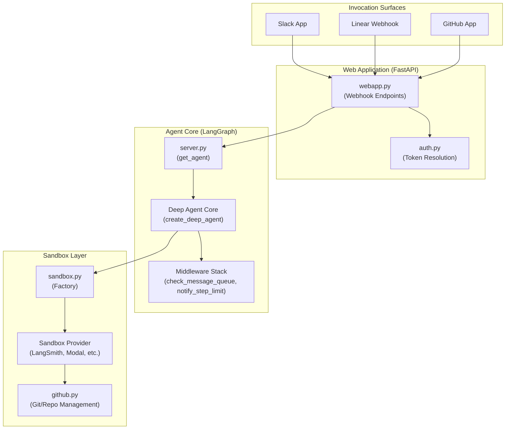
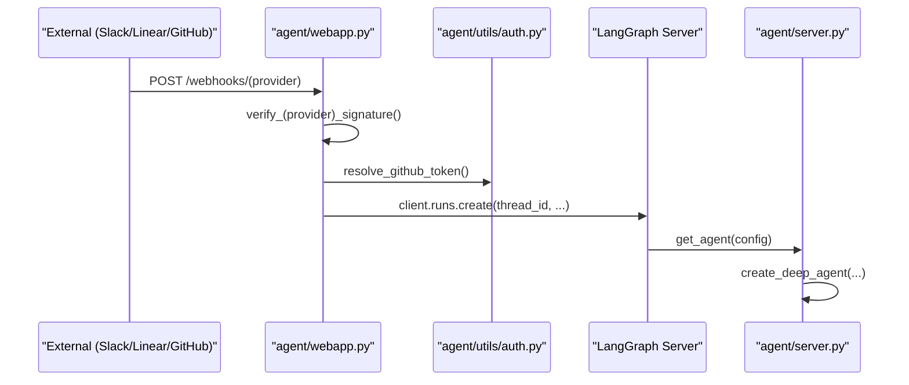
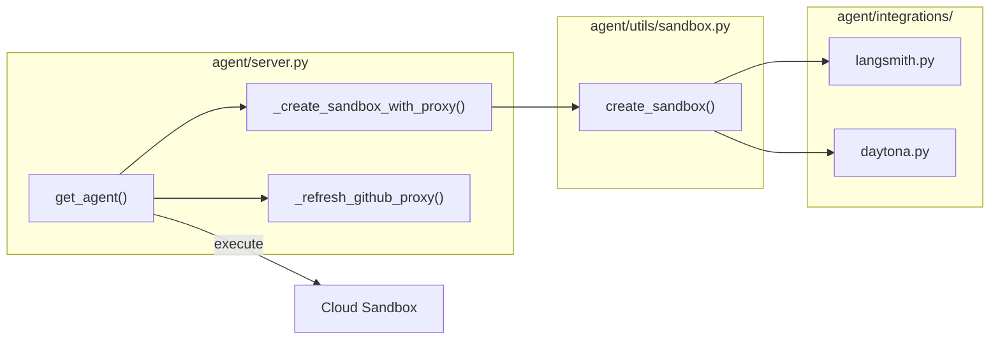

<!-- source: DeepWiki mcp.deepwiki.com · repo langchain-ai/open-swe · page 1.1 System Architecture · fetched 2026-10-26 -->

# System Architecture

Relevant source files

The following files were used as context for generating this wiki page:

- [CUSTOMIZATION.md](CUSTOMIZATION.md)
- [INSTALLATION.md](INSTALLATION.md)
- [Makefile](Makefile)
- [README.md](README.md)
- [agent/middleware/exclude_tools.py](agent/middleware/exclude_tools.py)
- [agent/server.py](agent/server.py)
- [agent/tools/__init__.py](agent/tools/__init__.py)
- [evals/reviewer/judge.py](evals/reviewer/judge.py)
- [langgraph.json](langgraph.json)

## Purpose and Scope

Open SWE is an open-source framework for building internal coding agents that operate within isolated cloud sandboxes. It is designed to compose on [LangGraph](https://langchain-ai.github.io/langgraph/) and [Deep Agents](https://github.com/langchain-ai/deepagents), providing a robust architecture for repository management, tool execution, and multi-surface invocation (Slack, Linear, GitHub) [README.md:25-40]().

This document details the high-level system architecture, focusing on the flow from external webhooks to agent orchestration and sandbox execution.

## High-Level Architecture

Open SWE follows a modular architecture where the agent logic is decoupled from the execution environment and the invocation surface.

**Sources:** [README.md:34-108](), [agent/server.py:29-69](), [langgraph.json:10-12]()

## Natural Language to Code Entity Mapping

The following diagrams bridge the gap between high-level concepts and specific code implementations.

### Webhook Processing Flow
When an event occurs in an external system, it hits a specific route in `agent/webapp.py`, which then interacts with the LangGraph server. The server invokes the graph defined by `get_agent` in `agent/server.py` [langgraph.json:4-5]().

**Sources:** [agent/webapp.py:1-12](), [agent/server.py:29-83](), [agent/utils/auth.py:70](), [langgraph.json:4-12]()

### Agent and Sandbox Lifecycle
The `get_agent()` function in `agent/server.py` is the central assembly point. It configures the sandbox and proxy authentication before returning the compiled agent [agent/server.py:29-80]().

**Sources:** [agent/server.py:121-139](), [agent/server.py:142-161](), [agent/utils/sandbox.py:80](), [CUSTOMIZATION.md:30-64]()

## Core Components

### 1. Agent Assembly
The agent is constructed using `create_deep_agent` from the `deepagents` framework. It is configured with a specific LLM model, a system prompt, a curated toolset, and a middleware stack [agent/server.py:29-69](), [CUSTOMIZATION.md:5-23]().

| Component | Code Reference | Description |
| :--- | :--- | :--- |
| **Model** | `make_model()` | Wraps `init_chat_model` for dynamic provider selection [agent/utils/model.py:77](). |
| **System Prompt** | `construct_system_prompt()` | Injects `AGENTS.md` and source context [agent/server.py:54](). |
| **Tools** | `agent/tools/` | Includes `fetch_url`, `http_request`, `linear_comment`, `slack_thread_reply`, etc [agent/tools/__init__.py:1-37](). |
| **Middleware** | `agent/middleware/` | Handles tool errors, message queuing, and status notifications [agent/server.py:44-53](). |

**Sources:** [agent/server.py:29-69](), [CUSTOMIZATION.md:5-23](), [agent/tools/__init__.py:1-37]()

### 2. Sandbox Management
Open SWE supports multiple sandbox providers (LangSmith, Modal, Daytona, Runloop, Local) [CUSTOMIZATION.md:58-64](). The `SandboxBackendProtocol` ensures a consistent interface for file operations and shell execution [agent/server.py:31]().

- **Isolation**: Each thread receives a persistent sandbox reused across follow-up messages [README.md:60]().
- **Persistence**: Sandbox IDs are managed via `get_sandbox_id_from_metadata` and `set_sandbox_backend` [agent/server.py:91-92]().
- **Auth Proxy**: For LangSmith sandboxes, `_configure_github_proxy` injects GitHub App installation tokens into the sandbox environment [agent/server.py:131-137]().

**Sources:** [agent/server.py:97-177](), [agent/utils/sandbox.py:80](), [CUSTOMIZATION.md:28-64]()

### 3. Reviewer Agent
In addition to the main coding agent, the system includes a `reviewer` graph [langgraph.json:6](). This agent uses a specialized `get_reviewer_agent()` factory and findings-management tools like `add_finding` and `list_findings` [agent/tools/__init__.py:20-30](). It also utilizes `ExcludeToolsMiddleware` to strip unnecessary tools (like `task`) from the reviewer's capabilities [agent/middleware/exclude_tools.py:33-43]().

**Sources:** [langgraph.json:6](), [agent/tools/__init__.py:20-30](), [agent/middleware/exclude_tools.py:33-43]()

### 4. Middleware and Orchestration
The system uses deterministic middleware hooks to extend agent behavior:
- **`check_message_queue_before_model`**: Injects new user messages into the current agent loop before the next model call [agent/server.py:50]().
- **`notify_step_limit_reached`**: Informs the user via Slack if the agent hits its maximum model call limit [agent/server.py:52]().
- **`ToolErrorMiddleware`**: Catches and handles tool execution errors gracefully [agent/server.py:49]().

**Sources:** [agent/server.py:44-53](), [README.md:91-96]()

---

