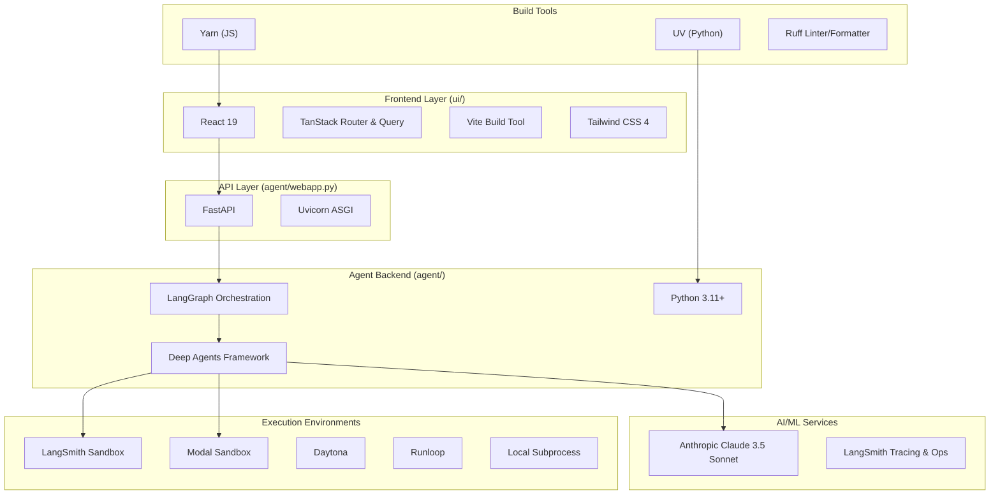
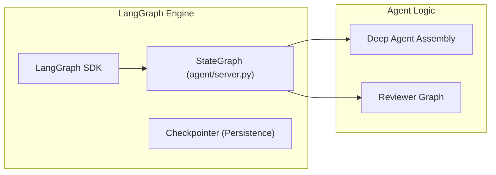
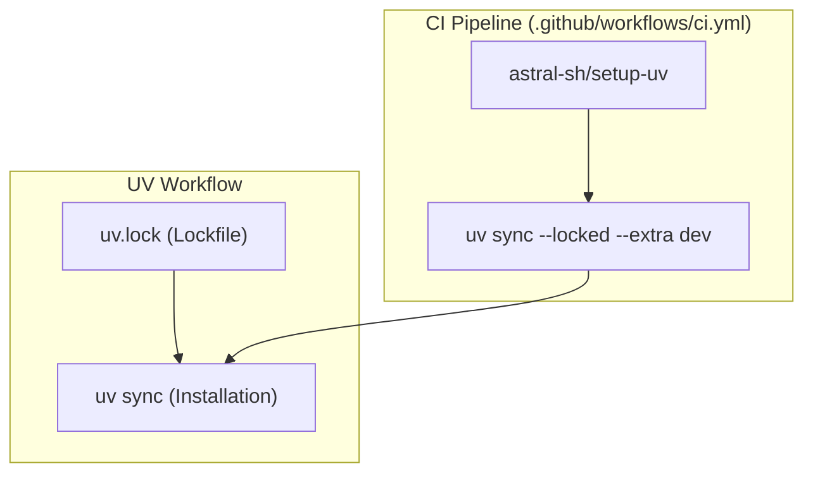

<!-- source: DeepWiki mcp.deepwiki.com · repo langchain-ai/open-swe · page 1.2 Technology Stack · fetched 2026-10-26 -->

# Technology Stack

Relevant source files

The following files were used as context for generating this wiki page:

- [.github/workflows/ci.yml](.github/workflows/ci.yml)
- [.github/workflows/pr_lint.yml](.github/workflows/pr_lint.yml)
- [LICENSE](LICENSE)
- [agent/integrations/langsmith.py](agent/integrations/langsmith.py)
- [pyproject.toml](pyproject.toml)
- [ui/package.json](ui/package.json)
- [ui/src/components/AppSidebar.tsx](ui/src/components/AppSidebar.tsx)
- [ui/yarn.lock](ui/yarn.lock)
- [uv.lock](uv.lock)

## Purpose and Scope

This document provides a comprehensive reference for all technologies, frameworks, and tools used in the Open SWE codebase. It covers the frontend dashboard (React/TanStack), backend services (Python/FastAPI), orchestration layer (LangGraph), AI/ML services, build tools, and deployment infrastructure.

For information about how these technologies are assembled into system components, see [System Architecture](#1.1). For deployment configurations and environment setup, see [Environment Configuration](#11.1).

---

## Technology Stack Overview

Open SWE employs a polyglot architecture with distinct technology layers serving specific purposes:

**Sources:** [pyproject.toml:1-28](), [ui/package.json:1-45](), [agent/integrations/langsmith.py:12-13]()

---

## Frontend Stack

### Dashboard Application

The frontend is a modern Single Page Application (SPA) located in the `ui/` directory, built using **React 19** and the **TanStack** ecosystem.

| Component | Technology | Version | Purpose |
|-----------|-----------|---------|---------|
| **Framework** | React | ^19.2.4 | UI Component library [ui/package.json:33]() |
| **Routing** | TanStack Router | ^1.167.4 | Type-safe client-side routing [ui/package.json:23]() |
| **Data Fetching** | TanStack Query | ^5.100.10 | Async state management [ui/package.json:21]() |
| **Styling** | Tailwind CSS | ^4.2.1 | Utility-first CSS framework [ui/package.json:42]() |
| **Build Tool** | Vite | ^7.3.1 | Frontend build pipeline [ui/package.json:59]() |
| **Icons** | Phosphor / Lucide | - | Icon sets [ui/package.json:17](), [ui/package.json:31]() |

**Key Navigation Structure:**
The `AppSidebar` defines the primary navigation surfaces for the dashboard:
- **My Settings**: User-specific overrides [ui/src/components/AppSidebar.tsx:31]()
- **Cloud Agents**: Agent management interface [ui/src/components/AppSidebar.tsx:32]()
- **Open SWE Review**: Automated PR reviewer interface [ui/src/components/AppSidebar.tsx:33]()
- **Integrations**: Platform connection management [ui/src/components/AppSidebar.tsx:34]()

**Sources:** [ui/package.json:14-45](), [ui/src/components/AppSidebar.tsx:30-36]()

---

## Backend Stack

### Python Runtime and Framework

The backend is built with **Python 3.11+** and uses **FastAPI** for its high-performance asynchronous capabilities.

| Component | Technology | Purpose |
|-----------|-----------|---------|
| **Runtime** | Python 3.11+ | Core language runtime [pyproject.toml:6]() |
| **Web Framework** | FastAPI | REST API and Webhook endpoints [pyproject.toml:10]() |
| **ASGI Server** | Uvicorn | Production-grade web server [pyproject.toml:11]() |
| **HTTP Client** | HTTPX | Asynchronous HTTP requests [pyproject.toml:12]() |
| **Security** | PyJWT / Cryptography | Token handling and encryption [pyproject.toml:13-14]() |

**Sources:** [pyproject.toml:1-28]()

---

## Orchestration Layer

### LangGraph Framework

**LangGraph** is the core orchestration engine used to define the agent's control flow as a stateful graph.

- **State Management**: LangGraph manages the propagation of state across agent turns [pyproject.toml:17]().
- **Persistence**: Thread state is persisted via checkpointers, allowing agents to resume long-running tasks.
- **SDK Integration**: The system utilizes `langgraph-sdk` to interact with the LangGraph server [pyproject.toml:15]().

**Sources:** [pyproject.toml:15-17]()

### Deep Agents Framework

Open SWE composes on the **Deep Agents** library to provide high-level agent abstractions:
- **Agent Assembly**: Uses `create_deep_agent` to combine LLMs, tools, and middleware [pyproject.toml:9]().
- **Tool Suite**: Provides standard SWE tools like `read_file`, `edit_file`, and `ls`.
- **Middleware**: Supports standard hooks for pre/post processing of agent turns.

**Sources:** [pyproject.toml:9]()

---

## AI/ML Services

### Large Language Models (LLMs)

Open SWE is model-agnostic but optimized for top-tier reasoning models.

| Provider | Library | Primary Usage |
|----------|---------|---------------|
| **Anthropic** | `langchain-anthropic` | Claude 3.5 Sonnet (Primary Agent) [pyproject.toml:19]() |
| **OpenAI** | `langchain-openai` | GPT-4o (Alternative/Reviewer) [pyproject.toml:22]() |
| **Google** | `langchain-google-genai` | Gemini 1.5 Pro (Alternative) [pyproject.toml:27]() |

### Observability and Tracing

- **LangSmith**: Used for full-stack tracing of agent runs, evaluation, and performance monitoring [pyproject.toml:21]().

**Sources:** [pyproject.toml:19-27]()

---

## Build Tools and Package Management

### Python Package Management - UV

Open SWE uses **UV** for extremely fast dependency resolution and virtual environment management.

- **Locking**: Deterministic builds are ensured via `uv.lock` [uv.lock:1-7]().
- **Linting/Formatting**: Managed by **Ruff**, which is configured for high-performance linting [pyproject.toml:48-61]().

**Sources:** [uv.lock:1-7](), [pyproject.toml:48-61](), [.github/workflows/ci.yml:22-24]()

### JavaScript Package Management - Yarn

The frontend uses **Yarn** for dependency management [ui/yarn.lock:1-2]().

---

## Execution Environments (Sandboxes)

Open SWE abstracts code execution into "Sandboxes" to safely run agent-generated code.

| Provider | Library | Type |
|----------|---------|------|
| **LangSmith** | `deepagents.backends.LangSmithSandbox` | Docker-based (Primary) [agent/integrations/langsmith.py:12]() |
| **Daytona** | `langchain-daytona` | Development containers [pyproject.toml:23]() |
| **Modal** | `langchain-modal` | Serverless functions [pyproject.toml:24]() |
| **Runloop** | `langchain-runloop` | Managed environments [pyproject.toml:25]() |

### LangSmith Sandbox Implementation
The `LangSmithProvider` manages the lifecycle of LangSmith sandboxes, including:
- **Snapshot Configuration**: Setting CPU, memory, and storage limits [agent/integrations/langsmith.py:18-22]().
- **GitHub Proxy**: Configuring proxy rules to inject GitHub credentials for secure `git` operations without storing tokens on the sandbox disk [agent/integrations/langsmith.py:70-95]().

**Sources:** [agent/integrations/langsmith.py:12-95](), [pyproject.toml:23-25]()

---

## CI/CD Pipeline

The project uses **GitHub Actions** for continuous integration.

| Pipeline | Trigger | Tasks |
|----------|---------|-------|
| **Agent CI** | Push to `main`, PRs | Linting, Formatting check, Unit tests [ .github/workflows/ci.yml:1-49]() |
| **PR Title Lint** | PR Open/Edit | Validates semantic PR titles (feat, fix, etc.) [.github/workflows/pr_lint.yml:1-42]() |

**Sources:** [.github/workflows/ci.yml:1-49](), [.github/workflows/pr_lint.yml:1-42]()

---

