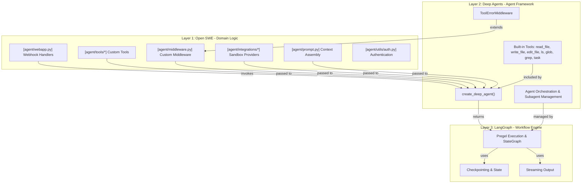
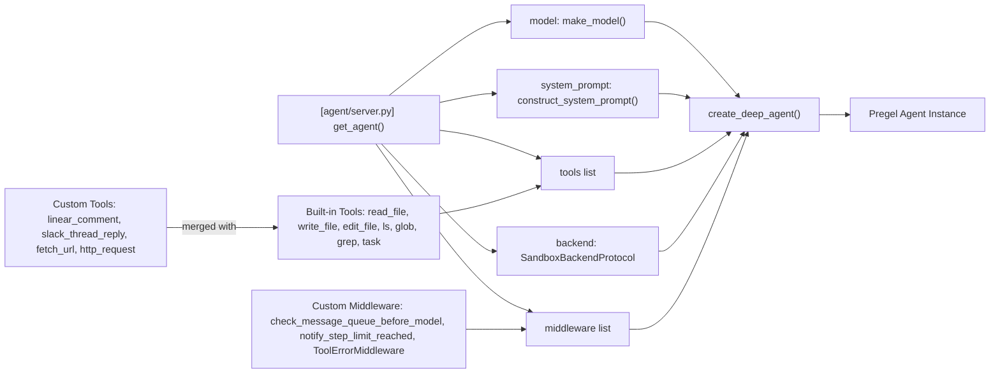

<!-- source: DeepWiki mcp.deepwiki.com · repo langchain-ai/open-swe · page 1.3 Framework Composition · fetched 2026-10-26 -->

# Framework Composition

<details>
<summary>Relevant source files</summary>

The following files were used as context for generating this wiki page:

- [CUSTOMIZATION.md](CUSTOMIZATION.md)
- [INSTALLATION.md](INSTALLATION.md)
- [README.md](README.md)
- [agent/server.py](agent/server.py)
- [agent/tools/__init__.py](agent/tools/__init__.py)

</details>


## Purpose and Scope

Open SWE is designed as a modular system that composes on top of the **Deep Agents** and **LangGraph** frameworks rather than forking them. This approach allows the codebase to remain lightweight while inheriting robust agent orchestration and workflow execution capabilities. This page documents the three-layer architecture, the assembly process via `create_deep_agent`, and the specific extension points where Open SWE adds domain-specific logic.

---

## Three-Layer Architecture

Open SWE implements a compositional architecture with three distinct layers, each providing different levels of abstraction:

### Three-Layer Architecture Diagram

Sources: [README.md:33-50](), [agent/server.py:29-53](), [agent/server.py:249-376]()

*   **Layer 3 - LangGraph (Foundation)**: Provides the workflow execution engine and state management. Open SWE uses LangGraph's `Pregel` executor to manage the agent loop and state transitions [agent/server.py:13-14]().
*   **Layer 2 - Deep Agents (Agent Framework)**: Provides the `create_deep_agent()` assembly function [agent/server.py:29](). It includes built-in file system tools and subagent orchestration via the `task` tool [README.md:76-77]().
*   **Layer 1 - Open SWE (Domain Logic)**: Adds webhook handlers, custom tools (Slack, Linear, GitHub), custom middleware for message queueing, and context engineering logic [README.md:52-110]().

---

## Agent Assembly via create_deep_agent()

The core composition happens in the `get_agent()` function [agent/server.py:249](), which assembles an agent by calling `create_deep_agent` with parameters tailored to the specific run.

### Agent Assembly Component Mapping

Sources: [agent/server.py:249-376](), [README.md:42-49](), [agent/tools/__init__.py:1-37]()

The assembly process in `agent/server.py` follows this implementation:

```python
# agent/server.py:362-372
return create_deep_agent(
    model=make_model(model_id, **model_kwargs),
    system_prompt=construct_system_prompt(...),
    tools=[
        http_request, 
        fetch_url, 
        linear_comment, 
        slack_thread_reply,
        # ... other custom tools
    ],
    backend=sandbox_backend,
    middleware=[
        ToolErrorMiddleware(),
        check_message_queue_before_model,
        ensure_no_empty_msg,
        notify_step_limit_reached,
    ],
)
```

The `create_deep_agent` function from Deep Agents performs the following:
*   Combines the provided tools with built-in file operations (`read_file`, `write_file`, `edit_file`, etc.) [README.md:76-77]().
*   Injects the `task` tool to allow the agent to spawn subagents [README.md:89-90]().
*   Configures the middleware stack around the LLM call loop [README.md:91-96]().

---

## Component Extension Points

Open SWE extends the base frameworks at four key extension points:

### 1. Sandbox Providers
All sandbox implementations must adhere to the `SandboxBackendProtocol` from Deep Agents [agent/server.py:31](). This allows Open SWE to swap between providers like LangSmith, Modal, or Daytona by setting the `SANDBOX_TYPE` environment variable [CUSTOMIZATION.md:58-64]().

### 2. Custom Tools
Custom tools extend the agent's capability beyond file manipulation. These are defined in `agent/tools/` and passed to the agent factory [agent/tools/__init__.py:1-37]().

| Tool | Purpose | File |
|------|---------|------|
| `linear_comment` | Post updates to Linear tickets | `agent/tools/linear_comment.py` |
| `slack_thread_reply` | Reply in Slack threads | `agent/tools/slack_thread_reply.py` |
| `fetch_url` | Fetch web pages as markdown | `agent/tools/fetch_url.py` |
| `http_request` | Perform generic API calls | `agent/tools/http_request.py` |

### 3. Custom Middleware
Middleware functions are used to intercept the agent loop [agent/middleware.py]().
*   **`check_message_queue_before_model`**: Injects new user messages (e.g., from Slack while the agent is running) into the conversation history before the next LLM turn [agent/server.py:50]().
*   **`notify_step_limit_reached`**: Handles notifications when an agent hits its execution budget [agent/server.py:52]().

### 4. Context Engineering
Open SWE specializes in assembling context from repository-specific files like `AGENTS.md` and source metadata from Slack or Linear [README.md:78-84](). This context is injected into the system prompt via `construct_system_prompt` [agent/server.py:54]().

---

## Benefits of Composition

Composing on frameworks rather than forking provides several architectural advantages:

1.  **Upgrade Path**: Open SWE can pull upstream improvements from Deep Agents and LangGraph (e.g., better tool error handling or execution speed) without merge conflicts [README.md:40]().
2.  **Tool Curation**: Open SWE focuses on "tool curation" (providing high-value domain tools) rather than "tool accumulation" (building a massive library of generic tools) [README.md:66]().
3.  **Separation of Concerns**:
    *   **LangGraph** handles state and execution logic.
    *   **Deep Agents** handles the agent loop and basic file tools.
    *   **Open SWE** handles the integration with external developer tools (Slack, Linear, GitHub) and sandbox management.

Sources: [README.md:33-50](), [README.md:66-96](), [agent/server.py:249-376](), [CUSTOMIZATION.md:5-24]()

---

