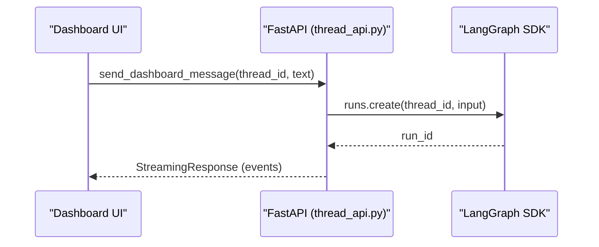

<!-- source: DeepWiki mcp.deepwiki.com · repo langchain-ai/open-swe · page 10 Dashboard and UI · fetched 2026-10-26 -->

# Dashboard and UI

<details>
<summary>Relevant source files</summary>

The following files were used as context for generating this wiki page:

- [agent/dashboard/profiles.py](agent/dashboard/profiles.py)
- [agent/dashboard/routes.py](agent/dashboard/routes.py)
- [ui/src/lib/api.ts](ui/src/lib/api.ts)
- [ui/src/routeTree.gen.ts](ui/src/routeTree.gen.ts)

</details>


The Open SWE Dashboard provides a centralized web interface for managing agent threads, configuring user profiles, and adjusting team-wide settings. It consists of a React-based frontend and a FastAPI backend that integrates with the LangGraph Store for persistence.

### System Overview

The dashboard bridges the gap between the automated agent execution (triggered via webhooks) and human oversight. It allows users to manually trigger agent runs, view real-time logs, and manage repository-specific review styles.

#### Dashboard Component Relationship
The following diagram illustrates how the dashboard components interact with the underlying system entities.

**Entity Mapping: Dashboard to Codebase**
```mermaid
graph TD
    subgraph "Natural Language Space"
        "User Interface"
        "API Layer"
        "Persistence"
    end

    subgraph "Code Entity Space"
        UI["React Frontend (TanStack Router)"]
        API["FastAPI Router (agent/dashboard/routes.py)"]
        STORE["LangGraph Store (profiles/oauth_tokens namespaces)"]
        
        UI -- "Calls" --> API
        API -- "CRUD" --> STORE
    end

    "User Interface" -.-> UI
    "API Layer" -.-> API
    "Persistence" -.-> STORE
```
Sources: [agent/dashboard/routes.py:78-78](), [agent/dashboard/profiles.py:31-32](), [ui/src/lib/api.ts:141-190]()

---

### Dashboard Backend
The backend is implemented as a FastAPI router located at `agent/dashboard/routes.py`. It handles:
*   **Authentication**: Implements a GitHub OAuth flow using `auth_login` and `auth_callback` endpoints [agent/dashboard/routes.py:144-196]().
*   **Session Management**: Issues secure JWT-based sessions stored in the `osw_session` cookie [agent/dashboard/routes.py:111-120]().
*   **REST API**: Exposes endpoints under `/dashboard/api` for managing threads, profiles, and team settings [agent/dashboard/routes.py:78-78]().

For details, see [Dashboard Backend](#10.1).

Sources: [agent/dashboard/routes.py:1-74]()

---

### Dashboard Frontend
The frontend is a modern React application utilizing **TanStack Router** for type-safe routing and **TanStack Query** for data fetching.
*   **Route Structure**: Organized into functional areas such as `/agents` for thread management, `/review` for repository configurations, and `/admin` for team-wide overrides [ui/src/routeTree.gen.ts:86-112]().
*   **API Client**: A typed `api` object in `ui/src/lib/api.ts` handles communication with the backend, including automatic credential handling for session cookies [ui/src/lib/api.ts:141-190]().

For details, see [Dashboard Frontend](#10.2).

Sources: [ui/src/routeTree.gen.ts:11-24](), [ui/src/lib/api.ts:1-48]()

---

### User Profiles and Team Settings
Open SWE uses the **LangGraph Store** to persist configuration across two primary namespaces: `profiles` and `oauth_tokens` [agent/dashboard/profiles.py:31-32]().
*   **User Profiles**: Individual settings including `default_model`, `reasoning_effort`, and `branch_prefix` [agent/dashboard/profiles.py:35-43]().
*   **Team Settings**: Global configurations managed by admins, such as `trigger_mode` (e.g., `every_push`, `manual`) and `autofix_mode` [ui/src/lib/api.ts:89-103]().
*   **Review Styles**: Per-repository settings that allow the Reviewer Agent to adapt to specific coding standards [ui/src/lib/api.ts:123-139]().

For details, see [User Profiles and Team Settings](#10.3).

Sources: [agent/dashboard/profiles.py:1-11](), [ui/src/lib/api.ts:64-103]()

---

### Agent Threads UI
The `agents/` route provides a high-fidelity view into agent activities. It enables users to:
*   **Monitor Runs**: View real-time progress of LangGraph threads via the `stream_dashboard_thread` endpoint [agent/dashboard/routes.py:73-73]().
*   **Interactive Chat**: Use the `AgentPromptBar` to send manual instructions to an agent within a specific thread context [agent/dashboard/routes.py:72-72]().
*   **Code Inspection**: View diffs and file changes through ported components like `AgentGitPanel`.

**Data Flow: Thread Interaction**

Sources: [agent/dashboard/routes.py:72-73](), [agent/dashboard/thread_api.py:1-10]()

For details, see [Agent Threads UI](#10.4).

Sources: [agent/dashboard/routes.py:64-74](), [ui/src/routeTree.gen.ts:108-110]()

---

