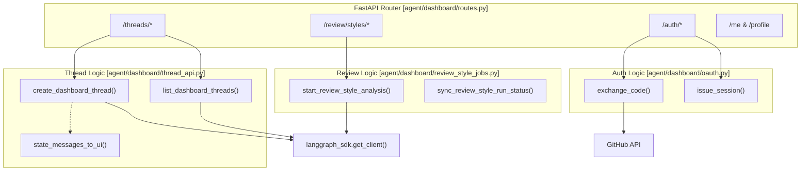
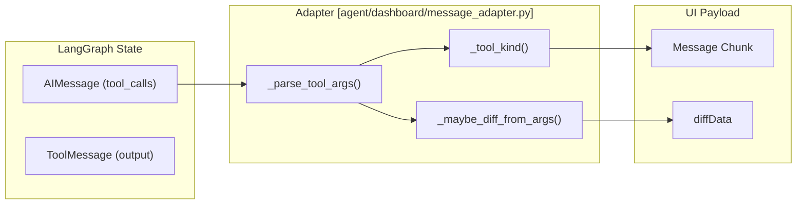

<!-- source: DeepWiki mcp.deepwiki.com · repo langchain-ai/open-swe · page 10.1 Dashboard Backend · fetched 2026-10-26 -->

# Dashboard Backend

Relevant source files

The following files were used as context for generating this wiki page:

- [agent/_patch_messages_reducer.py](agent/_patch_messages_reducer.py)
- [agent/dashboard/message_adapter.py](agent/dashboard/message_adapter.py)
- [agent/dashboard/oauth.py](agent/dashboard/oauth.py)
- [agent/dashboard/review_style_jobs.py](agent/dashboard/review_style_jobs.py)
- [agent/dashboard/review_styles.py](agent/dashboard/review_styles.py)
- [agent/dashboard/routes.py](agent/dashboard/routes.py)
- [agent/dashboard/thread_api.py](agent/dashboard/thread_api.py)
- [agent/review_style_analyzer.py](agent/review_style_analyzer.py)
- [agent/utils/thread_ops.py](agent/utils/thread_ops.py)
- [tests/test_github_oauth_refresh.py](tests/test_github_oauth_refresh.py)
- [tests/test_review_style_sync.py](tests/test_review_style_sync.py)
- [ui/src/components/ReviewStylesPanel.tsx](ui/src/components/ReviewStylesPanel.tsx)
- [ui/src/routeTree.gen.ts](ui/src/routeTree.gen.ts)

The Dashboard Backend is a FastAPI-based service that provides the administrative and user-facing API for managing Open SWE agents, review styles, and user profiles. It acts as a bridge between the React frontend and the underlying LangGraph execution engine.

## Overview and Purpose

The dashboard backend handles four primary responsibilities:
1.  **Authentication**: Managing GitHub App OAuth flows and session persistence via signed JWTs.
2.  **Thread Management**: Proxying requests to the LangGraph SDK to list, create, and stream agent runs.
3.  **Review Style Management**: Orchestrating the "Review Style Analyzer" graph which researches repository history to synthesize custom review prompts.
4.  **Profile & Settings**: Managing per-user and team-wide configurations stored in the LangGraph Store.

## Architecture and Data Flow

The backend is organized as a series of routers and utility modules that interact with the LangGraph SDK and the GitHub API.

### Authentication Flow
The system uses a stateful OAuth flow to bind GitHub identities to local sessions. It employs a double-cookie strategy (Session + State) to prevent CSRF and session fixation.

**Login Sequence:**
1.  User initiates login at `/dashboard/api/auth/login` [agent/dashboard/routes.py:144-162]().
2.  The backend generates a random nonce and a state JWT containing a hash of that nonce [agent/dashboard/oauth.py:102-126]().
3.  User is redirected to GitHub. Upon return to `/dashboard/api/auth/callback`, the backend verifies the state JWT and the nonce cookie [agent/dashboard/routes.py:165-177]().
4.  The authorization code is exchanged for a GitHub token [agent/dashboard/oauth.py:171-182]().
5.  A session JWT is issued and stored in a secure, `HttpOnly` cookie [agent/dashboard/routes.py:192-196]().

### Component Interaction Diagram
This diagram shows how the FastAPI routes connect to specific code entities and external services.

"Dashboard Backend Entity Map"

Sources: [agent/dashboard/routes.py:78-74](), [agent/dashboard/oauth.py:1-200](), [agent/dashboard/thread_api.py:1-185](), [agent/dashboard/review_style_jobs.py:38-121]()

## REST API Endpoints

All endpoints are prefixed with `/dashboard/api` and generally require an active session via the `require_session` dependency [agent/dashboard/routes.py:78-87]().

### Authentication & User
| Endpoint | Method | Description |
| :--- | :--- | :--- |
| `/auth/login` | GET | Initiates GitHub OAuth flow [agent/dashboard/routes.py:144](). |
| `/auth/callback` | GET | Handles OAuth redirect and issues session [agent/dashboard/routes.py:165](). |
| `/auth/logout` | POST | Clears the session cookie [agent/dashboard/routes.py:199](). |
| `/me` | GET | Returns current user's GitHub login, email, and admin status [agent/dashboard/routes.py:206](). |
| `/profile` | GET/PUT | Manages user-specific defaults (model, repo, branch prefix) [agent/dashboard/routes.py:221-229](). |

### Thread Management
These endpoints interface with the LangGraph server to manage agent conversations.

*   **`list_dashboard_threads`**: Filters LangGraph threads by `source="dashboard"` and the user's `github_login` [agent/dashboard/thread_api.py:185-195]().
*   **`create_dashboard_thread`**: Initializes a new thread, persists the user's encrypted GitHub token into thread metadata, and kicks off the initial agent run [agent/dashboard/thread_api.py:214-250]().
*   **`stream_dashboard_thread`**: Provides a `StreamingResponse` that yields LangGraph events mapped to the UI message format [agent/dashboard/thread_api.py:348-356]().

### Review Styles
Manages the synthesis of repository-specific review guidelines.

*   **`start_review_style_analysis`**: Kicks off a specialized LangGraph assistant (`review_style_analyzer`) that uses a sandbox to research historical PRs using the `gh` CLI [agent/dashboard/review_style_jobs.py:38-105]().
*   **`sync_review_style_run_status`**: Reconciles the state in the LangGraph Store with the actual status of the background analysis run [agent/dashboard/review_style_jobs.py:123-155]().

## Review Style Analyzer

The Review Style Analyzer is a distinct agentic workflow designed to automate "Context Engineering" for the reviewer agent.

### Analysis Workflow
1.  **Sample Collection**: The backend optionally pre-collects review samples [agent/dashboard/review_style_jobs.py:47]().
2.  **Agent Research**: The `review_style_analyzer` agent is spawned in a sandbox [agent/review_style_analyzer.py:118-119]().
3.  **Tool Usage**: The agent uses the `execute` tool to run `gh api` commands to browse merged PRs and identify human feedback patterns [agent/review_style_analyzer.py:49-71]().
4.  **Synthesis**: Once sufficient evidence is gathered, the agent calls `save_review_style_prompt` to persist the synthesized guide into the LangGraph Store [agent/review_style_analyzer.py:73-89]().

### Implementation Details
The analyzer uses a specific system prompt (`STYLE_ANALYZER_PROMPT`) that instructs it to identify the top reviewers and calibrate severity based on historical data [agent/review_style_analyzer.py:49-98]().

## Data Transformation (Message Adapter)

The backend includes a `state_messages_to_ui` utility that transforms complex LangChain/LangGraph message objects into a simplified JSON structure for the React frontend [agent/dashboard/message_adapter.py:131-135]().

**Key Transformations:**
*   **Tool Categorization**: Maps internal tool names to UI categories like `edit`, `execute`, or `search` [agent/dashboard/message_adapter.py:37-51]().
*   **Diff Extraction**: Parses tool arguments (e.g., from `write_file` or `str_replace`) to generate `diffData` objects for the frontend's diff viewer [agent/dashboard/message_adapter.py:77-94]().
*   **Turn Aggregation**: Groups consecutive AI messages and tool outputs into logical "turns" for cleaner display [agent/dashboard/message_adapter.py:131-160]().

"Message Transformation Logic"

Sources: [agent/dashboard/message_adapter.py:37-94](), [agent/dashboard/message_adapter.py:131-196]()

## Security and Session Management

*   **Token Encryption**: GitHub OAuth tokens are encrypted using Fernet before being stored in thread metadata, ensuring that even if the database is compromised, user tokens remain protected [agent/dashboard/thread_api.py:76-86]().
*   **Token Rotation**: The backend automatically handles GitHub OAuth token expiration by checking `token_expires_at` and performing a refresh using the stored refresh token [agent/dashboard/profiles.py:9-62]().
*   **State Verification**: The OAuth state parameter is a signed JWT that is cross-referenced against an HMAC-hashed nonce stored in a browser cookie to prevent CSRF [agent/dashboard/oauth.py:102-126]().

Sources: [agent/dashboard/routes.py:1-234](), [agent/dashboard/oauth.py:1-200](), [agent/dashboard/thread_api.py:1-356](), [agent/dashboard/review_style_jobs.py:1-181](), [agent/review_style_analyzer.py:1-165](), [agent/dashboard/message_adapter.py:1-196]()

---

