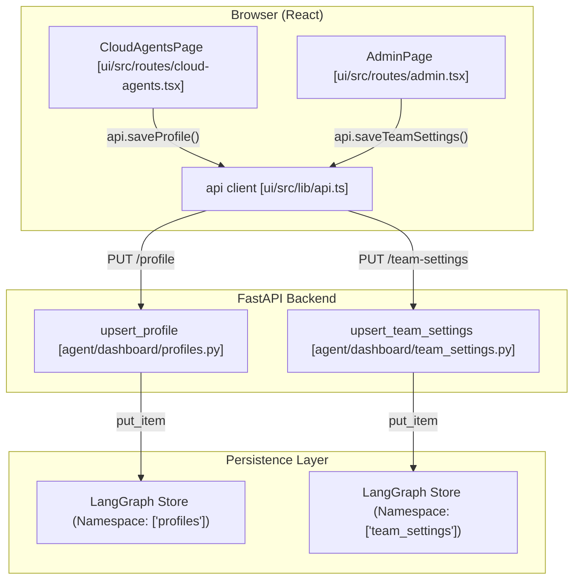
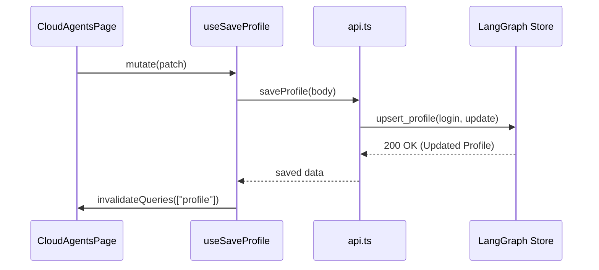

<!-- source: DeepWiki mcp.deepwiki.com · repo langchain-ai/open-swe · page 10.2 Dashboard Frontend · fetched 2026-10-26 -->

# Dashboard Frontend

Relevant source files

The following files were used as context for generating this wiki page:

- [agent/dashboard/profiles.py](agent/dashboard/profiles.py)
- [agent/dashboard/team_settings.py](agent/dashboard/team_settings.py)
- [tests/test_pr_ready_auto_review.py](tests/test_pr_ready_auto_review.py)
- [ui/package.json](ui/package.json)
- [ui/src/components/AppShell.tsx](ui/src/components/AppShell.tsx)
- [ui/src/components/AppSidebar.tsx](ui/src/components/AppSidebar.tsx)
- [ui/src/components/ui/switch.tsx](ui/src/components/ui/switch.tsx)
- [ui/src/lib/api.ts](ui/src/lib/api.ts)
- [ui/src/lib/profile.ts](ui/src/lib/profile.ts)
- [ui/src/routes/admin.tsx](ui/src/routes/admin.tsx)
- [ui/src/routes/cloud-agents.tsx](ui/src/routes/cloud-agents.tsx)
- [ui/src/routes/my-settings.tsx](ui/src/routes/my-settings.tsx)
- [ui/src/routes/review.tsx](ui/src/routes/review.tsx)
- [ui/yarn.lock](ui/yarn.lock)

The Open SWE Dashboard is a React-based single-page application (SPA) built with **Vite**, **TanStack Router**, and **TanStack Query**. It provides a management interface for configuring agent models, repository settings, and team-wide review policies.

## System Architecture and Data Flow

The frontend communicates with the FastAPI backend via a typed API client. Authentication is handled via an `httpOnly` session cookie (`osw_session`) established during the OAuth flow, which is automatically included in cross-origin requests using `credentials: "include"` [ui/src/lib/api.ts:1-6]().

### Frontend-Backend Communication

The following diagram illustrates how the React components interact with the backend API and the underlying LangGraph Store.

**Dashboard Data Flow: UI to Code Entity Space**

**Sources:** [ui/src/lib/api.ts:141-190](), [agent/dashboard/profiles.py:31-32](), [agent/dashboard/team_settings.py:21-22]()

## Route Structure

The application uses **TanStack Router** for type-safe routing. The navigation is primarily managed by the `AppSidebar` component [ui/src/components/AppSidebar.tsx:30-36]().

| Route | Component | Purpose |
| :--- | :--- | :--- |
| `/my-settings` | `MySettingsPage` | User-specific profile settings and logout [ui/src/routes/my-settings.tsx:19]() |
| `/cloud-agents` | `CloudAgentsPage` | Per-user agent defaults (model, repo, branch) [ui/src/routes/cloud-agents.tsx:28]() |
| `/review` | `ReviewPage` | Team-wide PR review configuration and repo toggles [ui/src/routes/review.tsx:20]() |
| `/review/styles` | `ReviewStylesPage` | Per-repo review style guide management [ui/src/lib/api.ts:148]() |
| `/admin` | `AdminPage` | Workspace defaults and per-user profile overrides [ui/src/routes/admin.tsx:20]() |

**Sources:** [ui/src/components/AppSidebar.tsx:30-36](), [ui/src/routes/my-settings.tsx:35](), [ui/src/routes/cloud-agents.tsx:30](), [ui/src/routes/review.tsx:59](), [ui/src/routes/admin.tsx:22]()

## Key Implementation Details

### Profile and Settings Management
Settings are synchronized using **TanStack Query** hooks defined in `ui/src/lib/profile.ts`. The `buildProfileUpdate` utility ensures that partial updates (e.g., changing only the branch prefix) do not clobber other fields in the profile object [ui/src/lib/profile.ts:57-74]().

**Profile Synchronization Logic**

**Sources:** [ui/src/lib/profile.ts:42-50](), [agent/dashboard/profiles.py:80-111]()

### Component Library
The UI is built using a combination of custom components and primitives:
*   **Styling**: Tailwind CSS 4.0 with `class-variance-authority` for component variants [ui/package.json:19-28]().
*   **Icons**: `react-icons/io5` and `@phosphor-icons/react` [ui/src/components/AppSidebar.tsx:2-9](), [ui/src/routes/review.tsx:3]().
*   **Primitives**: Radix-based components (Select, Switch, Combobox) via a local `ui/src/components/ui` directory [ui/src/routes/cloud-agents.tsx:5-24]().

## Admin and Team Settings

The `AdminPage` provides a dual-pane interface for managing the workspace. It allows administrators to:
1.  **Global Defaults**: Set the default `model_id` and `reasoning_effort` for both the "Agent" (Slack/Linear) and the "Reviewer" (GitHub PRs) [ui/src/routes/admin.tsx:138-174]().
2.  **User Overrides**: Select any user in the organization and edit their profile using the `ProfileForm` component [ui/src/routes/admin.tsx:71-110]().

The backend ensures these settings are persisted in the `team_settings` namespace within the LangGraph Store, specifically under the `default` key [agent/dashboard/team_settings.py:21-22]().

**Sources:** [ui/src/routes/admin.tsx:22-113](), [agent/dashboard/team_settings.py:104-118]()

---

