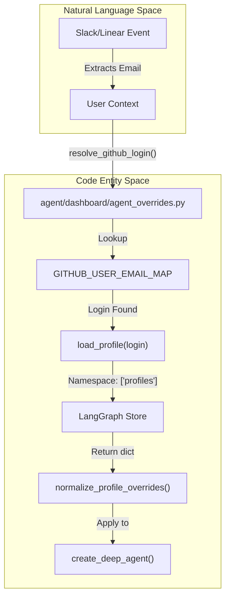
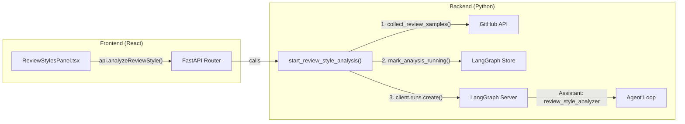

<!-- source: DeepWiki mcp.deepwiki.com · repo langchain-ai/open-swe · page 10.3 User Profiles and Team Settings · fetched 2026-10-26 -->

# User Profiles and Team Settings

Relevant source files

The following files were used as context for generating this wiki page:

- [agent/dashboard/agent_overrides.py](agent/dashboard/agent_overrides.py)
- [agent/dashboard/oauth.py](agent/dashboard/oauth.py)
- [agent/dashboard/options.py](agent/dashboard/options.py)
- [agent/dashboard/profiles.py](agent/dashboard/profiles.py)
- [agent/dashboard/review_style_jobs.py](agent/dashboard/review_style_jobs.py)
- [agent/dashboard/review_styles.py](agent/dashboard/review_styles.py)
- [tests/test_github_oauth_refresh.py](tests/test_github_oauth_refresh.py)
- [tests/test_review_style_sync.py](tests/test_review_style_sync.py)
- [ui/src/components/ReviewStylesPanel.tsx](ui/src/components/ReviewStylesPanel.tsx)
- [ui/src/lib/api.ts](ui/src/lib/api.ts)
- [ui/src/routes/__root.tsx](ui/src/routes/__root.tsx)

Open SWE provides a multi-layered configuration system that allows for individual developer preferences while maintaining team-wide standards. This system manages per-user overrides, such as preferred LLMs and repository defaults, alongside team-wide automation policies for CI autofixing and PR summaries.

## User Profiles and Overrides

Each user in Open SWE has a persistent profile stored in the LangGraph Store. These profiles allow developers to customize how agents behave when triggered by their actions (e.g., via Slack or Linear).

### Data Storage Strategy
User data is split into two distinct namespaces within the LangGraph Store to prevent race conditions between user-initiated UI edits and background OAuth token refreshes [agent/dashboard/profiles.py:1-11]():
*   **`["profiles"]`**: Contains user-editable settings like `default_model`, `reasoning_effort`, and `branch_prefix` [agent/dashboard/profiles.py:31]().
*   **`["oauth_tokens"]`**: Stores encrypted GitHub access tokens, refresh tokens, and expiration timestamps [agent/dashboard/profiles.py:32]().

### Profile Configuration Options
The `ProfileUpdate` schema defines the configurable parameters for an individual user [agent/dashboard/profiles.py:35-43]():

| Parameter | Type | Description |
| :--- | :--- | :--- |
| `default_model` | `str` | The LLM ID used for agent runs triggered by this user. |
| `reasoning_effort` | `str` | The reasoning effort level (e.g., "low", "medium", "high"). |
| `default_repo` | `str \| None` | Default `owner/repo` to target if none is specified in the trigger. |
| `branch_prefix` | `str \| None` | Custom prefix for branches created by the agent (e.g., `ai/`). |
| `create_prs` | `bool` | Whether the agent should automatically open a PR upon task completion. |
| `auto_fix_ci` | `bool` | Whether the agent should automatically attempt to fix CI failures. |

### Profile Resolution Flow
When an agent is initialized via `get_agent`, the system attempts to resolve the triggering user's GitHub login to apply these overrides.

Sources: [agent/dashboard/agent_overrides.py:29-40](), [agent/dashboard/agent_overrides.py:61-72](), [agent/dashboard/agent_overrides.py:85-96]()

## Team Settings and Admin Panel

Team settings define the global behavior of the Open SWE deployment. These settings act as fallbacks when user-specific profiles are not set or when events are triggered by the system (e.g., automated PR reviews).

### Global Automation Policies
The `TeamSettings` interface manages the following high-level behaviors [ui/src/lib/api.ts:92-103]():
*   **`trigger_mode`**: Controls when the reviewer agent runs (e.g., `every_push`, `once_per_pr`, or `manual`) [ui/src/lib/api.ts:89]().
*   **`autofix_mode`**: Sets the threshold for the Reviewer Agent to automatically commit fixes for findings (`off`, `low`, `medium`, `high`) [ui/src/lib/api.ts:90]().
*   **`pr_summaries`**: Boolean flag to enable/disable automated AI-generated PR descriptions.

### Model Options and Validation
The dashboard restricts model selection to a predefined list of supported IDs and effort levels to ensure compatibility with the underlying providers [agent/dashboard/options.py:15-28]().
*   **Validation**: The `ProfileUpdate` class uses a `@field_validator` to ensure the selected `default_model` exists in `SUPPORTED_MODEL_IDS` [agent/dashboard/profiles.py:45-50]().
*   **Pairing**: It further validates that the selected `reasoning_effort` is supported by that specific model via `model_supports_effort()` [agent/dashboard/profiles.py:52-57]().

## Review Style Management

A key component of team settings is the per-repository "Review Style." This allows teams to train the Reviewer Agent on their specific coding standards by analyzing historical PRs.

### Analysis Lifecycle
The analysis is managed as a background LangGraph run using the `review_style_analyzer` assistant [agent/dashboard/review_style_jobs.py:27]().

Sources: [ui/src/components/ReviewStylesPanel.tsx:95-103](), [agent/dashboard/review_style_jobs.py:38-45](), [agent/dashboard/review_style_jobs.py:88-105]()

### Analysis Status Reconciliation
Because analysis runs are asynchronous, the dashboard polls for status updates. The backend reconciles the state in the LangGraph Store with the actual status of the LangGraph run [agent/dashboard/review_styles.py:147-155]():
*   **Success**: If the run completes and a `custom_prompt` was saved, the status moves to `completed` [agent/dashboard/review_styles.py:161-163]().
*   **Failure**: If the run ends without saving a prompt, it is marked as `failed` with a user-facing error message [agent/dashboard/review_styles.py:164-167]().

## Authentication and Session Management

Access to the dashboard and the ability to save profiles is secured via GitHub OAuth.

### Session Persistence
*   **JWT Sessions**: Upon successful OAuth exchange, the system issues a signed JWT stored in an `osw_session` httpOnly cookie [agent/dashboard/oauth.py:21-23]().
*   **Token Encryption**: GitHub OAuth tokens (access and refresh) are encrypted using Fernet before being stored in the `oauth_tokens` namespace [agent/dashboard/profiles.py:157-161]().
*   **Token Refresh**: The `get_valid_access_token` function checks for token expiration (with a 300-second buffer) and automatically uses the refresh token to rotate the access token if necessary [agent/dashboard/profiles.py:125-134](), [agent/dashboard/profiles.py:220-235]().

Sources: [agent/dashboard/oauth.py:83-92](), [agent/dashboard/profiles.py:153-168](), [agent/dashboard/profiles.py:205-215]()

---

