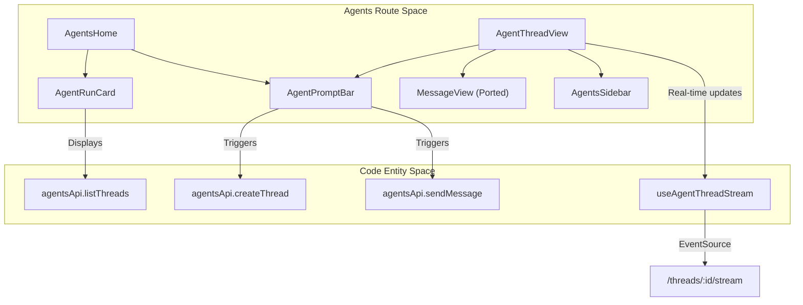
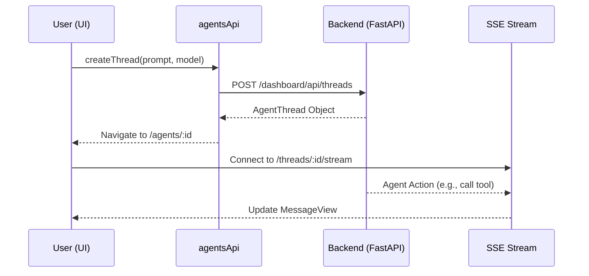

<!-- source: DeepWiki mcp.deepwiki.com · repo langchain-ai/open-swe · page 10.4 Agent Threads UI · fetched 2026-10-26 -->

# Agent Threads UI

Relevant source files

The following files were used as context for generating this wiki page:

- [ui/src/components/agents/AgentRunCard.tsx](ui/src/components/agents/AgentRunCard.tsx)
- [ui/src/components/agents/AgentThreadView.tsx](ui/src/components/agents/AgentThreadView.tsx)
- [ui/src/components/agents/AgentsHome.tsx](ui/src/components/agents/AgentsHome.tsx)
- [ui/src/lib/agents/api.ts](ui/src/lib/agents/api.ts)

The Agent Threads UI provides a comprehensive interface for interacting with, monitoring, and managing Open SWE agent executions. Located under the `/agents/` route, this system enables users to initiate new agent runs, view real-time execution logs, inspect code changes via diff viewers, and manage historical conversation threads.

## Component Architecture

The UI is structured around a central shell that manages navigation and state, with specialized views for the home screen and individual thread interactions.

### Component Hierarchy and Data Flow
The following diagram illustrates the relationship between the primary UI components and the backend API.

**Agent UI Component Map**

Sources: `ui/src/components/agents/AgentsHome.tsx:10-53`(), `ui/src/components/agents/AgentThreadView.tsx:29-170`(), `ui/src/lib/agents/api.ts:45-69`()

## Key Components

### AgentsHome
The landing page for the agent interface. It serves two primary functions:
1.  **Initialization**: Provides the primary `AgentPromptBar` to start new agent tasks `[ui/src/components/agents/AgentsHome.tsx:26-38]()`.
2.  **History**: Displays a list of the 5 most recent agent runs using `AgentRunCard` components `[ui/src/components/agents/AgentsHome.tsx:13-49]()`.

### AgentThreadView
The core interaction component for an active or historical agent session. It manages:
*   **Message Rendering**: Uses a ported `MessageView` to display the conversation history between the user and the agent `[ui/src/components/agents/AgentThreadView.tsx:111-119]()`.
*   **Real-time Streaming**: Utilizes the `useAgentThreadStream` hook to listen for Server-Sent Events (SSE) from the backend, ensuring the UI reflects the agent's progress in real-time `[ui/src/components/agents/AgentThreadView.tsx:31]()`.
*   **File Change Summaries**: Aggregates all file modifications performed by the agent across the thread and displays a summary of additions and deletions `[ui/src/components/agents/AgentThreadView.tsx:95-140]()`.

### AgentRunCard
A summary component used in lists to represent a single thread. It visualizes the status of a run, including:
*   **Diff Stats**: Shows the number of files changed and the specific count of additions and deletions `[ui/src/components/agents/AgentRunCard.tsx:23-35]()`.
*   **Metadata**: Displays the model used, the target repository, and the relative time of the last update `[ui/src/components/agents/AgentRunCard.tsx:51-60]()`.
*   **Status Indicators**: Shows whether the agent has finished or is associated with a branch/PR `[ui/src/components/agents/AgentRunCard.tsx:37-48]()`.

### AgentPromptBar
The input interface for both creating threads and sending follow-up messages. It includes:
*   **Model Selection**: Allows users to choose the specific LLM and "effort" level (e.g., reasoning depth) for the run `[ui/src/components/agents/AgentThreadView.tsx:164-165]()`.
*   **State Management**: Handles "busy" states during streaming to prevent concurrent message submission `[ui/src/components/agents/AgentThreadView.tsx:159-160]()`.

Sources: `ui/src/components/agents/AgentRunCard.tsx:12-73`(), `ui/src/components/agents/AgentThreadView.tsx:29-105`(), `ui/src/components/agents/AgentsHome.tsx:10-53`()

## Data Handling and API Integration

The UI interacts with the backend via the `agentsApi` object, which wraps standard `fetch` calls to the dashboard API endpoints.

| Function | Endpoint | Purpose |
| :--- | :--- | :--- |
| `listThreads` | `GET /threads` | Fetches all agent threads for the user `[ui/src/lib/agents/api.ts:46]()` |
| `createThread` | `POST /threads` | Starts a new agent run with a prompt `[ui/src/lib/agents/api.ts:49-53]()` |
| `sendMessage` | `POST /threads/:id/messages` | Sends a follow-up message to an existing thread `[ui/src/lib/agents/api.ts:54-58]()` |
| `streamUrl` | `GET /threads/:id/stream` | Provides the SSE URL for real-time updates `[ui/src/lib/agents/api.ts:67-68]()` |

### Thread Management Logic
Threads are grouped by time (Today, Last 30 Days, Older) for better organization in the sidebar and home screens using the `groupThreads` utility `[ui/src/lib/agents/api.ts:85-107]()`.

**Data Flow: Prompt to Execution**

Sources: `ui/src/lib/agents/api.ts:45-69`(), `ui/src/components/agents/AgentThreadView.tsx:29-31`()

## Ported Components

The Agent Threads UI utilizes several components ported from the core chat/diff viewer infrastructure to maintain consistency in how code and messages are displayed:

1.  **MessageView**: Handles the complex rendering of multi-modal messages, including text chunks and tool invocation blocks `[ui/src/components/agents/AgentThreadView.tsx:111-119]()`.
2.  **summarizeChangedFiles**: A utility that parses agent message chunks to extract a list of files modified during the session `[ui/src/components/agents/AgentThreadView.tsx:95-99]()`.
3.  **Logo**: The standard branding component used across the dashboard `[ui/src/components/agents/AgentsHome.tsx:25]()`.

Sources: `ui/src/components/agents/AgentThreadView.tsx:6-10`(), `ui/src/components/agents/AgentThreadView.tsx:95-99`()

---

