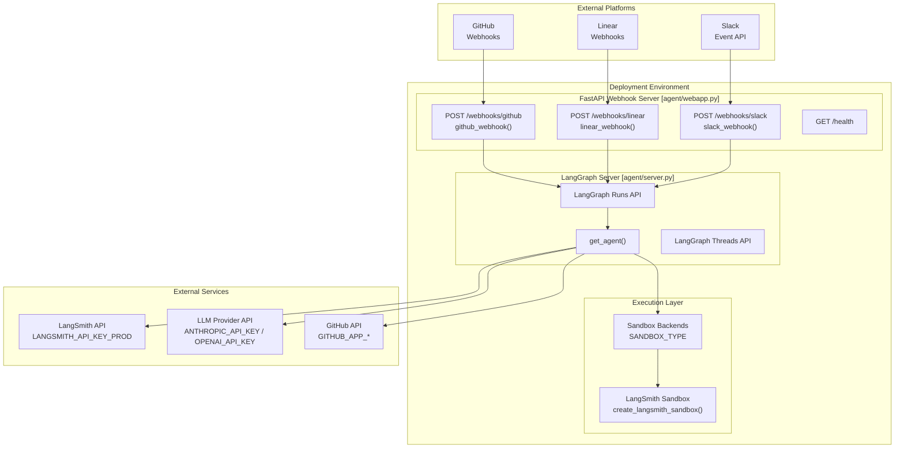
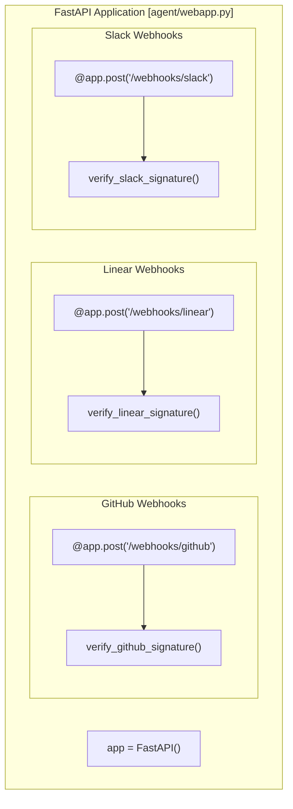

<!-- source: DeepWiki mcp.deepwiki.com · repo langchain-ai/open-swe · page 11 Deployment · fetched 2026-10-26 -->

# Deployment

Relevant source files

The following files were used as context for generating this wiki page:

- [CUSTOMIZATION.md](CUSTOMIZATION.md)
- [Dockerfile](Dockerfile)
- [INSTALLATION.md](INSTALLATION.md)
- [README.md](README.md)
- [agent/tools/fetch_url.py](agent/tools/fetch_url.py)
- [agent/tools/http_request.py](agent/tools/http_request.py)
- [tests/test_http_security.py](tests/test_http_security.py)

This page provides a comprehensive guide to deploying Open SWE in production environments. It covers environment variable configuration, webhook setup with external platforms, LangGraph server deployment options, and Docker containerization.

For local development setup, see [Local Development Setup](#12.1). For details on the technology stack and infrastructure components, see [Technology Stack](#1.2).

---

## Overview

Open SWE deploys as two main components: a **FastAPI webhook server** ([agent/webapp.py]()) that receives events from external platforms, and a **LangGraph server** ([agent/server.py]()) that orchestrates agent execution. The webhook server handles signature verification and creates runs on the LangGraph server.

**Deployment Architecture**

This diagram shows the complete deployment topology. External webhooks hit the FastAPI endpoints, which trigger LangGraph runs. The `get_agent()` function provisions sandboxes based on the `SANDBOX_TYPE` and connects to external services.

**Sources:** [agent/server.py:3-23](), [INSTALLATION.md:39-102](), [README.md:34-50]()

---

## Environment Configuration

Open SWE requires specific environment variables for authentication, webhook security, and service integration. For details, see [Environment Configuration](#11.1).

### Required Environment Variables

| Variable | Description | Source |
|----------|-------------|--------|
| `LANGSMITH_API_KEY_PROD` | LangSmith API key for tracing and sandboxes | [INSTALLATION.md:113-113]() |
| `LANGSMITH_TENANT_ID_PROD` | LangSmith Tenant ID | [INSTALLATION.md:114-114]() |
| `GITHUB_APP_ID` | GitHub App ID from settings | [INSTALLATION.md:82-82]() |
| `GITHUB_APP_PRIVATE_KEY` | GitHub App RSA private key | [INSTALLATION.md:83-83]() |
| `GITHUB_APP_INSTALLATION_ID` | GitHub App installation ID | [INSTALLATION.md:99-99]() |
| `GITHUB_WEBHOOK_SECRET` | Secret for verifying GitHub webhooks | [INSTALLATION.md:62-65]() |

### Sandbox Configuration

The `SANDBOX_TYPE` variable determines where the agent executes code. Supported types include `langsmith` (default), `daytona`, `runloop`, `modal`, and `local`.

**Sources:** [CUSTOMIZATION.md:58-64](), [README.md:52-63]()

---

## Webhook Setup

Open SWE receives events from external platforms via webhooks. Each platform requires configuring a webhook URL pointing to the deployed FastAPI server. For details, see [Webhook Setup](#11.2).

**Webhook Endpoint Structure**

This diagram shows the FastAPI route definitions. Each webhook handler validates the request signature using the corresponding secret before processing.

**Sources:** [INSTALLATION.md:53-76](), [INSTALLATION.md:167-175](), [INSTALLATION.md:205-215]()

---

## LangGraph Server Deployment

The LangGraph server can be deployed on **LangGraph Cloud** or **self-hosted**. For details, see [LangGraph Server Deployment](#11.3).

- **LangGraph Cloud**: Managed platform that automatically builds based on `langgraph.json`.
- **Self-Hosted**: Run the server on custom infrastructure; the FastAPI webapp connects via `LANGGRAPH_URL`.

**Sources:** [INSTALLATION.md:349-366](), [INSTALLATION.md:396-415]()

---

## Docker Deployment

Open SWE provides a Dockerfile to build images for sandboxes or the application itself. For details, see [Docker Deployment](#11.4).

### Dockerfile Components

The Dockerfile installs a comprehensive toolchain to ensure the agent has everything it needs to build and test code:

- **Python**: 3.14.0-slim-trixie [Dockerfile:1-1]()
- **UV**: Package manager for Python [Dockerfile:46-59]()
- **Node.js & Yarn**: For frontend/JS environments [Dockerfile:63-67]()
- **Go**: For Go-based repositories [Dockerfile:69-75]()
- **GitHub CLI (gh)**: For PR and issue operations [Dockerfile:34-44]()

**Sources:** [Dockerfile:1-88]()

---

## Production Deployment Checklist

Before moving to production, verify:

- [ ] `GITHUB_WEBHOOK_SECRET` matches GitHub App settings.
- [ ] `SANDBOX_TYPE` is set to a production-grade provider (e.g., `langsmith`, `daytona`).
- [ ] `GITHUB_OAUTH_PROVIDER_ID` is configured in LangSmith if per-user identity is required.
- [ ] `ALLOWED_GITHUB_ORGS` is set to restrict access to authorized organizations.

**Sources:** [INSTALLATION.md:117-133](), [CUSTOMIZATION.md:58-64]()

---

