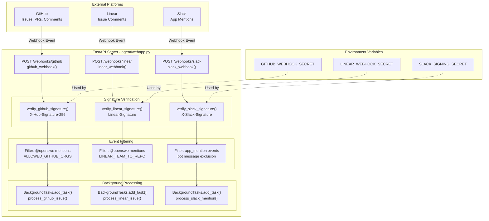
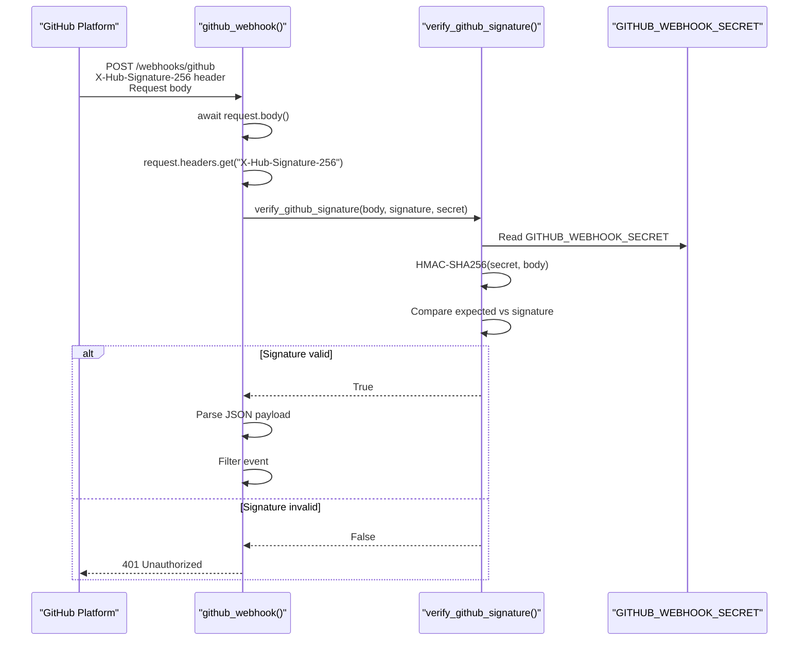
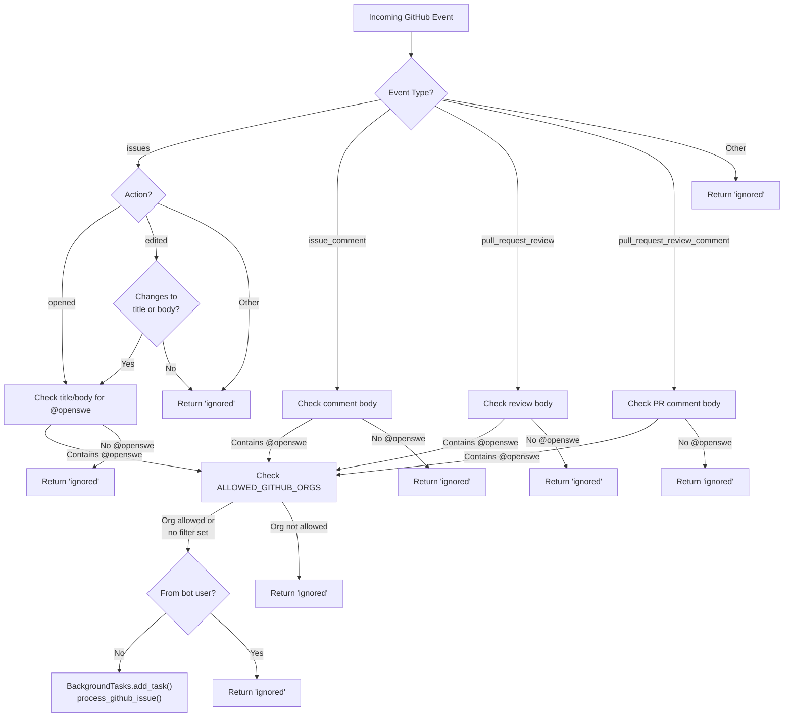
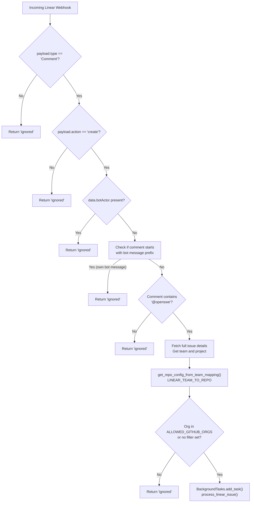
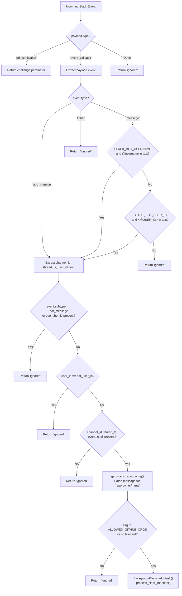

<!-- source: DeepWiki mcp.deepwiki.com · repo langchain-ai/open-swe · page 11.2 Webhook Setup · fetched 2026-10-26 -->

# Webhook Setup

<details>
<summary>Relevant source files</summary>

The following files were used as context for generating this wiki page:

- [CUSTOMIZATION.md](CUSTOMIZATION.md)
- [INSTALLATION.md](INSTALLATION.md)
- [README.md](README.md)
- [agent/webapp.py](agent/webapp.py)
- [tests/test_github_issue_webhook.py](tests/test_github_issue_webhook.py)

</details>


This page documents how to configure webhooks in external platforms (GitHub, Linear, Slack) to route events to the Open SWE FastAPI server. Webhooks are the primary mechanism for triggering agent runs from external user interactions.

For information about the overall deployment process, see [Environment Configuration](11.1) and [LangGraph Server Deployment](11.3). For details on how webhook events are processed internally, see [Webhook Processing Flow](2.4).

## Overview

Open SWE receives events from three external platforms via HTTP webhooks:

| Platform | Endpoint | Trigger |
|----------|----------|---------|
| GitHub | `POST /webhooks/github` | Issue/PR comments, issue creation, PR reviews |
| Linear | `POST /webhooks/linear` | Issue comments |
| Slack | `POST /webhooks/slack` | App mentions, direct messages |

Each webhook endpoint performs signature verification, event filtering, and dispatches background tasks for processing. All endpoints are defined in `agent/webapp.py` [agent/webapp.py:101]().

## Webhook Endpoint Architecture



**Sources:** [agent/webapp.py:101-1150](), [agent/utils/github_comments.py:57](), [agent/webapp.py:117-121]()

## GitHub Webhook Configuration

### Required Secrets

The GitHub webhook endpoint requires `GITHUB_WEBHOOK_SECRET` to verify incoming requests [agent/webapp.py:118](). Generate a secure secret:

```bash
openssl rand -hex 32
```

Set this value as `GITHUB_WEBHOOK_SECRET` in your environment and use the same value when configuring the webhook in GitHub [INSTALLATION.md:62-65]().

**Sources:** [agent/webapp.py:118](), [INSTALLATION.md:62-65]()

### GitHub App Webhook Settings

Configure your GitHub App with the following webhook settings:

| Setting | Value |
|---------|-------|
| **Webhook URL** | `https://<your-domain>/webhooks/github` |
| **Webhook secret** | Value of `GITHUB_WEBHOOK_SECRET` |
| **Content type** | `application/json` |

Enable these webhook events:
- **Issue comment** — triggers on new issue comments
- **Pull request review** — triggers on PR review submissions
- **Pull request review comment** — triggers on inline PR review comments

**Sources:** [INSTALLATION.md:54-76](), [agent/webapp.py:1100-1150]()

### GitHub Signature Verification



The signature verification implementation in `agent/utils/github_comments.py` [agent/utils/github_comments.py:57-64]():

```python
def verify_github_signature(body: bytes, signature: str, *, secret: str) -> bool:
    if not secret:
        logger.warning("GITHUB_WEBHOOK_SECRET is not configured — rejecting webhook request")
        return False

    expected = "sha256=" + hmac.new(secret.encode(), body, hashlib.sha256).hexdigest()
    return hmac.compare_digest(expected, signature)
```

**Sources:** [agent/utils/github_comments.py:57-64](), [agent/webapp.py:1115-1118]()

### GitHub Event Filtering

The GitHub webhook handler filters events based on several criteria:



Key filtering code references:

- Event type check: [agent/webapp.py:1122-1127]()
- `@openswe` mention detection: Case-insensitive search for `@openswe` tags [agent/utils/github_comments.py:46]()
- Organization allowlist: [agent/webapp.py:137-141](), checked in [agent/webapp.py:1130-1135]()
- Bot detection: Checks if sender matches bot user patterns [agent/webapp.py:1140-1145]()

**Sources:** [agent/webapp.py:1100-1150](), [agent/utils/github_comments.py:46]()

## Linear Webhook Configuration

### Required Secrets

The Linear webhook requires two credentials:

1. **Webhook Secret** — for signature verification [agent/webapp.py:117]():
   ```bash
   openssl rand -hex 32
   ```
   Set as `LINEAR_WEBHOOK_SECRET`.

2. **API Key** — for fetching full issue details and posting comments [agent/webapp.py:162](). Generate from Linear Settings → API → Personal API keys. Set as `LINEAR_API_KEY`.

**Sources:** [agent/webapp.py:117](), [agent/webapp.py:162](), [INSTALLATION.md:176-185]()

### Linear Webhook Settings

Configure the webhook in Linear (Settings → API → Webhooks):

| Setting | Value |
|---------|-------|
| **Label** | `open-swe` |
| **URL** | `https://<your-domain>/webhooks/linear` |
| **Secret** | Value of `LINEAR_WEBHOOK_SECRET` |
| **Events** | Comments → Create (only) |

The webhook endpoint also provides a GET endpoint for verification: `GET /webhooks/linear` returns `{"status": "ok"}` [agent/webapp.py:951-954]().

**Sources:** [INSTALLATION.md:171-179](), [agent/webapp.py:951-954]()

### Linear Signature Verification

The signature is provided in the `Linear-Signature` header and verified using `verify_linear_signature` [agent/webapp.py:813-830]():

```python
def verify_linear_signature(body: bytes, signature: str, secret: str) -> bool:
    if not secret:
        logger.warning("LINEAR_WEBHOOK_SECRET is not configured — rejecting webhook request")
        return False
    
    expected = hmac.new(secret.encode("utf-8"), body, hashlib.sha256).hexdigest()
    return hmac.compare_digest(expected, signature)
```

**Sources:** [agent/webapp.py:813-830](), [agent/webapp.py:844-847]()

### Linear Event Filtering

Linear webhooks are filtered to ensure the agent only responds to relevant human comments.



Bot message prefixes that are ignored include `🔐 **GitHub Authentication Required**` and `🤖 **Agent Response**` [agent/webapp.py:164-172]().

**Sources:** [agent/webapp.py:833-948](), [agent/webapp.py:164-172]()

### Team-to-Repository Mapping

Linear issues are routed to GitHub repositories based on the Linear team and project. Configure the mapping in `agent/utils/linear_team_repo_map.py` [agent/utils/linear_team_repo_map.py:39](). The `get_repo_config_from_team_mapping` function handles lookup [agent/webapp.py:175-198]().

The mapping supports:
- **Flat mapping**: Team name → repository config
- **Nested mapping**: Team name → project name → repository config
- **Default fallback**: Team name → default repository if project not found

**Sources:** [agent/webapp.py:175-198](), [agent/utils/linear_team_repo_map.py:39](), [INSTALLATION.md:187-202]()

## Slack Webhook Configuration

### Required Credentials

The Slack webhook requires several environment variables:

| Variable | Description |
|----------|-------------|
| `SLACK_BOT_TOKEN` | Bot User OAuth Token (`xoxb-...`) |
| `SLACK_SIGNING_SECRET` | Request signature verification secret [agent/webapp.py:119]() |
| `SLACK_BOT_USER_ID` | Bot's user ID (e.g., `U01234567`) [agent/webapp.py:120]() |
| `SLACK_BOT_USERNAME` | Bot's display name (e.g., `openswe`) [agent/webapp.py:121]() |

**Sources:** [agent/webapp.py:119-121](), [INSTALLATION.md:276-283]()

### Slack App Event Subscriptions

Configure in the Slack App settings:

| Setting | Value |
|---------|-------|
| **Request URL** | `https://<your-domain>/webhooks/slack` |
| **Subscribe to bot events** | `app_mention`, `message.im`, `message.mpim` |

The Slack webhook handles URL verification challenges automatically by returning the `challenge` parameter [agent/webapp.py:979-981]().

**Sources:** [INSTALLATION.md:208-273](), [agent/webapp.py:957-1046]()

### Slack Signature Verification

Slack uses request timestamp and HMAC-SHA256 for signature verification. The implementation in `agent/utils/slack.py` [agent/utils/slack.py:83]() includes signature verification logic called by the webapp.

**Sources:** [agent/utils/slack.py:83](), [agent/webapp.py:962-971]()

### Slack Event Filtering



**Sources:** [agent/webapp.py:957-1046](), [agent/utils/slack.py:83]()

### Repository Resolution for Slack

Slack messages can specify a repository in three ways:
1. **Explicit syntax**: `repo:owner/name` or `repo owner/name` [agent/utils/repo.py:25-33]().
2. **GitHub URL**: Extract from `github.com/owner/name` URLs [agent/utils/repo.py:36-38]().
3. **Default**: Use `SLACK_REPO_OWNER` and `SLACK_REPO_NAME` [agent/webapp.py:124-125]().

The resolution logic is implemented in `get_slack_repo_config()` [agent/webapp.py:345-387]().

**Sources:** [agent/webapp.py:345-387](), [agent/utils/repo.py:11-42](), [INSTALLATION.md:285-292]()

## Security Considerations

### Signature Verification Enforcement

All three webhook endpoints **require** signature verification. Requests without valid signatures are rejected with HTTP 401 [agent/webapp.py:1115-1118](), [agent/webapp.py:844-847](), [agent/webapp.py:964-971]().

### Organization Allowlist

The `ALLOWED_GITHUB_ORGS` environment variable restricts which GitHub organizations the agent can operate on [agent/webapp.py:137-141](). If set, only repositories belonging to the specified organizations are accepted [agent/webapp.py:297-306]().

**Sources:** [agent/webapp.py:137-141](), [agent/webapp.py:297-306]()

## Testing Webhook Configuration

### Local Development with ngrok

For local development, use ngrok to expose your local server to the internet [INSTALLATION.md:25-37]():

```bash
ngrok http 2024 --url https://your-subdomain.ngrok.dev
```

Configure all webhook URLs to point to `https://your-subdomain.ngrok.dev/webhooks/{platform}`.

### Verification Endpoints

Test webhook connectivity:

| Endpoint | Method | Response |
|----------|--------|----------|
| `/webhooks/linear` | GET | `{"status": "ok", "message": "Linear webhook endpoint is active"}` [agent/webapp.py:951-954]() |

**Sources:** [agent/webapp.py:951-954](), [INSTALLATION.md:358-365]()

---

