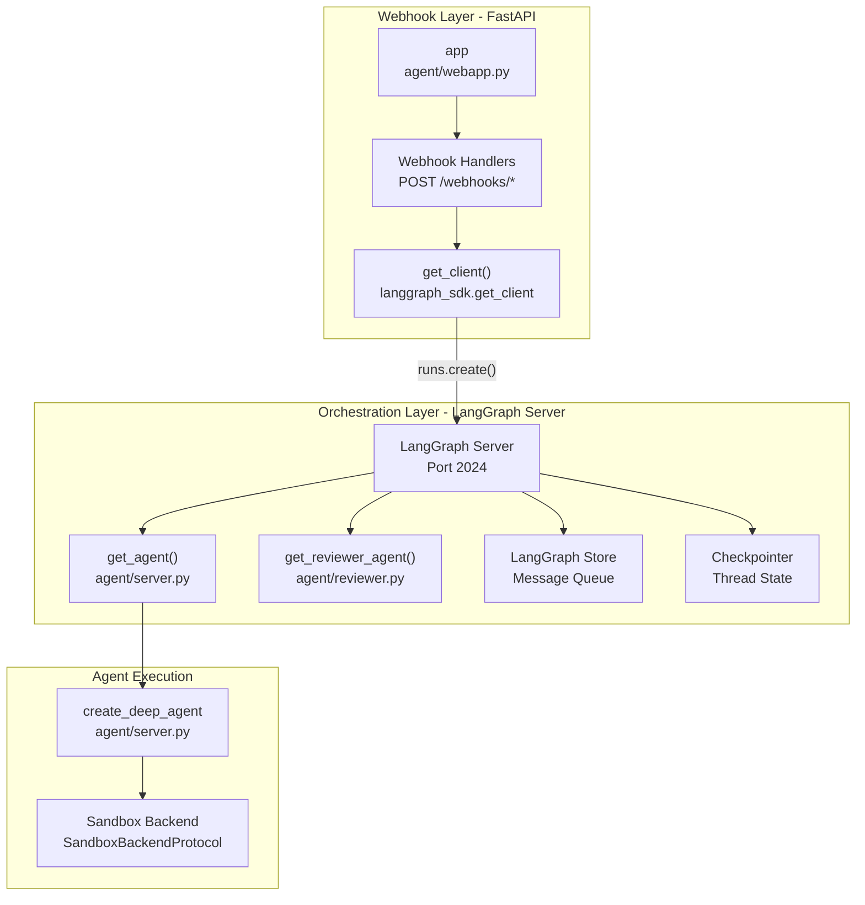
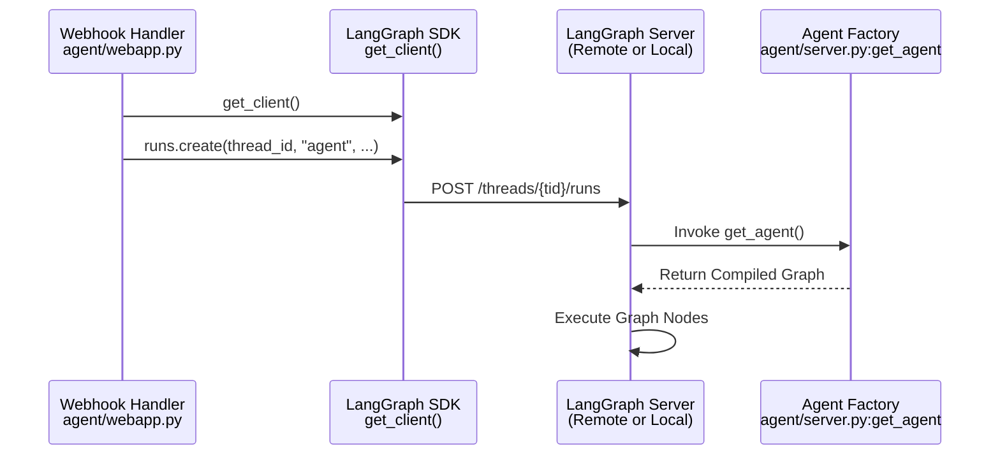
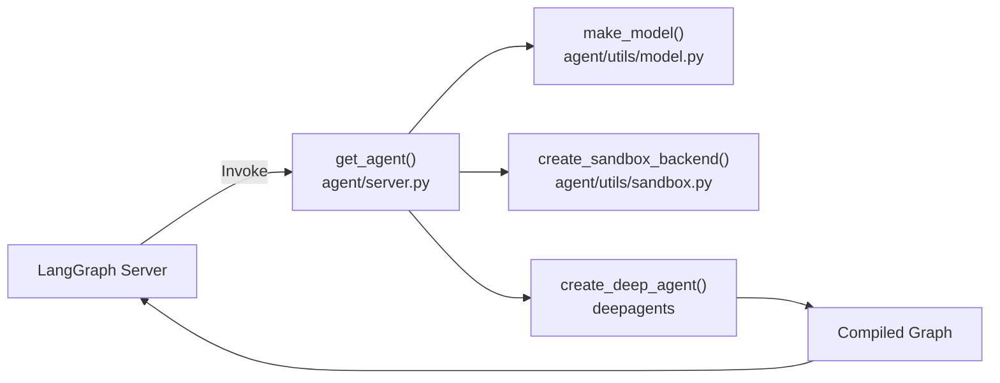

<!-- source: DeepWiki mcp.deepwiki.com · repo langchain-ai/open-swe · page 11.3 LangGraph Server Deployment · fetched 2026-10-26 -->

# LangGraph Server Deployment

Relevant source files

The following files were used as context for generating this wiki page:

- [CUSTOMIZATION.md](CUSTOMIZATION.md)
- [INSTALLATION.md](INSTALLATION.md)
- [Makefile](Makefile)
- [README.md](README.md)
- [agent/middleware/exclude_tools.py](agent/middleware/exclude_tools.py)
- [evals/reviewer/judge.py](evals/reviewer/judge.py)
- [langgraph.json](langgraph.json)

This page covers deployment options for the LangGraph orchestration layer, including LangGraph Cloud and self-hosted configurations. It explains how the FastAPI webapp connects to the LangGraph server and how agent graphs are defined via the `langgraph.json` configuration.

---

## Deployment Architecture Overview

The Open SWE system separates webhook handling (FastAPI) from agent orchestration (LangGraph Server) into two distinct layers that communicate over HTTP. The `langgraph.json` file defines the entry points for the graph logic, the reviewer logic, and the web application.

Title: System Deployment Architecture

**Sources:** [langgraph.json:4-12](), [agent/server.py:3-23](), [INSTALLATION.md:12-13]()

---

## LangGraph Configuration File

The `langgraph.json` file at the project root is the manifest used by the LangGraph CLI and LangGraph Cloud to locate the agent logic and the web server.

| Key | Value | Purpose |
|-----|-------|---------|
| `graphs.agent` | `"agent.server:get_agent"` | Points to the factory function that returns the compiled SWE agent [langgraph.json:5](). |
| `graphs.reviewer` | `"agent.reviewer:get_reviewer_agent"` | Points to the automated PR reviewer agent [langgraph.json:6](). |
| `http.app` | `"agent.webapp:app"` | Points to the FastAPI instance handling webhooks and dashboard API [langgraph.json:11](). |
| `python_version` | `"3.12"` | Specifies the runtime environment [langgraph.json:3](). |
| `dependencies` | `["."]` | Includes the local package for imports [langgraph.json:9](). |

**Example langgraph.json:**
[langgraph.json:1-14]()

**Sources:** [langgraph.json:1-14]()

---

## Connection Between Components

The FastAPI webhook layer in `agent/webapp.py` acts as a client to the LangGraph Server. It translates external events (Slack/GitHub/Linear) into LangGraph "runs".

### Execution Environment Resolution
During development, the system is typically run using the LangGraph CLI. The `Makefile` provides a `dev` target which executes `langgraph dev` [Makefile:10-11](). This starts the LangGraph server on port 2024 by default [INSTALLATION.md:13]().

### Run Creation Flow
When a webhook is received, the webapp triggers a run. For example, the `get_agent` function is invoked by the server to build the graph for a specific thread [langgraph.json:5]().

Title: Webapp to Server Communication

**Sources:** [langgraph.json:5-11](), [Makefile:10-15](), [INSTALLATION.md:12-13]()

---

## Deployment Options

### 1. LangGraph Cloud (Managed)
LangGraph Cloud is the recommended production path. It automatically reads `langgraph.json` to provision the infrastructure.

*   **Infrastructure:** Managed by LangChain.
*   **Scaling:** Automatic based on run volume.
*   **Persistence:** Managed checkpointer for thread state.
*   **Webhooks:** The FastAPI app defined in `agent.webapp:app` is automatically hosted alongside the graph [langgraph.json:11]().

### 2. Self-Hosted (CLI/Docker)
You can run the server manually using the `langgraph` CLI or within a Docker container.

*   **CLI Command:** `uv run langgraph dev` [Makefile:11]().
*   **Docker:** A `Dockerfile` is provided to containerize the application for custom infrastructure [INSTALLATION.md:138-146]().
*   **Port:** Defaults to `2024` for the LangGraph server [INSTALLATION.md:30]().

---

## The Graph Entry Point: get_agent()

The `get_agent` function in `agent/server.py` is the critical link between the server and the agent logic. It is the factory used to instantiate the `deepagent` with specific configurations.

### Core Responsibilities
1.  **Model Configuration:** Resolves the LLM to use (e.g., GPT-4o, Claude) via `make_model` [CUSTOMIZATION.md:7-13]().
2.  **Tool Setup:** Configures the suite of tools including `http_request`, `fetch_url`, and messaging tools [CUSTOMIZATION.md:15]().
3.  **Middleware Injection:** Attaches logic for error handling (`ToolErrorMiddleware`) and message queueing (`check_message_queue_before_model`) [CUSTOMIZATION.md:17-22]().
4.  **Sandbox Integration:** Connects the agent to the isolated execution environment [CUSTOMIZATION.md:16]().

Title: Agent Initialization Sequence

**Sources:** [CUSTOMIZATION.md:3-24](), [langgraph.json:5](), [agent/middleware/exclude_tools.py:33-43]()

---

## Webapp Mounting

The `agent.webapp:app` is a FastAPI instance that provides the external interface for webhooks.

### Key Endpoints
*   **GitHub:** Processes PR comments and issue events (configured in GitHub App settings) [INSTALLATION.md:61]().
*   **Linear:** Processes issue updates and comments [README.md:102-103]().
*   **Slack:** Processes mentions and thread replies [README.md:101]().

When deployed, the LangGraph server uses the `http.app` key in `langgraph.json` to mount this FastAPI application [langgraph.json:11](). This allows the system to receive webhooks and manage agent threads within a unified deployment.

**Sources:** [langgraph.json:10-12](), [INSTALLATION.md:61](), [README.md:99-106]()

---

