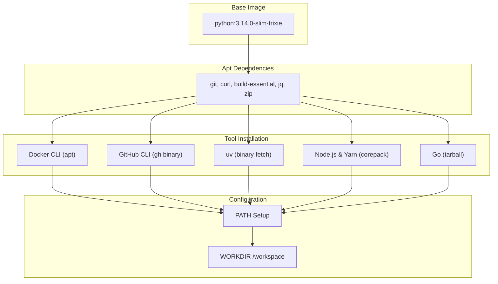
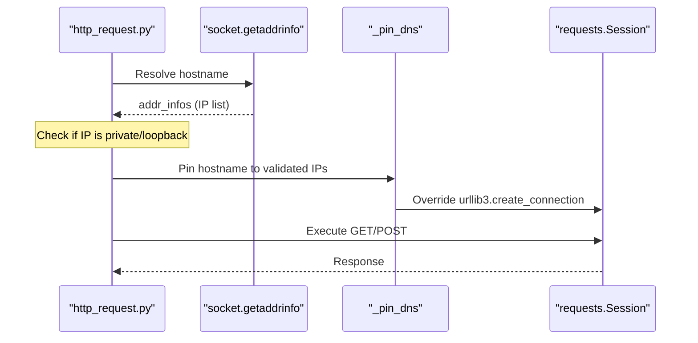

<!-- source: DeepWiki mcp.deepwiki.com · repo langchain-ai/open-swe · page 11.4 Docker Deployment · fetched 2026-10-26 -->

# Docker Deployment

<details>
<summary>Relevant source files</summary>

The following files were used as context for generating this wiki page:

- [.dockerignore](.dockerignore)
- [AGENTS.md](AGENTS.md)
- [CLAUDE.md](CLAUDE.md)
- [Dockerfile](Dockerfile)
- [agent/tools/fetch_url.py](agent/tools/fetch_url.py)
- [agent/tools/http_request.py](agent/tools/http_request.py)
- [tests/test_http_security.py](tests/test_http_security.py)

</details>


This page documents the Docker containerization of Open SWE, including the Dockerfile structure, image build process, and deployment patterns. The Docker image serves a dual purpose: it provides the execution environment for agent sandboxes (where code is cloned and edited) and can be used to deploy the Open SWE webhook server itself.

---

## Dockerfile Architecture

The Open SWE Dockerfile defines a comprehensive multi-runtime environment. It is designed to support the diverse language ecosystems that an agent might encounter, specifically Python, Node.js, and Go.

### System Components and Tools

The Dockerfile builds upon a Python base and layers in essential development tools and runtimes.

| Layer | Component | Version / Package | File Reference |
|:--- |:--- |:--- |:--- |
| **Base** | OS | `python:3.14.0-slim-trixie` | [Dockerfile:1]() |
| **System** | VCS | `git`, `openssh-client` | [Dockerfile:12-19]() |
| **System** | Utilities | `curl`, `wget`, `jq`, `unzip`, `zip` | [Dockerfile:13-22]() |
| **Runtime** | Docker CLI | `5:29.1.5-1~debian.13~trixie` | [Dockerfile:3]() |
| **Runtime** | GitHub CLI | `gh` (2.83.1) | [Dockerfile:7]() |
| **Runtime** | Python Tool | `uv` (0.9.26) | [Dockerfile:5]() |
| **Runtime** | Node.js | `22.22.0` | [Dockerfile:4]() |
| **Runtime** | JS Tool | `yarn` (4.12.0) | [Dockerfile:6]() |
| **Runtime** | Go | `1.23.5` | [Dockerfile:69]() |

### Build Logic Flow

The build process handles architecture-specific binaries (AMD64 vs ARM64) for tools like `gh`, `uv`, and `go` to ensure compatibility across different deployment environments.


**Sources:** [Dockerfile:1-88]()

---

## Building the Docker Image

### Build Command
The image is built using standard Docker commands. It supports build arguments to override tool versions if necessary.

```bash
docker build -t open-swe:latest .
```

### Architecture Detection
The Dockerfile uses `dpkg --print-architecture` to dynamically select the correct binary architecture strings (e.g., `aarch64-unknown-linux-gnu` for `uv` on ARM64) during the build process.

```bash
# Example of architecture mapping logic in Dockerfile
arch="$(dpkg --print-architecture)";
case "${arch}" in
  amd64) uv_arch="x86_64-unknown-linux-gnu" ;;
  arm64) uv_arch="aarch64-unknown-linux-gnu" ;;
esac;
```
**Sources:** [Dockerfile:34-44](), [Dockerfile:46-59]()

---

## Webhook Server Deployment

When deployed as the primary application container, the image runs the FastAPI webapp.

### Entrypoints and Routes
The application is served as defined in the `AGENTS.md` and `CLAUDE.md` documentation. The FastAPI app is located at `agent.webapp:app`.

| Component | Logic Location | Purpose |
|:--- |:--- |:--- |
| **Main App** | `agent/webapp.py` | FastAPI application and webhook endpoints |
| **Dashboard** | `agent/dashboard/` | React frontend and management API |
| **Dev Command** | `make dev` | Serves graphs + FastAPI via LangGraph dev |
| **Run Command** | `make run` | Direct Uvicorn execution of the webapp |

**Sources:** [AGENTS.md:17-34](), [CLAUDE.md:17-34]()

---

## Sandbox and Tool Execution

The Docker image provides the environment where tools like `http_request` and `fetch_url` are executed.

### Network Security within the Container
To prevent the agent from performing Server-Side Request Forgery (SSRF), the `http_request` tool implements strict DNS pinning and IP validation.


**Sources:** [agent/tools/http_request.py:125-162](), [agent/tools/http_request.py:91-123]()

### Tool Security Logic
1. **Validation**: `_resolve_and_validate(url)` checks every resolved address to ensure it is not private, loopback, link-local, or reserved. [agent/tools/http_request.py:125-162]()
2. **DNS Pinning**: `_pin_dns` uses a thread-local stack to ensure that the connection layer honors the validated IPs, preventing DNS-rebinding attacks. [agent/tools/http_request.py:91-123]()
3. **Safe Redirects**: `_request_with_safe_redirects` re-validates and re-pins DNS for every hop in a redirect chain. [agent/tools/http_request.py:180-210]()

**Sources:** [agent/tools/http_request.py:28-88](), [agent/tools/fetch_url.py:34-46]()

---

## Production Deployment Patterns

### Infrastructure Requirements
As documented in the architecture overview, Open SWE requires a persistent environment for its sandboxes.

- **Sandbox Lifecycle**: Managed via `ensure_sandbox_for_thread` which persists `sandbox_id` in thread metadata. [AGENTS.md:46-53]()
- **GitHub Proxy**: For `SANDBOX_TYPE=langsmith`, the system configures a proxy to inject credentials so real tokens never reside in the sandbox environment. [AGENTS.md:54-58]()

### Exclusions
To keep the image slim and secure, the `.dockerignore` file excludes sensitive files and local development artifacts:
- Environment files (`.env`, `.env.*`)
- Security credentials (`*.pem`, `credentials.json`)
- Virtual environments and caches (`.venv`, `node_modules`, `__pycache__`)

**Sources:** [.dockerignore:1-15]()

---

