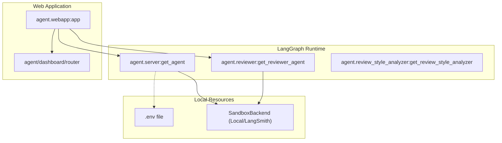
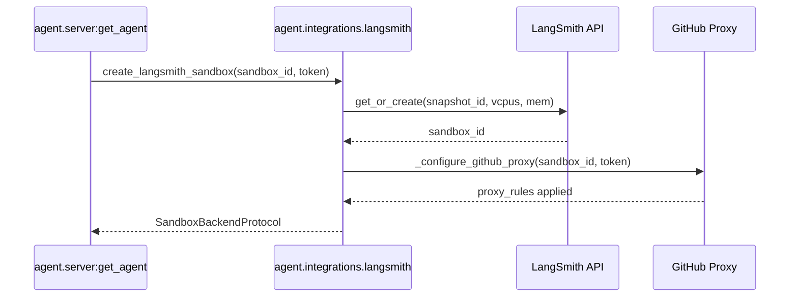

<!-- source: DeepWiki mcp.deepwiki.com · repo langchain-ai/open-swe · page 12.1 Local Development Setup · fetched 2026-10-26 -->

# Local Development Setup

<details>
<summary>Relevant source files</summary>

The following files were used as context for generating this wiki page:

- [.dockerignore](.dockerignore)
- [AGENTS.md](AGENTS.md)
- [CLAUDE.md](CLAUDE.md)
- [Makefile](Makefile)
- [agent/integrations/langsmith.py](agent/integrations/langsmith.py)
- [agent/middleware/exclude_tools.py](agent/middleware/exclude_tools.py)
- [evals/reviewer/judge.py](evals/reviewer/judge.py)
- [langgraph.json](langgraph.json)
- [pyproject.toml](pyproject.toml)
- [uv.lock](uv.lock)

</details>


This guide provides a step-by-step walkthrough for setting up a local development environment for Open SWE. It covers dependency management using `uv`, configuration of the three primary LangGraph agents, and the architecture of the local development loop.

---

## Prerequisites

Open SWE requires the following tools for development:

| Tool | Purpose | Minimum Version |
|------|---------|----------------|
| **Python** | Backend services and agent runtime | 3.11+ |
| **UV** | Python package manager and build tool | Latest |
| **LangGraph CLI** | Local development server for graphs | 0.4.24+ |
| **Ruff** | Linting and formatting | 0.15.12+ |

The project specifies Python 3.11+ in `pyproject.toml` [pyproject.toml:6-6](), though the `langgraph.json` configuration pins the runtime to 3.12 [langgraph.json:3-3]().

---

## Installation

Open SWE uses `uv` for high-performance dependency management.

### 1. Install Python Dependencies
Run the following command to install the core dependencies, including `deepagents`, `langgraph`, and `fastapi` [pyproject.toml:8-28]().

```bash
make install
```
*Implementation note: This executes `uv pip install -e .` [Makefile:16-17]().*

### 2. Install Development Tools
To include testing and linting tools like `pytest` and `ruff` [pyproject.toml:31-36]():

```bash
uv pip install -e ".[dev]"
```

**Sources:** [pyproject.toml:1-36](), [Makefile:16-17](), [uv.lock:1-7]()

---

## Local Development Workflow

Open SWE is structured as a multi-graph LangGraph application. The local development environment serves the coding agent, the reviewer agent, and the FastAPI webhook app simultaneously.

### 1. Running the Development Server
The primary way to develop locally is using the LangGraph dev server, which monitors the entrypoints defined in `langgraph.json` [langgraph.json:4-12]().

```bash
make dev
```
*Implementation note: This executes `uv run langgraph dev` [Makefile:10-11]().*

### 2. Service Architecture
When running `make dev`, the system orchestrates the following components:

**Local Service Composition**


**Sources:** [langgraph.json:1-14](), [AGENTS.md:15-34](), [Makefile:10-14]()

---

## Sandbox Configuration

Open SWE supports multiple sandbox providers. For local development, you typically use `local` or `langsmith`.

### 1. Provider Selection
The sandbox type is controlled by the `SANDBOX_TYPE` environment variable. The system uses a factory pattern to instantiate the backend [AGENTS.md:55-55]().

### 2. LangSmith Sandbox Setup
If using `SANDBOX_TYPE=langsmith`, the system configures a proxy to inject GitHub credentials so tokens are never stored on the sandbox disk [agent/integrations/langsmith.py:98-108]().

**Sandbox Initialization Flow**


**Sources:** [agent/integrations/langsmith.py:126-170](), [AGENTS.md:54-58]()

---

## Configuration Reference

### Environment Variables (`.env`)
The `langgraph.json` file points to a `.env` file for local secrets [langgraph.json:13-13](). Key variables include:

| Variable | Description |
|----------|-------------|
| `SANDBOX_TYPE` | `local`, `langsmith`, `modal`, `daytona`, `runloop` [AGENTS.md:55-55]() |
| `LANGSMITH_API_KEY` | Required for LangSmith sandboxes and tracing [agent/integrations/langsmith.py:25-31]() |
| `DEFAULT_SANDBOX_VCPUS` | CPU allocation for LangSmith boxes (default: 2) [agent/integrations/langsmith.py:19-19]() |
| `DEFAULT_SANDBOX_MEM_BYTES` | Memory allocation (default: ~8GiB) [agent/integrations/langsmith.py:20-20]() |

### Command Cheat Sheet
| Task | Command |
|------|---------|
| Start All Graphs | `make dev` |
| Start Webapp Only | `make run` |
| Run All Tests | `make test` |
| Lint Code | `make lint` |
| Format Code | `make format` |

**Sources:** [Makefile:1-69](), [AGENTS.md:15-24](), [agent/integrations/langsmith.py:18-22]()

---

## Code Quality and Safety

### Linting and Formatting
The project enforces strict standards via `ruff` with a line length of 100 [pyproject.toml:48-64]().
- **Check**: `make lint`
- **Fix**: `make format`

### Testing
Tests are powered by `pytest` with `asyncio` support [pyproject.toml:66-68]().
- **Full suite**: `uv run pytest -vvv tests/` [Makefile:27-27]()
- **Single test**: `uv run pytest -vvv tests/test_file.py::test_name` [AGENTS.md:21-21]()

**Sources:** [pyproject.toml:48-69](), [Makefile:25-37](), [AGENTS.md:11-24]()

---

