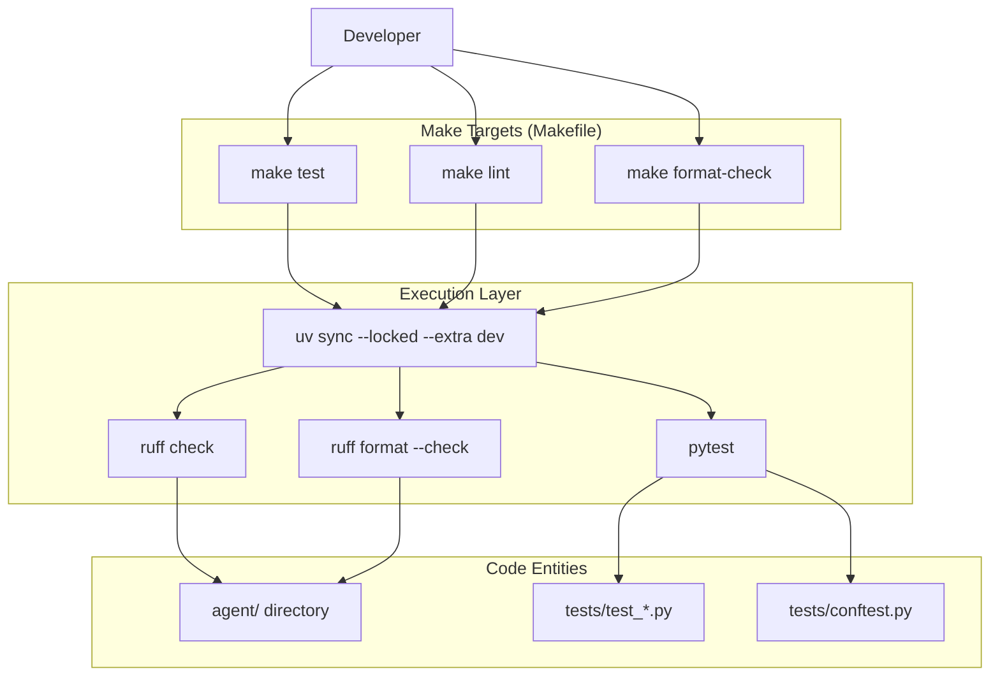

<!-- source: DeepWiki mcp.deepwiki.com · repo langchain-ai/open-swe · page 12.2 Testing · fetched 2026-10-26 -->

# Testing

<details>
<summary>Relevant source files</summary>

The following files were used as context for generating this wiki page:

- [.github/workflows/ci.yml](.github/workflows/ci.yml)
- [.github/workflows/pr_lint.yml](.github/workflows/pr_lint.yml)
- [LICENSE](LICENSE)
- [agent/dashboard/enabled_repos.py](agent/dashboard/enabled_repos.py)
- [tests/conftest.py](tests/conftest.py)
- [tests/test_reviewer_eval_run.py](tests/test_reviewer_eval_run.py)

</details>


This document covers the testing infrastructure in Open SWE, including test organization, how to run tests locally, test dependencies, and specialized testing for components like the Reviewer Agent.

## Overview

Open SWE uses a combination of unit tests, code quality checks (linting and formatting), and automated test execution through `Make` targets. The testing strategy focuses on validating the core agent logic, the webhooks/dashboard API, and the evaluation of reviewer performance.

The testing infrastructure is built on:
- **pytest**: Primary Python test framework.
- **ruff**: Python linter and formatter used for static analysis.
- **uv**: Package manager that handles test dependencies and synchronization.
- **Make**: Command orchestration layer for standardizing test execution.
- **GitHub Actions**: Automated CI execution on push and pull requests.

**Sources:**
- [.github/workflows/ci.yml:1-49]()

## Test Organization

Tests are located in the `tests/` directory at the root of the repository. The project follows standard Python testing conventions where test files are named with the `test_` prefix.

### Shared Fixtures and Mocks
Open SWE uses a central `conftest.py` to define shared fixtures that manage the test environment state.

- **Repo Enablement Mock**: To avoid dependency on a live LangGraph Store during tests, a global autouse fixture `_default_enable_review_repos` is provided. It patches `agent.webapp.is_review_repo_enabled` to return `True` by default [tests/conftest.py:10-26](). This allows tests to bypass the opt-in gate that usually filters repositories based on the dashboard configuration [agent/dashboard/enabled_repos.py:63-69]().

### Reviewer Evaluation Tests
Specific tests exist for the reviewer agent's evaluation infrastructure. For example, `tests/test_reviewer_eval_run.py` validates:
- **Configuration Coercion**: The `_coerce_config` function correctly parses and filters evaluation parameters like `model_id`, `severity_threshold`, and `max_concurrency` [tests/test_reviewer_eval_run.py:9-37]().
- **Environment Injection**: The `_apply_config_to_env` function correctly maps configuration keys to the environment variables required by the evaluation runner, such as `REVIEWER_EVAL_MODEL_ID` and `LANGGRAPH_URL` [tests/test_reviewer_eval_run.py:40-61]().

**Sources:**
- [tests/conftest.py:1-27]()
- [tests/test_reviewer_eval_run.py:1-61]()
- [agent/dashboard/enabled_repos.py:63-69]()

## Running Tests Locally

### Test Execution Flow

The following diagram illustrates how a developer interacts with the testing infrastructure and how `uv` manages the underlying environment.

**Natural Language to Code Entity Space: Test Invocation**

**Sources:**
- [.github/workflows/ci.yml:16-49]()
- [tests/conftest.py:7-11]()

### Basic Test Commands

To run tests locally, use the following commands. Each command ensures dependencies are synchronized via `uv sync` before execution.

```bash
# Install development dependencies and sync lockfile
uv sync --locked --extra dev

# Run the unit test suite
make test

# Run static analysis (linting)
make lint

# Verify code formatting without applying changes
make format-check
```

**Sources:**
- [.github/workflows/ci.yml:24-26]()
- [.github/workflows/ci.yml:35-37]()
- [.github/workflows/ci.yml:46-48]()

## CI Test Execution

The GitHub Actions CI pipeline (`Agent CI`) automates the validation process on every push to `main` and on all pull requests.

### CI Job Matrix

| Job Name | Make Target | Description |
|----------|-------------|-------------|
| `lint` | `make lint` | Checks for programmatic and stylistic errors using `ruff`. |
| `format` | `make format-check` | Ensures code adheres to the project's formatting standard. |
| `unit-tests` | `make test` | Executes the `pytest` suite. |

### PR Title Linting
In addition to code tests, a specialized `PR Title Lint` workflow ensures that pull request titles follow semantic versioning conventions (e.g., `feat:`, `fix:`, `docs:`) [/.github/workflows/pr_lint.yml:1-31](). This helps in generating clean changelogs and maintaining repository history.

**Sources:**
- [.github/workflows/ci.yml:17-49]()
- [.github/workflows/pr_lint.yml:1-42]()

## Environment Considerations

Testing Open SWE requires specific environment handling due to its reliance on external services and stateful components.

1. **LangGraph Store Mocking**: Since the LangGraph Store (used for persistence of enabled repos and review styles) is not available in a standard test runner, tests must mock the `agent.dashboard.enabled_repos` functions [tests/conftest.py:26-26]().
2. **Environment Variable Injection**: The reviewer evaluation system relies heavily on environment variables. Tests in `tests/test_reviewer_eval_run.py` use `unittest.mock.patch.dict` to verify that configuration objects are correctly transformed into environment variables for the subprocesses or API clients [tests/test_reviewer_eval_run.py:41-42]().

**Sources:**
- [tests/conftest.py:10-27]()
- [tests/test_reviewer_eval_run.py:40-61]()

---

