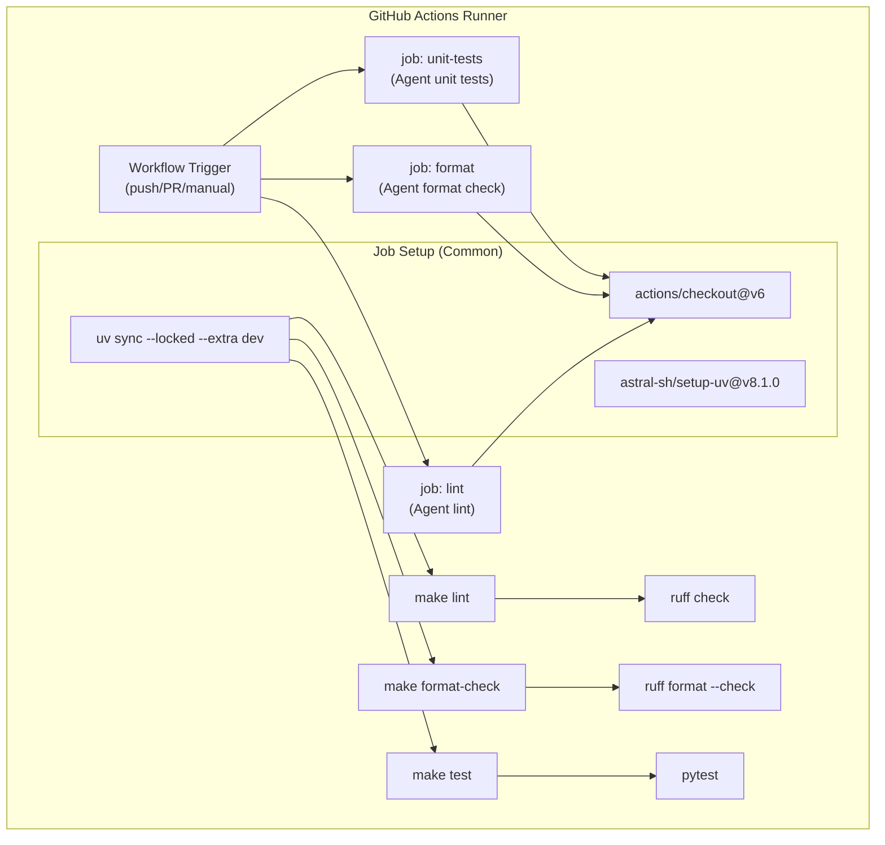
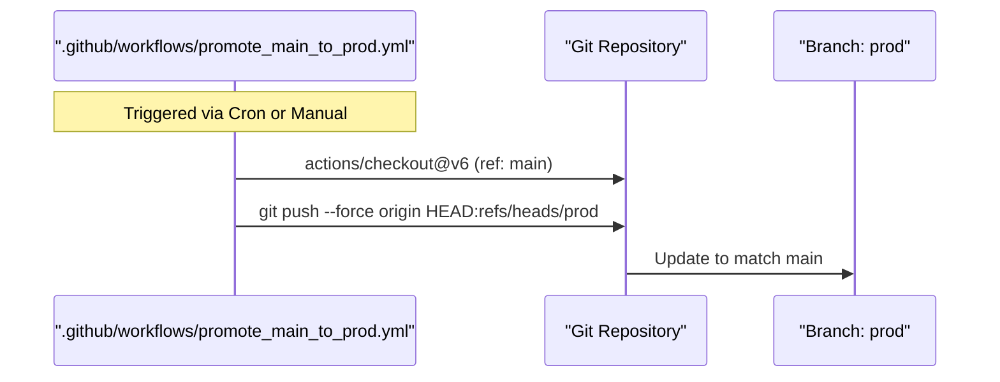

<!-- source: DeepWiki mcp.deepwiki.com · repo langchain-ai/open-swe · page 12.3 CI/CD Pipeline · fetched 2026-10-26 -->

# CI/CD Pipeline

Relevant source files

The following files were used as context for generating this wiki page:

- [.github/dependabot.yml](.github/dependabot.yml)
- [.github/workflows/ci.yml](.github/workflows/ci.yml)
- [.github/workflows/pr_lint.yml](.github/workflows/pr_lint.yml)
- [.github/workflows/promote_main_to_prod.yml](.github/workflows/promote_main_to_prod.yml)
- [LICENSE](LICENSE)

This page documents the continuous integration and continuous deployment (CI/CD) workflows for Open SWE. The CI/CD pipeline automates code quality checks, formatting validation, test execution, and automated branch promotion using GitHub Actions.

---

## Overview

The Open SWE CI/CD infrastructure consists of several specialized workflows that manage the lifecycle of the codebase from pull request creation to production deployment.

1.  **Agent CI** [`.github/workflows/ci.yml:1-49`()] — Runs linting, formatting, and unit tests on every push and PR.
2.  **PR Title Lint** [`.github/workflows/pr_lint.yml:1-42`()] — Enforces semantic versioning standards for pull request titles.
3.  **Promote Main to Prod** [`.github/workflows/promote_main_to_prod.yml:1-26`()] — Automates the synchronization of the `main` branch to the `prod` branch.
4.  **Dependabot** [`.github/workflows/dependabot.yml:1-53`()] — Manages automated dependency updates for `uv`, Docker, and GitHub Actions.

---

## Agent CI Workflow

The primary CI workflow, named `Agent CI`, ensures code quality by running parallel jobs on every push to `main`, pull request, or manual trigger [`.github/workflows/ci.yml:6-10`()].

### Workflow Metadata

| Property | Value | Description |
| :--- | :--- | :--- |
| **Permissions** | `contents: read` | Minimal permissions for security [`.github/workflows/ci.yml:4-4`()] |
| **Concurrency Group** | `${{ github.workflow }}-${{ github.ref }}` | Groups runs by workflow and branch/PR [`.github/workflows/ci.yml:13-13`()] |
| **Cancel In-Progress** | `true` | Cancels outdated runs when new commits are pushed [`.github/workflows/ci.yml:14-14`()] |

### CI Execution Flow

All jobs run in parallel on `ubuntu-latest` runners and use `uv` for dependency management [`.github/workflows/ci.yml:19,30,41`()].

**Sources:** [`.github/workflows/ci.yml:1-49`()]

---

## Pull Request Management

Open SWE enforces strict standards for pull requests to maintain a clean git history and high code quality.

### PR Title Linting
The `PR Title Lint` workflow uses `amannn/action-semantic-pull-request` [`.github/workflows/pr_lint.yml:15-15`()] to validate that PR titles follow the Conventional Commits specification.

*   **Allowed Types:** `feat`, `fix`, `docs`, `style`, `refactor`, `perf`, `test`, `build`, `ci`, `chore`, `revert`, `release` [`.github/workflows/pr_lint.yml:20-31`()].
*   **Allowed Scopes:** `shared`, `cli`, `web`, `open-swe`, `docs`, `deps` [`.github/workflows/pr_lint.yml:33-38`()].

### Automated Dependency Updates
Dependabot is configured to check for updates monthly [`.github/workflows/dependabot.yml:5,22,40`()]. It groups updates into `minor-and-patch` and `major` categories for three ecosystems:
*   **uv:** Python package management [`.github/workflows/dependabot.yml:3-18`()].
*   **docker:** Container images [`.github/workflows/dependabot.yml:20-35`()].
*   **github-actions:** Workflow actions [`.github/workflows/dependabot.yml:37-52`()].

**Sources:** [`.github/workflows/pr_lint.yml:1-42`()], [`.github/workflows/dependabot.yml:1-53`()]

---

## Deployment and Promotion

Open SWE follows a branch-based deployment strategy where the `prod` branch represents the stable production environment.

### Branch Promotion Logic
The `Promote main to prod` workflow automates the movement of code from the development branch (`main`) to the production branch (`prod`).

*   **Schedule:** Runs daily at 08:00 UTC [`.github/workflows/promote_main_to_prod.yml:8-8`()].
*   **Manual Trigger:** Can be invoked via `workflow_dispatch` [`.github/workflows/promote_main_to_prod.yml:9-9`()].
*   **Implementation:** Performs a force-push of the `main` HEAD to `refs/heads/prod` [`.github/workflows/promote_main_to_prod.yml:25-25`()].

**Sources:** [`.github/workflows/promote_main_to_prod.yml:1-26`()]

---

## Tooling and Environment

### UV Dependency Synchronization
The CI jobs use the following synchronization logic to ensure environment parity [`.github/workflows/ci.yml:24,35,46`()]:
*   `--locked`: Strictly adheres to the `uv.lock` file.
*   `--extra dev`: Installs tools required for CI like Ruff and Pytest.

### Permissions Summary
| Workflow | Permission | Purpose |
| :--- | :--- | :--- |
| **Agent CI** | `contents: read` | Read code for testing [`.github/workflows/ci.yml:4-4`()] |
| **PR Title Lint** | `pull-requests: read` | Validate PR metadata [`.github/workflows/pr_lint.yml:4-4`()] |
| **Promote Main to Prod** | `contents: write` | Force-push to the `prod` branch [`.github/workflows/promote_main_to_prod.yml:4-4`()] |

**Sources:** [`.github/workflows/ci.yml:1-49`()], [`.github/workflows/promote_main_to_prod.yml:1-26`()]

---

