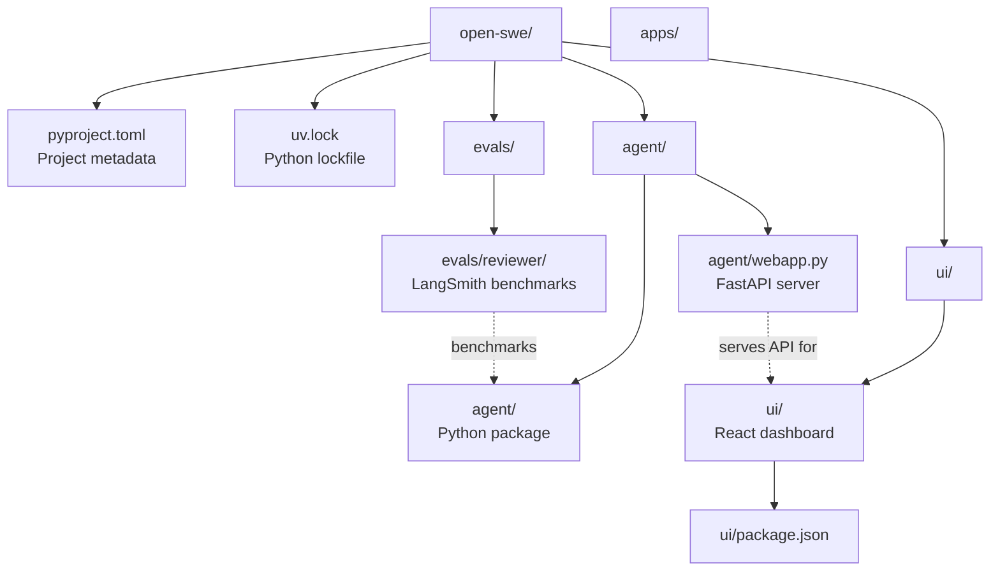
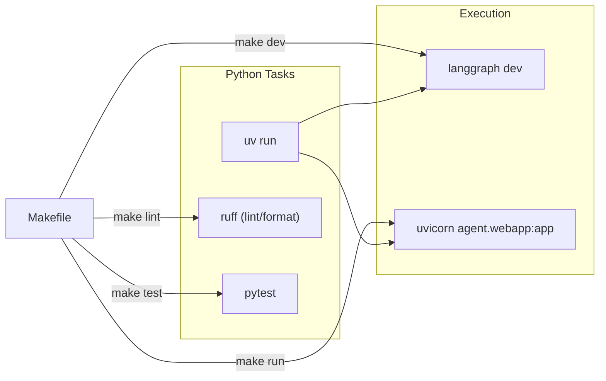

<!-- source: DeepWiki mcp.deepwiki.com · repo langchain-ai/open-swe · page 12.4 Monorepo Structure · fetched 2026-10-26 -->

# Monorepo Structure

Relevant source files

The following files were used as context for generating this wiki page:

- [Makefile](Makefile)
- [agent/integrations/langsmith.py](agent/integrations/langsmith.py)
- [agent/middleware/exclude_tools.py](agent/middleware/exclude_tools.py)
- [evals/reviewer/judge.py](evals/reviewer/judge.py)
- [langgraph.json](langgraph.json)
- [pyproject.toml](pyproject.toml)
- [ui/package.json](ui/package.json)
- [ui/src/components/AppSidebar.tsx](ui/src/components/AppSidebar.tsx)
- [ui/yarn.lock](ui/yarn.lock)
- [uv.lock](uv.lock)

This document describes the physical organization of the Open SWE codebase. While the project includes a React-based dashboard and a Python-based agent core, it utilizes a unified structure to manage dependencies, build processes, and cross-language integration.

## Overview

Open SWE is organized as a monorepo that bridges a Python backend (the Agent Core) with a TypeScript/React frontend (the Dashboard). The repository uses `uv` for Python package management and `yarn` for the frontend dashboard.

**Directory Structure:**

Sources: [pyproject.toml:1-28](), [uv.lock:1-7](), [langgraph.json:1-14](), [ui/package.json:1-63]()

## Project Configuration

The monorepo uses `pyproject.toml` as the primary manifest for the Python environment and `langgraph.json` to define the agentic graphs and server entry points.

**Core Manifests:**

| File | Purpose |
|------|---------|
| `pyproject.toml` | Defines Python dependencies (`deepagents`, `langgraph`, `fastapi`), build system (`hatchling`), and linting rules (`ruff`). |
| `uv.lock` | Deterministic lockfile for the entire Python environment. |
| `langgraph.json` | Maps graph identifiers to factory functions and defines the FastAPI webapp location. |
| `ui/package.json` | Manages React dependencies and build scripts for the dashboard. |

The `langgraph.json` file [langgraph.json:4-12]() is the central registry for the system's execution surfaces:
- **Graphs**: `agent`, `reviewer`, and `review_style_analyzer`.
- **HTTP**: Points to `agent.webapp:app` for the dashboard backend.

Sources: [pyproject.toml:1-40](), [langgraph.json:1-14]()

## Python Package Organization (`agent/`)

The `agent/` directory contains the core logic of the system, organized into functional sub-modules.

### Core Components

| Module | Role |
|--------|------|
| `agent.server` | Contains `get_agent`, the primary entry point for the coding agent. |
| `agent.reviewer` | Implements the automated PR reviewer logic and findings management. |
| `agent.integrations` | Sandbox providers (e.g., `langsmith.py`) and external service connectors. |
| `agent.middleware` | Logic that wraps the agent loop, such as `ExcludeToolsMiddleware`. |
| `agent.webapp` | The FastAPI server providing the dashboard API and webhook endpoints. |

### Sandbox Integration
The `agent/integrations/langsmith.py` file manages the lifecycle of remote execution environments. It uses `create_langsmith_sandbox` [agent/integrations/langsmith.py:126-170]() to provision containers and `_configure_github_proxy` [agent/integrations/langsmith.py:98-124]() to inject authentication without persisting tokens to the sandbox disk.

Sources: [langgraph.json:4-12](), [agent/integrations/langsmith.py:126-170](), [agent/middleware/exclude_tools.py:33-43]()

## Dashboard and UI (`ui/`)

The `ui/` directory contains a modern React application built with Vite and TanStack Router.

| Property | Value |
|----------|-------|
| Framework | React 19 + Vite |
| Routing | TanStack Router |
| Styling | Tailwind CSS 4 |
| Icons | Phosphor Icons / Lucide / React Icons |

**Key UI Entities:**
- **`AppSidebar`**: The primary navigation component [ui/src/components/AppSidebar.tsx:30-36]() defining routes for "Cloud Agents", "Open SWE Review", and "Admin".
- **`lib/api.ts`**: Handles communication with the FastAPI backend defined in `agent.webapp`.

Sources: [ui/package.json:14-45](), [ui/src/components/AppSidebar.tsx:30-49]()

## Build and Development Orchestration

The project uses a `Makefile` to provide a unified interface for development tasks across Python and Node.js environments.

**Build Dependency and Task Flow:**

**Common Commands:**
- `make dev`: Starts the LangGraph development server [Makefile:10-11]().
- `make run`: Starts the FastAPI webhook and dashboard API server [Makefile:13-14]().
- `make format`: Runs `ruff` to standardize Python code [Makefile:49-51]().

Sources: [Makefile:1-70]()

## Evaluation Infrastructure (`evals/`)

The `evals/` directory houses benchmarking logic to ensure agent quality. The `evals/reviewer/judge.py` file implements a sophisticated LLM-based evaluator.

- **`judge_match`**: Computes precision, recall, and F1 scores by comparing agent-generated PR comments against "golden" reference comments [evals/reviewer/judge.py:108-156]().
- **`aggregate_pr`**: Provides micro and macro averages across an entire experiment run [evals/reviewer/judge.py:163-199]().

This infrastructure allows developers to quantify the impact of prompt or tool changes on the agent's performance.

Sources: [evals/reviewer/judge.py:108-199]()

---

