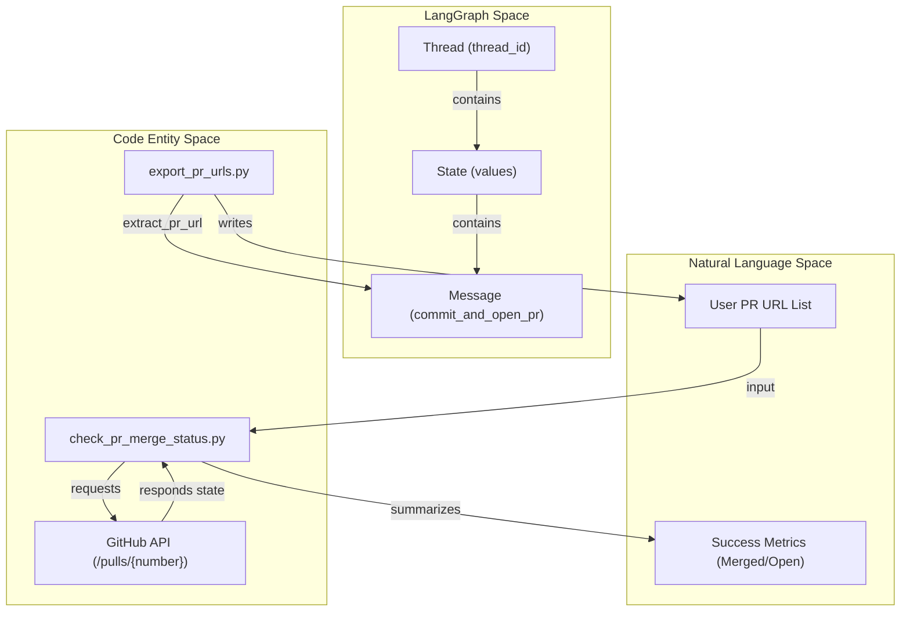
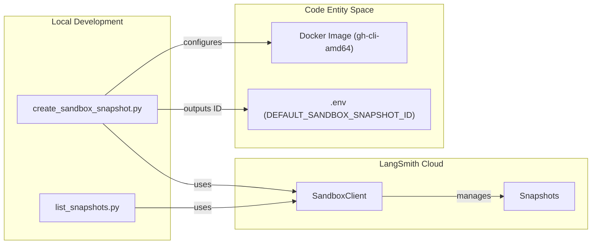

<!-- source: DeepWiki mcp.deepwiki.com · repo langchain-ai/open-swe · page 12.5 Operational Scripts · fetched 2026-10-26 -->

# Operational Scripts

<details>
<summary>Relevant source files</summary>

The following files were used as context for generating this wiki page:

- [agent/utils/authorship.py](agent/utils/authorship.py)
- [scripts/__init__.py](scripts/__init__.py)
- [scripts/check_pr_merge_status.py](scripts/check_pr_merge_status.py)
- [scripts/create_sandbox_snapshot.py](scripts/create_sandbox_snapshot.py)
- [scripts/list_snapshots.py](scripts/list_snapshots.py)

</details>


The `scripts/` directory contains utility scripts designed for PR analytics, bulk status monitoring, and sandbox environment management. These tools interact with the LangGraph API to extract data from agent execution threads, the GitHub API to verify the lifecycle of pull requests, and the LangSmith Sandbox API to manage execution environments.

## PR URL Extraction

The `export_pr_urls.py` script facilitates the extraction of unique GitHub PR URLs generated by Open SWE agents across multiple LangGraph threads.

### Implementation Details
The script performs a paginated search of threads via the `LangGraphClient` [scripts/export_pr_urls.py:206-208](). It targets threads created within a specific lookback window (defaulting to 9 days) [scripts/export_pr_urls.py:24-25]().

**Data Flow:**
1.  **Thread Discovery**: Searches for threads sorted by `created_at` descending [scripts/export_pr_urls.py:166-170]().
2.  **State Retrieval**: For each relevant thread, it fetches the thread state [scripts/export_pr_urls.py:182-187]().
3.  **Message Parsing**: It inspects the `messages` list within the state values. It specifically looks for messages where `type == "tool"` and `name == "commit_and_open_pr"` [scripts/export_pr_urls.py:47-50]().
4.  **URL Extraction**: It parses the JSON content of the tool output to retrieve the `pr_url` field [scripts/export_pr_urls.py:67-69]().

### Key Functions
| Function | Description |
| :--- | :--- |
| `export_pr_urls` | Main entry point that manages concurrency and pagination for thread scanning [scripts/export_pr_urls.py:190-204](). |
| `extract_pr_urls_from_messages` | Filters and parses tool messages to find successful PR creations [scripts/export_pr_urls.py:43-71](). |
| `_fetch_thread_page` | Low-level wrapper for `client.threads.search` [scripts/export_pr_urls.py:160-172](). |

**Sources:**
- [scripts/export_pr_urls.py:1-204]()
- [agent/tools/commit_and_open_pr.py:36-119]()

---

## Merge Status Analytics

The `check_pr_merge_status.py` script takes the output from the extraction script and performs bulk checking of PR states via the GitHub API.

### PR Classification Logic
The script classifies PRs into three primary buckets based on the GitHub API response [scripts/check_pr_merge_status.py:80-90]():
*   **merged**: PRs where the `merged` flag is true or `merged_at` is populated [scripts/check_pr_merge_status.py:81-82]().
*   **open_or_draft**: PRs with a state of `"open"` [scripts/check_pr_merge_status.py:85-86]().
*   **closed**: PRs with a state of `"closed"` that were never merged [scripts/check_pr_merge_status.py:87-88]().

### Execution Model
The script uses `httpx.AsyncClient` for high-concurrency network I/O [scripts/check_pr_merge_status.py:129-134](). It utilizes an `asyncio.Semaphore` to control the number of concurrent requests to the GitHub API [scripts/check_pr_merge_status.py:128-131](). It requires a `GITHUB_PAT` (Personal Access Token) for authenticated requests to avoid rate-limiting [scripts/check_pr_merge_status.py:165-167]().

**Sources:**
- [scripts/check_pr_merge_status.py:1-186]()

---

## Sandbox Snapshot Management

The repository includes scripts to manage LangSmith sandbox snapshots, which provide the execution environment for Open SWE agents.

### Snapshot Creation
The `create_sandbox_snapshot.py` script allows developers to create new LangSmith sandbox snapshots with specific Docker images and filesystem capacities [scripts/create_sandbox_snapshot.py:12-47]().

*   **Default Image**: `johanneslangchain/open-swe-sandbox:gh-cli-amd64` [scripts/create_sandbox_snapshot.py:8]().
*   **Default Capacity**: 32 GiB [scripts/create_sandbox_snapshot.py:9]().
*   **Implementation**: Uses the `SandboxClient` from `langsmith.sandbox` to call `create_snapshot` [scripts/create_sandbox_snapshot.py:36-41]().

### Snapshot Listing
The `list_snapshots.py` script provides a simple utility to view all existing snapshots, their IDs, and their current status [scripts/list_snapshots.py:1-6]().

**Sources:**
- [scripts/create_sandbox_snapshot.py:1-47]()
- [scripts/list_snapshots.py:1-6]()

---

## System Integration Diagrams

### PR Lifecycle Data Flow
This diagram illustrates how operational scripts bridge the gap between LangGraph's internal thread state and external GitHub entities.

Title: PR Analytics Data Flow

**Sources:**
- [scripts/export_pr_urls.py:43-71]()
- [scripts/check_pr_merge_status.py:93-119]()

### Sandbox Environment Management
This diagram shows how management scripts interact with the LangSmith Sandbox infrastructure.

Title: Sandbox Management Flow

**Sources:**
- [scripts/create_sandbox_snapshot.py:36-43]()
- [scripts/list_snapshots.py:3-5]()

---

## Configuration and Usage

### Environment Variables
Scripts utilize `.env` files if available via `load_dotenv` [scripts/export_pr_urls.py:27-32]().

| Variable | Required By | Description |
| :--- | :--- | :--- |
| `LANGGRAPH_URL` | `export_pr_urls.py` | URL of the LangGraph server (default: localhost:2024) [scripts/export_pr_urls.py:38-40](). |
| `LANGGRAPH_API_KEY` | `export_pr_urls.py` | Authentication for LangGraph Cloud [scripts/export_pr_urls.py:205](). |
| `GITHUB_PAT` | `check_pr_merge_status.py` | GitHub Personal Access Token for API requests [scripts/check_pr_merge_status.py:165-167](). |
| `LANGSMITH_API_KEY` | `create_sandbox_snapshot.py` | API key for LangSmith sandbox operations [scripts/create_sandbox_snapshot.py:27-30](). |

### CLI Examples
```bash
# 1. Export URLs from the last 7 days
python scripts/export_pr_urls.py --days-back 7 --output pr_urls.json

# 2. Check merge status of exported URLs
python scripts/check_pr_merge_status.py --input pr_urls.json --concurrency 10

# 3. Create a new sandbox snapshot
python scripts/create_sandbox_snapshot.py --name "custom-swe-env" --image "my-custom-image:latest"
```

**Sources:**
- [scripts/export_pr_urls.py:190-204]()
- [scripts/check_pr_merge_status.py:144-157]()
- [scripts/create_sandbox_snapshot.py:13-31]()

---

