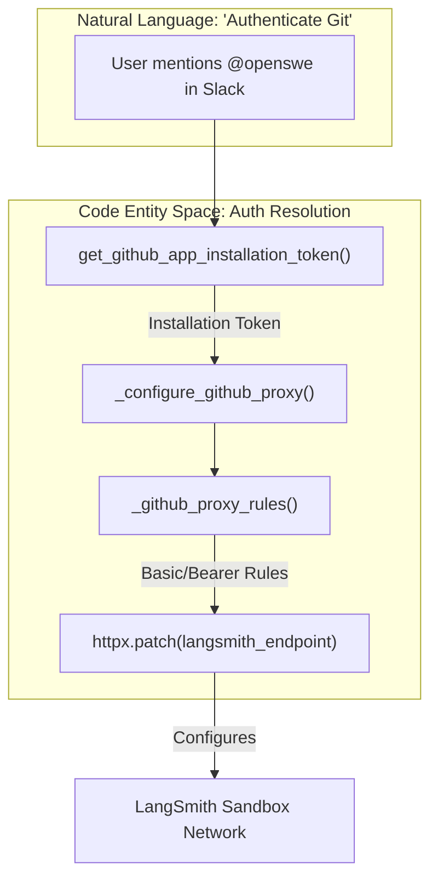
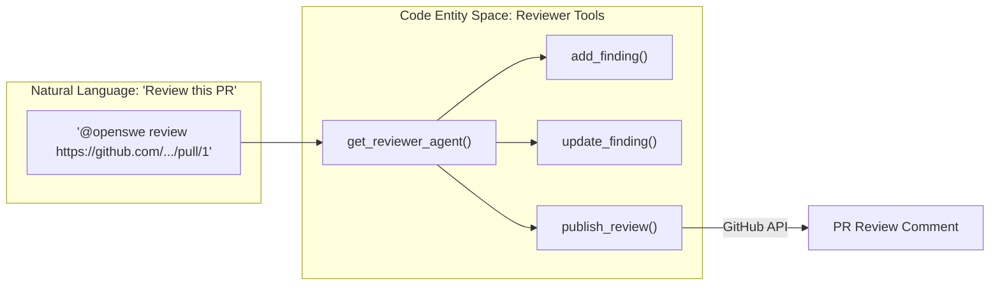

<!-- source: DeepWiki mcp.deepwiki.com · repo langchain-ai/open-swe · page 13 Glossary · fetched 2026-10-26 -->

# Glossary

Relevant source files

The following files were used as context for generating this wiki page:

- [CUSTOMIZATION.md](CUSTOMIZATION.md)
- [INSTALLATION.md](INSTALLATION.md)
- [README.md](README.md)
- [agent/integrations/langsmith.py](agent/integrations/langsmith.py)
- [agent/reviewer.py](agent/reviewer.py)
- [agent/reviewer_findings.py](agent/reviewer_findings.py)
- [agent/server.py](agent/server.py)
- [agent/tools/__init__.py](agent/tools/__init__.py)
- [agent/tools/add_finding.py](agent/tools/add_finding.py)
- [agent/tools/update_finding.py](agent/tools/update_finding.py)
- [agent/utils/slack.py](agent/utils/slack.py)
- [pyproject.toml](pyproject.toml)
- [tests/test_reviewer.py](tests/test_reviewer.py)
- [tests/test_reviewer_findings.py](tests/test_reviewer_findings.py)
- [tests/test_reviewer_tools.py](tests/test_reviewer_tools.py)
- [uv.lock](uv.lock)

This page provides definitions for codebase-specific terms, jargon, and domain concepts used throughout the Open SWE framework, including detailed technical implementation details for onboarding engineers.

## Core Concepts

| Term | Definition | Code Pointer |
|:---|:---|:---|
| **Deep Agent** | The foundational agentic framework Open SWE composes upon, providing the core execution loop and base tools. | [README.md:38-40](), [agent/server.py:29-29]() |
| **Sandbox** | An isolated, remote Linux environment (usually a container) where the agent clones code and executes shell commands. | [README.md:52-54](), [agent/utils/sandbox.py:1-20]() |
| **Thread ID** | A deterministic identifier used to route messages to the correct persistent sandbox and conversation state. | [README.md:105-106](), [agent/server.py:164-165]() |
| **AGENTS.md** | A repository-level configuration file used to inject custom instructions, coding standards, and context into the agent. | [README.md:82-83](), [agent/utils/agents_md.py:1-15]() |
| **Middleware** | Logic that runs before or after the agent's main loop to handle tasks like error recovery or message queuing. | [README.md:92-97](), [agent/middleware/__init__.py:1-20]() |
| **Subagent** | A child agent spawned via the `task` tool to handle a specific sub-problem in a separate sandbox. | [README.md:90-91](), [agent/server.py:55-69]() |
| **Reviewer Agent** | A specialized agent configuration focused solely on PR analysis and finding generation, using a restricted toolset. | [agent/reviewer.py:1-15]() |

Sources: [README.md:38-106](), [agent/server.py:29-69](), [agent/reviewer.py:1-15]()

---

## Technical Terms & Implementation

### 1. Sandbox Backend Protocol
The `SandboxBackendProtocol` is a Python interface (inherited from `deepagents`) that all sandbox providers must implement. It ensures the agent can interact with any environment (Modal, LangSmith, Daytona, etc.) using a unified set of methods.

**Key Methods:**
* `execute(command, timeout)`: Runs a shell command and returns an `ExecuteResponse`. [agent/integrations/langsmith.py:113-122]()
* `read(path)` / `write(path, content)`: Basic file I/O operations.
* `ls(path)` / `glob(pattern)`: Directory traversal and file discovery.

Sources: [agent/server.py:31-31](), [agent/integrations/langsmith.py:113-122](), [CUSTOMIZATION.md:101-106]()

### 2. GitHub Proxy Auth
A security feature specifically for **LangSmith** sandboxes. Instead of writing GitHub tokens to the sandbox disk (where they could be leaked), the system configures a network-level proxy. When the agent runs `git clone` or `gh api`, the LangSmith proxy intercepts the request and injects the `Authorization` header.

**Diagram: Natural Language Space to Code Entity Space (Auth Flow)**

Sources: [agent/integrations/langsmith.py:70-95](), [agent/server.py:131-137](), [agent/server.py:149-159]()

### 3. Review Findings
In the context of the `Reviewer Agent`, a **Finding** is a structured record of a code issue. Findings are persisted in thread metadata to survive sandbox eviction and allow for "watch-mode" reconciliation (checking if a previous finding was fixed in a new commit).

**Implementation Details:**
* `add_finding()`: Validates that the line range is within the PR diff using `is_range_in_diff`. [agent/tools/add_finding.py:24-86]()
* `Finding` Data Class: Includes `severity`, `confidence`, `file`, `start_line`, `end_line`, and `suggestion`. [agent/tools/add_finding.py:126-138]()

Sources: [agent/reviewer.py:90-96](), [agent/tools/add_finding.py:24-150]()

---

## Agent Lifecycle Components

### Middleware Hooks
Open SWE utilizes a middleware system to wrap the agent execution loop, allowing for deterministic checks and safety nets.

| Component | Function | File Pointer |
|:---|:---|:---|
| `ToolErrorMiddleware` | Catches exceptions from tool calls and returns them as observations to the LLM. | [agent/server.py:49-49]() |
| `check_message_queue_before_model` | Injects follow-up user messages (e.g., Slack replies) into the conversation before the next LLM turn. | [agent/server.py:50-50]() |
| `SanitizeToolInputsMiddleware` | Ensures tool arguments conform to expected types before execution. | [agent/server.py:47-47]() |
| `SlackAssistantStatusMiddleware` | Updates the Slack "is thinking..." status indicator during long-running tasks. | [agent/server.py:48-48]() |

Sources: [agent/server.py:44-53](), [README.md:91-96]()

### Toolset
The framework provides a curated toolset for engineering tasks.

**Diagram: Natural Language Space to Code Entity Space (Tool Execution)**

Sources: [agent/reviewer.py:53-61](), [agent/tools/__init__.py:1-37](), [agent/tools/add_finding.py:1-21]()

---

## Sandbox Providers
The system supports multiple backends configured via the `SANDBOX_TYPE` environment variable.

* **LangSmith:** Default cloud sandbox with integrated proxy auth. [agent/integrations/langsmith.py:1-30]()
* **Daytona:** Uses the Daytona API for dev environments. [CUSTOMIZATION.md:61-61]()
* **Runloop:** Uses Runloop's environment API. [CUSTOMIZATION.md:62-62]()
* **Modal:** Uses Modal's serverless infrastructure. [CUSTOMIZATION.md:63-63]()
* **Local:** Runs directly on the host machine. **Warning: No isolation.** [CUSTOMIZATION.md:64-66]()

Sources: [CUSTOMIZATION.md:58-64](), [agent/server.py:99-100]()

---

## Abbreviations & Jargon

* **PR:** Pull Request (GitHub).
* **LLM:** Large Language Model (e.g., GPT-4o, Claude 3.5 Sonnet).
* **Webhook:** HTTP callbacks used by Slack, Linear, or GitHub to notify Open SWE of events.
* **OAuth Provider ID:** A short string used to link a GitHub App's credentials within LangSmith for per-user authentication. [INSTALLATION.md:43-51]()
* **Installation ID:** The unique ID assigned by GitHub when an App is installed on a specific organization or account. [INSTALLATION.md:91-99]()
* **Reasoning Effort:** A parameter for OpenAI models (like o1/o3) that controls how much "thinking" time the model uses. [agent/server.py:41-42]()

Sources: [INSTALLATION.md:43-99](), [agent/server.py:41-42](), [README.md:100-106]()