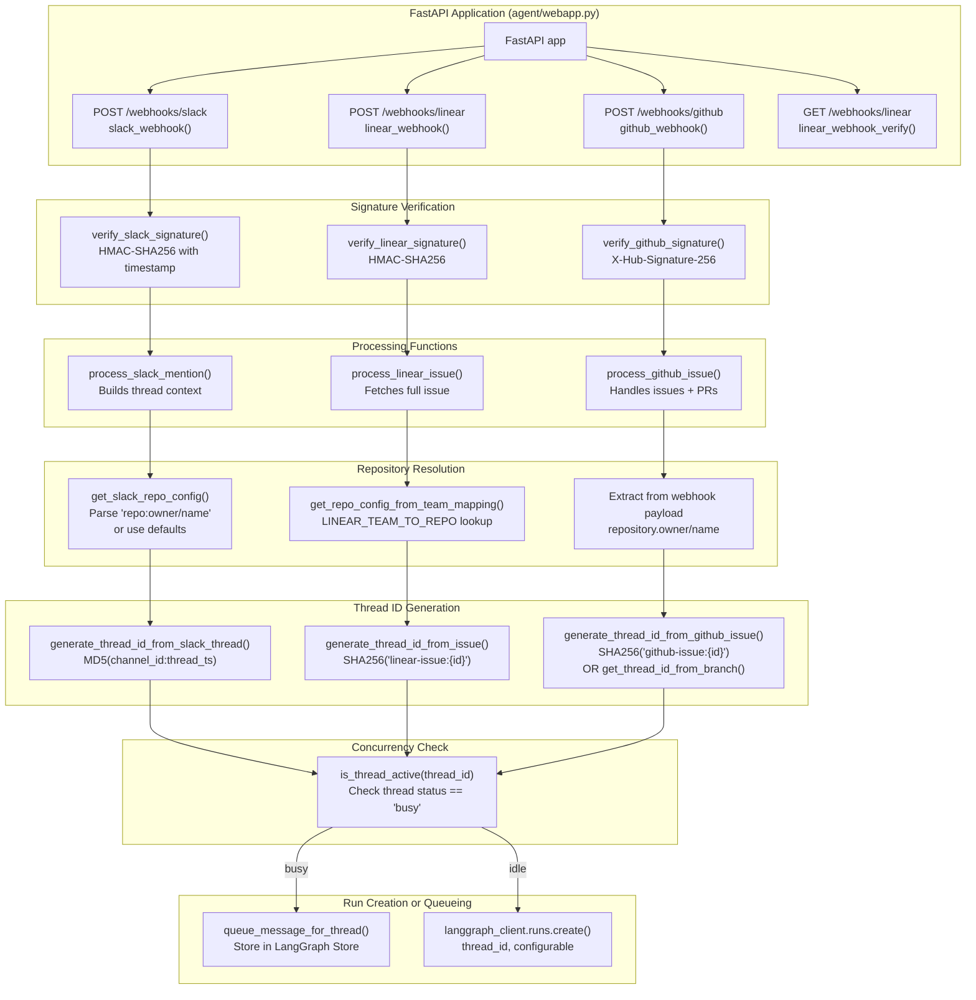
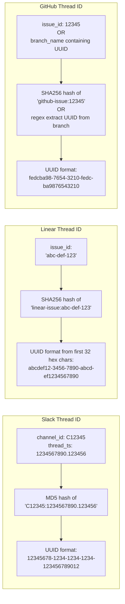
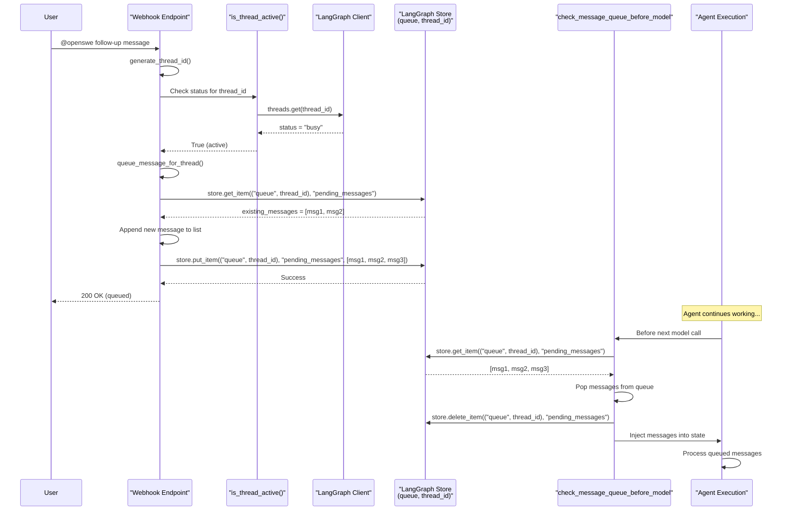

<!-- source: DeepWiki mcp.deepwiki.com · repo langchain-ai/open-swe · page 2 Invocation Surfaces · fetched 2026-10-26 -->

# Invocation Surfaces

<details>
<summary>Relevant source files</summary>

The following files were used as context for generating this wiki page:

- [CUSTOMIZATION.md](CUSTOMIZATION.md)
- [INSTALLATION.md](INSTALLATION.md)
- [README.md](README.md)
- [agent/webapp.py](agent/webapp.py)
- [tests/test_github_issue_webhook.py](tests/test_github_issue_webhook.py)

</details>


This document covers the multiple entry points through which users can trigger Open SWE agents. An **invocation surface** is a platform where users mention `@openswe` to start or interact with an agent run. Open SWE supports three primary surfaces: Slack, Linear, and GitHub, each implemented as a FastAPI webhook endpoint.

For detailed information about each surface's setup and behavior, see:
- Slack usage: [Slack Integration](#2.1)
- Linear usage: [Linear Integration](#2.2)  
- GitHub usage: [GitHub Integration](#2.3)
- Technical webhook processing details: [Webhook Processing Flow](#2.4)

For information about how agents are assembled and executed after invocation, see [Agent Core](#3).

---

## Supported Invocation Surfaces

Open SWE provides three webhook-based invocation surfaces, each listening for platform-specific events:

| Surface | Trigger Pattern | Webhook Endpoint | Event Types | Primary Use Case |
|---------|----------------|------------------|-------------|------------------|
| **Slack** | `@openswe` mention in thread | `POST /webhooks/slack` | `app_mention`, `message.im`, `message.mpim` | Real-time collaboration, quick tasks, status updates |
| **Linear** | `@openswe` in issue comment | `POST /webhooks/linear` | Comment → Create | Issue tracking integration, feature requests, bug fixes |
| **GitHub** | `@openswe` in issue or PR comment | `POST /webhooks/github` | `issues`, `issue_comment`, `pull_request_review`, `pull_request_review_comment` | PR review feedback, issue resolution |

Each surface triggers the same underlying agent system but provides different context and routing mechanisms.

**Sources:** [README.md:98-106](), [agent/webapp.py:833-1134]()

---

## Webhook Endpoint Architecture



**Diagram: Webhook Processing Pipeline**

Each webhook endpoint follows the same pattern: verify signature → extract context → generate thread ID → check thread status → create run or queue message. The differences lie in how each surface assembles context and resolves the target repository.

**Sources:** [agent/webapp.py:833-1134](), [agent/webapp.py:390-479](), [agent/webapp.py:239-268]()

---

## Thread ID Generation Strategy

Thread IDs are deterministic identifiers that route follow-up messages to the same agent run. Each surface uses a different algorithm:



**Diagram: Thread ID Generation by Surface**

| Surface | Source | Algorithm | Purpose |
|---------|--------|-----------|---------|
| **Slack** | `channel_id:thread_ts` | MD5 hash → UUID | Route replies within same thread |
| **Linear** | `issue_id` | SHA256 hash → UUID | Link comments on same issue |
| **GitHub (Issues)** | `issue.id` | SHA256 hash → UUID | Connect issue comments |
| **GitHub (PRs)** | Branch name regex | Extract existing UUID | Connect PR review comments to original thread |

The GitHub PR surface uses a special strategy: agent-created branches contain the thread ID in the branch name (e.g., `fix-bug-abc123de-1234-5678-9abc-def012345678`), allowing `get_thread_id_from_branch()` to extract it and route PR review comments back to the original thread.

**Sources:** [agent/webapp.py:239-268](), [agent/utils/github_comments.py:53]()

---

## Concurrency Handling and Message Queueing

When a user sends a follow-up message while an agent is still processing the previous one, Open SWE queues the new message instead of rejecting it or creating a duplicate run:



**Diagram: Message Queueing Flow for Concurrent Events**

The queueing mechanism ensures no messages are lost when multiple people comment on the same Linear issue or Slack thread simultaneously. The `check_message_queue_before_model` middleware (see [Middleware System](#3.3)) injects queued messages before the agent's next LLM call, allowing real-time guidance during long-running tasks.

**Key Functions:**
- `is_thread_active(thread_id)` [agent/utils/thread_ops.py:90](): Checks if thread status is "busy"
- `queue_message_for_thread(thread_id, message_content)` [agent/utils/thread_ops.py:90](): Stores message in LangGraph Store under namespace `("queue", thread_id)`
- `check_message_queue_before_model` [CUSTOMIZATION.md:19](): Middleware that retrieves and injects queued messages

**Sources:** [agent/webapp.py:90](), [README.md:93-94]()

---

## Context Assembly by Surface

Each surface provides different context to the agent:

```mermaid
graph TB
    subgraph "Slack Context"
        SlackEvent["Slack Event Payload"]
        SlackUser["get_slack_user_info(user_id)<br/>Resolve user email"]
        SlackThread["fetch_slack_thread_messages()<br/>Full thread history"]
        SlackContext["select_slack_context_messages()<br/>From thread start or last @openswe mention"]
        SlackPrompt["Format as conversation:<br/>@user1: message<br/>@user2: message<br/>@openswe: ..."]
        
        SlackEvent --> SlackUser
        SlackEvent --> SlackThread
        SlackThread --> SlackContext
        SlackContext --> SlackPrompt
    end
    
    subgraph "Linear Context"
        LinearEvent["Linear Webhook Payload"]
        LinearFetch["fetch_linear_issue_details(issue_id)<br/>GraphQL API call"]
        LinearIssue["Issue: title, description, identifier<br/>Comments: body, author, created_at<br/>Project: name, team"]
        LinearRecent["get_recent_comments()<br/>Filter out bot messages"]
        LinearPrompt["Format as markdown:<br/>## Title<br/>## Description<br/>## Comments"]
        
        LinearEvent --> LinearFetch
        LinearFetch --> LinearIssue
        LinearIssue --> LinearRecent
        LinearRecent --> LinearPrompt
    end
    
    subgraph "GitHub Context"
        GitHubEvent["GitHub Webhook Payload"]
        GitHubType{"Event Type?"}
        GitHubIssue["fetch_issue_comments()<br/>All issue comments"]
        GitHubPR["fetch_pr_comments_since_last_tag()<br/>PR comments + review comments + reviews"]
        GitHubPrompt["Format with trust wrappers:<br/>UNTRUSTED_GITHUB_COMMENT_OPEN_TAG<br/>comment body<br/>UNTRUSTED_GITHUB_COMMENT_CLOSE_TAG"]
        
        GitHubEvent --> GitHubType
        GitHubType -->|issue/issue_comment| GitHubIssue
        GitHubType -->|pull_request_review| GitHubPR
        GitHubIssue --> GitHubPrompt
        GitHubPR --> GitHubPrompt
    end
```



**Diagram: Context Assembly Pipeline by Surface**

**Slack Context** includes:
- Full thread history (or from last `@openswe` mention) [agent/utils/slack.py:69]()
- User display names and emails [agent/utils/slack.py:71-72]()
- Conversation formatted as chronological messages [agent/utils/slack.py:70]()
- Repository specified via `repo:owner/name` syntax or defaults [agent/webapp.py:122-125]()

**Linear Context** includes:
- Full issue title, description, identifier [agent/webapp.py:175-198]()
- All comments with authors and timestamps [agent/webapp.py:200-209]()
- Team and project information for repo mapping [agent/webapp.py:175-198]()
- Recent comments filtered to exclude bot messages [agent/utils/comments.py:40]()

**GitHub Context** includes:
- Issue/PR title, body, number, URL [agent/utils/github_comments.py:48-49]()
- All comments (issues) or comments since last `@openswe` tag (PRs) [agent/utils/github_comments.py:50-51]()
- Inline review comments with file path and line number [agent/utils/github_comments.py:51]()
- Trust wrappers for comments from users not in `GITHUB_USER_EMAIL_MAP` [agent/utils/github_comments.py:61]()

**Sources:** [agent/webapp.py:67-84]() (Slack), [agent/webapp.py:175-217]() (Linear), [agent/utils/github_comments.py:45-58]() (GitHub)

---

## Repository Resolution

Each surface uses a different mechanism to determine which GitHub repository the agent should operate on:

| Surface | Resolution Mechanism | Configuration | Fallback |
|---------|---------------------|---------------|----------|
| **Slack** | 1. Parse `repo:owner/name` from message<br/>2. Extract from `github.com/owner/name` URL<br/>3. Check thread metadata<br/>4. Use environment defaults | `SLACK_REPO_OWNER`, `SLACK_REPO_NAME` | `langchain-ai/langchainplus` |
| **Linear** | Map team name and project name to repo | `LINEAR_TEAM_TO_REPO` in [agent/utils/linear_team_repo_map.py]() | `langchain-ai/langchainplus` |
| **GitHub** | Extract directly from webhook payload | `payload.repository.owner.login`, `payload.repository.name` | N/A (always present) |

**Slack Repository Resolution:**
The `extract_repo_from_text` function [agent/utils/repo.py:65]() extracts repository details from message text. It checks for explicit `repo:owner/name` syntax before falling back to environment defaults defined in `agent/webapp.py` [agent/webapp.py:122-125]().

**Linear Repository Resolution:**
The `get_repo_config_from_team_mapping` function [agent/webapp.py:175-198]() uses the `LINEAR_TEAM_TO_REPO` mapping [agent/utils/linear_team_repo_map.py:63]() to find the correct owner and repository name based on the Linear team identifier and project name.

**Sources:** [agent/webapp.py:175-198]() (Linear), [agent/utils/repo.py:65](), [agent/utils/linear_team_repo_map.py:63]()

---

## Acknowledgment Reactions

All three surfaces immediately react to the triggering message with a 👀 emoji to acknowledge receipt:

| Surface | Reaction Method | API Endpoint | Timing |
|---------|----------------|--------------|--------|
| **Slack** | `set_slack_assistant_status(channel, thread_ts, "thinking")` | `POST /chat.postMessage` | Before thread check |
| **Linear** | `react_to_linear_comment(comment_id, "👀")` | GraphQL `reactionCreate` mutation | Before fetching issue details |
| **GitHub** | `react_to_github_comment(repo, comment_id, event_type, token)` | `POST /repos/{owner}/{repo}/issues/comments/{id}/reactions` | Before processing payload |

The reaction provides instant feedback to users while the agent provisions a sandbox and begins execution.

**Sources:** [agent/utils/slack.py:80]() (Slack), [agent/webapp.py:200-209]() (Linear logic), [agent/utils/github_comments.py:55]() (GitHub)

---

## Environment Variables by Surface

Each surface requires specific environment variables for webhook verification and API access:

### Slack
```bash
SLACK_BOT_TOKEN          # OAuth token (xoxb-...)
SLACK_BOT_USER_ID        # Bot's user ID [agent/webapp.py:120]
SLACK_BOT_USERNAME       # Bot's display name [agent/webapp.py:121]
SLACK_SIGNING_SECRET     # Webhook signature verification [agent/webapp.py:119]
SLACK_REPO_OWNER         # Default repo owner [agent/webapp.py:124]
SLACK_REPO_NAME          # Default repo name [agent/webapp.py:125]
```

### Linear
```bash
LINEAR_API_KEY           # Personal API key [agent/webapp.py:162]
LINEAR_WEBHOOK_SECRET    # Webhook signature verification [agent/webapp.py:117]
# LINEAR_TEAM_TO_REPO configured in agent/utils/linear_team_repo_map.py
```

### GitHub
```bash
GITHUB_WEBHOOK_SECRET    # Webhook signature verification [agent/webapp.py:118]
GITHUB_APP_ID            # GitHub App ID [INSTALLATION.md:82]
GITHUB_APP_PRIVATE_KEY   # GitHub App private key [INSTALLATION.md:83]
GITHUB_APP_INSTALLATION_ID  # Installation ID [INSTALLATION.md:99]
# GITHUB_USER_EMAIL_MAP configured in agent/utils/github_user_email_map.py
```

**Sources:** [agent/webapp.py:117-125](), [INSTALLATION.md:82-99]()

---

