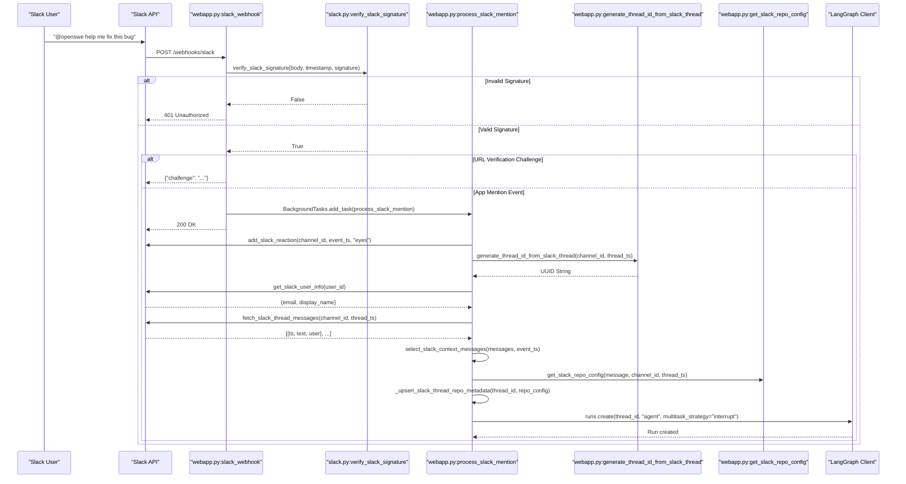
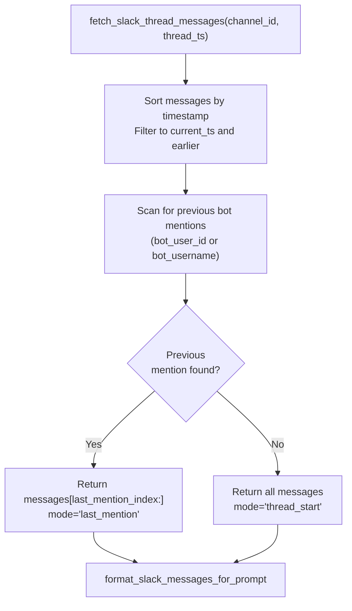

<!-- source: DeepWiki mcp.deepwiki.com · repo langchain-ai/open-swe · page 2.1 Slack Integration · fetched 2026-10-26 -->

# Slack Integration

<details>
<summary>Relevant source files</summary>

The following files were used as context for generating this wiki page:

- [agent/tools/slack_thread_reply.py](agent/tools/slack_thread_reply.py)
- [agent/utils/slack.py](agent/utils/slack.py)
- [agent/utils/slack_feedback.py](agent/utils/slack_feedback.py)
- [tests/test_slack_context.py](tests/test_slack_context.py)
- [tests/test_slack_feedback.py](tests/test_slack_feedback.py)

</details>


This page documents how to trigger Open SWE agents via Slack app mentions and how the system processes Slack events, assembles conversation context, and routes responses back to threads.

## Overview

The Slack integration enables users to invoke the Open SWE agent by mentioning the bot in any Slack channel or thread. When tagged with `@openswe` (or the configured bot username), the system:

1.  Receives a webhook event from Slack's Event API.
2.  Verifies the request signature for security.
3.  Generates a deterministic thread ID from the Slack channel and thread timestamp.
4.  Assembles conversation context from the thread history.
5.  Resolves which GitHub repository to work on.
6.  Creates a LangGraph agent run with full context.
7.  Enables the agent to reply in-thread using the `slack_thread_reply` tool.
8.  Captures user feedback via emoji reactions.

The integration supports both direct mentions and replies in existing threads, with automatic context selection to include either the full thread or just messages since the last bot mention.

**Sources:** [agent/webapp.py:698-810](), [agent/webapp.py:957-1046](), [agent/utils/slack_feedback.py:119-206]()

---

## Setup and Configuration

### Required Environment Variables

The Slack integration requires the following environment variables:

| Variable | Purpose | Example |
| :--- | :--- | :--- |
| `SLACK_BOT_TOKEN` | Bot User OAuth Token from Slack App | `xoxb-...` |
| `SLACK_SIGNING_SECRET` | Webhook signature verification secret | From App Credentials |
| `SLACK_BOT_USER_ID` | Bot's Slack user ID | `U01ABC123` |
| `SLACK_BOT_USERNAME` | Bot's display name | `openswe` |
| `SLACK_REPO_OWNER` | Default GitHub repository owner | `langchain-ai` |
| `SLACK_REPO_NAME` | Default GitHub repository name | `open-swe` |

**Sources:** [agent/webapp.py:61-67](), [agent/utils/slack.py:25-25]()

### Slack App Configuration

The Slack App must be configured with:

1.  **Event Subscriptions**: Request URL pointing to `https://<your-domain>/webhooks/slack`.
2.  **Bot Events**:
    *   `app_mention` — for @bot mentions.
    *   `message.im` — for direct messages.
    *   `reaction_added` / `reaction_removed` — for feedback tracking.
3.  **OAuth Scopes** (bot token):
    *   `reactions:write` / `reactions:read` — manage emoji feedback.
    *   `app_mentions:read` — detect mentions.
    *   `channels:history` — read thread context.
    *   `chat:write` — post replies.
    *   `users:read` — fetch user information.

---

## Webhook Processing Flow

The `slack_webhook` endpoint in `agent/webapp.py` [agent/webapp.py:957-1046]() handles incoming requests. If the signature is valid, it dispatches the event to `process_slack_mention` [agent/webapp.py:698-810]() or feedback processors [agent/utils/slack_feedback.py:208-213]() as background tasks.



**Sources:** [agent/webapp.py:957-1046](), [agent/webapp.py:698-810](), [agent/utils/slack.py:107-132]()

---

## Message Context Assembly

When processing a Slack mention, the system assembles conversation context by:

1.  **Fetching Thread Messages**: Retrieves all messages in the thread via `fetch_slack_thread_messages` [agent/utils/slack.py:382-400]().
2.  **Selecting Context Window**: The `select_slack_context_messages` function [agent/utils/slack.py:207-256]() implements a sliding window strategy.
3.  **Resolving User Names**: Fetches display names for users via `get_slack_user_names` [agent/utils/slack.py:357-379]().
4.  **Formatting for Prompt**: Converts messages to structured text using `format_slack_messages_for_prompt` [agent/utils/slack.py:316-349]().

### Context Selection Algorithm



**Sources:** [agent/utils/slack.py:207-256](), [agent/utils/slack.py:316-349](), [tests/test_slack_context.py:55-82]()

---

## Thread Management

### Deterministic Thread ID Generation

Slack threads are identified by a composite key of `channel_id:thread_ts`, hashed to produce a deterministic UUID in `generate_thread_id_from_slack_thread` [agent/webapp.py:264-268]().

```python
def generate_thread_id_from_slack_thread(channel_id: str, thread_ts: str) -> str:
    composite = f"{channel_id}:{thread_ts}"
    md5_hex = hashlib.md5(composite.encode("utf-8")).hexdigest()
    return str(uuid.UUID(hex=md5_hex))
```

**Sources:** [agent/webapp.py:264-268](), [tests/test_slack_context.py:46-53]()

### Response Mapping and Feedback

To support feedback on specific bot replies, the system stores a mapping between Slack message timestamps and LangGraph run IDs in the LangGraph Store via `store_slack_message_run_mapping` [agent/utils/slack.py:543-559]().

When a user adds a reaction (e.g., `:thumbsup:`), `process_slack_reaction` [agent/utils/slack_feedback.py:119-206]() performs:
1.  **Lookup**: Retrieves the `run_id` for that specific message [agent/utils/slack_feedback.py:150-161]().
2.  **Verification**: Ensures the reactor is the user who triggered the run [agent/utils/slack_feedback.py:163-172]().
3.  **Scoring**: Converts reactions to numeric scores (`+1` = 1.0, `-1` = 0.0) [agent/utils/slack_feedback.py:22-27]().
4.  **Persistence**: Records feedback in LangSmith [agent/utils/slack_feedback.py:194-202]().

**Sources:** [agent/utils/slack_feedback.py:119-206](), [agent/utils/slack.py:543-559](), [tests/test_slack_feedback.py:69-104]()

---

## Response Flow and Tools

### Agent Tool: `slack_thread_reply`

The agent uses the `slack_thread_reply` tool [agent/tools/slack_thread_reply.py:19-53]() to post responses back to the Slack thread.

*   **Mention Conversion**: Converts `@Name(USER_ID)` to `<@USER_ID>` [agent/tools/slack_thread_reply.py:51]().
*   **Run Mapping**: Every reply is mapped to the current `run_id` to enable future feedback [agent/tools/slack_thread_reply.py:56-61]().
*   **Formatting**: The tool documentation explicitly instructs the agent to use Slack `mrkdwn` (e.g., `*bold*`, `_italic_`, `• list`) rather than standard Markdown [agent/tools/slack_thread_reply.py:28-31]().

**Sources:** [agent/tools/slack_thread_reply.py:19-53](), [agent/utils/slack.py:102-104]()

---

## Security: Signature Verification

Incoming Slack webhooks are verified using `verify_slack_signature` [agent/utils/slack.py:107-132]().

*   **HMAC-SHA256**: Uses `SLACK_SIGNING_SECRET` to verify the payload.
*   **Replay Protection**: Rejects requests older than 5 minutes (`max_age_seconds: 300`).
*   **Constant-time comparison**: Uses `hmac.compare_digest` to prevent timing attacks.

**Sources:** [agent/utils/slack.py:107-132](), [agent/webapp.py:962-971]()

---

