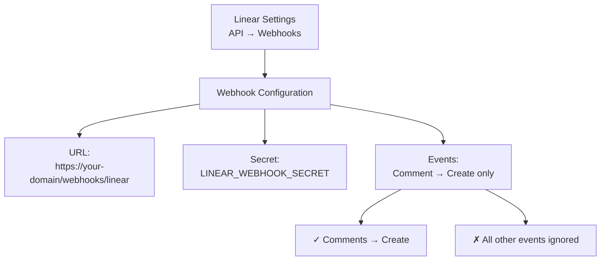
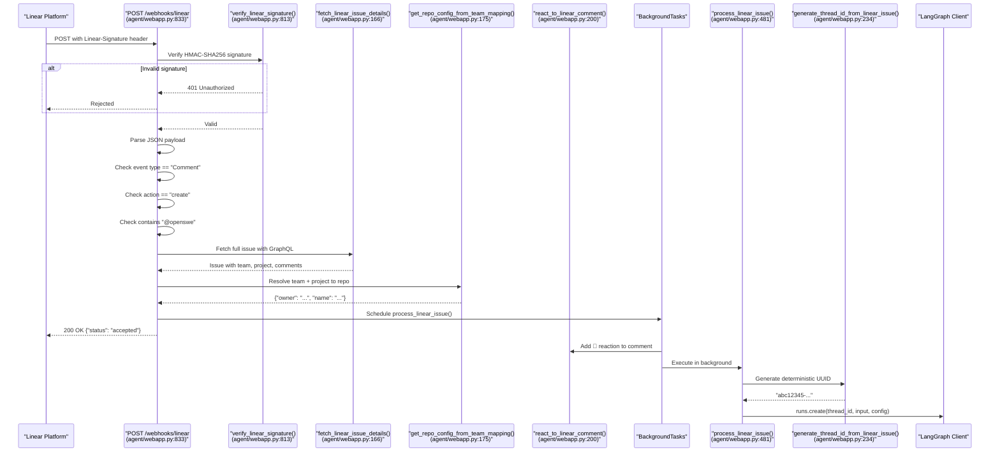
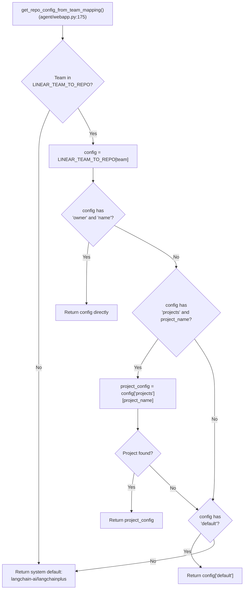

<!-- source: DeepWiki mcp.deepwiki.com · repo langchain-ai/open-swe · page 2.2 Linear Integration · fetched 2026-10-26 -->

# Linear Integration

Relevant source files

The following files were used as context for generating this wiki page:

- [agent/utils/langsmith.py](agent/utils/langsmith.py)
- [agent/utils/linear.py](agent/utils/linear.py)
- [agent/utils/linear_team_repo_map.py](agent/utils/linear_team_repo_map.py)
- [agent/webapp.py](agent/webapp.py)
- [tests/test_github_issue_webhook.py](tests/test_github_issue_webhook.py)

Linear Integration enables Open SWE agents to be triggered from Linear issue comments. When a user mentions `@openswe` in any Linear comment, the system creates or resumes an agent thread to work on that issue, fetches the full issue context, and posts results back as Linear comments.

For information about triggering agents from other platforms, see [Slack Integration](#2.1) and [GitHub Integration](#2.3). For technical details about webhook processing, see [Webhook Processing Flow](#2.4).

---

## Overview

The Linear integration consists of three main components:

1.  **Webhook endpoint** that receives Linear comment events.
2.  **Team-to-repository mapping** that routes Linear issues to GitHub repositories.
3.  **Issue context assembly** that pre-hydrates the full issue details for the agent.

The integration maintains deterministic thread IDs based on Linear issue IDs, enabling follow-up comments to route to the same running agent instance.

**Sources:**
- [agent/webapp.py:833-948]()
- [agent/webapp.py:166-232]()
- [agent/webapp.py:98-121]()

---

## Webhook Configuration

The Linear webhook endpoint is exposed at `POST /webhooks/linear` and requires signature verification using the `LINEAR_WEBHOOK_SECRET` environment variable.

### Required Environment Variables

| Variable | Purpose | How to Obtain |
| :--- | :--- | :--- |
| `LINEAR_WEBHOOK_SECRET` | Webhook signature verification | Generate with `openssl rand -hex 32` |
| `LINEAR_API_KEY` | Fetch full issue details and post comments | Linear Settings → API → Personal API keys |

### Webhook Settings in Linear

The webhook must be configured to listen for **Comment → Create** events only. Other event types are ignored.

**Sources:**
- [agent/webapp.py:117-117]()
- [agent/webapp.py:162-162]()
- [agent/utils/linear.py:15-16]()

---

## Webhook Request Flow

The following diagram bridges the **Natural Language Space** (Linear Comments) to the **Code Entity Space** (FastAPI routes and utility functions).

**Sources:**
- [agent/webapp.py:833-948]()
- [agent/webapp.py:200-232]()
- [agent/webapp.py:481-695]()
- [agent/webapp.py:813-831]()

---

## Signature Verification

The `verify_linear_signature()` function validates incoming webhooks using HMAC-SHA256. All webhook requests with missing or invalid signatures are rejected with HTTP 401.

**Sources:**
- [agent/webapp.py:813-831]()
- [agent/webapp.py:844-847]()

---

## Event Filtering

The webhook handler applies multiple filters before processing to avoid infinite loops or unnecessary runs:

| Filter | Check | Rejection Reason |
| :--- | :--- | :--- |
| Event type | `payload.get("type") == "Comment"` | "Not a Comment event" |
| Action | `payload.get("action") == "create"` | "Only processing 'create'" |
| Bot author | `not data.get("botActor")` | "Comment is from a bot" |
| Agent mention | `"@openswe" in comment_body.lower()` | "Comment doesn't mention @openswe" |
| Bot message prefix | `not comment_body.startswith(_GITHUB_BOT_MESSAGE_PREFIXES)` | "Comment is our own bot message" |

**Sources:**
- [agent/webapp.py:855-889]()
- [agent/webapp.py:164-172]()

---

## Team-to-Repository Mapping

Linear teams and projects are mapped to GitHub repositories via `LINEAR_TEAM_TO_REPO` in `agent/utils/linear_team_repo_map.py`.

### Mapping Resolution Logic

The `get_repo_config_from_team_mapping()` function follows this hierarchy:

1.  **Direct Team Match**: If the team has an `owner` and `name` directly.
2.  **Project Match**: If the team has a `projects` dictionary and the issue's project name matches a key.
3.  **Team Default**: If the team has a `default` key.
4.  **System Default**: Fallback to `DEFAULT_REPO_OWNER` and `DEFAULT_REPO_NAME`.

**Sources:**
- [agent/webapp.py:175-198]()
- [agent/utils/linear_team_repo_map.py:3-30]()

---

## Thread ID Generation

Thread IDs are deterministically generated from Linear issue IDs using SHA-256 in `generate_thread_id_from_linear_issue()`. This ensures that multiple comments on the same issue route to the same LangGraph thread, maintaining state across interactions.

**Sources:**
- [agent/webapp.py:234-252]()

---

## Issue Context Assembly

The `fetch_linear_issue_details()` function fetches comprehensive issue data via Linear's GraphQL API, including:
*   Issue Title and Description
*   Project and Team metadata
*   Full comment history (nodes including body, author, and timestamp)

This data is used to hydrate the agent's initial prompt so it doesn't have to perform manual discovery.

**Sources:**
- [agent/webapp.py:166-232]()
- [agent/utils/linear.py:105-130]()
- [agent/utils/linear.py:181-204]()

---

## Linear Tools for Agents

Open SWE provides several tools specifically for interacting with Linear within the agent loop. These wrap utilities in `agent/utils/linear.py`.

| Tool Name | Implementation Utility | Purpose |
| :--- | :--- | :--- |
| `linear_comment` | `comment_on_linear_issue` | Post a new comment to an issue. |
| `linear_get_issue` | `get_issue` | Retrieve full issue details by UUID. |
| `linear_create_issue` | `create_issue` | Create a new issue in a specific team. |
| `linear_update_issue` | `update_issue` | Modify title, description, state, or assignee. |
| `linear_list_teams` | `list_teams` | List all teams in the workspace. |

**Sources:**
- [agent/utils/linear.py:47-63]()
- [agent/utils/linear.py:105-130]()
- [agent/utils/linear.py:133-178]()
- [agent/utils/linear.py:207-240]()
- [agent/utils/linear.py:85-102]()

---

## Prompt Construction and Multimodal Support

The `process_linear_issue()` function assembles the final prompt. It uses `extract_image_urls` and `fetch_image_block` from `agent/utils/multimodal.py` to include images from the Linear issue description or comments directly in the agent's context.

The prompt includes:
1.  **Issue Metadata**: Title, identifier (e.g., ENG-123), and URL.
2.  **Description**: The full markdown description of the issue.
3.  **Comments**: Filtered history, excluding bot messages.
4.  **Tagging Instructions**: Instructions to the agent on when to tag the triggering user.

**Sources:**
- [agent/webapp.py:481-695]()
- [agent/webapp.py:614-628]()
- [agent/utils/multimodal.py:64-65]()

---

## Status Updates

When an agent is triggered, it immediately provides feedback to the user:
1.  **Reaction**: The system adds a "eyes" (👀) reaction to the triggering comment via `react_to_linear_comment()`.
2.  **Trace Comment**: It posts a comment "On it! [View trace](...)" containing a link to the LangSmith trace via `post_linear_trace_comment()`.

**Sources:**
- [agent/webapp.py:200-232]()
- [agent/utils/linear.py:66-83]()
- [agent/webapp.py:507-511]()

---

