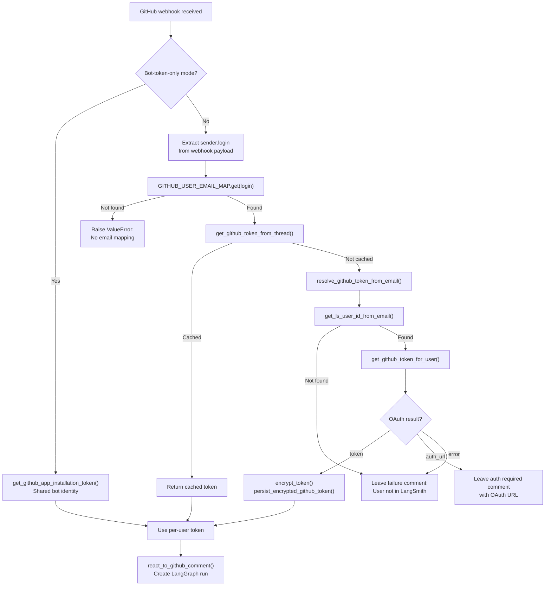

<!-- source: DeepWiki mcp.deepwiki.com · repo langchain-ai/open-swe · page 2.3 GitHub Integration · fetched 2026-10-26 -->

# GitHub Integration

<details>
<summary>Relevant source files</summary>

The following files were used as context for generating this wiki page:

- [agent/utils/auth.py](agent/utils/auth.py)
- [agent/utils/github_app.py](agent/utils/github_app.py)
- [agent/utils/github_comments.py](agent/utils/github_comments.py)
- [agent/utils/github_token.py](agent/utils/github_token.py)
- [agent/webapp.py](agent/webapp.py)
- [tests/test_github_issue_webhook.py](tests/test_github_issue_webhook.py)
- [tests/test_github_token_ttl.py](tests/test_github_token_ttl.py)
- [tests/test_proxy_auth.py](tests/test_proxy_auth.py)

</details>


This page documents how to use `@openswe` mentions in GitHub issues and pull request comments to trigger agent runs. GitHub is one of three invocation surfaces supported by Open SWE—for Slack integration see [2.1]() and for Linear integration see [2.2]().

GitHub integration differs from Slack and Linear in two key ways: (1) thread IDs are extracted from branch names for PR-based workflows, enabling seamless review feedback loops, and (2) authentication uses per-user GitHub OAuth tokens mapped from GitHub usernames rather than email addresses.

---

## Triggering Mechanisms

### Issue-Based Invocation

Users can trigger the agent by mentioning `@openswe` in:
- Issue titles or bodies when creating a new issue [agent/webapp.py:1001-1015]()
- Issue comments for follow-up instructions on existing issues [agent/webapp.py:1020-1035]()

The system matches any of the following mention patterns (case-insensitive):
- `@openswe`
- `@open-swe`
- `@openswe-dev`

**Sources:** [agent/utils/github_comments.py:36-37](), [agent/webapp.py:118-125]()

### Pull Request Comment Invocation

For PRs created by the agent, users can tag `@openswe` in:
- PR review comments (inline code comments) [agent/webapp.py:1040-1055]()
- PR review bodies (overall review feedback) [agent/webapp.py:1060-1075]()
- General PR issue comments [agent/webapp.py:1020-1035]()

This enables a review feedback loop where the agent can address reviewer comments by pushing additional commits to the same branch.

**Sources:** [agent/utils/github_comments.py:80-94](), [agent/webapp.py:1040-1075]()

---

## Webhook Processing Flow

```mermaid
graph TB
    GitHub["GitHub Webhook Event"] --> Endpoint["POST /webhooks/github"]
    Endpoint --> VerifySig["verify_github_signature()"]
    VerifySig -->|Invalid| Reject["Return 401"]
    VerifySig -->|Valid| ParseEvent["Parse Event Type"]
    
    ParseEvent --> IssueEvent{"Event Type?"}
    IssueEvent -->|"issues"| CheckIssueAction["Check action:<br/>opened/edited"]
    IssueEvent -->|"issue_comment"| CheckComment["Check for @openswe<br/>in comment body"]
    IssueEvent -->|"pull_request_review"<br/>"pull_request_review_comment"| ExtractPRContext["extract_pr_context()"]
    IssueEvent -->|Other| Ignore["Return 'ignored'"]
    
    CheckIssueAction --> CheckMention["Check title/body<br/>for @openswe"]
    CheckMention -->|Not found| Ignore
    CheckMention -->|Found| ExtractIssueContext["Extract issue context"]
    
    CheckComment -->|Not found| Ignore
    CheckComment -->|Found| DeterminePrompt{"Thread exists?"}
    
    ExtractPRContext --> GetThreadFromBranch["get_thread_id_from_branch()"]
    GetThreadFromBranch --> FetchPRComments["fetch_pr_comments_since_last_tag()"]
    FetchPRComments --> BuildPRPrompt["build_pr_prompt()"]
    
    DeterminePrompt -->|No| BuildFullPrompt["build_github_issue_prompt()"]
    DeterminePrompt -->|Yes| BuildFollowupPrompt["build_github_issue_followup_prompt()"]
    
    ExtractIssueContext --> BuildFullPrompt
    BuildFullPrompt --> ResolveToken["resolve_github_token()"]
    BuildFollowupPrompt --> ResolveToken
    BuildPRPrompt --> ResolveToken
    
    ResolveToken --> ReactEyes["react_to_github_comment()<br/>Add 👀 reaction"]
    ReactEyes --> CheckThreadStatus["is_thread_active()"]
    CheckThreadStatus -->|Busy| QueueMessage["queue_message_for_thread()"]
    CheckThreadStatus -->|Idle| CreateRun["langgraph_client.runs.create()"]
```

### Webhook Endpoint

The FastAPI webhook endpoint at `/webhooks/github` in `agent/webapp.py` handles the following GitHub event types:

| Event Type | Trigger | Action Field |
|------------|---------|--------------|
| `issues` | Issue opened/edited | `opened`, `edited` |
| `issue_comment` | Comment on issue/PR | `created` |
| `pull_request_review` | PR review submitted | `submitted` |
| `pull_request_review_comment` | Inline code comment | `created` |

**Sources:** [agent/webapp.py:1001-1095](), [tests/test_github_issue_webhook.py:130-161]()

### Signature Verification

All webhook requests must include a valid `X-Hub-Signature-256` header. The `verify_github_signature` function computes an HMAC-SHA256 signature of the raw request body using the `GITHUB_WEBHOOK_SECRET` environment variable and compares it against the provided signature using `hmac.compare_digest` to prevent timing attacks.

**Sources:** [agent/utils/github_comments.py:52-68](), [tests/test_github_issue_webhook.py:24-27]()

---

## Thread ID Resolution

### Issue-Based Thread IDs

For GitHub issues, the system generates deterministic thread IDs. This ensures that follow-up comments on the same issue route to the same LangGraph thread, maintaining conversation context and sandbox state.

**Sources:** [agent/webapp.py:255-261](), [tests/test_github_issue_webhook.py:64-70]()

### PR-Based Thread IDs (Branch Name Extraction)

For pull request comments, the thread ID is extracted from the PR's head branch name using a regular expression that matches UUID patterns:

```python
# agent/utils/github_comments.py:71-77
def get_thread_id_from_branch(branch_name: str) -> str | None:
    match = re.search(
        r"[0-9a-f]{8}-[0-9a-f]{4}-[0-9a-f]{4}-[0-9a-f]{4}-[0-9a-f]{12}",
        branch_name,
        re.IGNORECASE,
    )
    return match.group(0) if match else None
```

When the agent creates a PR, it automatically includes the thread ID in the branch name (e.g., `openswe-{thread_id}`). This enables seamless thread continuity when reviewers comment on the PR—the system extracts the original thread ID and routes the feedback to the existing agent run.

**Sources:** [agent/utils/github_comments.py:71-77](), [agent/webapp.py:1137-1143]()

---

## Authentication and Token Resolution



### User Email Mapping

Unlike Slack and Linear which use email addresses from the webhook payload, GitHub integration requires a manual mapping from GitHub usernames to email addresses in `GITHUB_USER_EMAIL_MAP`. This is a security measure to ensure only authorized users can trigger the agent.

**Sources:** [agent/utils/github_user_email_map.py:1-4](), [agent/webapp.py:1105-1108](), [agent/utils/auth.py:19]()

### Bot-Token-Only Mode

When the system is configured in bot-token-only mode (detected via `is_bot_token_only_mode`), all GitHub operations use the GitHub App's installation token instead of per-user OAuth tokens. This mode is active when a LangSmith API key is present but specific service JWT secrets are missing.

**Sources:** [agent/utils/auth.py:44-52](), [agent/webapp.py:35-38]()

### OAuth Token Resolution

When not in bot-token-only mode, the system resolves per-user GitHub tokens via LangSmith's OAuth integration:
1. Map GitHub username → email via `GITHUB_USER_EMAIL_MAP`.
2. Resolve LangSmith user ID from email via `get_ls_user_id_from_email`.
3. Call LangSmith Host API to get the OAuth token via `get_github_token_for_user`.
4. Encrypt and persist the token in thread metadata via `persist_encrypted_github_token`.

**Sources:** [agent/utils/auth.py:96-122](), [agent/utils/auth.py:138-183](), [agent/webapp.py:1115-1128]()

### Token Expiry and Invalidation

The system tracks token expiry using `github_token_expires_at` metadata. If a token is expired or if a downstream GitHub API call returns a `401 Unauthorized` error, the cached token is invalidated.

**Sources:** [agent/utils/github_token.py:45-79](), [agent/utils/github_token.py:137-154](), [tests/test_github_token_ttl.py:163-177]()

---

## Pull Request Review Workflow

### Comment Fetching Strategy

When handling PR review feedback, the system fetches comments from multiple GitHub API endpoints and merges them chronologically. The `fetch_pr_comments_since_last_tag` function implements a "context window" strategy: it returns all comments from the most recent `@openswe` mention onwards.

**Sources:** [agent/utils/github_comments.py:26-30](), [agent/webapp.py:45-58]()

### Prompt Construction for PR Comments

The `build_pr_prompt` function formats the fetched comments into a structured prompt that includes file paths and line numbers for inline review comments. It explicitly instructs the agent to use `commit_and_open_pr` to push changes.

**Sources:** [agent/webapp.py:45-58](), [agent/utils/github_comments.py:22-23]()

### Untrusted User Comment Wrapping

GitHub comments from users not in `GITHUB_USER_EMAIL_MAP` are wrapped in special XML-like tags (`<dangerous-external-untrusted-users-comment>`) to mark them as untrusted.

**Sources:** [agent/utils/github_comments.py:39-42](), [agent/utils/github_comments.py:111-122]()

---

## Reaction Mechanism

The system adds a 👀 (eyes) emoji reaction to GitHub comments to acknowledge receipt. For `pull_request_review` events, it uses a GraphQL mutation since the REST API does not support reactions on review summaries directly via the standard reaction endpoint.

**Sources:** [agent/utils/github_comments.py:124-164](), [agent/utils/github_comments.py:166-200]()

---

## Message Queueing for Concurrent Comments

When multiple comments arrive while the agent is busy, the system queues subsequent messages using the LangGraph Store. The `check_message_queue_before_model` middleware (integrated via `get_agent`) ensures these queued messages are processed.

**Sources:** [agent/webapp.py:90](), [agent/webapp.py:1324-1330]()

---

