<!-- source: DeepWiki mcp.deepwiki.com · repo langchain-ai/open-swe · page 2.4 Webhook Processing Flow · fetched 2026-10-26 -->

# Webhook Processing Flow

<details>
<summary>Relevant source files</summary>

The following files were used as context for generating this wiki page:

- [agent/webapp.py](agent/webapp.py)
- [tests/test_github_issue_webhook.py](tests/test_github_issue_webhook.py)

</details>


This page documents the technical flow from webhook reception through signature verification, event filtering, background task dispatch, and LangGraph run creation. This covers the FastAPI webhook endpoints and the request processing pipeline that transforms external events (Slack mentions, Linear comments, GitHub PR comments) into agent runs.

For details on configuring specific webhook integrations, see [Slack Integration](#2.1), [Linear Integration](#2.2), and [GitHub Integration](#2.3). For how thread IDs are generated from different sources, see [Thread ID Generation](#6.1). For authentication token resolution, see [GitHub Token Resolution](#7.1).

---

## Overview: Request Processing Pipeline

The webhook processing pipeline follows a consistent pattern across all three invocation surfaces (Slack, Linear, GitHub):

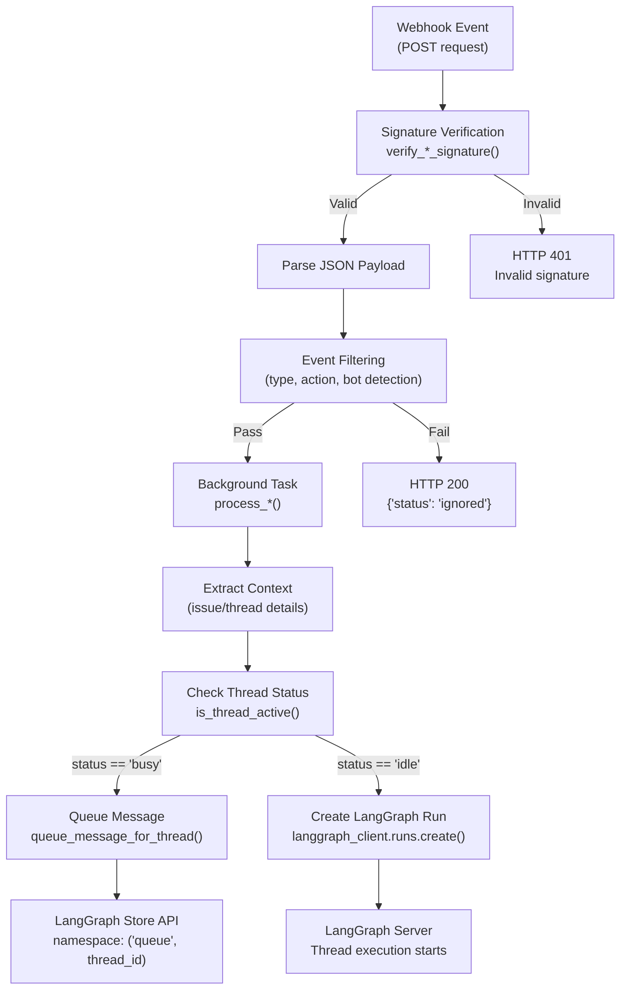

**Sources:** [agent/webapp.py:1-1376]()

---

## Webhook Endpoints and Routing

Open SWE exposes four webhook endpoints via FastAPI:

| Endpoint | HTTP Method | Purpose | Handler Function |
|----------|-------------|---------|------------------|
| `/webhooks/slack` | POST | Slack Event API callbacks | `slack_webhook` [agent/webapp.py:957-1048]() |
| `/webhooks/linear` | POST | Linear comment webhooks | `linear_webhook` [agent/webapp.py:833-948]() |
| `/webhooks/linear` | GET | Linear webhook verification | `linear_webhook_verify` [agent/webapp.py:951-954]() |
| `/webhooks/github` | POST | GitHub issue/PR webhooks | `github_webhook` [agent/webapp.py:1050-1376]() |

All endpoints are defined in the FastAPI application instance `app = FastAPI()` at [agent/webapp.py:101](). The server communicates with a LangGraph backend via `LANGGRAPH_URL` [agent/webapp.py:127-129]().

**Sources:** [agent/webapp.py:101](), [agent/webapp.py:127-129](), [agent/webapp.py:833-1376]()

---

## Signature Verification

Each webhook endpoint verifies the request signature before processing to ensure requests originate from the claimed source. Requests with invalid or missing signatures are rejected with HTTP 401.

### Verification Process by Platform

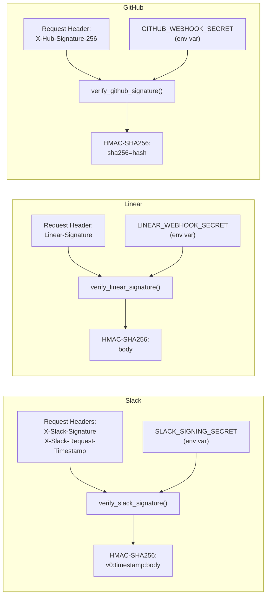

### Implementation Details

**Slack Verification** ([agent/utils/slack.py:83]()):
- Uses `X-Slack-Signature` and `X-Slack-Request-Timestamp` headers.
- Constructs base string: `v0:{timestamp}:{body_utf8}`.
- Computes HMAC-SHA256 with `SLACK_SIGNING_SECRET`.
- Rejects requests older than 300 seconds (replay protection).
- Uses constant-time comparison via `hmac.compare_digest()`.

**Linear Verification** ([agent/webapp.py:813-830]()):
- Uses `Linear-Signature` header.
- Directly computes HMAC-SHA256 of request body using `LINEAR_WEBHOOK_SECRET`.
- Uses constant-time comparison.

**GitHub Verification** ([agent/utils/github_comments.py:57]()):
- Uses `X-Hub-Signature-256` header (format: `sha256={hex}`).
- Computes HMAC-SHA256 of request body using `GITHUB_WEBHOOK_SECRET`.
- Uses constant-time comparison.

All verifications return `False` if the corresponding secret environment variable is not configured, causing the webhook to reject all requests with HTTP 401.

**Sources:** [agent/utils/slack.py:83](), [agent/webapp.py:813-830](), [agent/utils/github_comments.py:57]()

---

## Event Filtering and Validation

After signature verification, each webhook endpoint parses the JSON payload and applies platform-specific filters to determine if the event should trigger agent execution.

### Slack Event Filtering

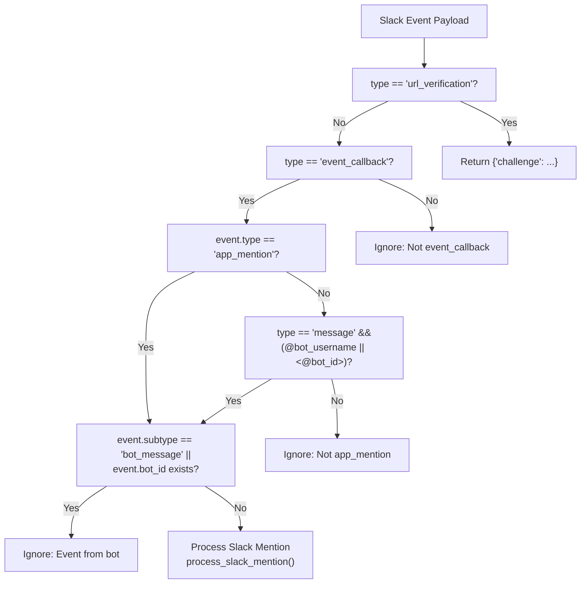

Implementation: [agent/webapp.py:979-1028]()

**Sources:** [agent/webapp.py:957-1048]()

### Linear Event Filtering

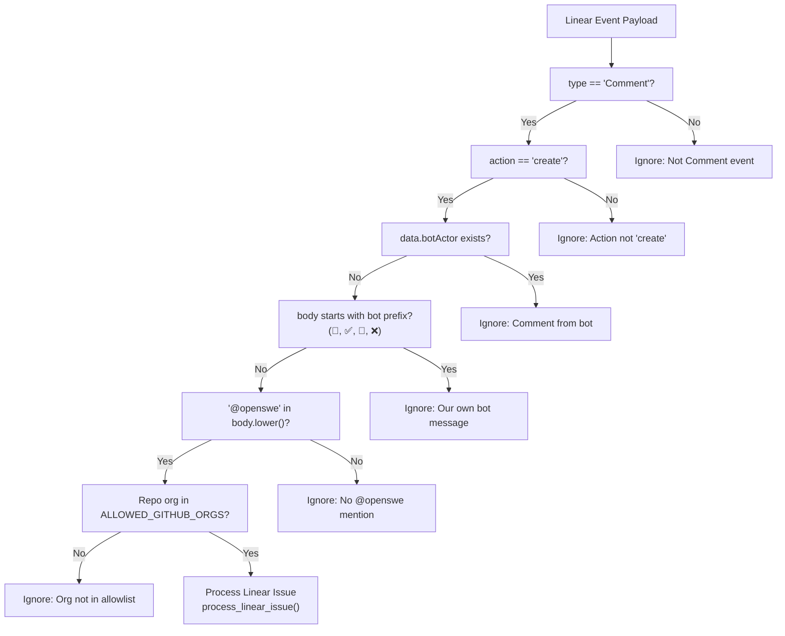

Bot message prefixes checked via `_GITHUB_BOT_MESSAGE_PREFIXES` at [agent/webapp.py:164-173]():
- `🔐 **GitHub Authentication Required**`
- `✅ **Pull Request Created**`
- `✅ **Pull Request Updated**`
- `🤖 **Agent Response**`
- `❌ **Agent Error**`

Implementation: [agent/webapp.py:855-927]()

**Sources:** [agent/webapp.py:164-173](), [agent/webapp.py:833-948]()

### GitHub Event Filtering

GitHub webhook filtering is more complex due to multiple event types (issues, issue comments, PR reviews, PR review comments).

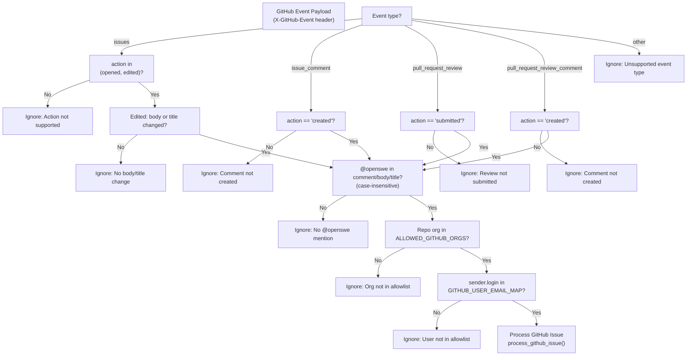

Implementation: [agent/webapp.py:1050-1376]()

**Sources:** [agent/webapp.py:1050-1376](), [agent/utils/github_user_email_map.py:1-10]()

---

## Background Task Dispatch

All three webhook endpoints use FastAPI's `BackgroundTasks` [agent/webapp.py:14]() to dispatch event processing asynchronously, allowing the webhook to return HTTP 200 immediately while processing continues in the background.

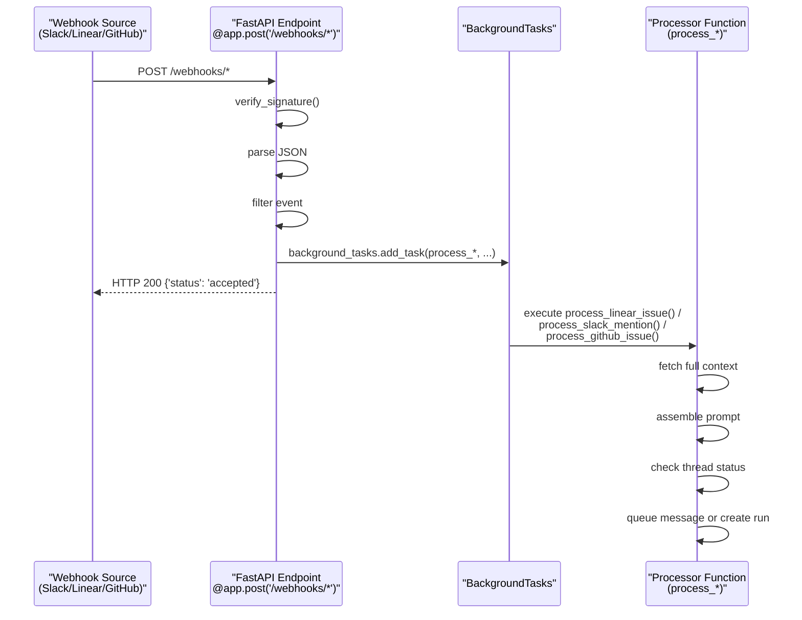

### Background Task Functions

| Platform | Background Function | Signature | File Location |
|----------|-------------------|-----------|---------------|
| Linear | `process_linear_issue()` | `(issue_data: dict, repo_config: dict)` | [agent/webapp.py:481-695]() |
| Slack | `process_slack_mention()` | `(event_data: dict, repo_config: dict)` | [agent/webapp.py:698-810]() |
| GitHub | `process_github_issue()` | `(payload: dict, event_type: str)` | [agent/webapp.py:1122-1376]() |

The background task pattern ensures webhook endpoints respond within the timeout limits imposed by external platforms (typically 3-5 seconds), preventing retries and duplicate events.

**Sources:** [agent/webapp.py:481-810](), [agent/webapp.py:1122-1376]()

---

## Thread Status Checking and Concurrency Control

Before creating a LangGraph run, the background processor checks if the thread is already active (has a running run). This prevents race conditions when multiple events arrive for the same thread.

### Thread Status Check Flow

```mermaid
graph TD
    CheckStatus["is_thread_active(thread_id)"]
    GetThread["langgraph_client.threads.get(thread_id)"]
    ThreadStatus["thread['status']"]
    
    CheckStatus --> GetThread
    GetThread -->|Success| ThreadStatus
    GetThread -->|Exception<br/>(404, timeout)| AssumeFalse["Assume status = 'idle'<br/>(thread not found or unreachable)"]
    
    ThreadStatus -->|"status == 'busy'"| ReturnTrue["Return True<br/>(thread is active)"]
    ThreadStatus -->|"status == 'idle'"| ReturnFalse["Return False<br/>(thread is idle)"]
    ThreadStatus -->|Other| ReturnFalse
    
    AssumeFalse --> ReturnFalse
```

Implementation at [agent/utils/thread_ops.py:90]():

```python
async def is_thread_active(thread_id: str) -> bool:
    """Check if a thread is currently active (has a running run)."""
    langgraph_client = get_client(url=LANGGRAPH_URL)
    try:
        thread = await langgraph_client.threads.get(thread_id)
        status = thread.get("status", "idle")
        logger.info("Thread %s status check: status=%s", thread_id, status)
    except Exception as e:
        logger.warning("Failed to get thread status for %s: assuming not active", thread_id)
        status = "idle"
    return status == "busy"
```

### Concurrency Control: Queue vs Create

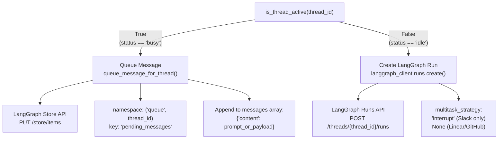

Implementation at [agent/utils/thread_ops.py:90]():

The `queue_message_for_thread()` function stores messages in the LangGraph Store API using namespace `("queue", thread_id)` and key `"pending_messages"`. The store maintains a FIFO list of queued messages. The `check_message_queue_before_model` middleware retrieves and injects these queued messages before the next LLM invocation.

**Sources:** [agent/utils/thread_ops.py:90](), [agent/webapp.py:665-695](), [agent/webapp.py:801-810]()

---

## Context Assembly and Prompt Construction

Each background processor fetches additional context from external APIs and constructs a prompt tailored to the invocation source.

### Linear Context Assembly

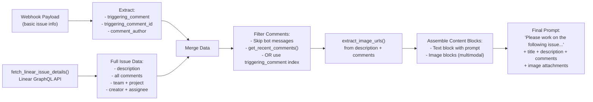

Implementation at [agent/webapp.py:481-641]():

Key details:
- Webhook payload contains minimal issue info; `fetch_linear_issue_details()` retrieves full context via GraphQL.
- Recent comments are filtered using `get_recent_comments()` at [agent/utils/comments.py:40]() to exclude bot responses.
- If `triggering_comment_id` is provided, all comments from that index onwards are included [agent/webapp.py:564-573]().
- Image URLs are extracted from Markdown content via `extract_image_urls()` and fetched as multimodal content blocks via `fetch_image_block()` [agent/utils/multimodal.py:64]().

**Sources:** [agent/webapp.py:481-641](), [agent/utils/comments.py:40](), [agent/utils/multimodal.py:64]()

### Slack Context Assembly

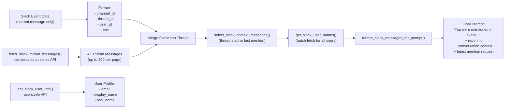

Implementation at [agent/webapp.py:698-784]():

Key details:
- `select_slack_context_messages()` determines whether to include the full thread or only messages since the last bot mention [agent/utils/slack.py:79]().
- User IDs are batch-resolved to display names via `get_slack_user_names()` [agent/utils/slack.py:72]().
- Bot mentions are replaced with bot usernames for readability via `strip_bot_mention()` [agent/utils/slack.py:82]().

**Sources:** [agent/webapp.py:698-784](), [agent/utils/slack.py:72-82]()

### GitHub Context Assembly

```mermaid
graph LR
    PayloadData["Webhook Payload"]
    ExtractPR["extract_pr_context()<br/>(repo, PR number, branch, login)"]
    
    PayloadData --> EventType["Event Type:<br/>- issue_comment<br/>- pull_request_review<br/>- pull_request_review_comment"]
    
    EventType -->|issue_comment<br/>on PR| FetchBranch["fetch_pr_branch()<br/>(GitHub API)"]
    EventType -->|PR review events| DirectBranch["Branch from<br/>payload.pull_request.head.ref"]
    
    FetchBranch --> Branch["Branch Name<br/>(for thread ID)"]
    DirectBranch --> Branch
    
    Branch --> ThreadID["get_thread_id_from_branch()<br/>(UUID extraction)"]
    ThreadID --> ExistingThread["Thread Exists?<br/>_thread_exists()"]
    
    ExistingThread -->|No| FetchIssue["fetch_issue_comments()<br/>(all comments)"]
    ExistingThread -->|Yes| FetchRecent["fetch_pr_comments_since_last_tag()<br/>(comments since last @openswe)"]
    
    FetchIssue --> BuildPrompt["build_github_issue_prompt()<br/>(full issue context)"]
    FetchRecent --> BuildFollowup["build_github_issue_followup_prompt()<br/>(just the new comment)"]
    
    BuildPrompt --> Prompt["Final Prompt"]
    BuildFollowup --> Prompt
```

Implementation at [agent/webapp.py:1122-1376]():

Key details:
- For PR-related events, thread ID is extracted from the branch name using `get_thread_id_from_branch()` [agent/utils/github_comments.py:53]().
- For new threads, `fetch_issue_comments()` retrieves all comments [agent/utils/github_comments.py:50]().
- For existing threads, `fetch_pr_comments_since_last_tag()` fetches only comments since the previous `@openswe` mention [agent/utils/github_comments.py:51]().
- Comments from untrusted users (not in `GITHUB_USER_EMAIL_MAP`) are wrapped in warning tags via `format_github_comment_body_for_prompt()` [agent/utils/github_comments.py:52]().

**Sources:** [agent/webapp.py:1122-1376](), [agent/utils/github_comments.py:50-53](), [agent/utils/github_user_email_map.py:1-10]()

---

## LangGraph Run Creation

After assembling the prompt and checking thread status, the processor creates a LangGraph run via the `langgraph_client.runs.create()` API.

### Run Configuration Structure

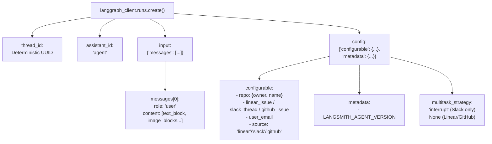

### Configurable Fields by Source

| Field | Linear | Slack | GitHub |
|-------|--------|-------|--------|
| `repo` | `{owner, name}` from team mapping | `{owner, name}` from message or thread metadata | `{owner, name}` from webhook payload |
| `source` | `"linear"` | `"slack"` | `"github"` |
| `user_email` | Comment author or assignee email | Slack user profile email | Mapped via `GITHUB_USER_EMAIL_MAP` |

Implementation examples:
- Linear: [agent/webapp.py:650-693]()
- Slack: [agent/webapp.py:787-810]()
- GitHub: [agent/webapp.py:1311-1376]()

### Multitask Strategy

Only Slack uses `multitask_strategy="interrupt"` [agent/webapp.py:809](), which tells LangGraph to interrupt any currently running task on the thread and start the new one immediately. Linear and GitHub use the default strategy (queue the run if thread is busy), relying on the message queueing system.

**Sources:** [agent/webapp.py:650-693](), [agent/webapp.py:787-810](), [agent/webapp.py:1311-1376]()

---

## Error Handling and Edge Cases

### Signature Verification Failures

All endpoints reject requests with invalid or missing signatures with HTTP 401 [agent/webapp.py:846-847](), [agent/webapp.py:970-971]():

```python
if not verify_*_signature(...):
    logger.warning("Invalid webhook signature")
    raise HTTPException(status_code=401, detail="Invalid signature")
```

### Missing Environment Variables

If webhook secrets are not configured, the verification functions return `False` and log a warning:
- Slack: [agent/utils/slack.py:83]()
- Linear: [agent/webapp.py:813-830]()
- GitHub: [agent/utils/github_comments.py:57]()

This ensures the system fails closed (rejects all webhooks) rather than accepting unverified requests.

### API Failures During Context Fetching

If external API calls fail during context assembly (e.g., Linear GraphQL, Slack users.info, GitHub API), the processors fall back gracefully:

- **Linear**: If GraphQL details fail, the system logs the error and continues with available data [agent/webapp.py:481-641]().
- **Slack**: If `get_slack_user_info()` fails, the system handles it via logging and fallback [agent/utils/slack.py:71]().
- **GitHub**: If `fetch_issue_comments()` fails, it returns an empty list [agent/utils/github_comments.py:50]().

### Thread Creation Race Conditions

When multiple events arrive simultaneously for a new thread, the `if_not_exists="create"` parameter ensures only one thread is created [agent/webapp.py:693](). Subsequent events detect the thread exists and queue their messages.

**Sources:** [agent/webapp.py:481-693](), [agent/utils/slack.py:71-83](), [agent/utils/github_comments.py:50-57]()

---

## Complete Flow Example: Linear Webhook

This diagram shows the complete request flow for a Linear issue comment webhook:

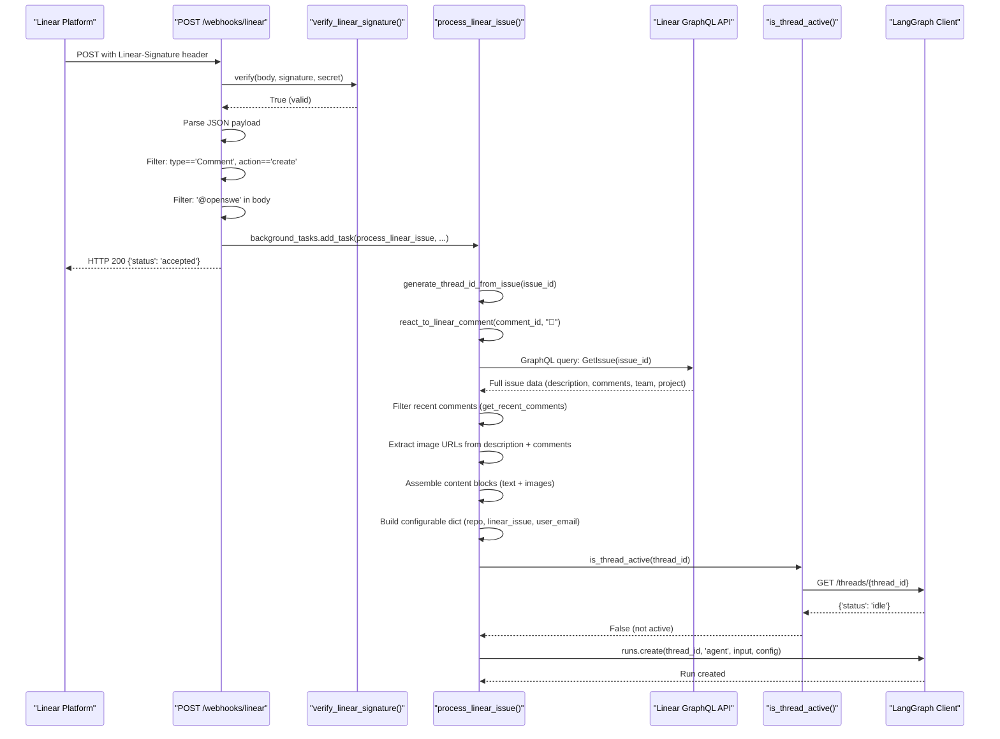

**Sources:** [agent/webapp.py:833-948](), [agent/webapp.py:481-695]()

---

