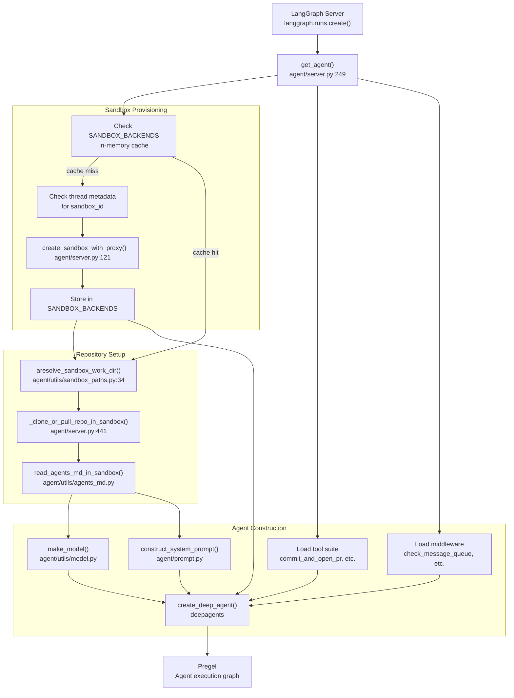
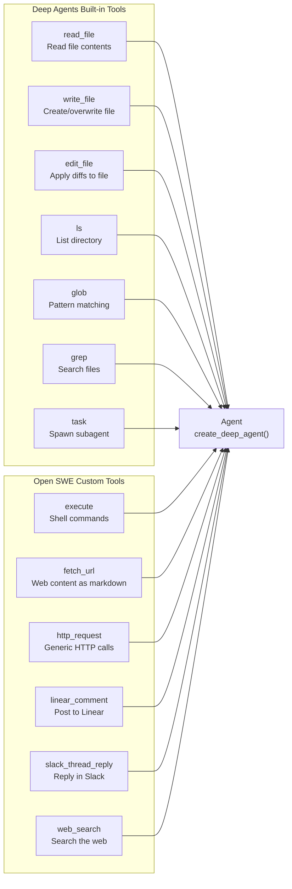
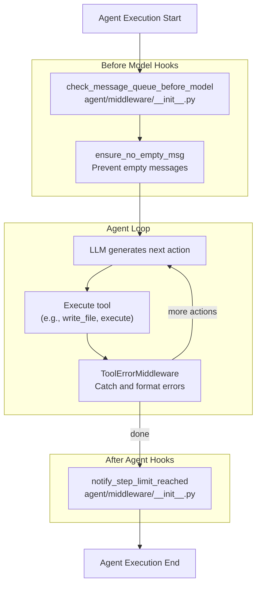
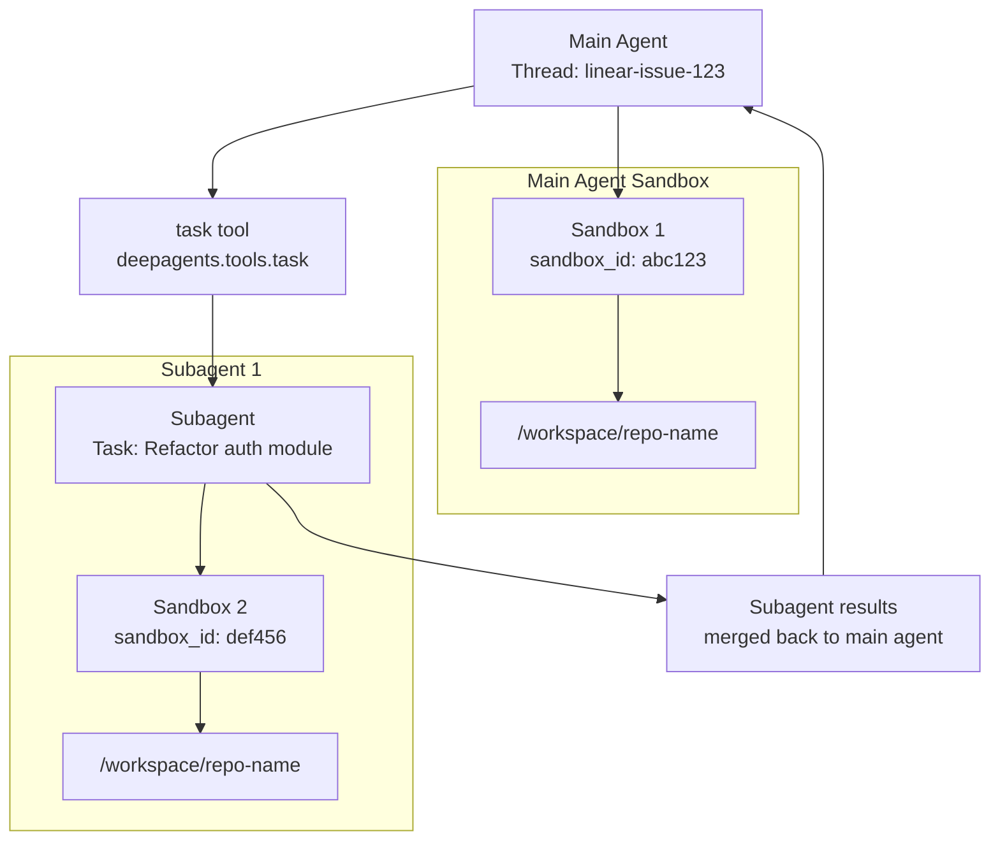
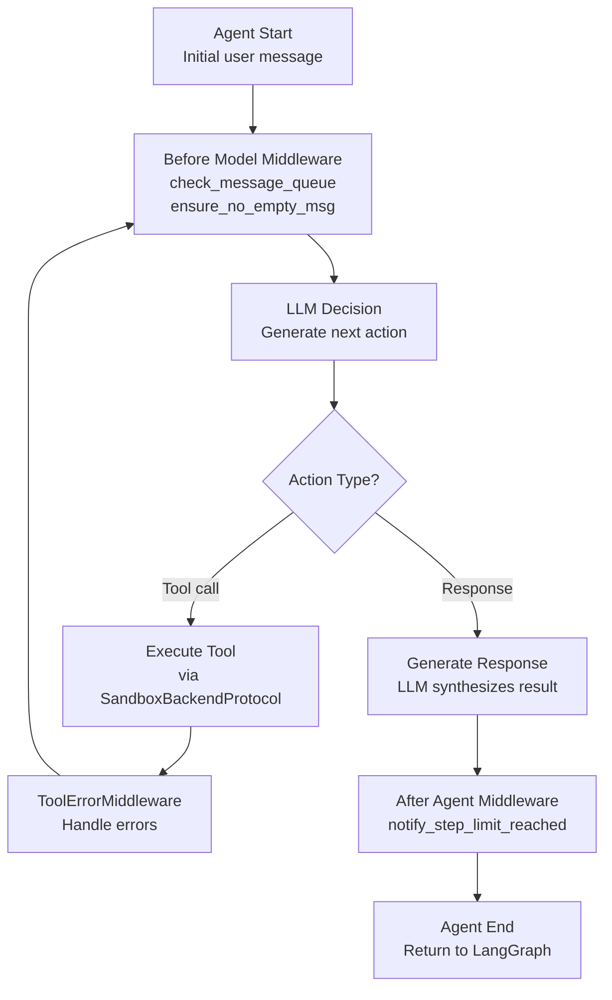

<!-- source: DeepWiki mcp.deepwiki.com · repo langchain-ai/open-swe · page 3 Agent Core · fetched 2026-10-26 -->

# Agent Core

Relevant source files

The following files were used as context for generating this wiki page:

- [CUSTOMIZATION.md](CUSTOMIZATION.md)
- [INSTALLATION.md](INSTALLATION.md)
- [README.md](README.md)
- [agent/server.py](agent/server.py)
- [agent/tools/__init__.py](agent/tools/__init__.py)

The Agent Core is the internal architecture of the agent itself—how it is assembled, what components it uses, and how it executes tasks. This page documents the `create_deep_agent` function and the modular components that make up the agent: models, tools, middleware, and subagent orchestration.

For information about how agents are triggered, see [Invocation Surfaces](#2). For sandbox execution environments, see [Sandbox Execution](#4). For context engineering via AGENTS.md, see [Context Engineering](#5).

---

## Agent Assembly

The agent is assembled in the `get_agent()` function in [agent/server.py:249-376](). This function is called by the LangGraph server whenever a new task is triggered via webhook. It provisions a sandbox, constructs the system prompt, and passes all components to `create_deep_agent()` from the Deep Agents framework.

### Agent Assembly Flow

**Sources:** [agent/server.py:249-376](), [agent/server.py:121-140](), [agent/server.py:441-525](), [agent/utils/sandbox_paths.py:34-56](), [agent/utils/sandbox_state.py:15-16]()

### The `get_agent()` Function

The `get_agent()` function follows this sequence:

1. **Extract configuration** from `RunnableConfig.configurable`:
   - `thread_id`: Unique identifier for the conversation thread. [agent/server.py:257]()
   - `repo`: `{"owner": "...", "name": "..."}` identifying the GitHub repository. [agent/server.py:261]()
   - `user_email`: Triggering user's email for GitHub OAuth resolution. [agent/server.py:262]()

2. **Provision sandbox**: Check `SANDBOX_BACKENDS` cache. If not found, check thread metadata for `sandbox_id`. If present, reconnect. Otherwise, create new sandbox via `_create_sandbox_with_proxy()`. [agent/server.py:273-305]()

3. **Set up repository**: Resolve working directory and clone or pull the repository via `_clone_or_pull_repo_in_sandbox()`. [agent/server.py:321-325]()

4. **Read context**: Read `AGENTS.md` from sandbox if it exists. [agent/server.py:330]() Assemble source context from Linear issue, Slack thread, or GitHub PR.

5. **Construct agent**: Call `create_deep_agent()` with model, system prompt, tools, sandbox backend, and middleware. [agent/server.py:356-364]()

6. **Store metadata**: Persist `sandbox_id`, encrypted GitHub token, and repository directory in thread metadata for reuse. [agent/server.py:366-373]()

**Sources:** [agent/server.py:249-376]()

---

## Model Configuration

The model is configured via the `make_model()` helper in [agent/utils/model.py]() and passed to `create_deep_agent()`. The default configuration typically uses reasoning-enabled models.

### Model Selection

The `make_model()` function wraps `langchain.chat_models.init_chat_model`. For OpenAI models, it automatically enables specific reasoning kwargs if supported. [agent/utils/model.py:73-79]()

| Provider | Example | Notes |
|----------|---------|-------|
| OpenAI | `"openai:gpt-4o"` | Default with reasoning effort [agent/server.py:73-79]() |
| Anthropic | `"anthropic:claude-3-5-sonnet-latest"` | Supported via `LLM_MODEL_ID` [CUSTOMIZATION.md:140]() |

### Dynamic Model Selection

The `get_agent()` function can route to different models based on user profiles or team settings. [agent/server.py:35-42]()

**Sources:** [agent/server.py:73-79](), [agent/utils/model.py](), [CUSTOMIZATION.md:134-162]()

---

## Tool System

The agent has access to two categories of tools: **Deep Agents built-ins** (inherited from the framework) and **Open SWE custom tools** (defined in [agent/tools/]()).

### Tool Categories

**Sources:** [agent/server.py:55-69](), [agent/tools/__init__.py:1-37]()

### Built-in Tools from Deep Agents

These tools are inherited automatically when calling `create_deep_agent()`:

| Tool | Purpose | Implementation |
|------|---------|----------------|
| `read_file` | Read file contents from sandbox | `SandboxBackendProtocol.read()` |
| `write_file` | Create or overwrite file | `SandboxBackendProtocol.write()` |
| `edit_file` | Apply diffs to existing file | `SandboxBackendProtocol.edit()` |
| `ls` | List directory contents | `SandboxBackendProtocol.ls_info()` |
| `glob` | Pattern-based file search | `SandboxBackendProtocol.glob_info()` |
| `grep` | Search file contents | `SandboxBackendProtocol.grep_raw()` |
| `task` | Spawn subagent for subtask | Deep Agents orchestration |

### Custom Tools in Open SWE

Custom tools are defined in [agent/tools/]() and registered in the `get_agent()` function. [agent/server.py:336-354]()

#### Sandbox Shell Access

The `execute` tool allows the agent to run arbitrary shell commands within the isolated environment. This is used for running tests, linters, and the `gh` CLI.

#### Other Custom Tools

| Tool | File | Purpose |
|------|------|---------|
| `fetch_url` | [agent/tools/fetch_url.py]() | Fetch web pages as markdown. |
| `http_request` | [agent/tools/http_request.py]() | Generic HTTP API calls. |
| `linear_comment` | [agent/tools/linear_comment.py]() | Post status updates to Linear. |
| `slack_thread_reply` | [agent/tools/slack_thread_reply.py]() | Reply in Slack threads. |
| `web_search` | [agent/tools/web_search.py]() | Perform web searches for external context. |

**Sources:** [agent/server.py:55-69](), [agent/tools/__init__.py:1-37]()

---

## Middleware System

Middleware hooks run around the agent loop at specific lifecycle points. Open SWE uses several middleware components to extend agent behavior.

### Middleware Execution Flow

**Sources:** [agent/server.py:44-53](), [README.md:91-96]()

### Middleware Components

| Middleware | Type | Source | Purpose |
|------------|------|------|---------|
| `ToolErrorMiddleware` | Tool error handler | [agent/server.py:49]() | Catches and handles tool errors gracefully. |
| `check_message_queue_before_model` | `@before_model` | [agent/server.py:50]() | Injects follow-up messages (Slack/Linear) mid-run. |
| `ensure_no_empty_msg` | `@before_model` | [agent/server.py:51]() | Prevents empty messages from reaching the model. |
| `notify_step_limit_reached` | `@after_agent` | [agent/server.py:52]() | Posts a Slack reply when the agent hits the model-call limit. |
| `ModelFallbackMiddleware` | `@after_model` | [agent/server.py:45]() | Handles model-specific failures by retrying with fallbacks. |

**Sources:** [agent/server.py:44-53]()

---

## Subagent Orchestration

The `task` tool from Deep Agents enables spawning child agents for parallel work decomposition. Each subagent runs in its own isolated sandbox with independent middleware and state.

### Subagent Architecture

When the main agent calls the `task` tool, Deep Agents creates a new agent instance with the same configuration. The subagent provisions its own isolated sandbox and clones the repository independently, allowing for parallelized execution without file-system conflicts.

**Sources:** [README.md:87-89]()

---

## Agent Execution Loop

Once assembled, the agent executes as a Pregel graph managed by LangGraph. The core loop alternates between LLM decision-making and tool execution until the task is complete.

### Execution Flow

**Sources:** [agent/server.py:29-53](), [README.md:91-96]()

### State Management

The agent maintains state in a LangGraph `StateGraph`:
- **Messages**: Conversation history including user messages, tool calls, and tool results.
- **Metadata**: Thread ID, sandbox ID, repository configuration, and authentication tokens. [agent/server.py:366-373]()

State is persisted via LangGraph checkpoints, allowing the agent to resume if interrupted or when follow-up messages arrive.

**Sources:** [agent/server.py:13-16](), [agent/server.py:366-373]()

---

