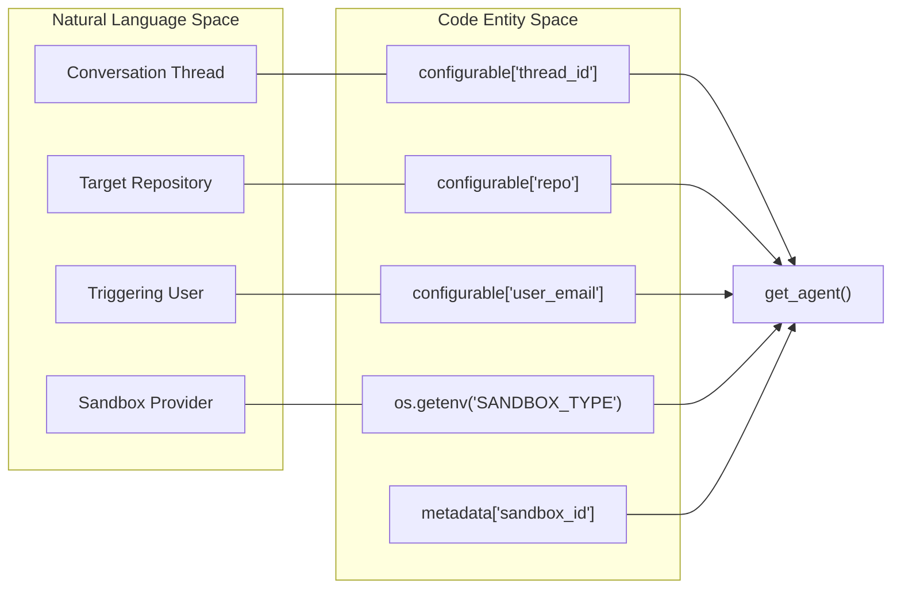
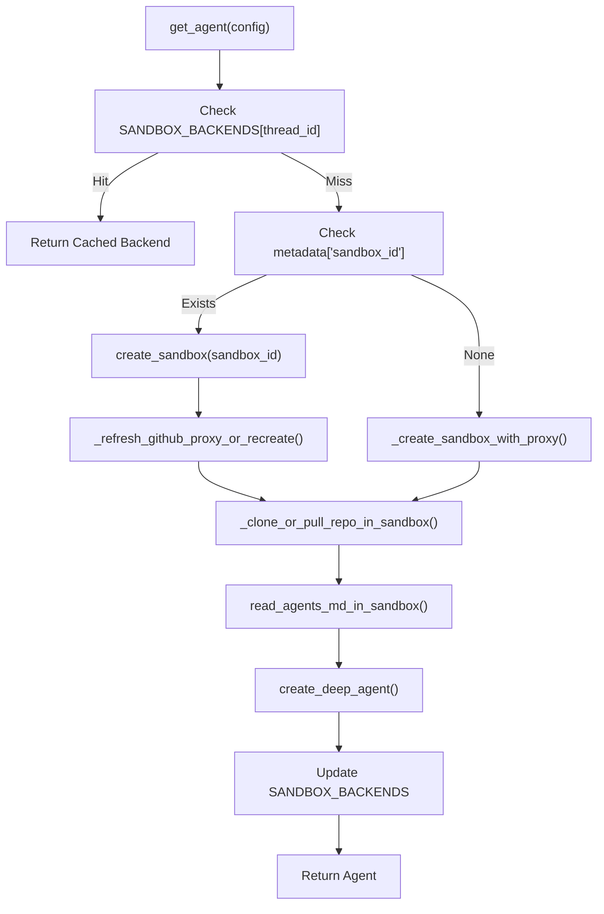

<!-- source: DeepWiki mcp.deepwiki.com · repo langchain-ai/open-swe · page 3.1 Agent Assembly · fetched 2026-10-26 -->

# Agent Assembly

<details>
<summary>Relevant source files</summary>

The following files were used as context for generating this wiki page:

- [agent/integrations/langsmith.py](agent/integrations/langsmith.py)
- [agent/server.py](agent/server.py)
- [agent/tools/__init__.py](agent/tools/__init__.py)
- [pyproject.toml](pyproject.toml)
- [uv.lock](uv.lock)

</details>


This page documents how the Open SWE agent is assembled from modular components in the `get_agent()` factory function. Agent assembly is the process of configuring and instantiating a `deepagents` instance with the appropriate model, system prompt, tools, sandbox backend, and middleware stack for a specific task.

---

## Overview

Agent assembly occurs in the `get_agent()` function at [agent/server.py:249-376](). This function serves as the central factory that:

1.  **Reads configuration** from `RunnableConfig` passed by the LangGraph server [agent/server.py:255-264]().
2.  **Provisions or reconnects** to a sandbox environment using `create_sandbox` [agent/server.py:275-295]().
3.  **Constructs the system prompt** with repository context and `AGENTS.md` guidelines [agent/server.py:324-328]().
4.  **Assembles a Deep Agents instance** via `create_deep_agent` [agent/server.py:322-328]().
5.  **Caches the sandbox backend** for reuse in the `SANDBOX_BACKENDS` global dictionary to maintain state across turns [agent/server.py:330-332]().

The function is called once per thread when the LangGraph server creates a new run. For follow-up messages on the same thread, the cached sandbox is reused, maintaining the filesystem and git state.

**Sources:** [agent/server.py:249-376](), [agent/utils/sandbox_state.py:90-94](), [agent/server.py:29-29]()

---

## The Factory Pattern

The `get_agent()` function follows a deterministic assembly pattern that separates infrastructure concerns from agent logic:

| Phase | Responsibility | Code Entity |
| :--- | :--- | :--- |
| **Configuration extraction** | Read thread ID, repo, and user identity | `configurable` from `RunnableConfig` [agent/server.py:255-264]() |
| **Sandbox provisioning** | Create or reconnect to isolated environment | `create_sandbox` [agent/utils/sandbox.py:80-80]() |
| **Context gathering** | Load repository and `AGENTS.md` | `_clone_or_pull_repo_in_sandbox` [agent/server.py:408-485]() |
| **Component assembly** | Configure model, tools, and middleware | `make_model` [agent/utils/model.py:77-77](), `tools` list [agent/server.py:310-315]() |
| **Instance creation** | Invoke framework factory | `create_deep_agent` [agent/server.py:29-29]() |
| **Caching** | Store sandbox for thread reuse | `SANDBOX_BACKENDS` [agent/utils/sandbox_state.py:90-94]() |

**Sources:** [agent/server.py:249-376](), [agent/utils/sandbox.py:80-80](), [agent/utils/model.py:77-77]()

---

## Configuration Sources

The `get_agent()` function reads configuration from three primary sources to drive assembly:

Title: Configuration to Code Entity Mapping


### RunnableConfig Structure

The LangGraph server passes a `RunnableConfig` dictionary. The `configurable` field contains task-specific parameters:

```python
{
    "configurable": {
        "thread_id": "linear-issue-PROJ-123",  # Deterministic ID
        "repo": {"owner": "my-org", "name": "my-repo"},  # Target repository
        "source": "linear",  # Invocation surface (slack, linear, github)
        "user_email": "user@example.com",
    },
    "metadata": {
        "sandbox_id": "abc123xyz",  # Persisted sandbox identifier for reconnection
    }
}
```

The `thread_id` serves as the cache key for sandbox backends in `SANDBOX_BACKENDS` [agent/server.py:276-277]().

**Sources:** [agent/server.py:255-264](), [agent/utils/sandbox_state.py:90-94]()

---

## Component Assembly

The `get_agent()` function assembles core components into the `create_deep_agent` constructor.

### Model Configuration
The model is instantiated via `make_model()` [agent/utils/model.py:77-77](). It defaults to the ID defined in `DEFAULT_MODEL_ID` [agent/dashboard/options.py:10-10](), typically `anthropic:claude-3-5-sonnet-latest`.

### System Prompt Construction
The prompt is assembled by `construct_system_prompt()` [agent/prompt.py:54-54](), which combines:
1.  **Base instructions**: Working environment and coding standards.
2.  **AGENTS.md content**: Repository-specific rules read via `read_agents_md_in_sandbox` [agent/server.py:323-323]().
3.  **Source context**: External issue or thread details (e.g., Slack history or Linear issue description).

### Tool Registration
Tools are registered as a list [agent/server.py:310-315](). Open SWE includes custom tools like `slack_thread_reply` [agent/tools/slack_thread_reply.py:15-15]() and `linear_comment` [agent/tools/linear_comment.py:23-23]().

### Middleware Stack
Middleware hooks wrap the agent loop to provide safety and observability [agent/server.py:316-321]():
- `ToolErrorMiddleware`: Formats execution errors for the LLM.
- `check_message_queue_before_model`: Injects queued events [agent/middleware/message_queue.py:50-50]().
- `SanitizeToolInputsMiddleware`: Cleans LLM-generated tool arguments.

**Sources:** [agent/server.py:310-328](), [agent/prompt.py:54-54](), [agent/middleware/__init__.py:44-53]()

---

## Sandbox Lifecycle Management

Title: get_agent() Lifecycle Logic


### Sandbox Reconnection
If a `sandbox_id` exists in metadata, the agent reconnects to the existing environment [agent/server.py:284-288](). For LangSmith sandboxes, the system refreshes GitHub proxy credentials via `_refresh_github_proxy_or_recreate` to ensure continued authentication [agent/server.py:162-177]().

### Repository Initialization
The repository is managed via `_clone_or_pull_repo_in_sandbox` [agent/server.py:408-485](). 
- If the directory is missing, it performs a `git clone` [agent/server.py:471-485]().
- If the directory exists and is clean, it performs a `git pull` [agent/server.py:449-469]().
- If there are uncommitted changes, it skips the pull to avoid merge conflicts [agent/server.py:445-447]().

**Sources:** [agent/server.py:408-485](), [agent/server.py:275-295](), [agent/integrations/langsmith.py:126-170]()

---

## GitHub Proxy Authentication

When using LangSmith sandboxes, `_create_sandbox_with_proxy` [agent/server.py:121-139]() configures a proxy to inject GitHub credentials. This allows `git` operations (clone, pull, push) inside the sandbox to succeed without storing permanent tokens on the sandbox disk.

The `_configure_github_proxy` function [agent/integrations/langsmith.py:98-124]() sets up `proxy_config` rules that match `github.com` and inject an `Authorization` header derived from the GitHub App installation token.

**Sources:** [agent/server.py:121-139](), [agent/integrations/langsmith.py:98-124](), [agent/utils/github_app.py:72-72]()

---

